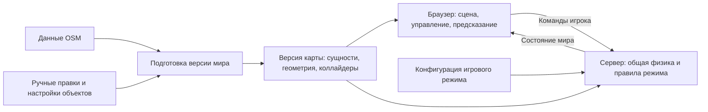

# Контекст проекта Syktyvkar Underground

Актуализировано 11 ноября 2026 года. Рабочее название соответствует имени репозитория. Пользователь принял **Babylon.js + Havok + Colyseus, TypeScript и Vite** как основу текущего этапа. Стадия — проектирование первого сетевого MVP; реализация и нагрузочная проверка ещё предстоят.

Подробное устройство компонентов и целевое дерево репозитория описаны в [архитектуре](docs/architecture.md). Актуальный объём v0.1 и критерии готовности — в [спецификации технодемо](docs/mvp-network-playground.md), задачи и технические проверки — в [плане разработки](docs/mvp-delivery-plan.md).

Проект — браузерная многопользовательская игра в узнаваемом Сыктывкаре. Объёмный город показывается изометрической камерой; игроки бегают своими персонажами, сталкиваются с препятствиями и взаимодействуют с физическими объектами. Общая карта должна стать основой для разных игровых режимов. Цель развития — **до 50 игроков одновременно в одном общем мире**. Первая технодемо по решению пользователя проверяется на **8 клиентах**.

## Требования из обсуждений

Эти требования сформулировал пользователь в [исследовании игровой архитектуры](pre-search.md).

| Требование | Следствие для проекта | Где зафиксировано |
|---|---|---|
| Браузерная игра с изометрической 3D-картой Сыктывкара | Браузер — основная платформа; география должна оставаться узнаваемой | Строки 3–7 |
| Каждый объект можно отдельно настраивать; сквозь препятствия нельзя проходить | Объектам нужны идентичность, свойства и представление для столкновений | Строка 5 |
| Игроки имеют собственных персонажей; поверх общей карты появятся разные режимы | Мир, персонажи и правила режимов должны быть разделены | Строка 5 |
| Архитектуру игры выбираем заново, без привязки к старой карте | HTML служит исследовательским артефактом и источником данных | Строки 2629–2631 |
| Нужен актуальный специализированный игровой движок | Удобство развития игровых функций важнее сохранения старого рендерера | Строка 2631 |
| Основная разработка — в коде, через Codex и Claude; далее уточнён VS Code | Визуальный редактор не должен быть обязательным звеном разработки | Строки 5137–5139, 7267 |
| Игра должна быть лёгкой, без лишних тяжёлых модулей | Измеряем загрузку и стоимость реально используемых систем | Строка 5139 |
| Полноценная физика нужна для будущих прыжков, мостов, толкания и транспорта | Проектируем объёмную симуляцию, позволяющую развивать эти механики | Строка 7265 |
| Несколько игроков существуют в одном общем мире; важна отзывчивость | Общая физика и согласование состояния входят в раннюю проверку | Строка 13398 |
| До 50 игроков одновременно | Проверяем и распределение по карте, и скопление всех игроков рядом | Ответ пользователя в строках 16734–16736 |

Предположение о первых игроках — автор и знакомые, которым можно отправить ссылку. Это следует из раннего сценария распространения карты; аудитория самой игры, её жанр, основной игровой цикл и монетизация пока не определены.

## Как развивалась идея

[Первое исследование](pre-pre-search.md) началось с Brno2000 как визуального ориентира. В нём описана карта на OpenSeadragon с заранее подготовленными DZI/WebP-тайлами и отдельными анимациями. Найденный открытый проект izomapa показывает маршрут от геоданных через 3D-сцену к готовым изображениям и тайлам.

Для Сыктывкара затем собрали иной по устройству прототип: **живую 3D-сцену на Three.js**, встроенную вместе с данными в один HTML. Центр участка пользователь задал на кольце Коммунистической улицы и Октябрьского проспекта — это уточнение находится в строке 5580 первого исследования.

Во втором обсуждении цель расширилась до сетевой игры. После уточнений о разработке в коде и развитой физике основными кандидатами стали Babylon.js и PlayCanvas Engine. Последняя рекомендация исследования — **Babylon.js + Havok + Colyseus**. После формирования контекста пользователь принял этот стек для текущего этапа и поручил сформулировать небольшой сетевой полигон и его архитектуру.

Сценарий «один HTML без бэкенда» относится к просмотру карты. Общему игровому миру потребуется работающий игровой сервер. Brno2000 остаётся ориентиром по представлению города; техническая архитектура игры определяется требованиями к взаимодействиям.

## Что уже есть в репозитории

Два Markdown-файла содержат историю исследований, включая выводы, уточнения и журналы инструментов. [syktyvkar-offline.html](data/syktyvkar-offline.html) — собранный автономный прототип «Сыктывкар · Вокруг кольца». Отдельных исходников приложения, сборочного проекта и сервера в текущем наборе файлов нет.

Следующие характеристики подтверждены статическим разбором HTML и встроенного объекта данных `u3`:

| Характеристика | Значение |
|---|---|
| Размер HTML | 3 422 740 байт, около 3,42 МБ |
| Рендерер | Встроенный Three.js r170 |
| Камера | Ортографическая, с масштабированием, перемещением и поворотом ракурса |
| Территория | Квадрат 2,3 × 2,3 км вокруг кольца |
| Центральная точка | 61.6638673° N, 50.8159518° E |
| Дата снимка, указанная в данных | 2026-11-11 |
| Записи зданий | 1 673 |
| Уникальные значения OSM-ID зданий | 1 668 |
| Записи с указанной этажностью | 1 516 |
| Источник высоты модели | 85 — высота из OSM; 1 438 — расчёт по этажности; 150 — типовая оценка |
| Дополнительные данные | 4 802 записи дорог/дорожек, 2 915 участков поверхности, 1 174 декоративных дерева, 47 записей именованных улиц |

Количество записей дорог и поверхности описывает структуру подготовленных данных, а не количество уникальных улиц или парков города. Ранняя проба из первого исследования — 2 307 объектов в радиусе 1,5 км — относится к другой выборке и не характеризует этот HTML.

В прототипе реализованы поиск внутри участка, выбор здания и карточка, лето/осень/зима, дневное и ночное освещение, декоративное движение машин, возврат к кольцу и выгрузка данных карты в JSON. Код и ресурсы просмотра встроены; переходы в OpenStreetMap требуют интернета. Историческая проверка интерфейса описана в первом исследовании, текущая сверка выполнена по содержимому файла.

Рельеф плоский, высоты частично оценочные, оформление условное. Поля крыш и цветов в данных не означают точного воспроизведения каждого здания. Деревья и машины декоративные. Управляемых персонажей, игровой физики, сетевой синхронизации, сохранения игрового состояния и игровых режимов ещё нет.

### Что можно использовать дальше

Полезны геометрия участка, адреса, связь с OSM, сведения об этажности и происхождении высот, а также визуальный ориентир по масштабу города. В записи здания уже есть `id`, `name`, `address`, `type`, контуры `p`, центр `c`, высота `h`, `levels` и `heightSource`.

**OSM-ID нельзя непосредственно считать уникальным идентификатором игровой сущности.** Пять значений повторяются по два раза: `way/56396223`, `way/85585776`, `way/1326450837`, `way/1343551210`, `way/1422653487`. При импорте нужно определить смысл этих частей и сформировать устойчивый `entityId`, сохранив OSM-ID как ссылку на источник. Причина повторов требует отдельной проверки геометрии.

Рендерер объединяет здания в общую геометрию, сохраняя индекс записи в атрибуте `buildingId` для выбора по клику. Это полезное различие для будущей игры: самостоятельность игровой сущности совместима с объединением геометрии для быстрой отрисовки.

## Принятый стек и вспомогательные инструменты

Ядро стека принято пользователем. Конкретные версии и вспомогательные инструменты фиксируются при сборке первого запускаемого основания.

| Часть | Решение | Основание и следующая проверка |
|---|---|---|
| Язык и сборка | TypeScript + Vite | Разработка в коде; общие типы клиента и сервера |
| Игровой клиент | Babylon.js | Документированные игровые системы, физика, контроллер персонажа и средства отладки |
| Физика | Havok через интеграцию Babylon.js | Проверить нужные механики, запуск серверной симуляции и согласование с клиентом |
| Игровой сервер и сеть | Node.js + Colyseus | Комнаты и синхронизация; правила и симуляцию реализуем в проекте |
| Интерфейс | HTML/CSS с минимально необходимым кодом | UI-фреймворк можно выбрать при появлении соответствующей сложности |
| Подготовка карты | Отдельный процесс импорта OSM и ручных правок | Python и геометрические библиотеки — возможный маршрут из исследования |

**PlayCanvas Engine + Ammo.js** остаётся в истории исследования как ближайшая альтернатива. Параллельная реализация на нём не входит в текущий план. К сравнению возвращаемся при подтверждённом существенном ограничении выбранного стека. Поддержку транспорта нельзя считать готовой только по факту подключения физической библиотеки.

Three.js остаётся технологией старого прототипа и вариантом с большим объёмом собственной игровой инфраструктуры. Godot отошёл на второй план после выбора разработки преимущественно в коде через агентов; это предпочтение процесса, а не доказательство невозможности работы с ним. Phaser и подход с заранее отрисованными тайлами не стали финалистами после уточнения требований к 3D-взаимодействиям.

Версии движков и статистика GitHub в исследовании не являются зафиксированным набором зависимостей. При проектировании архитектуры сверены официальные материалы о NullEngine, Havok и сетевых механизмах Colyseus 0.18. Перед реализацией нужно выбрать совместимые точные версии и проверить запуск физики и её согласование с клиентом; документация не заменяет этот тест.

## Рабочая архитектура

Предлагается разделить подготовку карты, игровую симуляцию и отображение. Мир и его правила должны быть доступны серверу независимо от браузерных графических объектов.

Основные принципы предлагаемой реализации:

- **Сервер определяет итоговое состояние.** Клиент передаёт команды движения и действий, сервер проверяет их и считает столкновения. Собственное движение отображается с предсказанием и последующим согласованием; чужое — со сглаживанием полученных состояний.
- **Один общий мир начинается с одной серверной симуляции.** В терминах Colyseus это одна выделенная комната города. Простое добавление процессов не распределяет физику одной комнаты. Дополнительные экземпляры карты не выполняют требование общего мира сами по себе.
- **Сущность, внешний вид и физическая форма разделены.** У объекта есть устойчивый ID, свойства, визуальная модель и упрощённая форма для столкновений. Их детализация может различаться.
- **География, ручные изменения и режимы разделены.** Повторный импорт OSM должен сохранять игровые проходы и правки. Режим добавляет правила, цели и точки появления поверх мира. Способ сосуществования разных режимов ещё предстоит выбрать.
- **Клиент и сервер согласуют версию мира.** Видимый проход должен совпадать с проходом в серверной геометрии столкновений.
- **Загрузка карты и сетевые обновления оптимизируются отдельно.** Геометрию можно загружать участками; частоту обновлений сущностей — выбирать по их значимости и расстоянию. Статические здания не нужно передавать заново на каждом сетевом шаге.

Постоянные аккаунты, персонажи и сохранения требуют отдельного решения о данных и хранилище. Упомянутые ранее PostgreSQL, React, Nakama и отдельные матчевые комнаты не являются принятыми компонентами текущей архитектуры.

## Первая технодемо v0.1

После обсуждения объёма пользователь выбрал техническую демонстрацию с простой графикой, гостевым входом и сбросом мира при перезапуске. Последним уточнением прыжки и платформа отложены; ранее был отложен транспорт. Первая приёмка — до 8 клиентов, включая два реальных браузера.

Актуальный минимум: условная площадка из простых форм, движение персонажей, столкновения, один общий ящик, предсказание собственного движения, переподключение и диагностика. Импорт Сыктывкара, игровые цели, редактор и сложное оформление не входят в рекомендуемый объём v0.1. Бэкенд — TypeScript в Node.js; Python для работающего сервера не требуется.

[Спецификация](docs/mvp-network-playground.md) содержит поведение, интерфейсы, критерии и базовые настройки; [план разработки](docs/mvp-delivery-plan.md) связывает их с задачами и техническими проверками. План с платформой, машиной, 20 ящиками и 50 клиентами из первоначального предложения заменён этим меньшим объёмом и не является обязательством первой версии.

Начальные параметры — 60 шагов симуляции и 20 отправок состояния в секунду. Их пригодность проверяется на выбранном оборудовании. Результат на 8 клиентах не подтверждает производительность на 50.

## Риски и открытые решения

Главный технический риск — **общая динамическая физика по сети**. Одновременное воздействие на ящик, столкновения транспорта и движущиеся платформы сложнее простой передачи координат персонажей. Готовая интеграция Colyseus не подтверждает корректность предсказания, восстановления физического состояния и серверной проверки действий.

Качество географии — второй существенный риск. Визуально правдоподобный дом ещё не задаёт правильные арки, дворы, заборы и проходы. На игровом участке их нужно проверять, а ручные исправления хранить отдельно от импорта.

Визуальные решения также требуют проверки: видимость персонажа за высокими домами, детализация, тени и объём загружаемых ресурсов. Экономия на лишних модулях должна подтверждаться размером и временем реальной загрузки, а не размером пакета в реестре.

Для v0.1 пользователь подтвердил гостевой вход и сброс мира при перезапуске. Для будущей игры остаётся определить:

1. Первый игровой цикл и границы первой карты.
2. Целевые браузеры и устройства, необходимость мобильного управления, бюджеты производительности и загрузки.
3. Поведение разных режимов в общем мире: общий режим, зоны или другой механизм.
4. Что сохраняется после выхода игрока и перезапуска сервера; нужны ли на старте аккаунты и настройка внешности.
5. Модель управления транспортом и объём физически активных объектов.
6. Хостинг и бюджет сервера после первичных замеров.

Для геоданных сохраняется атрибуция OpenStreetMap и условия ODbL. В HTML указана MIT-лицензия Three.js. Лицензия izomapa AGPL-3.0 становится предметом отдельного решения при заимствовании его кода; наличие проекта среди исследовательских ссылок само по себе не задаёт лицензию нашей игры.

## Источники и близкие примеры

Основные локальные источники:

- [pre-pre-search.md](pre-pre-search.md): выводы о Brno2000 и izomapa — строки 5427–5478; выбор центра — 5580; итог прототипа — 6388–6396. В конце сохранена история публикации через Sites; это историческое состояние, а не подтверждение текущей доступности сайта.
- [pre-search.md](pre-search.md): требования перечислены выше; финальное сравнение движков — 13332–13394; кейсы и сетевая архитектура — 18049–18117.
- [data/syktyvkar-offline.html](data/syktyvkar-offline.html): фактический состав текущего прототипа, встроенные данные `u3` и код визуализации.

Из второго исследования особенно полезны [Virtual Tour of Dieppe](https://forum.babylonjs.com/t/virtual-tour-of-dieppe-with-babylon-js/60445) — реальный город, Babylon.js, Colyseus и Havok; [T5C](https://forum.babylonjs.com/t/t5c-multiplayer-3d-rpg/63272) — общий RPG-мир и отбор ближайших сущностей; [Solar Stage](https://blog.playcanvas.com/porting-unreal-scenes-to-browser-with-playcanvas-developer-spotlight-with-leonidas-maliokas/) — социальная 3D-сцена на PlayCanvas с Colyseus.

Эти примеры подтверждают наличие похожих подходов, но не дают сравнительного измерения движков. Упомянутые в исследовании 100 имитированных игроков T5C — заявление автора, а не проверенная производительность нашего проекта.
