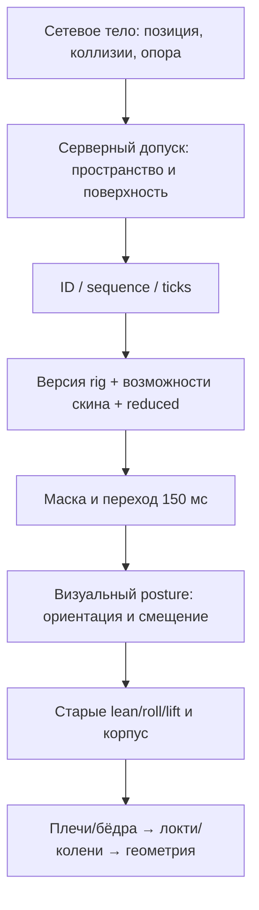

# S-53: контракт каркаса humanoid-v2

Цель — дать S-34 штатный путь для сидения, лежания, лежания на боку и колеса, сохранив прежние
клипы и три косметических действия в её отдельной ветке. Это косметические позы, без новой
физики трюков, импорта моделей или универсального animation graph. Пользовательские клипы
и их окончательный вид остаются в S-34. Контракт и полный пример добавления — в [инструкции](add-animation.md).

## Подтверждённое исходное состояние

Проверено на main `5521d946` (после S-31/#64):

| Ограничение | Источник на исходной базе | Следствие / изменение |
| --- | --- | --- |
| В AvatarPose только плечи, бёдра, lean/roll/lift | `apps/client/src/rendering/avatars/locomotion.ts:1` | Добавлены локти/колени и визуальный корень; старые поля и маски сохранены |
| Плечо/бедро владеют цельной конечностью | `avatar-rig.ts:28`, `skins/standard.ts:53`, `skins/minifigure.ts:159` в каталоге avatars | В v2 геометрия делится в реальном локальном суставе, нижняя половина дочерняя; одного увеличения lift было недостаточно |
| Валидатор: углы ±π, lift ±0,1; единственный rig | `tools/animation-validation.ts:27`, `:114` | v1 не ослаблен; v2 имеет собственные каналы и границы |
| Метаданные требуют preserve-seat | `packages/contracts/src/animation-validation.ts:49` | Введены явные variant/unavailable с пояснением |
| Коляска подавляет бёдра/lift и уменьшает lean/roll | `avatar-rig.ts:101` | Старое поведение сохранено; v2-адаптация ограничена руками, лежание/колесо явно недоступны |
| Пять секунд показа после движения | `apps/server/src/gameplay/player-activities.ts:51` | Для v1/capsule сохранено; ground отменяется до движения, без скольжения |
| Хеш не включает каркас/скины | `tools/animations.ts:60` | Алгоритм v2 включает контракт и реализацию визуального каркаса; старые клиенты несовместимы |

Пути `avatar-rig.ts`/`skins/*` выше относительны к `apps/client/src/rendering/avatars/`.
Числа строк относятся к исходной базе; имена функций остаются указателями после изменения.

## Поток и ответственность

Меню проверяет возможности скина → сервер проверяет cooldown, опору, покой и занимаемое место →
реплицируется прежний ID/sequence/tick → оба клиента по абсолютному elapsed выбирают одинаковый
sampler → CharacterAnimator смешивает маску → AvatarRig применяет суставы и размещает тело по
нижней точке реальной геометрии. Предпросмотр использует тот же AvatarView.

Физический корень, его капсула, камера, подписи и точки взаимодействия не получают позу.
Проверка свободного объёма — query-only, без шага физики или изменения тел. Серверные contracts
содержат только данные, политики и константы; Babylon остаётся в renderer/simulation/tooling.
Капсула остаётся стоящей даже у лежащего персонажа, поэтому анимация не даёт обхода препятствий.
Точность физического hitbox под лежащую модель — отдельное игровое решение, здесь не нужна.

## Геометрия, оси и опора

Все скины сохраняют исходные нейтральные плечи/бёдра и пропорции. Нулевой изгиб не меняет
внешнюю поверхность. При первом v2-показе нейтральные треугольники конечности разделяются пополам
по её продольной длине с замкнутыми срезами, нормалями и сохранением диапазонов цвета одежды.
Локоть/колено находится на этом срезе; нижние части вращаются относительно него. До v2 старые
клипы сохраняют исходные меши. После v2 нулевые изгибы возвращают прежнюю внешнюю форму.
Для юбок выделен тазовый pivot: в v2 подол следует среднему сгибу бёдер. Это жёсткая адаптация,
не симуляция ткани; художественные пересечения в сложных позах требуют осмотра.

Иерархия: physical root → facing (сглаженный Y) → posture (Y·X·Z и перенос) → body
(прежние X/Z и lift) → плечо/бедро → локоть/колено. +X вправо, +Y вверх, +Z вперёд.
Все углы — радианы; линейные каналы — доли высоты. Таблица диапазонов приведена в инструкции.
Новые каналы по умолчанию равны нулю; facingOffset остаётся только у аниматора.

Ground на полном весе размещает нижнюю вершину тела на нижней плоскости капсулы, затем добавляет
rootY. Во время смешивания отрицательное проникновение устраняется сразу; понижение плавно
зависит от веса. В расчёт не входят коляска, внешние атрибуты и маркер игрока. RootY — явный зазор,
а не перенос физического тела. В авторской проверке реальные вершины обязаны оставаться в
серверном объёме 1,6h × 1,3h × 1,6h; проверяются и промежуточные позы.

Сервер требует статичную поверхность с normal.y ≥ 0,995, разностью высоты ≤ 4 см в сетке 3×3,
и свободный объём с зазором 2,5 см от нижней плоскости капсулы. Допуск повторяется во время
показа; появившееся препятствие прекращает позу. Это консервативная проверка известной сцены,
не доказательство сплошности любой произвольной поверхности между лучами. На склоне, узкой
скамейке, краю крыши и подвижном предмете потребуется другое место. Наклон к нормали склона и IK
опор не входят в этот контракт. Перед физическим шагом принятый ввод прекращает ground;
локальный предсказанный ход и потеря опоры также сбрасывают корневую позу без медленного выхода.

## Коляска, доступность и жизненный цикл

- v1 сохраняет посадку как прежде: бёдра/lift неподвижны, lean ×0,4, roll ×0,3.
- v2/capsule с preserve-seat допускает только руки и локти.
- v2/variant имеет отдельный sampler рук. Сидение адаптируется как спокойная посадка в коляске;
  рама, ноги и высота не меняются. Это прямо подписано в меню/предпросмотре.
- v2/unavailable отключает действие с причиной. Лежание, бок и колесо не превращаются в
  невидимое неподвижное действие; UI скрывает неподдерживаемый просмотр, сервер отказывает.

Для ground reducedMotion=static обязателен и имеет пользовательскую подпись. Лежание остаётся
лежанием; у колеса явно названа подготовительная поза без вращения. Временная смена настройки
применяется локально ко всем видам; она не создаёт сетевое действие.

Смена sequence смешивается с текущей позой; смена entity/revision/skin отбрасывает историю.
Новые каналы обнуляются базовым слоем на каждом кадре, поэтому не переносятся в старый клип.
Pause, respawn, disconnect и reconnect сохраняют прежние правила отмены. Ground не возобновляется
после reconnect. Коляска не получает шагов. Косметические атрибуты S-34 остаются у её владельца
AvatarView, привязки rightShoulder/body и lifecycle не изменяются; новый rightHand доступен для
будущих v2-атрибутов после создания суставов. Смена скина уничтожает весь rig.

Продуктовая граница для владельца: варианты лежания/колеса в коляске потребовали бы отдельного
содержательного действия и, вероятно, физики/анимации рамы. До такого решения применяется
явный отказ, а не имитация. Это не блокирует четыре действия на семи остальных скинах.

## Совместимость, интеграция и проверка

Используется совместимая миграция **исходных клипов**, а выпуск клиент/сервер имеет строгую
совместимость: v1 и v2 coexist в новом клиенте, старые клиенты получают VERSION_MISMATCH.
Алгоритм хеша v2 включает metadata, модули, types.ts и animationContractFiles. Общий протокол
остаётся 25, поскольку схема запросов и репликации не меняется; error codes только расширены.
Ключи reactions и animations остаются обязательными в discovery/join/reconnect.
Адаптер v1 сохраняется для существующих клипов, без плановой даты удаления.

Порядок интеграции: проверить/слить PR S-53 в main → в ветке S-34 слить свежий main, сохранив её
prop-модули и три клипа → разрешить пересечения в types/animator/AvatarView/validator/генерируемых
файлах по смыслу → перегенерировать индексы, не выбирать чужой готовый хеш → добавить четыре
окончательных v2-клипа генератором → повторить матрицу, сеть, атрибуты и весь набор проверок.
S-53 сама не меняет и не сливает ветку S-34. Зависимость снимается после принятия/интеграции
каркаса, не по наличию одного изображения позы. Финальная готовность S-34 — все семь действий.

| Требование | Изменение | Проверка |
| --- | --- | --- |
| Суставы, положение тела, все скины | AvatarPose/AvatarRig, splitLimb, pivot юбок | animation-rig.test: реальные дочерние меши, 8 скинов × 3 масштаба, корень и геометрия |
| Старые клипы | Нулевые новые каналы, неизменённые legacy-маски | Исходные poseHashes, character-animator, animation-skins, avatar-view |
| Опора и запрет root motion | PhysicsWorld.checkAnimationSpace, отмена до движения | animation-space.test, animation-rig-activities, браузерный отказ у стены/отмена |
| Политика коляски/reduced | Метаданные, sampler, UI и сервер | Отрицательные проверки и матрица, статичный reduced, недоступность трёх действий |
| Конвейер и совместимость | Генератор, валидаторы, хеш v2 | authoring-тесты, stale/source hash, session-version, server integration, fixture build |
| Полный путь | Те же клипы/rig в preview и двух клиентах | test:animation-rig:browser, PNG/JSON; старый test:animations:browser и профиль |

Проверочные клипы хранятся только в tests/fixtures. Браузерный сценарий регистрирует их в
изолированной копии через штатные команды, собирает клиент/сервер и удаляет копию после проверки.
Ограничения стенда и результаты конкретного запуска фиксируются в `reports/animation-rig-v2.md`.
