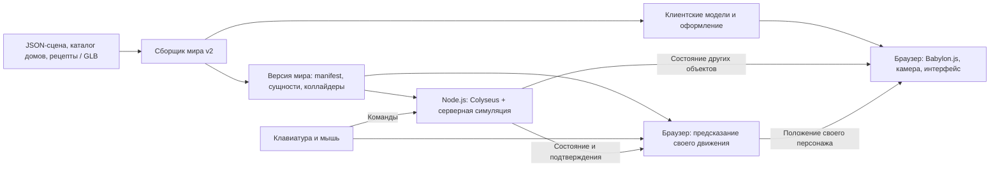

# Архитектура сетевого полигона и будущей игры

11 ноября 2026 года. Babylon.js, Havok, Colyseus, TypeScript и Vite приняты пользователем как основа текущего этапа. Ниже — устройство текущей технодемо и направления расширения. Обязательный объём v0.1 определён в спецификации: до 8 клиентов, движение и один общий ящик. Прыжки, платформа, транспорт и городская карта отложены. Компоненты описывают устройство локальной технодемо. Реальные команды запуска и сборки находятся в [README](../README.md), результаты проверок — в [отчётах](../reports/). Docker, CI и развёртывание исключены из текущей поставки по решению пользователя.

Фундамент состоит из двух приложений и общего кода симуляции. Браузер показывает мир и принимает управление. Сервер рассчитывает общий мир и проверяет действия. Оба используют одинаковые описания объектов, правила движения и физические параметры. Подготовка карты выполняется отдельно от работающей игры.

После базовой поставки добавлены два условных дома, поворот камеры и локальная прозрачность препятствий. Реализованный формат мира v2 и порядок наполнения каталога описаны в [моделях домов](building-assets.md); проверки — в [отчёте расширения](../reports/buildings.md). Городской импорт и потоковая загрузка остаются следующими этапами.

Границы первого результата и критерии проверки определены в [спецификации v0.1](mvp-network-playground.md), задачи и технические проверки — в [плане разработки](mvp-delivery-plan.md), исходные требования — в [контексте проекта](PROJECT_CONTEXT.md). При расхождении ранних предложений со спецификацией состав v0.1 определяется спецификацией.

## Состав системы



| Компонент | Ответственность | Что получает и отдаёт |
|---|---|---|
| Клиент | Загрузка, соединение, управление, камера, графика, интерфейс и локальное предсказание | Получает версию мира и состояние; отправляет намерения игрока |
| Сервер | Вход в общий мир, сессии, авторитетная физика, правила режима, состояние всех сущностей | Получает команды; отдаёт подтверждённое состояние |
| Общая симуляция | Физические формы, движение персонажа, шаг мира, поведение ящика | Принимает описание мира и команды; возвращает данные состояния |
| Контракты данных | Идентификаторы, единицы измерения, форматы мира, команд и снимков | Обычные типы и проверяемые данные |
| Сетевой протокол | Схемы Colyseus, формат входа, преобразование состояния в сетевые поля | Соединяет контракты с транспортом |
| Сборщик мира | Импорт, ручные правки, проверка геометрии и выпуск версии карты | Выпускает согласованные данные для клиента и сервера |
| Инструменты проверки | Тесты, автоматические клиенты и сбор метрик | Дают воспроизводимые сценарии и отчёты |

Первое размещение — один серверный процесс с одной комнатой мира и статические файлы клиента. Внутренние пакеты не становятся отдельными сервисами. Постоянные аккаунты обслуживает HTTP API в том же процессе: Telegram OIDC подтверждает личность, PostgreSQL хранит аккаунты, связи с внешней идентичностью, профили и серверные авторизации. Миграции запускаются отдельно; симуляция не обращается к БД. Настройка и проверки описаны в разделе [аккаунтов](../README.md#постоянные-аккаунты-через-telegram).

Реализованный этап описан в [концепции предметов, личного инвентаря и постоянного мира](items-inventory-and-world-persistence.md). Она определяет каталог переносимых предметов, размещение, сохранение и восстановление мира. Это расширение MVP; прежние предположения о единственном обязательном ящике и сбросе мира при перезапуске относятся к базовой реализации.

## Разделение кода

Используем pnpm workspaces: один репозиторий, один lockfile, локальные зависимости через `workspace:*`. Общую конфигурацию TypeScript держим в корне, настройки браузера и Node.js — в приложениях. Версию Node.js и pnpm фиксируем вместе с проверенными версиями библиотек на первом этапе реализации.

| Пакет | Содержание | Разрешённые зависимости внутри проекта |
|---|---|---|
| `@su/contracts` | `EntityId`, описание мира, команды, снимки, версии, валидаторы входных данных | Нет |
| `@su/simulation` | Обёртка Babylon/Havok, контроллер персонажа, серверный мир, мир предсказания и политика sandbox | `contracts` |
| `@su/protocol` | Схемы `@colyseus/schema`, типы сообщений, преобразование снимков в сетевые данные | `contracts` |
| `@su/client` | Клиент Colyseus, Babylon-рендерер, локальное управление, UI и диагностика | Три общих пакета |
| `@su/server` | Colyseus Room, подключение, проверки команд, управление жизненным циклом и публикация состояния | Три общих пакета |
| `@su/world-build` | Сборка и валидация карты | `contracts` |
| `@su/load-test` | Автоматические сетевые клиенты | `contracts`, `protocol` |

`contracts` не импортирует Babylon.js, Colyseus, DOM или файловую систему. `simulation` зависит от выбранной физики, но не от браузерного интерфейса, WebSocket и комнаты Colyseus. `protocol` не импортирует серверную симуляцию. Приложения соединяют эти части; циклических зависимостей между ними нет.

В `simulation` нужны отдельные точки экспорта `server` и `prediction`, чтобы клиент импортировал только нужные ему функции. Это не две копии правил движения: общий контроллер и физические параметры остаются одними. Для такого объёма достаточно обычных TypeScript-модулей; отдельный ECS-фреймворк и универсальный контейнер зависимостей пока не требуются.

## Объекты мира и владение состоянием

У объекта есть три представления, связанные через `entityId`:

| Представление | Пример | Владелец |
|---|---|---|
| Определение | Тип ящика, размеры, масса, стартовая позиция, материал | Версия карты |
| Текущее состояние | Положение, скорость, активность, занятое место водителя | Серверная симуляция |
| Отображение | Babylon TransformNode/Mesh, цвет, анимация, подсветка | Клиентский рендерер |

Сервер читает положения динамических тел из Havok после физического шага и формирует снимок. Сетевые схемы — проекция этого снимка, а не второе независимо меняющееся состояние мира. Клиент не изменяет декодированное серверное состояние для предсказания: прогноз хранится отдельно.

Виды объектов в текущей модели и последующих расширениях:

- `obstacle`: статическая форма столкновений и простой визуальный объект полигона.
- `BuildingInstance`: размещение модели из каталога с собственным `entityId`, позой и необязательным `sourceRef`; статические дома загружаются из версии карты и не пересылаются в сетевых снимках.
- `player`: капсула контроллера, состояние движения и ссылка на сессию; внешность относится к отображению.
- `crate`: динамическое тело, масса, трение, возможность толкания.
- `platform` (позднее): управляемое физическое тело с траекторией, вычисляемой по времени симуляции.
- `vehicle` (позднее): динамическое тело, управление, ограничения и место водителя.
- `trigger` (позднее): зона, которую проверяет режим, например цель доставки.

`entityId` отличается от `sessionId`, идентификатора аккаунта и OSM-ID. Статическим объектам назначаем ID при подготовке карты и сохраняем соответствие в реестре импорта; динамическим — при создании в экземпляре мира. В старом HTML есть повторяющиеся OSM-ID, поэтому они сохраняются только как `sourceRef`. Индекс массива и хеш текущей геометрии не подходят для долговечной идентичности редактируемого дома.

Свойства объекта редактируются в данных. Первая настройка — изменение JSON и пересборка мира; полноценный визуальный редактор можно добавить поверх того же формата. Иерархия классов вида «всё наследуется от игрового объекта» не нужна: поведение выбирает фабрика по типу, состояние хранится в типизированных коллекциях.

## Система координат и версия мира

Единицы проекта: метры, секунды, радианы; вертикаль — `Y`, восток — `+X`, север — `-Z`. Используем правую систему координат и явную соответствующую настройку Babylon-сцен. В v0.1 начало координат — центр условной площадки. Для будущего городского участка ориентир начала — кольцо Коммунистической улицы и Октябрьского проспекта. Географические координаты преобразуются при сборке, а не внутри каждого игрового шага.

Эта договорённость распространяется на физику, импорт моделей, сервер, камеру и тесты. Повороты динамических объектов передаются кватернионами; направление движения преобразуется из экранных осей в мировые на клиенте до формирования команды.

Сборщик выпускает:

| Артефакт | Содержание | Потребитель |
|---|---|---|
| `manifest.json` | Формат v2, версии мира/симуляции, bounds, каталог моделей, список ячеек и SHA-256 всех файлов | Клиент и сервер |
| `world.<hash>.json` | Препятствия и ящик, точки появления, параметры физики | Клиент и сервер |
| `cells/<cellId>.<hash>.json` | Устойчивые ID экземпляров домов, ссылки на модели, позиции и повороты | Клиент и сервер |
| `assets/<version>/colliders.json` | Составные ориентированные параллелепипеды и замкнутые статические треугольные формы | Клиентская и серверная физика |
| `assets/<version>/model.glb`, `parts.json` | Модель и семантические части с группами прозрачности | Клиентский рендерер; сервер проверяет целостность файлов до готовности |

`mapVersion` идентифицирует выпущенный набор данных; хеш конфигурации учитывает параметры движения, массы и другие значения, влияющие на симуляцию. Отдельный `protocolVersion` обозначает совместимость сетевого формата. При несовпадении сервер не разрешает появление персонажа и возвращает понятную причину.

Сборщик работает с JSON-сценой и каталогом домов: параметрические исходники двух домов или подготовленные статические GLB. OSM-импорт не реализован. При его последующем добавлении OSM-снимок, ручные исправления и сгенерированный результат хранятся раздельно. Сборка повторяема: текущее время не меняет хеш содержимого. Геометрия проверяется на корректность, дубли ID, точки появления внутри препятствий и допустимые размеры тел. Проходы в составных формах и треугольных коллайдерах проверены на отдельном дворе и арке. Один общий bounding box не заменяет физическую геометрию.

В MVP весь небольшой участок загружается целиком, из одной ячейки `0_0`. Ячейки уже отделены от каталога моделей, но потоковой загрузки и автоматического разбиения города нет. GLB загружается и разбирается один раз на версию модели; копии разделяют геометрию, а изменяемые материалы принадлежат конкретным экземплярам. Обновление карты применяется при пересоздании мира с новой версией; горячая замена коллайдеров во время игры не входит в первый этап.

Камера ортографическая, с фиксированным наклоном и плавными поворотами Q/E на 90°. Управление преобразуется по фактическому текущему азимуту. Параллельные лучи от камеры к нескольким точкам капсулы находят все закрывающие её группы дома; стены, крыши и детали плавно переходят к прозрачности 0,2. Смена прозрачности и отключение теней этих групп происходят только в локальной графической сцене. Общая физика и вид других клиентов не меняются.

## Серверная симуляция

`WorldRoom` управляет соединениями и делегирует физику в `AuthoritativeWorld`. Он создаёт мир один раз, добавляет и удаляет персонажей, проверяет совместимость, переводит сетевой ввод в команды, запускает шаг и обновляет сетевую проекцию.

Babylon.js предоставляет `NullEngine` для работы без WebGL в Node.js. Планируем отдельную физическую сцену на NullEngine и Havok: без материалов, текстур, камеры и загрузки браузерных ресурсов. Технические TransformNode и формы создаются из подготовленных данных. Это штатное направление серверного запуска, но конкретный запуск Havok/WASM и способ фиксированного шага проверяются в M0. [Серверный Babylon.js](https://doc.babylonjs.com/setup/support/serverSide/), [интеграция Havok](https://doc.babylonjs.com/features/featuresDeepDive/physics/havokPlugin/).

Начальная частота — 60 шагов в секунду; отправка изменений состояния — 20 раз в секунду. Это настройки для измерений. Часы шага принадлежат комнате, а не отдельным объектам или графическому циклу.

Один шаг выполняет следующую последовательность:

1. Обрабатывает подготовленные операции входа/выхода и берёт не более одного очередного ввода каждого игрока.
2. Проверяет значения и права действия; обновляет желаемые скорости и управляющие воздействия.
3. Обновляет контроллеры персонажей в проверенном порядке. Цели управляемых платформ добавятся на этой границе в последующей итерации.
4. Продвигает **общий физический мир ровно один раз** на заданный `dt`.
5. Читает положения и контакты; применяет политику sandbox. Триггеры и цели режима подключаются позднее.
6. Формирует снимок для сетевой проекции и обновляет диагностику.

Для одного общего физического решателя Colyseus 0.18 документирует получение одного ввода через `next()` и один шаг мира после обхода игроков. Его `setFixedTimestep` задаёт шаг; при необходимости частоту ввода и физики можно связать через substeps. В MVP берём одинаковые 60 Гц для ввода и физики. [Ввод и фиксированный шаг](https://docs.colyseus.io/netcode/server-input).

Внутренний `world.step(dt)` — наш интерфейс адаптера, а не обещание одноимённого метода Babylon. В M0 фиксируем поддерживаемый способ продвижения Havok и порядок обновления контроллеров. Графический `scene.render()` не должен дополнительно двигать тот же мир. Нельзя вызывать полный физический шаг отдельно для каждого игрока: это ускорит время мира с ростом числа подключений.

Очереди ввода ограничены. Пропуск ввода не замораживает гравитацию; управляющие оси переходят к нейтральному состоянию, разовые действия не повторяются. Большое отставание или переполнение приводит к контролируемой ресинхронизации с очисткой устаревшего ввода. Сервер не выполняет произвольное число шагов по запросу клиента. Число догоняющих шагов за проход цикла ограничиваем и измеряем отставание.

## Клиент и предсказание

У клиента отдельно существуют графическая сцена и мир предсказания. Графическая сцена Babylon.js отображает данные на частоте экрана. Мир предсказания использует общий адаптер NullEngine/Havok и фиксированный шаг; его доступность в браузерной сборке тоже проверяется в M0. Это позволяет не привязывать физику к FPS и не давать интерполяции изображений менять коллайдеры.

На первом этапе оба цикла работают в основном потоке браузера. Перенос физики в Worker рассматриваем, если профилирование покажет необходимость: сообщение между потоками потребует отдельной синхронизации.

| Объекты на клиенте | Источник движения | Роль в предсказании |
|---|---|---|
| Свой персонаж | Локальный ввод, затем согласование с сервером | Активный контроллер |
| Статические здания | Версия карты | Такие же формы столкновений, как на сервере |
| Другие игроки и ящики | Серверные данные и сглаживание | При необходимости приближённые кинематические формы для локального столкновения |
| Платформа, позднее | Серверная траектория и время симуляции | Положение опоры на нужный момент шага |
| Машина, позднее | Серверная симуляция | Сначала серверное движение со сглаживанием; предсказание водителя добавляется по результатам проверки |

Полный мир не пересчитывается независимо каждым игроком. Клиентское воздействие на ящик не становится истиной для остальных. В первом варианте толчок разрешается сервером, поэтому у общего предмета есть дополнительная задержка реакции. Контакты с динамическими объектами — область приближённого предсказания и обязательного теста.

Для своего персонажа храним непринятые сервером команды. После подтверждения восстанавливаем серверные координаты, скорость и состояние движения, затем повторяем оставшиеся команды. Коррекцию картинки можно сгладить, но физическое состояние принимает серверный результат сразу. Телепортация и возрождение очищают историю предсказания.

Положение тела — не всё состояние контроллера: важны вертикальная скорость, опора, режим движения и одноразовые действия. Используем штатный PhysicsCharacterController как основу; его API включает проверку опоры, задание скорости и интегрирование, а платформы поддерживаются через управляемые тела. [Контроллер Babylon.js](https://doc.babylonjs.com/features/featuresDeepDive/physics/characterController/).

Для сетевой обвязки ориентируемся на Colyseus 0.18 `predict.sim` и собственные адаптеры применения состояния. Документация предупреждает: восстановление полей не откатывает внутренние кэши контактов и решателя. Поэтому одинаковые версии Havok и общий код не являются гарантией детерминизма или полного rollback. M0 и M2 проверяют принятие серверного состояния, повтор ввода и отсутствие накопленного дрейфа. [Предсказание и восстановление состояния](https://docs.colyseus.io/netcode/client-prediction).

Для воспроизведения шага контроллер не читает DOM, положение камеры или wall-clock. Необходимый ввод зафиксирован в команде; параметры и `dt` приходят из согласованной конфигурации. Во время повтора не отправляем повторные сетевые действия, звуки или награды. [Требования Colyseus к симуляции](https://docs.colyseus.io/netcode/determinism).

При будущем добавлении прыжков и платформ потребуется отдельно решить движущиеся опоры. Для них нужен `supportEntityId` и положение опоры в момент повторяемого шага, а не её текущая сглаженная картинка. Первую платформу задаём простой траекторией по серверному tick. Для произвольно движущейся машины аналогичная задача сложнее; полноценное предсказание взаимодействующих машин остаётся отдельным развитием после измерений.

## Сетевой протокол

Начальный транспорт — WebSocket через Colyseus. Он доставляет сообщения надёжно и по порядку, но сетевые потери могут увеличивать задержку из-за повторной передачи. Проверка потерь выполняется на сетевом уровне; пропуск сообщений в приложении не считается эквивалентным тестом.

| Направление | Содержание |
|---|---|
| Клиент → сервер, вход | Версия протокола, карты и симуляции, гостевое имя |
| Клиент → сервер, ввод | В v0.1 только мировые оси движения; прыжок и управление транспортом добавятся с версией протокола |
| Клиент → сервер, действие | В v0.1 запрос возврата своего персонажа на старт с ID и эпохой мира |
| Сервер → клиент, состояние | Tick, версия/эпоха мира, персонажи и ящик; поля следующих механик добавляются отдельно |
| Сервер → клиент, ответ | Принятое/отклонённое действие и причина; подтверждения ввода средствами Colyseus |

Клиент не отправляет «мою позицию считать такой» или «этот предмет теперь мой». Сервер связывает команду с персонажем по сессии, проверяет числовые значения, нормализует направление, ограничивает частоту и проверяет расстояние до цели. Повтор действия с тем же ID не должен дважды занимать место или начислять результат. Типы TypeScript дополняются проверкой входа во время выполнения.

Сохраняем два потока: воспроизводимый ввод движения и дискретные запросы действий. Возврат на старт выполняет сервер; его не нужно повторять внутри предсказания ходьбы. Позднее тот же принцип применяется к посадке в транспорт. Для номера и подтверждения ввода используем механизм выбранной версии Colyseus, не создавая параллельный конкурирующий счётчик. ID дискретного действия — отдельная задача.

Статические здания загружаются один раз из карты. По сети передаются прежде всего изменяемые сущности: позиция, ориентация, скорости, состояние движения и значимые игровые поля. Полное состояние приходит при входе; далее Colyseus передаёт изменения полей. Однократный эффект, который может возникнуть и исчезнуть между отправками состояния, оформляем событием с ID, а важный итог сохраняем в состоянии. [Синхронизация Colyseus](https://docs.colyseus.io/state).

На небольшом полигоне все видят все динамические сущности. Фильтрацию по расстоянию добавляем по результатам нагрузки: персонажу нужны также его опора, машина и другие зависимые объекты. Удалённый из сетевой видимости объект и уничтоженный объект — разные события.

## Вход в единственный общий мир

При старте сервер загружает конкретную версию мира, проверяет файлы, инициализирует Havok и создаёт одну `WorldRoom`. Комната не удаляется при выходе последнего игрока. Сервис входа возвращает её текущий ID; клиенты присоединяются к ней. При достижении настраиваемого лимита следующий клиент получает сообщение о заполнении, а не новую копию полигона. В v0.1 лимит равен 8; переход к 50 требует отдельного нагрузочного этапа.

Такое ограничение нужно задать явно: обычный подбор/создание комнаты может создать следующий экземпляр. Один Colyseus Room принадлежит одному процессу; распределение комнат по процессам само по себе не делит физику общего города. [Модель масштабирования](https://docs.colyseus.io/scalability).

Последовательность входа:

1. Клиент загружает приложение и узнаёт параметры активного мира.
2. Загружает manifest, коллайдеры и необходимые визуальные ресурсы.
3. Запрашивает место; сервер проверяет совместимость и лимит участников.
4. Клиент получает состояние и завершает локальную подготовку физики.
5. Отправляет готовность; сервер размещает персонажа в свободной точке и разрешает ввод. Незавершённая подготовка имеет ограниченный тайм-аут и освобождает место.

Для v0.1 пользователь выбрал гостевую сессию. При разрыве соединения место и сущность сохраняются 30 секунд, ввод становится нейтральным. Возврат в пределах окна восстанавливает ту же сущность и сбрасывает старое предсказание; после окна игрок появляется заново. Colyseus предоставляет окно переподключения и token, но хранение сущности — наша логика. [Переподключение](https://docs.colyseus.io/room/reconnection).

Token хранится в рамках вкладки и не выводится в логи. После перезапуска сервера меняется `worldEpoch`: клиенты получают новый мир со стартовым состоянием. Постоянное сохранение коробок и персонажей между перезапусками не входит в MVP.

## Игровые режимы

Режим — подключаемый серверной симуляцией TypeScript-модуль с конфигурацией. Он получает события появления игроков, контактов с зонами и шаги времени; вызывает ограниченные команды мира и ведёт состояние целей. Он не управляет сокетами, камерой или загрузкой моделей.

Политика `sandbox` v0.1 обеспечивает точки появления, возврат на старт и возвращение потерянного ящика. Игровых целей и очков нет. В будущем цель вроде «дотолкать ящик в зону» добавляется в модуле режима и данных карты, без изменения сетевого цикла и физического адаптера; сервер фиксирует результат.

Пока активен один режим на общий мир. Зоны с разными режимами, одновременные матчи и перенос персонажей между ними потребуют следующего решения; структура не предписывает их раньше времени.

## Структура репозитория

Это целевое дерево фундамента с отмеченными будущими данными. Папки с кодом создаются по мере появления работающих модулей. Текущие исследования и HTML сохраняют свои пути.

```text
syktyvkar-underground/
├── README.md
├── data/
│   └── syktyvkar-offline.html
├── docs/
│   ├── PROJECT_CONTEXT.md
│   ├── pre-pre-search.md
│   ├── pre-search.md
│   ├── architecture.md
│   ├── mvp-network-playground.md
│   └── mvp-delivery-plan.md
├── apps/
│   ├── client/
│   │   ├── src/
│   │   │   ├── main.ts
│   │   │   ├── bootstrap/          # загрузка и состояния подключения
│   │   │   ├── input/              # клавиатура → мировые команды
│   │   │   ├── network/            # Colyseus, ack, применение состояния
│   │   │   ├── rendering/          # сцена, камера, виды сущностей
│   │   │   ├── prediction/         # соединение SDK с общей симуляцией
│   │   │   └── ui/                 # гостевой вход, статус, диагностика
│   │   ├── index.html
│   │   ├── vite.config.ts
│   │   └── package.json
│   └── server/
│       ├── src/
│       │   ├── main.ts
│       │   ├── rooms/WorldRoom.ts
│       │   ├── admission/          # вход именно в общий мир
│       │   ├── replication/        # снимок → сетевая проекция
│       │   └── diagnostics/        # шаг, очереди, трафик, health
│       └── package.json
├── packages/
│   ├── contracts/src/             # ID, мир, команды, снимки, проверки
│   ├── protocol/src/              # схемы Colyseus и сообщения
│   └── simulation/src/
│       ├── physics/               # NullEngine/Havok, WASM, тела, step
│       ├── character/             # общие правила движения
│       ├── objects/               # ящик; новые типы добавляются позднее
│       ├── modes/                 # политика sandbox
│       ├── authoritative-world.ts
│       └── prediction-world.ts
├── content/
│   ├── sources/                   # позднее: выбранные геоданные
│   ├── overrides/                 # позднее: ручные правки импорта
│   ├── worlds/
│   │   ├── physics-lab/            # описание простой тестовой площадки
│   │   └── ring-block/             # позднее: городской участок
│   └── assets/                    # исходники моделей и материалов
├── tools/
│   ├── world-build/src/
│   └── load-test/src/
├── tests/
│   ├── integration/               # сервер, физика, вход и версии
│   ├── e2e/                       # два реальных браузерных контекста
│   └── scenarios/                 # движения и взаимодействия для замеров
├── reports/                       # небольшие отчёты и параметры замеров
├── dist/                          # генерируется, не редактируется вручную
├── package.json
├── pnpm-workspace.yaml
├── pnpm-lock.yaml
├── tsconfig.base.json
└── .node-version
```

Локальные тесты модуля лежат рядом с ним. В `tests/` размещаются сценарии, затрагивающие несколько пакетов. Результаты сборки и тяжёлые трассировки исключаем из контроля версий; короткие отчёты с окружением и выводами сохраняем. Для клиента сборка публикует визуальные файлы, для сервера — определения и физическую геометрию той же версии.

Для проверок предлагаем Vitest для модулей и интеграции в Node.js, Playwright для двух независимых браузерных контекстов. Нагрузочный инструмент использует обычный клиентский SDK Colyseus. Эти инструменты относятся к разработке и не включаются в игровой клиент.

## Разработка и размещение

Команды локальной разработки (актуальный список — в `package.json`):

| Команда | Результат |
|---|---|
| `pnpm install --frozen-lockfile` | Воспроизводимая установка зафиксированных зависимостей |
| `pnpm world:build` | Проверка и сборка выбранного мира |
| `pnpm dev` | Совместный запуск Vite, серверного процесса и наблюдения за общими пакетами |
| `pnpm check` | Типы и правила импортов; данные проверяет `pnpm world:build` |
| `pnpm test` | Модульные проверки и короткие интеграционные сценарии |
| `pnpm test:browser` | Проверка двух браузерных клиентов |
| `pnpm load -- --clients 6 --scenario crowd` | 6 активных автоматических клиентов; вместе с 2 реальными — максимум v0.1 |
| `pnpm build` | Клиент, сервер и согласованные артефакты мира |

Для симуляции тестируем поведение: непроходимую стену, контакт игроков, принятие серверной коррекции, общий ящик и переподключение. В браузере проверяем два независимых соединения, ввод и отображение общего состояния. Инспектор Babylon и сетевые отладочные панели подключаем только в режиме разработки.

Локальная проверка изменения включает установку по lockfile, проверку типов и импортов, сборку мира, короткие тесты и сборку приложений. CI-пайплайны на этом этапе не подключаются. Браузерный сценарий проверяет вход и взаимодействие двух игроков. Прогон на 8 клиентов и 30-минутная проверка выполняются отдельно с сохранением окружения и отчёта, чтобы показатели можно было сравнивать.

Будущее внешнее размещение предполагает статический клиент и один Node.js-процесс за HTTPS/WSS-прокси. Текущая поставка запускается локально из консоли; внешнее размещение не выполняется. Оба можно разместить на одной машине; WebSocket и HTTP-вход должны маршрутизироваться к тому же процессу. WASM отдаётся как локальный версионированный ресурс, сервер читает свою копию из артефакта сборки. Подключения к CDN с плавающим `latest` в игровом запуске не нужны.

Проверка готовности сервера становится успешной только после загрузки мира и физики. Перезапуск явно завершает старую сессию мира. Автоматические публичные endpoints сброса мира и диагностические панели не входят в игровой интерфейс; тестовое управление доступно только в режиме разработки.

## Точки расширения после MVP

После v0.1 отдельно проверяются прыжки, платформа, транспорт и нагрузка до 50 игроков. Новый тип объекта добавляется через контракт определения, фабрику физики, сетевые поля изменяемого состояния и клиентский вид. Новый режим использует существующий мир и его события. Большая карта потребует загрузки участков и сетевой видимости. Аккаунты уже сохраняют имя и цвет; будущий игровой прогресс связывается с постоянным `accountId`, сохраняя отдельные `entityId`, игровую сессию и авторизацию браузера.

Переход к нескольким серверам для одного мира, полное предсказание взаимодействующих динамических тел и бесшовные интерьеры — самостоятельные архитектурные задачи. Поддерживать чистые границы компонентов полезно уже сейчас; реализовывать всю эту инфраструктуру для первого полигона не требуется.
