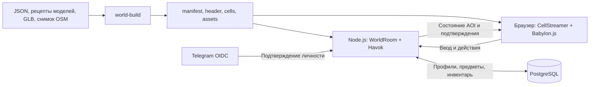

# Архитектура Syktyvkar Underground

Документ описывает текущую реализацию. По подтверждению владельца проекта от 12 ноября 2026 года эта версия работает в production, все приёмки пройдены. Команды эксплуатации — в [operations.md](operations.md), проверки изменений — в [testing.md](testing.md).

## Состав системы

Игра — TypeScript-монорепозиторий на pnpm workspaces. Один Node.js-процесс обслуживает HTTP API, статический клиент, ресурсы активного мира и WebSocket Colyseus. В процессе работает одна `WorldRoom` с общей авторитетной симуляцией Babylon.js `NullEngine` + Havok и лимитом **8 игроков**. PostgreSQL обязателен, в том числе для гостей. Telegram OIDC подключается отдельно для постоянных аккаунтов.

Основной мир — городской `ring-block`. `physics-lab` используется для регрессий, `streaming-lab` — для синтетических проверок 2 × 2 км. `SU_WORLD` выбирает один мир на запуск; добавление процесса не распределяет физику этой комнаты. PostgreSQL advisory lock исключает двух владельцев одного постоянного мира.

## Границы компонентов

| Путь | Ответственность |
| --- | --- |
| `packages/contracts/src/` | Типы и валидаторы мира, каталоги, команды, версии; без зависимостей от движка и транспорта |
| `packages/protocol/src/index.ts` | Схемы Colyseus и локальный снимок; зависит от contracts |
| `packages/simulation/src/` | Havok, персонажи, предметы, размещение, авторитетный мир и предсказание; зависит от contracts, не обращается к БД или Colyseus |
| `apps/server/src/index.ts` | HTTP/WS, загрузка мира, создание комнаты, readiness и завершение работы |
| `apps/server/src/world-room.ts` | Сессии, подготовка области, ввод, действия, шаг симуляции и репликация |
| `apps/server/src/interest.ts` | Отбор динамических сущностей для клиента через `StateView` |
| `apps/server/src/accounts/` | Telegram OIDC, HTTP API профиля и авторизации, хранение аккаунтов |
| `apps/server/src/items/` | Транзакции предметов и инвентаря, очередь сохранений и восстановление |
| `apps/client/src/network/session.ts` | Соединение, подготовка, предсказание/согласование, интерполяция и команды |
| `apps/client/src/streaming/` | Проверка ресурсов, выбор ячеек, отдельное удержание физики и графики |
| `apps/client/src/presentation/` | Данные отображения и временные буферы анимаций, без управления сценой |
| `apps/client/src/rendering/` | Сцена, камера, дымка, модели, прозрачность, аватары и предметы |
| `apps/client/src/input/`, `apps/client/src/ui/` | Клавиатура и интерфейс игры |
| `tools/world-build/src/` | Импорт города и выпуск согласованного пакета мира |
| `tools/load-test/src/`, `tests/` | SDK-нагрузка, интеграционные и браузерные проверки |

Границы общих пакетов проверяет `tools/check-boundaries.mjs` в составе `pnpm check`. Точки входа симуляции — `@su/simulation/server` и `@su/simulation/prediction`. Отдельного ECS-фреймворка, сервиса режимов или распределённой симуляции нет.

## Данные, идентичность и версии

Единицы: метры, секунды, радианы; правая система координат, вертикаль `+Y`, восток `+X`, север `−Z`. Начало города — кольцо Коммунистической улицы и Октябрьского проспекта. Географические координаты преобразуются импортёром.

| Идентификатор | Назначение |
| --- | --- |
| `worldId` | Постоянный мир и его сохранения |
| `worldEpoch` | Конкретный запуск симуляции; меняется при перезапуске |
| `roomId`, `sessionId` | Комната и игровое соединение Colyseus |
| `accountId`, `authSessionId` | Постоянный аккаунт и авторизация браузера |
| `entityId` | Экземпляр здания, персонажа или предмета; ID вещи сохраняется при переносах |
| `assetId`, `typeId`, `skinId` | Ключи каталогов моделей, предметов и внешности |
| `sourceRef` | Происхождение геометрии, например OSM-ID; не заменяет `entityId` |

Текущие версии: **протокол 10, формат мира 4, ячейка 2, схема PostgreSQL 3**. Источники: [contracts](../packages/contracts/src/index.ts) и [миграции](../apps/server/src/migrations.ts). Версия npm-пакета `0.1.0` не является версией протокола или статусом приёмки.

`mapVersion` — хеш содержимого manifest; `simulationConfigHash` описывает физически значимую конфигурацию. Цвета, подписи и визуальные модели не входят в физический хеш. Текущие позы сохранённых предметов также не меняют версию карты. При входе сверяются протокол, карта и симуляция.

## Мир и потоковая загрузка

Сборщик выпускает `dist/worlds/<worldId>/manifest.json`, небольшой `header.<sha256>.json`, ячейки и переиспользуемые GLB/коллайдеры/описания частей. Заголовок содержит границы, настройки симуляции, точки появления, каталог и начальное наполнение предметов; статика находится в ячейках.

Ячейки имеют сторону 125 м. Здание или примитив с одним `entityId` включается во все ячейки, пересекаемые его AABB. Сервер собирает полную геометрию без дублей. Клиент удерживает объект, пока на него ссылается хотя бы одна нужная ячейка. Земля города разбита на отдельные модели и физические плиты.

До входа и после выхода клиент показывает статический город без игрового места и локальной физики. При игре критическая область включает окрестности серверной и предсказанной позиции и ячейки неподтверждённого ввода. Фон загружается независимо. Физика использует круг 500 м с удержанием до 800 м; графика дополнительно покрывает фактический кадр камеры, включая масштаб 30×. Радиальная дымка ограничивает видимость готовой графикой.

Подробнее: [потоковая загрузка](large-map-streaming.md), [форматы моделей](building-assets.md), [городской импорт](ring-block.md).

## Камера и управление

Камера ортографическая, с фиксированным наклоном и свободным горизонтальным вращением: удержание Q/E или перетаскивание мышью с зажатой правой кнопкой. Один контроллер хранит текущий угол и сглаживает поворот с коротким затуханием без привязки к заданным ракурсам. Направление движения преобразуется из экранных осей в мировые по фактическому текущему азимуту. Потеря фокуса, скрытие вкладки, чат, размещение предмета и потеря графического контекста сбрасывают ввод камеры.

Параллельные лучи от камеры к нескольким точкам капсулы находят закрывающие её группы домов; стены, крыши и детали плавно переходят к прозрачности 0,22. Прозрачность и отключение теней меняют только локальную графическую сцену. Общая физика и вид других клиентов сохраняются.

## Симуляция и сеть

Сервер выполняет физический шаг **60 Гц**, состояние публикуется **20 Гц**. Клиент передаёт проверяемые `moveX`, `moveZ`, `sprint`, а не итоговые координаты. Нумерацию и подтверждения ввода ведёт Colyseus; дискретные действия имеют отдельный `requestId` и проверку эпохи.

Своя капсула движется с локальным предсказанием на общих правилах Havok. Получив серверное состояние, клиент восстанавливает его и повторяет неподтверждённый ввод. История ограничена, нужная для повторения статика удерживается. При нехватке критического окружения, длительном отсутствии состояния, потере фокуса/графического контекста или паузе сохранения управление и прогноз останавливаются. Это не побитовый rollback общей физики: чужие тела служат локальными прокси, итог взаимодействий принадлежит серверу.

Удалённые сущности отображаются с интерполяцией; состояние анимации и опоры выбирается на той же временной шкале. Движение моделей не изменяет физические капсулы. Телепортации и возврат различаются через `revision`, без интерполяции сквозь мир.

Полные `WorldState.players/items` остаются на сервере. `DynamicInterest` фильтрует только сериализацию: вход в область интереса при расстоянии по XZ ≤500 м, удержание до 800 м. Свой появившийся персонаж виден всегда, `occupancy` отражает все занятые места. Личный инвентарь и ответы на команды отправляются владельцу отдельно. Выход из AOI не уничтожает объект и не прекращает его сохранение.

`SimulationSnapshot` имеет `scope: 'authoritative'`; `LocalSimulationSnapshot` — `scope: 'local'`. Сохраняющий модуль получает полный серверный снимок, а не набор видимых клиенту предметов.

## Вход, возврат и переподключение

1. Клиент читает `/api/world`, manifest и заголовок; просмотр не резервирует место.
2. `joinById` присоединяет к уже созданной комнате. Создание других комнат через matcher запрещено. При заполнении мира следующий вход отклоняется.
3. Сервер проверяет версии и авторизацию, резервирует место и отправляет `prepareArea`: ID плана, эпоху, версию карты, целевую позицию, ячейки и срок.
4. Клиент готовит критическую графику и физику, отправляет `areaReady`. Дальний фон не задерживает появление.
5. Сервер повторно проверяет готовность, авторизацию и свободную точку, создаёт/перемещает персонажа и отвечает `areaResult`. Устаревшие и повторные планы не создают второго персонажа.

Подготовка по умолчанию ограничена 15 секундами; после готовности клиента поиск свободного места ограничен дополнительным окном. Возврат на старт и переподключение проходят тот же протокол. Ожидание области не держит SQL-транзакцию.

При кратком обрыве появившийся персонаж и место сохраняются **30 секунд**, ввод становится нейтральным. Вкладка хранит reconnection token в `sessionStorage`. Явный выход освобождает место сразу. Один аккаунт может иметь только одного персонажа, включая подготовку и окно восстановления. Перезапуск создаёт новую эпоху: персонажи появляются заново, предметы восстанавливаются из БД.

## Постоянные данные и действия

Telegram подтверждает внешнюю идентичность `iss/sub`; игровые имя, цвет и скин принадлежат профилю. Авторизация браузера — случайный токен в HttpOnly cookie, в БД хранится его хеш; срок — до 30 дней. Версия профиля защищает от перезаписи старой формой. Выход из аккаунта отзывает текущую авторизацию и связанные игровые соединения, сохраняя другие авторизации аккаунта.

`ItemStore` хранит мир, каталог типов, экземпляры, ячейки и журнал операций. `ItemRuntime` ведёт одну упорядоченную очередь записей. Подбор, размещение и операции ячеек фиксируются транзакционно до подтверждения; на время этих команд физика приостановлена. `/giveme` создаёт вещь сразу в инвентаре через ту же очередь, без резервирования физического тела.

Движение предметов записывается примерно раз в секунду и при остановке тела; фоновая запись не останавливает физику. Версия размещения, эпоха и порядок снимка защищают от запоздалой записи старой позы. При отказе БД мир приостанавливается, readiness снимается, незавершённая операция повторяется с установлением сохранённого результата. После согласования БД и тел игра возобновляется.

Штатное завершение ждёт финального сохранения. Аварийное завершение сохраняет подтверждённые переносы, но может откатить движение до последнего записанного снимка. Начальное наполнение создаётся один раз; пустой мир не заселяется заново. Позиции персонажей, обычный чат, реакции и анимации между запусками не сохраняются. Инварианты — в [документе предметов](items-inventory-and-world-persistence.md).

## Эксплуатационные границы

`/health/live` проверяет процесс; `/health/ready` — готовность мира и доступность PostgreSQL. `/api/world` выдаёт параметры комнаты, `/api/diagnostics` — метрики. Статика мира выдаётся только по перечисленным в manifest путям; файлы с хешем кешируются как immutable. Клиент и сервер используют локальные копии библиотек и Havok WASM.

SQL-миграция и миграция геометрии — разные команды. `world:migrate` после остановки проверяет сохранённые типы, позы, скорости и `safePose`, затем атомарно обновляет совместимость. Несовместимое изменение отклоняется без переноса вещей или повторного начального наполнения. `make run` явно выполняет обе миграции; обычный `start` только проверяет совместимость.

Прыжки, транспорт, движущиеся платформы, интерьеры, крафт, торговля, визуальный редактор и распределение одного мира между серверами пока не реализованы. Лимит 50 игроков остаётся направлением развития, а не доступным режимом.
