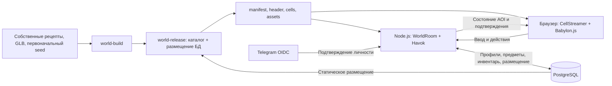

# Архитектура Syktyvkar Underground

Документ описывает реализацию в текущей рабочей ветке, включая рефактор игрового ядра от 13 ноября 2026 года. Команды эксплуатации — в [operations.md](operations.md), проверки изменений — в [testing.md](testing.md).

## Состав системы

Игра — TypeScript-монорепозиторий на pnpm workspaces. Один Node.js-процесс обслуживает HTTP API, статический клиент, ресурсы активного мира и WebSocket Colyseus. В процессе работает одна `WorldRoom` с общей авторитетной симуляцией Babylon.js `NullEngine` + Havok и лимитом **8 игроков**. PostgreSQL обязателен, в том числе для гостей. Telegram OIDC подключается отдельно для постоянных аккаунтов.

Основной мир — городской `ring-block`. `physics-lab` используется для регрессий, `streaming-lab` — для синтетических проверок 2 × 2 км. `SU_WORLD` выбирает один мир на запуск; добавление процесса не распределяет физику этой комнаты. PostgreSQL advisory lock исключает двух владельцев одного постоянного мира.

В рабочей ветке доступны каталог `/motherlode` и удаление `/vilievna`, протокол 16 / БД v6. `LiveStaticPlacement` использует общую очередь `ItemRuntime` и ту же сессию `WorldOwnership` для создания и удаления. Под паузой сохраняется текущий снимок предметов, готовится неизменяемая публикация, затем одной транзакцией фиксируются добавление либо `enabled=false`, игровой аудит, ревизия и compatibility hash. После commit сервер добавляет либо освобождает все коллайдеры выбранного экземпляра и переключает `LayoutPublications`, общий для HTTP и комнаты. При потере подтверждения commit очередь проверяет историю и завершает применение той же операции; после отказа применения подтверждённой геометрии комната остаётся неготовой до штатного перезапуска. Удалять самостоятельные экземпляры, включая исходные здания, может любой авторизованный игрок. Основание и границы защищены; восстановление не реализовано. UUID операции проверяется между обоими видами изменений, а историческое подтверждение создания отключённого экземпляра не включает его обратно.

`layoutChanged` передаёт epoch, выпуск ассетов, ревизию/хеш раскладки, mapVersion, simulationConfigHash и конкретный URL manifest. Барьер `layout` работает под собственной паузой: `areaReady` проверяет также layoutRevision, отключившиеся/просрочившие 15 с участники исключаются. Позиции персонажей, скорости предметов и инвентари сохраняются. Клиент заменяет `VerifiedResources`, `CellStreamer` и локальную физику, очищает историю предсказания и отменяет старые продолжения. Графический движок остаётся, удержания старой статики освобождаются. Pending-запросы создания и удаления хранятся в отдельных ключах sessionStorage на аккаунт и переживает переподготовку/reconnect.

HTTP отдаёт только перечисленные manifest файлы текущей и предыдущей публикаций. После барьера предыдущая ссылка освобождается; runtime удаляет только собственные более неиспользуемые каталоги. Исходные и операторские каталоги не удаляются. Предпросмотр до входа проверяет `/api/world` перед join, при возврате фокуса и каждые 15 с в видимой вкладке.

## Границы компонентов

| Путь                                                 | Ответственность                                                                                                                |
| ---------------------------------------------------- | ------------------------------------------------------------------------------------------------------------------------------ |
| `packages/contracts/src/`                            | Типы и валидаторы мира, каталоги, команды, версии; без зависимостей от движка и транспорта                                     |
| `packages/protocol/src/index.ts`                     | Схемы Colyseus и локальный снимок; зависит от contracts                                                                        |
| `packages/simulation/src/`                           | Havok, персонажи, предметы, размещение, авторитетный мир и предсказание; зависит от contracts, не обращается к БД или Colyseus |
| `apps/server/src/index.ts`                           | HTTP/WS, загрузка мира, создание комнаты, readiness и завершение работы                                                        |
| `apps/server/src/world-room.ts`                      | Жизненный цикл соединений, подготовка области, маршрутизация действий, шаг симуляции и репликация                              |
| `apps/server/src/room/`, `apps/server/src/gameplay/` | Состояние сессии, последовательность запросов и серверные правила активностей игрока                                           |
| `apps/server/src/interest.ts`                        | Отбор динамических сущностей для клиента через `StateView`                                                                     |
| `apps/server/src/accounts/`                          | Telegram OIDC, HTTP API профиля и авторизации, хранение аккаунтов                                                              |
| `apps/server/src/items/`                             | Транзакции предметов и инвентаря, очередь сохранений и восстановление                                                          |
| `apps/client/src/app/`                               | Сборка приложения, HUD, предпросмотр персонажа и согласование игровых панелей                                                  |
| `apps/client/src/network/`                           | Сессия, подготовка, предсказание/согласование, загрузка публикации и доставка команд                                           |
| `apps/client/src/streaming/`                         | Проверка ресурсов, выбор ячеек, отдельное удержание физики и графики                                                           |
| `apps/client/src/presentation/`                      | Данные отображения и временные буферы анимаций, без управления сценой                                                          |
| `apps/client/src/rendering/`                         | Сцена, камера, дымка, модели, прозрачность, аватары и предметы                                                                 |
| `apps/client/src/input/`, `apps/client/src/ui/`      | Режим ввода, клавиатура, мышь, сенсорные жесты и интерфейс игры                                                                |
| `tools/world-build/src/`                             | Импорт города и выпуск согласованного пакета мира                                                                              |
| `tools/load-test/src/`, `tests/`                     | SDK-нагрузка, интеграционные и браузерные проверки                                                                             |

Границы общих пакетов проверяет `tools/check-boundaries.mjs` в составе `pnpm check`. Точки входа симуляции — `@su/simulation/server` и `@su/simulation/prediction`. Отдельного ECS-фреймворка, сервиса режимов или распределённой симуляции нет.

### Организация игрового кода

`main.ts` подключает стили и вызывает `startGame`. В `app/game-application.ts` остаются создание
компонентов, связи между ними и порядок игрового кадра. `GameHud` отвечает за представление
состояний и подсказок, `LobbyPreview` владеет отдельной сценой персонажа до входа, а `GamePanels`
задаёт взаимное исключение панелей, включая помощь и список игроков, и отмену предпросмотра размещения.
Постоянное поле чата может оставаться рядом с одной открытой панелью; при выходе и смене режима
координатор закрывает всё. Сворачивается ли поле после отправки, решает настройка `ChatSettings`
в панели помощи (только `localStorage`, без БД): по умолчанию Enter отправляет и сворачивает,
Shift+Enter отправляет, не сворачивая; можно поменять сочетания местами или не сворачивать вовсе. Новая панель регистрируется в одном месте. `WorldHud` согласует часы,
автоматическую тему, список игроков и ленту чата; игровой кадр передаёт ему сущности для отображения.

`GameSession` владеет соединением и текущим поколением мира. Первичная загрузка и смена раскладки
проходят через `loadWorldPublication`: manifest, хеш и заголовок проверяются до установки нового
контекста. Завершение устаревшей загрузки не заменяет актуальные ресурсы. `PendingAction`
централизует подтверждение, таймаут и cooldown реакций, чата и возврата на старт.
`PersistentOperation` сохраняет один ID предметной операции или размещения до окончательного
ответа, повторяет отправку не чаще раза в три секунды и восстанавливает запрос своего аккаунта.
Анимация использует отдельный `AnimationRequestState`, поскольку ожидает не только ответ,
но и репликацию нового состояния.

На сервере `ActionLedger` хранит общую последовательность запросов игрока, незавершённые команды
и последние 32 результата. Он переживает переподключение вместе с сессией.
`gameplay/player-activities.ts` содержит правила реакций, анимаций и чата: допуск, cooldown
(1 с, растёт при флуде по общему правилу `floodCooldown` из `@su/contracts`), замену показа,
старт отсчёта после движения и завершение. Модуль не управляет транспортом, БД или физическим
движком; `WorldRoom` передаёт ему состояние игрока и серверный такт. `gameplay/world-clock.ts`
обрабатывает `/time` и общий cooldown комнаты. Часы хранятся в двух реплицируемых полях
`dayOffsetMs` и `dayFrozenHour`; доступ и повторные команды проверяются тем же `ActionLedger`.
`gameplay/world-weather.ts` так же обрабатывает `/weather` (и сокращение `/clouds`); погода
хранится в реплицируемых полях `weatherClouds`, `weatherPrecipitation` и `weatherFog`.

Публичный `@su/contracts` остаётся совместимым фасадом. Определения сгруппированы по назначению:

- `simulation.ts` — такт симуляции, координаты и физические снимки;
- `input.ts` — ввод, нормализация и ограничения очереди;
- `world-types.ts` — город, ячейки, статические объекты и ассеты;
- `session.ts` — сообщения и ограничения игровой сессии;
- `activity.ts` — единый критерий движения и перевод времени в серверные такты;
- `day-clock.ts` — общие часы, действия с ними и форматирование игрового времени;
- `weather.ts` — погода комнаты и действия `/weather`.

`rendering/environment/` объединяет суточный цикл, облачное поле, облака и освещение.
`WorldEnvironment` владеет их ресурсами и обновляет их от одних часов; `WorldView` передаёт
положение камеры, масштаб и видимую область. Неподвижные объекты используют кеш теней,
аватары и предметы — покадровую карту. В экономном режиме облака и тени отключены; `/weather clouds off` отключает облака для всей комнаты.
`?time=` остаётся локальным визуальным переопределением; `/time` меняет часы всей комнаты.

Погода на клиенте — тоже часть `rendering/environment/`. `WeatherMix` плавно ведёт силу дождя,
снега, тумана, пасмурности, мокрости и снежного покрова к погоде комнаты; `weatherSky` поправляет
по ним небо часа (тусклое солнце, серое небо, цвет тумана). Мокрый асфальт с лужами, снег на
горизонтальных поверхностях и туман вокруг игрока считает плагин материалов `WorldWeatherSurface`,
без новых мешей; его код попадает в шейдеры при первой непогоде и дальше остаётся. Дождь и снег —
по одному мешу `PrecipitationLayer` (один вызов отрисовки): капли привязаны к миру и повторяются
в объёме вокруг камеры, сверху объём растёт с отдалением, а издалека осадки уступают слою облаков. `?weather=` так же
задаёт погоду только своей вкладки.

Внутри contracts используются прямые импорты предметных модулей; приложения обращаются к
публичному фасаду. Правила, нужные клиенту и серверу, добавляются в contracts, физические
операции — в simulation, серверные игровые решения — в gameplay, визуальное представление —
в presentation/rendering/UI. Транспортные обработчики только связывают эти части.

Физика хранит дополнительный индекс динамических предметов со ссылками на те же тела, что и
общий реестр объектов. Шаг предметов, снимки и reconciliation не перебирают статический город.
Для запроса одного игрока используется `getPlayerState`. Выбор ячеек вокруг камеры ограничен
прямоугольником охвата круга с последующей точной проверкой расстояния; порядок и включение
касательных границ сохранены.

## Данные, идентичность и версии

Единицы: метры, секунды, радианы; правая система координат, вертикаль `+Y`, восток `+X`, север `−Z`. Начало города — кольцо Коммунистической улицы и Октябрьского проспекта. Географические координаты преобразуются импортёром.

| Идентификатор                 | Назначение                                                                  |
| ----------------------------- | --------------------------------------------------------------------------- |
| `worldId`                     | Постоянный мир и его сохранения                                             |
| `worldEpoch`                  | Конкретный запуск симуляции; меняется при перезапуске                       |
| `roomId`, `sessionId`         | Комната и игровое соединение Colyseus                                       |
| `accountId`, `authSessionId`  | Постоянный аккаунт и авторизация браузера                                   |
| `entityId`                    | Экземпляр здания, персонажа или предмета; ID вещи сохраняется при переносах |
| `assetId`, `typeId`, `skinId` | Ключи каталогов моделей, предметов и внешности                              |
| `sourceRef`                   | Происхождение геометрии, например OSM-ID; не заменяет `entityId`            |

Текущие версии: **протокол 13, формат мира 5, ячейка 2, схема PostgreSQL 6**. Источники: [contracts](../packages/contracts/src/index.ts) и [миграции](../apps/server/src/migrations.ts). Версия npm-пакета `0.1.0` не является версией протокола или статусом приёмки.

`mapVersion` — хеш содержимого manifest; `simulationConfigHash` описывает физически значимую конфигурацию. Цвета, подписи и визуальные модели не входят в физический хеш. Текущие позы сохранённых предметов также не меняют версию карты. При входе сверяются протокол, карта и симуляция.

## Два вида одного персонажа

`WorldView` содержит ортографическую `ArcRotateCamera` и перспективную `FreeCamera`; активна одна.
`WorldLighting` регистрирует обе камеры при каждом создании pipeline. Первое лицо следует за
физической позицией предсказания без визуального смещения согласования и анимации головы;
собственная модель и накладки скрываются только локально. Дымка ограничена минимумом 200 м и
готового графического радиуса, maxZ равен 300 м. Загрузчик продолжает покрывать фактический
кадр с прежними запасами; физика и AOI сохраняют 500/800 м.

Общий `MoveInput` имеет необязательный `facingYaw`: ноль направлен вдоль +Z, диапазон −π…π
с исключённой верхней границей. Colyseus передаёт `hasFacing` и `facingYaw`; общие функции
чтения/записи сохраняют семантику отсутствия и нейтрального сброса в сервере, истории и replay.
В обзоре корпус поворачивается по движению, в первом лице — по горизонтальному взгляду.
Поворот стоя не считается поступательным движением для чата и анимаций. Удалённый yaw интерполируется по кратчайшей дуге в существующем буфере презентации на той же серверной временной шкале, что и позиции; компоненты quaternion игрока отдельно не интерполируются.

Порядок кадра: ввод и взгляд → симуляция и отображаемая поза → активная камера → графическая
область, проекции, видимость и накладки → render. Перекрытие накладок проверяется
раз в 100 мс существующим физическим лучом к голове, с исключением своего тела и допустимым
попаданием в целевого игрока. Отдельного физического мира камеры нет.

## Мир и потоковая загрузка

Сборщик выпускает `dist/worlds/<worldId>/manifest.json`, небольшой `header.<sha256>.json`, ячейки и переиспользуемые GLB/коллайдеры/описания частей. Заголовок содержит границы, настройки симуляции, точки появления, каталог и начальное наполнение предметов; статика находится в ячейках.

Ячейки имеют сторону 125 м. Здание или примитив с одним `entityId` включается во все ячейки, пересекаемые его AABB. Сервер собирает полную геометрию без дублей. Клиент удерживает объект, пока на него ссылается хотя бы одна нужная ячейка. Земля города разбита на отдельные модели и физические плиты.

До входа и после выхода клиент показывает статический город без игрового места и локальной физики. При игре критическая область включает окрестности серверной и предсказанной позиции и ячейки неподтверждённого ввода. Фон загружается независимо. Физика использует круг 500 м с удержанием до 800 м; графика дополнительно покрывает фактический кадр камеры, включая масштаб 30×. Радиальная дымка ограничивает видимость готовой графикой.

Подробнее: [потоковая загрузка](large-map-streaming.md), [форматы моделей](building-assets.md), [городской контент](ring-block.md).

`WorldOwnership` удерживает одно соединение с advisory lock для предметов и размещения. `StaticLayoutStore` читает строки БД, а общий `@su/world-release` распределяет их по ячейкам вместе с фиксированным основанием. Static seed и динамические предметы нового мира фиксируются в одной транзакции; существующий пустой мир не наполняется заново. `world:migrate` атомарно проверяет сохранённые предметы, подтверждает размещение и совместимость. HTTP, подготовка областей и серверная симуляция используют один снимок.

Графические удержания загружают записи ячеек и GLB/parts, физические — коллайдеры. Разобранная физика освобождается после последнего удержания и задержки, даже если дальняя графика остаётся. Зависимости подаются ограниченно, критическая область имеет приоритет над фоновыми выделениями; графический preview прерывается, когда той же ячейке нужна физика. Модель без коллайдеров достигает готовности без native body. Горячее редактирование статического мира и игровой редактор пока не реализованы.

## Камера и управление

`input/mode.ts` хранит одно состояние `desktop | touch | gamepad`. Начальный выбор touch требует одновременно `(pointer: coarse)` и `navigator.maxTouchPoints > 0`. Явное касание canvas/стика переключает в touch; мышь на canvas или клавиша движения — в desktop. Gamepad выбирается новым A поддерживаемого контроллера вне редактируемого поля. Поля ввода, дрейф стиков, движение мыши и совместимые click режим не меняют. Переключающее событие поглощается, удерживаемый ввод и предпросмотр сбрасываются, игровые панели закрываются.

`input/gamepad.ts` опрашивает свежий `navigator.getGamepads()` независимым RAF, работающим также до загрузки Babylon и при потере WebGL. Поддерживаемая граница — `mapping="standard"`, минимум 4 оси и 16 кнопок. Выбран один индекс на время подключения, после потери нужна новая активация A. Радиальная зона обоих стиков равна 0,18; RT включает бег от 0,55 и выключает до 0,45. A/B/Y имеют фронты, крестовина — ограниченный повтор 350/120 мс. Опрос публикует снимок и UI-команды, не продвигая физику и не отправляя движение.

Игровой кадр перед продвижением орбиты добавляет поворот правого стика со скоростью до π/2 рад/с и ограничением delta до 0,1 с; левый стик затем проходит через `screenMovement` по фактическому углу. В gamepad фиксирован масштаб 1. `ui/gamepad-navigation.ts` работает по явным логическим пунктам существующего DOM, сохраняя фокус при обновлениях. `HelpMenu` показывает компактное представление с прежними кнопками звука, качества, возврата и выхода, без отдельного хранилища настроек.

`GameApplication` разделяет доступность UI и движения. После обычных переходов требуется 100 мс непрерывной нейтрали; внешнее прерывание дополнительно требует нового A «Продолжить». Нейтраль означает оба стика внутри зоны 0,18, RT ≤0,1 и отпущенные A/B/Y/крестовину. Resize требует нейтрали без дополнительного A, а отключение — нового выбора контроллера. WebGL имеет приоритет над подтверждением выхода, меню, ошибкой области, лобби и прогулкой. Режим запрещает первое лицо, чат, реакции, выбираемые анимации и операции предметов в обработчиках и обновлениях. Принятые сервером операции сохраняются. `__SU_DEBUG__.controls()` показывает API, контроллер, контекст, блокировку и готовность, не потребляя кнопки.

`input/touch.ts` независимо удерживает pointerId стика и камеры через Pointer Events и capture. Стик имеет фиксированный центр, радиальную мёртвую зону 12% и аналоговую скорость; экранные оси проходят через общий `screenMovement` с текущим азимутом. Бег всегда выключен. Свайп начинается на свободной правой половине canvas; горизонтальное перемещение даёт −0,005 радиана/CSS-пиксель, вертикальное игнорируется. Штатное отпускание освобождает только свой жест и сохраняет короткое сглаживание камеры; отмена сбрасывает оба жеста и сглаживание.

`app/game-application.ts` передаёт в `session.frame` прежний `MoveInput` из одного активного источника. Сенсорный ввод разрешён только в `playing`, при активной странице, готовой графике и разрешённом вводе сессии, без паузы хранения/ожидания сервера. Фокус, фон, resize/ориентация, ожидание окружения, переподключение, пауза хранения и потеря WebGL освобождают capture и отправляют нейтральный ввод существующим путём. После восстановления старые пальцы не возобновляют жесты.

Доступность социальных панелей вычисляется с учётом режима при каждом обновлении UI и сетевом ответе. `InventoryPanel.setEnabled` дополнительно закрывает панель и отменяет размещение, защищает горячие клавиши, все действия и click canvas. Серверные возможности и подтверждённые операции не меняются. В touch масштаб равен 1 и wheel отключён; после перехода в desktop wheel снова работает.

`ui/touch-buttons.ts` активирует служебные кнопки по корректному сенсорному отпусканию, включая второй палец при удерживаемом стике. Совместимый click подавляется, чтобы действие не выполнялось повторно; мышь и клавиатура продолжают использовать обычный click.

`render-quality.ts` задаёт hardware scaling 1 для standard и 1,5 для economy независимо от DPR. Это разрешение относительно CSS-размера canvas без Retina-масштабирования; DPR остаётся в диагностике. Качество не меняет видимую область мира, физику или сеть.

Обзорная камера ортографическая, с фиксированным наклоном и свободным горизонтальным вращением: удержание Q/E или перетаскивание мышью с зажатой правой кнопкой. Один контроллер хранит текущий угол и сглаживает поворот с коротким затуханием без привязки к заданным ракурсам. Направление движения преобразуется из экранных осей в мировые по фактическому текущему азимуту. Потеря фокуса, скрытие вкладки, чат, размещение предмета и потеря графического контекста сбрасывают ввод камеры.

В обзоре параллельные лучи от камеры к нескольким точкам капсулы находят закрывающие её группы домов; стены, крыши и детали плавно переходят к прозрачности 0,22. Прозрачность и отключение теней меняют только локальную графическую сцену. Общая физика и вид других клиентов сохраняются.

## Симуляция и сеть

Сервер выполняет физический шаг **60 Гц**, состояние публикуется **20 Гц**. Клиент передаёт проверяемые `moveX`, `moveZ`, `sprint`, а не итоговые координаты. Нумерацию и подтверждения ввода ведёт Colyseus; дискретные действия имеют отдельный `requestId` и проверку эпохи.

Своя капсула движется с локальным предсказанием на общих правилах Havok. Получив серверное состояние, клиент восстанавливает его и повторяет неподтверждённый ввод. История ограничена, нужная для повторения статика удерживается. При нехватке критического окружения, длительном отсутствии состояния, потере фокуса/графического контекста или паузе сохранения управление и прогноз останавливаются. Это не побитовый rollback общей физики: чужие тела служат локальными прокси, итог взаимодействий принадлежит серверу.

Удалённые сущности отображаются с интерполяцией; состояние анимации и опоры выбирается на той же временной шкале. Движение моделей не изменяет физические капсулы. Телепортации и возврат различаются через `revision`, без интерполяции сквозь мир.

Полные `WorldState.players/items` остаются на сервере. `DynamicInterest` фильтрует только сериализацию: вход в область интереса при расстоянии по XZ ≤500 м, удержание до 800 м. Свой появившийся персонаж виден всегда, `occupancy` отражает все занятые места. Личный инвентарь и ответы на команды отправляются владельцу отдельно. Выход из AOI не уничтожает объект и не прекращает его сохранение.

`SimulationSnapshot` имеет `scope: 'authoritative'`; `LocalSimulationSnapshot` — `scope: 'local'`. Сохраняющий модуль получает полный серверный снимок, а не набор видимых клиенту предметов.

## Вход, возврат и переподключение

1. Клиент читает `/api/world`, manifest и заголовок; просмотр не резервирует место.
2. `joinById` присоединяет к уже созданной комнате. Создание других комнат через matcher запрещено. При заполнении мира следующий вход отклоняется.
3. Сервер проверяет версии и авторизацию, резервирует место и отправляет `prepareArea`: ID плана, эпоху, версию карты, целевую позицию, ячейки и срок.
4. Клиент готовит критическую графику и физику, отправляет `areaReady`. Дальний фон не задерживает появление.
5. Сервер повторно проверяет готовность, авторизацию и свободную точку, создаёт/перемещает персонажа и отвечает `areaResult`. Устаревшие и повторные планы не создают второго персонажа.

Подготовка по умолчанию ограничена 15 секундами; после готовности клиента поиск свободного места ограничен дополнительным окном. Возврат на старт и переподключение проходят тот же протокол. Ожидание области не держит SQL-транзакцию.

При кратком обрыве появившийся персонаж и место сохраняются **30 секунд**, ввод становится нейтральным. Вкладка хранит reconnection token в `sessionStorage`. Явный выход освобождает место сразу. Один аккаунт может иметь только одного персонажа, включая подготовку и окно восстановления. Перезапуск создаёт новую эпоху: персонажи появляются заново, предметы восстанавливаются из БД.

## Постоянные данные и действия

Telegram подтверждает внешнюю идентичность `iss/sub`; игровые имя, цвет и скин принадлежат профилю. Авторизация браузера — случайный токен в HttpOnly cookie, в БД хранится его хеш; срок — до 30 дней. Версия профиля защищает от перезаписи старой формой. Выход из аккаунта отзывает текущую авторизацию и связанные игровые соединения, сохраняя другие авторизации аккаунта.

`ItemStore` хранит мир, каталог типов, экземпляры, ячейки и журнал операций. `ItemRuntime` ведёт одну упорядоченную очередь записей. Подбор, размещение и операции ячеек фиксируются транзакционно до подтверждения; на время этих команд физика приостановлена. `/giveme` создаёт вещь сразу в инвентаре через ту же очередь, без резервирования физического тела.

Движение предметов записывается примерно раз в секунду и при остановке тела; фоновая запись не останавливает физику. Версия размещения, эпоха и порядок снимка защищают от запоздалой записи старой позы. При отказе БД мир приостанавливается, readiness снимается, незавершённая операция повторяется с установлением сохранённого результата. После согласования БД и тел игра возобновляется.

Штатное завершение ждёт финального сохранения. Аварийное завершение сохраняет подтверждённые переносы, но может откатить движение до последнего записанного снимка. Начальное наполнение создаётся один раз; пустой мир не заселяется заново. Позиции персонажей, обычный чат, реакции и анимации между запусками не сохраняются. Инварианты — в [документе предметов](items-inventory-and-world-persistence.md).

## Эксплуатационные границы

`/health/live` проверяет процесс; `/health/ready` — готовность мира и доступность PostgreSQL. `/api/world` выдаёт параметры комнаты, `/api/diagnostics` — метрики. Статика мира выдаётся только по перечисленным в manifest путям; файлы с хешем кешируются как immutable. Клиент и сервер используют локальные копии библиотек и Havok WASM.

SQL-миграция и миграция геометрии — разные команды. `world:migrate` после остановки проверяет сохранённые типы, позы, скорости и `safePose`, затем атомарно обновляет совместимость. Несовместимое изменение отклоняется без переноса вещей или повторного начального наполнения. `make run` явно выполняет обе миграции; обычный `start` только проверяет совместимость.

Прыжки, транспорт, движущиеся платформы, интерьеры, крафт, торговля, визуальный редактор и распределение одного мира между серверами пока не реализованы. Лимит 50 игроков остаётся направлением развития, а не доступным режимом.
