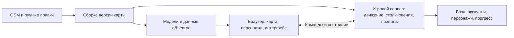

# Выбрать архитектуру онлайн-игры

> Я захотел сделать браузерную онлайн-игру, где игроки бегают своими персонажами по изометрической карте Сыктывкара, которую мы обсуждали вот здесь [@Изучить технологии сайта Brno 2000](thread://01a1ca3b-4505-7b63-aa71-4fa6c9f5fd39?hostId=local)
>
> Из важных особенностей: каждый объект на карте описывается отдельным объектов, которые можно настраивать и сквозь которые нельзя проходить. Игроки имеют своих персонажей и могут бегать по улицам. В дальнейшем на общей игровой карте будем настраивать разные игровые режимы.
>
> Как бы ты предложил подойти к этой задаче? Какие технологии, движки и фреймворки использовать? На что обратить внимание на ранних этапах проектирования архитектуры?
>
> Давай посмотрим, какие у нас есть возможности и варианты в этом направлении

<details><summary>6 previous messages</summary>

> Сначала прочитаю обсуждение карты и сверю возможности браузерных движков. Затем предложу варианты архитектуры и первый прототип, на котором можно проверить движение, столкновения и мультиплеер.
>
> <details><summary>Explored 3 files, ran 2 commands, called a tool</summary>
>
> <details><summary>Explored 5 files</summary>
>
> - Read `~/.agents/skills/stefania-memory/SKILL.md`
> - Read `~/.stefania/agent-core/references/safety.md`
> - Read `~/ObsidianVault/stefania/knowledge-base/personal/ilia-may/sessions/2026-11-11-oflayn-karta-tsentra-syktyvkara-i-publikatsiya.md`
> - Read `~/.stefania/agent-core/references/session-memory.md`
> - Read `~/.agents/skills/stefania-memory/SKILL.md`
>
> </details>
>
> - Ran `python3 /Users/ilia-may/.agents/skills/stefania-memory/scripts/recall.py 'Сыктывкар Brno карта' --limit 5`
>
> Tool call
>
> Tool: read_thread
> Status: completed
>
> MCP tool call
>
> codex_apps.search_service.web_run
>
> ```json
> {
>   "system2_search_query": [
>     {
>       "q": "site.docs.colyseus.io authoritative server state synchronization room latest"
>     },
>     {
>       "q": "site:docs.phaser.io phaser three js 3d rendering isometric arcade physics"
>     },
>     {
>       "q": "site:threejs.org docs OrthographicCamera InstancedMesh Raycaster"
>     }
>   ],
>   "response_length": "long"
> }
> ```
>
> ```text
> State Synchronization – Colyseus (https://docs.colyseus.io/state)
> 【turn751390search0】 [wordlim: 200] Crawled: yesterday; Colyseus uses a schema-based approach to define the state of a room. ... Only the latest mutation of each property is queued and sent to clients during the patchRate interval. ... Colyseus will take care of synchronizing the state with all clients in the room. ...   * Enqueueing changes: When the server mutates the state, it tracks which properties have changed since the last state synchronization, per `Schema` instance.
>
> # State Synchronization
>
> Schema DefinitionState ViewState Sync CallbacksOptimizing State
>
> ## Overview
>
> Colyseus uses a schema-based approach to define the state of a room. The server is responsible for mutating the state, and the client listens for state changes to keep the user interface in sync.
>
>   * The room’s state is defined using `schema()` from `@colyseus/schema`. Only the server can directly mutate the state.
>   * Clients send messages to the server to request state changes. Your room code processes these requests and updates the state.
>   * Colyseus optimizes performance and bandwidth by tracking property-level changes. Only the latest mutation of each property is queued and sent to clients during the patchRate interval.
>   * On the frontend, you listen for state changes to keep the user interface in sync.
>
> ### Backend: Define your state structures
>
> Define your state structures using `schema()` and `t.*` field builders from `@colyseus/schema`, or the classic `@type()` decorator style:
>
> ### Frontend: Full state received on join
>
> Clients receive the full state when they join the room. Whenever a mutation occurs in the backend, the state is automatically synchronized with all clients in the room.
>
> Below is an example of how to listen to player additions and removals on the frontend:
>
> client.js
>     
>     `import { Client, Callbacks } from "@colyseus/sdk";
>      
>     // ...
>     const client = new Client('http://localhost:2567');
>     const room = await client.joinOrCreate('my_room', {/* */});
>     const callbacks = Callbacks.get(room);
>      
>     // Listen to 'player' instance additions
>     callbacks.onAdd("players", (player, sessionId) => {
>         console.log('Player joined:', player);
>     });
>      
>     // Listen to 'player' instance removals
>     callbacks.onRemove("players", (player, sessionId) => {
>         console.log('Player left:', player);
>     });`
>
> ### … request the server to mutate the state
>
> The frontend is not capable of mutating the state directly. Instead, it sends messages to the server to request state changes.
>
> ## Limitations
>
>   * Each `Schema` structure can hold up to `63` serialized fields. If you need more fields, use nested `Schema` structures.
>     * Inherited fields count toward the limit, so check the parent class too. Defining the 64th field throws where the class is defined.
>   * `NaN` is encoded as `0`. `Infinity` is encoded as the largest safe integer, which costs 9 bytes.
>   * `null` strings are encoded as `""`.
>   * Multi-dimensional arrays are not supported. See how to use 1D arrays as multi-dimensional
>   * `@colyseus/schema` encoding order is based on field definition order: the order fields appear in the `schema()` object literal (or, for decorators, declaration order).
>     * Both encoder (server) and decoder (client) must have the same schema definition.
>     * The order of the fields must be the same.
>
> For what a patch costs in bytes and how to make it smaller, see Optimizing State.
>
> ## How does it work, internally?
>
>   * Handshake: When a client joins a room, the server sends all the types that compose the room’s state, followed by the full state.
>     * Handshake is skipped on automatic reconnections, OR when the client has provided the concrete state classes when joining the room.
>   * Enqueueing changes: When the server mutates the state, it tracks which properties have changed since the last state synchronization, per `Schema` instance. Each `Schema` instance holds a `ChangeTree` object that tracks its changes.
>   * Sending changes: The server encodes only the changed properties and sends them to the client during the patchRate interval.
>   * `refId`: Each `Schema` instance has a unique `refId` that is used to identify the instance across the network. The `refId` is how Colyseus knows which instance has been added, removed, or updated.
>   * Decoding changes: When the client receives the state changes, it decodes them and applies them to each `Schema` instance based on the `refId`. Decoding triggers the `onChange`, `listen`, and `onAdd`/`onRemove` callbacks on the frontend.
>
> ## Troubleshooting
>
> The `schema()` builder needs no compiler configuration. If you use the `@type()` decorator style, two `tsconfig.json` flags are required. See Decorators → TypeScript Config.
>
> * * *
>
> ## Next Steps
>
>   * Schema Definition - Complete reference for defining state structures
>   * Decorators (@type) - The classic decorator-based definition style
>   * State Sync Callbacks - All methods for listening to state changes
>   * State View - Control which parts of state each client can see
>   * Optimizing State - What a patch costs, and how to make it smaller
> --------------------------------------------------------------------------------
> Welcome to Phaser Docs | Phaser Help (https://docs.phaser.io/)
> 【turn751390search1】 [wordlim: 200] Crawled: 3 weeks ago; Phaser is a fast, free, and fun open source HTML5 game framework that offers WebGL and Canvas rendering across desktop and mobile web browsers and has been actively developed for over 10 years. ... It does not include 3D rendering or 3D physics as built-in features. ... Phaser was developed in JavaScript, because this is the language of the web browser.
> There are ways to convert browser games to native mobile or desktop apps using 3rd party tools, and many Phaser developers have done this successfully. However, Phasers primary focus is, and always will be, the web.
>
> Phaser is a 2D game framework. This means that both its features and internal design are based entirely around creating lightning fast 2D games. It does not include 3D rendering or 3D physics as built-in features. Again, there are ways to integrate 3rd party libraries to provide this, but Phaser itself is 2D and our documentation and examples reflect this.
>
> Phaser was developed in JavaScript, because this is the language of the web browser. As such, you will need to code your game using either JavaScript or TypeScript. All of our examples and documentation are provided in JavaScript, but we also provide TypeScript definitions.
>
> Phaser is made available as a JavaScript library. This can be downloaded, linked from a Content Delivery Network (CDN), or installed via any of the standard JavaScript package managers, such as npm. 
> --------------------------------------------------------------------------------
> Overview - Colyseus & Arena Cloud Documentation (https://0-14-x.docs.colyseus.io/colyseus/state/overview/)
> 【turn751390search2】 [wordlim: 200] Crawled: today; Colyseus handles state synchronization automatically through its strongly-typed `Schema` structures. ...   * When the user successfully joins the room, they receive the full state from the server. ...   * `onStateChange` is triggered after all latest patches have been applied in the client.
>
> # State Synchronization¶
>
> Colyseus handles state synchronization automatically through its strongly-typed `Schema` structures.
>
> ### How does it work?¶
>
>   * When the user successfully joins the room, they receive the full state from the server.
>   * At every patchRate, binary patches of the state are sent to every client (`50ms` by default)
>   * schema callbacks are triggered on client-side when applying patches coming from the server.
>   * `onStateChange` is triggered after all latest patches have been applied in the client.
>   * Your server-side logic may mutate the room state at any moment. Connected clients are always ensured to be in sync with the server.
> --------------------------------------------------------------------------------
> Colyseus Client SDK – Colyseus (https://docs.colyseus.io/sdk)
> 【turn751390search3】 [wordlim: 200] Crawled: today; The netcode APIs (`room.input()`, `room.clock`, `Predict`) are available in Colyseus 0.18+ across the official SDKs. ... ## State Synchronization
>
> The room state is automatically synchronized from the server to all connected clients. The `room.state` property always contains the latest state.
>
> ## Sending Input (Netcode)
>
> For prediction-ready rooms (rooms that call `defineInput()` on the server), `room.input()` returns a typed input channel: stage fields on `input.data`, then `input.send()` once per fixed step.
>
> client.ts
>     
>     `const input = room.input();   // input schema arrives from the server's defineInput()
>      
>     input.data.moveX = 1;
>     input.data.jump = true;
>     input.send();`
>
> Inputs are buffered and acknowledged, and power client-side prediction and lag compensation. See `room.input(options)` for the full reference: reliability modes, redundancy, and the `InputHandle` surface.
>
> The netcode APIs (`room.input()`, `room.clock`, `Predict`) are available in Colyseus 0.18+ across the official SDKs. See Client Prediction.
>
> ## State Synchronization
>
> The room state is automatically synchronized from the server to all connected clients. The `room.state` property always contains the latest state.
>
> ### State Sync Callbacks (Recommended)
>
> --------------------------------------------------------------------------------
> Physics | Phaser Help (https://docs.phaser.io/phaser/concepts/physics)
> 【turn751390search4】 [wordlim: 200] Crawled: 3 weeks ago; The first is called Arcade Physics and the second is Matter JS. ... Matter JS is an open-source third party physics library and Phaser has its own custom version of it bundled.
>
> # Physics
>
> Phaser has two physics systems built in. The first is called Arcade Physics and the second is Matter JS.
>
> Arcade Physics is, as its name implies, meant for more 'arcade' or 'retro' style games, although is not limited just to those. It's a lightweight physics system that can only handle two different types of physics shapes: rectangles and circles. It's not meant for complex physics simulations, but rather for simple things like platformers, top-down games, or puzzle games. It's very fast and easy to use, with lots of helper functions, but due to its nature it does have its limitations.
>
> Matter JS is an open-source third party physics library and Phaser has its own custom version of it bundled. The reason for including Matter is that it provides a more advanced 'full body' physics system. If you need to move beyond rectangles and circles, with more complex physics shapes, and features such as constraints, joints and behaviours, then Matter is the system to use.
>
> Both physics systems need to be enabled before they can be used. 
> --------------------------------------------------------------------------------
> Rooms – Colyseus (https://docs.colyseus.io/room)
> 【turn751390search5】 [wordlim: 200] Crawled: today; The `Room` class is the core building block of Colyseus. ...     `this.broadcastBytes("raw-update", new Uint8Array([ 1, 2, 3 ]), { except: client });` ... Relay Room A lightweight relay that broadcasts client messages to everyone else, with no authoritative state. ...   * State Synchronization - Learn how to define and synchronize room state
>   * Server Configuration - Configure your Colyseus server
> See Server Input & Fixed Timestep.
>
> ### Visibility & Access
>
> Three flags (`locked`, `private`, and `unlisted`) control who can find and join a room, alongside `lock()`, `unlock()`, and `setMatchmaking()`. See Room Visibility & Access for the full reference.
>
> * * *
>
> ### Configuration Properties
>
> Property  | Default  | Description
> --- | --- | ---
> `maxClients`  | `Infinity`  | Maximum number of clients allowed. Room is auto-locked when full.
> `patchRate`  | `50`  | Frequency to send state updates to clients, in milliseconds (20fps).
> `autoDispose`  | `true`  | Automatically dispose the room when last client disconnects.
> `maxMessagesPerSecond`  | `Infinity`  | Maximum messages a client can send per second. Exceeding disconnects the client.
> `seatReservationTimeout`  | `15`  | Seconds to wait for a client to effectively join after reserving a seat.
> `locked`  | (read-only)  | Whether the room is currently locked (via `maxClients` or `lock()`).
>
> ## Communication
>
> ### Broadcast Message
>
> Send a message to all connected clients.
>
> ## Room Properties
>
> ### `roomId`
>
> The unique identifier of the room. By default, a random 9-character-long string is assigned as the Room ID.
>
> You may customize the Room ID during `onCreate()` by setting the `this.roomId` property. See Recipes » Customize Room ID
>
> * * *
>
> ### `roomName`
>
> The name of the room you provided in the `rooms` configuration of `defineServer()`.
>
> * * *
>
> ### `state`
>
> The synchronized state of the room.
>
> See State Synchronization.
>
> * * *
>
> ### `metadata`
>
> The room’s matchmaking metadata. This data is used to filter rooms during matchmaking queries.
>
> MyRoom.ts
>     
>     `// Get metadata
>     console.log(this.metadata.difficulty);
>      
>     // Set metadata during onCreate() only
>     onCreate(options) {
>         this.metadata = { difficulty: "hard", rating: 1500 };
>     }`
>
> ⚠️
>
> The `metadata` setter can only be used during `onCreate()`. To update metadata after the room is created, use `setMetadata()` or `setMatchmaking()` instead.
>
> ### `clients`
> `2000` - `2999`  |  | Yes  | Yes  | Reserved for use by WebSocket extensions
> `3000` - `3999`  |  | No  | Yes  | Available for use by libraries and frameworks. May not be used by applications. Available for registration at the IANA via first-come, first-serve.
> `4000`  | `CONSENTED`  | No  | No  | Client left intentionally (`room.leave()`)
> `4001`  | `SERVER_SHUTDOWN`  | No  | No  | Server graceful shutdown (production)
> `4002`  | `WITH_ERROR`  | No  | No  | Closed due to an error
> `4003`  | `FAILED_TO_RECONNECT`  | No  | No  | All reconnection attempts failed, or the server denied/failed the reconnection
> `4010`  | `MAY_TRY_RECONNECT`  | No  | No  | Server shutdown in dev mode (allows reconnect)
> `4011` - `4999`  |  | No  | Yes  | Available for applications
>
> ## Built-in Rooms
>
> Colyseus ships pre-built room types you can use directly or extend. Lobby and Queue are documented under Matchmaking, since that’s the job they do:
>
> Lobby Room A live listing of available rooms, the backend for a room browser UI. Queue Room A matchmaking queue that groups players over time and spawns a match room when a group is ready. Relay Room A lightweight relay that broadcasts client messages to everyone else, with no authoritative state.
>
> ## Next Steps
>
>   * State Synchronization - Learn how to define and synchronize room state
>   * Server Configuration - Configure your Colyseus server
>   * Timing Events - Schedule delayed and recurring events
>
> Graceful ShutdownLifecycle Events
> --------------------------------------------------------------------------------
> Arcade Physics | Phaser Help (https://docs.phaser.io/phaser/concepts/physics/arcade)
> 【turn751390search6】 [wordlim: 200] Crawled: 3 weeks ago;     const game = new Phaser.Game(config); ...     3. ...     * `targets` : Array of Arcade Physics Game Object, Body or Static Body. ...     Render
>
> # Arcade Physics
>
> Arcade Physics is, as its name implies, meant for more 'arcade' or 'retro' style games, although is not limited just to those. It's a lightweight physics system that can only handle two different types of physics shapes: rectangles and circles. It's not meant for complex physics simulations, but rather for simple things like platformers, top-down games, or puzzle games. It's very fast and easy to use, with lots of helper functions, but due to its nature it does have its limitations.
>
> Arcade Physics must be enabled before it can be used. This can be done via the Game Configuration or on a per-Scene basis. Once enabled, you can then add physics-enabled Game Objects to your game. This will allow you to control the Sprite using the built-in physics functions, such as velocity, acceleration, gravity, etc.
>
> By default a Game Object is not enabled for physics. This is because not all Game Objects need to be. For example, a background image or game logo likely doesn't need to be affected by physics, but a player character does. 
> --------------------------------------------------------------------------------
> Colyseus - Multiplayer Game Framework for Node.js – Colyseus (https://docs.colyseus.io/)
> 【turn751390search7】 [wordlim: 200] Crawled: today; Colyseus is an open-source Node.js framework for building authoritative game servers, with real-time state synchronization, matchmaking, and simple integration into any game engine or frontend. ... The Room state is the data structure that will be synchronized between the server and the connected clients: ...     `import io.colyseus.Client;
>
> # Image: Colyseus Multiplayer Framework
>
> Colyseus is an open-source Node.js framework for building authoritative game servers, with real-time state synchronization, matchmaking, and simple integration into any game engine or frontend. Authentication, database services, an admin panel, and dev tooling are all included.
>
> ## Key Features
>
> Rooms & Matchmaking From a single Room definition, clients are matched into multiple room instances, with visibility flags, lobbies, and ranked queues. State Synchronization Define your state on the server; clients receive binary delta patches automatically. Prediction-Ready Netcode Built-in client prediction, rollback, interpolation, and lag compensation, new in 0.18. Full-Stack Type Safety Share your server’s types with the SDK: typed messages, typed join options, typed state. Any Engine Official SDKs for the Web, Unity, Godot, Defold, GameMaker, Construct, Haxe, and more. 【6†Scale & Deploy Anywhere Horizontal scaling across processes. 
> --------------------------------------------------------------------------------
> State Synchronization – Colyseus (https://0-17.docs.colyseus.io/state)
> 【turn751390search8】 [wordlim: 200] Published: 7 months ago; Crawled: today; Colyseus uses a schema-based approach to define the state of a room. ... Only the latest mutation of each property is queued and sent to clients during the patchRate interval. ...   * Enqueueing changes: When the server mutates the state, it tracks which properties have changed since the last state synchronization, per `Schema` instance.
>
> --------------------------------------------------------------------------------
> Room - Colyseus 0.11.x (https://0-11-x.docs.colyseus.io/client/room/)
> 【turn751390search9】 [wordlim: 200] Crawled: last month; This variable is always synched with the latest `state` from the server-side. ... Use Room#onMessage() from the server-side to read the message. ...       console.log("the room state has been updated:", state);
>
> --------------------------------------------------------------------------------
> Usage - Colyseus & Arena Cloud Documentation (https://0-14-x.docs.colyseus.io/colyseus/client/client/)
> 【turn751390search10】 [wordlim: 200] Crawled: today; The current room's state. This variable is always synched with the latest `state` from the server-side.
>
> --------------------------------------------------------------------------------
> docs/pages/sdk.mdx at master · colyseus/docs · GitHub (https://github.com/colyseus/docs/blob/master/pages/sdk.mdx)
> 【turn751390search11】 [wordlim: 200] Crawled: 2 days ago; The netcode APIs (`room.input()`, `room.clock`, `Predict`) are available in Colyseus 0.18+ **across the official SDKs**. ... ## State Synchronization
>
> The room state is automatically synchronized from the server to all connected clients. The `room.state` property always contains the latest state.
>
> --------------------------------------------------------------------------------
> Room - Colyseus 0.12.x (https://0-12-x.docs.colyseus.io/client/room/)
> 【turn751390search12】 [wordlim: 200] Crawled: 3 weeks ago; This variable is always synched with the latest `state` from the server-side. ... Use Room#onMessage() from the server-side to read the message. ...       console.log("the room state has been updated:", state);
>
> --------------------------------------------------------------------------------
> Index - Colyseus Multiplayer Framework (https://0-15-x.docs.colyseus.io/state/)
> 【turn751390search13】 [wordlim: 200] Published: 2.8 years ago; Crawled: today; # State Synchronization¶
>
>   * Schema definitions – define your state structure using Colyseus' `Schema` class. ...   * When the client joins a room, it receives the full encoded state from the server.
>
> --------------------------------------------------------------------------------
> Reconnection – Colyseus (https://docs.colyseus.io/room/reconnection)
> 【turn751390search14】 [wordlim: 200] Crawled: today;     `import { Room, Client, CloseCode } from "colyseus"; ...     `import { Client, Room } from "@colyseus/sdk"; ... On a successful reconnection the server sends a full state snapshot.
>
> --------------------------------------------------------------------------------
> Arcade Physics | Phaser Help (https://docs.phaser.io/phaser-editor/scene-editor/arcade-physics)
> 【turn751390search15】 [wordlim: 200] Crawled: 2 months ago; You can create a `Phaser.Physics.Arcade.Image` or `Phaser.Physics.Arcade.Sprite` game object or you can enable a physics body in any other game object.
>
> --------------------------------------------------------------------------------
> TilemapLayer | Phaser Help (https://docs.phaser.io/api-documentation/class/tilemaps-tilemaplayer)
> 【turn751390search16】 [wordlim: 200] Crawled: 3 weeks ago; Version: Phaser v4.1.0 ... A TilemapLayer is a Game Object responsible for rendering a single layer of tile data from a Tilemap. ... Each layer corresponds to a LayerData entry within the Tilemap, and supports all four map orientations: Orthogonal, Isometric, Hexagonal, and Staggered. ... TilemapLayers support physics via both Arcade Physics and Matter.js, and can have tints, alpha, and other standard Game Object properties applied to them.
>
> --------------------------------------------------------------------------------
> Creating Arcade Image and Sprite objects | Phaser Help (https://docs.phaser.io/phaser-editor/scene-editor/arcade-physics/arcade-physics-add-object)
> 【turn751390search17】 [wordlim: 200] Crawled: 2 months ago; The simplest way of creating an object with an Arcade physics body is by adding a Phaser.Physics.Arcade.Image or Phaser.Physics.Arcade.Sprite object to the scene. ... Arcade game objects are generated in code with the image and sprite factories of the Arcade physics system:
>
> --------------------------------------------------------------------------------
> Mesh | Phaser Help (https://docs.phaser.io/phaser/concepts/gameobjects/mesh)
> 【turn751390search18】 [wordlim: 200] Crawled: 3 weeks ago; Although you can use this to render 3D objects, its primary use is for displaying more complex Sprites, or Sprites where you need fine-grained control over the vertex positions in order to achieve special effects in your games. Note that rendering still takes place using Phaser's orthographic camera (after being transformed via `projectionMesh`, see `setPerspective`, `setOrtho`, and `panZ` methods). ... However, if you want to easily add some small fun 3D elements into your game, or create some special effects involving vertex warping, this is the right object for you.
>
> --------------------------------------------------------------------------------
> OrthographicCamera - Three.js Docs (https://threejs.org/docs/pages/OrthographicCamera.html)
> 【turn751390search19】 [wordlim: 200] Crawled: 2 weeks ago; # OrthographicCamera
>
> Camera that uses orthographic projection.
>
> --------------------------------------------------------------------------------
> Creating Arcade Image and Sprite objects | Phaser Help (https://docs.phaser.io/phaser-editor/v4/scene-editor/arcade-physics/arcade-physics-add-object)
> 【turn751390search20】 [wordlim: 200] Crawled: 2 months ago; The simplest way of creating an object with an Arcade physics body is by adding a Phaser.Physics.Arcade.Image or Phaser.Physics.Arcade.Sprite object to the scene. ... Arcade game objects are generated in code with the image and sprite factories of the Arcade physics system:
>
> --------------------------------------------------------------------------------
> IsoTriangle | Phaser Help (https://docs.phaser.io/api-documentation/3.90.0/class/gameobjects-isotriangle)
> 【turn751390search21】 [wordlim: 200] Crawled: 2 months ago; Version: Phaser v3.90.0 ... it for input or physics. It provides a quick and easy way for you to render this shape in your ... An IsoTriangle is an 'isometric' triangle.
>
> --------------------------------------------------------------------------------
> Raycaster - Three.js Docs (https://threejs.org/docs/pages/Raycaster)
> 【turn751390search22】 [wordlim: 200] Crawled: last week; The camera to use when raycasting against view-dependent objects such as billboarded objects like sprites. ... Where `threshold` is the precision of the raycaster when intersecting objects, in world units. ... number  | The index number of the instance where the ray intersects the InstancedMesh.
>
> --------------------------------------------------------------------------------
> GameObjectFactory | Phaser Help (https://docs.phaser.io/api-documentation/class/gameobjects-gameobjectfactory)
> 【turn751390search23】 [wordlim: 200] Crawled: 3 weeks ago; Note: This method will only be available if the IsoTriangle Game Object has been built into Phaser. ... You can treat it like any other Game Object in your game, such as tweening it, scaling it, or enabling it for input or physics. It provides a quick and easy way for you to render this shape in your game without using a texture, while still taking advantage of being fully batched in WebGL. ... An IsoTriangle is an 'isometric' triangle. ... > Source: src/gameobjects/shape/isotriangle/IsoTriangleFactory.js#L10
>
> --------------------------------------------------------------------------------
> ArcadePhysics | Phaser Help (https://docs.phaser.io/api-documentation/3.88.2/class/physics-arcade-arcadephysics)
> 【turn751390search24】 [wordlim: 200] Crawled: 2 months ago; > Source: src/physics/arcade/ArcadePhysics.js#L21 ... gameObject  | Phaser.GameObjects.GameObject  | No  |  | Any Game Object with an Arcade Physics body.
>
> --------------------------------------------------------------------------------
> Graphics | Phaser Help (https://docs.phaser.io/phaser/concepts/gameobjects/graphics)
> 【turn751390search25】 [wordlim: 200] Crawled: 3 weeks ago; An IsoBox is an 'isometric' rectangle. ...     `class MyIsoTriangle extends Phaser.GameObjects.IsoTriangle { ...     * Set `true` to render upside down.
>
> --------------------------------------------------------------------------------
> How-To Guide: Colyseus (https://opencoursehub.cs.sfu.ca/bfraser/grav-cms/cmpt433/links/files/2025-student-howtos/NodeJS_Colyseus_multiplayer_game_server.pdf)
> 【turn751390search36】 [wordlim: 200] Published: 1.6 years ago; After this initial synchronization, the server sends incremental updates that allow each client to continuously update their local state and maintain synchronized rendering of the application.
>
> In our application, we use Colyseus to streamline both individual calls—such as tracking user movements—and global calls, like starting the game for all users in a room.
>
> --------------------------------------------------------------------------------
> InstancedMesh - Three.js Docs (https://threejs.org/docs/pages/InstancedMesh.html)
> 【turn751390search26】 [wordlim: 200] Crawled: last month; Computes the bounding sphere of the instanced mesh, and updates InstancedMesh#boundingSphere The engine automatically computes the bounding sphere when it is needed, e.g., for ray casting or view frustum culling.
>
> --------------------------------------------------------------------------------
>  (https://archive.threejs.org/docs/api/en/core/Raycaster.html)
> 【turn751390search27】 [wordlim: 200] Crawled: 5 months ago; ` const raycaster = new THREE.Raycaster(); const pointer = new THREE.Vector2(); function onPointerMove( event ) { // calculate pointer position in normalized device coordinates // (-1 to +1) for both components pointer.x = ( event.clientX / window.innerWidth ) * 2 - 1; pointer.y = - ( event.clientY / window.innerHeight ) * 2 + 1; } function render() { // update the picking ray with the camera and pointer position raycaster.setFromCamera( pointer, camera ); // calculate objects intersecting the picking ray const intersects = raycaster.intersectObjects( scene.children ); for ( let i = 0; i < intersects.length; i ++ ) { intersects[ i ].object.material.color.set( 0xff0000 ); } renderer.render( scene, camera ); } window.addEventListener( 'pointermove', onPointerMove ); window.requestAnimationFrame(render); ` ... [page:Integer instanceId] – The index number of the instance where the ray intersects the InstancedMesh
>
> --------------------------------------------------------------------------------
> Cameras (https://threejs.org/manual/pages/cameras.html)
> 【turn751390search28】 [wordlim: 200] Crawled: 5 days ago; Let's change the 2 view example above to use an `OrthographicCamera` in the first view. ...       const planeMat = new THREE.MeshBasicMaterial({ ... Another common use for an `OrthographicCamera` is to draw the up, down, left, right, front, back views of a 3D modeling program or a game engine's editor.
>
> --------------------------------------------------------------------------------
> Raycasting problems using MapConstrols and OrthographicCamera - Questions - three.js forum (https://discourse.threejs.org/t/raycasting-problems-using-mapconstrols-and-orthographiccamera/48936)
> 【turn751390search29】 [wordlim: 200] Published: 3.7 years ago; Crawled: 2.5 years ago; raycaster, controls, orthographic-camera, mapcontrols
>
> --------------------------------------------------------------------------------
> Raycaster with Orthographic Camera and z position - Questions - three.js forum (https://discourse.threejs.org/t/raycaster-with-orthographic-camera-and-z-position/43881)
> 【turn751390search30】 [wordlim: 200] Published: 4.1 years ago; Crawled: 4.1 years ago; # Raycaster with Orthographic Camera and z position ...         const intersected = raycaster.intersectObject(layerMesh);
>
> --------------------------------------------------------------------------------
> Sync Host Overview (https://www.gamedevs.org/uploads/introduction-to-sync-host.pdf)
> 【turn751390search37】 [wordlim: 200]   - Has the authoritative (most up-to-date) game state
>     - Late-joining clients can ask server for game state update
>
> --------------------------------------------------------------------------------
> Raycaster – three.js docs (https://threejs.org/docs/pages/Raycaster.html)
> 【turn751390search31】 [wordlim: 200] Crawled: last week;   * Raycaster
>
> --------------------------------------------------------------------------------
> Is is possible to get/set userData of a single object within InstancedMesh? - Questions - three.js forum (https://discourse.threejs.org/t/is-is-possible-to-get-set-userdata-of-a-single-object-within-instancedmesh/46769)
> 【turn751390search32】 [wordlim: 200] Published: 3.8 years ago; Crawled: 3.8 years ago; # Is is possible to get/set userData of a single object within InstancedMesh? ... I’m looking to use raycaster to select the object and get the userData of that object.
>
> --------------------------------------------------------------------------------
> three.js docs (https://threejs.org/docs/?q=spot)
> 【turn751390search33】 [wordlim: 200] Crawled: 4 months ago;   * OrthographicCamera ...   * InstancedBufferAttribute ...   * Raycaster
>
> --------------------------------------------------------------------------------
> Topics tagged orthographic-camera (https://discourse.threejs.org/tag/orthographic-camera/340?match_all_tags=true&page=1&tags%5B%5D=orthographic-camera)
> 【turn751390search34】 [wordlim: 200] Crawled: last month; Inconsistent raycaster intersectObjects results Questions raycaster ,  orthographic-camera  |  | 5  | 1766  | October 19, 2023 ... Debugging culling in InstancedMesh and Orthographic camera Questions camera ,  orthographic-camera ,  instanced-mesh  |  | 0  | 543  | December 23, 2022
>
> --------------------------------------------------------------------------------
> Raycaster with InstancedMesh - Questions - three.js forum (https://discourse.threejs.org/t/raycaster-with-instancedmesh/10028)
> 【turn751390search35】 [wordlim: 200] Published: 7.1 years ago; Crawled: 6.8 years ago; # Raycaster with InstancedMesh
>
> --------------------------------------------------------------------------------
> 4 **Colyseus Architecture: Design and Evaluation** (https://www.cs.cmu.edu/~ashu/thesis/proposal.pdf)
> 【turn751390search38】 [wordlim: 200] **State Partitioning**  Each object in the global object store has a *primary* (authoritative) copy that resides on exactly one node. ... In practice, the node holding the primary can synchronize replicas the same way viewable objects are synchronized on game clients in client-server architectures. ... Instead, Colyseus mandates each primary object to predict the set of objects that it expects to read or write in the near future, and prefetches the objects in the read and write sets of all primary objects on each node.
>
> --------------------------------------------------------------------------------
> A server-authoritative multiplayer FPS (https://www.reddit.com/r/threejs/comments/1vc0a4q/a_serverauthoritative_multiplayer_fps/)
> 【turn751390reddit39】 [wordlim: 200] Published: 3 months ago; Multiplayer runs on Colyseus, with the server owning movement, combat, health, scoring, projectiles and objectives. ... Server: authoritative physics and collision. ... The server simulates at 60 Hz and broadcasts state at 20 Hz.
>
> --------------------------------------------------------------------------------
> Three.js + Colyseus multiplayer game. 80 actors on screen with frustum culling, 20 Hz server tick, ~2 kB/s per player (https://www.reddit.com/r/threejs/comments/1wi4trx/threejs_colyseus_multiplayer_game_80_actors_on/)
> 【turn751390reddit40】 [wordlim: 200] Published: last month; Server-authoritative Colyseus at 20 Hz, per-player area of interest, permessage-deflate (7 kB snapshots down to 0.5 kB).
>
> --------------------------------------------------------------------------------
> Multiplayer & move_and_collide miscalculation (https://www.reddit.com/r/godot/comments/1u877tb/multiplayer_move_and_collide_miscalculation/)
> 【turn751390reddit41】 [wordlim: 200] Published: 4 months ago; Crawled: 4 months ago; Colyseus can handle that state sync side pretty cleanly from what I've seen. ... In my game (which is 3D and does use server authority so it's not entirely the same), I've had good results with consistent move\_and\_collides for player prediction that doesn't produce noticeable snapping when authoritative syncs are made.
> ```
>
> Tool call
>
> Tool: read_thread
> Status: completed
>
> - Ran `python3 /Users/ilia-may/.agents/skills/stefania-memory/scripts/recall.py 'Сыктывкар Brno карта' --limit 5`
>
> </details>
>
> В прошлом чате уже собран живой прототип Сыктывкара на Three.js с отдельными зданиями. Это полезная основа для игры: можно сохранить геометрию города и добавить движение и столкновения. Для мультиплеера понадобится игровой сервер; прежний вариант с одним офлайн-HTML решал только просмотр карты.
>
> <details><summary>Explored 3 files, called 3 tools</summary>
>
> <details><summary>Explored a file</summary>
>
> - Read `~/Documents/Codex/2026-11-11/new-chat/work/prototype/package.json`
>
> </details>
>
> MCP tool call
>
> codex_apps.search_service.web_run
>
> ```json
> {
>   "open": [
>     {
>       "ref_id": "https://docs.colyseus.io/"
>     },
>     {
>       "ref_id": "https://threejs.org/docs/pages/OrthographicCamera.html"
>     },
>     {
>       "ref_id": "https://docs.phaser.io/phaser/concepts/physics"
>     },
>     {
>       "ref_id": "https://docs.godotengine.org/en/stable/tutorials/export/exporting_for_web.html"
>     },
>     {
>       "ref_id": "https://doc.babylonjs.com/features/featuresDeepDive/physics/usingPhysicsEngine"
>     }
>   ],
>   "response_length": "long"
> }
> ```
>
> ```text
> Colyseus - Multiplayer Game Framework for Node.js – Colyseus (https://docs.colyseus.io/)
> 【turn393576view0】 [wordlim: 200] Crawled: today; Content type: text/html; Source: open({"ref_id":"https://docs.colyseus.io/","lineno":null}); Total lines: 497
> L0: 【0†v0.18】
> L1: 
> L2: 【0†Documentation】【1†Roadmap】【2†Sponsors】Versions
> L3: 
> L4: [Input: Search documentation…]
> L5: 
> L6: 【3†GitHub†github.com】【4†Discord†discord.gg】
> L7: 
> L8: [Input: Search documentation…]
> L9: 
> L10:   * Overview
> L11:   * 【0†Introduction】
> L12:   * 【5†Getting Started】
> L13:     * 【6†Create a Server】
> L14:     * Client SDKs
> L15:     * 【7†TypeScript】
> L16:     * 【8†React】
> L17:     * 【9†Unity】
> L18:     * 【10†MonoGame】
> L19:     * 【11†Godot】
> L20:     * 【12†Defold】
> L21:     * 【13†Construct 3】
> L22:     * 【14†GameMaker】
> L23:     * 【15†Cocos Creator】
> L24:     * 【16†Haxe】
> L25:     * 【17†Flutter】
> L26:     * 【18†Swift】
> L27:     * 【19†Native SDK (C)】
> L28:     * 【20†Discord Activity】
> L29:     * 【21†WeChat】
> L30: 
> L31:   * 【22†Learn】
> L32: 
> L33:     * 【23†Tutorials】
> L34: 
> L35:       * 【24†Phaser Tutorial】
> L36:         * 【25†Part 1: Basic Player Movement】
> L37:         * 【26†Part 2: Linear Interpolation】
> L38:         * 【27†Part 3: Client Predicted Input】
> L39:         * 【28†Part 4: Fixed Tickrate】
> L40: 
> L41:       * Unity
> L42: 
> L43:         * 【29†MMO Demo】
> L44:         * 【30†Shooting Gallery Demo】
> L45:         * 【31†Starboss Demo】
> L46:         * 【32†Turn Based Tanks Demo】
> L47: 
> L48:       * 【33†PlayCanvas】
> L49:       * Babylon.js
> L50: 
> L51:         * 【34†Basics】
> L52:         * 【35†Hide and Seek Tech Demo】
> L53: 
> L54:       * Cocos Creator
> L55: 
> L56:         * 【36†MMO Demo】
> L57: 
> L58:     * 【37†Examples】
> L59:       * JavaScript
> L60:       * 【38†Phaser Examples】
> L61:       * 【39†PixiJS】
> L62:       * 【40†Babylon.js】
> L63:       * 【41†KAPLAY】
> L64:       * 【42†Three.js】
> L65:       * Engines
> L66:       * 【43†Defold Engine】
> L67:       * Platforms & Integration
> L68:       * 【44†Discord Activity】
> L69:       * 【45†Decentraland】
> L70: 
> L71:   * Building Your Game
> L72:   * 【46†Server】
> L73: 
> L74:     * Setup
> L75:     * 【47†Transport】
> L76: 
> L77:       * 【48†WebSocket (Default)】
> L78:       * 【49†uWebSockets.js】
> L79:       * 【50†WebTransport】
> L80:       * 【51†Bun WebSockets】
> L81:     * 【52†Driver】
> L82:     * 【53†Presence】
> L83:     * 【54†HTTP Routes】
> L84:     * Development
> L85:     * 【55†Development Mode】
> L86:     * 【56†Vite Plugin】
> L87:     * 【57†Debugging】
> L88:     * 【58†Logging】
> L89:     * Production
> L90:     * 【59†Graceful Shutdown】
> L91: 
> L92:   * 【60†Rooms】
> L93: 
> L94:     * 【61†Lifecycle Events】
> L95:     * 【62†Message Composability】
> L96:     * 【63†Timing Events】
> L97:     * 【64†Reconnection Handling】
> L98:     * 【65†Exception Handling】
> L99:     * 【66†Room Plugins】
> L100:       * 【67†Kick Idle】
> L101:       * 【68†GeoIP】
> L102:       * 【69†WebRTC】
> L103:       * 【70†Unique Session】
> L104:       * 【71†Track User Sessions】
> L105: 
> L106:     * 【72†Relay Room】
> L107: 
> L108:   * 【73†State Sync】
> L109: 
> L110:     * 【74†Schema Definition】
> L111: 
> L112:       * 【75†Decorators (@type)】
> L113: 
> L114:     * 【76†State Sync Callbacks】
> L115: 
> L116:       * 【77†React】
> L117:       * 【78†Advanced: Implement Your Own Callback System】
> L118: 
> L119:     * 【79†State View】
> L120:     * 【80†Streaming Collections】
> L121:     * 【81†Optimizing State】
> L122:     * 【82†Advanced Schema Usage】
> L123: 
> L124:   * 【83†Client SDK】
> L125:     * 【84†Connection Lifecycle】
> L126: 
> L127:   * 【85†Matchmaking】
> L128: 
> L129:     * 【86†Visibility & Access】
> L130:     * 【87†Lobby Room】
> L131:     * 【88†Queue Room】
> L132:     * 【89†Standalone Matchmaker】
> L133: 
> L134:   * 【90†Authentication】
> L135: 
> L136:     * 【91†Room Authentication】
> L137:     * 【92†HTTP Middleware】
> L138:     * 【93†Auth Module】
> L139: 
> L140:   * 【94†Database】
> L141: 
> L142:     * 【95†Authentication】
> L143:     * 【96†Services】
> L144:     * 【97†Customizing schemas】
> L145:     * 【98†Bring your own database】
> L146: 
> L147:   * Advanced
> L148:   * 【99†Netcode】
> L149:     * 【100†Server Input & Timestep】
> L150:     * 【101†Client Prediction】
> L151:     * 【102†Lag Compensation】
> L152:     * 【103†Determinism & The Contract】
> L153:     * 【104†Recipes】
> L154: 
> L155:   * Tools & Integrations
> L156:   * 【105†Built-in Tools】
> L157: 
> L158:     * 【106†Playground】
> L159:     * 【107†Share your dev server】
> L160:     * 【108†Monitoring Panel】
> L161:     * 【109†Load Testing】
> L162:     * 【110†Unit Testing】
> L163: 
> L164:   * 【111†Admin Panel】
> L165: 
> L166:     * 【112†Authentication & RBAC】
> L167:     * 【113†Resources & CRUD】
> L168:     * 【114†Dashboard & widgets】
> L169:     * 【115†Live rooms】
> L170: 
> L171:   * 【116†Payments】
> L172:     * 【117†Xsolla】
> L173: 
> L174:   * 【118†3rd Party Packages】
> L175:   * Deploy & Scale
> L176:   * 【119†Deployment】
> L177:   * 【120†Scalability】
> L178: 
> L179:     * 【121†Traefik Load Balancer】
> L180: 
> L181:   * 【122†Colyseus Cloud】
> L182: 
> L183:     * 【123†Compute Plans】
> L184:     * 【124†Private NPM Registry】
> L185:     * 【125†Continuous Deployment】
> L186:     * 【126†DDoS Protection】
> L187:     * 【127†Environment Variables and Secrets】
> L188:     * 【128†"Deploy failed" errors】
> L189:     * 【129†TypeScript/Compilation errors】
> L190:     * 【130†Pricing & Billing】
> L191:     * 【131†Cloud API】
> L192: 
> L193:   * Resources
> L194:   * 【132†Recipes & Guides】
> L195:     * 【133†The Command Pattern】
> L196:     * 【134†Custom Room ID】
> L197:     * 【135†Deny a Player Joining a Room】
> L198:     * 【136†Password Protect Room】
> L199:     * 【137†Setup Server from Scratch with TypeScript】
> L200: 
> L201:   * 【138†FAQ】
> L202:   * 【139†Migrating Versions】
> L203: 
> L204:     * 【140†Migrating to 0.18】
> L205:     * 【141†Migrating to 0.17】
> L206:     * 【142†Migrating to 0.16】
> L207:     * 【143†Migrating to 0.15】
> L208: 
> L209:   * 【144†Community】
> L210:   * * * *
> L211: 
> L212: Light
> L213: 
> L214: On This Page
> L215:   * 【145†Key Features】
> L216:   * 【146†What does it look like?】
> L217:   * 【147†Create a server】
> L218:   * 【148†Define your Room State】
> L219:   * 【149†Create your Room code】
> L220:   * 【150†Expose the Room identifier】
> L221:   * 【151†Join the Room from the client SDK】
> L222:   * 【152†Explore more】
> L223: 
> L224: 【153†Question? Give us feedback →†github.com】【154†Edit this page†github.com】
> L225: 
> L226: Sponsors
> L227: 
> L228: 【155†Become a sponsor†github.com】
> L229: 
> L230: Scroll to top
> L231: # 【156†Image: Colyseus Multiplayer Framework】
> L232: 
> L233: Colyseus is an open-source Node.js framework for building authoritative game servers, with real-time state synchronization, matchmaking, and simple integration into any game engine or frontend. Authentication, database services, an admin panel, and dev tooling are all included.
>
> --------------------------------------------------------------------------------
> OrthographicCamera - Three.js Docs (https://threejs.org/docs/pages/OrthographicCamera.html)
> 【turn393576view1】 [wordlim: 200] Crawled: today; Content type: text/html; Source: open({"ref_id":"https://threejs.org/docs/pages/OrthographicCamera.html","lineno":null}); Total lines: 104
> L0: 【0†EventDispatcher】 → 【1†Object3D】 → 【2†Camera】 →
> L1: 
> L2: # OrthographicCamera
> L3: 
> L4: Camera that uses 【3†orthographic projection†en.wikipedia.org】.
> L5: 
> L6: In this projection mode, an object's size in the rendered image stays constant regardless of its distance from the camera. This can be useful for rendering 2D scenes and UI elements, amongst other things.
> L7: 
> L8: ## Code Example
> L9: 
> L10:     `const camera = new THREE.OrthographicCamera( width / - 2, width / 2, height / 2, height / - 2, 1, 1000 );
> L11:     scene.add( camera );
> L12:     `
> L13: ## Constructor
> L14: ### new 【4†OrthographicCamera】( left : number, right : number, top : number, bottom : number, near : number, far : number )
> L15: 
> L16: Constructs a new orthographic camera.
> L17: left  | The left plane of the camera's frustum. Default is `-1`.
> L18: right  | The right plane of the camera's frustum. Default is `1`.
> L19: top  | The top plane of the camera's frustum. Default is `1`.
> L20: bottom  | The bottom plane of the camera's frustum. Default is `-1`.
> L21: near  | The camera's near plane. Default is `0.1`.
> L22: far  | The camera's far plane. Default is `2000`.
> L23: ## Properties
> L24: 
> L25: ### .【5†bottom】 : number
> L26: 
> L27: The bottom plane of the camera's frustum.
> L28: 
> L29: Default is `-1`.
> L30: 
> L31: ### .【6†far】 : number
> L32: 
> L33: The camera's far plane. Must be greater than the current value of 【7†OrthographicCamera#near】.
> L34: 
> L35: Default is `2000`.
> L36: 
> L37: ### .【8†isOrthographicCamera】 : boolean (readonly)
> L38: 
> L39: This flag can be used for type testing.
> L40: 
> L41: Default is `true`.
> L42: 
> L43: ### .【9†left】 : number
> L44: 
> L45: The left plane of the camera's frustum.
> L46: 
> L47: Default is `-1`.
> L48: ### .【7†near】 : number
> L49: 
> L50: The camera's near plane. The valid range is greater than `0` and less than the current value of 【6†OrthographicCamera#far】.
> L51: 
> L52: Note that, unlike for the 【10†PerspectiveCamera】, `0` is a valid value for an orthographic camera's near plane.
> L53: 
> L54: Default is `0.1`.
> L55: 
> L56: ### .【11†right】 : number
> L57: 
> L58: The right plane of the camera's frustum.
> L59: 
> L60: Default is `1`.
> L61: 
> L62: ### .【12†top】 : number
> L63: 
> L64: The top plane of the camera's frustum.
> L65: 
> L66: Default is `1`.
> L67: ### .【13†view】 : Object
> L68: 
> L69: Represents the frustum window specification. This property should not be edited directly but via 【14†PerspectiveCamera#setViewOffset】 and 【15†PerspectiveCamera#clearViewOffset】.
> L70: 
> L71: Default is `null`.
> L72: 
> L73: ### .【16†zoom】 : number
> L74: 
> L75: The zoom factor of the camera.
> L76: 
> L77: Default is `1`.
> L78: 
> L79: ## Methods
> L80: 
> L81: ### .【17†clearViewOffset】()
> L82: 
> L83: Removes the view offset from the projection matrix.
> L84: ### .【18†setViewOffset】( fullWidth : number, fullHeight : number, x : number, y : number, width : number, height : number )
> L85: 
> L86: Sets an offset in a larger frustum. This is useful for multi-window or multi-monitor/multi-machine setups.
> L87: 
> L88: fullWidth  | The full width of multiview setup.
> L89: fullHeight  | The full height of multiview setup.
> L90: x  | The horizontal offset of the subcamera.
> L91: y  | The vertical offset of the subcamera.
> L92: width  | The width of subcamera.
> L93: height  | The height of subcamera.
> L94: 
> L95: See:
> L96:   * 【14†PerspectiveCamera#setViewOffset】
> L97: ### .【19†updateProjectionMatrix】()
> L98: 
> L99: Updates the camera's projection matrix. Must be called after any change of camera properties.
> L100: 
> L101: ## Source
> L102: 
> L103: 【20†src/cameras/OrthographicCamera.js†github.com】
>
> --------------------------------------------------------------------------------
> Physics | Phaser Help (https://docs.phaser.io/phaser/concepts/physics)
> 【turn393576view2】 [wordlim: 200] Crawled: today; Content type: text/html; Source: open({"ref_id":"https://docs.phaser.io/phaser/concepts/physics","lineno":null}); Total lines: 59
> L0: 【0†Skip to main content】
> L1: 
> L2:   * 【1†Introduction】
> L3: 
> L4:   * 【2†Getting Started】
> L5: 
> L6:   * 【3†Concepts】
> L7: 
> L8:     * 【3†Actions】
> L9:     * 【4†Animations】
> L10:     * 【5†Audio】
> L11:     * 【6†Cameras】
> L12:     * 【7†Data Manager】
> L13:     * 【8†Device】
> L14:     * 【9†Display】
> L15:     * 【10†Events】
> L16:     * 【11†FX】
> L17:     * 【12†Game】
> L18:     * 【13†Game Objects】
> L19: 
> L20:     * 【14†Geometry】
> L21:     * 【15†Input】
> L22:     * 【16†Loader】
> L23: 
> L24:     * 【17†Math】
> L25:     * 【18†Physics】
> L26: 
> L27:       * 【19†Arcade Physics】
> L28:       * 【20†Matter Physics】
> L29:     * 【21†Scale Manager】
> L30:     * 【22†Scenes】
> L31:     * 【23†Textures】
> L32:     * 【24†Time】
> L33:     * 【25†Tweens】
> L34:     * 【26†Utils】
> L35:   * 【27†Phaser Discord†discord.gg】
> L36: # Physics
> L37: 
> L38: Phaser has two physics systems built in. The first is called Arcade Physics and the second is Matter JS.
> L39: 【19†Arcade Physics】 is, as its name implies, meant for more 'arcade' or 'retro' style games, although is not limited just to those. It's a lightweight physics system that can only handle two different types of physics shapes: rectangles and circles. It's not meant for complex physics simulations, but rather for simple things like platformers, top-down games, or puzzle games. It's very fast and easy to use, with lots of helper functions, but due to its nature it does have its limitations.
> L40: 【20†Matter JS】 is an open-source third party physics library and Phaser has its own custom version of it bundled. The reason for including Matter is that it provides a more advanced 'full body' physics system. If you need to move beyond rectangles and circles, with more complex physics shapes, and features such as constraints, joints and behaviours, then Matter is the system to use.
> L41: Both physics systems need to be enabled before they can be used. This can be done via the Game Configuration or on a per-Scene basis. Once enabled, you can then add physics-enabled Game Objects to your game. For example, if you enable Arcade Physics, you can then add a Sprite and enable physics on it. This will allow you to control the Sprite using the built-in physics functions, such as velocity, acceleration, gravity, etc.
> L42: By default a Game Object is not enabled for physics. This is because not all Game Objects need to be. For example, a background image or game logo likely doesn't need to be affected by physics, but a player character does. Therefore, you must enable physics on the Game Objects that you specifically want to be affected by it. We will cover this in detail in later chapters.
> L43: The two systems are entirely separate. An Arcade Physics sprite, for example, cannot collide with a Matter Physics sprite. You cannot add the same Sprite to both systems, you need to pick one or the other. However, although it's unusual to do so, both systems can actually run in parallel in the same Scene. This means that you can have a Sprite that uses Arcade Physics and another that uses Matter Physics, and they will both work at the same time, although they will not interact together.
> L44: 【17†Previous Math】【19†Next Arcade Physics】
> L45: 
> L46: Community
> L47: 
> L48:   * 【27†Discord†discord.gg】
> L49:   * 【28†X†twitter.com】
> L50: 
> L51: Resources
> L52: 
> L53:   * 【29†GitHub†github.com】
> L54:   * 【30†Phaser†phaser.io】
> L55:   * 【31†LinkedIn†www.linkedin.com】
> L56:   * 【32†YouTube†www.youtube.com】
> L57: 
> L58: © 2026 Phaser
>
> --------------------------------------------------------------------------------
> Exporting for the Web — Godot Engine (stable) documentation in English (https://docs.godotengine.org/en/stable/tutorials/export/exporting_for_web.html)
> 【turn393576view3】 [wordlim: 200] Crawled: today; Content type: text/html; Source: open({"ref_id":"https://docs.godotengine.org/en/stable/tutorials/export/exporting_for_web.html","lineno":null}); Total lines: 240
> L0: [Input: Search docs] [Input] [Input]
> L1: 
> L2: 【0†Godot Engine】
> L3: # Exporting for the Web【1†】
> L4: 
> L5: See also
> L6: 
> L7: This page describes how to export a Godot project to HTML5. If you're looking to compile editor or export template binaries from source instead, read 【2†Compiling for the Web】.
> L8: 
> L9: HTML5 export allows publishing games made in Godot Engine to the browser. This requires support for 【3†WebAssembly†webassembly.org】 and 【4†WebGL 2.0†www.khronos.org】 in the user's browser.
> L10: 
> L11: Attention
> L12: Projects written in C# using Godot 4 currently cannot be exported to the web. See 【5†this blog post†godotengine.org】 for more information.
> L13: 
> L14: To use C# on web platforms, use Godot 3 instead.
> L15: 
> L16: Tip
> L17: 
> L18: Use the browser-integrated developer console, usually opened with `F12` or ``Ctrl` ``+`` `Shift` ``+`` `I`` (``Cmd` ``+`` `Option` ``+`` `I`` on macOS), to view debug information like JavaScript, engine, and WebGL errors.
> L19: If the shortcut doesn't work, it's because Godot actually captures the input. You can still open the developer console by accessing the browser's menu.
> L20: 
> L21: Note
> L22: 
> L23: Due to security concerns with `SharedArrayBuffer` due to various exploits, the use of multiple threads for the Web platform has multiple drawbacks, including requiring specific server-side headers and complete cross-origin isolation (meaning no ads, nor third-party integrations on the website hosting your game).
> L24: Since Godot 4.3, Godot supports exporting your game on a single thread, which solves this issue. While it has some drawbacks on its own (it cannot use threads, and is not as performant as the multi-threaded export), it doesn't require as much overhead to install. It is also more compatible overall with stores like 【6†itch.io†itch.io】 or Web publishers like 【7†Poki†poki.com】 or 【8†CrazyGames†crazygames.com】.
> L25: The single-threaded export works very well on macOS and iOS too, where it always had compatibility issues with multiple threads exports.
> L26: For these reasons, it is the preferred and now default way to export your games on the Web.
> L27: 
> L28: For more information, see 【9†this blog post about single-threaded Web export†godotengine.org】.
> L29: 
> L30: See also
> L31: 
> L32: See the 【10†list of open issues on GitHub related to the web export†github.com】 for a list of known bugs.
> L33: ## Export file name【11†】
> L34: 
> L35: We suggest users to export their Web projects with `index.html` as the file name. `index.html` is usually the default file loaded by web servers when accessing the parent directory, usually hiding the name of that file.
> L36: 
> L37: Attention
> L38: 
> L39: The Godot 4 Web export expects some files to be named the same name as the one set in the initial export. Some issues could occur if some exported files are renamed, including the main HTML file.
> L40: ## WebGL version【12†】
> L41: 
> L42: Godot 4 can only target WebGL 2.0 (using the Compatibility rendering method). Forward+/Mobile are not supported on the web platform, as these rendering methods are designed around modern low-level graphics APIs. Godot currently does not support WebGPU, which is a prerequisite for allowing Forward+/Mobile to run on the web platform.
> L43: See 【13†Can I use WebGL 2.0†caniuse.com】 for a list of browser versions supporting WebGL 2.0. Note that Safari has several issues with WebGL 2.0 support that other browsers don't have, so we recommend using a Chromium-based browser or Firefox if possible.
> L44: ## Mobile considerations【14†】
> L45: 
> L46: The Web export can run on mobile platforms with some caveats. While native 【15†Android】 and 【16†iOS】 exports will always perform better by a significant margin, the Web export allows people to run your project without going through app stores.
> L47: Remember that CPU and GPU performance is at a premium when running on mobile devices. This is even more the case when running a project exported to Web (as it's WebAssembly instead of native code). See 【17†Performance】 section of the documentation for advice on optimizing your project. If your project runs on platforms other than Web, you can use 【18†Feature tags】 to apply low-end-oriented settings when running the project exported to Web.
> L48: To speed up loading times on mobile devices, you should also 【19†compile an optimized export template】 with unused features disabled. Depending on the features used by your project, this can reduce the size of the WebAssembly payload significantly, making it faster to download and initialize (even when cached).
> L49: ## Audio playback【20†】
> L50: 
> L51: Since Godot 4.3, audio playback is done using the Web Audio API on the web platform. This Sample playback mode allows for low latency even when the project is exported without thread support, but it has several limitations:
> L52: 
> L53:   * AudioEffects are not supported.
> L54: 
> L55:   * 【21†Reverberation and doppler】 effects are not supported.
> L56: 
> L57:   * Procedural audio generation is not supported.
> L58: 
> L59:   * Positional audio may not always work correctly depending on the node's properties.
>
> --------------------------------------------------------------------------------
> Using A Physics Engine | Babylon.js Documentation (https://doc.babylonjs.com/features/featuresDeepDive/physics/usingPhysicsEngine)
> 【turn393576view4】 [wordlim: 200] Crawled: today; Content type: text/html; Source: open({"ref_id":"https://doc.babylonjs.com/features/featuresDeepDive/physics/usingPhysicsEngine","lineno":null}); Total lines: 242
> L0: [Input: Search…]
> L1: 
> L2: 【0†API】
> L3: 
> L4: 【1†Features】|
> L5: 
> L6: 【2†Deep Dive】|
> L7: 
> L8: 【3†Physics】|
> L9: 
> L10: 【4†Using A Physics Engine】
> L11: 
> L12: …|
> L13: 
> L14: 【1†Features】|
> L15: 
> L16: 【2†Deep Dive】|
> L17: 
> L18: 【3†Physics】|
> L19: 
> L20: 【4†Using A Physics Engine】
> L21: 
> L22: 【5†Babylon.js】【6†Babylon Lite】
> L23: 
> L24: Filter
> L25: 
> L26: [Input]Filter
> L27: 
> L28:   * 【7†Your Journey Starts Here】
> L29: 
> L30:   * 【1†Features】
> L31: 
> L32:   * 【8†Adding Babylon.js to Your Web Project】
> L33: 
> L34:   * 【9†Tools and Resources】
> L35: 
> L36:   * 【10†Preparing Assets for Babylon.js】
> L37: 
> L38:   * 【11†Babylon.js Cross-Platform】
> L39: 
> L40:   * 【12†Contribute】
> L41: 
> L42:   * 【13†Guided Learning】
> L43: 
> L44:   * 【14†Official Add-ons】
> L45:   * 【15†Community Extensions】
> L46: 
> L47:   * 【16†Legacy】
> L48: 
> L49:   * 【17†What's New】
> L50: 
> L51:   * 【18†Breaking Changes】
> L52: 
> L53:   * 【0†API】
> L54: 
> L55:   * 【19†Search】
> L56: 
> L57:   * 【20†Playground search】
> L58: # Using A Physics Engine
> L59: ## Introduction
> L60: 
> L61: Babylon.js has a plugin system for physics engines that enables users to add physics interactions to scene objects. Unlike the internal collision system, a physics engine calculates objects' body dynamics and emulates "real-life" interactions between them. So if two objects collide, they will "bounce" off one another, just like you would expect from a real-life object.
> L62: The plugin system allows us to use well-established physics engines and integrate them into the render loop. Apart from very advanced usage, there is no need to interact directly with the physics engine. Babylon.js does the work for you.
> L63: ## Which physics engine is integrated
> L64: 
> L65: There is a plugin for the Havok Physics engine.
> L66: 
> L67: Read about the 【21†Babylon.js Havok plugin】 and how to use it directly.
> L68: 
> L69: ## Basic usage
> L70: ### Enabling the physics engine
> L71: 
> L72: To enable the physics engine, call the scene's `enablePhysics` function:
> L73: ES6[Button: ES6 pure][Button: UMD]
> L74: 
> L75:     `
> L76: 
> L77:     import { Vector3 } from "@babylonjs/core/Maths/math.vector";
> L78: 
> L79:     import { HavokPlugin } from "@babylonjs/core/Physics/v2/Plugins/havokPlugin";
> L80: 
> L81:     import { Scene } from "@babylonjs/core/scene";
> L82: 
> L83:     var scene = new Scene(engine);
> L84: 
> L85:     var gravityVector = new Vector3(0, -9.81, 0);
> L86: 
> L87:     var physicsPlugin = new HavokPlugin();
> L88: 
> L89:     scene.enablePhysics(gravityVector, physicsPlugin);
> L90: 
> L91:     `
> L92: Both parameters are optional. The default parameters are shown in the example. This is the same as calling:
> L93: 
> L94:     `
> L95: 
> L96:     scene.enablePhysics();
> L97: 
> L98:     `
> L99: 
> L100: ES6[Button: ES6 pure][Button: UMD]
> L101: 
> L102:     `
> L103: 
> L104:     import { Vector3 } from "@babylonjs/core/Maths/math.vector";
> L105: 
> L106:     import { HavokPlugin } from "@babylonjs/core/Physics/v2/Plugins/havokPlugin";
> L107: 
> L108:     scene.enablePhysics(new Vector3(0, -9.81, 0), new HavokPlugin());
> L109: 
> L110:     `
> L111: Calling this function will create a new `PhysicsEngine` object that handles the physics interactions.
> L112: 
> L113: The physics engine is now enabled and is running during the render loop.
> L114: ## Your first physics scene
> L115: 
> L116: Here we present a minimal example of a physics-enabled scene, using 【22†Aggregates】 for faster creation:
> L117: ES6[Button: ES6 pure][Button: UMD]
> L118: 
> L119:     `
> L120: 
> L121:     import { FreeCamera } from "@babylonjs/core/Cameras/freeCamera";
> L122: 
> L123:     import { HemisphericLight } from "@babylonjs/core/Lights/hemisphericLight";
> L124: 
> L125:     import { Vector3 } from "@babylonjs/core/Maths/math.vector";
> L126: 
> L127:     import { MeshBuilder } from "@babylonjs/core/Meshes/meshBuilder";
> L128: 
> L129:     import { PhysicsShapeType } from "@babylonjs/core/Physics/v2/IPhysicsEnginePlugin";
> L130:     import { PhysicsAggregate } from "@babylonjs/core/Physics/v2/physicsAggregate";
> L131: 
> L132:     import { HavokPlugin } from "@babylonjs/core/Physics/v2/Plugins/havokPlugin";
> L133: 
> L134:     import { Scene } from "@babylonjs/core/scene";
> L135: 
> L136:     var createScene = function () {
> L137: 
> L138:         // This creates a basic Babylon Scene object (non-mesh)
> L139: 
> L140:         var scene = new Scene(engine);
> L141: 
> L142:         // This creates and positions a free camera (non-mesh)
> L143:         var camera = new FreeCamera("camera1", new Vector3(0, 5, -10), scene);
> L144: 
> L145:         // This targets the camera to scene origin
> L146: 
> L147:         camera.setTarget(Vector3.Zero());
> L148: 
> L149:         // This attaches the camera to the canvas
> L150: 
> L151:         camera.attachControl(canvas, true);
> L152: 
> L153:         // This creates a light, aiming 0,1,0 - to the sky (non-mesh)
> L154: 
> L155:         var light = new HemisphericLight("light", new Vector3(0, 1, 0), scene);
> L156:         // Default intensity is 1. Let's dim the light a small amount
> L157: 
> L158:         light.intensity = 0.7;
> L159: 
> L160:         // Our built-in 'sphere' shape.
> L161: 
> L162:         var sphere = MeshBuilder.CreateSphere("sphere", { diameter: 2, segments: 32 }, scene);
> L163: 
> L164:         // Move the sphere upward at 4 units
> L165: 
> L166:         sphere.position.y = 4;
> L167: 
> L168:         // Our built-in 'ground' shape.
> L169: 
> L170:         var ground = MeshBuilder.CreateGround("ground", { width: 10, height: 10 }, scene);
> L171: 
> L172:         // initialize plugin
> L173: 
> L174:         var hk = new HavokPlugin();
> L175: 
> L176:         // enable physics in the scene with a gravity
> L177: 
> L178:         scene.enablePhysics(new Vector3(0, -9.8, 0), hk);
> L179: 
> L180:         // Create a sphere shape and the associated body. Size will be determined automatically.
> L181: 
> L182:         var sphereAggregate = new PhysicsAggregate(sphere, PhysicsShapeType.SPHERE, { mass: 1, restitution: 0.75 }, scene);
> L183: 
> L184:         // Create a static box shape.
> ```
>
> MCP tool call
>
> codex_apps.search_service.web_run
>
> ```json
> {
>   "open": [
>     {
>       "ref_id": "https://rapier.rs/docs/user_guides/javascript/character_controller/"
>     },
>     {
>       "ref_id": "https://docs.colyseus.io/netcode"
>     },
>     {
>       "ref_id": "https://docs.colyseus.io/scalability"
>     },
>     {
>       "ref_id": "https://pixijs.com/8.x/guides/getting-started/what-pixijs-is"
>     }
>   ],
>   "response_length": "long"
> }
> ```
>
> ```text
> Controllers | Rapier (https://rapier.rs/docs/user_guides/javascript/character_controller/)
> 【turn348850view0】 [wordlim: 200] Crawled: today; Content type: text/html; Source: open({"ref_id":"https://rapier.rs/docs/user_guides/javascript/character_controller/","lineno":null}); Total lines: 304
> L0: 【0†Skip to main content】
> L1: 
> L2: 【1†Rapier】
> L3: 
> L4:   * 【2†About Rapier】
> L5:   * User Guide: JavaScript (0.21)
> L6: 
> L7:     * 【3†Getting started】
> L8:     * 【4†Rigid-bodies】
> L9:     * 【5†Colliders】
> L10:     * 【6†Joints】
> L11:     * 【7†Joint constraints】
> L12:     * 【8†Soft-bodies】
> L13:     * 【9†Controllers】
> L14:     * 【10†Scene queries】
> L15:     * 【11†Advanced collision-detection】
> L16:     * 【12†Debug-renderer】
> L17:     * 【13†Serialization】
> L18:     * 【14†Determinism】
> L19:     * 【15†Common mistakes】
> L20:   * 【16†API Documentation】
> L21: 
> L22: 【17†Rust】【18†C】【9†JavaScript】【19†Python】【20†Bevy plugin】【21†All】
> L23: [Button: On this page]
> L24: # Controllers
> L25: 
> L26: A controller is a higher-level tool computing the motion of a body from what your application asks for, rather than leaving it entirely to the forces of the simulation. Rapier provides:
> L27: 
> L28:   * The 【22†character controller】, moving a kinematic body along the obstacles of the scene.
> L29:   * The 【23†vehicle controller】, driving a car-like body on ray-casted wheels.
> L30:   * The 【24†PID controller】, steering a dynamic body toward a target pose at the velocity level.
> L31: ## Character controller【25†​】
> L32: 
> L33: Most games involve bodies behaving in ways that defy the laws of physics: floating platforms, elevators, playable characters, etc. This is why kinematic bodies exist: they offer a total control over the body’s trajectory since they are completely immune to forces or impulses (like gravity, contacts, joints).
> L34: But this control comes at a price: it is up to the user to take any obstacle into account by running custom collision-detection operations manually and update the trajectory accordingly. This can be very difficult. Detecting obstacles usually rely on 【26†ray-casting】 or 【27†shape-casting】, used to adjust the trajectory based on the potential contact normals. Often, multiple ray or shape-casts are needed, and the trajectory adjustment code isn’t straightforward.
> L35: The Kinematic Character Controller (which we will abbreviate to character controller) is a higher-level tool that will emit the proper ray-casts and shape-casts to adjust the user-defined trajectory based on obstacles. The well-known move-and-slide operation is the main feature of a character controller.
> L36: 
> L37: note
> L38: Despite its name, a character controller can also be used for moving objects that are not characters. For example, a character controller may be used to move a platform. In the rest of this guide, we will use the word character to designate whatever you would like to move using the character controller.
> L39: 
> L40: Rapier provides a built-in general-purpose character controller implementation. It allows you to easily:
> L41:   * Stop at obstacles.
> L42:   * Slide on slopes that are not to steep.
> L43:   * Climb stairs automatically.
> L44:   * Walk over small obstacles.
> L45:   * Interact with moving platforms.
> L46: Despite the fact that this built-in character controller is designed to be generic enough to serve as a good starting point for many common use-cases, character-control (especially for the player’s character itself) is often very game-specific. Therefore the builtin character controller may not work perfectly out-of-the-box for all game types.
> L47: ### Setup and usage【28†​】
> L48: 
> L49: A new character controller can be created and removed by the physics `World`:
> L50: 
> L51:     `// The gap the controller will leave between the character and its environment.
> L52:     let offset = 0.01;
> L53:     // Create the controller.
> L54:     let characterController = world.createCharacterController(offset);
> L55:     // Remove the controller once we are done with it.
> L56:     world.removeCharacterController(characterController);
> L57:     `
> L58: Note that the character controller does not store a reference to the rigid-body and collider it controls. Therefore, the same instance of the `CharacterController` class can be used to control different colliders. This can be useful if you want to apply the same kind of character control settings to multiple characters.
> L59: 
> L60: The created character controller can then be used to control the movement of a collider taking into account obstacles on its path. This is done in two steps:
> L61:   1. Given a desired translation, compute the actual translation that we can apply to the collider based on the obstacles.
> L62:   2. Read the result and apply it to the rigid-body or collider (if it isn’t attached to a rigid-body) by setting its position, kinematic velocity, or next kinematic position, depending on the situation.
> L63: 
> L64:     `let characterController = world.createCharacterController(offset);
> L65:     characterController.computeColliderMovement(
> L66:         collider,    // The collider we would like to move.
> L67:         desiredTranslation, // The movement we would like to apply if there wasn’t any obstacle.
> L68:     );
> L69:     // Read the result.
> L70:     let correctedMovement = characterController.computedMovement();
> L71:     // TODO: apply this corrected movement by following the rules described below.
> L72:     `
> L73: The recommended way to update the character’s position depends on its representation:
> L74:   * A collider not attached to any rigid-body: set the collider’s position directly (with `collider.setTranslation`) to the corrected movement added to its current position.
> L75:   * A velocity-based kinematic rigid-body: set its velocity (with `rigidBody.setLinvel`) to the computed movement divided by the timestep length.
> L76:   * A position-based kinematic rigid-body: set its next kinematic position (with `rigidBody.setNextKinematicTranslation`) to the corrected movement added to its current position.
> L77: 
> L78: info
> L79: The character’s shape may be any shape supported by Rapier. However, it is recommended to either use a cuboid, a ball, or a capsule since they involve less computations and less numerical approximations.
> L80: 
> L81: warning
> L82: 
> L83: The built-in character controller does not support rotational movement. It only supports translations.
> L84: ### Character offset【29†​】
> L85: For performance and numerical stability reasons, the character controller will attempt to preserve a small gap between the character shape and the environment. This small gap is named `offset` and acts as a small margin around the character shape. A good value for this offset is something sufficiently small to make the gap unnoticeable, but sufficiently large to avoid numerical issues (if the character seems to get stuck inexplicably, try increasing the offset).
> L86:     `// Here the character controller is initialized with an offset of 0.01.
> L87:     let offset = 0.01;
> L88:     let characterController = world.createCharacterController(0.01);
> L89:     `
> L90: warning
> L91: 
> L92: It is not recommended to change the offset after the creation of the character controller.
> L93: ### Up vector【30†​】
> L94: The up vector instructs the character controller of what direction should be considered vertical. The horizontal plane is the plane orthogonal to this up vector. There are two equivalent ways to evaluate the slope of the floor: by taking the angle between the floor and the horizontal plane (in 2D), or by taking the angle between the up-vector and the normal of the floor (in 2D and 3D).
> L95: By default, the up vector is the positive y axis, but it can be modified to be any (unit) vector that suits the application.
> L96:   * Example 2D
> L97:   * Example 3D
> L98: 
> L99:     `let characterController = world.createCharacterController(0.01);
> L100:     // Change the character controller’s up vector to the positive X axis.
> L101:     characterController.setUp({ x: 1.0, y: 0.0 });
> L102:     `
> L103: 
> L104:     `let characterController = world.createCharacterController(0.01);
> L105:     // Change the character controller’s up vector to the positive Z axis.
> L106:     characterController.setUp({ x: 0.0, y: 0.0, z: 1.0 });
> L107:     `
>
> --------------------------------------------------------------------------------
> Netcode – Colyseus (https://docs.colyseus.io/netcode)
> 【turn348850view1】 [wordlim: 200] Crawled: today; Content type: text/html; Source: open({"ref_id":"https://docs.colyseus.io/netcode","lineno":null}); Total lines: 307
> L0: 【0†v0.18】
> L1: 
> L2: 【0†Documentation】【1†Roadmap】【2†Sponsors】Versions
> L3: 
> L4: [Input: Search documentation…]
> L5: 
> L6: 【3†GitHub†github.com】【4†Discord†discord.gg】
> L7: 
> L8: [Input: Search documentation…]
> L9: 
> L10:   * Overview
> L11:   * 【0†Introduction】
> L12:   * 【5†Getting Started】
> L13:     * 【6†Create a Server】
> L14:     * Client SDKs
> L15:     * 【7†TypeScript】
> L16:     * 【8†React】
> L17:     * 【9†Unity】
> L18:     * 【10†MonoGame】
> L19:     * 【11†Godot】
> L20:     * 【12†Defold】
> L21:     * 【13†Construct 3】
> L22:     * 【14†GameMaker】
> L23:     * 【15†Cocos Creator】
> L24:     * 【16†Haxe】
> L25:     * 【17†Flutter】
> L26:     * 【18†Swift】
> L27:     * 【19†Native SDK (C)】
> L28:     * 【20†Discord Activity】
> L29:     * 【21†WeChat】
> L30: 
> L31:   * 【22†Learn】
> L32: 
> L33:     * 【23†Tutorials】
> L34: 
> L35:       * 【24†Phaser Tutorial】
> L36:         * 【25†Part 1: Basic Player Movement】
> L37:         * 【26†Part 2: Linear Interpolation】
> L38:         * 【27†Part 3: Client Predicted Input】
> L39:         * 【28†Part 4: Fixed Tickrate】
> L40: 
> L41:       * Unity
> L42: 
> L43:         * 【29†MMO Demo】
> L44:         * 【30†Shooting Gallery Demo】
> L45:         * 【31†Starboss Demo】
> L46:         * 【32†Turn Based Tanks Demo】
> L47: 
> L48:       * 【33†PlayCanvas】
> L49:       * Babylon.js
> L50: 
> L51:         * 【34†Basics】
> L52:         * 【35†Hide and Seek Tech Demo】
> L53: 
> L54:       * Cocos Creator
> L55: 
> L56:         * 【36†MMO Demo】
> L57: 
> L58:     * 【37†Examples】
> L59:       * JavaScript
> L60:       * 【38†Phaser Examples】
> L61:       * 【39†PixiJS】
> L62:       * 【40†Babylon.js】
> L63:       * 【41†KAPLAY】
> L64:       * 【42†Three.js】
> L65:       * Engines
> L66:       * 【43†Defold Engine】
> L67:       * Platforms & Integration
> L68:       * 【44†Discord Activity】
> L69:       * 【45†Decentraland】
> L70: 
> L71:   * Building Your Game
> L72:   * 【46†Server】
> L73: 
> L74:     * Setup
> L75:     * 【47†Transport】
> L76: 
> L77:       * 【48†WebSocket (Default)】
> L78:       * 【49†uWebSockets.js】
> L79:       * 【50†WebTransport】
> L80:       * 【51†Bun WebSockets】
> L81:     * 【52†Driver】
> L82:     * 【53†Presence】
> L83:     * 【54†HTTP Routes】
> L84:     * Development
> L85:     * 【55†Development Mode】
> L86:     * 【56†Vite Plugin】
> L87:     * 【57†Debugging】
> L88:     * 【58†Logging】
> L89:     * Production
> L90:     * 【59†Graceful Shutdown】
> L91: 
> L92:   * 【60†Rooms】
> L93: 
> L94:     * 【61†Lifecycle Events】
> L95:     * 【62†Message Composability】
> L96:     * 【63†Timing Events】
> L97:     * 【64†Reconnection Handling】
> L98:     * 【65†Exception Handling】
> L99:     * 【66†Room Plugins】
> L100:       * 【67†Kick Idle】
> L101:       * 【68†GeoIP】
> L102:       * 【69†WebRTC】
> L103:       * 【70†Unique Session】
> L104:       * 【71†Track User Sessions】
> L105: 
> L106:     * 【72†Relay Room】
> L107: 
> L108:   * 【73†State Sync】
> L109: 
> L110:     * 【74†Schema Definition】
> L111: 
> L112:       * 【75†Decorators (@type)】
> L113: 
> L114:     * 【76†State Sync Callbacks】
> L115: 
> L116:       * 【77†React】
> L117:       * 【78†Advanced: Implement Your Own Callback System】
> L118: 
> L119:     * 【79†State View】
> L120:     * 【80†Streaming Collections】
> L121:     * 【81†Optimizing State】
> L122:     * 【82†Advanced Schema Usage】
> L123: 
> L124:   * 【83†Client SDK】
> L125:     * 【84†Connection Lifecycle】
> L126: 
> L127:   * 【85†Matchmaking】
> L128: 
> L129:     * 【86†Visibility & Access】
> L130:     * 【87†Lobby Room】
> L131:     * 【88†Queue Room】
> L132:     * 【89†Standalone Matchmaker】
> L133: 
> L134:   * 【90†Authentication】
> L135: 
> L136:     * 【91†Room Authentication】
> L137:     * 【92†HTTP Middleware】
> L138:     * 【93†Auth Module】
> L139: 
> L140:   * 【94†Database】
> L141: 
> L142:     * 【95†Authentication】
> L143:     * 【96†Services】
> L144:     * 【97†Customizing schemas】
> L145:     * 【98†Bring your own database】
> L146: 
> L147:   * Advanced
> L148:   * 【99†Netcode】
> L149:     * 【100†Server Input & Timestep】
> L150:     * 【101†Client Prediction】
> L151:     * 【102†Lag Compensation】
> L152:     * 【103†Determinism & The Contract】
> L153:     * 【104†Recipes】
> L154: 
> L155:   * Tools & Integrations
> L156:   * 【105†Built-in Tools】
> L157: 
> L158:     * 【106†Playground】
> L159:     * 【107†Share your dev server】
> L160:     * 【108†Monitoring Panel】
> L161:     * 【109†Load Testing】
> L162:     * 【110†Unit Testing】
> L163: 
> L164:   * 【111†Admin Panel】
> L165: 
> L166:     * 【112†Authentication & RBAC】
> L167:     * 【113†Resources & CRUD】
> L168:     * 【114†Dashboard & widgets】
> L169:     * 【115†Live rooms】
> L170: 
> L171:   * 【116†Payments】
> L172:     * 【117†Xsolla】
> L173: 
> L174:   * 【118†3rd Party Packages】
> L175:   * Deploy & Scale
> L176:   * 【119†Deployment】
> L177:   * 【120†Scalability】
> L178: 
> L179:     * 【121†Traefik Load Balancer】
> L180: 
> L181:   * 【122†Colyseus Cloud】
> L182: 
> L183:     * 【123†Compute Plans】
> L184:     * 【124†Private NPM Registry】
> L185:     * 【125†Continuous Deployment】
> L186:     * 【126†DDoS Protection】
> L187:     * 【127†Environment Variables and Secrets】
> L188:     * 【128†"Deploy failed" errors】
> L189:     * 【129†TypeScript/Compilation errors】
> L190:     * 【130†Pricing & Billing】
> L191:     * 【131†Cloud API】
> L192: 
> L193:   * Resources
> L194:   * 【132†Recipes & Guides】
> L195:     * 【133†The Command Pattern】
> L196:     * 【134†Custom Room ID】
> L197:     * 【135†Deny a Player Joining a Room】
> L198:     * 【136†Password Protect Room】
> L199:     * 【137†Setup Server from Scratch with TypeScript】
> L200: 
> L201:   * 【138†FAQ】
> L202:   * 【139†Migrating Versions】
> L203: 
> L204:     * 【140†Migrating to 0.18】
> L205:     * 【141†Migrating to 0.17】
> L206:     * 【142†Migrating to 0.16】
> L207:     * 【143†Migrating to 0.15】
> L208: 
> L209:   * 【144†Community】
> L210:   * * * *
> L211: 
> L212: Light
> L213: 
> L214: On This Page
> L215:   * 【145†The mental model】
> L216:   * 【146†Which primitive for which interaction?】
> L217:   * 【147†Read in order】
> L218:   * 【148†Runnable reference】
> L219:   * 【149†Premium demos】
> L220: 
> L221: 【150†Question? Give us feedback →†github.com】【151†Edit this page†github.com】
> L222: 
> L223: Sponsors
> L224: 
> L225: 【152†Become a sponsor†github.com】
> L226: 
> L227: Scroll to top
> L228: # Netcode
> L229: 
> L230: Fast-paced games can’t wait for the network. If your character only moves after a round-trip to the server, controls feel sluggish. But if the client simply moves itself, the server is no longer in charge and cheating becomes trivial.
> L231: Colyseus 0.18 gives you both: the server stays authoritative, and the client predicts. Your own movement responds instantly, remote players move smoothly, and hits register against what you saw on screen. The framework runs the prediction, reconciliation, and rewind loops. You supply the deterministic step function.
> L232: 
> L233: Available in Colyseus 0.18+. These APIs (`room.input()`, `Predict`, `defineInput()`, `setFixedTimestep()`, `allowRewindState()`) are new in 0.18 and have no equivalent in earlier versions.
> L234: ## The mental model
> L235: 
> L236: The stack is one loop split across the server and the client. Each half is configured independently, but they only make sense together:
> L237:   * The server runs the authoritative simulation at a fixed tick rate.
> L238:   * The client predicts its own entity by running the same step function locally. When the server’s authoritative state arrives, it reconciles: roll back, replay the inputs the server hasn’t processed yet, and smoothly correct any mismatch.
> L239:   * Remote entities are smoothed from the server stream (interpolated a little in the past, or dead-reckoned forward).
> L240:   * For hits, the server rewinds other entities to where the shooter saw them (their render time). That way, a well-aimed shot at a moving target registers.
> L241: > One input per fixed step; one `predict.tick()` per render frame drives everything.
> L242: ## Which primitive for which interaction?
> L243: 
> L244: Every interaction in your game maps onto a small set of primitives. Find the row that matches, then jump to the page that documents it:
> L245: Interaction  | Primitive  | Page
> L246: --- | --- | ---
> L247: Your own movement (one entity, flat fields)  | `predict.reconciler`  | 【101†Client Prediction】
> L248: Anything your inputs push / carry / throw (paddle + puck, vehicle + cargo)  | `predict.sim` (composite scalars)  | 【153†Client Prediction】
> L249: Your movement inside a physics engine (Rapier/crashcat)  | `predict.sim` (engine handle)  | 【153†Client Prediction】
> L250: Remote players you don’t control  | `Predict` `lerp`  | 【154†Client Prediction】
> L251: Server-driven ballistics nobody touches  | `Predict` `reckon`  | 【104†Recipes】
> L252: Discrete events your timeline produces (a goal, a kill, a pickup)  | `predict.defineEvent` + `ctx.predict`  | 【155†Client Prediction】
> L253: Projectiles you spawn (predicted → authoritative handoff)  | `predict.spawns`  | 【156†Recipes】
> L254: Hitscan against others (instantaneous, server-owned target)  | `allowRewindState` + `rewind.lastSeenBy`  | 【102†Lag Compensation】
>
> --------------------------------------------------------------------------------
> Scalability – Colyseus (https://docs.colyseus.io/scalability)
> 【turn348850view2】 [wordlim: 200] Crawled: today; Content type: text/html; Source: open({"ref_id":"https://docs.colyseus.io/scalability","lineno":null}); Total lines: 408
> L0: 【0†v0.18】
> L1: 
> L2: 【0†Documentation】【1†Roadmap】【2†Sponsors】Versions
> L3: 
> L4: [Input: Search documentation…]
> L5: 
> L6: 【3†GitHub†github.com】【4†Discord†discord.gg】
> L7: 
> L8: [Input: Search documentation…]
> L9: 
> L10:   * Overview
> L11:   * 【0†Introduction】
> L12:   * 【5†Getting Started】
> L13:     * 【6†Create a Server】
> L14:     * Client SDKs
> L15:     * 【7†TypeScript】
> L16:     * 【8†React】
> L17:     * 【9†Unity】
> L18:     * 【10†MonoGame】
> L19:     * 【11†Godot】
> L20:     * 【12†Defold】
> L21:     * 【13†Construct 3】
> L22:     * 【14†GameMaker】
> L23:     * 【15†Cocos Creator】
> L24:     * 【16†Haxe】
> L25:     * 【17†Flutter】
> L26:     * 【18†Swift】
> L27:     * 【19†Native SDK (C)】
> L28:     * 【20†Discord Activity】
> L29:     * 【21†WeChat】
> L30: 
> L31:   * 【22†Learn】
> L32: 
> L33:     * 【23†Tutorials】
> L34: 
> L35:       * 【24†Phaser Tutorial】
> L36:         * 【25†Part 1: Basic Player Movement】
> L37:         * 【26†Part 2: Linear Interpolation】
> L38:         * 【27†Part 3: Client Predicted Input】
> L39:         * 【28†Part 4: Fixed Tickrate】
> L40: 
> L41:       * Unity
> L42: 
> L43:         * 【29†MMO Demo】
> L44:         * 【30†Shooting Gallery Demo】
> L45:         * 【31†Starboss Demo】
> L46:         * 【32†Turn Based Tanks Demo】
> L47: 
> L48:       * 【33†PlayCanvas】
> L49:       * Babylon.js
> L50: 
> L51:         * 【34†Basics】
> L52:         * 【35†Hide and Seek Tech Demo】
> L53: 
> L54:       * Cocos Creator
> L55: 
> L56:         * 【36†MMO Demo】
> L57: 
> L58:     * 【37†Examples】
> L59:       * JavaScript
> L60:       * 【38†Phaser Examples】
> L61:       * 【39†PixiJS】
> L62:       * 【40†Babylon.js】
> L63:       * 【41†KAPLAY】
> L64:       * 【42†Three.js】
> L65:       * Engines
> L66:       * 【43†Defold Engine】
> L67:       * Platforms & Integration
> L68:       * 【44†Discord Activity】
> L69:       * 【45†Decentraland】
> L70: 
> L71:   * Building Your Game
> L72:   * 【46†Server】
> L73: 
> L74:     * Setup
> L75:     * 【47†Transport】
> L76: 
> L77:       * 【48†WebSocket (Default)】
> L78:       * 【49†uWebSockets.js】
> L79:       * 【50†WebTransport】
> L80:       * 【51†Bun WebSockets】
> L81:     * 【52†Driver】
> L82:     * 【53†Presence】
> L83:     * 【54†HTTP Routes】
> L84:     * Development
> L85:     * 【55†Development Mode】
> L86:     * 【56†Vite Plugin】
> L87:     * 【57†Debugging】
> L88:     * 【58†Logging】
> L89:     * Production
> L90:     * 【59†Graceful Shutdown】
> L91: 
> L92:   * 【60†Rooms】
> L93: 
> L94:     * 【61†Lifecycle Events】
> L95:     * 【62†Message Composability】
> L96:     * 【63†Timing Events】
> L97:     * 【64†Reconnection Handling】
> L98:     * 【65†Exception Handling】
> L99:     * 【66†Room Plugins】
> L100:       * 【67†Kick Idle】
> L101:       * 【68†GeoIP】
> L102:       * 【69†WebRTC】
> L103:       * 【70†Unique Session】
> L104:       * 【71†Track User Sessions】
> L105: 
> L106:     * 【72†Relay Room】
> L107: 
> L108:   * 【73†State Sync】
> L109: 
> L110:     * 【74†Schema Definition】
> L111: 
> L112:       * 【75†Decorators (@type)】
> L113: 
> L114:     * 【76†State Sync Callbacks】
> L115: 
> L116:       * 【77†React】
> L117:       * 【78†Advanced: Implement Your Own Callback System】
> L118: 
> L119:     * 【79†State View】
> L120:     * 【80†Streaming Collections】
> L121:     * 【81†Optimizing State】
> L122:     * 【82†Advanced Schema Usage】
> L123: 
> L124:   * 【83†Client SDK】
> L125:     * 【84†Connection Lifecycle】
> L126: 
> L127:   * 【85†Matchmaking】
> L128: 
> L129:     * 【86†Visibility & Access】
> L130:     * 【87†Lobby Room】
> L131:     * 【88†Queue Room】
> L132:     * 【89†Standalone Matchmaker】
> L133: 
> L134:   * 【90†Authentication】
> L135: 
> L136:     * 【91†Room Authentication】
> L137:     * 【92†HTTP Middleware】
> L138:     * 【93†Auth Module】
> L139: 
> L140:   * 【94†Database】
> L141: 
> L142:     * 【95†Authentication】
> L143:     * 【96†Services】
> L144:     * 【97†Customizing schemas】
> L145:     * 【98†Bring your own database】
> L146: 
> L147:   * Advanced
> L148:   * 【99†Netcode】
> L149:     * 【100†Server Input & Timestep】
> L150:     * 【101†Client Prediction】
> L151:     * 【102†Lag Compensation】
> L152:     * 【103†Determinism & The Contract】
> L153:     * 【104†Recipes】
> L154: 
> L155:   * Tools & Integrations
> L156:   * 【105†Built-in Tools】
> L157: 
> L158:     * 【106†Playground】
> L159:     * 【107†Share your dev server】
> L160:     * 【108†Monitoring Panel】
> L161:     * 【109†Load Testing】
> L162:     * 【110†Unit Testing】
> L163: 
> L164:   * 【111†Admin Panel】
> L165: 
> L166:     * 【112†Authentication & RBAC】
> L167:     * 【113†Resources & CRUD】
> L168:     * 【114†Dashboard & widgets】
> L169:     * 【115†Live rooms】
> L170: 
> L171:   * 【116†Payments】
> L172:     * 【117†Xsolla】
> L173: 
> L174:   * 【118†3rd Party Packages】
> L175:   * Deploy & Scale
> L176:   * 【119†Deployment】
> L177:   * 【120†Scalability】
> L178: 
> L179:     * 【121†Traefik Load Balancer】
> L180: 
> L181:   * 【122†Colyseus Cloud】
> L182: 
> L183:     * 【123†Compute Plans】
> L184:     * 【124†Private NPM Registry】
> L185:     * 【125†Continuous Deployment】
> L186:     * 【126†DDoS Protection】
> L187:     * 【127†Environment Variables and Secrets】
> L188:     * 【128†"Deploy failed" errors】
> L189:     * 【129†TypeScript/Compilation errors】
> L190:     * 【130†Pricing & Billing】
> L191:     * 【131†Cloud API】
> L192: 
> L193:   * Resources
> L194:   * 【132†Recipes & Guides】
> L195:     * 【133†The Command Pattern】
> L196:     * 【134†Custom Room ID】
> L197:     * 【135†Deny a Player Joining a Room】
> L198:     * 【136†Password Protect Room】
> L199:     * 【137†Setup Server from Scratch with TypeScript】
> L200: 
> L201:   * 【138†FAQ】
> L202:   * 【139†Migrating Versions】
> L203: 
> L204:     * 【140†Migrating to 0.18】
> L205:     * 【141†Migrating to 0.17】
> L206:     * 【142†Migrating to 0.16】
> L207:     * 【143†Migrating to 0.15】
> L208: 
> L209:   * 【144†Community】
> L210:   * * * *
> L211: 
> L212: Light
> L213: 
> L214: On This Page
> L215:   * 【145†How does Colyseus achieve scalability?】
> L216:   * 【146†Use a shared `Presence` and `Driver`】
> L217:   * 【147†Make each Colyseus process publicly accessible】
> L218:   * 【148†Spawn multiple Colyseus processes】
> L219:   * 【149†Use NGINX as a reverse proxy】
> L220:   * 【150†SSL Certificate Setup】
> L221:   * 【151†Next Steps】
> L222: 
> L223: 【152†Question? Give us feedback →†github.com】【153†Edit this page†github.com】
> L224: 
> L225: Sponsors
> L226: 
> L227: 【154†Become a sponsor†github.com】
> L228: 
> L229: Scroll to top
> L230: # Scalability
> L231: 
> L232: ⚠️
> L233: 
> L234: If you find configuring scalability overwhelming, consider using 【155†Colyseus Cloud†cloud.colyseus.io】 to easily deploy and scale your Colyseus servers.
> L235: 
> L236: You do not need to specify `driver`, `presence`, or `publicAddress` when using Colyseus Cloud.
> L237: ## How does Colyseus achieve scalability?
> L238: 
> L239:   * Increasing the number of processes will increase the amount of rooms that can be created.
> L240:   * Rooms are equally distributed across the available processes.
> L241:   * Each Room belongs to a single Colyseus process.
> L242:   * Each process has a maximum amount of players it can handle. (The exact amount depends on many factors. 【156†See our FAQ】.)
> L243:   * Client connections are directly associated with the process that created the room.
> L244: 【157†Redis†redis.io】 is required for scaling.
> L245: 
> L246: Check out the diagram of how matchmaking works with scaling infrastructure and multiple processes.
> L247: 
> L248: * * *
> L249: 
> L250: 【158†Image: Scalability diagram】
> L251: ## Use a shared `Presence` and `Driver`
> L252: 
> L253: server.ts
> L254: 
> L255:     `import { defineServer } from "colyseus";
> L256:     import { RedisPresence } from "@colyseus/redis-presence";
> L257:     import { RedisDriver } from "@colyseus/redis-driver";
> L258: 
> L259:     const server = defineServer({
> L260:       // ...
> L261:       presence: new RedisPresence(),
> L262:       driver: new RedisDriver(),
> L263:     });`
> L264: 
> L265: The process to join a Room consists of two requests:
> L266:   * Reserve a seat in the Room: Any of the Colyseus processes can handle this request. By using a shared `presence` and `driver`, the framework is able to communicate internally via pub/sub to reserve a seat, or create a new room if necessary.
> L267:   * Establish a WebSocket connection with the Room: The client will use the seat reservation information to connect directly to the process that created the room.
> L268: 
> L269: See 【53†Presence API】 and 【52†Driver】.
> L270: ## Make each Colyseus process publicly accessible
> L271: 
> L272: Configure each Colyseus process to use its very own public address, so clients can connect directly to it.
> L273: src/app.config.ts
> L274: 
> L275:     `    import { defineServer } from "colyseus";
> L276:         // ...
> L277:         const server = defineServer({
> L278:             driver: new RedisDriver(),
> L279:             presence: new RedisPresence(),
> L280: 
> L281:             // use a unique public address for each process
> L282:             publicAddress: `backend.yourdomain.com/${(Number(process.env.PORT) + Number(process.env.NODE_APP_INSTANCE))}`,
> L283:             // ...
> L284:         });`
>
> --------------------------------------------------------------------------------
> Internal Error ()
> 【turn348850view3】 [wordlim: 200] Source: open({"ref_id":"https://pixijs.com/8.x/guides/getting-started/what-pixijs-is","lineno":null}); 
> URL https://pixijs.com/8.x/guides/getting-started/what-pixijs-is is not accessible via this tool.
> ```
>
> <details><summary>Explored 2 files</summary>
>
> - Read `~/Documents/Codex/2026-11-11/new-chat/work/prototype/prepare.py`
> - Read `~/Documents/Codex/2026-11-11/new-chat/work/prototype/app.js`
>
> </details>
>
> MCP tool call
>
> codex_apps.search_service.web_run
>
> ```json
> {
>   "system2_search_query": [
>     {
>       "q": "site:heroiclabs.com/docs/nakama concepts multiplayer authoritative match tick"
>     },
>     {
>       "q": "site:developer.playcanvas.com user manual editor browser webgl"
>     },
>     {
>       "q": "site:rapier.rs docs user guides javascript getting started rapier2d Node.js"
>     },
>     {
>       "q": "site:pixijs.com what is pixijs rendering engine game physics"
>     }
>   ],
>   "response_length": "long"
> }
> ```
>
> ```text
> Multiplayer Engine - Heroic Labs Documentation (https://heroiclabs.com/docs/nakama/concepts/multiplayer/)
> 【turn108876search0】 [wordlim: 200] Published: 7 months ago; Crawled: 5 days ago; For a game with some elements of real-time functionality, you can use an authoritative match with the lowest tick rate allowed (`1`). ... Match listing is one of two methods, along with the matchmaker, available in Nakama for your players to find a multiplayer match.
>
> ### Relayed #
>
> In the relayed multiplayer model Nakama functions as a relay for gameplay data between clients, it has no insight into what the data being sent is and no oversight into whether the data is correct.
>
> The only information maintained by the server are the ID of each match and a list of presences for each match. Users can create, join, and leave matches with messages sent from clients. Any data sent through a match is immediately routed to all other match opponents.
>
> Relayed matches are kept in-memory and exist on the server until their last participant has left.
>
> ### Authoritative #
>
> In the authoritative multiplayer model all exchanges of gameplay data are validated and broadcast by the server. In this model you write custom server runtime code for the gameplay rules to be enforced by Nakama (i.e. how many players can join, whether matches can be joined in progress, etc.).
>
> Authoritative multiplayer is suitable for fast paced real-time gameplay. Messages are sent to the server, server calculates changes to the environment and players, and data is broadcasted to relevant peers. 
> For the former, with no real-time functionality, a group can be used to represent the multiplayer “match”, with all match participants being members of the same group. The “match” owner can be either the user that created the group or the system user.
>
> The Nakama storage engine can be used to store the match state, with the group ID of each “match” being the `key` under which it is stored. You can then use a series of RPCs to manipulate the stored state and send notifications to the group (match) participants.
>
> For a game with some elements of real-time functionality, you can use an authoritative match with the lowest tick rate allowed (`1`).
>
> In your match logic, the list of match participants should be stored in the match state. While any match participants remain online, send them the match state and keep the match loop running. When all participants are offline, at the end of the match loop you write the match state to the database - using any desired `key` and the system user ID - and then terminate the match.
>
> --------------------------------------------------------------------------------
> Authoritative Multiplayer - Heroic Labs Documentation (https://heroiclabs.com/docs/nakama/concepts/multiplayer/authoritative/)
> 【turn108876search1】 [wordlim: 200] Published: 2 months ago; Crawled: 5 days ago; In addition to relayed multiplayer, Nakama also supports the server-authoritative multiplayer model, giving you the freedom and flexibility to decide which approach is best for your game. ... To support multiplayer game designs which require data messages to change state maintained on the server, the authoritative multiplayer engine enables you to run custom match logic with a fixed tick rate.
>
> # Authoritative Multiplayer
>
> In addition to relayed multiplayer, Nakama also supports the server-authoritative multiplayer model, giving you the freedom and flexibility to decide which approach is best for your game.
>
> In server-authoritative multiplayer, all exchanges of gameplay data are validated and broadcast by the server. In this model you write custom server runtime code for the gameplay rules to be enforced by Nakama (i.e. how many players can join, whether matches can be joined in progress, etc.).
>
> There are no strong determinative factors that necessitate the relayed or authoritative approach over the other, it is a design decision based on the desired gameplay. Authoritative multiplayer is more suitable for gameplay which depends on central state managed by the game backend, gameplay with higher player counts per match, and where you don’t want to trust game clients and instead want stricter control over gameplay rules to minimize cheating, etc.
>
> To support multiplayer game designs which require data messages to change state maintained on the server, the authoritative multiplayer engine enables you to run custom match logic with a fixed tick rate. Messages can be validated and state changes broadcast to connected peers. This enables you to build:
>
>   1. Asynchronous real-time authoritative multiplayer: Fast paced real-time multiplayer. Messages are sent to the server, server calculates changes to the environment and players, and data is broadcasted to relevant peers. This typically requires a high tick-rate for the gameplay to feel responsive.
>   2. Active turn-based multiplayer: Some examples are Stormbound or Clash Royale, games where two or more players are connected and are playing a quick turn-based match. Players are expected to respond to turns immediately. The server receives input, validates them and broadcast to players. The expected tick-rate is quite low as rate of message sent and received is low.
>   3. Passive turn-based multiplayer: A great example is Words With Friends on mobile where the gameplay can span several hours to weeks. The server receives input, validates them, stores them in the database and broadcast changes to any connected peers before shutting down the server loop until next gameplay sequence.
>   4. Session-based multiplayer: For complex gameplay where you want the physics running server-side (e.g. Unity headless instances). Nakama can manage these headless instances, via an orchestration layer, and can be used for matchmaking, moving players on match completion, and reporting the match results.
>
> It is important to note that there are no out-of-the-box or generic scenarios when building your server-authoritative multiplayer game. You must define the gameplay - how many players per match, whether joining in progress is allowed, how the match ends, etc. - by writing custom runtime code.
>
>
> A single node is responsible for this to ensure the highest level of consistency accessing and updating the state and to avoid potential delays reconciling distributed state.
>
> Nakama Enterprise Only
>
> Match presences are replicated so all nodes in a cluster have immediate access to both a list of matches and details about match participants. Balancing among nodes is done automatically, with new matches created on the most appropriate node and never on a node that has entered shutdown.
>
> Migrating from Nakama Open-Source to Nakama Enterprise is seamless, and does not require any client or server-side code change. Presence replication, inter-cluster data exchange and message routing all happens transparently to your match handler as if it was operating on a single-instance cluster.
>
> Every running match is self-contained, it cannot communicate with or affect any other matches. Communication with matches is done only via clients sending match data. Nakama internally manages the CPU scheduling and Memory allocation to each match ensuring fair and balance distribution of load on a single instance or all instances in the cluster.
>
> The match signal function can be used to accomplish this in a limited manner: reserve a place in a match for a given player or handoff players/data to another match. This should only be used as rare exception and not standard practice.
>
> Match handlers run even if there are no presences connected or active. You must account for the handling of idle or empty matches in your match runtime logic.
>
> Matches cannot be stopped from the outside and end only when one of the lifecycle functions returns a `nil` state.
>
> In order to make the match handler available it must be registered.
>
> ## Tick rate #
>
> While most match handler functions are called due to user behavior or internal server processes, the server will periodically call the match loop function even when there is no input waiting to be processed. The logic is able to advance the game state as needed, and can also validate incoming input and kick inactive players.
>
> Your tick rate represents the desired frequency (per second) at which the server calls the match loop function - i.e. how often the match should update. For example a rate of `10` represents 10 ticks to the match loop per second.
>
> The server always tries to maintain even start point spacing. Using the tick rate of `10` example, each loop will start `100ms` after the last one started. Best practice is to leave as much time as possible between loops, allowing for the irregularly called non-loop functions to execute in the gaps between loops.
>
> It is important that your game loop logic and configured tick rate do not cause the server to fall behind - i.e. each loop must be able to finish before the next is scheduled (less than `100ms` in our example). If the match loops do fall behind, the server will first try to “catch up” by starting the next loop as soon as possible. If too many loops fall behind - typically the result of poor loop logic design - the server will end the match.
>
> Tick rate is configurable and typical frequencies range from once per second for turn-based games to dozens of times per second for fast-paced gameplay. Some considerations to keep in mind when choosing your tick rate:
>
>   * Select the lowest possible tick rate that provides an acceptable player experience (no lag, etc.)
>   * Higher tick rates mean less gaps between match loops, and more responsive “feel” for players
>   * Always start with a low rate and increase in small increments (1-2) until the desired experience is achieved
>   * The lower your tick rate then more matches than can be run concurrently per CPU core
>   * Each match handler can have a different tick rate, such as for different game modes
>
> ## Match state #
>
> Nakama exposes an in-memory region for authoritative matches to use for the duration of the match to store their state. 
> In each case the new label is applied at the end of the current tick and becomes visible to the Match Listing API on the next batch, so listings and search queries reflect the updated state.
>
> ## Managing matches #
>
> ### Create a match #
>
> Authoritative matches can be created on the server either manually or via the matchmaker.
>
> #### Manually #
>
> You can use an RPC function which submits some user IDs to the server and will create a match.
>
> A match ID will be created which could be sent out to the players with an in-app notification or push message (or both). This approach is great when you want to manually create a match and compete with specific users.
>
> #### Matchmaker #
>
> Use the matchmaker to find opponents and use the matchmaker matched callback on the server to create an authoritative match and return a match ID. This uses the standard matchmaker API on the client.
>
> The clients will receive the matchmaker callback as normal with a match ID.
>
> --------------------------------------------------------------------------------
> Matchmaker - Heroic Labs Documentation (https://heroiclabs.com/docs/nakama/concepts/multiplayer/matchmaker/)
> 【turn108876search2】 [wordlim: 200] Published: 2 months ago; Crawled: 5 days ago; There are several parameters available in your Nakama configuration that affect how the matchmaker functions. ... On Heroic Cloud this runs without any manual intervention. ... Which is included depends on the type of match: for client relayed matches a token is provided, while for server authoritative matches a match ID is provided. ... In the case of client relayed multiplayer, the token enables the server to know that these users wanted to play together and will create a match dynamically for them.
>
> --------------------------------------------------------------------------------
> Matchmaker - Heroic Labs Documentation (https://heroiclabs.com/docs/nakama/concepts/multiplayer/matchmaker/index.html)
> 【turn108876search3】 [wordlim: 200] Published: 2 months ago; Crawled: 2 months ago; Image: Illustration of the Nakama matchmaker pooling players by criteria : skill rating, region, and game mode : and pairing them into a match Matchmake to find friends, groups, teammates, or opponents ...   * For server authoritative matches, register a matchmaker matched hook to create the match and return its ID. ... On Heroic Cloud this runs without any manual intervention. ... In the case of client relayed multiplayer, the token enables the server to know that these users wanted to play together and will create a match dynamically for them.
>
> --------------------------------------------------------------------------------
> Getting started | Rapier (https://rapier.rs/docs/user_guides/javascript/getting_started_js/)
> 【turn108876search4】 [wordlim: 200] Crawled: today; # Getting started ... If you are attempting to use Rapier without a bundler, or if you are using a bundler that doesn't support WASM files properly, the previous solution will be difficult to get working. The alternative is to use our compatibility UMD packages `@dimforge/rapier2d-compat` or `@dimforge/rapier3d-compat`. These packages embed the WASM file (encoded in base64) into the main `JS` file. ... An example of this in action can be see in the Rapier.js testbed code.
>
> --------------------------------------------------------------------------------
> How to create a multiplayer lobby system - Heroic Labs Documentation (https://heroiclabs.com/docs/nakama/guides/concepts/lobby/)
> 【turn108876search5】 [wordlim: 200] Published: 2 months ago; Crawled: 5 days ago; This guide assumes you are already familiar with and have set up a local Nakama instance. ... To learn more about authoritative match handlers please see the authoritative multiplayer and match handler API documentation. ... We’ll start by defining the server’s tick rate and how long we should keep the match active when there are no connected players.
>
> --------------------------------------------------------------------------------
> Authoritative Multiplayer - Heroic Labs Documentation (https://heroiclabs.com/docs/gameplay-multiplayer-server-multiplayer/)
> 【turn108876search6】 [wordlim: 200] Published: 2 months ago; Crawled: last week; In addition to relayed multiplayer, Nakama also supports the server-authoritative multiplayer model, giving you the freedom and flexibility to decide which approach is best for your game. ... To support multiplayer game designs which require data messages to change state maintained on the server, the authoritative multiplayer engine enables you to run custom match logic with a fixed tick rate.
>
> --------------------------------------------------------------------------------
> Client Relayed Multiplayer - Heroic Labs Documentation (https://heroiclabs.com/docs/nakama/concepts/multiplayer/relayed/)
> 【turn108876search7】 [wordlim: 200] Published: 7 months ago; Crawled: 5 days ago; This relayed multiplayer (also known as client-authoritative) model is suitable for many game types, such as simple 1vs1 or co-op games, where authoritative control on the server is not important (e.g. cheating is a non-factor). ... Since Nakama does not track the amount or content of the data forwarded in a relayed multiplayer match, there is no cheat detection, error correction, or other such functionality available.
>
> --------------------------------------------------------------------------------
> FAQ | PixiJS (https://pixijs.com/faq)
> 【turn108876search8】 [wordlim: 200] Crawled: today; Pixi.js is a rendering library that will allow you to create rich, interactive graphic experiences, cross-platform applications, and games without having to dive into the WebGL API or grapple with the intricacies of browser and device compatibility. ... Is PixiJS a game engine?
>
> --------------------------------------------------------------------------------
> Java/Android - Heroic Labs Documentation (https://heroiclabs.com/docs/nakama/client-libraries/java/)
> 【turn108876search9】 [wordlim: 200] Published: 4 months ago; Crawled: 5 days ago; Nakama supports Server Authoritative and Server Relayed multiplayer matches.
>
> In server authoritative matches the server controls the gameplay loop and must keep all clients up to date with the current state of the game. ...     `Match match = socket.createMatch().get();
>
> --------------------------------------------------------------------------------
> FAQ | PixiJS (https://pixijs.com/7.x/faq)
> 【turn108876search10】 [wordlim: 200] Crawled: yesterday; Pixi.js is a rendering library that will allow you to create rich, interactive graphic experiences, cross-platform applications, and games without having to dive into the WebGL API or grapple with the intricacies of browser and device compatibility. ... ## Is PixiJS a game engine?​
>
> --------------------------------------------------------------------------------
> JavaScript - Heroic Labs Documentation (https://heroiclabs.com/docs/nakama/client-libraries/javascript/)
> 【turn108876search11】 [wordlim: 200] Published: 4 months ago; Crawled: 5 days ago; Nakama supports Server Authoritative and Server Relayed multiplayer matches. ... Developers can find matches for players using Match Listing or the Nakama Matchmaker, which enables players join the real-time matchmaking pool and be notified when they are matched with other players that match their specified criteria.
>
> --------------------------------------------------------------------------------
> Session-Based Multiplayer - Heroic Labs Documentation (https://heroiclabs.com/docs/nakama/concepts/multiplayer/session-based/)
> 【turn108876search12】 [wordlim: 200] Published: last week; Crawled: 5 days ago; Along with relayed and authoritative multiplayer models, Nakama additionally supports session-based multiplayer. ... These server instances are created on-demand for each new gameplay session, enabling players join a match and participate in the game for its duration, before then being shutdown at the conclusion of each match.
>
> --------------------------------------------------------------------------------
> Streams - Heroic Labs Documentation (https://heroiclabs.com/docs/nakama/server-framework/streams/)
> 【turn108876search13】 [wordlim: 200] Published: 7 months ago; Crawled: 5 days ago; Authoritative Match  | 6  | Match ID  | -  | “nakama node name”  | Membership and message routing for an authoritative real-time multiplayer match.
>
> --------------------------------------------------------------------------------
> Match Handler API - Heroic Labs Documentation (https://heroiclabs.com/docs/nakama/server-framework/typescript-runtime/function-reference/match-handler/)
> 【turn108876search14】 [wordlim: 200] Published: 7 months ago; Crawled: 5 days ago; This page lists all functions for Nakama’s Server Authoritative multiplayer match handler. ...     `const matchLoop = function (ctx: nkruntime.Context, logger: nkruntime.Logger, nk: nkruntime.Nakama, dispatcher: nkruntime.MatchDispatcher, tick: number, state: nkruntime.MatchState, messages: nkruntime.MatchMessage[]) : { state: nkruntime.MatchState} | null {
>
> --------------------------------------------------------------------------------
> What PixiJS Is | PixiJS (https://pixijs.com/7.x/guides/basics/what-pixijs-is)
> 【turn108876search15】 [wordlim: 200] Crawled: today; # What PixiJS Is ... At its heart, PixiJS is a rendering system that uses WebGL (or optionally Canvas) to display images and other 2D visual content. ... Want to understand how the engine works? ... Your users simply visit a URL, and your game or other content is ready to run.
>
> --------------------------------------------------------------------------------
> FAQ - PixiJS (https://legacy.pixijs.com/faq/)
> 【turn108876search16】 [wordlim: 200] Crawled: 3.4 years ago; Pixi.js is a rendering library that will allow you to create rich, interactive graphic experiences, cross-platform applications, and games without having to dive into the WebGL API or grapple with the intricacies of browser and device compatibility. ... ###### Is PixiJS a game engine?
>
> --------------------------------------------------------------------------------
> Renderers | PixiJS (https://pixijs.com/guides/components/renderers/)
> 【turn108876search17】 [wordlim: 200] Crawled: last month; PixiJS renderers are responsible for drawing your scene to a canvas using either WebGL/WebGL2 or WebGPU. ... This is useful when mixing PixiJS with other libraries like Three.js:
>
> --------------------------------------------------------------------------------
> What PixiJS Is Not | PixiJS (https://pixijs.com/7.x/guides/basics/what-pixijs-is-not)
> 【turn108876search18】 [wordlim: 200] Crawled: today; # What PixiJS Is Not ... PixiJS is a rendering engine, and it supports additional features such as interaction management that are commonly needed when using a render engine.
>
> --------------------------------------------------------------------------------
> Index of /docs/user_guides/javascript (https://rapier.rs/docs/user_guides/javascript/)
> 【turn108876search19】 [wordlim: 200] Crawled: today; # Index of /docs/user_guides/javascript ...     Image: [DIR] getting_started_js/     2026-09-25 18:58    -
>
> --------------------------------------------------------------------------------
> Welcome | PixiJS (https://pixijs.com/7.x/guides)
> 【turn108876search20】 [wordlim: 200] Crawled: today; PixiJS is an open source, web-based rendering system that provides blazing fast performance for games, data visualization, and other graphics intensive projects.
>
> --------------------------------------------------------------------------------
> Interaction | PixiJS (https://pixijs.com/7.x/guides/components/interaction)
> 【turn108876search21】 [wordlim: 200] Crawled: today; PixiJS is primarily a rendering system, but it also includes support for interactivity. ... What this means is that, in many cases, you can write your project to use pointer events and it will just work when used with either mouse or touch input. ... As an example, if you were building a side-scrolling game, you would probably want to set `background.interactiveChildren = false` for your background layer with rocks, clouds, flowers, etc.
>
> --------------------------------------------------------------------------------
> Introduction | PixiJS (https://pixijs.com/guides/getting-started/intro/)
> 【turn108876search22】 [wordlim: 200] Crawled: last month; ## What Is PixiJS?​
>
> PixiJS is an advanced, open-source 2D rendering engine designed for creating stunning visual experiences on the web.
>
> --------------------------------------------------------------------------------
> Ecosystem | PixiJS (https://pixijs.com/8.x/guides/getting-started/ecosystem)
> 【turn108876search23】 [wordlim: 200] Crawled: today; PixiJS itself is just a rendering engine.
>
> --------------------------------------------------------------------------------
> Getting started | Rapier (https://rapier.rs/docs/user_guides/rust/getting_started/)
> 【turn108876search24】 [wordlim: 200] Crawled: today; # Getting started ... Therefore, making rapier ready to use in your project is simply a matter of adding a new dependency to your `Cargo.toml` file. You can either use the rapier2d crate for 2D physics simulation or the rapier3d crate for 3D physics simulation. ... SIMD optimizations (based on the `wide` crate) are always enabled: the solver processes 4 contact manifolds per instruction (8 with the `simd8` feature), and falls back to scalar code on targets without SIMD support. ... Details about the elements used in this examples are given in subsequent pages of this guide.
>
> --------------------------------------------------------------------------------
> PixiJS | The HTML5 Creation Engine | PixiJS (https://pixijs.com/)
> 【turn108876search25】 [wordlim: 200] Crawled: yesterday; # The HTML5 Creation Engine
>
> --------------------------------------------------------------------------------
> Render Loop | PixiJS (https://pixijs.com/7.x/guides/basics/render-loop)
> 【turn108876search26】 [wordlim: 200] Crawled: yesterday; The majority of any PixiJS project is contained in this update + render cycle. You code the updates, PixiJS handles the rendering. ... After you've updated your game objects by moving, rotating and so forth, PixiJS needs to calculate the new positions and state of every object in the scene, before it can start drawing.
>
> --------------------------------------------------------------------------------
> About Rapier | Rapier (https://rapier.rs/docs/)
> 【turn108876search27】 [wordlim: 200] Crawled: today; Rapier is a set of 2D and 3D physics engines written using the Rust programming language. ... The user guide of this website covers the Rust API, the `bevy_rapier` plugin, and the JavaScript/TypeScript, C, and Python bindings.
>
> --------------------------------------------------------------------------------
> Getting started | Rapier (https://www.rapier.rs/docs/user_guides/c/getting_started_c/)
> 【turn108876search28】 [wordlim: 200] Crawled: today; # Getting started ... Other variants of the library are selected with the following options, given to the first command. ...     `cmake --install build/c --config Release --prefix /path/to/rapier-sdk ... If you don't use CMake, you will have to define these yourself: exactly one of `RAPIER_DIM2` or `RAPIER_DIM3`, and one of `RAPIER_F32` or `RAPIER_F64`, before including any header of Rapier (the default being 3D with 32-bits floats), as well as `RAPIER_FEM`, `RAPIER_ROBOTICS`, and `RAPIER_PARALLEL` if the library was built with the corresponding features. ... Details about the elements used in this examples are given in subsequent pages of this guide. ...     static void RAPIER_CALL on_error(R2Status status, const char *message, void *user_data) {
>
> --------------------------------------------------------------------------------
> Rendering Settings | PlayCanvas Developer Site (https://developer.playcanvas.com/user-manual/editor/interface/settings/rendering/)
> 【turn108876search29】 [wordlim: 200] Crawled: today; Fill Mode  | Decides how the canvas fills the browser window. ... Enable WebGL 2.0  | When enabled, the application will try to use WebGL 2.0 if available. ... Power Preference  | Provides a hint to WebGL regarding the preferred power mode:
>
> --------------------------------------------------------------------------------
> @dimforge/rapier2d (https://rapier.rs/javascript2d/)
> 【turn108876search30】 [wordlim: 200] Crawled: today; @dimforge/rapier2d
>
> --------------------------------------------------------------------------------
> Getting started | Rapier (https://rapier.rs/docs/user_guides/c/getting_started_c/)
> 【turn108876search31】 [wordlim: 200] Crawled: today; # Getting started ... Other variants of the library are selected with the following options, given to the first command. ...     `cmake --install build/c --config Release --prefix /path/to/rapier-sdk ... If you don't use CMake, you will have to define these yourself: exactly one of `RAPIER_DIM2` or `RAPIER_DIM3`, and one of `RAPIER_F32` or `RAPIER_F64`, before including any header of Rapier (the default being 3D with 32-bits floats), as well as `RAPIER_FEM`, `RAPIER_ROBOTICS`, and `RAPIER_PARALLEL` if the library was built with the corresponding features. ... Details about the elements used in this examples are given in subsequent pages of this guide. ...     static void RAPIER_CALL on_error(R2Status status, const char *message, void *user_data) {
>
> --------------------------------------------------------------------------------
> Engine Compatibility | PlayCanvas Developer Site (https://developer.playcanvas.com/user-manual/editor/engine-compatibility/)
> 【turn108876search32】 [wordlim: 200] Crawled: yesterday;     * This supports WebGL1 and WebGL2, and receives critical bug fixes. ...     * This supports WebGL2 and WebGPU but not WebGL1 for rendering. ... The viewport settings are now located inside the EDITOR section of the Settings panel:
>
> --------------------------------------------------------------------------------
> @dimforge/rapier2d (https://rapier.rs/javascript2d/index.html)
> 【turn108876search33】 [wordlim: 200] Crawled: last month; ## @dimforge/rapier2d
>
> --------------------------------------------------------------------------------
> Supported Browsers | PlayCanvas Developer Site (https://developer.playcanvas.com/user-manual/engine/supported-browsers/)
> 【turn108876search34】 [wordlim: 200] Crawled: today; The PlayCanvas Engine requires a browser with WebGL 2.0 support and the JavaScript features described in Build Target. ... To verify your browser supports WebGL 2.0, visit webglreport.com.
>
> --------------------------------------------------------------------------------
> Troubleshooting | PlayCanvas Developer Site (https://developer.playcanvas.com/user-manual/supersplat/editor/troubleshooting/)
> 【turn108876search35】 [wordlim: 200] Crawled: today; If the page shows "SuperSplat requires WebGPU, which this browser does not support" instead of loading, switch to a current version of Chrome or Edge, Safari 26 or later, or Firefox with WebGPU enabled, and make sure hardware acceleration is turned on in the browser's settings. ... If the problem persists, open Help > Log an Issue in the Editor and include the browser version, operating system, source format, approximate Gaussian count, and the steps that reproduce the problem.
>
> --------------------------------------------------------------------------------
> Common recipes | Rapier (https://rapier.rs/docs/user_guides/javascript/common_recipes/)
> 【turn108876search36】 [wordlim: 200] Crawled: last month; 
>
> # Common recipes
>
> ## Making a moving platform.​
>
> ## Making a one-way platform.​
>
> ## Making a simple kinematic character controller.​
>
> ## Making a simple dynamic character controller.​
>
> ## Simulating a conveyor belt.​
> --------------------------------------------------------------------------------
> Rapier physics engine | Rapier (https://rapier.rs/)
> 【turn108876search37】 [wordlim: 200] Crawled: today; High-performance 2D and 3D physics engine for the Rust programming language.
>
> Get Started ... ### WebAssembly and JavaScript
>
> Use our official NPM packages published behind the @dimforge namespace and run Rapier in any modern browser.
>
> --------------------------------------------------------------------------------
> Getting started | Rapier (https://rapier.rs/docs/user_guides/bevy_plugin/getting_started_bevy/)
> 【turn108876search38】 [wordlim: 200] Crawled: today; # Getting started
>
> Bevy is an efficient, simple-to-use, and fast-to-compile data-driven game engine written in Rust. ... To get the best of bevy_rapier multiple features can be enabled optionally: ... Details about the elements used in this examples are given in subsequent pages of this guide. ... The `use bevy_rapier2d::prelude::*` or `use bevy_rapier3d::prelude::*` will import all the most common types needed to work with `bevy_rapier`. ...         commands.spawn(Camera2d::default());
>
> --------------------------------------------------------------------------------
> Determinism | Rapier (https://www.rapier.rs/docs/user_guides/javascript/determinism/)
> 【turn108876search39】 [wordlim: 200] Crawled: today; The WASM/Typescript/JavaScript version of Rapier is fully cross-platform deterministic.
>
> --------------------------------------------------------------------------------
> PlayCanvas Engine | PlayCanvas Developer Site (https://developer.playcanvas.com/user-manual/engine/)
> 【turn108876search40】 [wordlim: 200] Crawled: today; It renders with WebGPU or WebGL 2 in any modern browser, on desktop and mobile, and it's the foundation that the Editor, PlayCanvas React and Web Components are built on. ...     const canvas = document.getElementById('application'); ... The first lines are the same in every Engine app. `createGraphicsDevice` asks for WebGPU and falls back to WebGL 2 where the browser doesn't support it. ... User Interface  | Screens, layout, text, images and input, on screen or in the 3D world
>
> --------------------------------------------------------------------------------
> Open Source Mission | PlayCanvas Developer Site (https://developer.playcanvas.com/user-manual/getting-started/open-source/)
> 【turn108876search41】 [wordlim: 200] Crawled: today; editor  | Visual editing environment for building WebGL/WebGPU/WebXR applications  | MIT ... supersplat  | SuperSplat Editor — browser-based editor for 3D Gaussian Splats  | MIT ... Every bug fix, feature request, documentation improvement, and star helps make 3D web development more accessible to developers everywhere.
>
> --------------------------------------------------------------------------------
> Troubleshooting Performance | PlayCanvas Developer Site (https://developer.playcanvas.com/user-manual/optimization/troubleshooting-performance/)
> 【turn108876search42】 [wordlim: 200] Crawled: today; In these cases Chrome will revert to using a software renderer to render WebGL content. ... In order to get the best performance out of WebGL applications it is important to ensure that the web browser is accelerated using the more powerful graphics card.
>
> --------------------------------------------------------------------------------
> SuperSplat Editor | PlayCanvas Developer Site (https://developer.playcanvas.com/user-manual/supersplat/editor/)
> 【turn108876search43】 [wordlim: 200] Crawled: yesterday; For a more comprehensive guide to using the SuperSplat Editor, check out this in-depth tutorial: ... If WebGPU is unavailable, the Editor shows a message at startup instead of loading. ... You can optionally install the Editor as an app from the browser's address bar; it then opens `.ply`, `.splat`, `.sog`, `.spz`, `.ksplat`, and `.ssproj` files directly from your file manager.
>
> --------------------------------------------------------------------------------
> PlayCanvas Developer Site (https://developer.playcanvas.com/en/)
> 【turn108876search44】 [wordlim: 200] Crawled: today; Assemble scenes, add scripts and publish from a collaborative editor that runs in your browser. ... The open-source engine every other product is built on, rendering with WebGL2 or WebGPU. ... Entity Component System Entities, components and the scene hierarchy.Scripting Add behavior with ESM scripts and attributes.Assets Load, preload and unload models, textures and more.Graphics Cameras, lighting, materials, shaders and post effects.Gaussian Splatting Capture, render and build apps with 3D Gaussian splats.Animation State graphs, blending, layer masks and events.Physics Rigid bodies, collisions, triggers, joints and ray casts.User Interface Screens, elements, text, buttons and scroll views.2D Sprites, 9-slicing and texture packing.XR Immersive VR and AR experiences with WebXR.Optimization Profile and speed up loading and rendering.Browse the User Manual→
>
> --------------------------------------------------------------------------------
> SuperSplat | PlayCanvas Developer Site (https://developer.playcanvas.com/user-manual/supersplat/)
> 【turn108876search45】 [wordlim: 200] Crawled: today; 🧹 I have a splat file Clean up floaters, crop the scene, and publish it from the browser-based Editor. ... User Profile  | A creator's public page: avatar, bio, social links, their published splats.  | `superspl.at/user/<username>`
> Viewer  | The open-source web viewer that powers scene pages and Editor HTML exports. ... Convert  | Web frontend to the splat-transform CLI: convert formats, transform, and filter in the browser.  | superspl.at/convert
>
> --------------------------------------------------------------------------------
> Getting Started | PlayCanvas Developer Site (https://developer.playcanvas.com/user-manual/supersplat/getting-started/)
> 【turn108876search46】 [wordlim: 200] Crawled: today; This guide takes a raw splat file all the way to a published, shareable scene page. ...   * A current browser. The Editor runs on WebGPU: current Chrome or Edge, Safari 26 or later, or Firefox with WebGPU enabled. ... Open superspl.at/editor and drop your file anywhere in the window. ... In the Annotations tab, frame a detail, add an annotation, and give it a title and some text.
>
> --------------------------------------------------------------------------------
> PlayCanvas Web Components | PlayCanvas Developer Site (https://developer.playcanvas.com/user-manual/web-components/)
> 【turn108876search47】 [wordlim: 200] Crawled: today; The examples browser has more, including webcam AR, vehicles and ragdolls, particles, positional sound, and 2D and 3D user interfaces. ... All they ask of a browser is WebGL 2 or WebGPU, ES Modules and Custom Elements, all standard in current Chrome, Edge, Firefox and Safari.
>   * Your editor knows every tag.
>
> --------------------------------------------------------------------------------
> PlayCanvas E2E (the quick version) (https://developer.playcanvas.com/downloads/playcanvas-crash-course-make-a-game.pdf)
> 【turn108876search48】 [wordlim: 200] - WebXR support ... - Editor is multi-platform and a 2.1MB zipped download
>
> --------------------------------------------------------------------------------
> PlayCanvas E2E (the quick version) (https://developer.playcanvas.com/ja/downloads/playcanvas-crash-course-make-a-game.pdf)
> 【turn108876search49】 [wordlim: 200] - PCUI - PlayCanvas User Interface Framework
>   - Lightweight HTML5 + CSS3 for complex front-end web tools
>   - Used by the Editor to render its UI ... - glTF Viewer
> ```
>
> </details>
>
> В исходниках уже есть контуры зданий, OSM-идентификаторы и размеры в метрах. Физики пока нет, а геометрия объединена для быстрой отрисовки — это можно сохранить, оставив каждый дом отдельной игровой сущностью. Главный выбор сейчас: достаточно ли движения по плоскости улиц или в будущем нужны мосты, крыши и несколько уровней. От этого зависит физика, даже при одинаковой изометрической картинке.
>
> <details><summary>Called a tool</summary>
>
> MCP tool call
>
> codex_apps.search_service.web_run
>
> ```json
> {
>   "open": [
>     {
>       "ref_id": "https://docs.phaser.io/phaser/getting-started/what-is-phaser"
>     },
>     {
>       "ref_id": "https://heroiclabs.com/docs/nakama/"
>     },
>     {
>       "ref_id": "https://www.openstreetmap.org/copyright"
>     },
>     {
>       "ref_id": "https://threejs.org/docs/pages/InstancedMesh.html"
>     }
>   ],
>   "response_length": "short"
> }
> ```
>
> ```text
> What is Phaser? | Phaser Help (https://docs.phaser.io/phaser/getting-started/what-is-phaser)
> 【turn259994view0】 [wordlim: 200] Crawled: today; Content type: text/html; Source: open({"ref_id":"https://docs.phaser.io/phaser/getting-started/what-is-phaser","lineno":null}); Total lines: 60
> L0: 【0†Skip to main content】
> L1: 
> L2:   * 【1†Introduction】
> L3: 
> L4:   * 【2†Getting Started】
> L5: 
> L6:     * 【2†What is Phaser?】
> L7:     * 【3†Installing】
> L8:     * 【4†Working with Phaser】
> L9:     * 【5†Project Templates】
> L10:     * 【6†Making your first Phaser Game】
> L11:   * 【7†Concepts】
> L12: 
> L13:   * 【8†Phaser Discord†discord.gg】
> L14: 
> L15: [Button: On this page]
> L16: # What is Phaser?
> L17: 
> L18: Phaser is a fast, free, and fun open source HTML5 game framework that offers WebGL and Canvas rendering across desktop and mobile web browsers and has been actively developed for over 10 years.
> L19: Games can be built for the web, or as YouTube Playables, Discord Activies, Twitch Overlays or compiled to iOS, Android, Steam and native apps using 3rd party tools. You can use JavaScript or TypeScript for development. Phaser supports over 40 different front-end frameworks including React and Vue.
> L20: Phaser is commercially developed and maintained by Phaser Studio Inc along with our fantastic open source community. As a result of rapid support, and a developer friendly API, Phaser is currently one of the 【9†most starred†github.com】 game frameworks on GitHub.
> L21: 
> L22: Interested in learning more? Click the image below to watch our intro video.
> L23: ## What is it used for?【10†​】
> L24: Phaser is an HTML5 game framework designed specifically for web browsers. It is built using, and relying on, web technologies. And the games it creates are meant to be played in desktop or mobile browsers, or apps capable of running web games, such as Discord, SnapChat, Facebook and more. There are ways to convert browser games to native mobile or desktop apps using 3rd party tools, and many Phaser developers have done this successfully. However, Phasers primary focus is, and always will be, the web.
> L25: Phaser is a 2D game framework. This means that both its features and internal design are based entirely around creating lightning fast 2D games. It does not include 3D rendering or 3D physics as built-in features. Again, there are ways to integrate 3rd party libraries to provide this, but Phaser itself is 2D and our documentation and examples reflect this.
> L26: Phaser was developed in JavaScript, because this is the language of the web browser. As such, you will need to code your game using either JavaScript or TypeScript. All of our examples and documentation are provided in JavaScript, but we also provide TypeScript definitions.
> L27: Phaser is made available as a JavaScript library. This can be downloaded, linked from a Content Delivery Network (CDN), or installed via any of the standard JavaScript package managers, such as npm. Phaser itself is not a desktop application. You do not 'install' it, although we do provide Phaser Editor. At its core, Phaser is a JavaScript library that you include in your own web pages, or bundle. You then write your game code in JavaScript and run them together in a web browser.
>
> --------------------------------------------------------------------------------
> Nakama - Heroic Labs Documentation (https://heroiclabs.com/docs/nakama/)
> 【turn259994view1】 [wordlim: 200] Crawled: today; Content type: text/html; Source: open({"ref_id":"https://heroiclabs.com/docs/nakama/","lineno":null}); Total lines: 678
> L0: 【0†Sign Up to Heroic Cloud†cloud.heroiclabs.com】
> L1: 
> L2: Documentation
> L3:   * 【1†Nakama】
> L4:     * 【2†Getting Started+】
> L5:       * 【2†Overview】
> L6:       * 【3†Installation+】
> L7:         * 【3†Overview】
> L8:         * 【4†Docker Compose】
> L9:         * 【5†Windows】
> L10:         * 【6†macOS Binary】
> L11:         * 【7†Linux】
> L12:       * 【8†CLI Commands】
> L13:       * 【9†Configuration+】
> L14:         * 【9†Overview】
> L15:         * 【10†Docker Configuration】
> L16:       * 【11†Upgrading】
> L17:       * 【12†Metrics】
> L18:       * 【13†Nakama Console】
> L19:       * 【14†Architecture Overview】
> L20:       * 【15†Benchmarks】
> L21:       * 【16†Data Privacy】
> L22:       * 【17†Release Notes】
> L23:     * 【18†Nakama Concepts+】
> L24:       * 【18†Overview】
> L25:       * 【19†Authentication+】
> L26:         * 【19†Overview】
> L27:         * 【20†Auth Providers】
> L28:       * 【21†Sessions+】
> L29:         * 【21†Overview】
> L30:         * 【22†Session Management】
> L31:       * 【23†User accounts】
> L32:       * 【24†Storage Engine+】
> L33:         * 【24†Overview】
> L34:         * 【25†Collections】
> L35:         * 【26†Access Controls】
> L36:         * 【27†Storage Search】
> L37:         * 【28†Modeling for Scalability】
> L38:       * 【29†Friends+】
> L39:         * 【29†Overview】
> L40:         * 【30†Best Practices】
> L41:       * 【31†Groups+】
> L42:         * 【31†Overview】
> L43:         * 【32†Groups Best Practices】
> L44:       * 【33†Real-time Chat】
> L45:       * 【34†Parties】
> L46:       * 【35†Multiplayer Engine+】
> L47:         * 【35†Overview】
> L48:         * 【36†Client Relayed Multiplayer】
> L49:         * 【37†Authoritative Multiplayer】
> L50:         * 【38†Session-Based Multiplayer】
> L51:         * 【39†Understand Match Listing】
> L52:         * 【40†Matchmaker+】
> L53:           * 【40†Overview】
> L54:           * 【41†Offline Matchmaking】
> L55:         * 【42†Query Syntax】
> L56:       * 【43†Status】
> L57:       * 【44†Leaderboards+】
> L58:         * 【44†Overview】
> L59:         * 【45†Leaderboards Best Practices】
> L60:       * 【46†Tournaments】
> L61:       * 【47†Notifications】
> L62:       * 【48†In-app Purchase Validation+】
> L63:         * 【48†Overview】
> L64:         * 【49†Validate Apple App Store purchases】
> L65:         * 【50†Validate Google Play purchases】
> L66:       * 【51†Events】
> L67:       * 【52†Sockets】
> L68:     * 【53†Server Framework+】
> L69:       * 【53†Overview】
> L70:       * 【54†Introduction+】
> L71:         * 【54†Overview】
> L72:         * 【55†Runtime Context】
> L73:         * 【56†Hooks】
> L74:         * 【57†Best Practices】
> L75:       * 【58†TypeScript Runtime+】
> L76:         * 【58†Overview】
> L77:         * 【59†Function Reference+】
> L78:           * 【59†Overview】
> L79:           * 【60†Match Handler API】
> L80:           * 【61†Match Runtime API】
> L81:         * 【62†Code Samples】
> L82:       * 【63†Go Runtime+】
> L83:         * 【63†Overview】
> L84:         * 【64†Function Reference+】
> L85:           * 【64†Overview】
> L86:           * 【65†Match Handler API】
> L87:           * 【66†Match Runtime API】
> L88:         * 【67†Code Samples】
> L89:         * 【68†Dependency Pinning】
> L90:       * 【69†Lua Runtime+】
> L91:         * 【69†Overview】
> L92:         * 【70†Function Reference+】
> L93:           * 【70†Overview】
> L94:           * 【71†Match Handler API】
> L95:           * 【72†Match Runtime API】
> L96:         * 【73†Code Samples】
> L97:       * 【74†Error reference】
> L98:       * 【75†Server Runtime Examples+】
> L99:         * 【75†Overview】
> L100:         * 【76†Server To Server】
> L101:       * 【77†Streams】
> L102:     * 【78†Client Libraries+】
> L103:       * 【78†Overview】
> L104:       * 【79†Game Console SDKs】
> L105:       * 【80†Unity/.Net】
> L106:       * 【81†Unreal+】
> L107:         * 【81†Overview】
>
> --------------------------------------------------------------------------------
> Copyright and License | OpenStreetMap (https://www.openstreetmap.org/copyright)
> 【turn259994view2】 [wordlim: 200] Crawled: today; Content type: text/html; Source: open({"ref_id":"https://www.openstreetmap.org/copyright","lineno":null}); Total lines: 70
> L0: # 【0†OpenStreetMap】
> L1: 
> L2: 【1†Edit】
> L3: 
> L4:   * 【2†Edit with iD (in-browser editor)】
> L5:   * 【3†Edit with Remote Control (JOSM, Potlatch, Merkaartor)】
> L6: 
> L7: 【4†Log In】 【5†Sign Up】
> L8: 
> L9: # Select Language
> L10: 
> L11: #
> L12: 
> L13: [Button: Close]
> L14: # Copyright and License
> L15: 
> L16: OpenStreetMap provides open map data for thousands of websites, mobile apps, and hardware devices. OpenStreetMap is built by a community of people like you who contribute and maintain mapping data about roads, trails, cafés, railway stations, and much more, all over the world.
> L17: 【6†Learn more about OpenStreetMap†wiki.openstreetmap.org】 and 【5†get started mapping】! You can read more on the 【7†OpenStreetMap Blog†blog.openstreetmap.org】, and subscribe to 【8†weeklyOSM†weeklyosm.eu】. Find other mappers in your local 【9†OSM community】. Support the project by joining the 【10†OSM Foundation†osmfoundation.org】 and 【11†making a donation†supporting.openstreetmap.org】.
> L18: ### OpenStreetMap licensing
> L19: 
> L20: OpenStreetMap is open data, licensed under the 【12†Open Data Commons Open Database License†opendatacommons.org】 (ODbL) by the 【10†OpenStreetMap Foundation†osmfoundation.org】 (OSMF). In summary:
> L21: You are free to copy, distribute, transmit and adapt our data, as long as you credit OpenStreetMap and its contributors. If you alter or build upon our data, you may distribute the result only under the same license. The 【13†full legal code at Open Data Commons†opendatacommons.org】 explains your rights and responsibilities.
> L22: 
> L23: Our documentation is licensed under the 【14†Creative Commons Attribution-ShareAlike 2.0 license†creativecommons.org】 (CC BY-SA 2.0).
> L24: Read more about using our data at the 【15†OSMF Licence page†osmfoundation.org】.
> L25: ### How to credit OpenStreetMap
> L26: 
> L27: Where you use OpenStreetMap data, you are required to do the following two things:
> L28: 
> L29:   * Provide credit to OpenStreetMap by displaying our attribution notice.
> L30:   * Make clear that the data is available under the Open Database License.
> L31: For the attribution notice, we have different 【16†requirements on how this should be displayed†osmfoundation.org】, depending on how you are using our data. For example, different rules apply on how to show the attribution notice depending on whether you have created a browsable map, a printed map or a static image. More details can be found in the 【16†attribution guidelines†osmfoundation.org】 section of 【17†the licensing requirements†osmfoundation.org】.
> L32: Generally speaking, to make clear that the data is available under the Open Database License, you may link to 【18†this copyright page】. If you are distributing OSM in data form, please name and link directly to the license(s). In media where links are not possible (e.g. printed works), please include the full URL on the page, e.g. https://www.openstreetmap.org/copyright.
> L33: 
> L34: In this example, the credit appears in the corner of the map:
> L35: 
> L36: 【19†Image: Attribution example】
>
> --------------------------------------------------------------------------------
> InstancedMesh - Three.js Docs (https://threejs.org/docs/pages/InstancedMesh.html)
> 【turn259994view3】 [wordlim: 200] Crawled: today; Content type: text/html; Source: open({"ref_id":"https://threejs.org/docs/pages/InstancedMesh.html","lineno":null}); Total lines: 118
> L0: 【0†EventDispatcher】 → 【1†Object3D】 → 【2†Mesh】 →
> L1: 
> L2: # InstancedMesh
> L3: 
> L4: A special version of a mesh with instanced rendering support. Use this class if you have to render a large number of objects with the same geometry and material(s) but with different world transformations. The usage of 'InstancedMesh' will help you to reduce the number of draw calls and thus improve the overall rendering performance in your application.
> L5: 
> L6: ## Constructor
> L7: ### new 【3†InstancedMesh】( geometry : 【4†BufferGeometry】, material : 【5†Material】 | Array.<【5†Material】>, count : number )
> L8: 
> L9: Constructs a new instanced mesh.
> L10: 
> L11: geometry  | The mesh geometry.
> L12: material  | The mesh material.
> L13: count  | The number of instances.
> L14: 
> L15: ## Properties
> L16: 
> L17: ### .【6†boundingBox】 : 【7†Box3】
> L18: 
> L19: The bounding box of the instanced mesh. Can be computed via 【8†InstancedMesh#computeBoundingBox】.
> L20: 
> L21: Default is `null`.
> L22: ### .【9†boundingSphere】 : 【10†Sphere】
> L23: 
> L24: The bounding sphere of the instanced mesh. Can be computed via 【11†InstancedMesh#computeBoundingSphere】.
> L25: 
> L26: Default is `null`.
> L27: 
> L28: ### .【12†count】 : number
> L29: 
> L30: The number of instances.
> L31: 
> L32: Overrides: 【13†Mesh#count】
> L33: 
> L34: ### .【14†instanceColor】 : 【15†InstancedBufferAttribute】
> L35: 
> L36: Represents the color of all instances. You have to set its 【16†BufferAttribute#needsUpdate】 flag to true if you modify instanced data via 【17†InstancedMesh#setColorAt】.
> L37: 
> L38: Default is `null`.
> L39: ### .【18†instanceMatrix】 : 【15†InstancedBufferAttribute】
> L40: 
> L41: Represents the local transformation of all instances. You have to set its 【16†BufferAttribute#needsUpdate】 flag to true if you modify instanced data via 【19†InstancedMesh#setMatrixAt】.
> L42: 
> L43: ### .【20†isInstancedMesh】 : boolean (readonly)
> L44: 
> L45: This flag can be used for type testing.
> L46: 
> L47: Default is `true`.
> L48: ### .【21†morphTexture】 : 【22†DataTexture】
> L49: 
> L50: Represents the morph target weights of all instances. You have to set its 【23†Texture#needsUpdate】 flag to true if you modify instanced data via 【24†InstancedMesh#setMorphAt】.
> L51: 
> L52: Default is `null`.
> L53: 
> L54: ## Methods
> L55: ### .【8†computeBoundingBox】()
> L56: 
> L57: Computes the bounding box of the instanced mesh, and updates 【6†InstancedMesh#boundingBox】. The bounding box is not automatically computed by the engine; this method must be called by your app. You may need to recompute the bounding box if an instance is transformed via 【19†InstancedMesh#setMatrixAt】.
> L58: ### .【11†computeBoundingSphere】()
> L59: 
> L60: Computes the bounding sphere of the instanced mesh, and updates 【9†InstancedMesh#boundingSphere】 The engine automatically computes the bounding sphere when it is needed, e.g., for ray casting or view frustum culling. You may need to recompute the bounding sphere if an instance is transformed via 【19†InstancedMesh#setMatrixAt】.
> L61: ### .【25†dispose】()
> L62: 
> L63: Frees the GPU-related resources allocated by this instance. Call this method whenever this instance is no longer used in your app.
> L64: 
> L65: Overrides: 【26†Mesh#dispose】
> L66: 
> L67: ### .【27†getColorAt】( index : number, color : 【28†Color】 ) : 【28†Color】
> L68: 
> L69: Gets the color of the defined instance.
> L70: 
> L71: index  | The instance index.
> L72: color  | The target object that is used to store the method's result.
> ```
>
> </details>
</details>

**Я бы начала с TypeScript + Three.js + Colyseus, используя уже собранную карту как основу.** Город останется полноценной 3D-сценой с изометрической камерой, а движение, столкновения и игровые правила будут отдельными системами.

Я прочитала прошлый чат и посмотрела исходники прототипа. Уже есть полезная заготовка: контуры зданий, OSM-идентификаторы, размеры в метрах и ортографическая камера. Здания объединены для быстрой отрисовки, но данные каждого дома сохранены отдельно. Физику и мультиплеер ещё предстоит добавить.

Для первой версии я бы ориентировалась на **небольшой район и 10–30 одновременно играющих человек**. Это стартовый масштаб для проверки архитектуры, а не предполагаемый предел.

**Какие движки подходят**

Изометрический вид можно получить двумя способами: рисовать 2D-изображения под нужным углом или показывать настоящий 3D-мир ортографической камерой. Для нашей карты второй путь выглядит удобнее: здания уже построены из геометрии, можно менять их внешний вид, освещение и угол обзора. [Ортографическая камера Three.js](https://threejs.org/docs/pages/OrthographicCamera.html) сохраняет размер объектов независимо от расстояния до камеры.

| Вариант | Когда я бы его выбрала | Основной компромисс |
|---|---|---|
| **Three.js** | Развиваем текущую карту, хотим управлять устройством игры | Это графическая библиотека: игровые системы и инструменты редактирования нужно собрать |
| **Babylon.js** | Хотим больше готовых возможностей для браузерной 3D-игры | Потребуется перенести код отображения; данные города можно сохранить |
| **Phaser** | Хотим 2D-изометрию со спрайтами, фиксированной камерой и выраженным рисованным стилем | Город придётся подготовить под 2D; отдельно решать перекрытие персонажей зданиями |
| **Godot** | Важен полноценный редактор сцен, анимаций и игровой логики | Другой процесс разработки; браузерную загрузку и производительность нужно проверить заранее |

У Babylon.js есть интеграция физических движков, включая Havok. Phaser ориентирован на 2D и предлагает Arcade Physics и Matter: для сложных контуров зданий возможностей Arcade недостаточно. Godot экспортирует игры в браузер через WebAssembly и WebGL 2.0. Это подтверждается документацией [Babylon.js](https://doc.babylonjs.com/features/featuresDeepDive/physics/usingPhysicsEngine), [Phaser](https://docs.phaser.io/phaser/concepts/physics) и [Godot](https://docs.godotengine.org/en/stable/tutorials/export/exporting_for_web.html).

**Мой основной выбор — Three.js; ближайшая альтернатива — Babylon.js.** Phaser имеет смысл выбирать вместе с решением делать именно 2D-игру. Godot — если удобство полноценного игрового редактора перевешивает преимущества уже готового браузерного прототипа.

Предварительно отрисованная карта, как в Brno2000, тоже допускает игру поверх неё. Но для настраиваемых зданий, проходов, дверей и меняющейся сцены потребуется поддерживать соответствие картинки, препятствий и перекрытий. Для нашего замысла живая геометрия упростит эту работу.

**Как я бы разделила архитектуру**



Здесь три части с разным жизненным циклом: **подготовка города, работающая игровая симуляция и отображение у игрока**.

Рекомендованный набор технологий:

- **TypeScript + Vite** — браузерное приложение; TypeScript также для сервера и общих описаний данных.
- **Three.js** — город, персонажи, камера, освещение и эффекты.
- **Rapier** — столкновения и движение персонажа с учётом препятствий.
- **Node.js + Colyseus** — игровые комнаты, соединения и синхронизация.
- **React** — меню, выбор персонажа и панель настройки объектов. Покадровое движение остаётся внутри игровой системы.
- **Python + Shapely** — подготовка геометрии из OSM; этот маршрут уже используется в прототипе.
- **PostgreSQL** — когда понадобятся постоянные аккаунты, внешность персонажей и прогресс.

Colyseus предоставляет серверную модель комнат и синхронизацию состояния, а также средства предсказания движения и его согласования с сервером. Игровые правила и функцию симуляции всё равно задаём мы. [Документация Colyseus](https://docs.colyseus.io/), [сетевая модель](https://docs.colyseus.io/netcode).

Если с самого начала важны друзья, группы, рейтинги и другие социальные функции, стоит отдельно сравнить Colyseus с [Nakama](https://heroiclabs.com/docs/nakama/). Для первого прототипа совместного перемещения я бы выбрала Colyseus.

**На раннем этапе я бы зафиксировала следующие решения.**

1. **Каждый объект — самостоятельная игровая сущность.**

   У дома должны быть устойчивый идентификатор, положение, внешний вид, форма препятствия и настраиваемые свойства. Например: можно ли войти, какие действия доступны, участвует ли дом в текущем режиме.

   При этом отдельная сущность не требует отдельного вызова отрисовки. Дома можно объединять по участкам, а одинаковые деревья рисовать через instancing, сохраняя связь с их идентификаторами. Это позволит настраивать каждый объект и одновременно поддерживать производительность. [InstancedMesh в Three.js](https://threejs.org/docs/pages/InstancedMesh.html).

2. **Внешний вид и форма препятствия хранятся отдельно.**

   Для столкновений не нужна вся сложная модель дома: обычно достаточно упрощённого контура. Персонажа можно представить кругом при движении по плоскости или капсулой в 3D.

   Для прогулок по плоским улицам я бы начала с **Rapier 2D**, даже при объёмной картинке. Если нужны мосты с проходом под ними, крыши, прыжки или несколько этажей — лучше сразу рассматривать **Rapier 3D**. Переход между ними затронет игровую логику.

   В Rapier есть контроллер персонажа, который корректирует движение с учётом препятствий. [Описание контроллера](https://rapier.rs/docs/user_guides/javascript/character_controller/).

3. **Окончательное решение о движении принимает сервер.**

   Браузер отправляет команды: направление движения, взаимодействие, использование способности. Сервер проверяет скорость, столкновения и правила режима, затем сообщает результат.

   Чтобы управление ощущалось отзывчивым, собственный персонаж двигается с локальным предсказанием, а движение остальных сглаживается. Клиент и сервер используют общую логику движения и одну версию данных препятствий.

   Как начальную гипотезу можно взять симуляцию 30 раз в секунду и сетевые обновления 10–20 раз в секунду. Частоты затем выбираются по ощущениям от управления и замерам.

4. **Город, игровой режим и конкретный матч — разные сущности.**

   Одна версия Сыктывкара может использоваться для свободной прогулки, гонки курьеров или пряток. Режим добавляет точки появления, цели, команды, таймер и правила взаимодействий.

   Я бы начала с общей карты и отдельных игровых комнат. Это позволит запускать несколько матчей на одной географии, не смешивая их состояние. Отдельно хранятся аккаунт игрока, его постоянный персонаж и состояние этого персонажа в текущем матче.

   Если задумка предполагает, что **все игроки всегда находятся в одном непрерывном городе**, это существенное отдельное требование. Colyseus распределяет комнаты между процессами, но одна комната принадлежит одному процессу: увеличение числа серверов само по себе не распределит её симуляцию. [Масштабирование Colyseus](https://docs.colyseus.io/scalability).

5. **Импорт города должен сохранять ручные доработки.**

   Я бы хранила исходные данные OSM, наши исправления и настройки режимов отдельными слоями. Тогда обновление географии не сотрёт вручную сделанные проходы или игровые объекты.

   OSM даст хорошую основу, но арки, дворы, заборы и доступные проходы нужно проверять. Ошибка контура в игре сразу становится стеной на пути персонажа.

   Каждая опубликованная карта должна иметь версию. Клиент и сервер обязаны согласовать её перед входом, иначе игрок увидит проход, который сервер считает закрытым. Для данных OSM также сохраняем атрибуцию и учитываем [условия ODbL](https://www.openstreetmap.org/copyright).

6. **Небольшой редактор понадобится раньше, чем сложные режимы.**

   В первой панели достаточно выбора объекта, редактирования свойств, показа препятствий, расстановки точек появления и сохранения изменений.

   Одновременно стоит предусмотреть деление города на участки: загружать нужную геометрию и отправлять игроку изменения ближайших сущностей. Это разные задачи — загрузка карты и сетевая видимость.

   С самого начала проверяем целевые браузеры, слабый ноутбук и ситуацию, когда персонаж оказывается за высоким домом. Прозрачность мешающих зданий или подсветка силуэта сильно влияют на удобство.

**Первый прототип я бы ограничила одним проверяемым игровым сценарием.**

Взять несколько кварталов вокруг кольца Коммунистической и Октябрьского проспекта и сделать:

1. Персонажа с управлением и следящей камерой.
2. Столкновения со зданиями и границей участка.
3. Совместный вход нескольких игроков по ссылке, выход и переподключение.
4. Настройку одного дома и нескольких игровых точек через простую панель.
5. Режим «доставь предмет из точки А в точку Б» с серверным подсчётом результата.

Проверять его стоит при искусственно добавленной задержке сети, с несколькими клиентами и на целевом слабом устройстве. Такой прототип покажет сразу три вещи: приятно ли бегать по Сыктывкару, достаточно ли точна карта для игры и действительно ли новый режим можно добавить поверх общих систем.

> Я бы предложил тут не завязываться на конкретную версию карты из прошлого чата, которую мы изначально готовили как просто статичную карту
>
> Здесь я бы предпочел специализированный актуальный игровой движок, в котором можно отрисовать нашу изометрическую 3D карту и легко добавлять всякие игровые функции

<details><summary>4 previous messages</summary>

> Согласна: для этой задачи движок лучше выбирать под будущую игру, а прошлую карту использовать как источник геоданных. Сравню актуальные игровые движки по работе в браузере, редактору сцен и удобству добавления механик.
>
> <details><summary>Explored a file, called 3 tools</summary>
>
> <details><summary>Explored a file</summary>
>
> - Read `~/.agents/skills/stefania-bug/SKILL.md`
>
> </details>
>
> MCP tool call
>
> codex_apps.search_service.web_run
>
> ```json
> {
>   "system2_search_query": [
>     {
>       "q": "site:developer.playcanvas.com user manual engine editor physics collision rigidbody typescript"
>     },
>     {
>       "q": "site:docs.godotengine.org stable exporting for web high level multiplayer websocket web"
>     },
>     {
>       "q": "site:doc.babylonjs.com editor character controller physics navigation"
>     },
>     {
>       "q": "site:docs.unity3d.com 6000 web technical limitations multiplayer dedicated server browser"
>     }
>   ],
>   "response_length": "long"
> }
> ```
>
> ```text
> Common Questions | PlayCanvas Developer Site (https://developer.playcanvas.com/user-manual/editor/faq/)
> 【turn961815search0】 [wordlim: 200] Crawled: today; The Collision component gives a physical shape to the Entity and the RigidBody component makes the Entity be simulated by the physics engine.
> To rotate it use the  Rotate tool and to scale it use the  Scale tool.
>
> Switch between the Translate / Rotate / Scale tools by pressing 1 / 2 / 3 respectively.
>
> ## How do I upload assets?​
>
> To upload Assets simply drag and drop files from your computer into the Assets panel. Your files will be processed by the server and will appear shortly after in the Assets Panel.
>
> ## How do I use physics?​
>
> To give physical properties to an Entity you need to add a Collision component to it and a RigidBody component. The Collision component gives a physical shape to the Entity and the RigidBody component makes the Entity be simulated by the physics engine.
>
> You can change the default gravity in the Scene Settings.
>
> ## How do I use real-time shadows?​
>
> Real-time shadows are rendered for each light source that has Cast Shadows enabled. To enable shadows, select an Entity with a Light component and enable Cast Shadows. You also need to enable Cast Shadows on any Model components in your scene.
> --------------------------------------------------------------------------------
> Joint | PlayCanvas Developer Site (https://developer.playcanvas.com/user-manual/editor/scenes/components/joint/)
> 【turn961815search1】 [wordlim: 200] Crawled: today; The Editor inspector for it is available from Editor 2.32. ...   * Both referenced entities need a Rigid Body Component, each with a Collision Component to give it a shape. ...   * Physics - Learn more about the physics system
>
> # Joint
>
> The Joint Component constrains two rigid bodies, or constrains one rigid body to a fixed point in world space.
>
> Alpha
>
> The joint component is in alpha, so its behavior and API may change. The Editor inspector for it is available from Editor 2.32.
>
> ## Prerequisites​
>
> The Joint Component is driven by the Ammo physics backend, so two things must be in place before it does anything:
>
>   * Ammo must be imported into the project. Until it is, the component panel shows an `Ammo module not found` warning with an import button. See Physics for how to add it.
>   * Both referenced entities need a Rigid Body Component, each with a Collision Component to give it a shape.
>
> Leave `Entity B` empty to constrain `Entity A` to a fixed point in world space instead of to a second body.
>
> ## Joint types​
>
> `Type` selects a fixed, ball, hinge, slider, or six degrees of freedom joint. The inspector options are Fixed, Ball, Hinge, Slider and 6DoF.
>
> The type decides which of the remaining fields the inspector shows, so the panel changes as you switch between them:
>
> Type  | Additional fields
> --- | ---
> Fixed  | None — only the always-shown properties.
> Ball  | Enable Limits, and the swing and twist limits when it is on.
> Hinge  | Enable Limits, Limits, Motor Speed, Max Motor Force.
> Slider  | Enable Limits, Limits, Motor Speed, Max Motor Force.
> 6DoF  | The per-axis Linear and Angular motion, limit and spring fields.
>
> A chain of planks, each held to the next by a joint, launched from the Editor.
>
> --------------------------------------------------------------------------------
> Trigger Volumes | PlayCanvas Developer Site (https://developer.playcanvas.com/user-manual/physics/trigger-volumes/)
> 【turn961815search2】 [wordlim: 200] Crawled: last month; Add a Collision component to the entity and set its shape, but do not add a Rigid Body component. ... The physics engine picks up the new transform on its next step. ... Collision Events shows where to put that code in the Editor, in React and in Web Components.
>
> # Trigger Volumes
>
> Trigger volumes are collision shapes that fire events whenever a rigid body enters or leaves them, without physically blocking anything. They are useful for detecting when a goal has been scored, when a race car crosses the finish line or when the player walks into a room.
>
> ## Creating a Trigger Volume​
>
> A trigger is simply a collision component on an entity that has no rigidbody component. Any collision shape works, including mesh and compound shapes. Here is a box-shaped goal mouth:
>
>   * Engine
>   * Editor
>   * React
>   * Web Components
>     
>     `
>     
>     const goal = new pc.Entity('goal');
>     
>     goal.addComponent('collision', {
>     
>         type: 'box',
>     
>         halfExtents: new pc.Vec3(2, 1, 0.5)
>     
>     });
>     
>     goal.setPosition(0, 1, -10);
>     
>     app.root.addChild(goal);
>     
>     `
>
> Add a Collision component to the entity and set its shape, but do not add a Rigid Body component. The Editor draws the shape in the viewport while the entity is selected, which makes it easy to size the volume against the scene.
>
> --------------------------------------------------------------------------------
> Rigid Body | PlayCanvas Developer Site (https://developer.playcanvas.com/user-manual/editor/scenes/components/rigidbody/)
> 【turn961815search3】 [wordlim: 200] Crawled: 2 weeks ago; The Rigid Body Component enables an entity to participate in the scene's physics simulation. ... Note that you must add a Collision Component to the same entity in order to define the shape of the rigid body.
>
> # Rigid Body
>
> The Rigid Body Component enables an entity to participate in the scene's physics simulation. This allows the movement of an entity to be simulated realistically. The component interface dynamically displays different attributes based on the 'Type' attribute.
>
> #### Static​
>
> Image: Rigid Body Component (Static)
>
> #### Dynamic​
>
> Image: Rigid Body Component (Dynamic)
>
> #### Kinematic​
>
> Image: Rigid Body Component (Kinematic)
>
> Note that you must add a Collision Component to the same entity in order to define the shape of the rigid body. Otherwise, the Rigid Body Component has no effect and will not participate in the physics simulation.
>
> ## Properties​
>
> Property  | Description
> --- | ---
> Type  | The type of the body. Options: Static, Dynamic, Kinematic.
> Mass  | Dynamic only. The mass of the body in kilograms (when world units are meters).
> Linear Damping  | Dynamic only. Specifies the proportion of linear velocity lost per second (0 to 1).
>
> --------------------------------------------------------------------------------
> Rigid Bodies | PlayCanvas Developer Site (https://developer.playcanvas.com/user-manual/physics/rigid-bodies/)
> 【turn961815search4】 [wordlim: 200] Crawled: today; It needs two components: a rigidbody component, which decides how the physics engine treats the entity, and a collision component, which gives it a shape. ... Eight user groups, `pc.BODYGROUP_USER_1` to `pc.BODYGROUP_USER_8`, are free for your own use. ...   * Rigid Body Component - Editor reference for every property
>
> --------------------------------------------------------------------------------
> Physics | PlayCanvas Developer Site (https://developer.playcanvas.com/user-manual/physics/)
> 【turn961815search5】 [wordlim: 200] Crawled: today; A physics engine attempts to reproduce our understanding of the natural world in an artificial game world. ... The rigidbody component decides how an entity moves, the collision component gives it a physical shape, and the alpha joint component constrains bodies to one another. ...   * Collision and Triggers - Tutorial that builds a complete physics scene in the Editor
>
> --------------------------------------------------------------------------------
> Using WebSockets — Godot Engine (4.x) documentation in English (https://docs.godotengine.org/cs/4.x/tutorials/networking/websocket.html)
> 【turn961815search6】 [wordlim: 200] Crawled: last week; Godot supports WebSocket in both native and web exports. ... See section on high-level multiplayer for more details. ... When exporting to Android, make sure to enable the `INTERNET` permission in the Android export preset before exporting the project or using one-click deploy. ... A more advanced chat demo which optionally uses the multiplayer mid-level abstraction and a high-level multiplayer demo are available in the godot demo projects under `networking/websocket_chat` and `networking/websocket_multiplayer`.
>
> --------------------------------------------------------------------------------
> WebRTC — Godot Engine (stable) documentation in English (https://docs.godotengine.org/en/stable/tutorials/networking/webrtc.html)
> 【turn961815search7】 [wordlim: 200] Crawled: 4 months ago; One of Godot's great features is its ability to export to the HTML5/WebAssembly platform, allowing your game to run directly in the browser when a user visit your webpage. ... When the WebSocket protocol was standardized in December 2011, it allowed browsers to create stable and bidirectional connections to a WebSocket server. ... WebSockets, though, still use a TCP connection, which is good for reliability but not for latency, so not good for real-time applications like VoIP and fast-paced games. ... See section on high-level multiplayer for more details. ... When exporting to Android, make sure to enable the `INTERNET` permission in the Android export preset before exporting the project or using one-click deploy.
>
> --------------------------------------------------------------------------------
> Getting Started | PlayCanvas Developer Site (https://developer.playcanvas.com/user-manual/physics/physics-basics/)
> 【turn961815search8】 [wordlim: 200] Crawled: today; The physics engine interprets 1 unit as 1 meter and measures mass in kilograms. ...   * RigidBodyComponentSystem - API reference for gravity, the time scale and manual stepping ...   * Collision and Triggers - Tutorial that builds a complete physics scene in the Editor
>
> --------------------------------------------------------------------------------
> WebSocket — Godot Engine (4.1) documentation in English (https://docs.godotengine.org/en/4.1/tutorials/networking/websocket.html)
> 【turn961815search9】 [wordlim: 200] Crawled: 2.4 years ago; See section on high-level multiplayer for more details. ... When exporting to Android, make sure to enable the `INTERNET` permission in the Android export preset before exporting the project or using one-click deploy. ...     export var websocket_url = "wss://libwebsockets.org" ... A more advanced chat demo which optionally uses the multiplayer mid-level abstraction and a high level multiplayer demo are available in the godot demo projects under networking/websocket_chat and networking/websocket_multiplayer.
>
> --------------------------------------------------------------------------------
> Components | PlayCanvas Developer Site (https://developer.playcanvas.com/user-manual/editor/scenes/components/)
> 【turn961815search10】 [wordlim: 200] Crawled: today; You can add a component to an entity using the PlayCanvas Editor or by using the Engine API. ... Collision  | Assigns a collision volume to the entity.
> Element  | Defines a user interface text or image element. ... Rigid Body  | Adds the entity to the scene's physical simulation.
>
> --------------------------------------------------------------------------------
> PlayCanvas Engine | PlayCanvas Developer Site (https://developer.playcanvas.com/user-manual/engine/)
> 【turn961815search11】 [wordlim: 200] Crawled: today; Rigid-body physics, state-based animation, positional sound, 2D and 3D user interfaces, WebXR for AR and VR, Gaussian splats, and mouse, keyboard, touch and gamepad input are all built in. ... 🦾 Write code against the Engine Create the app, its entities and their components yourself in JavaScript or TypeScript, with full control over the frame loop and every system.Using the Engine Standalone →
>
> 🛠️ Build visually in the Editor Compose scenes with your team in a browser-based editor, and attach scripts that call the same Engine API.PlayCanvas Editor → ... Physics  | Rigid bodies, collision, triggers, ray casts and joints
>
> --------------------------------------------------------------------------------
> Project Settings | PlayCanvas Developer Site (https://developer.playcanvas.com/user-manual/editor/interface/settings/)
> 【turn961815search12】 [wordlim: 200] Crawled: today; They include engine/runtime configuration (rendering, physics, input, network), asset import defaults, and Editor preferences. Some settings apply only to you (session or user-specific), while most affect all collaborators on the current branch.
>
> --------------------------------------------------------------------------------
> Physics character controller | Babylon.js Documentation (https://doc.babylonjs.com/features/featuresDeepDive/physics/characterController/)
> 【turn961815search13】 [wordlim: 200] Crawled: last month; # Physics character controller ...     import { PhysicsCharacterController } from "@babylonjs/core/Physics/v2/characterController";
>
> --------------------------------------------------------------------------------
> WebSocket — Godot Engine (3.3) documentation in English (https://docs.godotengine.org/en/3.3/tutorials/networking/websocket.html)
> 【turn961815search14】 [wordlim: 200] Crawled: 2.8 years ago; The WebSocket protocol was standardized in 2011 with the original goal of allowing browsers to create stable and bidirectional connections with a server. ... WebSocket is implemented in Godot via three main classes WebSocketClient, WebSocketServer, and WebSocketPeer. ... See section on high-level multiplayer for more details. ... When exporting to Android, make sure to enable the `INTERNET` permission in the Android export preset before exporting the project or using one-click deploy. ... A more advanced chat demo which optionally uses the multiplayer mid-level abstraction and a high level multiplayer demo are available in the godot demo projects under networking/websocket_chat and networking/websocket_multiplayer.
>
> --------------------------------------------------------------------------------
> Moving Bodies | PlayCanvas Developer Site (https://developer.playcanvas.com/user-manual/physics/forces-and-impulses/)
> 【turn961815search15】 [wordlim: 200] Crawled: today;       <Collision type="box" /> ... Load a script file that exports the same `Push` class shown in the Editor tab, then attach it to the entity: ... You move them by moving the entity, and the physics engine reads the new transform at the start of each step. ...   * RigidBodyComponent - API reference for every method on this page
>
> --------------------------------------------------------------------------------
> PlayCanvas Developer Site (https://developer.playcanvas.com/en/)
> 【turn961815search16】 [wordlim: 200] Crawled: today; Scaffold a Vite and TypeScript project for the Engine, React or Web Components from one of 12 runnable starters. ... Entity Component System Entities, components and the scene hierarchy.Scripting Add behavior with ESM scripts and attributes.Assets Load, preload and unload models, textures and more.Graphics Cameras, lighting, materials, shaders and post effects.Gaussian Splatting Capture, render and build apps with 3D Gaussian splats.Animation State graphs, blending, layer masks and events.Physics Rigid bodies, collisions, triggers, joints and ray casts.User Interface Screens, elements, text, buttons and scroll views.2D Sprites, 9-slicing and texture packing.XR Immersive VR and AR experiences with WebXR.Optimization Profile and speed up loading and rendering.Browse the User Manual→ ... Engine Examples Hundreds of live examples with full source, from rendering and physics to splats and XR.Editor Tutorials Step-by-step guides to building games and interactive apps in the Editor.【
>
> --------------------------------------------------------------------------------
> Exporting for the Web — Godot Engine (3.3) documentation in English (https://docs.godotengine.org/en/3.3/getting_started/workflow/export/exporting_for_web.html)
> 【turn961815search17】 [wordlim: 200] Crawled: 2.8 years ago; Godot's GLES3 renderer targets high end devices, and the performance using WebGL 2.0 can be subpar. ... If a runnable web export template is available, a button appears between the Stop scene and Play edited Scene buttons in the editor to quickly open the game in the default browser for testing. ... On export, several text placeholders are replaced in the generated HTML file specifically for the given export options. ... Low level networking is not implemented due to lacking support in browsers.
>
> Currently, only HTTP client, HTTP requests, WebSocket (client) and WebRTC are supported. ... Exporting for the web generates several files to be served from a web server, including a default HTML page for presentation.
>
> --------------------------------------------------------------------------------
> Exporting for the Web — Godot Engine (4.3) documentation in English (https://docs.godotengine.org/en/4.3/tutorials/export/exporting_for_web.html)
> 【turn961815search18】 [wordlim: 200] Crawled: 9 months ago; Forward+/Mobile are not supported on the web platform, as these rendering methods are designed around modern low-level graphics APIs. ... ### Exporting as a Progressive Web App (PWA) ...   * Configure high-resolution icons, a display mode and screen orientation. ...   * Allow the project to be loaded without an Internet connection if it has been loaded at least once beforehand. ... This allows exports with threads enabled to work when hosted on any website, even if there is no way for you to control the headers it sends. ... Currently, only HTTP client, HTTP requests, WebSocket (client) and WebRTC are supported. ... Gamepads might have the wrong mapping depending on the browser/OS/gamepad combination, sadly the Gamepad API does not provide a reliable way to detect the gamepad information necessary to remap them based on model/vendor/OS due to privacy considerations. ... A custom HTML file can be used, see Custom HTML page for Web export.
>
> --------------------------------------------------------------------------------
> WebSocket — Godot Engine (4.4) documentation in English (https://docs.godotengine.org/en/4.4/tutorials/networking/websocket.html)
> 【turn961815search19】 [wordlim: 200] Crawled: 1.6 years ago; The WebSocket protocol was standardized in 2011 with the original goal of allowing browsers to create stable and bidirectional connections with a server. ... See section on high-level multiplayer for more details. ... When exporting to Android, make sure to enable the `INTERNET` permission in the Android export preset before exporting the project or using one-click deploy. ... A more advanced chat demo which optionally uses the multiplayer mid-level abstraction and a high-level multiplayer demo are available in the godot demo projects under networking/websocket_chat and networking/websocket_multiplayer.
>
> --------------------------------------------------------------------------------
> Exporting for the Web — Godot Engine (4.5) documentation in English (https://docs.godotengine.org/en/4.5/tutorials/export/exporting_for_web.html)
> 【turn961815search20】 [wordlim: 200] Crawled: 10 months ago; Due to security concerns with `SharedArrayBuffer` due to various exploits, the use of multiple threads for the Web platform has multiple drawbacks, including requiring specific server-side headers and complete cross-origin isolation (meaning no ads, nor third-party integrations on the website hosting your game). ... Forward+/Mobile are not supported on the web platform, as these rendering methods are designed around modern low-level graphics APIs. ... If a runnable web export template is available, a button appears between the Stop scene and Play edited Scene buttons in the editor to quickly open the game in the default browser for testing. ...   * Configure high-resolution icons, a display mode and screen orientation. ...   * Allow the project to be loaded without an Internet connection if it has been loaded at least once beforehand. ... This is due to the way browsers prefer to play audio and the lack of processing power available when exporting Web games with the Use Threads export option off. ... Currently, only HTTP client, HTTP requests, WebSocket (client) and WebRTC are supported.
>
> --------------------------------------------------------------------------------
> Exporting for the Web — Godot Engine (4.2) documentation in English (https://docs.godotengine.org/en/4.2/tutorials/export/exporting_for_web.html)
> 【turn961815search21】 [wordlim: 200] Crawled: 2.2 years ago; There is no stable way to run Vulkan applications on the web yet. ... If a runnable web export template is available, a button appears between the Stop scene and Play edited Scene buttons in the editor to quickly open the game in the default browser for testing. ... Low level networking is not implemented due to lacking support in browsers.
>
> Currently, only HTTP client, HTTP requests, WebSocket (client) and WebRTC are supported. ... Exporting for the web generates several files to be served from a web server, including a default HTML page for presentation.
>
> --------------------------------------------------------------------------------
> High-level multiplayer — Godot Engine (4.7) documentation in English (https://docs.godotengine.org/en/4.7/tutorials/networking/high_level_multiplayer.html)
> 【turn961815search22】 [wordlim: 200] Crawled: last month; Most notably, the HTML5 platform currently offers WebSockets and WebRTC support but lacks some of the higher-level features, as well as raw access to low-level protocols like TCP and UDP. ... It may even allow an attacker to compromise the machines your application runs on and use your servers to send spam, attack others or steal your users' data if they play your game. ... By default, Godot provides an implementation based on ENet (ENetMultiplayerPeer), one based on WebRTC (WebRTCMultiplayerPeer), and one based on WebSocket (WebSocketMultiplayerPeer), but this could be used to implement mobile APIs (for ad hoc WiFi, Bluetooth) or custom device/console-specific networking APIs. ... Godot's high-level multiplayer API uses a modified version of ENet which allows for full IPv6 support.
>
> --------------------------------------------------------------------------------
> High-level multiplayer — Godot Engine (4.3) documentation in English (https://docs.godotengine.org/en/4.3/tutorials/networking/high_level_multiplayer.html)
> 【turn961815search23】 [wordlim: 200] Crawled: 9 months ago; Most notably, the HTML5 platform currently offers WebSockets and WebRTC support but lacks some of the higher-level features, as well as raw access to low-level protocols like TCP and UDP. ... It may even allow an attacker to compromise the machines your application runs on and use your servers to send spam, attack others or steal your users' data if they play your game. ... By default, Godot provides an implementation based on ENet (ENetMultiplayerPeer), one based on WebRTC (WebRTCMultiplayerPeer), and one based on WebSocket (WebSocketPeer), but this could be used to implement mobile APIs (for ad hoc WiFi, Bluetooth) or custom device/console-specific networking APIs. ... Godot's high-level multiplayer API uses a modified version of ENet which allows for full IPv6 support.
>
> --------------------------------------------------------------------------------
> createPhysicsCharacterController | Babylon.js Documentation (https://doc.babylonjs.com/lite/typedoc/functions/createPhysicsCharacterController/)
> 【turn961815search24】 [wordlim: 200] Crawled: 2 weeks ago; Create a Havok physics character controller.
>
> --------------------------------------------------------------------------------
> EditorExportPlatformWeb — Godot Engine (stable) documentation in English (https://docs.godotengine.org/en/stable/classes/class_editorexportplatformweb.html)
> 【turn961815search25】 [wordlim: 200] Crawled: 4 months ago;   * Browser: Displays the app as a normal web page. ... This can simplify the setup to serve the exported game. ... File path to the smallest icon for this web application. ... It requires a "cross-origin isolated" website, which may be difficult to set up and is limited for security reasons (such as not being able to communicate with third-party websites).
>
> --------------------------------------------------------------------------------
> CharacterSurfaceInfo | Babylon.js Documentation (https://doc.babylonjs.com/lite/typedoc/interfaces/CharacterSurfaceInfo)
> 【turn961815search26】 [wordlim: 200] Crawled: last month;   * Defined in packages/babylon-lite/src/physics/character-controller.ts:114
>
> --------------------------------------------------------------------------------
> Root Motion | Babylon.js Documentation (https://doc.babylonjs.com/features/featuresDeepDive/animation/rootMotion/)
> 【turn961815search27】 [wordlim: 200] Crawled: yesterday; Set `applyToCharacter` to false to consume the motion yourself, for example to feed a physics character controller or `moveWithCollisions`. `deltaPosition` is the travel of the last animation step in world space and `deltaRotation` its turn about the up axis in radians. `onRootMotionObservable` is notified after they are updated.
>
> --------------------------------------------------------------------------------
> Offsite Tutorials | Babylon.js Documentation (https://doc.babylonjs.com/guidedLearning/offsite)
> 【turn961815search28】 [wordlim: 200] Crawled: yesterday; Title Physics in WebGL Games  | Keywords CannonJS, OimoJS, Physics  | Description Although this is an older document, it still speaks pertinently about the wonderful world of WebGL physics engine integration. ... Title Babylon.js Projects Page  | Keywords Actions Builder, Editor, Electron  | Description Julien Moreau-Mathis is a French programmer and innovator, and he has become a serious Babylon.js superhero. ... Luaacro is currently deeply involved in the brand-new BJS online editor. ... Title Babylon.js: Physics and Character Animation  | Keywords Physics  | Description Andy Beaulieu does some substantial early work with adding physics to player characters.
>
> --------------------------------------------------------------------------------
> PhysicsCharacterController | Babylon.js Documentation (https://doc.babylonjs.com/lite/typedoc/classes/PhysicsCharacterController)
> 【turn961815search29】 [wordlim: 200] Crawled: 2 weeks ago; A physics-driven character controller.
>
> --------------------------------------------------------------------------------
> Unity - マニュアル: 技術的制約 (https://docs.unity3d.com/ja/6000.0/Manual/webgl-technical-overview.html)
> 【turn961815search30】 [wordlim: 200] Crawled: 2 weeks ago; WebGL グラフィックス API のウェブプラットフォームには、いくつかの制限がありますが、これは OpenGL ES グラフィックスライブラリの機能に基づいています。 ...   * ウェブプラットフォームは、Web Player の設定で Native C/C++ support を有効にした場合にのみ C/C++ マルチスレッドをサポートします。
>
> --------------------------------------------------------------------------------
> CharacterCollisionEvent | Babylon.js Documentation (https://doc.babylonjs.com/lite/typedoc/interfaces/CharacterCollisionEvent)
> 【turn961815search31】 [wordlim: 200] Crawled: last month;   * Defined in packages/babylon-lite/src/physics/character-controller.ts:70
>
> --------------------------------------------------------------------------------
> CharacterSupportedState | Babylon.js Documentation (https://doc.babylonjs.com/lite/typedoc/variables/CharacterSupportedState/)
> 【turn961815search32】 [wordlim: 200] Crawled: last month;   * Defined in packages/babylon-lite/src/physics/character-controller.ts:45
>
> --------------------------------------------------------------------------------
> CharacterSupportedState | Babylon.js Documentation (https://doc.babylonjs.com/lite/typedoc/types/CharacterSupportedState)
> 【turn961815search33】 [wordlim: 200] Crawled: last month;   * Defined in packages/babylon-lite/src/physics/character-controller.ts:45
>
> --------------------------------------------------------------------------------
> Technical limitations - Unity マニュアル (https://docs.unity3d.com/ja/2023.2/Manual/webgl-technical-overview.html)
> 【turn961815search34】 [wordlim: 200] Crawled: today; Web technology imposes restrictions on Unity web applications which are designed to run in web browsers. Make sure you are aware of the following technical limitations before you build your application for the Web platform. ... Most popular desktop browser versions support Unity Web content, but do note that different browsers offer different level of support. ... The following HTTP response headers must be set by the server.
>
> --------------------------------------------------------------------------------
> Animating Characters | Babylon.js Documentation (https://doc.babylonjs.com/features/featuresDeepDive/animation/animatedCharacter)
> 【turn961815search35】 [wordlim: 200] Crawled: yesterday; Detailed workflow Create a character with animation Add and combine several animations into a character Control the movement of the animated character with the keyboard Import the model and play animation Control animations via keyboard ... ## Control the movement of the animated character with the keyboard
>
> --------------------------------------------------------------------------------
> The Network Manager HUD in LAN mode - Unity Manual (https://docs.unity3d.com/es/2017.4/Manual/UNetManagerHUDLanMode.html)
> 【turn961815search36】 [wordlim: 200] Published: 9.9 years ago; Crawled: last month; This type of game is often called a “dedicated server”. ... A dedicated server on a LAN results in better performance for all connected players, because the server doesn’t need to process a local player’s gameplay in addition to acting as server. ... You need to use Matchmaker mode if you want to create or connect to games hosted on the internet using Unity’s Matchmaker multiplayer service.
>
> --------------------------------------------------------------------------------
> PlayCanvas E2E (the quick version) (https://developer.playcanvas.com/downloads/playcanvas-crash-course-make-a-game.pdf)
> 【turn961815search48】 [wordlim: 200] - Using Physics collision and rigidbody
>
> --------------------------------------------------------------------------------
> Supported Block Families | Babylon.js Documentation (https://doc.babylonjs.com/toolsAndResources/flowGraphEditor/supportedBlockFamilies/)
> 【turn961815search37】 [wordlim: 200] Crawled: yesterday; A Living Map Of The Editor Palette Events Control Flow Animation Physics Physics Events Physics Actions Physics Data Audio Audio Actions Audio Events Audio Data Math Math Constants Math Arithmetic Math Rounding Math Trigonometry Math Logarithmic Math Comparison Vector And Matrix Bitwise Data Conversion Data Access Keyboard Utility How To Read This Page As The Editor Evolves
>
> --------------------------------------------------------------------------------
> CharacterCollisionObservable | Babylon.js Documentation (https://doc.babylonjs.com/lite/typedoc/classes/CharacterCollisionObservable/)
> 【turn961815search38】 [wordlim: 200] Crawled: last month; Kept local to the physics module (no dependency on gizmo/observable code) so the character-controller graph stays self-contained and tree-shakeable.
>
> --------------------------------------------------------------------------------
> Web introduction - Unity 手册 (https://docs.unity3d.com/cn/2023.2/Manual/webgl-intro.html)
> 【turn961815search39】 [wordlim: 200] Crawled: 3 weeks ago; The Web option in the Unity Editor allows you to publish content as JavaScript programs which use HTML5/JavaScript, WebAssembly, WebGL rendering API, and other web standards to run Unity content in a web browser. ... Technical limitations  | Details technical limitations of the Web platform.
>
> --------------------------------------------------------------------------------
> Web browser compatibility - Unity マニュアル (https://docs.unity3d.com/ja/2023.2/Manual/webgl-browsercompatibility.html)
> 【turn961815search40】 [wordlim: 200] Crawled: last week; Technical limitations ... Unity’s Web platform support for desktop browsers differs depending on the browser. ...   * The Web platform also supports the latest version of the Chromium-based Edge browser.
>
> --------------------------------------------------------------------------------
> Network Lobby Manager - Unity 手册 (https://docs.unity3d.com/cn/2017.4/Manual/class-NetworkLobbyManager.html)
> 【turn961815search41】 [wordlim: 200] Published: 8.9 years ago; Crawled: last month; Therefore, for WebGL instances of your multiplayer game to be able to find each other and play together, you must host a server-only instance of your game running in LAN mode, with a publicly reachable IP address, and it must have this option enabled.
>
> --------------------------------------------------------------------------------
> Web networking - Unity 手册 (https://docs.unity3d.com/cn/2023.2/Manual/webgl-networking.html)
> 【turn961815search42】 [wordlim: 200] Crawled: 4 days ago; To implement the UnityWebRequest class, Unity uses the JavaScript Fetch API, which uses the browser to handle web requests. ... If you try to access content using UnityWebRequest, and the remote server doesn’t have CORS set up or configured correctly, an error like the following appears in the browser console: ... Unity Multiplayer enables communication via the WebSockets protocol.
>
> --------------------------------------------------------------------------------
> Network Manager - Unity Manual (https://docs.unity3d.com/ru/2019.4/Manual/class-NetworkManagerUNet.html)
> 【turn961815search43】 [wordlim: 200] Crawled: last month; These WebGL instances of your game cannot act as a host (in either peer-hosted or server-only mode). Therefore, for WebGL instances of your multiplayer game to be able to find each other and play together, you must host a server-only instance of your game running in LAN mode, with a publicly reachable IP address, and it must have this option enabled. ... Player Prefab  | Define the default prefab Unity should use to create player GameObjects on the server.
>
> --------------------------------------------------------------------------------
> Unity - Manual: Getting started with WebGL development (https://docs.unity3d.com/560/Documentation/Manual/webgl-gettingstarted.html)
> 【turn961815search44】 [wordlim: 200] Published: 9.3 years ago; Crawled: 1.4 years ago; The WebGL build option allows Unity to publish content as JavaScript programs which use HTML5 technologies and the WebGL rendering API to run Unity content in a web browser. ... ## Technical overview ... NET game code (your C# and UnityScript scripts) into JavaScript, we use a technology called IL2CPP. ...   * The WebGL graphics API is equivalent to OpenGL ES 2.0 and 3.0, which has some limitations.
>
> --------------------------------------------------------------------------------
> Network Lobby Manager - Unity Manual (https://docs.unity3d.com/es/2017.4/Manual/class-NetworkLobbyManager.html)
> 【turn961815search45】 [wordlim: 200] Crawled: last month; These WebGL instances of your game cannot act as a host (in either peer-hosted or server-only mode). Therefore, for WebGL instances of your multiplayer game to be able to find each other and play together, you must host a server-only instance of your game running in LAN mode, with a publicly reachable IP address, and it must have this option enabled. ... Player Prefab  | Define the default prefab Unity should use to create player GameObjects on the server.
>
> --------------------------------------------------------------------------------
> Unity - Manual: Security Sandbox of the Webplayer (https://docs.unity3d.com/es/530/Manual/SecuritySandbox.html)
> 【turn961815search46】 [wordlim: 200] Crawled: last month; In Unity 3.0, the webplayer implements a security model very similar to the one used by the Adobe Flash player™. ... The server code can be found inside the Unity install folder, in Data/Tools/SocketPolicyServer on Windows or /Unity.app/Contents/Tools/SocketPolicyServer on OS X. ... Third party networking libraries, commonly used for multiplayer game networking, should be able to work with these requirements as long as they do not depend on peer 2 peer functionality (see below) but utilize dedicated servers. ... He writes a unity webgame that pretends to be a game, but in the background does a WWW request to http://internal.whitehouse.gov/LocationOfNuclearBombs.pdf. internal.whitehouse.gov is a server that is not reachable from the internet, but is reachable from Bob’s workstation because he works at the white house. ... You are allowed to download images from servers that do not have a crossdomain.xml file.
>
> --------------------------------------------------------------------------------
> PlayCanvas E2E (the quick version) (https://developer.playcanvas.com/ja/downloads/playcanvas-crash-course-make-a-game.pdf)
> 【turn961815search49】 [wordlim: 200]   - Launching & Editor Link ...   - Scripting, Events, Physics ...   - User Interface
>
> --------------------------------------------------------------------------------
> Network Lobby Manager - Unity Manual (https://docs.unity3d.com/ru/2018.4/Manual/class-NetworkLobbyManager.html)
> 【turn961815search47】 [wordlim: 200] Published: 8.9 years ago; Crawled: last month; Therefore, for WebGL instances of your multiplayer game to be able to find each other and play together, you must host a server-only instance of your game running in LAN mode, with a publicly reachable IP address, and it must have this option enabled.
> ```
>
> <details><summary>Explored a file</summary>
>
> - Read `~/.agents/skills/stefania-bug/references/triggers.md`
>
> </details>
>
> MCP tool call
>
> codex_apps.search_service.web_run
>
> ```json
> {
>   "open": [
>     {
>       "ref_id": "https://developer.playcanvas.com/user-manual/engine/"
>     },
>     {
>       "ref_id": "https://developer.playcanvas.com/user-manual/editor/"
>     },
>     {
>       "ref_id": "https://docs.godotengine.org/en/stable/tutorials/export/exporting_for_web.html"
>     },
>     {
>       "ref_id": "https://docs.godotengine.org/en/stable/tutorials/export/exporting_for_dedicated_servers.html"
>     },
>     {
>       "ref_id": "https://docs.unity3d.com/6000.0/Documentation/Manual/webgl-technical-overview.html"
>     }
>   ],
>   "response_length": "long"
> }
> ```
>
> ```text
> PlayCanvas Engine | PlayCanvas Developer Site (https://developer.playcanvas.com/user-manual/engine/)
> 【turn916996view0】 [wordlim: 200] Crawled: today; Content type: text/html; Source: open({"ref_id":"https://developer.playcanvas.com/user-manual/engine/","lineno":null}); Total lines: 329
> L0: 【0†Skip to main content】
> L1: 
> L2:   * 【1†Engine Examples†playcanvas.com】
> L3:   * 【2†Editor Tutorials】
> L4:   * 【3†React Examples】
> L5:   * 【4†Web Components Examples†playcanvas.github.io】
> L6: 
> L7:   * Introduction
> L8: 
> L9:   * 【5†Welcome】
> L10:   * 【6†Getting Started】
> L11: 
> L12:   * 【7†Account Management】
> L13: 
> L14:   * Core Products
> L15: 
> L16:   * 【8†PlayCanvas Engine】
> L17:     * 【9†Supported Browsers】
> L18:     * 【10†Using the Engine Standalone】
> L19:     * 【11†Running the Engine in Node.js】
> L20:     * 【12†Versioning and Releases】
> L21:     * 【13†Engine Migrations】
> L22:     * 【14†Developing with AI】
> L23:     * 【15†Add-on Libraries】
> L24: 
> L25:     * 【1†Examples†playcanvas.com】
> L26:   * 【16†PlayCanvas Editor】
> L27: 
> L28:   * 【17†PlayCanvas React】
> L29: 
> L30:   * 【18†PlayCanvas Web Components】
> L31: 
> L32:   * 【19†SuperSplat】
> L33: 
> L34:   * 【20†SplatTransform】
> L35: 
> L36:   * Common Topics
> L37: 
> L38:   * 【21†Entity Component System】
> L39: 
> L40:   * 【22†Assets】
> L41: 
> L42:   * 【23†Scripting】
> L43: 
> L44:   * 【24†Graphics】
> L45:   * 【25†Gaussian Splatting】
> L46: 
> L47:   * 【26†Animation】
> L48: 
> L49:   * 【27†Physics】
> L50: 
> L51:   * 【28†2D】
> L52: 
> L53:   * 【29†User Interface】
> L54: 
> L55:   * 【30†XR】
> L56: 
> L57:   * 【31†Debugging and Optimization】
> L58: 
> L59:   * Foundational APIs
> L60: 
> L61:   * 【32†REST API】
> L62: 
> L63:   * 【33†PCUI】
> L64: 
> L65:   * Additional Resources
> L66: 
> L67:   * 【34†Glossary】
> L68:   * 【35†Press Pack】
> L69:   * 【36†Security】
> L70: 
> L71: [Button: On this page]
> L72: # PlayCanvas Engine
> L73: 
> L74: The PlayCanvas Engine is an open-source 3D engine for the web. It renders with WebGPU or WebGL 2 in any modern browser, on desktop and mobile, and it's the foundation that the 【16†Editor】, 【17†PlayCanvas React】 and 【18†Web Components】 are built on.
> L75: 
> L76: 【37†Tropical islands with palm trees on a rippling turquoise sea†playcanvas.com】
> L77: 
> L78: 【10†Get Started →】【38†Browse the Examples†playcanvas.com】【39†API Reference†api.playcanvas.com】
> L79: ## Your First App【40†​】
> L80: 
> L81: This is a complete Engine app. It is running right here in the page, and you can edit it: the preview reruns as you type.
> L82: 
> L83: Live Example
> L84: Open in StackBlitz
> L85: 
> L86:     `
> L87: 
> L88:     import * as pc from 'playcanvas';
> L89: 
> L90:     // create a graphics device, preferring WebGPU over WebGL 2
> L91: 
> L92:     const canvas = document.getElementById('application');
> L93: 
> L94:     const device = await pc.createGraphicsDevice(canvas, {
> L95: 
> L96:         deviceTypes: [pc.DEVICETYPE_WEBGPU]
> L97: 
> L98:     });
> L99: 
> L100:     device.maxPixelRatio = Math.min(window.devicePixelRatio, 2);
> L101: 
> L102:     // create an application with the component systems it uses
> L103:     const options = new pc.AppOptions();
> L104: 
> L105:     options.graphicsDevice = device;
> L106: 
> L107:     options.componentSystems = [
> L108: 
> L109:         pc.RenderComponentSystem,
> L110: 
> L111:         pc.CameraComponentSystem,
> L112: 
> L113:         pc.LightComponentSystem
> L114: 
> L115:     ];
> L116: 
> L117:     const app = new pc.AppBase(canvas);
> L118: 
> L119:     app.init(options);
> L120: 
> L121:     app.setCanvasFillMode(pc.FILLMODE_FILL_WINDOW);
> L122: 
> L123:     app.setCanvasResolution(pc.RESOLUTION_AUTO);
> L124: 
> L125:     window.addEventListener('resize', () => app.resizeCanvas());
> L126:     app.start();
> L127: 
> L128:     // light the scene softly from all around
> L129: 
> L130:     app.scene.ambientLight = new pc.Color(0.3, 0.3, 0.35);
> L131: 
> L132:     // create a camera looking down at the middle of the grid
> L133: 
> L134:     const camera = new pc.Entity('camera');
> L135: 
> L136:     camera.addComponent('camera', {
> L137: 
> L138:         clearColor: new pc.Color(0.12, 0.14, 0.17)
> L139: 
> L140:     });
> L141: 
> L142:     camera.setPosition(0, 7, 17);
> L143: 
> L144:     camera.lookAt(0, 0, 0);
> L145: 
> L146:     app.root.addChild(camera);
> L147: 
> L148:     // create a sun that casts shadows
> L149: 
> L150:     const light = new pc.Entity('light');
> L151: 
> L152:     light.addComponent('light', {
> L153: 
> L154:         castShadows: true,
> L155: 
> L156:         shadowDistance: 40,
> L157: 
> L158:         shadowBias: 0.2,
> L159: 
> L160:         normalOffsetBias: 0.05
> L161: 
> L162:     });
> L163: 
> L164:     light.setEulerAngles(45, 30, 0);
> L165: 
> L166:     app.root.addChild(light);
> L167: 
> L168:     // create a grid of boxes, shading from orange in the middle to purple at the edges
> L169: 
> L170:     const size = 10;
> L171: 
> L172:     const orange = new pc.Color(1, 0.4, 0.1);
> L173:     const purple = new pc.Color(0.4, 0.2, 1);
> L174: 
> L175:     const boxes = [];
> L176: 
> L177:     for (let x = -size; x <= size; x++) {
> L178: 
> L179:         for (let z = -size; z <= size; z++) {
> L180: 
> L181:             const material = new pc.StandardMaterial();
> L182: 
> L183:             material.diffuse.lerp(orange, purple, Math.hypot(x, z) / (size * 1.5));
> L184: 
> L185:             material.update();
> L186: 
> L187:             const box = new pc.Entity();
> L188: 
> L189:             box.addComponent('render', { type: 'box', material: material });
>
> --------------------------------------------------------------------------------
> PlayCanvas Editor | PlayCanvas Developer Site (https://developer.playcanvas.com/user-manual/editor/)
> 【turn916996view1】 [wordlim: 200] Crawled: today; Content type: text/html; Source: open({"ref_id":"https://developer.playcanvas.com/user-manual/editor/","lineno":null}); Total lines: 206
> L0: 【0†Skip to main content】
> L1: 
> L2:   * 【1†Engine Examples†playcanvas.com】
> L3:   * 【2†Editor Tutorials】
> L4:   * 【3†React Examples】
> L5:   * 【4†Web Components Examples†playcanvas.github.io】
> L6: 
> L7:   * Introduction
> L8: 
> L9:   * 【5†Welcome】
> L10:   * 【6†Getting Started】
> L11: 
> L12:   * 【7†Account Management】
> L13: 
> L14:   * Core Products
> L15: 
> L16:   * 【8†PlayCanvas Engine】
> L17: 
> L18:   * 【9†PlayCanvas Editor】
> L19: 
> L20:     * 【10†Getting Started】
> L21: 
> L22:     * 【11†Projects】
> L23: 
> L24:     * 【12†Editor Interface】
> L25: 
> L26:     * 【13†Assets】
> L27: 
> L28:     * 【14†Real-time Collaboration】
> L29:     * 【15†Working with Scenes】
> L30:     * 【16†Scripting】
> L31: 
> L32:     * 【17†Templates】
> L33: 
> L34:     * 【18†Version Control】
> L35: 
> L36:     * 【19†Publishing】
> L37: 
> L38:     * 【20†Editor API】
> L39:     * 【21†MCP Server】
> L40:     * 【22†Engine Compatibility】
> L41:     * 【23†Common Questions】
> L42:     * 【24†Troubleshooting】
> L43:     * 【2†Tutorials】
> L44:   * 【25†PlayCanvas React】
> L45: 
> L46:   * 【26†PlayCanvas Web Components】
> L47: 
> L48:   * 【27†SuperSplat】
> L49: 
> L50:   * 【28†SplatTransform】
> L51: 
> L52:   * Common Topics
> L53: 
> L54:   * 【29†Entity Component System】
> L55: 
> L56:   * 【30†Assets】
> L57: 
> L58:   * 【31†Scripting】
> L59: 
> L60:   * 【32†Graphics】
> L61: 
> L62:   * 【33†Gaussian Splatting】
> L63:   * 【34†Animation】
> L64: 
> L65:   * 【35†Physics】
> L66: 
> L67:   * 【36†2D】
> L68: 
> L69:   * 【37†User Interface】
> L70: 
> L71:   * 【38†XR】
> L72: 
> L73:   * 【39†Debugging and Optimization】
> L74: 
> L75:   * Foundational APIs
> L76: 
> L77:   * 【40†REST API】
> L78: 
> L79:   * 【41†PCUI】
> L80: 
> L81:   * Additional Resources
> L82: 
> L83:   * 【42†Glossary】
> L84:   * 【43†Press Pack】
> L85:   * 【44†Security】
> L86: 
> L87: [Button: On this page]
> L88: # PlayCanvas Editor
> L89: 
> L90: The PlayCanvas Editor is a powerful, browser-based development environment for creating stunning 3D applications. No downloads, no installations—just open your browser and start building.
> L91: 
> L92: 【45†Image: PlayCanvas Editor Interface】
> L93: 
> L94: ## Why Choose the PlayCanvas Editor?【46†​】
> L95: ### 🌐 Accessible Anywhere【47†​】
> L96: 
> L97: The entire Editor runs in your web browser. Whether you're at your desk, on a laptop, or borrowing a friend's computer, your projects are just a login away. Your work is automatically saved to the cloud, so you never lose progress.
> L98: ### 👁️ What You See Is What You Get【48†​】
> L99: 
> L100: The Editor uses the same 【8†PlayCanvas Engine】 that powers your published applications. Every material, every light, every shadow you see in the Editor is exactly what your users will experience. No surprises at runtime.
> L101: ### ⚡ Instant Iteration【49†​】
> L102: 
> L103: Make a change, see it instantly. With 【50†live editing】, you can tweak materials, adjust positions, and even modify scripts while your application runs. Hit the 【51†Launch】 button and your project opens in a new tab, ready to test. The feedback loop between idea and implementation has never been shorter.
> L104: 
> L105: ## Built for Teams【52†​】
> L106: ### Real-time Collaboration【53†​】
> L107: 
> L108: 【54†Image: Collaboration in the Viewport】
> L109: 
> L110: Work together with your team in real-time. See where others are looking, what they're selecting, and chat directly within the Editor. Multiple developers, artists, and designers can build the same scene simultaneously—no merge conflicts, no stepping on each other's toes. 【14†Learn more about collaboration →】
> L111: ### Professional Version Control【55†​】
> L112: 
> L113: 【56†Image: Version Control Graph】
> L114: 
> L115: PlayCanvas includes a complete 【18†version control system】 designed specifically for 3D projects:
> L116: 
> L117:   * Checkpoints — Snapshot your project at any point and roll back if needed
> L118:   * Branches — Develop features in isolation without affecting the main project
> L119:   * Merging — Combine work from multiple branches with visual conflict resolution
> L120:   * History — Track every change to every asset and entity over time
> L121: ## Complete Development Toolkit【57†​】
> L122: 
> L123: ### Visual Scene Building【58†​】
> L124: 
> L125: Construct your 3D worlds using intuitive 【59†transform gizmos】, a hierarchical 【60†entity tree】, and a comprehensive 【61†property inspector】. Drag and drop assets directly into your scene, parent entities with a click, and fine-tune every detail.
> L126: ### Integrated Code Editor【62†​】
> L127: 
> L128: Write scripts without leaving your browser. The built-in 【63†code editor】 features syntax highlighting, intelligent autocomplete, and real-time error checking. For larger projects, use the 【64†VS Code extension】 and develop locally with full IDE power.
> L129: ### Powerful Asset Pipeline【65†​】
> L130: 
> L131: Import models, textures, audio, and more with a streamlined 【66†asset pipeline】. The Editor automatically optimizes your assets and handles format conversions. Organize everything in the 【67†Assets Panel】 with folders, search, and filtering.
> L132: 
> L133: ### Component-Based Architecture【68†​】
> L134: 
> L135: Build complex behaviors by combining 【69†components】—camera, light, physics, audio, scripts, and more. This modular approach keeps your project organized and your code reusable.
>
> --------------------------------------------------------------------------------
> Exporting for the Web — Godot Engine (stable) documentation in English (https://docs.godotengine.org/en/stable/tutorials/export/exporting_for_web.html)
> 【turn916996view2】 [wordlim: 200] Crawled: today; Content type: text/html; Source: open({"ref_id":"https://docs.godotengine.org/en/stable/tutorials/export/exporting_for_web.html","lineno":null}); Total lines: 240
> L0: [Input: Search docs] [Input] [Input]
> L1: 
> L2: 【0†Godot Engine】
> L3: # Exporting for the Web【1†】
> L4: 
> L5: See also
> L6: 
> L7: This page describes how to export a Godot project to HTML5. If you're looking to compile editor or export template binaries from source instead, read 【2†Compiling for the Web】.
> L8: 
> L9: HTML5 export allows publishing games made in Godot Engine to the browser. This requires support for 【3†WebAssembly†webassembly.org】 and 【4†WebGL 2.0†www.khronos.org】 in the user's browser.
> L10: 
> L11: Attention
> L12: Projects written in C# using Godot 4 currently cannot be exported to the web. See 【5†this blog post†godotengine.org】 for more information.
> L13: 
> L14: To use C# on web platforms, use Godot 3 instead.
> L15: 
> L16: Tip
> L17: 
> L18: Use the browser-integrated developer console, usually opened with `F12` or ``Ctrl` ``+`` `Shift` ``+`` `I`` (``Cmd` ``+`` `Option` ``+`` `I`` on macOS), to view debug information like JavaScript, engine, and WebGL errors.
> L19: If the shortcut doesn't work, it's because Godot actually captures the input. You can still open the developer console by accessing the browser's menu.
> L20: 
> L21: Note
> L22: 
> L23: Due to security concerns with `SharedArrayBuffer` due to various exploits, the use of multiple threads for the Web platform has multiple drawbacks, including requiring specific server-side headers and complete cross-origin isolation (meaning no ads, nor third-party integrations on the website hosting your game).
> L24: Since Godot 4.3, Godot supports exporting your game on a single thread, which solves this issue. While it has some drawbacks on its own (it cannot use threads, and is not as performant as the multi-threaded export), it doesn't require as much overhead to install. It is also more compatible overall with stores like 【6†itch.io†itch.io】 or Web publishers like 【7†Poki†poki.com】 or 【8†CrazyGames†crazygames.com】.
> L25: The single-threaded export works very well on macOS and iOS too, where it always had compatibility issues with multiple threads exports.
> L26: For these reasons, it is the preferred and now default way to export your games on the Web.
> L27: 
> L28: For more information, see 【9†this blog post about single-threaded Web export†godotengine.org】.
> L29: 
> L30: See also
> L31: 
> L32: See the 【10†list of open issues on GitHub related to the web export†github.com】 for a list of known bugs.
> L33: ## Export file name【11†】
> L34: 
> L35: We suggest users to export their Web projects with `index.html` as the file name. `index.html` is usually the default file loaded by web servers when accessing the parent directory, usually hiding the name of that file.
> L36: 
> L37: Attention
> L38: 
> L39: The Godot 4 Web export expects some files to be named the same name as the one set in the initial export. Some issues could occur if some exported files are renamed, including the main HTML file.
> L40: ## WebGL version【12†】
> L41: 
> L42: Godot 4 can only target WebGL 2.0 (using the Compatibility rendering method). Forward+/Mobile are not supported on the web platform, as these rendering methods are designed around modern low-level graphics APIs. Godot currently does not support WebGPU, which is a prerequisite for allowing Forward+/Mobile to run on the web platform.
> L43: See 【13†Can I use WebGL 2.0†caniuse.com】 for a list of browser versions supporting WebGL 2.0. Note that Safari has several issues with WebGL 2.0 support that other browsers don't have, so we recommend using a Chromium-based browser or Firefox if possible.
> L44: ## Mobile considerations【14†】
> L45: 
> L46: The Web export can run on mobile platforms with some caveats. While native 【15†Android】 and 【16†iOS】 exports will always perform better by a significant margin, the Web export allows people to run your project without going through app stores.
> L47: Remember that CPU and GPU performance is at a premium when running on mobile devices. This is even more the case when running a project exported to Web (as it's WebAssembly instead of native code). See 【17†Performance】 section of the documentation for advice on optimizing your project. If your project runs on platforms other than Web, you can use 【18†Feature tags】 to apply low-end-oriented settings when running the project exported to Web.
> L48: To speed up loading times on mobile devices, you should also 【19†compile an optimized export template】 with unused features disabled. Depending on the features used by your project, this can reduce the size of the WebAssembly payload significantly, making it faster to download and initialize (even when cached).
>
> --------------------------------------------------------------------------------
> Exporting for dedicated servers — Godot Engine (stable) documentation in English (https://docs.godotengine.org/en/stable/tutorials/export/exporting_for_dedicated_servers.html)
> 【turn916996view3】 [wordlim: 200] Crawled: today; Content type: text/html; Source: open({"ref_id":"https://docs.godotengine.org/en/stable/tutorials/export/exporting_for_dedicated_servers.html","lineno":null}); Total lines: 187
> L0: [Input: Search docs] [Input] [Input]
> L1: 
> L2: 【0†Godot Engine】
> L3: # Exporting for dedicated servers【1†】
> L4: 
> L5: If you want to run a dedicated server for your project on a machine that doesn't have a GPU or display server available, you'll need to run Godot with the `headless` display server and `Dummy` 【2†audio driver】.
> L6: 
> L7: Since Godot 4.0, this can be done by running a Godot binary on any platform with the `--headless` command line argument, or running a project exported as dedicated server. You do not need to use a specialized server binary anymore, unlike Godot 3.x.
> L8: ## Editor versus export template【3†】
> L9: 
> L10: It is possible to use either an editor or export template (debug or release) binary in headless mode. Which one you should use depends on your use case:
> L11: 
> L12:   * Export template: Use this one for running dedicated servers. It does not contain editor functionality, and is therefore smaller and more optimized.
> L13:   * Editor: This binary contains editor functionality and is intended to be used for exporting projects. This binary can be used to run dedicated servers, but it's not recommended as it's larger and less optimized.
> L14: ## Export approaches【4†】
> L15: 
> L16: There are two ways to export a project for a server:
> L17: 
> L18:   * Create a separate export preset for the platform that will host the server, then export your project as usual.
> L19: 
> L20:   * Export a PCK file only, preferably for the platform that matches the platform that will host the server. Place this PCK file in the same folder as an export template binary, rename the binary to have the same name as the PCK (minus the file extension), then run the binary.
> L21: Both methods should result in identical output. The rest of the page will focus on the first approach.
> L22: 
> L23: See 【5†Exporting projects】 for more information.
> L24: ## Exporting a project for a dedicated server【6†】
> L25: 
> L26: If you export a project as usual when targeting a server, you will notice that the PCK file is just as large as for the client. This is because it includes all resources, including those the server doesn't need (such as texture data). Additionally, headless mode won't be automatically used; the user will have to specify `--headless` to make sure no window spawns.
> L27: Many resources such as textures can be stripped from the PCK file to greatly reduce its size. Godot offers a way to do this for textures and materials in a way that preserves references in scene or resource files (built-in or external).
> L28: 
> L29: To begin doing so, make sure you have a dedicated export preset for your server, then select it, go to its Resources tab and change its export mode:
> L30: 
> L31: 【7†Image: Choosing the **Export as dedicated server** export mode in the export preset】
> L32: Choosing the Export as dedicated server export mode in the export preset【8†】
> L33: 
> L34: When this export mode is chosen, the `dedicated_server` feature tag is automatically added to the exported project.
> L35: 
> L36: Note
> L37: 
> L38: If you do not wish to use this export mode but still want the feature tag, you can write the name `dedicated_server` in the Features tab of the export preset. This will also force `--headless` when running the exported project.
> L39: After selecting this export mode, you will be presented with a list of resources in the project:
> L40: 
> L41: 【9†Image: Choosing resources to keep, keep with stripped visuals or remove】
> L42: 
> L43: Choosing resources to keep, keep with stripped visuals or remove【10†】
> L44: 
> L45: Ticking a box allows you to override options for the specified file or folder. Checking boxes does not affect which files are exported; this is done by the options selected for each checkbox instead.
> L46: Files within a checked folder will automatically use the parent's option by default, which is indicated by the (Inherited) suffix for the option name (and the option name being grayed out). To change the option for a file whose option is currently inherited, you must tick the box next to it first.
> L47:   * Strip Visuals: Export this resource, with visual files (textures and materials) replaced by placeholder classes. Placeholder classes store the image size (as it's sometimes used to position elements in a 2D scene), but nothing else.
> L48: 
> L49:   * Keep: Export this resource as usual, with visual files intact.
> L50:   * Remove: The file is not included in the PCK. This is useful to ignore scenes and resources that only the client needs. If you do so, make sure the server doesn't reference these client-only scenes and resources in any way.
>
> --------------------------------------------------------------------------------
> Technical limitations • Web introduction • 6000.0 • Unity Editor (https://docs.unity3d.com/6000.0/Documentation/Manual/webgl-technical-overview.html ; rewritten summary of https://docs.unity.com/en-us/engine/6000.0/manual/platform-specific/webgl/intro/technical-overview)
> 【turn916996view4】 [wordlim: 200] Crawled: today; Content type: text/html; Source: open({"ref_id":"https://docs.unity3d.com/6000.0/Documentation/Manual/webgl-technical-overview.html","lineno":null}); Redirected to URL: https://docs.unity.com/en-us/engine/6000.0/manual/platform-specific/webgl/intro/technical-overview; Total lines: 385
> L0: 【0†Documentation】
> L1: 
> L2: Development
> L3: 
> L4: User Acquisition
> L5: 
> L6: Monetization
> L7: 
> L8: Industry
> L9: 
> L10: Development
> L11: 
> L12: User Acquisition
> L13: 
> L14: Monetization
> L15: 
> L16: Industry
> L17: 
> L18: ### Unity Engine
> L19: 
> L20: Version: 7000.0
> L21: 
> L22: Alpha
> L23: 
> L24: Version: 6000.7
> L25: 
> L26: Beta
> L27: 
> L28: Version: 6000.6
> L29: 
> L30: Current
> L31: 
> L32: Version: 6000.3
> L33: 
> L34: LTS
> L35: 
> L36: Version: 6000.0
> L37: 
> L38: LTS
> L39: 
> L40: Version: 6000.5
> L41: 
> L42: Legacy
> L43: 
> L44: Version: 6000.4
> L45: 
> L46: Legacy
> L47: 
> L48: Version: 6000.2
> L49: 
> L50: Legacy
> L51: 
> L52: Version: 6000.1
> L53: 
> L54: Legacy
> L55: 
> L56: 【1†User Manual】【2†Script Reference】
> L57: ### Unity Engine
> L58: 
> L59: Version: 7000.0
> L60: 
> L61: Alpha
> L62: 
> L63: Version: 6000.7
> L64: 
> L65: Beta
> L66: 
> L67: Version: 6000.6
> L68: 
> L69: Current
> L70: 
> L71: Version: 6000.3
> L72: 
> L73: LTS
> L74: 
> L75: Version: 6000.0
> L76: 
> L77: LTS
> L78: 
> L79: Version: 6000.5
> L80: 
> L81: Legacy
> L82: 
> L83: Version: 6000.4
> L84: 
> L85: Legacy
> L86: 
> L87: Version: 6000.2
> L88: 
> L89: Legacy
> L90: 
> L91: Version: 6000.1
> L92: 
> L93: Legacy
> L94: 
> L95: 【3†Unity Engine Documentation】
> L96: 
> L97: ​
> L98: 
> L99: [Input: Filter by title]
> L100: 
> L101: ​
> L102: 
> L103: Unity User Manual
> L104: 
> L105:   * 【1†Unity 6.0 User Manual】
> L106: 
> L107:   * 【4†What's new in Unity】
> L108: 
> L109:   * 【5†Get started】
> L110: 
> L111:   * 【6†Upgrade Unity】
> L112: 
> L113:   * 【7†Unity Building Blocks】
> L114: 
> L115:   * 【8†Unity Editor interface】
> L116:   * 【9†Packages and package management】
> L117: 
> L118:   * 【10†Assets and media】
> L119: 
> L120:   * 【11†2D game development】
> L121: 
> L122:   * 【12†XR】
> L123: 
> L124:   * 【13†Multiplayer】
> L125: 
> L126:   * 【14†Platform development】
> L127: 
> L128:     * 【15†Cross-platform features and considerations】
> L129: 
> L130:     * 【16†Android】
> L131: 
> L132:     * 【17†Dedicated Server】
> L133: 
> L134:     * 【18†Embedded systems】
> L135: 
> L136:     * 【19†iOS】
> L137: 
> L138:     * 【20†Linux】
> L139: 
> L140:     * 【21†macOS】
> L141: 
> L142:     * 【22†tvOS】
> L143: 
> L144:     * 【23†Universal Windows Platform】
> L145: 
> L146:     * 【24†visionOS】
> L147: 
> L148:     * 【25†Web】
> L149: 
> L150:       * 【26†Web introduction】
> L151:         * 【27†Web browser compatibility】
> L152: 
> L153:         * 【28†Technical limitations】
> L154: 
> L155:         * 【29†Web development and publishing process】
> L156: 
> L157:       * 【30†Web development】
> L158: 
> L159:       * 【31†Build and distribute a Web application】
> L160: 
> L161:     * 【32†Windows】
> L162: 
> L163:   * 【33†GameObjects】
> L164: 
> L165:   * 【34†Scenes】
> L166: 
> L167:   * 【35†Cameras】
> L168: 
> L169:   * 【36†World building】
> L170: 
> L171:   * 【37†Physics】
> L172: 
> L173:   * 【38†Input】
> L174: 
> L175:   * 【39†UI systems】
> L176: 
> L177:   * 【40†Animation】
> L178: 
> L179:   * 【41†Audio】
> L180: 
> L181:   * 【42†Video and cutscenes】
> L182: 
> L183:   * 【43†Lighting】
> L184: 
> L185:   * 【44†Materials and shaders】
> L186:   * 【45†Visual effects】
> L187: 
> L188:   * 【46†Render pipelines】
> L189: 
> L190:   * 【47†Post-processing】
> L191: 
> L192:   * 【48†Gameplay programming】
> L193: 
> L194:   * 【49†Unity programming environment】
> L195: 
> L196:   * 【50†Optimization】
> L197: 
> L198:   * 【51†Building and publishing】
> L199: 
> L200:   * 【52†Unity Services】
> L201: 
> L202:   * 【53†Best practice guides】
> L203: 
> L204:   * 【54†Troubleshooting】
> L205: 
> L206:   * 【55†Glossary】
> L207: 
> L208:   1. 【3†Unity Engine documentation】
> L209:   2.   3. 【1†Unity 6.0 User Manual】
> L210:   4.   5. 【14†Platform development】
> L211:   6.   7. 【25†Web】
> L212:   8.   9. 【26†Web introduction】
> L213: # Technical limitations
> L214: 
> L215: Details the technical limitations of the Web platform.
> L216: 
> L217: Read time 5 minutes
> L218: 
> L219: Last updated 12 days ago
> L220: 
> L221: * * *
> L222: 
> L223: Web technology imposes restrictions on Unity web applications designed to run in web browsers. Make sure you're aware of the following technical limitations before you build your application for the Web platform.
> L224: ## Platform support
> L225: 
> L226: Most popular desktop browser versions support Unity Web content, but do note that different browsers offer 【27†different levels of support】.
> L227: 
> L228: The following features in Web builds are either not available or limited due to constraints of the platform itself:
> L229: 
> L230: ### Lack of Web build debug support in Visual Studio
> L231: 
> L232: Debugging Web builds isn't supported in Visual Studio. For more information, refer to 【56†Debug and troubleshoot Web builds】.
> L233: ### Lack of Unity cache and caching script support
> L234: 
> L235: Web builds don't support the Unity Cache and Caching Scripting API due to restricted access to the filesystem in browsers. Network requests to asset data and AssetBundles are instead cached in the browser cache. Refer to 【57†Cache behavior in Web】.
> L236: ### Lack of Input System keyboard layout mapping
> L237: 
> L238: The Web platform doesn't support physical-to-active keyboard mapping, a feature of Unity's 【58†Input System†docs.unity3d.com】. This limitation means that certain 【59†InputControl properties†docs.unity3d.com】 that rely on translating physical key codes to a virtual keyboard layout don't function as expected with non-English keyboards.
> L239: ### Lack of managed threading support
> L240: 
> L241: Managed (C#) threads aren't supported due to the lack of a multithreaded garbage collection feature in WebAssembly. You can enable partial support for threading in the form of native C/C++ threads with the experimental Player setting Native C/C++ Multithreading. Refer to 【60†Multithreading support】.
> L242: 
> L243: Due to this limitation, anything in the C#
> L244: 
> L245:     `System.Threading`
> L246: 
> L247: namespace isn't supported. For example, use of the
> L248: 
> L249:     `System.Threading.Timer`
> ```
>
> MCP tool call
>
> codex_apps.search_service.web_run
>
> ```json
> {
>   "click": [
>     {
>       "ref_id": "turn916996view0",
>       "id": 11
>     },
>     {
>       "ref_id": "turn916996view1",
>       "id": 19
>     },
>     {
>       "ref_id": "turn916996view1",
>       "id": 31
>     }
>   ],
>   "open": [
>     {
>       "ref_id": "https://docs.godotengine.org/en/stable/tutorials/networking/high_level_multiplayer.html"
>     },
>     {
>       "ref_id": "https://playcanvas.com/pricing"
>     },
>     {
>       "ref_id": "https://docs.godotengine.org/en/stable/classes/class_characterbody3d.html"
>     },
>     {
>       "ref_id": "https://developer.playcanvas.com/user-manual/graphics/cameras/"
>     }
>   ],
>   "response_length": "long"
> }
> ```
>
> ```text
> High-level multiplayer — Godot Engine (stable) documentation in English (https://docs.godotengine.org/en/stable/tutorials/networking/high_level_multiplayer.html)
> 【turn635076view0】 [wordlim: 200] Crawled: today; Content type: text/html; Source: open({"ref_id":"https://docs.godotengine.org/en/stable/tutorials/networking/high_level_multiplayer.html","lineno":null}); Total lines: 600
> L0: [Input: Search docs] [Input] [Input]
> L1: 
> L2: 【0†Godot Engine】
> L3: 
> L4: # High-level multiplayer【1†】
> L5: ## High-level vs low-level API【2†】
> L6: 
> L7: The following explains the differences of high- and low-level networking in Godot as well as some fundamentals. If you want to jump in head-first and add networking to your first nodes, skip to 【3†Initializing the network】 below. But make sure to read the rest later on!
> L8: Godot always supported standard low-level networking via UDP (User Datagram Protocol), TCP (Transmission Control Protocol) and some higher-level protocols such as HTTP (Hypertext Transfer Protocol) and SSL (Secure Sockets Layer). These protocols are flexible and can be used for almost anything. However, using them to synchronize game state manually can be a large amount of work. Sometimes that work can't be avoided or is worth it, for example when working with a custom server implementation on the backend.
> L9: But in most cases, it's worthwhile to consider Godot's high-level networking API, which sacrifices some of the fine-grained control of low-level networking for greater ease of use.
> L10: This is due to the inherent limitations of the low-level protocols:
> L11:   * TCP ensures packets will always arrive reliably and in order, but latency is generally higher due to error correction. It's also quite a complex protocol because it understands what a "connection" is, and optimizes for goals that often don't suit applications like multiplayer games. Packets are buffered to be sent in larger batches, trading less per-packet overhead for higher latency. This can be useful for things like HTTP, but generally not for games. Some of this can be configured and disabled (e.g.
> L12: by disabling "Nagle's algorithm" for the TCP connection).
> L13:   * UDP is a simpler protocol, which only sends packets (and has no concept of a "connection"). No error correction makes it pretty quick (low latency), but packets may be lost along the way or received in the wrong order. Added to that, the MTU (maximum packet size) for UDP is generally low (only a few hundred bytes), so transmitting larger packets means splitting them, reorganizing them and retrying if a part fails.
> L14: In general, TCP can be thought of as reliable, ordered, and slow; UDP as unreliable, unordered and fast. Because of the large difference in performance, it often makes sense to re-build the parts of TCP wanted for games (optional reliability and packet order), while avoiding the unwanted parts (congestion/traffic control features, Nagle's algorithm, etc). Due to this, most game engines come with such an implementation, and Godot is no exception.
> L15: In summary, you can use the low-level networking API for maximum control and implement everything on top of bare network protocols or use the high-level API based on 【4†SceneTree】 that does most of the heavy lifting behind the scenes in a generally optimized way.
> L16: 
> L17: Note
> L18: Most of Godot's supported platforms offer all or most of the mentioned high- and low-level networking features. As networking is always largely hardware and operating system dependent, however, some features may change or not be available on some target platforms. Most notably, the HTML5 platform currently offers WebSockets and WebRTC support but lacks some of the higher-level features, as well as raw access to low-level protocols like TCP and UDP.
> L19: 
> L20: Note
> L21: More about TCP/IP, UDP, and networking: 【5†https://gafferongames.com/post/udp_vs_tcp/†gafferongames.com】
> L22: 
> L23: Gaffer On Games has a lot of useful articles about networking in Games (【6†here†gafferongames.com】), including the comprehensive 【7†introduction to networking models in games†gafferongames.com】.
> L24: 
> L25: Warning
> L26: Adding networking to your game comes with some responsibility. It can make your application vulnerable if done wrong and may lead to cheats or exploits. It may even allow an attacker to compromise the machines your application runs on and use your servers to send spam, attack others or steal your users' data if they play your game.
> L27: This is always the case when networking is involved and has nothing to do with Godot. You can of course experiment, but when you release a networked application, always take care of any possible security concerns.
> L28: ## Mid-level abstraction【8†】
> L29: 
> L30: Before going into how we would like to synchronize a game across the network, it can be helpful to understand how the base network API for synchronization works.
> L31: 
> L32: Godot uses a mid-level object 【9†MultiplayerPeer】. This object is not meant to be created directly, but is designed so that several C++ implementations can provide it.
> L33: This object extends from 【10†PacketPeer】, so it inherits all the useful methods for serializing, sending and receiving data. On top of that, it adds methods to set a peer, transfer mode, etc. It also includes signals that will let you know when peers connect or disconnect.
> L34: This class interface can abstract most types of network layers, topologies and libraries. By default, Godot provides an implementation based on ENet (【11†ENetMultiplayerPeer】), one based on WebRTC (【12†WebRTCMultiplayerPeer】), and one based on WebSocket (【13†WebSocketMultiplayerPeer】), but this could be used to implement mobile APIs (for ad hoc WiFi, Bluetooth) or custom device/console-specific networking APIs.
> L35: For most common cases, using this object directly is discouraged, as Godot provides even higher level networking facilities. This object is still made available in case a game has specific needs for a lower-level API.
> L36: ## Hosting considerations【14†】
> L37: 
> L38: When hosting a server, clients on your LAN (Local Area Network) can connect using the internal IP address which is usually of the form `192.168.*.*`. This internal IP address is not reachable by non-LAN/Internet clients.
> L39: 
> L40: On Windows, you can find your internal IP address by opening a command prompt and entering `ipconfig`. On macOS, open a Terminal and enter `ifconfig`. On Linux, open a terminal and enter `ip addr`.
> L41: If you're hosting a server on your own machine and want non-LAN clients to connect to it, you'll probably have to forward the server port on your router. This is required to make your server reachable from the Internet since most residential connections use a 【15†NAT†en.wikipedia.org】. Godot's high-level multiplayer API only uses UDP, so you must forward the port in UDP, not just TCP.
>
> --------------------------------------------------------------------------------
> Pricing & Plans | PlayCanvas (https://playcanvas.com/pricing ; rewritten summary of https://playcanvas.com/plans)
> 【turn635076view1】 [wordlim: 200] Crawled: today; Content type: text/html; Source: open({"ref_id":"https://playcanvas.com/pricing","lineno":null}); Redirected to URL: https://playcanvas.com/plans; Total lines: 190
> L0: Products
> L1: 
> L2: 【0†Engine】 【1†Editor】 【2†SuperSplat】 【3†Model Viewer】
> L3: 
> L4: Industries
> L5: 
> L6: 【4†Games】 【5†AR】 【6†VR】 【7†Configurators】 【8†Advertising】 【9†Gambling】 【10†Education】
> L7: 
> L8: 【11†Explore】
> L9: 
> L10: 【12†Learn†developer.playcanvas.com】
> L11: 
> L12: 【13†Log in†login.playcanvas.com】
> L13: 
> L14: 【14†Sign up†login.playcanvas.com】
> L15: 
> L16: Products
> L17: 
> L18: 【0†Engine】
> L19: 
> L20: 【1†Editor】
> L21: 
> L22: 【2†SuperSplat】
> L23: 
> L24: 【3†Model Viewer】
> L25: 
> L26: Industries
> L27: 
> L28: 【4†Games】
> L29: 
> L30: 【5†AR】
> L31: 
> L32: 【6†VR】
> L33: 
> L34: 【7†Configurators】
> L35: 
> L36: 【8†Advertising】
> L37: 
> L38: 【9†Gambling】
> L39: 
> L40: 【10†Education】
> L41: 
> L42: 【11†Explore】
> L43: 
> L44: 【12†Learn†developer.playcanvas.com】
> L45: 【13†Log in†login.playcanvas.com】 【14†Sign up†login.playcanvas.com】
> L46: # Editor Plans
> L47: #### PlayCanvas is free and open source. These plans unlock additional Editor features for individuals and teams who need them.
> L48: 
> L49: Free
> L50: 
> L51: $0 / month
> L52: 
> L53: Unlimited Public Projects
> L54: 
> L55: Unlimited Public Teammates
> L56: 
> L57: Free App Hosting
> L58: 
> L59: 【14†Sign Up†login.playcanvas.com】
> L60: 
> L61: 1GB Storage
> L62: 
> L63: Free App Hosting
> L64: 
> L65: Download Apps for Self-hosting
> L66: 
> L67: Access to REST API
> L68: 
> L69: Customize PlayCanvas Loading Screen
> L70: 
> L71: Project Archive and Restore
> L72: 
> L73: Unlimited Public Projects
> L74: 
> L75: Unlimited Private Projects
> L76: 
> L77: Team Management
> L78: 
> L79: Personal
> L80: 
> L81: $15 / month
> L82: Designed for Individuals
> L83: 
> L84: Unlimited Private Projects
> L85: 
> L86: 10x Storage of Free Account
> L87: 
> L88: 【14†Sign Up†login.playcanvas.com】
> L89: 
> L90: 10GB Storage
> L91: 
> L92: Free App Hosting
> L93: 
> L94: Download Apps for Self-hosting
> L95: 
> L96: Access to REST API
> L97: 
> L98: Customize PlayCanvas Loading Screen
> L99: 
> L100: Project Archive and Restore
> L101: 
> L102: Unlimited Public Projects
> L103: 
> L104: Unlimited Private Projects
> L105: 
> L106: Team Management
> L107: 
> L108: Organization
> L109: 
> L110: $50 per seat / month
> L111: 
> L112: Designed for Businesses
> L113: 
> L114: Unlimited Private Projects
> L115: 
> L116: Team Management
> L117: 
> L118: 【14†Sign Up†login.playcanvas.com】
> L119: 
> L120: 50GB Storage
> L121: Free App Hosting
> L122: 
> L123: Download Apps for Self-hosting
> L124: 
> L125: Access to REST API
> L126: 
> L127: Customize PlayCanvas Loading Screen
> L128: 
> L129: Project Archive and Restore
> L130: 
> L131: Unlimited Public Projects
> L132: 
> L133: Unlimited Private Projects
> L134: 
> L135: Team Management
> L136: ## FAQs
> L137: #### Got a question about our plans? Check here first:
> L138: 
> L139: Can I trial the Personal or Organization plan?
> L140: 
> L141: Yes. Email sales@playcanvas.com for an account upgrade code.
> L142: 
> L143: Does my subscription auto-renew?
> L144: 
> L145: Yes. Once you subscribe to the Personal or Organization plan, payment will automatically be taken on a monthly basis, on the day of the month when you first subscribed.
> L146: 
> L147: How do I cancel my subscription?
> L148: Visit the home page of the account you wish to cancel (either your personal account or your organization's account). Select the 'ACCOUNT' tab, scroll down to the 'Current Plan' section and hit 'Cancel'.
> L149: 
> L150: What happens to my published apps when I cancel my subscription?
> L151: 
> L152: Your published apps will be completely unaffected if you cancel your subscription.
> L153: 
> L154: What happens to my private projects if I cancel my subscription?
> L155: Your private projects will become locked (inaccessible) when you cancel your subscription. To unlock them, you have two options: resubscribe to a plan or make the projects public.
> L156: 
> L157: Can I pay for a year's subscription in advance?
> L158: 
> L159: We can issue an online invoice for Organization subscriptions that are for 1 year or more. Place your order via sales@playcanvas.com.
> L160: 
> L161: What is the minimum subscription term?
> L162: 
> L163: The minimum term for a PlayCanvas subscription is 1 month. You can cancel at any time.
> L164: Is there a discount for educational use?
> L165: 
> L166: While we don't have a formal discount for education, contact us at sales@playcanvas.com and make a proposal.
> L167: 
> L168: Where can I get an invoice for my monthly payments?
> L169: 
> L170: Monthly invoices are e-mailed to the address of the person who activated the PlayCanvas subscription. Check your spam folder if you can't find them. Historical invoices can be found on your Account page.
> L171: 
> L172: How can I contact PlayCanvas about billing?
> L173: If your question about billing is not answered on this page, please email billing@playcanvas.com.
> L174: ## Get started for free
> L175: 
> L176: #### Free access to the full power of the PlayCanvas Engine, unlimited public projects and free hosting
> L177: 
> L178: 【14†Sign up†login.playcanvas.com】 【14†Sign up with Google†login.playcanvas.com】 【14†Sign up with GitHub†login.playcanvas.com】
> L179: 
> L180: Unlimited Public Projects
> L181: 
> L182: 1GB Storage
> L183: 
> L184: Free App Hosting
> L185: 
> L186: ## Contact Us
> L187: #### Drop us a line at support@playcanvas.com
> L188: 
> L189: 【12†Learn†developer.playcanvas.com】 【15†Blog†blog.playcanvas.com】 【16†Pricing】 【17†Contact】 【18†Privacy Policy】 【19†Terms of Use】 【20†Cookies】 【21†Cookie Preferences】
>
> --------------------------------------------------------------------------------
> CharacterBody3D — Godot Engine (stable) documentation in English (https://docs.godotengine.org/en/stable/classes/class_characterbody3d.html)
> 【turn635076view2】 [wordlim: 200] Crawled: today; Content type: text/html; Source: open({"ref_id":"https://docs.godotengine.org/en/stable/classes/class_characterbody3d.html","lineno":null}); Total lines: 357
> L0: [Input: Search docs] [Input] [Input]
> L1: 
> L2: 【0†Godot Engine】
> L3: 
> L4: # CharacterBody3D【1†】
> L5: 
> L6: Inherits: 【2†PhysicsBody3D】 < 【3†CollisionObject3D】 < 【4†Node3D】 < 【5†Node】 < 【6†Object】
> L7: 
> L8: A 3D physics body specialized for characters moved by script.
> L9: ## Description【7†】
> L10: CharacterBody3D is a specialized class for physics bodies that are meant to be user-controlled. They are not affected by physics at all, but they affect other physics bodies in their path. They are mainly used to provide high-level API to move objects with wall and slope detection (【8†move_and_slide()】 method) in addition to the general collision detection provided by 【9†PhysicsBody3D.move_and_collide()】.
> L11: This makes it useful for highly configurable physics bodies that must move in specific ways and collide with the world, as is often the case with user-controlled characters.
> L12: For game objects that don't require complex movement or collision detection, such as moving platforms, 【10†AnimatableBody3D】 is simpler to configure.
> L13: ## Tutorials【11†】
> L14: 
> L15:   * 【12†Physics introduction】
> L16: 
> L17:   * 【13†Troubleshooting physics issues】
> L18: 
> L19:   * 【14†Kinematic character (2D)】
> L20: 
> L21:   * 【15†3D Kinematic Character Demo†godotengine.org】
> L22: 
> L23:   * 【16†3D Platformer Demo†godotengine.org】
> L24: 
> L25:   * 【17†3D Voxel Demo†godotengine.org】
> L26: 
> L27:   * 【18†Third Person Shooter (TPS) Demo†godotengine.org】
> L28: ## Properties【19†】
> L29: 【20†bool】  | 【21†floor_block_on_wall】  | `true`
> L30: 【20†bool】  | 【22†floor_constant_speed】  | `false`
> L31: 【23†float】  | 【24†floor_max_angle】  | `0.7853982`
> L32: 【23†float】  | 【25†floor_snap_length】  | `0.1`
> L33: 【20†bool】  | 【26†floor_stop_on_slope】  | `true`
> L34: 【27†int】  | 【28†max_slides】  | `6`
> L35: 【29†MotionMode】  | 【30†motion_mode】  | `0`
> L36: 【27†int】  | 【31†platform_floor_layers】  | `4294967295`
> L37: 【32†PlatformOnLeave】  | 【33†platform_on_leave】  | `0`
> L38: 【27†int】  | 【34†platform_wall_layers】  | `0`
> L39: 【23†float】  | 【35†safe_margin】  | `0.001`
> L40: 【20†bool】  | 【36†slide_on_ceiling】  | `true`
> L41: 【37†Vector3】  | 【38†up_direction】  | `Vector3(0, 1, 0)`
> L42: 【37†Vector3】  | 【39†velocity】  | `Vector3(0, 0, 0)`
> L43: 【23†float】  | 【40†wall_min_slide_angle】  | `0.2617994`
> L44: ## Methods【41†】
> L45: void (No return value.)  | 【42†apply_floor_snap】()
> L46: 【23†float】  | 【43†get_floor_angle】(up_direction: 【37†Vector3】 = Vector3(0, 1, 0)) const (This method has no side effects. It doesn't modify any of the instance's member variables.)
> L47: 【37†Vector3】  | 【44†get_floor_normal】() const (This method has no side effects. It doesn't modify any of the instance's member variables.)
> L48: 【37†Vector3】  | 【45†get_last_motion】() const (This method has no side effects. It doesn't modify any of the instance's member variables.)
> L49: 【46†KinematicCollision3D】  | 【47†get_last_slide_collision】()
> L50: 【37†Vector3】  | 【48†get_platform_angular_velocity】() const (This method has no side effects. It doesn't modify any of the instance's member variables.)
> L51: 【37†Vector3】  | 【49†get_platform_velocity】() const (This method has no side effects. It doesn't modify any of the instance's member variables.)
> L52: 【37†Vector3】  | 【50†get_position_delta】() const (This method has no side effects. It doesn't modify any of the instance's member variables.)
> L53: 【37†Vector3】  | 【51†get_real_velocity】() const (This method has no side effects. It doesn't modify any of the instance's member variables.)
> L54: 【46†KinematicCollision3D】  | 【52†get_slide_collision】(slide_idx: 【27†int】)
> L55: 【27†int】  | 【53†get_slide_collision_count】() const (This method has no side effects. It doesn't modify any of the instance's member variables.)
> L56: 【37†Vector3】  | 【54†get_wall_normal】() const (This method has no side effects. It doesn't modify any of the instance's member variables.)
> L57: 【20†bool】  | 【55†is_on_ceiling】() const (This method has no side effects. It doesn't modify any of the instance's member variables.)
> L58: 【20†bool】  | 【56†is_on_ceiling_only】() const (This method has no side effects. It doesn't modify any of the instance's member variables.)
> L59: 【20†bool】  | 【57†is_on_floor】() const (This method has no side effects. It doesn't modify any of the instance's member variables.)
> L60: 【20†bool】  | 【58†is_on_floor_only】() const (This method has no side effects. It doesn't modify any of the instance's member variables.)
> L61: 【20†bool】  | 【59†is_on_wall】() const (This method has no side effects. It doesn't modify any of the instance's member variables.)
> L62: 【20†bool】  | 【60†is_on_wall_only】() const (This method has no side effects. It doesn't modify any of the instance's member variables.)
> L63: 【20†bool】  | 【8†move_and_slide】()
> L64: * * *
> L65: ## Enumerations【61†】
> L66: 
> L67: enum MotionMode: 【29†🔗】
> L68: 
> L69: 【29†MotionMode】 MOTION_MODE_GROUNDED = `0`
> L70: 
> L71: Apply when notions of walls, ceiling and floor are relevant. In this mode the body motion will react to slopes (acceleration/slowdown). This mode is suitable for grounded games like platformers.
> L72: 
> L73: 【29†MotionMode】 MOTION_MODE_FLOATING = `1`
> L74: Apply when there is no notion of floor or ceiling. All collisions will be reported as `on_wall`. In this mode, when you slide, the speed will always be constant. This mode is suitable for games without ground like space games.
> L75: 
> L76: * * *
> L77: 
> L78: enum PlatformOnLeave: 【32†🔗】
> L79: 
> L80: 【32†PlatformOnLeave】 PLATFORM_ON_LEAVE_ADD_VELOCITY = `0`
> L81: 
> L82: Add the last platform velocity to the 【39†velocity】 when you leave a moving platform.
> L83: 
> L84: 【32†PlatformOnLeave】 PLATFORM_ON_LEAVE_ADD_UPWARD_VELOCITY = `1`
> L85: Add the last platform velocity to the 【39†velocity】 when you leave a moving platform, but any downward motion is ignored. It's useful to keep full jump height even when the platform is moving down.
> L86: 
> L87: 【32†PlatformOnLeave】 PLATFORM_ON_LEAVE_DO_NOTHING = `2`
> L88: 
> L89: Do nothing when leaving a platform.
> L90: 
> L91: * * *
> L92: ## Property Descriptions【62†】
> L93: 
> L94: 【20†bool】 floor_block_on_wall = `true` 【21†🔗】
> L95: 
> L96:   * void (No return value.) set_floor_block_on_wall_enabled(value: 【20†bool】)
> L97: 
> L98:   * 【20†bool】 is_floor_block_on_wall_enabled()
> L99: 
> L100: If `true`, the body will be able to move on the floor only. This option avoids to be able to walk on walls, it will however allow to slide down along them.
> L101: 
> L102: * * *
> L103: 
> L104: 【20†bool】 floor_constant_speed = `false` 【22†🔗】
> L105: 
> L106:   * void (No return value.) set_floor_constant_speed_enabled(value: 【20†bool】)
> L107:   * 【20†bool】 is_floor_constant_speed_enabled()
> L108: 
> L109: If `false` (by default), the body will move faster on downward slopes and slower on upward slopes.
> L110: 
> L111: If `true`, the body will always move at the same speed on the ground no matter the slope. Note that you need to use 【25†floor_snap_length】 to stick along a downward slope at constant speed.
> L112: 
> L113: * * *
> L114: 
> L115: 【23†float】 floor_max_angle = `0.7853982` 【24†🔗】
> L116: 
> L117:   * void (No return value.) set_floor_max_angle(value: 【23†float】)
> L118: 
>
> --------------------------------------------------------------------------------
> Cameras | PlayCanvas Developer Site (https://developer.playcanvas.com/user-manual/graphics/cameras/)
> 【turn635076view3】 [wordlim: 200] Crawled: today; Content type: text/html; Source: open({"ref_id":"https://developer.playcanvas.com/user-manual/graphics/cameras/","lineno":null}); Total lines: 200
> L0: 【0†Skip to main content】
> L1: 
> L2:   * 【1†Engine Examples†playcanvas.com】
> L3:   * 【2†Editor Tutorials】
> L4:   * 【3†React Examples】
> L5:   * 【4†Web Components Examples†playcanvas.github.io】
> L6: 
> L7:   * Introduction
> L8: 
> L9:   * 【5†Welcome】
> L10:   * 【6†Getting Started】
> L11: 
> L12:   * 【7†Account Management】
> L13: 
> L14:   * Core Products
> L15: 
> L16:   * 【8†PlayCanvas Engine】
> L17: 
> L18:   * 【9†PlayCanvas Editor】
> L19: 
> L20:   * 【10†PlayCanvas React】
> L21: 
> L22:   * 【11†PlayCanvas Web Components】
> L23: 
> L24:   * 【12†SuperSplat】
> L25: 
> L26:   * 【13†SplatTransform】
> L27: 
> L28:   * Common Topics
> L29: 
> L30:   * 【14†Entity Component System】
> L31: 
> L32:   * 【15†Assets】
> L33:   * 【16†Scripting】
> L34: 
> L35:   * 【17†Graphics】
> L36: 
> L37:     * 【18†Cameras】
> L38: 
> L39:       * 【19†Projection】
> L40:       * 【20†Clearing】
> L41:       * 【21†Tone Mapping & Exposure】
> L42:       * 【22†Multiple Cameras】
> L43:       * 【23†Camera Controls】
> L44:       * 【24†Screen and World Coordinates】
> L45:       * 【25†Scene Picker】
> L46:       * 【26†Depth Layer】
> L47:     * 【27†Meshes】
> L48: 
> L49:     * 【28†Lighting】
> L50: 
> L51:     * 【29†Physically Based Rendering】
> L52: 
> L53:     * 【30†Textures】
> L54:     * 【31†Transparency】
> L55:     * 【32†Linear Workflow】
> L56: 
> L57:     * 【33†Shaders】
> L58: 
> L59:     * 【34†Post Effects】
> L60:     * 【35†Particles】
> L61:     * 【36†Layers】
> L62:     * 【37†Wide Lines】
> L63:     * 【38†Debug Drawing】
> L64:     * 【39†Advanced Rendering】
> L65: 
> L66:   * 【40†Gaussian Splatting】
> L67: 
> L68:   * 【41†Animation】
> L69: 
> L70:   * 【42†Physics】
> L71: 
> L72:   * 【43†2D】
> L73: 
> L74:   * 【44†User Interface】
> L75: 
> L76:   * 【45†XR】
> L77: 
> L78:   * 【46†Debugging and Optimization】
> L79: 
> L80:   * Foundational APIs
> L81: 
> L82:   * 【47†REST API】
> L83: 
> L84:   * 【48†PCUI】
> L85: 
> L86:   * Additional Resources
> L87: 
> L88:   * 【49†Glossary】
> L89:   * 【50†Press Pack】
> L90:   * 【51†Security】
> L91: 
> L92: [Button: On this page]
> L93: # Cameras
> L94: 
> L95: Cameras render your scene to the screen. A camera is simply an entity with a 【52†CameraComponent†api.playcanvas.com】 attached — the scene is drawn from the entity's position and orientation, so you aim a camera by moving and rotating its entity just like any other. Cameras look down their local negative Z axis.
> L96: You need at least one enabled camera in your scene to see anything. Beyond that single camera, there is a lot you can control: the 【19†projection】 that maps the 3D scene to a 2D image, the 【21†tone mapping】 that shapes the final colors, and how 【22†multiple cameras】 compose views for split-screen, overlays, and render-to-texture.
> L97: ## Creating a Camera【53†​】
> L98: 
> L99:   * Engine
> L100:   * Editor
> L101:   * React
> L102:   * Web Components
> L103: 
> L104:     `
> L105: 
> L106:     // Create an entity with a camera component
> L107: 
> L108:     const camera = new pc.Entity('Camera');
> L109: 
> L110:     camera.addComponent('camera', {
> L111: 
> L112:         clearColor: new pc.Color(0.3, 0.3, 0.7)
> L113: 
> L114:     });
> L115: 
> L116:     app.root.addChild(camera);
> L117: 
> L118:     // Aim the camera by transforming its entity
> L119: 
> L120:     camera.setPosition(0, 5, 10);
> L121: 
> L122:     camera.lookAt(0, 0, 0);
> L123: 
> L124:     `
> L125: New scenes are automatically populated with a camera entity. To create another, use the Entity menu, which creates an entity with a 【54†Camera Component】 in a single step:
> L126: 
> L127: 【55†Image: Camera creation】
> L128: 
> L129: All camera properties can then be edited in the Inspector.
> L130: 
> L131:     `
> L132: 
> L133:     <Entity name="camera" position={[0, 5, 10]}>
> L134: 
> L135:       <Camera clearColor="#4d4db3" />
> L136: 
> L137:     </Entity>
> L138: 
> L139:     `
> L140: See the 【56†`<Camera/>` component reference】 for all available props.
> L141: 
> L142:     `
> L143: 
> L144:     <pc-entity name="camera" position="0 5 10">
> L145: 
> L146:       <pc-camera clear-color="0.3 0.3 0.7 1"></pc-camera>
> L147: 
> L148:     </pc-entity>
> L149: 
> L150:     `
> L151: 
> L152: See the 【57†`<pc-camera>` tag reference】 for all available attributes.
> L153: ## In This Section【58†​】
> L154:   * 【19†Projection】 — perspective vs orthographic projection, field of view, clip planes and frustum culling.
> L155:   * 【20†Clearing】 — set the background color, make the canvas transparent, or disable clearing.
> L156:   * 【21†Tone Mapping & Exposure】 — map HDR scene lighting to your display, with optional physical exposure controls.
> L157:   * 【22†Multiple Cameras】 — compose views with priorities, viewports, layers and render targets.
> L158:   * 【23†Camera Controls】 — add orbit, fly and first-person navigation with the engine's ready-made script.
> L159:   * 【24†Screen and World Coordinates】 — convert between 2D screen positions and 3D world positions.
> L160:   * 【25†Scene Picker】 — accurately select the objects under a screen coordinate.
> L161:   * 【26†Depth Layer】 — give shaders access to the scene's color and depth buffers.
> L162: ## Going Further【59†​】
> L163:   * Post-processing — bloom, depth of field, SSAO, TAA, vignette and more are applied per camera. See 【34†Post Effects】.
> L164:   * AR and VR — a camera can drive an immersive WebXR session via 【60†`startXr()`†api.playcanvas.com】. See the 【45†XR section】.
> L165:   * Per-camera fog — override the scene's fog settings on an individual camera with 【61†`fog`†api.playcanvas.com】.
> L166:   * Custom projections — supply 【62†`calculateProjection`†api.playcanvas.com】 and 【63†`calculateTransform`†api.playcanvas.com】 callbacks for advanced effects such as oblique projections and planar reflections.
> L167:   * Tutorials — try 【64†Camera Following a Path】 and 【65†Orbit Camera】.
> L168: 【66†Edit this page†github.com】
> L169: 
> L170: 【17†Previous Graphics】【19†Next Projection】
> L171: 
> L172:   * 【53†Creating a Camera】
> L173:   * 【58†In This Section】
> L174:   * 【59†Going Further】
> L175: 
> L176: Docs
> L177: 
> L178:   * 【5†User Manual】
> L179:   * 【2†Tutorials】
> L180:   * 【67†API Reference†api.playcanvas.com】
> L181: 
> L182: Social
> L183: 
> L184:   * 【68†X†x.com】
> L185:   * 【69†LinkedIn†www.linkedin.com】
> L186:   * 【70†Facebook†www.facebook.com】
> L187: 
> L188: Community
> L189: 
> L190:   * 【71†Discord†discord.gg】
> L191:   * 【72†Forum†forum.playcanvas.com】
> L192:   * 【73†Reddit†www.reddit.com】
> L193: 
> L194: Resources
> L195:   * 【74†Blog†blog.playcanvas.com】
> L196:   * 【75†GitHub†github.com】
> L197:   * 【76†YouTube†www.youtube.com】
> L198: 
> L199: Copyright © 2026 PlayCanvas Ltd.
>
> --------------------------------------------------------------------------------
> Running the Engine in Node.js | PlayCanvas Developer Site (https://developer.playcanvas.com/user-manual/engine/running-in-node/)
> 【turn635076view4】 [wordlim: 200] Crawled: today; Content type: text/html; Source: click({"ref_id":"turn916996view0","id":11}); Total lines: 273
>
> --------------------------------------------------------------------------------
> Publishing | PlayCanvas Developer Site (https://developer.playcanvas.com/user-manual/editor/publishing/)
> 【turn635076view5】 [wordlim: 200] Crawled: today; Content type: text/html; Source: click({"ref_id":"turn916996view1","id":19}); Total lines: 137
>
> --------------------------------------------------------------------------------
> Scripting | PlayCanvas Developer Site (https://developer.playcanvas.com/user-manual/scripting/)
> 【turn635076view6】 [wordlim: 200] Crawled: yesterday; Content type: text/html; Source: click({"ref_id":"turn916996view1","id":31}); Total lines: 170
> ```
>
> </details>
>
> PlayCanvas хорошо подходит под этот приоритет: у него есть браузерный редактор, сцены, компоненты объектов, физика и анимации. Godot тоже остаётся сильным кандидатом — особенно если важны локальный редактор и общий движок для клиента и сервера. Проверю ограничения браузерного экспорта и серверного запуска: они могут повлиять на выбор больше, чем сама изометрия.
>
> <details><summary>Called a tool</summary>
>
> MCP tool call
>
> codex_apps.search_service.web_run
>
> ```json
> {
>   "open": [
>     {
>       "ref_id": "turn635076view4",
>       "lineno": 90
>     },
>     {
>       "ref_id": "turn635076view6",
>       "lineno": 90
>     },
>     {
>       "ref_id": "turn635076view5",
>       "lineno": 85
>     },
>     {
>       "ref_id": "https://developer.playcanvas.com/user-manual/networking/"
>     },
>     {
>       "ref_id": "https://docs.godotengine.org/en/stable/classes/class_camera3d.html"
>     }
>   ],
>   "response_length": "long"
> }
> ```
>
> ```text
> Running the Engine in Node.js | PlayCanvas Developer Site (https://developer.playcanvas.com/user-manual/engine/running-in-node/)
> 【turn215194view0】 [wordlim: 200] Crawled: today; Content type: text/html; Source: open({"ref_id":"turn635076view4","lineno":90}); Total lines: 273
> L0: 【0†Skip to main content】
> L1: 
> L2:   * 【1†Engine Examples†playcanvas.com】
> L3:   * 【2†Editor Tutorials】
> L4:   * 【3†React Examples】
> L5:   * 【4†Web Components Examples†playcanvas.github.io】
> L6: 
> L7:   * Introduction
> L8: 
> L9:   * 【5†Welcome】
> L10:   * 【6†Getting Started】
> L11: 
> L12:   * 【7†Account Management】
> L13: 
> L14:   * Core Products
> L15: 
> L16:   * 【8†PlayCanvas Engine】
> L17:     * 【9†Supported Browsers】
> L18:     * 【10†Using the Engine Standalone】
> L19:     * 【11†Running the Engine in Node.js】
> L20:     * 【12†Versioning and Releases】
> L21:     * 【13†Engine Migrations】
> L22:     * 【14†Developing with AI】
> L23:     * 【15†Add-on Libraries】
> L24: 
> L25:     * 【1†Examples†playcanvas.com】
> L26:   * 【16†PlayCanvas Editor】
> L27: 
> L28:   * 【17†PlayCanvas React】
> L29: 
> L30:   * 【18†PlayCanvas Web Components】
> L31: 
> L32:   * 【19†SuperSplat】
> L33: 
> L34:   * 【20†SplatTransform】
> L35: 
> L36:   * Common Topics
> L37: 
> L38:   * 【21†Entity Component System】
> L39: 
> L40:   * 【22†Assets】
> L41: 
> L42:   * 【23†Scripting】
> L43: 
> L44:   * 【24†Graphics】
> L45:   * 【25†Gaussian Splatting】
> L46: 
> L47:   * 【26†Animation】
> L48: 
> L49:   * 【27†Physics】
> L50: 
> L51:   * 【28†2D】
> L52: 
> L53:   * 【29†User Interface】
> L54: 
> L55:   * 【30†XR】
> L56: 
> L57:   * 【31†Debugging and Optimization】
> L58: 
> L59:   * Foundational APIs
> L60: 
> L61:   * 【32†REST API】
> L62: 
> L63:   * 【33†PCUI】
> L64: 
> L65:   * Additional Resources
> L66: 
> L67:   * 【34†Glossary】
> L68:   * 【35†Press Pack】
> L69:   * 【36†Security】
> L70: 
> L71: [Button: On this page]
> L72: # Running the Engine in Node.js
> L73: 
> L74: 【37†Node.js†nodejs.org】 is a cross-platform, open-source JavaScript runtime environment that can run on Windows, Linux, macOS, and more. It runs on the V8 JavaScript engine, and executes JavaScript code outside a web browser. Node.js lets developers use JavaScript to write command line tools and for server-side scripting.
> L75: 
> L76: The PlayCanvas Engine fully supports running in Node.js. This can be useful for:
> L77:   * creating multiplayer servers
> L78:   * creating tools for processing asset data
> L79:   * writing unit tests for your application
> L80: 
> L81: note
> L82: 
> L83: The PlayCanvas Engine runs its own 【38†unit tests†github.com】 using Node.js.
> L84: ## Installation【39†​】
> L85: 
> L86: Before you begin, verify you have Node.js 18+ installed. Then you can install the PlayCanvas Engine using npm.
> L87: 
> L88:     `
> L89: 
> L90:     npm install playcanvas
> L91: 
> L92:     `
> L93: ## Creating a Headless Application【40†​】
> L94: When running a PlayCanvas application in Node.js, you are unlikely to require rendering. In this case, you can create a 【41†`NullGraphicsDevice`†api.playcanvas.com】, which renders nothing. Since there is nothing to display, a plain object can stand in for the canvas.
> L95: 
> L96:     `
> L97: 
> L98:     import { AppBase, AppOptions, NullGraphicsDevice, ScriptComponentSystem } from 'playcanvas';
> L99: 
> L100:     // Nothing is rendered, so a plain object stands in for the canvas
> L101: 
> L102:     const canvas = { width: 1, height: 1 };
> L103:     const options = new AppOptions();
> L104: 
> L105:     options.graphicsDevice = new NullGraphicsDevice(canvas);
> L106: 
> L107:     options.componentSystems = [ScriptComponentSystem];
> L108: 
> L109:     const app = new AppBase(canvas);
> L110: 
> L111:     app.init(options);
> L112: 
> L113:     app.start();
> L114: 
> L115:     `
> L116: 【42†`AppBase`†api.playcanvas.com】 only runs the component systems that you register. This application registers the script component system, which 【43†Adding Scripts】 uses. Register a system for each other component type you add, as described in 【44†Configuring the Application】.
> L117: ## Updating the Application【45†​】
> L118: In a browser, `app.start()` begins a main loop driven by `requestAnimationFrame`. Node.js has no `requestAnimationFrame`, so no main loop runs. Instead, call 【46†`app.update(dt)`†api.playcanvas.com】 at the rate you need. This updates the component systems you registered, such as scripts, animation or physics, and skips rendering entirely.
> L119: 
> L120:     `
> L121: 
> L122:     const TICK_RATE = 20; // updates per second
> L123: 
> L124:     setInterval(() => {
> L125: 
> L126:         app.update(1 / TICK_RATE);
> L127: 
> L128:     }, 1000 / TICK_RATE);
> L129:     `
> L130: Passing a fixed `dt` gives every update the same length, however much the timer drifts.
> L131: ## Adding Scripts【43†​】
> L132: 
> L133: 【47†ESM scripts】 are standard JavaScript modules, so Node.js can import them directly. For example, here is a script that rotates its entity:
> L134: 
> L135: rotate.mjs
> L136: 
> L137:     `
> L138: 
> L139:     import { Script } from 'playcanvas';
> L140: 
> L141:     export class Rotate extends Script {
> L142: 
> L143:         static scriptName = 'rotate';
> L144: 
> L145:         update(dt) {
> L146: 
> L147:             this.entity.rotate(0, 90 * dt, 0);
> L148: 
> L149:         }
> L150: 
> L151:     }
> L152: 
> L153:     `
> L154: Import the script class and pass it to the script component:
> L155: 
> L156:     `
> L157: 
> L158:     import { Entity } from 'playcanvas';
> L159: 
> L160:     import { Rotate } from './rotate.mjs';
> L161: 
> L162:     const entity = new Entity('Box');
> L163: 
> L164:     entity.addComponent('script');
> L165: 
> L166:     entity.script.create(Rotate);
> L167: 
> L168:     app.root.addChild(entity);
> L169: 
> L170:     `
> L171: 
> L172: The script's `update` method now runs every time you call `app.update(dt)`.
> L173: ## Using jsdom【48†​】
> L174: 
> L175: Some parts of the engine rely on DOM APIs that Node.js does not provide:
> L176: 
> L177:   * classic scripts, which are loaded with a `<script>` element
> L178:   * loading assets through the asset registry, which requests files with `XMLHttpRequest`
> L179: 
> L180: If you need either of these, you can use the 【49†`jsdom`†www.npmjs.com】 package to simulate a DOM environment.
> L181: 
> L182:     `
> L183: 
> L184:     npm install jsdom
> L185: 
> L186:     `
> L187: The following function uses `jsdom` to configure the DOM environment so that the PlayCanvas Engine can run successfully.
> L188: 
> L189:     `
> L190: 
> L191:     import { JSDOM } from 'jsdom';
> L192: 
> L193:     import * as pc from 'playcanvas';
> L194: 
> L195:     let jsdom;
> L196: 
> L197:     export function jsdomSetup() {
> L198: 
> L199:         const html = '<!DOCTYPE html><html><head></head><body></body></html>';
> L200: 
> L201:         jsdom = new JSDOM(html, {
> L202: 
> L203:             resources: 'usable',         // Allow the engine to load assets
> L204:             runScripts: 'dangerously',   // Allow the engine to run scripts
> L205: 
> L206:             url: 'http://localhost:3000' // Set the URL of the document
> L207: 
> L208:         });
> L209: 
> L210:         // Copy the window and document to global scope
> L211: 
> L212:         global.window = jsdom.window;
> L213: 
> L214:         global.document = jsdom.window.document;
> L215: 
> L216:         // Copy the DOM APIs used by the engine to global scope
> L217: 
> L218:         global.ArrayBuffer = jsdom.window.ArrayBuffer;
> L219: 
> L220:         global.Audio = jsdom.window.Audio;
> L221:         global.DataView = jsdom.window.DataView;
> L222: 
> L223:         global.Image = jsdom.window.Image;
> L224: 
> L225:         global.KeyboardEvent = jsdom.window.KeyboardEvent;
> L226: 
> L227:         global.MouseEvent = jsdom.window.MouseEvent;
> L228: 
> L229:         global.XMLHttpRequest = jsdom.window.XMLHttpRequest;
> L230: 
> L231:         // Copy the PlayCanvas API to global scope (only required for 'classic' scripts)
> L232: 
> L233:         jsdom.window.pc = pc;
> L234: 
> L235:     }
> L236: 
> L237:     `
> L238: Call `jsdomSetup()` before you create your application. To load assets, also register the resource handler for each asset type in `AppOptions`, such as `ScriptHandler` for classic scripts. `jsdom` does not provide a main loop either, so keep calling `app.update(dt)` as shown above.
> L239: 
> L240: 【50†Edit this page†github.com】
> L241: 
> L242: 【10†Previous Using the Engine Standalone】【12†Next Versioning and Releases】
> L243:   * 【39†Installation】
> L244:   * 【40†Creating a Headless Application】
> L245:   * 【45†Updating the Application】
> L246:   * 【43†Adding Scripts】
> L247:   * 【48†Using jsdom】
> L248: 
> L249: Docs
> L250: 
> L251:   * 【5†User Manual】
> L252:   * 【2†Tutorials】
> L253:   * 【51†API Reference†api.playcanvas.com】
> L254: 
> L255: Social
> L256: 
> L257:   * 【52†X†x.com】
> L258:   * 【53†LinkedIn†www.linkedin.com】
> L259:   * 【54†Facebook†www.facebook.com】
> L260: 
> L261: Community
> L262: 
> L263:   * 【55†Discord†discord.gg】
> L264:   * 【56†Forum†forum.playcanvas.com】
> L265:   * 【57†Reddit†www.reddit.com】
> L266: 
> L267: Resources
> L268:   * 【58†Blog†blog.playcanvas.com】
> L269:   * 【59†GitHub†github.com】
> L270:   * 【60†YouTube†www.youtube.com】
> L271: 
> L272: Copyright © 2026 PlayCanvas Ltd.
>
> --------------------------------------------------------------------------------
> Scripting | PlayCanvas Developer Site (https://developer.playcanvas.com/user-manual/scripting/)
> 【turn215194view1】 [wordlim: 200] Crawled: today; Content type: text/html; Source: open({"ref_id":"turn635076view6","lineno":90}); Total lines: 170
> L0: 【0†Skip to main content】
> L1: 
> L2:   * 【1†Engine Examples†playcanvas.com】
> L3:   * 【2†Editor Tutorials】
> L4:   * 【3†React Examples】
> L5:   * 【4†Web Components Examples†playcanvas.github.io】
> L6: 
> L7:   * Introduction
> L8: 
> L9:   * 【5†Welcome】
> L10:   * 【6†Getting Started】
> L11: 
> L12:   * 【7†Account Management】
> L13: 
> L14:   * Core Products
> L15: 
> L16:   * 【8†PlayCanvas Engine】
> L17: 
> L18:   * 【9†PlayCanvas Editor】
> L19: 
> L20:   * 【10†PlayCanvas React】
> L21: 
> L22:   * 【11†PlayCanvas Web Components】
> L23: 
> L24:   * 【12†SuperSplat】
> L25: 
> L26:   * 【13†SplatTransform】
> L27: 
> L28:   * Common Topics
> L29: 
> L30:   * 【14†Entity Component System】
> L31: 
> L32:   * 【15†Assets】
> L33:   * 【16†Scripting】
> L34: 
> L35:     * 【17†Getting Started】
> L36:     * 【18†ESM Scripts】
> L37:     * 【19†Script Lifecycle】
> L38:     * 【20†Application Lifecycle】
> L39:     * 【21†Script Attributes】
> L40: 
> L41:     * 【22†Calling the Engine API】
> L42:     * 【23†Events】
> L43:     * 【24†Debugging】
> L44:     * 【25†Migration Guide】
> L45:   * 【26†Graphics】
> L46: 
> L47:   * 【27†Gaussian Splatting】
> L48: 
> L49:   * 【28†Animation】
> L50: 
> L51:   * 【29†Physics】
> L52: 
> L53:   * 【30†2D】
> L54: 
> L55:   * 【31†User Interface】
> L56: 
> L57:   * 【32†XR】
> L58: 
> L59:   * 【33†Debugging and Optimization】
> L60: 
> L61:   * Foundational APIs
> L62: 
> L63:   * 【34†REST API】
> L64: 
> L65:   * 【35†PCUI】
> L66:   * Additional Resources
> L67: 
> L68:   * 【36†Glossary】
> L69:   * 【37†Press Pack】
> L70:   * 【38†Security】
> L71: 
> L72: [Button: On this page]
> L73: # Scripting
> L74: 
> L75: Scripts are the heart of interactivity in PlayCanvas. They're reusable pieces of code that you attach to Entities to define behaviors, handle user input, manage game logic, and bring your projects to life.
> L76: 
> L77: Using the Editor?
> L78: 
> L79: If you're using the PlayCanvas Editor, check out the 【39†Editor Scripting】 section to learn about managing scripts, the code editor, VS Code integration, and hot reloading.
> L80: ## Two Scripting Systems【40†​】
> L81: 
> L82: PlayCanvas supports two scripting approaches:
> L83: 
> L84:   * ESM Scripts (`.mjs` files) — Modern ES Module-based scripts using class syntax. Recommended for new projects.
> L85:   * Classic Scripts (`.js` files) — The original PlayCanvas scripting system using prototype-based syntax.
> L86: 
> L87: Both systems can coexist in the same project, allowing you to migrate gradually or use whichever approach fits your needs.
> L88: ## Quick Example【41†​】
> L89: 
> L90: Here's a simple script that rotates an entity:
> L91:   * ESM (Recommended)
> L92:   * Classic
> L93: 
> L94:     `
> L95: 
> L96:     import { Script } from 'playcanvas';
> L97: 
> L98:     export class Rotate extends Script {
> L99: 
> L100:         static scriptName = 'rotate';
> L101: 
> L102:         /** @attribute */
> L103: 
> L104:         speed = 10;
> L105: 
> L106:         update(dt) {
> L107: 
> L108:             this.entity.rotate(0, this.speed * dt, 0);
> L109: 
> L110:         }
> L111: 
> L112:     }
> L113: 
> L114:     `
> L115: 
> L116:     `
> L117: 
> L118:     var Rotate = pc.createScript('rotate');
> L119: 
> L120:     Rotate.attributes.add('speed', { type: 'number', default: 10 });
> L121:     Rotate.prototype.update = function(dt) {
> L122: 
> L123:         this.entity.rotate(0, this.speed * dt, 0);
> L124: 
> L125:     };
> L126: 
> L127:     `
> L128: ## In This Section【42†​】
> L129:   * 【17†Getting Started】 — Basic script structure and syntax.
> L130:   * 【18†ESM Scripts】 — Modern scripting with ES Modules.
> L131:   * 【19†Script Lifecycle】 — When and how script methods are called.
> L132:   * 【20†Application Lifecycle】 — Understanding app initialization and frame updates.
> L133:   * 【21†Script Attributes】 — Exposing configurable properties.
> L134:   * 【22†Engine API】 — Key classes and patterns.
> L135:   * 【23†Events】 — Communication between scripts.
> L136:   * 【24†Debugging】 — Tools and techniques for troubleshooting.
> L137:   * 【25†Migration Guide】 — Upgrading from classic to ESM scripts.
> L138: 【43†Edit this page†github.com】
> L139: 
> L140: 【44†Previous Third-party Asset Sites】【17†Next Getting Started】
> L141: 
> L142:   * 【40†Two Scripting Systems】
> L143:   * 【41†Quick Example】
> L144:   * 【42†In This Section】
> L145: 
> L146: Docs
> L147: 
> L148:   * 【5†User Manual】
> L149:   * 【2†Tutorials】
> L150:   * 【45†API Reference†api.playcanvas.com】
> L151: 
> L152: Social
> L153: 
> L154:   * 【46†X†x.com】
> L155:   * 【47†LinkedIn†www.linkedin.com】
> L156:   * 【48†Facebook†www.facebook.com】
> L157: 
> L158: Community
> L159: 
> L160:   * 【49†Discord†discord.gg】
> L161:   * 【50†Forum†forum.playcanvas.com】
> L162:   * 【51†Reddit†www.reddit.com】
> L163: 
> L164: Resources
> L165:   * 【52†Blog†blog.playcanvas.com】
> L166:   * 【53†GitHub†github.com】
> L167:   * 【54†YouTube†www.youtube.com】
> L168: 
> L169: Copyright © 2026 PlayCanvas Ltd.
>
> --------------------------------------------------------------------------------
> Publishing | PlayCanvas Developer Site (https://developer.playcanvas.com/user-manual/editor/publishing/)
> 【turn215194view2】 [wordlim: 200] Crawled: today; Content type: text/html; Source: open({"ref_id":"turn635076view5","lineno":85}); Total lines: 137
> L0: 【0†Skip to main content】
> L1: 
> L2:   * 【1†Engine Examples†playcanvas.com】
> L3:   * 【2†Editor Tutorials】
> L4:   * 【3†React Examples】
> L5:   * 【4†Web Components Examples†playcanvas.github.io】
> L6: 
> L7:   * Introduction
> L8: 
> L9:   * 【5†Welcome】
> L10:   * 【6†Getting Started】
> L11: 
> L12:   * 【7†Account Management】
> L13: 
> L14:   * Core Products
> L15: 
> L16:   * 【8†PlayCanvas Engine】
> L17: 
> L18:   * 【9†PlayCanvas Editor】
> L19: 
> L20:     * 【10†Getting Started】
> L21: 
> L22:     * 【11†Projects】
> L23: 
> L24:     * 【12†Editor Interface】
> L25: 
> L26:     * 【13†Assets】
> L27: 
> L28:     * 【14†Real-time Collaboration】
> L29:     * 【15†Working with Scenes】
> L30:     * 【16†Scripting】
> L31: 
> L32:     * 【17†Templates】
> L33: 
> L34:     * 【18†Version Control】
> L35: 
> L36:     * 【19†Publishing】
> L37: 
> L38:       * 【20†Web】
> L39: 
> L40:       * 【21†Mobile】
> L41: 
> L42:       * 【22†Desktop】
> L43:       * 【23†Playable Ads】
> L44: 
> L45:       * 【24†Snapchat Web Lenses】
> L46:     * 【25†Editor API】
> L47:     * 【26†MCP Server】
> L48:     * 【27†Engine Compatibility】
> L49:     * 【28†Common Questions】
> L50:     * 【29†Troubleshooting】
> L51:     * 【2†Tutorials】
> L52:   * 【30†PlayCanvas React】
> L53: 
> L54:   * 【31†PlayCanvas Web Components】
> L55: 
> L56:   * 【32†SuperSplat】
> L57: 
> L58:   * 【33†SplatTransform】
> L59: 
> L60:   * Common Topics
> L61:   * 【34†Entity Component System】
> L62: 
> L63:   * 【35†Assets】
> L64: 
> L65:   * 【36†Scripting】
> L66: 
> L67:   * 【37†Graphics】
> L68: 
> L69:   * 【38†Gaussian Splatting】
> L70: 
> L71:   * 【39†Animation】
> L72: 
> L73:   * 【40†Physics】
> L74: 
> L75:   * 【41†2D】
> L76: 
> L77:   * 【42†User Interface】
> L78: 
> L79:   * 【43†XR】
> L80: 
> L81:   * 【44†Debugging and Optimization】
> L82: 
> L83:   * Foundational APIs
> L84: 
> L85:   * 【45†REST API】
> L86: 
> L87:   * 【46†PCUI】
> L88: 
> L89:   * Additional Resources
> L90: 
> L91:   * 【47†Glossary】
> L92:   * 【48†Press Pack】
> L93:   * 【49†Security】
> L94: 
> L95: [Button: On this page]
> L96: # Publishing
> L97: 
> L98: Once you have built your game, you will no doubt want to publish it and allow people to enjoy its majesty! PlayCanvas makes things very easy for you to target just about any operating system or app store.
> L99: ## Where can I publish PlayCanvas games?【50†​】
> L100: 
> L101:   * 【20†Web】
> L102:   * 【21†Mobile】
> L103:   * 【22†Desktop】
> L104:   * 【23†Playable Ads】
> L105:   * 【24†Snapchat Web Lenses】
> L106: 
> L107: 【51†Edit this page†github.com】
> L108: 
> L109: 【52†Previous Item History】【20†Next Web】
> L110: 
> L111:   * 【50†Where can I publish PlayCanvas games?】
> L112: 
> L113: Docs
> L114: 
> L115:   * 【5†User Manual】
> L116:   * 【2†Tutorials】
> L117:   * 【53†API Reference†api.playcanvas.com】
> L118: 
> L119: Social
> L120: 
> L121:   * 【54†X†x.com】
> L122:   * 【55†LinkedIn†www.linkedin.com】
> L123:   * 【56†Facebook†www.facebook.com】
> L124: 
> L125: Community
> L126:   * 【57†Discord†discord.gg】
> L127:   * 【58†Forum†forum.playcanvas.com】
> L128:   * 【59†Reddit†www.reddit.com】
> L129: 
> L130: Resources
> L131: 
> L132:   * 【60†Blog†blog.playcanvas.com】
> L133:   * 【61†GitHub†github.com】
> L134:   * 【62†YouTube†www.youtube.com】
> L135: 
> L136: Copyright © 2026 PlayCanvas Ltd.
>
> --------------------------------------------------------------------------------
> Internal Error ()
> 【turn215194view3】 [wordlim: 200] Source: open({"ref_id":"https://developer.playcanvas.com/user-manual/networking/","lineno":null}); 
> URL https://developer.playcanvas.com/user-manual/networking/ is not accessible via this tool.
> --------------------------------------------------------------------------------
> Camera3D — Godot Engine (stable) documentation in English (https://docs.godotengine.org/en/stable/classes/class_camera3d.html)
> 【turn215194view4】 [wordlim: 200] Crawled: today; Content type: text/html; Source: open({"ref_id":"https://docs.godotengine.org/en/stable/classes/class_camera3d.html","lineno":null}); Total lines: 372
> L0: [Input: Search docs] [Input] [Input]
> L1: 
> L2: 【0†Godot Engine】
> L3: 
> L4: # Camera3D【1†】
> L5: 
> L6: Inherits: 【2†Node3D】 < 【3†Node】 < 【4†Object】
> L7: 
> L8: Inherited By: 【5†XRCamera3D】
> L9: 
> L10: Camera node, displays from a point of view.
> L11: ## Description【6†】
> L12: Camera3D is a special node that displays what is visible from its current location. Cameras register themselves in the nearest 【7†Viewport】 node (when ascending the tree). Only one camera can be active per viewport. If no viewport is available ascending the tree, the camera will register in the global viewport. In other words, a camera just provides 3D display capabilities to a 【7†Viewport】, and, without one, a scene registered in that 【7†Viewport】 (or higher viewports) can't be displayed.
> L13: ## Tutorials【8†】
> L14: 
> L15:   * 【9†Third Person Shooter (TPS) Demo†godotengine.org】
> L16: ## Properties【10†】
> L17: 【11†CameraAttributes】  | 【12†attributes】  |
> L18: 【13†Compositor】  | 【14†compositor】  |
> L19: 【15†int】  | 【16†cull_mask】  | `1048575`
> L20: 【17†bool】  | 【18†current】  | `false`
> L21: 【19†DopplerTracking】  | 【20†doppler_tracking】  | `0`
> L22: 【21†Environment】  | 【22†environment】  |
> L23: 【23†float】  | 【24†far】  | `4000.0`
> L24: 【23†float】  | 【25†fov】  | `75.0`
> L25: 【26†Vector2】  | 【27†frustum_offset】  | `Vector2(0, 0)`
> L26: 【23†float】  | 【28†h_offset】  | `0.0`
> L27: 【29†KeepAspect】  | 【30†keep_aspect】  | `1`
> L28: 【23†float】  | 【31†near】  | `0.05`
> L29: 【32†ProjectionType】  | 【33†projection】  | `0`
> L30: 【23†float】  | 【34†size】  | `1.0`
> L31: 【23†float】  | 【35†v_offset】  | `0.0`
> L32: ## Methods【36†】
> L33: void (No return value.)  | 【37†clear_current】(enable_next: 【17†bool】 = true)
> L34: 【38†Projection】  | 【39†get_camera_projection】() const (This method has no side effects. It doesn't modify any of the instance's member variables.)
> L35: 【40†RID】  | 【41†get_camera_rid】() const (This method has no side effects. It doesn't modify any of the instance's member variables.)
> L36: 【42†Transform3D】  | 【43†get_camera_transform】() const (This method has no side effects. It doesn't modify any of the instance's member variables.)
> L37: 【17†bool】  | 【44†get_cull_mask_value】(layer_number: 【15†int】) const (This method has no side effects. It doesn't modify any of the instance's member variables.)
> L38: 【45†Array】[【46†Plane】]  | 【47†get_frustum】() const (This method has no side effects. It doesn't modify any of the instance's member variables.)
> L39: 【40†RID】  | 【48†get_pyramid_shape_rid】()
> L40: 【17†bool】  | 【49†is_position_behind】(world_point: 【50†Vector3】) const (This method has no side effects. It doesn't modify any of the instance's member variables.)
> L41: 【17†bool】  | 【51†is_position_in_frustum】(world_point: 【50†Vector3】) const (This method has no side effects. It doesn't modify any of the instance's member variables.)
> L42: void (No return value.)  | 【52†make_current】()
> L43: 【50†Vector3】  | 【53†project_local_ray_normal】(screen_point: 【26†Vector2】) const (This method has no side effects. It doesn't modify any of the instance's member variables.)
> L44: 【50†Vector3】  | 【54†project_position】(screen_point: 【26†Vector2】, z_depth: 【23†float】) const (This method has no side effects. It doesn't modify any of the instance's member variables.)
> L45: 【50†Vector3】  | 【55†project_ray_normal】(screen_point: 【26†Vector2】) const (This method has no side effects. It doesn't modify any of the instance's member variables.)
> L46: 【50†Vector3】  | 【56†project_ray_origin】(screen_point: 【26†Vector2】) const (This method has no side effects. It doesn't modify any of the instance's member variables.)
> L47: void (No return value.)  | 【57†set_cull_mask_value】(layer_number: 【15†int】, value: 【17†bool】)
> L48: void (No return value.)  | 【58†set_frustum】(size: 【23†float】, offset: 【26†Vector2】, z_near: 【23†float】, z_far: 【23†float】)
> L49: void (No return value.)  | 【59†set_orthogonal】(size: 【23†float】, z_near: 【23†float】, z_far: 【23†float】)
> L50: void (No return value.)  | 【60†set_perspective】(fov: 【23†float】, z_near: 【23†float】, z_far: 【23†float】)
> L51: 【26†Vector2】  | 【61†unproject_position】(world_point: 【50†Vector3】) const (This method has no side effects. It doesn't modify any of the instance's member variables.)
> L52: * * *
> L53: ## Enumerations【62†】
> L54: 
> L55: enum ProjectionType: 【32†🔗】
> L56: 
> L57: 【32†ProjectionType】 PROJECTION_PERSPECTIVE = `0`
> L58: 
> L59: Perspective projection. Objects on the screen becomes smaller when they are far away.
> L60: 
> L61: 【32†ProjectionType】 PROJECTION_ORTHOGONAL = `1`
> L62: 
> L63: Orthogonal projection, also known as orthographic projection. Objects remain the same size on the screen no matter how far away they are.
> L64: 
> L65: 【32†ProjectionType】 PROJECTION_FRUSTUM = `2`
> L66: Frustum projection. This mode allows adjusting 【27†frustum_offset】 to create "tilted frustum" effects.
> L67: 
> L68: * * *
> L69: 
> L70: enum KeepAspect: 【29†🔗】
> L71: 
> L72: 【29†KeepAspect】 KEEP_WIDTH = `0`
> L73: 
> L74: Preserves the horizontal aspect ratio; also known as Vert- scaling. This is usually the best option for projects running in portrait mode, as taller aspect ratios will benefit from a wider vertical FOV.
> L75: 
> L76: 【29†KeepAspect】 KEEP_HEIGHT = `1`
> L77: Preserves the vertical aspect ratio; also known as Hor+ scaling. This is usually the best option for projects running in landscape mode, as wider aspect ratios will automatically benefit from a wider horizontal FOV.
> L78: 
> L79: * * *
> L80: 
> L81: enum DopplerTracking: 【19†🔗】
> L82: 
> L83: 【19†DopplerTracking】 DOPPLER_TRACKING_DISABLED = `0`
> L84: 
> L85: Disables 【63†Doppler effect†en.wikipedia.org】 simulation (default).
> L86: 
> L87: 【19†DopplerTracking】 DOPPLER_TRACKING_IDLE_STEP = `1`
> L88: Simulate 【63†Doppler effect†en.wikipedia.org】 by tracking positions of objects that are changed in `_process`. Changes in the relative velocity of this camera compared to those objects affect how audio is perceived (changing the audio's 【64†AudioStreamPlayer3D.pitch_scale】).
> L89: 
> L90: 【19†DopplerTracking】 DOPPLER_TRACKING_PHYSICS_STEP = `2`
> L91: Simulate 【63†Doppler effect†en.wikipedia.org】 by tracking positions of objects that are changed in `_physics_process`. Changes in the relative velocity of this camera compared to those objects affect how audio is perceived (changing the audio's 【64†AudioStreamPlayer3D.pitch_scale】).
> L92: 
> L93: * * *
> L94: ## Property Descriptions【65†】
> L95: 
> L96: 【11†CameraAttributes】 attributes 【12†🔗】
> L97: 
> L98:   * void (No return value.) set_attributes(value: 【11†CameraAttributes】)
> L99: 
> L100:   * 【11†CameraAttributes】 get_attributes()
> L101: 
> L102: The 【11†CameraAttributes】 to use for this camera.
> L103: 
> L104: * * *
> L105: 
> L106: 【13†Compositor】 compositor 【14†🔗】
> L107: 
> L108:   * void (No return value.) set_compositor(value: 【13†Compositor】)
> L109:
> ```
>
> </details>
</details>

**Тогда я бы поставила на первое место PlayCanvas, а главным альтернативным вариантом — Godot.** Предыдущую карту считаем исследовательским прототипом: архитектуру игры выбираем заново под персонажей, взаимодействия и игровые режимы.

Для этого полезно оценивать движок вместе с его редактором: насколько удобно собирать сцены, настраивать объекты, подключать анимации и проверять игровые механики.

| Движок | Почему подходит | Что учитывать |
|---|---|---|
| **PlayCanvas** | Полноценный движок для браузера: редактор сцен, объекты с компонентами, физика, анимации, звук, интерфейсы. JavaScript/TypeScript | Сетевую игру нужно спроектировать отдельно; облачный редактор — отдельный сервис |
| **Godot** | Полноценная игровая среда: сцены, переиспользуемые объекты, физика, персонажи, навигация и сетевые инструменты | Браузерный экспорт имеет ограничения; для этого проекта я бы использовала GDScript |
| **Unity** | Богатый редактор и экосистема готовых игровых решений; особенно привлекателен при опыте работы с ним | Нужно внимательно выбирать совместимые с браузером пакеты и проверять веб-сборку |

Возможности подтверждаются документацией [PlayCanvas](https://developer.playcanvas.com/user-manual/engine/), [Godot](https://docs.godotengine.org/en/stable/tutorials/export/exporting_for_web.html) и [Unity](https://docs.unity3d.com/6000.0/Documentation/Manual/webgl-technical-overview.html). Ранжирование здесь — моя рекомендация именно для нашего проекта.

**PlayCanvas я бы выбрала при сохранении браузера как основной платформы.**

У него есть нужный нам процесс работы: открываем [редактор](https://developer.playcanvas.com/user-manual/editor/), собираем сцену, добавляем объектам компоненты и скрипты поведения, запускаем игру в браузере. Редактор поддерживает настройку свойств и совместную работу.

Наши сущности естественно укладываются в эту модель:

- **Здание** — модель, форма препятствия, статическое физическое тело и наши свойства: адрес, доступность входа, действия.
- **Персонаж** — модель, анимации, обработка управления и логика движения.
- **Контрольная точка** — область срабатывания и наш скрипт, который сообщает режиму о прибытии игрока.
- **Дверь** — модель, препятствие и переключаемое состояние.
- **Игровой режим** — отдельная логика команд, целей, таймеров и подсчёта результата.

Физические компоненты и области срабатывания уже предусмотрены движком; конкретное поведение пишем мы. Например, [trigger volumes](https://developer.playcanvas.com/user-manual/physics/trigger-volumes/) подходят для финиша, зоны доставки или входа в помещение.

Изометрия здесь — обычная 3D-сцена с ортографической камерой. Можно сохранять объём зданий, менять освещение и поворачивать обзор. [Камеры PlayCanvas](https://developer.playcanvas.com/user-manual/graphics/cameras/).

Есть и полезная возможность для мультиплеера: **PlayCanvas официально поддерживает запуск в Node.js без отрисовки**, в том числе для игровых серверов. Это позволяет использовать часть общей логики на клиенте и сервере. Синхронизацию, предсказание движения и проверку действий всё равно нужно реализовать и проверить. [Серверный запуск](https://developer.playcanvas.com/user-manual/engine/running-in-node/).

Для такого варианта я бы рассматривала:

**PlayCanvas + Editor → общий модуль игровой логики → Node.js + Colyseus → база постоянных данных.**

При этом физику сначала выбираем в рамках движка. Дополнительный Rapier имеет смысл подключать при конкретной необходимости.

Условия редактора стоит учесть заранее: у него есть бесплатный и платные планы, а готовые приложения можно скачивать для собственного хостинга. [Условия PlayCanvas](https://playcanvas.com/plans).

**Godot я бы предпочла, если важнее локальный редактор и единая игровая среда для клиента и сервера.**

В нём особенно удобно строить игру из переиспользуемых сцен: «персонаж», «дом», «дверь», «предмет», «режим». Для управляемого персонажа уже есть [`CharacterBody3D`](https://docs.godotengine.org/en/stable/classes/class_characterbody3d.html) с движением и обработкой препятствий. Сервер можно запускать в том же движке [без графики](https://docs.godotengine.org/en/stable/tutorials/export/exporting_for_dedicated_servers.html).

Но браузер нужно сделать обязательной платформой проверки с первого дня:

- Веб-экспорт использует Compatibility renderer и WebGL 2.0.
- По текущей документации проекты Godot 4 на C# не экспортируются в браузер — поэтому здесь выбирала бы GDScript.
- Для сети в браузере доступны WebSocket и WebRTC; привычную схему с ENet нельзя переносить без изменений.

Это описано в документации [экспорта](https://docs.godotengine.org/en/stable/tutorials/export/exporting_for_web.html) и [мультиплеера](https://docs.godotengine.org/en/stable/tutorials/networking/high_level_multiplayer.html).

**Выбор я бы закрепила короткой проверкой PlayCanvas и Godot на одинаковой тестовой сцене.** Несколько домов, персонаж с анимацией, столкновения, изометрическая камера, интерактивная дверь и два подключённых игрока. Полная карта города для этого пока не нужна.

Оценивала бы удобство добавления нового поведения, скорость загрузки, работу на слабом устройстве и объём дополнительного кода для мультиплеера. **С учётом текущего требования «браузерная игра с удобным развитием механик» мой первый кандидат — PlayCanvas.**

> Мы будем вести разработку, в основном, в коде с использованием Codex и Claude агентов. Поэтому, кажется, Godot нам не подходит.
>
> При чем я бы хотел сохранить максимальную легкость и простоту будущей игры без импорта лишних тяжелых модулей. Хотя, наверное, писать на каком-нибудь голом html5 не сильно удачная идея

<details><summary>2 previous messages</summary>

> С таким способом разработки важнее удобство работы с кодом, модульность и простая сборка. Проверю, какие движки позволяют обойтись без визуального редактора и подключать только нужные игровые системы.
>
> <details><summary>Called 3 tools</summary>
>
> MCP tool call
>
> codex_apps.search_service.web_run
>
> ```json
> {
>   "open": [
>     {
>       "ref_id": "https://developer.playcanvas.com/user-manual/engine/using-standalone/"
>     },
>     {
>       "ref_id": "https://developer.playcanvas.com/user-manual/engine/"
>     },
>     {
>       "ref_id": "https://doc.babylonjs.com/setup/frameworkPackages/es6Support/"
>     },
>     {
>       "ref_id": "https://threejs.org/manual/en/game.html"
>     }
>   ],
>   "response_length": "long"
> }
> ```
>
> ```text
> Internal Error ()
> 【turn543344view0】 [wordlim: 200] Source: open({"ref_id":"https://developer.playcanvas.com/user-manual/engine/using-standalone/","lineno":null}); 
> URL https://developer.playcanvas.com/user-manual/engine/using-standalone/ is not accessible via this tool.
> --------------------------------------------------------------------------------
> PlayCanvas Engine | PlayCanvas Developer Site (https://developer.playcanvas.com/user-manual/engine/)
> 【turn543344view1】 [wordlim: 200] Crawled: today; Content type: text/html; Source: open({"ref_id":"https://developer.playcanvas.com/user-manual/engine/","lineno":null}); Total lines: 329
> L0: 【0†Skip to main content】
> L1: 
> L2:   * 【1†Engine Examples†playcanvas.com】
> L3:   * 【2†Editor Tutorials】
> L4:   * 【3†React Examples】
> L5:   * 【4†Web Components Examples†playcanvas.github.io】
> L6: 
> L7:   * Introduction
> L8: 
> L9:   * 【5†Welcome】
> L10:   * 【6†Getting Started】
> L11: 
> L12:   * 【7†Account Management】
> L13: 
> L14:   * Core Products
> L15: 
> L16:   * 【8†PlayCanvas Engine】
> L17:     * 【9†Supported Browsers】
> L18:     * 【10†Using the Engine Standalone】
> L19:     * 【11†Running the Engine in Node.js】
> L20:     * 【12†Versioning and Releases】
> L21:     * 【13†Engine Migrations】
> L22:     * 【14†Developing with AI】
> L23:     * 【15†Add-on Libraries】
> L24: 
> L25:     * 【1†Examples†playcanvas.com】
> L26:   * 【16†PlayCanvas Editor】
> L27: 
> L28:   * 【17†PlayCanvas React】
> L29: 
> L30:   * 【18†PlayCanvas Web Components】
> L31: 
> L32:   * 【19†SuperSplat】
> L33: 
> L34:   * 【20†SplatTransform】
> L35: 
> L36:   * Common Topics
> L37: 
> L38:   * 【21†Entity Component System】
> L39: 
> L40:   * 【22†Assets】
> L41: 
> L42:   * 【23†Scripting】
> L43: 
> L44:   * 【24†Graphics】
> L45:   * 【25†Gaussian Splatting】
> L46: 
> L47:   * 【26†Animation】
> L48: 
> L49:   * 【27†Physics】
> L50: 
> L51:   * 【28†2D】
> L52: 
> L53:   * 【29†User Interface】
> L54: 
> L55:   * 【30†XR】
> L56: 
> L57:   * 【31†Debugging and Optimization】
> L58: 
> L59:   * Foundational APIs
> L60: 
> L61:   * 【32†REST API】
> L62: 
> L63:   * 【33†PCUI】
> L64: 
> L65:   * Additional Resources
> L66: 
> L67:   * 【34†Glossary】
> L68:   * 【35†Press Pack】
> L69:   * 【36†Security】
> L70: 
> L71: [Button: On this page]
> L72: # PlayCanvas Engine
> L73: 
> L74: The PlayCanvas Engine is an open-source 3D engine for the web. It renders with WebGPU or WebGL 2 in any modern browser, on desktop and mobile, and it's the foundation that the 【16†Editor】, 【17†PlayCanvas React】 and 【18†Web Components】 are built on.
> L75: 
> L76: 【37†Tropical islands with palm trees on a rippling turquoise sea†playcanvas.com】
> L77: 
> L78: 【10†Get Started →】【38†Browse the Examples†playcanvas.com】【39†API Reference†api.playcanvas.com】
> L79: ## Your First App【40†​】
> L80: 
> L81: This is a complete Engine app. It is running right here in the page, and you can edit it: the preview reruns as you type.
> L82: 
> L83: Live Example
> L84: Open in StackBlitz
> L85: 
> L86:     `
> L87: 
> L88:     import * as pc from 'playcanvas';
> L89: 
> L90:     // create a graphics device, preferring WebGPU over WebGL 2
> L91: 
> L92:     const canvas = document.getElementById('application');
> L93: 
> L94:     const device = await pc.createGraphicsDevice(canvas, {
> L95: 
> L96:         deviceTypes: [pc.DEVICETYPE_WEBGPU]
> L97: 
> L98:     });
> L99: 
> L100:     device.maxPixelRatio = Math.min(window.devicePixelRatio, 2);
> L101: 
> L102:     // create an application with the component systems it uses
> L103:     const options = new pc.AppOptions();
> L104: 
> L105:     options.graphicsDevice = device;
> L106: 
> L107:     options.componentSystems = [
> L108: 
> L109:         pc.RenderComponentSystem,
> L110: 
> L111:         pc.CameraComponentSystem,
> L112: 
> L113:         pc.LightComponentSystem
> L114: 
> L115:     ];
> L116: 
> L117:     const app = new pc.AppBase(canvas);
> L118: 
> L119:     app.init(options);
> L120: 
> L121:     app.setCanvasFillMode(pc.FILLMODE_FILL_WINDOW);
> L122: 
> L123:     app.setCanvasResolution(pc.RESOLUTION_AUTO);
> L124: 
> L125:     window.addEventListener('resize', () => app.resizeCanvas());
> L126:     app.start();
> L127: 
> L128:     // light the scene softly from all around
> L129: 
> L130:     app.scene.ambientLight = new pc.Color(0.3, 0.3, 0.35);
> L131: 
> L132:     // create a camera looking down at the middle of the grid
> L133: 
> L134:     const camera = new pc.Entity('camera');
> L135: 
> L136:     camera.addComponent('camera', {
> L137: 
> L138:         clearColor: new pc.Color(0.12, 0.14, 0.17)
> L139: 
> L140:     });
> L141: 
> L142:     camera.setPosition(0, 7, 17);
> L143: 
> L144:     camera.lookAt(0, 0, 0);
> L145: 
> L146:     app.root.addChild(camera);
> L147: 
> L148:     // create a sun that casts shadows
> L149: 
> L150:     const light = new pc.Entity('light');
> L151: 
> L152:     light.addComponent('light', {
> L153: 
> L154:         castShadows: true,
> L155: 
> L156:         shadowDistance: 40,
> L157: 
> L158:         shadowBias: 0.2,
> L159: 
> L160:         normalOffsetBias: 0.05
> L161: 
> L162:     });
> L163: 
> L164:     light.setEulerAngles(45, 30, 0);
> L165: 
> L166:     app.root.addChild(light);
> L167: 
> L168:     // create a grid of boxes, shading from orange in the middle to purple at the edges
> L169: 
> L170:     const size = 10;
> L171: 
> L172:     const orange = new pc.Color(1, 0.4, 0.1);
> L173:     const purple = new pc.Color(0.4, 0.2, 1);
> L174: 
> L175:     const boxes = [];
> L176: 
> L177:     for (let x = -size; x <= size; x++) {
> L178: 
> L179:         for (let z = -size; z <= size; z++) {
> L180: 
> L181:             const material = new pc.StandardMaterial();
> L182: 
> L183:             material.diffuse.lerp(orange, purple, Math.hypot(x, z) / (size * 1.5));
> L184: 
> L185:             material.update();
> L186: 
> L187:             const box = new pc.Entity();
> L188: 
> L189:             box.addComponent('render', { type: 'box', material: material });
> L190:             box.setPosition(x, 0, z);
> L191: 
> L192:             app.root.addChild(box);
> L193: 
> L194:             boxes.push(box);
> L195: 
> L196:         }
> L197: 
> L198:     }
> L199: 
> L200:     // every frame, ripple the boxes' heights out from the middle
> L201: 
> L202:     let time = 0;
> L203: 
> L204:     app.on('update', (dt) => {
> L205: 
> L206:         time += dt;
> L207: 
> L208:         for (const box of boxes) {
> L209: 
> L210:             const { x, z } = box.getPosition();
> L211: 
> L212:             const height = 2.2 + 2 * Math.sin(time * 3 - Math.hypot(x, z) * 0.5);
> L213:             box.setLocalScale(0.9, height, 0.9);
> L214: 
> L215:         }
> L216: 
> L217:     });
> L218: 
> L219:     `
> L220: The first lines are the same in every Engine app. 【41†`createGraphicsDevice`†api.playcanvas.com】 asks for WebGPU and falls back to WebGL 2 where the browser doesn't support it. 【42†`AppBase`†api.playcanvas.com】 is the application: it runs the frame loop, but only the component systems you register, so a bundler can leave the others out of your build.
> L221: Everything in the scene is an 【43†entity】 in a hierarchy under `app.root`, and components give each entity its abilities: here a camera, a sun that casts shadows, and 441 boxes, each rendered with its own 【44†material】. Every frame, the `update` event passes your code the time since the last one, which it uses to ripple the boxes. Some things to try:
> L222:   * Speed the ripple up by raising the `3` in `time * 3`, or tighten its rings by raising the `0.5`.
> L223:   * Swap `orange` and `purple` for any two colors you like.
> L224:   * Grow the grid by changing `size` to `20`: that's 1,681 boxes.
> L225:   * Turn the boxes into columns with `type: 'cylinder'`.
> L226: 
> L227: To build an app like this on your own machine, run `npm create playcanvas@latest` and pick the Engine format, or follow 【10†Using the Engine Standalone】 to set a project up by hand.
> L228: ## What You Can Build【45†​】
> L229: 
> L230: Engine apps run in the browser, so whatever you build is a link away for anyone, on any device. These are some of the things developers build with it:
> L231: 
> L232: 【46†Games Browser and mobile games that start from a link, with nothing to install. This siege game is built entirely with the engine.Play the demo →†playcanvas.com】
> L233: 【47†Product Configurators Let shoppers restyle a product in real time. This shoe switches between glTF material variants from an HTML panel rendered in 3D.Try the demo →†playcanvas.com】
> L234: 
> L235: 【48†Gaussian Splat Apps Viewers, tours and games built on photoreal captures. This skate park streams in by level of detail as you move.Explore the demo →†playcanvas.com】
> L236: 
> L237: 【30†XR Apps VR and AR that open straight from a link with WebXR, on headsets and phones, with controller and hand tracking.Read the XR guide →】
> L238: 【49†Playable Ads Package a game like the catapult as an interactive ad, and export it from the Editor for Facebook and Snapchat.Publish a playable ad →】
> L239: 
> L240: 【50†Education Interactive lessons and explainers. This scroll-driven tour of the solar system is a single HTML page built with Web Components.Explore the demo →†playcanvas.github.io】
> L241: The 【38†examples browser†playcanvas.com】 has more than 250 live examples, from volumetric fog and dynamic skies to crowds of thousands of animated characters, each with source code you can edit.
> L242: Models: 【51†Tropical Island†sketchfab.com】 by Elin (in the demo at the top of the page), 【52†Catapult†sketchfab.com】 by AlexJJ, 【53†Low Poly Lumberjack†sketchfab.com】 by Daz and 【54†Materials Variants Shoe†github.com】 by Shopify, all 【55†CC BY 4.0†creativecommons.org】. Skatepark splat by 【56†Christoph Schindelar†superspl.at】.
> L243: ## Why the PlayCanvas Engine?【57†​】
> L244:   * WebGPU and WebGL 2 from one codebase. Ask for WebGPU and the engine falls back to WebGL 2 in browsers that don't support it yet, with the same API and the same look. See 【9†Supported Browsers】 for where each one runs.
> L245:   * Batteries included. Rigid-body 【27†physics】, state-based 【26†animation】, positional sound, 2D and 3D 【29†user interfaces】, 【30†WebXR】 for AR and VR, 【25†Gaussian splats】, and mouse, keyboard, touch and gamepad input are all built in. The package also ships 【58†ready-made scripts†github.com】 for camera controls, character controllers, XR, post effects and more.
> L246:   * Lean by design. The engine is published as ES modules, and `AppBase` runs only the component systems and resource handlers you register, so a bundler can leave out the ones your app doesn't use.
> L247:   * Assets that load fast. Models load from 【59†glTF 2.0】 files with Draco geometry and Basis texture compression, and large Gaussian splat scenes 【60†stream in by level of detail】 as the camera moves.
> L248:   * TypeScript ready. The npm package ships complete TypeScript declarations, so your editor can complete and check every class, method and property, whether you write TypeScript or JavaScript.
> L249:   * Runs where JavaScript runs. As well as in the browser, the engine 【11†runs headless in Node.js】, for multiplayer servers, asset tools and unit tests.
> L250:   * Open source and proven in production. The engine is developed in the open 【61†on GitHub†github.com】 under the MIT license, free for personal and commercial projects. It powers the PlayCanvas Editor and 【19†SuperSplat】, as well as every app built with the Editor, PlayCanvas React or Web Components.
> L251: ## One Engine, Four Ways to Use It【62†​】
> L252: 
> L253: Every PlayCanvas product drives this engine, so choose the way of working that suits you. What you learn about entities, components, materials and scripts carries over between them.
> L254: 
> L255: 【10†🦾 Write code against the Engine Create the app, its entities and their components yourself in JavaScript or TypeScript, with full control over the frame loop and every system.Using the Engine Standalone →】
> L256: 【16†🛠️ Build visually in the Editor Compose scenes with your team in a browser-based editor, and attach scripts that call the same Engine API.PlayCanvas Editor →】
> L257: 
> L258: 【17†⚛️ Use React Describe your scene as JSX components, with hooks for assets, materials, physics and input.PlayCanvas React →】
> L259: 
> L260: 【18†🧩 Write HTML Build scenes from `<pc-*>` tags in a plain web page, with no build step.PlayCanvas Web Components →】
> L261: ## Explore the Engine【63†​】
> L262: 
> L263: The engine's features are documented by topic, and each topic applies whichever way you use the engine.
> L264: Topic  | What it covers
> L265: --- | ---
> L266: 【21†Entity Component System】  | Entities, components and the scene hierarchy
> L267: 【23†Scripting】  | Script classes, their lifecycle, attributes and events
> L268: 【22†Assets】  | Loading and managing models, textures and other files at runtime
> L269: 【24†Graphics】  | Cameras, meshes, lighting, materials, shaders, post effects and particles
> L270: 【25†Gaussian Splatting】  | Rendering, streaming and customizing 3D Gaussian splats
> L271: 【26†Animation】  | Animation state graphs, layer masks and animation events
> L272: 【27†Physics】  | Rigid bodies, collision, triggers, ray casts and joints
> L273: 【28†2D】  | Sprites, 9-slicing, texture atlases and Spine
> L274: 【29†User Interface】  | Screens, layout, text, images and input, on screen or in the 3D world
> L275: 【30†XR】  | Immersive AR and VR with WebXR, including input and hand tracking
> L276: 【31†Optimization】  | Profiling and tuning load time, frame rate and memory
> L277: ## In This Section【64†​】
> L278:   * 【10†Using the Engine Standalone】 — set up a project with npm and Vite, or with an import map and a CDN.
>
> --------------------------------------------------------------------------------
> Babylon.js ES6 support with Tree Shaking | Babylon.js Documentation (https://doc.babylonjs.com/setup/frameworkPackages/es6Support/)
> 【turn543344view2】 [wordlim: 200] Crawled: today; Content type: text/html; Source: open({"ref_id":"https://doc.babylonjs.com/setup/frameworkPackages/es6Support/","lineno":null}); Total lines: 1082
> L0: [Input: Search…]
> L1: 
> L2: 【0†API】
> L3: 
> L4: 【1†Adding Babylon.js to Your Web Project】|
> L5: 
> L6: 【2†Framework Packages】|
> L7: 
> L8: 【3†ES6/NPM Support】
> L9: 
> L10: …|
> L11: 
> L12: 【1†Adding Babylon.js to Your Web Project】|
> L13: 
> L14: 【2†Framework Packages】|
> L15: 
> L16: 【3†ES6/NPM Support】
> L17: 
> L18: 【4†Babylon.js】【5†Babylon Lite】
> L19: 
> L20: Filter
> L21: 
> L22: [Input]Filter
> L23: 
> L24:   * 【6†Your Journey Starts Here】
> L25: 
> L26:   * 【7†Features】
> L27: 
> L28:   * 【1†Adding Babylon.js to Your Web Project】
> L29: 
> L30:   * 【8†Tools and Resources】
> L31: 
> L32:   * 【9†Preparing Assets for Babylon.js】
> L33: 
> L34:   * 【10†Babylon.js Cross-Platform】
> L35: 
> L36:   * 【11†Contribute】
> L37:   * 【12†Guided Learning】
> L38: 
> L39:   * 【13†Official Add-ons】
> L40: 
> L41:   * 【14†Community Extensions】
> L42: 
> L43:   * 【15†Legacy】
> L44: 
> L45:   * 【16†What's New】
> L46: 
> L47:   * 【17†Breaking Changes】
> L48: 
> L49:   * 【0†API】
> L50: 
> L51:   * 【18†Search】
> L52: 
> L53:   * 【19†Playground search】
> L54: # Babylon.js ES6 support with Tree Shaking
> L55: ## Introduction
> L56: 
> L57: The NPM package manager is one of the best ways to define and organize your project's dependencies. Compared to traditional JavaScript development (including a script in a 'script' HTML Tag), using npm packages allows you to use tools like Webpack or Browserify to pack your project and (continuously) deliver it.
> L58: 
> L59: We now officially support our npm ES6 packages and will continue updating the npm repository with new versions as they are developed.
> L60: Please note that by using ES6 packages, you will need to rely on extra tooling to bundle and test your library but on the bright side you will be able to tree shake your application and reduce its final size.
> L61: 
> L62: All the Babylon.js ES6 packages are available within the npm scope @babylonjs.
> L63: ## Available packages
> L64: 
> L65: We offer Babylon.js core and its modules as npm packages. The following are available:
> L66:   * 【20†@babylonjs/core†www.npmjs.com】 - Babylon's core.
> L67:   * 【21†@babylonjs/materials†www.npmjs.com】 - A collection of Babylon-supported advanced materials.
> L68:   * 【22†@babylonjs/loaders†www.npmjs.com】 - All of Babylon's official loaders (OBJ, STL, glTF).
> L69:   * 【23†@babylonjs/post-processes†www.npmjs.com】 - Babylon's post processes.
> L70:   * 【24†@babylonjs/procedural-textures†www.npmjs.com】 - Officially supported procedural textures.
> L71:   * 【25†@babylonjs/serializers†www.npmjs.com】 - Scene / mesh serializers.
> L72:   * 【26†@babylonjs/gui†www.npmjs.com】 - Babylon.js GUI module.
> L73:   * 【27†@babylonjs/viewer†www.npmjs.com】 - The stand-alone Babylon.js Viewer.
> L74:   * 【28†@babylonjs/inspector†www.npmjs.com】 - The Babylon.js Inspector for visual debugging.
> L75:   * 【29†@babylonjs/ktx2decoder†www.npmjs.com】 - Babylon's KTX2 Decoder module.
> L76: ## Basic Example
> L77: 
> L78: A boilerplate project with a few examples on how to use the ES6 modules can be found here - 【30†Babylon.js, Webpack and ES6 modules†github.com】 on GitHub. It is a project skeleton, based on TypeScript, Webpack and our ES6 modules. The different scenes (Asset loading, physics, simple scene) to show the different aspects of module-loading and Babylon.js.
> L79: ## Basic usage
> L80: 
> L81: As the ES6 version is composed of many separate files the usual way to consume such packages is through Webpack or other bundlers. The following examples will be done with Webpack but you could rely on any of the tools you are familiar with.
> L82: ### Application Creation Summary
> L83:   1. Create new folder MyAwesomeApp
> L84:   2. Open GitBash (or similar) for MyAwesomeApp
> L85:   3. Run `npm init`
> L86:   4. Run `npm install webpack webpack-cli webpack-dev-server --save-dev`
> L87:   5. Run `npm install @babylonjs/core @babylonjs/materials`
> L88:   6. Create Folder public in MyAwesomeApp and create index.html file in public as described in First App Section below
> L89:   7. Create Folder src in MyAwesomeApp
> L90:   8. Create index.js file in src as described in `First App Section` below
> L91:   9. Run `npx webpack serve` to check result in `http://localhost:8080/`
> L92:   10. Run `npx webpack` to create dist folder
> L93: Read all the following sections for full description.
> L94: ### Using Webpack
> L95: 
> L96: First create a new folder where you will develop your app: `mkdir MyAwesomeApp` .
> L97: 
> L98: Then navigate to the folder `cd MyAwesomeApp` and initialize npm with the command `npm init`. Simply fill out the requested questions or leave the defaults if you prefer.
> L99: 
> L100: You can then install Webpack like this: ``npm install webpack webpack-cli webpack-dev-server --save-dev``. This will also install a local dev server, which is pretty handy for local development.
> L101: Following the default Webpack convention, you do not even need a configuration file.
> L102: ### Installing Babylon.js
> L103: 
> L104: To install the latest Babylon.js ES6 version, use:
> L105: 
> L106:     `
> L107: 
> L108:     npm install @babylonjs/core
> L109: 
> L110:     `
> L111: 
> L112: This will install Babylon.js's JavaScript files and will also include a TypeScript declaration file.
> L113: 
> L114: To include the whole of Babylon in a javascript or typescript file, use:
> L115: 
> L116:     `
> L117: 
> L118:     import * as BABYLON from "@babylonjs/core/Legacy/legacy.js";
> L119: 
> L120:     `
> L121: 
> L122: This will work exactly like the non-ES6 version and the entire library will be included as a dependency.
> L123: You can also load specific classes to help with your code:
> L124: 
> L125:     `
> L126: 
> L127:     import { Engine, Scene } from "@babylonjs/core";
> L128: 
> L129:     `
> L130: 
> L131: NOTE: Some of the modules work through side effects, so you might need to ``import "@babylonjs/core/Meshes/meshBuilder.js"`` for side effects only in order to rely on any of the Mesh creation static methods like ``MeshBuilder.CreateBox`` for instance. This was the best way to deliver our ES6 version without breaking backward compatibility of the bundled version.
> L132: ### Installing other Babylon modules
> L133: 
> L134: After including ``@babylonjs/core`` you can add Babylon's extra modules using npm as follows:
> L135: 
> L136:     `
> L137: 
> L138:     npm install --save-dev @babylonjs/materials [other packages]
> L139: 
> L140:     `
> L141: 
> L142: As with Babylon.js, this will install the JavaScript files and a declaration file.
> L143: To import the dependencies, you simply need to import the library (without giving it a namespace):
> L144: 
> L145:     `
> L146: 
> L147:     import {
> L148: 
> L149:         GridMaterial
> L150: 
> L151:     } from '@babylonjs/materials';
> L152: 
> L153: 
> L154: 
> L155: 
> L156:     let gridMaterial = new GridMaterial(.....)
> L157: 
> L158:     `
> L159: ### Creating our first JS App
> L160: Now we have all the dependencies created, create an index.html file in the public folder and fill it with the following code:
> L161: 
> L162:     `
> L163: 
> L164:     <!DOCTYPE html>
> L165: 
> L166:     <html xmlns="http://www.w3.org/1999/xhtml">
> L167: 
> L168:       <head>
> L169: 
> L170:         <title>Local Development</title>
> L171: 
> L172: 
> L173: 
> L174: 
> L175:         <script src="https://code.jquery.com/pep/0.4.2/pep.min.js"></script>
> L176: 
> L177: 
> L178: 
> L179: 
> L180:         <style>
> L181: 
> L182:           html,
> L183: 
> L184:           body {
> L185: 
> L186:             width: 100%;
> L187:             height: 100%;
> L188: 
> L189:             padding: 0;
> L190: 
> L191:             margin: 0;
> L192: 
> L193:             overflow: hidden;
> L194: 
> L195:           }
> L196: 
> L197: 
> L198: 
> L199: 
> L200:           #renderCanvas {
> L201: 
> L202:             width: 100%;
> L203: 
> L204:             height: 100%;
> L205: 
> L206:             display: block;
> L207: 
> L208:             font-size: 0;
> L209: 
> L210:           }
> L211: 
> L212:         </style>
> L213: 
> L214:       </head>
> L215: 
> L216: 
> L217: 
> L218: 
> L219:       <body>
> L220: 
> L221:         <canvas id="renderCanvas" touch-action="none"></canvas>
> L222:         <script src="main.js"></script>
> L223: 
> L224:       </body>
> L225: 
> L226:     </html>
> L227: 
> L228:     `
> L229: This will only have a fullscreen canvas as well as a reference to our application file (by default webpack output during development is "main.js");
> L230: Once done you can create a `src` folder containing an index.js file with the following content:
> L231: 
> L232:     `
> L233: 
> L234:     import { FreeCamera } from "@babylonjs/core/Cameras/freeCamera.js";
> L235: 
> L236:     import { Engine } from "@babylonjs/core/Engines/engine.js";
> L237: 
> L238:     import { HemisphericLight } from "@babylonjs/core/Lights/hemisphericLight.js";
> L239: 
> L240:     import { Vector3 } from "@babylonjs/core/Maths/math.vector.js";
> L241: 
> L242:     import { CreateGround } from "@babylonjs/core/Meshes/Builders/groundBuilder.js";
> L243:     import { CreateSphere } from "@babylonjs/core/Meshes/Builders/sphereBuilder.js";
> L244: 
> L245:     import { Scene } from "@babylonjs/core/scene.js";
> L246: 
> L247: 
> L248: 
> L249: 
> L250:     import { GridMaterial } from "@babylonjs/materials/grid/gridMaterial.js";
> L251: 
> L252: 
> L253: 
> L254: 
> L255:     // Get the canvas element from the DOM.
> L256: 
> L257:     const canvas = document.getElementById("renderCanvas");
> L258: 
> L259: 
> L260: 
> L261: 
> L262:     // Associate a Babylon Engine to it.
> L263: 
> L264:     const engine = new Engine(canvas);
> L265:     // Create our first scene.
> L266: 
> L267:     const scene = new Scene(engine);
> L268: 
> L269: 
> L270: 
> L271: 
> L272:     // This creates and positions a free camera (non-mesh)
> L273: 
> L274:     const camera = new FreeCamera("camera1", new Vector3(0, 5, -10), scene);
> L275: 
> L276: 
> L277: 
> L278: 
> L279:     // This targets the camera to scene origin
> L280: 
> L281:     camera.setTarget(Vector3.Zero());
> L282: 
> L283: 
> L284: 
> L285: 
> L286:     // This attaches the camera to the canvas
> L287: 
> L288:     camera.attachControl(canvas, true);
> L289:     // This creates a light, aiming 0,1,0 - to the sky (non-mesh)
> L290: 
> L291:     const light = new HemisphericLight("light1", new Vector3(0, 1, 0), scene);
> L292: 
> L293: 
> L294: 
> L295: 
> L296:     // Default intensity is 1. Let's dim the light a small amount
> L297: 
> L298:     light.intensity = 0.7;
> L299: 
> L300: 
> L301: 
> L302: 
> L303:     // Create a grid material
> L304: 
> L305:     const material = new GridMaterial("grid", scene);
> L306: 
> L307: 
> L308: 
> L309: 
> L310:     // Our built-in 'sphere' shape.
> L311:     const sphere = CreateSphere("sphere1", { segments: 16, diameter: 2 }, scene);
> L312: 
> L313: 
> L314: 
> L315: 
> L316:     // Move the sphere upward 1/2 its height
> L317: 
> L318:     sphere.position.y = 2;
> L319: 
> L320: 
> L321: 
> L322: 
> L323:     // Affect a material
> L324: 
> L325:     sphere.material = material;
> L326: 
> L327: 
> L328: 
> L329: 
> L330:     // Our built-in 'ground' shape.
> L331: 
> L332:     const ground = CreateGround("ground1", { width: 6, height: 6, subdivisions: 2 }, scene);
> L333: 
> L334: 
> L335: 
> L336: 
> L337:     // Affect a material
> L338: 
> L339:     ground.material = material;
> L340: 
> L341:     // Render every frame
> L342: 
> L343:     engine.runRenderLoop(() => {
> L344: 
> L345:       scene.render();
> L346: 
> L347:     });
> L348: 
> L349:     `
> L350: Finally, you can run the local dev environment with the command `npx webpack serve`.
> L351: 
> L352: Open the browser and navigate to the URL `http://localhost:8080/`. You should see a sphere and a plane using the Grid Material.
> L353: 
> L354: To create the distribution folder `dist` use the command `npx webpack`
> L355: 
> L356: You may have noticed that we did our imports from files instead of the base modules. This is to ensure we get the full benefit of Tree Shaking. For more information, see the Side Effects section below.
> L357: ## TypeScript
> L358: 
> L359: Switching the project to TypeScript is pretty straightforward. First, in the `MyAwesomeApp` folder from the previous example, we need to install TypeScript and one of the modules that allows its use in Webpack: `npm install typescript ts-loader --save-dev`
> L360: Once that is done, we can replace our previous index.js with its TypeScript equivalent, index.ts:
> L361: 
> L362:     `
> L363: 
> L364:     import { FreeCamera } from "@babylonjs/core/Cameras/freeCamera.js";
> L365: 
> L366:     import { Engine } from "@babylonjs/core/Engines/engine.js";
> L367: 
> L368:     import { HemisphericLight } from "@babylonjs/core/Lights/hemisphericLight.js";
> L369: 
> L370:     import { Vector3 } from "@babylonjs/core/Maths/math.vector.js";
> L371: 
> L372:     import { CreateGround } from "@babylonjs/core/Meshes/Builders/groundBuilder.js";
> L373:     import { CreateSphere } from "@babylonjs/core/Meshes/Builders/sphereBuilder.js";
> L374: 
> L375:     import { Scene } from "@babylonjs/core/scene.js";
> L376: 
> L377: 
> L378: 
> L379: 
> L380:     import { GridMaterial } from "@babylonjs/materials/grid/gridMaterial.js";
> L381: 
> L382: 
> L383: 
> L384: 
> L385:     // Get the canvas element from the DOM.
> L386: 
> L387:     const canvas = document.getElementById("renderCanvas") as HTMLCanvasElement;
> L388: 
> L389: 
> L390: 
> L391: 
> L392:     // Associate a Babylon Engine to it.
> L393: 
> L394:     const engine = new Engine(canvas);
>
> --------------------------------------------------------------------------------
> Internal Error ()
> 【turn543344view3】 [wordlim: 200] Source: open({"ref_id":"https://threejs.org/manual/en/game.html","lineno":null}); 
> Failed to fetch https://threejs.org/manual/en/game.html: (404) Not Found
> ```
>
> MCP tool call
>
> codex_apps.search_service.web_run
>
> ```json
> {
>   "click": [
>     {
>       "ref_id": "turn543344view1",
>       "id": 10
>     },
>     {
>       "ref_id": "turn543344view2",
>       "id": 5
>     },
>     {
>       "ref_id": "turn543344view1",
>       "id": 14
>     }
>   ],
>   "system2_search_query": [
>     {
>       "q": "site:doc.babylonjs.com lite overview production experimental tree shaking"
>     },
>     {
>       "q": "site:developer.playcanvas.com AppBase tree shaking physics ammo bundle size"
>     },
>     {
>       "q": "site:doc.babylonjs.com physics collisions without physics engine moveWithCollisions"
>     }
>   ],
>   "response_length": "long"
> }
> ```
>
> ```text
> PhysicsCharacterController | Babylon.js Documentation (https://doc.babylonjs.com/lite/typedoc/classes/PhysicsCharacterController)
> 【turn745560search0】 [wordlim: 200] Crawled: 2 weeks ago; Create one with createPhysicsCharacterController; drive it each physics step with PhysicsCharacterController.moveWithCollisions and read back the resolved position with PhysicsCharacterController.getPosition.
>
>   * Defined in packages/babylon-lite/src/physics/character-controller.ts:279
>
> --------------------------------------------------------------------------------
> Physics character controller | Babylon.js Documentation (https://doc.babylonjs.com/features/featuresDeepDive/physics/characterController/)
> 【turn745560search1】 [wordlim: 200] Crawled: last month; Conceptually, it resides between the game/experiment code and the physics engine. ... `moveWithCollisions` is a synchronous function that moves the character to the target position while taking care of collisions along the way. ... The custom collision observable lets you get collision information specific to the character controller.
>
> --------------------------------------------------------------------------------
> Using A Physics Engine | Babylon.js Documentation (https://doc.babylonjs.com/features/featuresDeepDive/physics/usingPhysicsEngine/)
> 【turn745560search2】 [wordlim: 200] Crawled: yesterday; Unlike the internal collision system, a physics engine calculates objects' body dynamics and emulates "real-life" interactions between them. ... Apart from very advanced usage, there is no need to interact directly with the physics engine. ...         // Move the sphere upward at 4 units
>
> --------------------------------------------------------------------------------
> createPhysicsCharacterController | Babylon.js Documentation (https://doc.babylonjs.com/lite/typedoc/functions/createPhysicsCharacterController/)
> 【turn745560search3】 [wordlim: 200] Crawled: 2 weeks ago; Drive it from a per-physics-step callback (e.g. `onPhysicsAfterStep`) by calling PhysicsCharacterController.moveWithCollisions with the desired displacement, then read PhysicsCharacterController.getPosition to update your display mesh. ...     * Defined in packages/babylon-lite/src/physics/character-controller.ts:1441
>
> --------------------------------------------------------------------------------
> Using A Physics Engine | Babylon.js Documentation (https://doc.babylonjs.com/legacy/physics/usingPhysicsEngine)
> 【turn745560search4】 [wordlim: 200] Crawled: last month; How to Use a Physics Engine Introduction What physics engines are integrated Basic usage Enabling the physics engine Impostors Authoring and loading a mesh with a collider mesh (Currently works with AmmoJS plugin only)Authoring Loading Examples Babylon's physics impostor object type options Basic physics scene Further functionality of the Impostor class Bidirectional transformation linking Linear velocity Angular velocity Impulses and forces Radial explosion impulse/force & gravitational fields Collision callbacks Physics Joints What are joints Adding a new joint Setting the joint data Interaction with the physics engine Setting the time step Setting the scene's gravity See it all working together ... Apart from very advanced usage, there is no need to interact directly with the physics engine. ... To get reasonably accurate collisions without overloading the physics engine, a collider mesh is recommended. ... That means that changing the object's position or rotation in Babylon code will also move the impostor.
>
> --------------------------------------------------------------------------------
> removeFromScene | Babylon.js Documentation (https://doc.babylonjs.com/lite/typedoc/functions/removeFromScene)
> 【turn745560search5】 [wordlim: 200] Crawled: last month; Standalone function for tree-shaking — only included when actually used. ...     * Defined in packages/babylon-lite/src/scene/scene-remove.ts:31
>
> --------------------------------------------------------------------------------
> getContainerMeshes | Babylon.js Documentation (https://doc.babylonjs.com/lite/typedoc/functions/getContainerMeshes)
> 【turn745560search6】 [wordlim: 200] Crawled: last month; Tree-shakeable: only callers that import this pull it into their bundle. ...     * Defined in packages/babylon-lite/src/asset-container.ts:73
>
> --------------------------------------------------------------------------------
> FlowGraphMeshIntersectionEventBlock | Babylon.js Documentation (https://doc.babylonjs.com/typedoc/classes/_babylonjs_core.FlowGraphMeshIntersectionEventBlock)
> 【turn745560search7】 [wordlim: 200] Crawled: last week; The intersection is checked before each frame using the meshes' bounding volumes, so no physics engine is required. ... The `out` and `done` signals fire on both transitions; use `isIntersecting` to tell them apart. ...   * Defined in packages/dev/core/src/FlowGraph/Blocks/Event/flowGraphMeshIntersectionEventBlock.pure.ts:43
>
> --------------------------------------------------------------------------------
> PhysicsCharacterController | Babylon.js Documentation (https://doc.babylonjs.com/lite/typedoc/classes/PhysicsCharacterController/)
> 【turn745560search8】 [wordlim: 200] Crawled: yesterday; Create one with createPhysicsCharacterController; drive it each physics step with PhysicsCharacterController.moveWithCollisions and read back the resolved position with PhysicsCharacterController.getPosition. ... The shape options used to build the collision capsule.
>
> --------------------------------------------------------------------------------
> Root Motion | Babylon.js Documentation (https://doc.babylonjs.com/features/featuresDeepDive/animation/rootMotion/)
> 【turn745560search9】 [wordlim: 200] Crawled: yesterday; Set `applyToCharacter` to false to consume the motion yourself, for example to feed a physics character controller or `moveWithCollisions`. `deltaPosition` is the travel of the last animation step in world space and `deltaRotation` its turn about the up axis in radians. `onRootMotionObservable` is notified after they are updated. ... Moving the character yourself needs no reset.
>
> --------------------------------------------------------------------------------
> Physics | Babylon.js Documentation (https://doc.babylonjs.com/features/featuresDeepDive/physics)
> 【turn745560search10】 [wordlim: 200] Crawled: yesterday; Aggregates How to use Physics Aggregate for fast and easy physics scene creation.Using Havok and the Havok Plugin Learn how to use the Havok plugin offered by Babylon.js.Using A Physics Engine Learn how to use one of the available physics engines in Babylon.js.Physics V2 core concepts All the concepts and objects designed for Physics V2 plugins Physics V2 Shapes Describing Shapes Forces Learn all about applying physical forces in Babylon.js.Physics Compounds Learn how to use compounds to model complex objects with simple primitives.Collision Events Learn how to access collision events in Babylon.js.Constraints Learn all about using Constraints with Babylon.js.Raycast How to use Physics for fast raycasting.Migrate from Physics V1 A guide on best practices to port a Physics V1 scene to V2 Performance Tips A guide on best practices to achieve maximum performance with the Physics V2 API Ragdolls A guide on ragdoll creation with the Physics V2 API Shape cast A guide on shape casting with the Physics V2 API Physics prestep How to use prestep to apply changes from scene to physics world Physics character controller How to use the character controller
>
> --------------------------------------------------------------------------------
> Physics V2 core concepts | Babylon.js Documentation (https://doc.babylonjs.com/features/featuresDeepDive/physics/rigidBodies)
> 【turn745560search11】 [wordlim: 200] Crawled: 2 weeks ago; However, collision detection can require a lot of calculations, so rather than using an object's visual meshes, the `PhysicsBody` uses a shape (`PhysicsShape`) that is usually simpler than the render meshes and enables the engine to minimize the amount of calculation needed to simulate the world. ... Use this motion type for your terrain or any kind of object which should not move, but should still affect other bodies in the engine. ... It takes the `TransformNode` associated with that body, a motion type (static vs dynamic vs animated), a boolean indicating whether the body will start in sleep mode, and a scene (which needs to have an active Physics Engine).
>
> --------------------------------------------------------------------------------
> Getting Started - Chapter 9 - Your First Physics Scene | Babylon.js Documentation (https://doc.babylonjs.com/features/introductionToFeatures/chap9/physics/)
> 【turn745560search12】 [wordlim: 200] Crawled: yesterday; These meshes describe what we see, but the physics engine also needs bodies and collision shapes. ... Continue with Physics Aggregates to adjust bodies and shapes, or learn how to apply forces and impulses to make bodies move.
>
> --------------------------------------------------------------------------------
> loadEnvironment | Babylon.js Documentation (https://doc.babylonjs.com/lite/typedoc/functions/loadEnvironment)
> 【turn745560search13】 [wordlim: 200] Crawled: last month; Tree-shaken when unused. ...     * Defined in packages/babylon-lite/src/loader-env/load-env.ts:34
>
> --------------------------------------------------------------------------------
> Physics | PlayCanvas Developer Site (https://developer.playcanvas.com/user-manual/react/guide/physics/)
> 【turn745560search14】 [wordlim: 200] Crawled: today; The physics system is powered by the ammo.js physics engine. ... This means you're only shipping ammo.js when you need it, helping you keep your bundle size down.
>
> --------------------------------------------------------------------------------
> Mesh | Babylon.js Documentation (https://doc.babylonjs.com/typedoc/classes/babylon.mesh)
> 【turn745560search15】 [wordlim: 200] Crawled: 6 months ago; Gets or sets a boolean indicating that this mesh can be used in the collision engine ... Gets Collider object used to compute collisions (not physics) ... ### moveWithCollisions ... Move the mesh using collision engine
>
> --------------------------------------------------------------------------------
> EngineFeatureOptions | Babylon.js Documentation (https://doc.babylonjs.com/lite/typedoc/interfaces/EngineFeatureOptions)
> 【turn745560search16】 [wordlim: 200] Crawled: yesterday;   * Defined in packages/babylon-lite/src/engine/engine.ts:350 ... When true, `createEngine` dynamically imports the LWR runtime (`large-world/floating-origin.js`) so engines without LWR never pull the module into their bundle (tree-shaken via the dynamic-import gate, same pattern as the F64 storage module).
>
> --------------------------------------------------------------------------------
> NPM Support | Babylon.js Documentation (https://doc.babylonjs.com/setup/frameworkPackages/npmSupport/)
> 【turn745560search17】 [wordlim: 200] Crawled: yesterday; If you want to benefit from tree shaking and other details, you can use our Babylon.js ES6 packages:
>
> --------------------------------------------------------------------------------
> EngineOptions | Babylon.js Documentation (https://doc.babylonjs.com/lite/typedoc/interfaces/EngineOptions)
> 【turn745560search18】 [wordlim: 200] Crawled: yesterday;   * Defined in packages/babylon-lite/src/engine/engine.ts:350 ... When true, `createEngine` dynamically imports the LWR runtime (`large-world/floating-origin.js`) so engines without LWR never pull the module into their bundle (tree-shaken via the dynamic-import gate, same pattern as the F64 storage module).
>
> --------------------------------------------------------------------------------
> PlayCanvas Engine | PlayCanvas Developer Site (https://developer.playcanvas.com/user-manual/engine/)
> 【turn745560search19】 [wordlim: 200] Crawled: today;     const app = new pc.AppBase(canvas); ...     const size = 10; ... Rigid-body physics, state-based animation, positional sound, 2D and 3D user interfaces, WebXR for AR and VR, Gaussian splats, and mouse, keyboard, touch and gamepad input are all built in.
>
> --------------------------------------------------------------------------------
> EngineDeviceOptions | Babylon.js Documentation (https://doc.babylonjs.com/lite/typedoc/interfaces/EngineDeviceOptions)
> 【turn745560search20】 [wordlim: 200] Crawled: yesterday;   * Defined in packages/babylon-lite/src/engine/surface.ts:147 ... When true, `createEngine` dynamically imports the LWR runtime (`large-world/floating-origin.js`) so engines without LWR never pull the module into their bundle (tree-shaken via the dynamic-import gate, same pattern as the F64 storage module).
>
> --------------------------------------------------------------------------------
> EngineOptions | Babylon.js Documentation (https://doc.babylonjs.com/lite/typedoc/interfaces/EngineOptions/)
> 【turn745560search21】 [wordlim: 200] Crawled: 2 weeks ago;   * Defined in packages/babylon-lite/src/engine/engine.ts:331 ... When true, `createEngine` dynamically imports the LWR runtime (`large-world/floating-origin.js`) so engines without LWR never pull the module into their bundle (tree-shaken via the dynamic-import gate, same pattern as the F64 storage module).
>
> --------------------------------------------------------------------------------
> Script Loading Order | PlayCanvas Developer Site (https://developer.playcanvas.com/user-manual/editor/scripting/loading-order/)
> 【turn745560search22】 [wordlim: 200] Crawled: today;     this.app.scripts.on('add', (name, scriptType) => { ...   * Tree-shaking: Engine code that your project doesn't use is left out of the bundle. ...   * Minification: With Minify Scripts enabled, the bundled code is also minified to reduce its download size.
>
> --------------------------------------------------------------------------------
> Native ES Modules in the Browser | Babylon.js Documentation (https://doc.babylonjs.com/setup/frameworkPackages/nativeBrowserESM/)
> 【turn745560search23】 [wordlim: 200] Crawled: yesterday; The Babylon Lite project includes a gallery of plain HTML and JavaScript scenes. ...   * Browsers do not tree-shake modules. Use an ESM-aware bundler when minimizing the production payload is more important than avoiding a build step.
>
> --------------------------------------------------------------------------------
> ToneMapping | Babylon.js Documentation (https://doc.babylonjs.com/lite/typedoc/interfaces/ToneMapping/)
> 【turn745560search24】 [wordlim: 200] Crawled: last month; Khronos PBR Neutral — be added without a breaking change, and keeps them tree-shakeable: a bundle only carries the WGSL of the tone mapping it actually references.
>
> --------------------------------------------------------------------------------
> Using the Engine Standalone | PlayCanvas Developer Site (https://developer.playcanvas.com/user-manual/engine/standalone/)
> 【turn745560search25】 [wordlim: 200] Crawled: today;     const app = new pc.AppBase(canvas); ... Because nothing else is registered, a build tool can leave the rest out of your bundle.
>
> --------------------------------------------------------------------------------
> Getting Started | PlayCanvas Developer Site (https://developer.playcanvas.com/user-manual/physics/physics-basics/)
> 【turn745560search26】 [wordlim: 200] Crawled: today; PlayCanvas physics is powered by ammo.js, a port of the open source Bullet physics engine to WebAssembly. ... The rigid body system finds the `Ammo` global as the application starts and installs the ammo.js backend. `pc.Application` registers every component system for you; if you build from `pc.AppBase` and `pc.AppOptions` instead, add `pc.CollisionComponentSystem` and `pc.RigidBodyComponentSystem` (and `pc.JointComponentSystem` for joints) to `componentSystems`. ... For objects to fall at a rate that looks right, size your scenes accordingly: a character who is 1.8 m tall should be 1.8 units high.
>
> --------------------------------------------------------------------------------
> enableGltfCameras | Babylon.js Documentation (https://doc.babylonjs.com/lite/typedoc/functions/enableGltfCameras)
> 【turn745560search27】 [wordlim: 200] Crawled: last month; Idempotent and tree-shakable. ...     * Defined in packages/babylon-lite/src/loader-gltf/gltf-feature-camera.ts:146
>
> --------------------------------------------------------------------------------
> Physics | PlayCanvas Developer Site (https://developer.playcanvas.com/user-manual/physics/)
> 【turn745560search28】 [wordlim: 200] Crawled: today; PlayCanvas physics is powered by ammo.js, a WebAssembly port of the open source Bullet physics engine.
>
> --------------------------------------------------------------------------------
> Calling the Engine API | PlayCanvas Developer Site (https://developer.playcanvas.com/user-manual/scripting/engine-api/)
> 【turn745560search29】 [wordlim: 200] Crawled: yesterday;     this.app        // The main application (AppBase)
>
> --------------------------------------------------------------------------------
> Physics Settings | PlayCanvas Developer Site (https://developer.playcanvas.com/user-manual/editor/interface/settings/physics/)
> 【turn745560search30】 [wordlim: 200] Crawled: last month; Physics Library  | Add the Ammo asm.js and WebAssembly modules to this project from the PlayCanvas Store.
>
> --------------------------------------------------------------------------------
> Babylon Lite API | Babylon.js Documentation (https://doc.babylonjs.com/lite/typedoc/index)
> 【turn745560search31】 [wordlim: 200] Crawled: yesterday; # Babylon Lite API ... AccessibilityTree ... LiteMetadata ... createAccessibilityTree
>
> --------------------------------------------------------------------------------
> Tag Reference | PlayCanvas Developer Site (https://developer.playcanvas.com/user-manual/web-components/tags/)
> 【turn745560search32】 [wordlim: 200] Crawled: last week; Every document has the same shape. `<pc-app>` holds the resources and one `<pc-scene>`; the scene holds entities; an entity holds one of each component tag it needs, plus child entities: ... `<pc-wasm>`  | Defines a WebAssembly module, such as the Ammo physics engine. ... A `<pc-screen>` hosts a tree of entities that each carry a `<pc-element>`; the other tags refine how those elements behave.
>
> --------------------------------------------------------------------------------
> Migrating from Unity | PlayCanvas Developer Site (https://developer.playcanvas.com/user-manual/getting-started/migrating-from-unity/)
> 【turn745560search33】 [wordlim: 200] Crawled: yesterday; PlayCanvas physics runs on ammo.js, a WebAssembly build of the Bullet physics engine. ... `Debug.Break()`  | A `debugger;` statement, which pauses the app while the developer tools are open
>
> --------------------------------------------------------------------------------
> Using the Engine Standalone | PlayCanvas Developer Site (https://developer.playcanvas.com/user-manual/engine/standalone/)
> 【turn745560view0】 [wordlim: 200] Crawled: today; Content type: text/html; Source: click({"ref_id":"turn543344view1","id":10}); Total lines: 797
> L0: 【0†Skip to main content】
> L1: 
> L2:   * 【1†Engine Examples†playcanvas.com】
> L3:   * 【2†Editor Tutorials】
> L4:   * 【3†React Examples】
> L5:   * 【4†Web Components Examples†playcanvas.github.io】
> L6: 
> L7:   * Introduction
> L8: 
> L9:   * 【5†Welcome】
> L10:   * 【6†Getting Started】
> L11: 
> L12:   * 【7†Account Management】
> L13: 
> L14:   * Core Products
> L15: 
> L16:   * 【8†PlayCanvas Engine】
> L17:     * 【9†Supported Browsers】
> L18:     * 【10†Using the Engine Standalone】
> L19:     * 【11†Running the Engine in Node.js】
> L20:     * 【12†Versioning and Releases】
> L21:     * 【13†Engine Migrations】
> L22:     * 【14†Developing with AI】
> L23:     * 【15†Add-on Libraries】
> L24: 
> L25:     * 【1†Examples†playcanvas.com】
> L26:   * 【16†PlayCanvas Editor】
> L27: 
> L28:   * 【17†PlayCanvas React】
> L29: 
> L30:   * 【18†PlayCanvas Web Components】
> L31: 
> L32:   * 【19†SuperSplat】
> L33: 
> L34:   * 【20†SplatTransform】
> L35: 
> L36:   * Common Topics
> L37: 
> L38:   * 【21†Entity Component System】
> L39: 
> L40:   * 【22†Assets】
> L41: 
> L42:   * 【23†Scripting】
> L43: 
> L44:   * 【24†Graphics】
> L45:   * 【25†Gaussian Splatting】
> L46: 
> L47:   * 【26†Animation】
> L48: 
> L49:   * 【27†Physics】
> L50: 
> L51:   * 【28†2D】
> L52: 
> L53:   * 【29†User Interface】
> L54: 
> L55:   * 【30†XR】
> L56: 
> L57:   * 【31†Debugging and Optimization】
> L58: 
> L59:   * Foundational APIs
> L60: 
> L61:   * 【32†REST API】
> L62: 
> L63:   * 【33†PCUI】
> L64: 
> L65:   * Additional Resources
> L66: 
> L67:   * 【34†Glossary】
> L68:   * 【35†Press Pack】
> L69:   * 【36†Security】
> L70: 
> L71: [Button: On this page]
> L72: # Using the Engine Standalone
> L73: 
> L74: It is possible to build applications on the PlayCanvas Engine without using the Editor. Some examples of applications built directly against the Engine are:
> L75: 
> L76:   * 【37†glTF Viewer†playcanvas.com】 [【38†GitHub†github.com】]
> L77:   * 【39†SuperSplat†playcanvas.com】 [【40†GitHub†github.com】]
> L78:   * ...and, of course, the 【16†PlayCanvas Editor】 itself!
> L79: 
> L80: This page guides you in how to get started.
> L81: 
> L82: note
> L83: 
> L84: Before you begin, ensure you have 【41†Node.js†nodejs.org】 installed.
> L85: 
> L86: Quick start
> L87: For a Vite and TypeScript project, use the official 【42†`create-playcanvas`】 tool and choose the Engine format:
> L88: 
> L89:     `
> L90: 
> L91:     npm create playcanvas@latest my-app -- -f engine
> L92: 
> L93:     `
> L94: 
> L95: The generated project includes a runnable starter and 【43†PlayCanvas Skills】 for compatible AI coding agents.
> L96: 
> L97: When setting up your project, there are two main options to consider.
> L98: ## Option 1: Build Tool and NPM【44†​】
> L99: 
> L100: This is the recommended set up that should suit most developers.
> L101: A build tool can bundle your application into an optimized package that can run on a wide range of browsers. There are many build tools such as 【45†webpack†webpack.js.org】, 【46†Rollup†rollupjs.org】 and 【47†esbuild†esbuild.github.io】, and PlayCanvas will work with all of them. Here, we will use 【48†Vite†vitejs.dev】, a popular build tool that aims to provide a faster and leaner development experience for modern web projects.
> L102: 
> L103: First, select whether you prefer to develop in JavaScript or TypeScript:
> L104:   * JavaScript
> L105:   * TypeScript
> L106: 
> L107:   1. Open a Terminal/Command Prompt, create a folder for your app and `cd` inside it.
> L108: 
> L109:   2. Install `playcanvas` and `vite`:
> L110: 
> L111:     `
> L112: 
> L113:     npm install playcanvas
> L114: 
> L115:     npm install vite --save-dev
> L116: 
> L117:     `
> L118: 
> L119: To control which future Engine releases npm can update to, see 【12†Versioning and Releases】.
> L120: 
> L121:   3. Create an `index.html` and paste this:
> L122: index.html
> L123: 
> L124:     `
> L125: 
> L126:     <!DOCTYPE html>
> L127: 
> L128:     <html lang="en">
> L129: 
> L130:         <head>
> L131: 
> L132:             <meta charset="utf-8">
> L133: 
> L134:             <style>
> L135: 
> L136:                 body { margin: 0; overflow: hidden; }
> L137: 
> L138:             </style>
> L139: 
> L140:         </head>
> L141: 
> L142:         <body>
> L143: 
> L144:             <script type="module" src="main.js"></script>
> L145: 
> L146:             <canvas id='application'></canvas>
> L147: 
> L148:         </body>
> L149: 
> L150:     </html>
> L151: 
> L152:     `
> L153: 
> L154:   4. Create a `main.js` and paste this:
> L155: main.js
> L156: 
> L157:     `
> L158: 
> L159:     import * as pc from 'playcanvas';
> L160: 
> L161:     // create a graphics device, preferring WebGPU over WebGL 2.0
> L162: 
> L163:     const canvas = document.getElementById('application');
> L164: 
> L165:     const device = await pc.createGraphicsDevice(canvas, {
> L166: 
> L167:         deviceTypes: [pc.DEVICETYPE_WEBGPU]
> L168: 
> L169:     });
> L170: 
> L171:     // create an application with the systems and handlers it uses
> L172: 
> L173:     const options = new pc.AppOptions();
> L174: 
> L175:     options.graphicsDevice = device;
> L176:     options.componentSystems = [
> L177: 
> L178:         pc.RenderComponentSystem,
> L179: 
> L180:         pc.CameraComponentSystem,
> L181: 
> L182:         pc.LightComponentSystem
> L183: 
> L184:     ];
> L185: 
> L186:     options.resourceHandlers = [
> L187: 
> L188:         pc.TextureHandler,
> L189: 
> L190:         pc.ContainerHandler
> L191: 
> L192:     ];
> L193: 
> L194:     const app = new pc.AppBase(canvas);
> L195: 
> L196:     app.init(options);
> L197: 
> L198:     app.setCanvasResolution(pc.RESOLUTION_AUTO);
> L199: 
> L200:     app.setCanvasFillMode(pc.FILLMODE_FILL_WINDOW);
> L201: 
> L202:     app.start();
> L203:     // resize the canvas when the window is resized
> L204: 
> L205:     window.addEventListener('resize', () => app.resizeCanvas());
> L206: 
> L207:     // create a camera
> L208: 
> L209:     const camera = new pc.Entity();
> L210: 
> L211:     camera.addComponent('camera', {
> L212: 
> L213:         clearColor: new pc.Color(0.3, 0.3, 0.7)
> L214: 
> L215:     });
> L216: 
> L217:     camera.setPosition(0, 0, 3);
> L218: 
> L219:     app.root.addChild(camera);
> L220: 
> L221:     // create a light
> L222: 
> L223:     const light = new pc.Entity();
> L224: 
> L225:     light.addComponent('light');
> L226:     light.setEulerAngles(45, 45, 0);
> L227: 
> L228:     app.root.addChild(light);
> L229: 
> L230:     // create a box
> L231: 
> L232:     const box = new pc.Entity();
> L233: 
> L234:     box.addComponent('render', {
> L235: 
> L236:         type: 'box'
> L237: 
> L238:     });
> L239: 
> L240:     app.root.addChild(box);
> L241: 
> L242:     // rotate the box
> L243: 
> L244:     app.on('update', (dt) => box.rotate(10 * dt, 20 * dt, 30 * dt));
> L245: 
> L246:     `
> L247:   5. Run the Vite development server:
> L248: 
> L249:     `
> L250: 
> L251:     npx vite
> L252: 
> L253:     `
> L254: 
> L255: This starts a server at `http://localhost:5173`. Visit this URL in your browser and you will see the following:
> L256: 
> L257: 【49†Image: Spinning Cube】
> L258: 
> L259: tip
> L260: 
> L261: Every time you save your source files, the tab will reload automatically.
> L262: 
> L263:   1. Open a Terminal/Command Prompt, create a folder for your app and `cd` inside it.
> L264:   2. Install `playcanvas` and `vite`:
> L265: 
> L266:     `
> L267: 
> L268:     npm install playcanvas
> L269: 
> L270:     npm install vite --save-dev
> L271: 
> L272:     `
> L273: 
> L274: To control which future Engine releases npm can update to, see 【12†Versioning and Releases】.
> L275: 
> L276:   3. Create an `index.html` and paste this:
> L277: index.html
> L278: 
> L279:     `
> L280: 
> L281:     <!DOCTYPE html>
> L282: 
> L283:     <html lang="en">
> L284: 
> L285:         <head>
> L286: 
> L287:             <meta charset="utf-8">
> L288: 
> L289:             <style>
> L290: 
> L291:                 body { margin: 0; overflow: hidden; }
> L292: 
> L293:             </style>
> L294: 
> L295:         </head>
> L296: 
> L297:         <body>
> L298: 
> L299:             <script type="module" src="main.ts"></script>
> L300: 
> L301:             <canvas id='application'></canvas>
> L302: 
> L303:         </body>
> L304: 
> L305:     </html>
> L306: 
> L307:     `
> L308: 
> L309:   4. Create a `main.ts` and paste this:
> L310: main.ts
> L311: 
> L312:     `
> L313: 
> L314:     import * as pc from 'playcanvas';
> L315: 
> L316:     // create a graphics device, preferring WebGPU over WebGL 2.0
> L317: 
> L318:     const canvas = document.getElementById('application') as HTMLCanvasElement;
> L319: 
> L320:     const device = await pc.createGraphicsDevice(canvas, {
> L321: 
> L322:         deviceTypes: [pc.DEVICETYPE_WEBGPU]
> L323: 
> L324:     });
> L325: 
> L326:     // create an application with the systems and handlers it uses
> L327: 
> L328:     const options = new pc.AppOptions();
> L329: 
> L330:     options.graphicsDevice = device;
> L331:     options.componentSystems = [
> L332: 
> L333:         pc.RenderComponentSystem,
> L334: 
> L335:         pc.CameraComponentSystem,
> L336: 
> L337:         pc.LightComponentSystem
> L338: 
> L339:     ];
> L340: 
> L341:     options.resourceHandlers = [
> L342: 
> L343:         pc.TextureHandler,
> L344: 
> L345:         pc.ContainerHandler
> L346: 
> L347:     ];
> L348: 
> L349:     const app = new pc.AppBase(canvas);
> L350: 
> L351:     app.init(options);
> L352: 
> L353:     app.setCanvasResolution(pc.RESOLUTION_AUTO);
> L354: 
> L355:     app.setCanvasFillMode(pc.FILLMODE_FILL_WINDOW);
> L356: 
> L357:     app.start();
> L358:     // resize the canvas when the window is resized
> L359: 
> L360:     window.addEventListener('resize', () => app.resizeCanvas());
> L361: 
> L362:     // create a camera
> L363: 
> L364:     const camera = new pc.Entity();
> L365: 
> L366:     camera.addComponent('camera', {
> L367: 
> L368:         clearColor: new pc.Color(0.3, 0.3, 0.7)
> L369: 
> L370:     });
> L371: 
> L372:     camera.setPosition(0, 0, 3);
> L373: 
> L374:     app.root.addChild(camera);
> L375: 
> L376:     // create a light
> L377: 
> L378:     const light = new pc.Entity();
> L379: 
> L380:     light.addComponent('light');
> L381:     light.setEulerAngles(45, 45, 0);
> L382: 
> L383:     app.root.addChild(light);
> L384: 
> L385:     // create a box
> L386: 
> L387:     const box = new pc.Entity();
> L388: 
> L389:     box.addComponent('render', {
> L390: 
> L391:         type: 'box'
> L392: 
> L393:     });
> L394: 
> L395:     app.root.addChild(box);
> L396: 
> L397:     // rotate the box
> L398: 
> L399:     app.on('update', (dt: number) => box.rotate(10 * dt, 20 * dt, 30 * dt));
> L400: 
> L401:     `
> L402:   5. Run the Vite development server:
> L403: 
> L404:     `
> L405: 
> L406:     npx vite
> L407: 
> L408:     `
> L409: 
> L410: This starts a server at `http://localhost:5173`. Visit this URL in your browser and you will see the following:
> L411: 
> L412: 【49†Image: Spinning Cube】
> L413: 
> L414: tip
> L415: 
> L416: Every time you save your source files, the tab will reload automatically.
> L417: ## Option 2: Import Map and CDN【50†​】
> L418: 
> L419: An 【51†import map†developer.mozilla.org】 can resolve module specifiers in JavaScript modules. Consider this import statement:
> L420: 
> L421:     `
> L422: 
> L423:     import * as pc from 'playcanvas';
> L424: 
> L425:     `
> L426: 
> L427: An import map can resolve `playcanvas` to a CDN-hosted build of the engine that can be dynamically loaded by the browser. This means that we can skip the build step described in Option 1.
> L428: 
> L429: First, select whether you prefer to develop in JavaScript or TypeScript:
> L430:   * JavaScript
> L431:   * TypeScript
> L432: 
> L433:   1. Open a Terminal/Command Prompt, create a folder for your app and `cd` inside it.
> L434: 
> L435:   2. Create an `index.html` and paste this:
> L436: index.html
> L437: 
> L438:     `
> L439: 
> L440:     <!DOCTYPE html>
> L441: 
> L442:     <html lang="en">
> L443: 
> L444:         <head>
> L445: 
> L446:             <meta charset="utf-8">
> L447: 
> L448:             <style>
> L449: 
> L450:                 body { margin: 0; overflow: hidden; }
> L451: 
> L452:             </style>
> L453: 
> L454:             <script type="importmap">
>
> --------------------------------------------------------------------------------
> Welcome to Babylon Lite | Babylon.js Documentation (https://doc.babylonjs.com/lite/)
> 【turn745560view1】 [wordlim: 200] Crawled: yesterday; Content type: text/html; Source: click({"ref_id":"turn543344view2","id":5}); Total lines: 305
>
> --------------------------------------------------------------------------------
> Developing with AI | PlayCanvas Developer Site (https://developer.playcanvas.com/user-manual/engine/developing-with-ai/)
> 【turn745560view2】 [wordlim: 200] Crawled: today; Content type: text/html; Source: click({"ref_id":"turn543344view1","id":14}); Total lines: 221
> ```
>
> MCP tool call
>
> codex_apps.search_service.web_run
>
> ```json
> {
>   "open": [
>     {
>       "ref_id": "turn745560view1",
>       "lineno": 40
>     },
>     {
>       "ref_id": "turn745560view2",
>       "lineno": 70
>     },
>     {
>       "ref_id": "https://developer.playcanvas.com/user-manual/physics/physics-basics/"
>     }
>   ],
>   "find": [
>     {
>       "ref_id": "turn745560view1",
>       "pattern": "experimental"
>     },
>     {
>       "ref_id": "turn745560view1",
>       "pattern": "preview"
>     },
>     {
>       "ref_id": "turn745560view0",
>       "pattern": "Configuring the Application"
>     }
>   ],
>   "response_length": "long"
> }
> ```
>
> ```text
> Welcome to Babylon Lite | Babylon.js Documentation (https://doc.babylonjs.com/lite/)
> 【turn477365view0】 [wordlim: 200] Crawled: today; Content type: text/html; Source: open({"ref_id":"turn745560view1","lineno":40}); Total lines: 305
> L0: [Input: Search…]
> L1: 
> L2: 【0†API】
> L3: 
> L4: 【1†Babylon Lite】|
> L5: 
> L6: 【2†Welcome】
> L7: 
> L8: …|
> L9: 
> L10: 【1†Babylon Lite】|
> L11: 
> L12: 【2†Welcome】
> L13: 
> L14: 【3†Babylon.js】【1†Babylon Lite】
> L15: 
> L16: Filter
> L17: 
> L18: [Input]Filter
> L19: 
> L20:   * 【1†Welcome】
> L21: 
> L22:   * 【4†Getting Started】
> L23: 
> L24:   * 【5†Feature Comparison】
> L25: 
> L26:   * 【6†Porting Guide】
> L27: 
> L28:   * 【7†Playground】
> L29: 
> L30:   * 【8†Headless Null Engine】
> L31: 
> L32:   * 【9†Area Lights】
> L33: 
> L34:   * 【10†Right Handed System】
> L35: 
> L36:   * 【11†Architecture】
> L37: 
> L38:   * 【12†Bundle Size Results】
> L39: # Welcome to Babylon Lite
> L40: 
> L41: Babylon Lite is the engine we've always dreamed of building — a 3D engine started from a blank page, with no legacy to carry, built directly on top of modern GPU APIs and a modern toolchain.
> L42: 
> L43: It is a WebGPU-exclusive, tree-shakable, data-oriented renderer, engineered for an unprecedentedly small bundle size and high performance — while producing output that is pixel-for-pixel identical to the beautiful rendering you've come to expect from Babylon.js.
> L44: > Babylon Lite is not a replacement for Babylon.js. The two engines move forward side by side, as one family. They simply optimize for different things — so you can pick the right tool for the job.
> L45: 
> L46: * * *
> L47: ## TL;DR — Which engine should I use?
> L48: 
> L49: If you want…  | Choose
> L50: --- | ---
> L51: The smallest possible bundle size, the highest performance, ship-only-what-you-use  | Babylon Lite
> L52: The broadest feature set, WebGL and WebGPU support, and rock-solid backward compatibility  | Babylon.js
> L53: To learn 3D on the modern web from a clean, classless API  | Babylon Lite
> L54: To ship a production app today that depends on the full Babylon feature set  | Babylon.js
> L55: 
> L56: Still unsure? Jump to the 【13†decision tree】 below.
> L57: 
> L58: * * *
> L59: ## What is Babylon Lite?
> L60: 
> L61: Babylon Lite is a ground-up rethink of a 3D engine for the modern web. A few ideas define it:
> L62:   * WebGPU exclusive. Zero WebGL fallback, no legacy wrappers, no abstraction layers for older APIs. Lite is built entirely around WebGPU paradigms — render pipelines, compute shaders, bind groups, and command buffers.
> L63:   * No classes — pure data + functions. Cameras, lights, meshes, and materials are plain state objects. Behavior lives in standalone, tree-shakable functions like `getViewMatrix(camera)` and `addToScene(scene, entity)`. Nothing carries hidden references, which means trivial serialization, zero circular dependencies, and maximum dead-code elimination.
> L64:   * Obsessively tree-shakable. Every optional feature is an isolated module, dynamically imported only when a scene actually uses it. Unused features cost zero bytes. A simple scene ships a handful of KB; a complex PBR + IBL scene only pays for what it touches.
> L65:   * Modern toolchain. Built on Vite, with WGSL shader minification in production bundles and strict, modern TypeScript throughout.
> L66: ### Visually compatible — pixel-perfect with Babylon.js
> L67: 
> L68: This is the part we are most proud of. Given the same scene setup, Babylon Lite and Babylon.js render the same pixels.
> L69: We don't copy Babylon.js code — we understand the math and write the minimum code that reproduces the exact same image. Every parity scene is validated against a Babylon.js golden reference with an automated pixel-diff in CI: each scene renders in both engines, and we compute the mean absolute difference (MAD) per color channel (0–255 scale) against an immutable Babylon.js screenshot.
> L70: The median across our suite is a MAD of 0.05 — effectively indistinguishable — and the threshold is enforced on every change, not eyeballed once.
> L71: That means you get Babylon.js-quality visuals with Lite's footprint and speed.
> L72: 
> L73: * * *
> L74: ## The numbers
> L75: 
> L76: Measured live across our full parity test suite (100+ scenes), comparing the exact same scene built in each engine.
> L77: 
> L78: Metric  | Babylon Lite vs Babylon.js
> L79: --- | ---
> L80: Bundle size (gzipped JS)  | ~19× smaller on average (~30× smaller uncompressed); up to 50× smaller on focused scenes
> L81: Frame time (RAF CPU)  | ~3–4× faster
> L82: Startup time  | ~2.5× faster
> L83: Memory  | ~5× less
> L84: Visual output  | Pixel-identical (median MAD 0.05)
> L85: For the BoomBox PBR scene below, that's 34 KB vs 675 KB gzipped (84.5 KB vs 2.8 MB raw) — the same image, a fraction of the download.
> L86: ### Same scene, side by side
> L87: 
> L88: 【14†Image: Babylon Lite and Babylon.js rendering the identical BoomBox PBR scene side by side, annotated with bundle size and frame time】Expand
> L89: 
> L90: > Left: Babylon Lite. Right: Babylon.js. Same model, same lights, same IBL — identical result, at a fraction of the size.
> L91: 
> L92: * * *
> L93: ## The same scene in both engines
> L94: 
> L95: Moving a scene to Babylon Lite is meant to feel familiar. The API is different — there are no classes, and behavior lives in standalone functions rather than methods — but it is still similar in shape and naming, so the concepts carry over directly.
> L96: 
> L97: Here is the exact same BoomBox PBR scene shown above, in both engines.
> L98: ### Babylon.js
> L99: 
> L100:     `
> L101: 
> L102:     import { WebGPUEngine } from "@babylonjs/core/Engines/webgpuEngine";
> L103: 
> L104:     import "@babylonjs/core/Helpers/sceneHelpers";
> L105: 
> L106:     import { HemisphericLight } from "@babylonjs/core/Lights/hemisphericLight";
> L107: 
> L108:     import { SceneLoader } from "@babylonjs/core/Loading/sceneLoader";
> L109: 
> L110:     import { CubeTexture } from "@babylonjs/core/Materials/Textures/cubeTexture";
> L111: 
> L112:     import { Vector3 } from "@babylonjs/core/Maths/math.vector";
> L113:     import { Scene } from "@babylonjs/core/scene";
> L114: 
> L115:     import "@babylonjs/loaders/glTF";
> L116: 
> L117: 
> L118: 
> L119: 
> L120:     const engine = new WebGPUEngine(canvas, { antialias: true, adaptToDeviceRatio: true });
> L121: 
> L122:     await engine.initAsync();
> L123: 
> L124:     const scene = new Scene(engine);
> L125: 
> L126: 
> L127: 
> L128: 
> L129:     const light = new HemisphericLight("hemi", new Vector3(0, 1, 0), scene);
> L130: 
> L131:     light.intensity = 1.0;
> L132:     await SceneLoader.ImportMeshAsync("", "https://playground.babylonjs.com/scenes/", "BoomBox.glb", scene);
> L133: 
> L134:     scene.environmentTexture = new CubeTexture("https://assets.babylonjs.com/core/environments/environmentSpecular.env", scene);
> L135: 
> L136:     scene.createDefaultCamera(true, true, true);
> L137: 
>
> --------------------------------------------------------------------------------
> Developing with AI | PlayCanvas Developer Site (https://developer.playcanvas.com/user-manual/engine/developing-with-ai/)
> 【turn477365view1】 [wordlim: 200] Crawled: today; Content type: text/html; Source: open({"ref_id":"turn745560view2","lineno":70}); Total lines: 221
> L0: 【0†Skip to main content】
> L1: 
> L2:   * 【1†Engine Examples†playcanvas.com】
> L3:   * 【2†Editor Tutorials】
> L4:   * 【3†React Examples】
> L5:   * 【4†Web Components Examples†playcanvas.github.io】
> L6: 
> L7:   * Introduction
> L8: 
> L9:   * 【5†Welcome】
> L10:   * 【6†Getting Started】
> L11: 
> L12:   * 【7†Account Management】
> L13: 
> L14:   * Core Products
> L15: 
> L16:   * 【8†PlayCanvas Engine】
> L17:     * 【9†Supported Browsers】
> L18:     * 【10†Using the Engine Standalone】
> L19:     * 【11†Running the Engine in Node.js】
> L20:     * 【12†Versioning and Releases】
> L21:     * 【13†Engine Migrations】
> L22:     * 【14†Developing with AI】
> L23:     * 【15†Add-on Libraries】
> L24: 
> L25:     * 【1†Examples†playcanvas.com】
> L26:   * 【16†PlayCanvas Editor】
> L27: 
> L28:   * 【17†PlayCanvas React】
> L29: 
> L30:   * 【18†PlayCanvas Web Components】
> L31: 
> L32:   * 【19†SuperSplat】
> L33: 
> L34:   * 【20†SplatTransform】
> L35: 
> L36:   * Common Topics
> L37: 
> L38:   * 【21†Entity Component System】
> L39: 
> L40:   * 【22†Assets】
> L41: 
> L42:   * 【23†Scripting】
> L43: 
> L44:   * 【24†Graphics】
> L45:   * 【25†Gaussian Splatting】
> L46: 
> L47:   * 【26†Animation】
> L48: 
> L49:   * 【27†Physics】
> L50: 
> L51:   * 【28†2D】
> L52: 
> L53:   * 【29†User Interface】
> L54: 
> L55:   * 【30†XR】
> L56: 
> L57:   * 【31†Debugging and Optimization】
> L58: 
> L59:   * Foundational APIs
> L60: 
> L61:   * 【32†REST API】
> L62: 
> L63:   * 【33†PCUI】
> L64: 
> L65:   * Additional Resources
> L66: 
> L67:   * 【34†Glossary】
> L68:   * 【35†Press Pack】
> L69:   * 【36†Security】
> L70: 
> L71: [Button: On this page]
> L72: # Developing with AI
> L73: 
> L74: PlayCanvas Engine applications are regular JavaScript or TypeScript projects, so any coding assistant that can read files, edit code, and run commands can work with them. Give the assistant the same Engine references and verification steps that a human contributor would use.
> L75: 
> L76: tip
> L77: 
> L78: If your code is stored in a PlayCanvas Editor project, use the 【37†VS Code Extension】 instead.
> L79: ## Choose an AI Client and Interface【38†​】
> L80: Client  | Interface  | Recommended for
> L81: --- | --- | ---
> L82: 【39†Cursor†cursor.com】  | Code editor  | Inline changes, visual diff review, and an editor-first agent workflow
> L83: Claude Code  | 【40†CLI†code.claude.com】, 【41†IDE integrations†code.claude.com】, and the 【42†Code tab in Claude Desktop†code.claude.com】  | Repository-wide work from a terminal, editor, or desktop workspace with visual diffs and app previews
> L84: OpenAI Codex  | 【43†CLI†learn.chatgpt.com】, 【44†IDE extension†learn.chatgpt.com】, and 【45†Codex in the ChatGPT desktop app†learn.chatgpt.com】  | Local implementation and review from a terminal, editor, or desktop workspace with parallel chats and worktrees
> L85: The clients have different plans and supported platforms. Use their official documentation for current installation and availability details.
> L86: ## Add PlayCanvas Workflows【46†​】
> L87: 
> L88: 【47†PlayCanvas Skills】 give compatible AI coding agents task-specific workflows for Engine, React, and Web Components applications. New projects created with 【48†`create-playcanvas`】 include them by default. For an existing project, run:
> L89: 
> L90:     `
> L91: 
> L92:     npx skills add playcanvas/skills
> L93: 
> L94:     `
> L95: For Claude Code, you can instead install the PlayCanvas plugin from the Anthropic Directory. Use one installation route per client. Start a new agent conversation after installation so the client discovers the skills.
> L96: ## Provide Project Context【49†​】
> L97: 
> L98: Start the assistant in the repository root and install the project dependencies first. This gives it access to the PlayCanvas package, TypeScript declarations, scripts, and existing code patterns.
> L99: 
> L100: Add the project's real development commands and conventions to the client's repository instructions, such as 【50†`AGENTS.md`†learn.chatgpt.com】, 【51†`CLAUDE.md`†code.claude.com】, or 【52†Cursor Rules†cursor.com】. Keep the instructions short and include:
> L101:   * The development, lint, test, and build commands
> L102:   * The source and generated directories
> L103:   * Browser support and performance constraints
> L104:   * The observable result required before a task is complete
> L105: 
> L106: Keep shared guidance in `AGENTS.md` where possible. Claude Code can reuse it through a `CLAUDE.md` containing only:
> L107: 
> L108:     `
> L109: 
> L110:     @AGENTS.md
> L111: 
> L112:     `
> L113: 
> L114: Keep separate client files only for instructions that are genuinely client-specific.
> L115: Point the assistant to these PlayCanvas sources instead of asking it to recall APIs from memory:
> L116: 
> L117:   * 【8†Engine User Manual】
> L118:   * 【53†Engine API Reference†api.playcanvas.com】
> L119:   * 【54†Engine Examples†playcanvas.github.io】
> L120:   * 【55†Engine source†github.com】
> L121:   * 【56†AI-readable documentation index】
> L122:   * 【57†AI-readable Engine API index†api.playcanvas.com】
> L123:   * 【58†Complete AI-readable documentation】
> L124: ## Reuse Engine Code Before Writing It【59†​】
> L125: 
> L126: Before writing camera controls, character controllers, tweens, water, sky, post effects, or XR code, check the production 【60†Engine scripts†github.com】 available through `playcanvas/scripts/*`.
> L127: 
> L128: For an unfamiliar Engine feature, find a matching 【54†Engine Example†playcanvas.github.io】 and adapt its Engine setup and update logic. Treat examples as recipes to read and port, not modules to import.
> L129: ## Describe the Outcome and Its Proof【61†​】
> L130: Ask for one observable result, the constraints to preserve, and the checks that prove the result. For example:
> L131: 
> L132:     `
> L133: 
> L134:     Inspect this PlayCanvas Engine project before editing. Reuse its existing patterns and
> L135: 
> L136:     check the installed PlayCanvas types or official API reference instead of guessing APIs.
> L137: 
> L138:     Implement [outcome] without changing [constraints]. Run [test/build command], launch
> L139: 
> L140:     the app, exercise [interaction], check the browser console, and summarize the diff and
> L141:     the evidence that the result works.
> L142: 
> L143:     `
> L144: ## Recommended Plugins and MCP Servers【62†​】
> L145: 
> L146: Start with only the integrations needed for the task. Before adding a browser MCP server, check whether the selected desktop client's built-in browser or app preview already covers verification. Otherwise, choose one browser tool and add another only when it provides a missing capability.
> L147:   * 【63†Context7 MCP†github.com】: Retrieve its indexed 【64†PlayCanvas Engine documentation†context7.com】 when the client benefits from MCP-based lookup. Prefer the official AI-readable documentation above for authoritative content.
> L148:   * 【65†Playwright MCP†github.com】: Launch and operate the application in a browser, exercise user flows, and capture screenshots.
> L149:   * 【66†Chrome DevTools MCP†github.com】: Use instead of Playwright when console, network, or performance diagnosis is the main task.
>
> --------------------------------------------------------------------------------
> Getting Started | PlayCanvas Developer Site (https://developer.playcanvas.com/user-manual/physics/physics-basics/)
> 【turn477365view2】 [wordlim: 200] Crawled: today; Content type: text/html; Source: open({"ref_id":"https://developer.playcanvas.com/user-manual/physics/physics-basics/","lineno":null}); Total lines: 364
> L0: 【0†Skip to main content】
> L1: 
> L2:   * 【1†Engine Examples†playcanvas.com】
> L3:   * 【2†Editor Tutorials】
> L4:   * 【3†React Examples】
> L5:   * 【4†Web Components Examples†playcanvas.github.io】
> L6: 
> L7:   * Introduction
> L8: 
> L9:   * 【5†Welcome】
> L10:   * 【6†Getting Started】
> L11: 
> L12:   * 【7†Account Management】
> L13: 
> L14:   * Core Products
> L15: 
> L16:   * 【8†PlayCanvas Engine】
> L17: 
> L18:   * 【9†PlayCanvas Editor】
> L19: 
> L20:   * 【10†PlayCanvas React】
> L21: 
> L22:   * 【11†PlayCanvas Web Components】
> L23: 
> L24:   * 【12†SuperSplat】
> L25: 
> L26:   * 【13†SplatTransform】
> L27: 
> L28:   * Common Topics
> L29: 
> L30:   * 【14†Entity Component System】
> L31: 
> L32:   * 【15†Assets】
> L33:   * 【16†Scripting】
> L34: 
> L35:   * 【17†Graphics】
> L36: 
> L37:   * 【18†Gaussian Splatting】
> L38: 
> L39:   * 【19†Animation】
> L40: 
> L41:   * 【20†Physics】
> L42: 
> L43:     * 【21†Getting Started】
> L44:     * 【22†Rigid Bodies】
> L45:     * 【23†Collision Shapes】
> L46:     * 【24†Moving Bodies】
> L47:     * 【25†Collision Events】
> L48:     * 【26†Trigger Volumes】
> L49:     * 【27†Ray Casting】
> L50:     * 【28†Joints】
> L51:     * 【29†Calling ammo.js Directly】
> L52:     * 【30†Alternatives to ammo.js】
> L53:   * 【31†2D】
> L54: 
> L55:   * 【32†User Interface】
> L56: 
> L57:   * 【33†XR】
> L58: 
> L59:   * 【34†Debugging and Optimization】
> L60: 
> L61:   * Foundational APIs
> L62: 
> L63:   * 【35†REST API】
> L64:   * 【36†PCUI】
> L65: 
> L66:   * Additional Resources
> L67: 
> L68:   * 【37†Glossary】
> L69:   * 【38†Press Pack】
> L70:   * 【39†Security】
> L71: 
> L72: [Button: On this page]
> L73: # Getting Started
> L74: 
> L75: PlayCanvas physics is powered by 【40†ammo.js†github.com】, a port of the open source Bullet physics engine to WebAssembly. Once it is loaded, you build a simulation out of entities that carry a 【41†rigidbody】 component, which decides how the entity moves, and a 【42†collision】 component, which gives it a shape. This page covers loading the library, the global settings, and the rules that every other page in this section builds on.
> L76: ## Enabling Physics【43†​】
> L77: 
> L78: Physics is opt-in. ammo.js weighs in at several hundred kilobytes, so nothing loads it unless you ask. It is distributed as three files: the WebAssembly module `ammo.wasm.wasm`, its JavaScript glue `ammo.wasm.js`, and `ammo.js`, an asm.js fallback for browsers without WebAssembly support. Until the library is present, physics components are inert placeholders: adding them does nothing and raises no errors.
> L79: 
> L80:   * Engine
> L81:   * Editor
> L82:   * React
> L83:   * Web Components
> L84: Load the module before creating the application. The three files ship with the engine repository under `examples/assets/wasm/ammo/` and in the 【44†sync-ammo†www.npmjs.com】 npm package.
> L85: 
> L86:     `
> L87: 
> L88:     pc.WasmModule.setConfig('Ammo', {
> L89: 
> L90:         glueUrl: 'ammo/ammo.wasm.js',
> L91: 
> L92:         wasmUrl: 'ammo/ammo.wasm.wasm',
> L93: 
> L94:         fallbackUrl: 'ammo/ammo.js'
> L95: 
> L96:     });
> L97: 
> L98:     // Wait for the module, then create the application as usual
> L99: 
> L100:     await new Promise((resolve) => {
> L101:         pc.WasmModule.getInstance('Ammo', () => resolve());
> L102: 
> L103:     });
> L104: 
> L105:     const app = new pc.Application(canvas);
> L106: 
> L107:     `
> L108: The rigid body system finds the `Ammo` global as the application starts and installs the ammo.js backend. `pc.Application` registers every component system for you; if you build from `pc.AppBase` and `pc.AppOptions` instead, add `pc.CollisionComponentSystem` and `pc.RigidBodyComponentSystem` (and `pc.JointComponentSystem` for 【28†joints】) to `componentSystems`. The 【45†Falling Shapes†playcanvas.github.io】 example shows the complete sequence.
> L109: Open the Scene Settings panel, expand PHYSICS and click IMPORT AMMO. This adds the three files from the PlayCanvas Store to your assets, and the engine loads them before your scene starts.
> L110: 
> L111: Until the library is imported, the 【42†Collision】 and 【41†Rigid Body】 component inspectors show an Ammo module not found warning with the same button. To use your own build of ammo.js, add it as a 【46†WASM module asset】 instead of the Store version.
> L112: 
> L113: Legacy projects
> L114: Projects created before ammo.js was distributed as module assets used a legacy copy of the library that the launcher injected automatically. If a project has no ammo.js assets but physics still works, this is why. Clicking IMPORT AMMO adds the module assets and turns the legacy library off at the same time, so a project never loads both. The imported build is newer, smaller and faster, so make the switch when you can.
> L115: Install the module and set the `usePhysics` prop on your root `<Application>`:
> L116: 
> L117:     `
> L118: 
> L119:     npm install sync-ammo
> L120: 
> L121:     `
> L122: 
> L123:     `
> L124: 
> L125:     import { Application } from '@playcanvas/react';
> L126: 
> L127:     <Application usePhysics>
> L128: 
> L129:       {/* entities with <RigidBody> and <Collision> components */}
> L130: 
> L131:     </Application>
> L132: 
> L133:     `
> L134: ammo.js is loaded lazily when `usePhysics` is set, so your scene renders before the library arrives and physics components activate once it has. The 【47†`usePhysics`】 hook reports `isPhysicsLoaded` if you need to wait for that moment. See the 【48†React physics guide】 for details.
> L135: Declare the module with a 【49†`<pc-wasm>`】 tag inside `<pc-app>`:
> L136: 
> L137:     `
> L138: 
> L139:     <pc-app>
> L140: 
> L141:         <pc-wasm name="Ammo"
> L142: 
> L143:                  glue="https://developer.playcanvas.com/assets/modules/ammo/ammo.wasm.js"
> L144: 
> L145:                  wasm="https://developer.playcanvas.com/assets/modules/ammo/ammo.wasm.wasm"
> L146: 
> L147:                  fallback="https://developer.playcanvas.com/assets/modules/ammo/ammo.js"></pc-wasm>
> L148: 
> L149:         <pc-scene>
> L150:             <!-- entities with <pc-rigid-body> and <pc-collision> components -->
> L151: 
> L152:         </pc-scene>
> L153: 
> L154:     </pc-app>
> L155: 
> L156:     `
>
> --------------------------------------------------------------------------------
> Welcome to Babylon Lite | Babylon.js Documentation (https://doc.babylonjs.com/lite/)
> 【turn477365view3】 [wordlim: 200] Crawled: today; Content type: text/html; Source: find({"ref_id":"turn745560view1","pattern":"experimental"}); Total lines: 305
> No matching text found for "experimental"
> --------------------------------------------------------------------------------
> Welcome to Babylon Lite | Babylon.js Documentation (https://doc.babylonjs.com/lite/)
> 【turn477365view4】 [wordlim: 200] Crawled: today; Content type: text/html; Source: find({"ref_id":"turn745560view1","pattern":"preview"}); Total lines: 305
> No matching text found for "preview"
> --------------------------------------------------------------------------------
> Using the Engine Standalone | PlayCanvas Developer Site (https://developer.playcanvas.com/user-manual/engine/standalone/)
> 【turn477365view5】 [wordlim: 200] Crawled: today; Content type: text/html; Source: find({"ref_id":"turn745560view0","pattern":"Configuring the Application"}); Total lines: 797
> L588: index.html
> L589: 
> L590:     `
> L591: 
> L592:     <!DOCTYPE html>
> L593: 
> L594:     <html lang="en">
> L595: 
> L596:         <head>
> L597: 
> L598:             <meta charset="utf-8">
> L599: 
> L600:             <style>
> L601: 
> L602:                 body { margin: 0; overflow: hidden; }
> L603: 
> L604:             </style>
> L605: 
> L606:             <script type="importmap">
> L607: 
> L608:             {
> L609: 
> L610:                 "imports": {
> L611: 
> L612:                     "playcanvas": "https://cdn.jsdelivr.net/npm/playcanvas/+esm"
> L613: 
> L614:                 }
> L615: 
> L616:             }
> L617: 
> L618:             </script>
> L619:         </head>
> L620: 
> L621:         <body>
> L622: 
> L623:             <script type="module" src="main.js"></script>
> L624: 
> L625:             <canvas id='application'></canvas>
> L626: 
> L627:         </body>
> L628: 
> L629:     </html>
> L630: 
> L631:     `
> L632:   3. Create a `main.ts` and paste this:
> L633: main.ts
> L634: 
> L635:     `
> L636: 
> L637:     import * as pc from 'playcanvas';
> L638: 
> L639:     // create a graphics device, preferring WebGPU over WebGL 2.0
> L640: 
> L641:     const canvas = document.getElementById('application') as HTMLCanvasElement;
> L642: 
> L643:     const device = await pc.createGraphicsDevice(canvas, {
> L644: 
> L645:         deviceTypes: [pc.DEVICETYPE_WEBGPU]
> L646: 
> L647:     });
> L648: 
> L649:     // create an application with the systems and handlers it uses
> L650: 
> L651:     const options = new pc.AppOptions();
> L652: 
> L653:     options.graphicsDevice = device;
> L654:     options.componentSystems = [
> L655: 
> L656:         pc.RenderComponentSystem,
> L657: 
> L658:         pc.CameraComponentSystem,
> L659: 
> L660:         pc.LightComponentSystem
> L661: 
> L662:     ];
> L663: 
> L664:     options.resourceHandlers = [
> L665: 
> L666:         pc.TextureHandler,
> L667: 
> L668:         pc.ContainerHandler
> L669: 
> L670:     ];
> L671: 
> L672:     const app = new pc.AppBase(canvas);
> L673: 
> L674:     app.init(options);
> L675: 
> L676:     app.setCanvasResolution(pc.RESOLUTION_AUTO);
> L677: 
> L678:     app.setCanvasFillMode(pc.FILLMODE_FILL_WINDOW);
> L679: 
> L680:     app.start();
> L681:     // resize the canvas when the window is resized
> L682: 
> L683:     window.addEventListener('resize', () => app.resizeCanvas());
> L684: 
> L685:     // create a camera
> L686: 
> L687:     const camera = new pc.Entity();
> L688: 
> L689:     camera.addComponent('camera', {
> L690: 
> L691:         clearColor: new pc.Color(0.3, 0.3, 0.7)
> L692: 
> L693:     });
> L694: 
> L695:     camera.setPosition(0, 0, 3);
> L696: 
> L697:     app.root.addChild(camera);
> L698: 
> L699:     // create a light
> L700: 
> L701:     const light = new pc.Entity();
> L702: 
> L703:     light.addComponent('light');
> L704:     light.setEulerAngles(45, 45, 0);
> L705: 
> L706:     app.root.addChild(light);
> L707: 
> L708:     // create a box
> L709: 
> L710:     const box = new pc.Entity();
> L711: 
> L712:     box.addComponent('render', {
> L713: 
> L714:         type: 'box'
> L715: 
> L716:     });
> L717: 
> L718:     app.root.addChild(box);
> L719: 
> L720:     // rotate the box
> L721: 
> L722:     app.on('update', (dt: number) => box.rotate(10 * dt, 20 * dt, 30 * dt));
> L723: 
> L724:     `
> L725:   4. Install `playcanvas` and `typescript`:
> L726: 
> L727:     `
> L728: 
> L729:     npm install playcanvas typescript --save-dev
> L730: 
> L731:     `
> L732: 
> L733:   5. Compile `main.ts` to `main.js`:
> L734: 
> L735:     `
> L736: 
> L737:     npx tsc main.ts --target es2022 --lib esnext,dom --module esnext --moduleResolution bundler --types webxr
> L738: 
> L739:     `
> L740: 
> L741:   6. Run `serve`:
> L742: 
> L743:     `
> L744: 
> L745:     npx serve
> L746: 
> L747:     `
> L748: 
> L749: This starts a server at `http://localhost:3000`. Visit this URL in your browser and you will see the following:
> L750: 
> L751: 【49†Image: Spinning Cube】
> L752: ## Configuring the Application【52†​】
> L753: 
> L754: The samples create the application in two steps:
> L755:   1. 【53†`createGraphicsDevice`†api.playcanvas.com】 creates the graphics device. Listing `DEVICETYPE_WEBGPU` in `deviceTypes` requests WebGPU, and the Engine falls back to WebGL 2.0 when WebGPU isn't available.
> L756:   2. 【54†`AppBase`†api.playcanvas.com】 is initialized with an 【55†`AppOptions`†api.playcanvas.com】 object that lists the component systems and resource handlers the application uses. Because nothing else is registered, a build tool can leave the rest out of your bundle.
> L757: As your application grows, register what it needs:
> L758:   * Components: Each component type needs its component system. For example, add `pc.ScriptComponentSystem` to use the `script` component. The 【56†`Application` constructor†api.playcanvas.com】 lists every component type with its system. If a system is missing, `addComponent` returns `null`, and the debug build of the Engine logs an error.
> L759:   * Assets: Each asset type needs its resource handler. The samples register `pc.TextureHandler` for textures and `pc.ContainerHandler` for GLB models.
> L760:   * Other features: Sound, batching, lightmapping and XR are enabled with further `AppOptions` properties. For example, the `sound` component also needs `options.soundManager = new pc.SoundManager()`.
> L761: note
> L762: 
> L763: The 【57†`Application`†api.playcanvas.com】 class sets all of this up for you. However, its constructor can't create a WebGPU device, it adds every component system and resource handler to your bundle, and it is expected to be deprecated in a future release.
> L764: 
> L765: 【58†Edit this page†github.com】
> L766: 
> L767: 【9†Previous Supported Browsers】【11†Next Running the Engine in Node.js】
> L768: 
> L769:   * 【44†Option 1: Build Tool and NPM】
> L770:   * 【50†Option 2: Import Map and CDN】
> L771:   * 【52†Configuring the Application】
> L772: 
> L773: Docs
> L774:   * 【5†User Manual】
> L775:   * 【2†Tutorials】
> L776:   * 【59†API Reference†api.playcanvas.com】
> L777: 
> L778: Social
> L779: 
> L780:   * 【60†X†x.com】
> L781:   * 【61†LinkedIn†www.linkedin.com】
> L782:   * 【62†Facebook†www.facebook.com】
> L783: 
> L784: Community
> L785: 
> L786:   * 【63†Discord†discord.gg】
> L787:   * 【64†Forum†forum.playcanvas.com】
> L788:   * 【65†Reddit†www.reddit.com】
> L789: 
> L790: Resources
> L791: 
> L792:   * 【66†Blog†blog.playcanvas.com】
> L793:   * 【67†GitHub†github.com】
> L794:   * 【68†YouTube†www.youtube.com】
> L795: 
> L796: Copyright © 2026 PlayCanvas Ltd.
> ```
>
> </details>
</details>

**Под эти требования я бы выбрала PlayCanvas Engine напрямую из TypeScript, без облачного редактора.** Это обычный проект с исходниками, зависимостями и сборкой — удобный для разработки агентами.

Godot тоже позволяет работать преимущественно в коде. Но при наших приоритетах — браузер, небольшой размер и JavaScript/TypeScript — его преимущества менее существенны.

**PlayCanvas Engine и PlayCanvas Editor можно использовать независимо.** Официальный маршрут разработки без редактора уже предусматривает **TypeScript + Vite**. Объекты, сцены и поведение создаются кодом; конфигурацию города можно хранить в JSON. [Разработка без редактора](https://developer.playcanvas.com/user-manual/engine/standalone/).

При этом есть конкретный способ контролировать состав движка: использовать **`AppBase` с явным подключением нужных систем**. Например, сначала подключить отображение моделей, камеру, освещение и анимации. Неиспользуемые системы сборщик сможет исключать из результата. Это описано в [настройке приложения](https://developer.playcanvas.com/user-manual/engine/standalone/#configuring-the-application).

Я бы строила начальный набор так:

| Часть | Решение |
|---|---|
| Язык | **TypeScript** для клиента, сервера и общих данных |
| Игровой движок | **PlayCanvas Engine**, с выбранными системами |
| Разработка и сборка | **Vite** |
| Меню и панели | Обычные **HTML/CSS**, усложнять по мере необходимости |
| Карта | Данные объектов и отдельные загружаемые участки |
| Мультиплеер | **Node.js + Colyseus**; в браузере только клиентская часть |
| Игровые правила | Наш небольшой общий модуль симуляции |

TypeScript и Vite — инструменты разработки: игроку не требуется скачивать их как отдельную среду выполнения.

**С «голым HTML5» здесь нет противоречия.** HTML и CSS вполне подходят для оболочки и меню. Для отображения 3D движок использует графические возможности браузера. Самостоятельно писать управление видеокартой, материалы, загрузку моделей и анимации для нашей задачи было бы лишней работой.

Отдельно стоит решить вопрос **физики**. Объёмная картинка не обязывает нас моделировать полноценную физику всего города.

Если персонажи пока только бегают по улицам, достаточно движения по плоскости, контура препятствий и скольжения вдоль стен. Если нужны прыжки, мосты, толкание предметов и транспорт — полноценная 3D-физика становится полезнее.

В PlayCanvas стандартная физика использует **Ammo.js и подключается отдельно**. Её можно не загружать, но тогда столкновения должен обеспечивать другой модуль: одних компонентов `Collision` и `RigidBody` без физической библиотеки недостаточно. [Подключение физики](https://developer.playcanvas.com/user-manual/physics/physics-basics/). Здесь я бы сравнила стоимость готовой физики с трудозатратами на более узкое решение, прежде чем экономить на ней.

Чтобы игра оставалась лёгкой, я бы зафиксировала несколько правил:

- **Измерять итоговую загрузку:** код, физическую библиотеку, модели и текстуры после сжатия. Размер установленного пакета мало говорит о размере игры.
- **Загружать город участками.** Даже компактный движок не спасёт от загрузки всей геометрии и текстур города при входе.
- **Сохранять простой стиль:** небольшие модели и текстуры, ограниченные тени и эффекты.
- **Разделять симуляцию и отображение.** Координаты, препятствия и правила существуют независимо от графических объектов. Это помогает использовать общую логику на сервере.
- **Подключать возможности под конкретную механику.** Новая зависимость должна решать уже возникшую задачу.

Из альтернатив **Babylon.js остаётся достойным кандидатом**: он тоже допускает разработку полностью в TypeScript и выборочные импорты с удалением неиспользуемого кода. [Модульная сборка Babylon.js](https://doc.babylonjs.com/setup/frameworkPackages/es6Support/). Без одинаковой тестовой сцены я бы не объявляла один движок самым лёгким.

**Моя текущая рекомендация: PlayCanvas Engine + TypeScript + Vite, сцены и настройки в коде, минимальный набор подключённых систем.** Первый прототип должен проверить именно этот подход: персонаж, несколько настраиваемых зданий, столкновения и два игрока — с замером размера загрузки и производительности.

> Понял, хороший обзор. На счет физики я согласен - в будущем нам захочется использовать продвинутые возможности толкания, транспорта, мостов, прыжков. На этом экономить не будем.
>
> Давай сравним доступные движки с точки зрения актуальности, их обновления, поддержки, коммьюнити, доступной документации и удобства разработки игры через GPT-агентов в VS Code

<details><summary>6 previous messages</summary>

> Сравню PlayCanvas, Babylon.js и Three.js по свежим релизам, поддержке, сообществу и документации, а затем — по удобству разработки через агентов в VS Code. Three.js включу как ориентир по объёму работы, которую придётся взять на себя; полноценную 3D-физику считаю обязательной частью проекта.
>
> <details><summary>Ran a command, called 5 tools</summary>
>
> MCP tool call
>
> codex_apps.search_service.web_run
>
> ```json
> {
>   "system2_search_query": [
>     {
>       "q": "site:github.com/playcanvas/engine releases"
>     },
>     {
>       "q": "site:github.com/BabylonJS/Babylon.js releases"
>     },
>     {
>       "q": "site:github.com/mrdoob/three.js releases"
>     },
>     {
>       "q": "site:developer.playcanvas.com developing with AI VS Code"
>     }
>   ],
>   "response_length": "long"
> }
> ```
>
> ```text
> Releases · playcanvas/engine · GitHub (https://github.com/playcanvas/engine/releases)
> 【turn705760search0】 [wordlim: 200] Crawled: 2 days ago; [Input: Find a release] [Input]
>
> Releases · playcanvas/engine
>
> # Releases
>
> [Input: Find a release] [Input]
>
> Releases · playcanvas/engine
>
> ## v2.23.3
>
> v2.23.3
>
> Latest
>
> Compare
>
> # Choose a tag to compare
>
> ## Sorry, something went wrong.
>
> Filter
>
> Loading [Input]
>
> ## Sorry, something went wrong.
>
> ### Uh oh!
>
> There was an error while loading. Please reload this page.
>
> ## No results found
>
> View all tags
>
> Image: @mvaligursky mvaligursky released this 15 Oct 15:44
>
> v2.23.3
>
> `b7655d8`
>
> ### Fixes
>
>   * Warn about unregistered render containers only when preload starts by @mvaligursky in #9771
>
> Full Changelog: `v2.23.2...v2.23.3`
>
> ## v2.23.2
>
> v2.23.2
>
> Compare
>
> # Choose a tag to compare
>
> ## Sorry, something went wrong.
>
> Filter
>
> Loading [Input]
>
> ## Sorry, something went wrong.
>
> ### Uh oh!
>
> There was an error while loading. Please reload this page.
>
> ## No results found
>
> View all tags
>
> Image: @mvaligursky mvaligursky released this 09 Oct 15:01
>
> v2.23.2
>
> `fa431cb`
>
> ### Fixes
>
>   * Stream gsplat LOD levels coarsest first across the whole view by @mvaligursky in #9694
>   * Keep the Node worker_threads require out of bundled worker code by @mvaligursky in #9656
>   * Keep the canvas resolution when its client size is zero by @mvaligursky in #9671
>   * Skip the MiniStats draw when it has nothing to render by @mvaligursky in #9672
>
> Full Changelog: `v2.23.1...v2.23.2`
>
> ## v2.23.1
>
> v2.23.1
>
> Compare
>
> # Choose a tag to compare
>
> ## Sorry, something went wrong.
>
> Filter
>
> Loading [Input]
>
> ## Sorry, something went wrong.
>
> ### Uh oh!
>
> There was an error while loading. Please reload this page.
>
> ## No results found
>
> View all tags
>
> Image: @mvaligursky mvaligursky released this 07 Oct 10:49
>
> v2.23.1
>
> `c3eb403`
>
> ### Fixes
>
>   * Fix apps not being announced to the devtools hook from every build by @mvaligursky in #9646
>   * Keep MiniStats sized to the canvas when it resizes without a resizecanvas event by @slimbuck in #9661
>   * Do not fire tween events that have no name by @mvaligursky in #9650
>   * Resolve the inspector's engine peer to the linked engine by @mvaligursky in #9641
>
> Full Changelog: `v2.23.0...v2.23.1`
>
> ## v2.23.0
>
> v2.23.0
>
> Compare
>
> # Choose a tag to compare
>
> ## Sorry, something went wrong.
>
> Filter
>
> Loading [Input]
>
> ## Sorry, something went wrong.
>
> ### Uh oh!
>
> There was an error while loading. Please reload this page.
>
> ## No results found
>
> View all tags
>
> Image: @mvaligursky mvaligursky released this 01 Oct 12:28
>
> v2.23.0
>
> `cfef43d`
>
> ## Changes
>
>   * Add distanceSq by @AlexAPPi in #9313
>   * Add useFog/useTonemap to ParticleSystemComponent, deprecate noFog by @mvaligursky in #9340
>   * Load audio assets regardless of the URL's file extension by @mvaligursky in #9365
>   * Poll gamepads every frame without allocating by @willeastcott in #9470
>   * Run the engine headless in Node.js without jsdom by @willeastcott in #9504
>   * Replace batch.origMeshInstances[0] with sourceMeshInstance variable by @AlexAPPi in #9454
>
> ## Gaussian Splatting
>
>   * Make gsplat LOD distance-only, with target or limit splat budgets by @mvaligursky in #9584
>   * Only judge oversized gsplat LOD nodes by their middle by @mvaligursky in #9586
>   * Gsplat LOD: empty level for nodes without coarse data; distance default by @mvaligursky in #9326
>   * Load streamed gsplat LOD files nearest the camera first by @mvaligursky in #9520
>   * Update StreamedGSplat presets to use LOD falloff by @mvaligursky in #9369
>   * Stochastic alpha rendering for the GPU-sort gsplat renderer by @slimbuck in #9443
>   * Flat per-splat gsplat varyings and fix ComputeRadixSort reallocation on growth by @slimbuck in #9372
>   * Allow either provoking vertex for WGSL splat varyings by @mvaligursky in #9374
>   * Prefer first provoking vertex on WebGL by @mvaligursky in #9375
>   * Use a per-axis focal length for the gsplat footprint by @dfattal in #9486
> ## Physics
>
>   * Add RigidBodyComponent#gravityScale by @willeastcott in #9465
>   * Add a hitBackFaces raycast option to skip mesh collider back faces by @willeastcott in #9506
>   * Tighten the public surface of the physics API by @willeastcott in #9519
>   * Harden physics raycasts and forward the A...
>
> Read more
>
> ## v2.22.6
>
> v2.22.6
>
> Compare
>
> # Choose a tag to compare
>
> ## Sorry, something went wrong.
>
> Filter
>
> Loading [Input]
>
> ## Sorry, something went wrong.
>
> ### Uh oh!
>
> There was an error while loading. Please reload this page.
>
> ## No results found
>
> View all tags
>
> Image: @mvaligursky mvaligursky released this 28 Sep 11:47
>
> v2.22.6
>
> `dfcc50f`
>
> ### Fixes
>
>   * Fix acceptance of mesh instances without a material in `Layer#addMeshInstances` by @mvaligursky in #9579
>
> Full Changelog: `v2.22.5...v2.22.6`
>
> ## v2.22.5
>
> v2.22.5
>
> Compare
>
> # Choose a tag to compare
>
> ## Sorry, something went wrong.
>
> Filter
>
> Loading [Input]
>
> ## Sorry, something went wrong.
>
> ### Uh oh!
>
> There was an error while loading. Please reload this page.
>
> ## No results found
>
> View all tags
>
> Image: @mvaligursky mvaligursky released this 28 Sep 10:05
>
> v2.22.5
>
> `1069984`
>
> ### Fixes
>
>   * Fix element position when added to an entity under a screen by @willeastcott in #9525
>   * Prevent NVIDIA GPU hangs during gsplat depth picking by @mvaligursky in #9575
>
> Full Changelog: `v2.22.4...v2.22.5`
>
> ## v2.22.4
>
> v2.22.4
>
> Compare
>
> # Choose a tag to compare
>
> ## Sorry, something went wrong.
>
> Filter
>
> Loading [Input]
>
> ## Sorry, something went wrong.
>
> ### Uh oh!
>
> There was an error while loading. Please reload this page.
>
> ## No results found
>
> View all tags
>
> Image: @mvaligursky mvaligursky released this 23 Sep 12:13
>
> v2.22.4
>
> `b5b9839`
>
> ## Fixes
>
>   * Fix gsplat GPU sort flicker from sort key precision loss by @mvaligursky in #9494
>
> Full Changelog: `v2.22.3...v2.22.4`
>
> ## v2.22.3
>
> v2.22.3
>
> Compare
>
> # Choose a tag to compare
>
> ## Sorry, something went wrong.
>
> Filter
>
> Loading [Input]
>
> ## Sorry, something went wrong.
>
> ### Uh oh!
>
> There was an error while loading. Please reload this page.
>
> ## No results found
>
> View all tags
>
> Image: @mvaligursky mvaligursky released this 21 Sep 10:15
>
> v2.22.3
>
> `b134b31`
>
> ### Fixes
>
>   * Fix skydome depth of field with scene-pass depth by @mvaligursky in #9391
>   * Fix WebGPU resource cleanup and recovery cancellation on application destroy by @mvaligursky in #9396
>   * Fix reset of clustered shadow lights before frame preparation by @mvaligursky in #9414
>
> Full Changelog: `v2.22.2...v2.22.3`
>
> ## v2.22.2
>
> v2.22.2
>
> Compare
>
> # Choose a tag to compare
>
> ## Sorry, something went wrong.
>
> Filter
>
> Loading [Input]
>
> ## Sorry, something went wrong.
>
> ### Uh oh!
>
> There was an error while loading. Please reload this page.
>
> ## No results found
>
> View all tags
>
> Image: @mvaligursky mvaligursky released this 11 Sep 13:37
>
> v2.22.2
>
> `6e6d0d0`
>
> ### Fixes
>
>   * Fix selection of correct shadow shader when changing cascade count by @mvaligursky in #9343
>   * Fix `StandardMaterial` texture map iteration ignoring prototype properties by @mvaligursky in #9368
>
> Full Changelog: `v2.22.1...v2.22.2`
>
> ## v2.22.1
>
> v2.22.1
>
> Compare
>
> # Choose a tag to compare
>
> ## Sorry, something went wrong.
>
> Filter
>
> Loading [Input]
>
> ## Sorry, something went wrong.
>
> ### Uh oh!
>
> There was an error while loading. Please reload this page.
>
> ## No results found
>
> View all tags
>
> Image: @mvaligursky mvaligursky released this 08 Sep 13:11
>
> v2.22.1
>
> `73787b3`
>
> ### Fixes
>
>   * Gsplat LOD: empty level for nodes without coarse data; distance default by @mvaligursky in [#9326]
>   * Correct `RigidBodyComponent` group/mask defaults and `raycastAll` sort order docs by @willeastcott in [#9305]
>
> Full Changelog: `v2.22.0...v2.22.1`
> --------------------------------------------------------------------------------
> Releases · BabylonJS/Babylon.js · GitHub (https://github.com/BabylonJS/Babylon.js/releases)
> 【turn705760search1】 [wordlim: 200] Crawled: 2 weeks ago; # Releases: BabylonJS/Babylon.js ... ## Release list
>
> # Releases: BabylonJS/Babylon.js
>
> Releases Tags
>
> ## Release list
>
>   * 9.32.0
>   * 9.31.3
>   * 9.31.2
>   * 9.30.0
>   * 9.29.0
>   * 9.28.0
>   * 9.27.1
>   * 9.27.0
>   * 9.26.2
>   * 9.26.1
>
>
> ## 9.32.0
>
> 9.32.0
>
> Latest
>
> Image: @bjsplat bjsplat released this 22 Oct 08:06
>
> 9.32.0
>
> `40751ac`
>
> ### Inspector
>
>   * Inspector Lite: add debug helpers and capture tools (P7b) - [New Feature] by ryantrem (#19016)
>
>
> ## 9.31.3
>
> 9.31.3
>
> Image: @bjsplat bjsplat released this 21 Oct 21:35
>
> 9.31.3
>
> `0af817c`
>
> ### Core
>
>   * NativeEngine rendering parity - by bkaradzic-microsoft (#19005)
>
> ### Inspector
>
>   * Inspector Lite: add transform gizmos (P6b) - [New Feature] by ryantrem (#19017)
>
> ## 9.27.0
>
> 9.27.0
>
> Image: @bjsplat bjsplat released this 17 Sep 07:46
>
> 9.27.0
>
> `6902089`
>
> ### Core
>
>   * Add KHR_interactivity export support - [New Feature] by RaananW (#18914)
>
> ### Loaders
>
>   * Add KHR_interactivity export support - [New Feature] by RaananW (#18914)
>
> ### Serializers
>
>   * Add KHR_interactivity export support - [New Feature] by RaananW (#18914)
>
> ## 9.26.2
>
> 9.26.2
>
> Image: @bjsplat bjsplat released this 16 Sep 10:53
>
> 9.26.2
>
> `1c0985a`
>
> ### Core
>
>   * Fix: DoF seam (WebGL) and shader-compile crash (WebGPU) in LensRenderingPipeline - [Bug Fix] by raymondyfei (#18904)
>   * Add mesh blending post process - [New Feature] by Popov72 (#18915)
>   * Widen input types in ProceduralTexture uniform setters - by BarthPaleologue (#18916)
>
> --------------------------------------------------------------------------------
> Releases · mrdoob/three.js · GitHub (https://github.com/mrdoob/three.js/releases)
> 【turn705760search2】 [wordlim: 200] Crawled: 2 months ago; https://github.com/mrdoob/three.js/wiki/Migration-Guide#185--186
> https://github.com/mrdoob/three.js/milestone/99?
>
> # Releases: mrdoob/three.js
>
> Releases Tags
>
> [Input: Find a release] [Input]
>
> Releases · mrdoob/three.js
>
> ## Release list
>
> ## r186
>
> r186
>
> Latest
>
> Compare
>
> # Choose a tag to compare
>
> ## Sorry, something went wrong.
>
> Filter
>
> Loading [Input]
>
> ## Sorry, something went wrong.
>
> ### Uh oh!
>
> There was an error while loading. Please reload this page.
>
> ## No results found
>
> View all tags
>
> Image: @mrdoob mrdoob released this 08 Sep 19:16
>
> r186
>
> `148ef33`
>
> https://github.com/mrdoob/three.js/wiki/Migration-Guide#185--186
> https://github.com/mrdoob/three.js/milestone/99?closed=1
>
>   * Global
>     * Add linting for tsl/. #34488 (@ycw)
>     * Clean up. #34499 (@Mugen87)
>   * AnimationObjectGroup
>     * Fix stale index bookkeeping in uncache() and unsubscribe_(). #34035 (@sean-kim05, @Mugen87)
>   * Backend
>     * `Renderer`: Add `resetState()` function. #33877 (@pepperoni505, @Mugen87)
>
> --------------------------------------------------------------------------------
> Releases · mrdoob/three.js · GitHub (https://github.com/mrdoob/three.js/releases?after=r18)
> 【turn705760search3】 [wordlim: 200] Crawled: yesterday; https://github.com/mrdoob/three.js/wiki/Migration-Guide#186--187
> https://github.com/mrdoob/three.js/milestone/100?
>
> --------------------------------------------------------------------------------
> Releases · mrdoob/three.js · GitHub (https://github.com/mrdoob/three.js/releases?after=r76)
> 【turn705760search4】 [wordlim: 200] Crawled: 5 days ago; https://github.com/mrdoob/three.js/wiki/Migration-Guide#186--187
> https://github.com/mrdoob/three.js/milestone/100?
>
> --------------------------------------------------------------------------------
> Releases · mrdoob/three.js · GitHub (https://github.com/mrdoob/three.js/releases?after=r86)
> 【turn705760search5】 [wordlim: 200] Crawled: 2 weeks ago; https://github.com/mrdoob/three.js/wiki/Migration-Guide#185--186
> https://github.com/mrdoob/three.js/milestone/99?
>
> --------------------------------------------------------------------------------
> Milestones · mrdoob/three.js · GitHub (https://github.com/mrdoob/three.js/milestones)
> 【turn705760search6】 [wordlim: 200] Crawled: today;   * Open 3 (3)
>
> --------------------------------------------------------------------------------
> Releases · mrdoob/three.js · GitHub (https://github.com/mrdoob/three.js/releases?after=r75)
> 【turn705760search7】 [wordlim: 200] Crawled: 2 weeks ago; https://github.com/mrdoob/three.js/wiki/Migration-Guide#185--186
> https://github.com/mrdoob/three.js/milestone/99?
>
> --------------------------------------------------------------------------------
> Releases · mrdoob/three.js · GitHub (https://github.com/mrdoob/three.js/releases?after=r130)
> 【turn705760search8】 [wordlim: 200] Crawled: 2 weeks ago; # Releases: mrdoob/three.js ... https://github.com/mrdoob/three.js/wiki/Migration-Guide#185--186
>
> --------------------------------------------------------------------------------
> Releases · mrdoob/three.js · GitHub (https://github.com/mrdoob/three.js/releases?after=r66)
> 【turn705760search9】 [wordlim: 200] Crawled: 6 days ago; # Releases: mrdoob/three.js ... https://github.com/mrdoob/three.js/wiki/Migration-Guide#186--187
>
> --------------------------------------------------------------------------------
> Milestones · mrdoob/three.js · GitHub (https://github.com/mrdoob/three.js/milestones?state=closed)
> 【turn705760search10】 [wordlim: 200] Crawled: today;   * Open 3 (3)
>
> --------------------------------------------------------------------------------
> Releases · mrdoob/three.js · GitHub (https://github.com/mrdoob/three.js/releases?after=r110)
> 【turn705760search11】 [wordlim: 200] Crawled: last month; # Releases: mrdoob/three.js ... Releases · mrdoob/three.js
>
> --------------------------------------------------------------------------------
> Releases · mrdoob/three.js · GitHub (https://github.com/mrdoob/three.js/releases?after=r56)
> 【turn705760search12】 [wordlim: 200] Crawled: last month; https://github.com/mrdoob/three.js/wiki/Migration-Guide#185--186
> https://github.com/mrdoob/three.js/milestone/99?
>
> --------------------------------------------------------------------------------
> Releases · mrdoob/three.js · GitHub (https://github.com/mrdoob/three.js/releases?after=r78)
> 【turn705760search13】 [wordlim: 200] Crawled: 3 weeks ago; # Releases: mrdoob/three.js ... https://github.com/mrdoob/three.js/wiki/Migration-Guide#185--186
>
> --------------------------------------------------------------------------------
> Releases · BabylonJS/Babylon.js · GitHub (https://github.com/BabylonJS/Babylon.js/releases?ref=xrdevelopernews.com)
> 【turn705760search14】 [wordlim: 200] Crawled: last month; # Releases: BabylonJS/Babylon.js ... [Input: Find a release] [Input]
>
> --------------------------------------------------------------------------------
> Issues · playcanvas/engine · GitHub (https://github.com/playcanvas/engine/issues)
> 【turn705760search15】 [wordlim: 200] Crawled: 6 days ago; playcanvas/engine#9941 · Filter by author willeastcott opened on Nov 4, 2026
>
> --------------------------------------------------------------------------------
> PlayCanvas · GitHub (https://github.com/playcanvas)
> 【turn705760search16】 [wordlim: 200] Crawled: today; playcanvas/engine's past year of commit activity
>
> --------------------------------------------------------------------------------
> GitHub - BabylonJS/Babylon.js: Babylon.js is a powerful, beautiful, simple, and open game and rendering engine packed into a friendly JavaScript framework. · GitHub (https://github.com/BabylonJS/Babylon.js)
> 【turn705760search17】 [wordlim: 200] Crawled: yesterday; Babylon.js is a powerful, beautiful, simple, and open game and rendering engine packed into a friendly JavaScript framework. ... .github  | .github  |    | ... For the preview release, use the following URLs:
>
> --------------------------------------------------------------------------------
> GitHub - BabylonJS/Babylon.js: Babylon.js is a powerful, beautiful, simple, and open game and rendering engine packed into a friendly JavaScript framework. · GitHub (https://github.com/BabylonJS/Babylon.js/)
> 【turn705760search18】 [wordlim: 200] Crawled: last month;   * https://cdn.babylonjs.com/babylon.js ... For the preview release, use the following URLs:
>
> --------------------------------------------------------------------------------
> Releases · BabylonJS/Babylon.js · GitHub (https://github.com/BabylonJS/Babylon.js/releases?after=3.3.0-)
> 【turn705760search19】 [wordlim: 200] Crawled: last month; # Releases: BabylonJS/Babylon.js ... [Input: Find a release] [Input]
>
> --------------------------------------------------------------------------------
> Releases · playcanvas/developer-site · GitHub (https://github.com/playcanvas/developer-site/releases)
> 【turn705760search20】 [wordlim: 200] Crawled: last month; This commit was created on GitHub.com and signed with GitHub’s verified signature. ...   * Updated Clustered Lighting for Engine 1.56 #435
>
> --------------------------------------------------------------------------------
> Releases · BabylonJS/Babylon.js · GitHub (https://github.com/BabylonJS/Babylon.js/releases?after=4.1.0-beta.2)
> 【turn705760search21】 [wordlim: 200] Crawled: last month; # Releases: BabylonJS/Babylon.js ... [Input: Find a release] [Input]
>
> --------------------------------------------------------------------------------
> Releases · babel/babylon · GitHub (https://github.com/babel/babylon/releases)
> 【turn705760search22】 [wordlim: 200] Crawled: last week; Image: @hzoo hzoo released this 27 Sep 18:35 ...   * Ensure no-overlap between Flow and TS node types (#710) (James Kyle) ...   * Update babel-eslint to the latest version 🚀 (#719) [skip ci] (greenkeeper[bot])
>
> --------------------------------------------------------------------------------
> Releases · playcanvas/editor · GitHub (https://github.com/playcanvas/editor/releases)
> 【turn705760search23】 [wordlim: 200] Crawled: 2 weeks ago;   * chore: bump engine to 2.22.4 by @playcanvas-bot[bot] in #2279
>   * ci: support Editor release branches and previews by @kpal81xd in #2280 ... This commit was created on GitHub.com and signed with GitHub’s verified signature.
>
> --------------------------------------------------------------------------------
> Babylon.js · GitHub (https://github.com/BabylonJs)
> 【turn705760search24】 [wordlim: 200] Crawled: 2 weeks ago; Babylon.js is a powerful, beautiful, simple, and open game and rendering engine packed into a friendly JavaScript framework.
>
> --------------------------------------------------------------------------------
> Pull requests · playcanvas/engine · GitHub (https://github.com/playcanvas/engine/pulls)
> 【turn705760search25】 [wordlim: 200] Crawled: today;   * ### fix: Report the release position on element touchend and click events ...   * ### fix: Map ElementDragHelper pointer positions with the canvas's pixel ratio
>
> --------------------------------------------------------------------------------
> Babylon.js · GitHub (https://github.com/BabylonJS)
> 【turn705760search26】 [wordlim: 200] Crawled: yesterday; Babylon.js is a powerful, beautiful, simple, and open game and rendering engine packed into a friendly JavaScript framework.
>
> --------------------------------------------------------------------------------
> Releases · playcanvas/model-viewer · GitHub (https://github.com/playcanvas/model-viewer/releases)
> 【turn705760search27】 [wordlim: 200] Crawled: 4 days ago; [Input: Find a release] [Input]
>
> Releases · playcanvas/model-viewer ...   * Use engine picker. by @slimbuck in #383 ... This commit was created on GitHub.com and signed with GitHub’s verified signature.
>
> --------------------------------------------------------------------------------
> engine/package-lock.json at main · playcanvas/engine · GitHub (https://github.com/playcanvas/engine/blob/main/package-lock.json)
> 【turn705760search28】 [wordlim: 200] Crawled: last month; playcanvas / engine Public
>
> --------------------------------------------------------------------------------
> Releases · playcanvas/web-components · GitHub (https://github.com/playcanvas/web-components/releases)
> 【turn705760search29】 [wordlim: 200] Crawled: today; Releases · playcanvas/web-components ... Image: @github-actions github-actions released this 10 Nov 14:40 ...   * Infer .lcc2 splat assets and update examples for engine 2.24.0 by @willeastcott in #547
>
> --------------------------------------------------------------------------------
> Releases · BabylonJS/Exporters · GitHub (https://github.com/BabylonJS/Exporters/releases)
> 【turn705760search30】 [wordlim: 200] Crawled: today; [Input: Find a release] [Input]
>
> Releases · BabylonJS/Exporters ... Image: @github-actions github-actions released this 23 Apr 15:49
>
> --------------------------------------------------------------------------------
> api-reference/repos-config.json at main · playcanvas/api-reference · GitHub (https://github.com/playcanvas/api-reference/blob/main/repos-config.json)
> 【turn705760search31】 [wordlim: 200] Crawled: 2 months ago; "url": "https://github.com/playcanvas/engine.git", ... "url": "https://github.com/playcanvas/editor-api.git",
>
> --------------------------------------------------------------------------------
> Issues · BabylonJS/Babylon.js · GitHub (https://github.com/BabylonJS/Babylon.js/issues)
> 【turn705760search32】 [wordlim: 200] Crawled: 2 days ago; BabylonJS/Babylon.js#19087 · Filter by author omicr0n opened on Oct 30, 2026
>
> --------------------------------------------------------------------------------
> Milestones · BabylonJS/Babylon.js · GitHub (https://github.com/BabylonJS/Babylon.js/milestones)
> 【turn705760search33】 [wordlim: 200] Crawled: 3 months ago; 
>
> # Milestones
>
> ## List view
>
>   * Open 2 (2)
>   * Closed 15 (15)
>
> Sort
>
>   * ### 10.0
>
> Due by March 25, 2027
>
> •18/31 issues closed
>
> 58% complete13 open18 closed
>
>   * ### Future
>
> No due date
>
> •246/248 issues closed
>
> 99% complete2 open246 closed
>
> You can’t perform that action at this time.
> --------------------------------------------------------------------------------
> playcanvas repositories · GitHub (https://github.com/orgs/playcanvas/repositories)
> 【turn705760search34】 [wordlim: 200] Crawled: 2 days ago; playcanvas/engine’s past year of commit activity
>
> --------------------------------------------------------------------------------
> Milestones · playcanvas/engine · GitHub (https://github.com/playcanvas/engine/milestones)
> 【turn705760search35】 [wordlim: 200] Crawled: 2 months ago; 
>
> No due date
>
> •2/2 issues closed
>
> 100% complete0 open2 closed
>
>   * ### Clear coat
>
> No due date
>
> •1/1 issues closed
>
> 100% complete0 open1 closed
>
>   * ### Baked lighting improvements
>
> No due date
>
> •2/2 issues closed
>
> 100% complete0 open2 closed
>
>   * ### Clustered light shadow support
>
> No due date
>
> •2/2 issues closed
>
> 100% complete0 open2 closed
>
>   * ### Animation Events
>
> No due date
>
> 0% complete0 open0 closed
>
>   * ### Immediate primitive rendering
>
> No due date
>
> •3/3 issues closed
>
> 100% complete0 open3 closed
>
>   * ### Animation Masks / State Layers
>
> No due date
>
> 0% complete0 open0 closed
>
>   * ### Depth buffer rendering
>
> No due date
>
> •5/5 issues closed
>
> 100% complete0 open5 closed
>
>   * ### Shader precision optimization
>
> No due date
>
> •0/1 issues closed
>
> 0% complete1 open0 closed
>
>   * ### Clustered lighting (without shadow support)
>
> No due date
>
> 0% complete0 open0 closed
>
>   * ### v1.41.0
>
> No due date
>
> •9/9 issues closed
>
> 100% complete0 open9 closed
>
> --------------------------------------------------------------------------------
> Developing with AI | PlayCanvas Developer Site (https://developer.playcanvas.com/user-manual/engine/developing-with-ai/)
> 【turn705760search36】 [wordlim: 200] Crawled: today; # Developing with AI
>
> PlayCanvas Engine applications are regular JavaScript or TypeScript projects, so any coding assistant that can read files, edit code, and run commands can work with them. ...   * PlayCanvas VS Code Extension: Expose Editor-managed text assets as local files for Cursor and other coding assistants. ... For complex state, consider a development-only `window.snapshot()` that returns JSON-serializable data without exposing mutation methods.
>
> --------------------------------------------------------------------------------
> VS Code Extension | PlayCanvas Developer Site (https://developer.playcanvas.com/user-manual/editor/scripting/vscode-extension/)
> 【turn705760search37】 [wordlim: 200] Crawled: today; You can edit scripts and shaders with VS Code or Cursor while the extension handles authentication, branches, type information, and synchronization with the Editor. ... ## Use with AI Coding Assistants​
>
> --------------------------------------------------------------------------------
> PlayCanvas Developer Site (https://developer.playcanvas.com/en/)
> 【turn705760search38】 [wordlim: 200] Crawled: today; ### Build with code ... ## Build with AI ...   * Developing with AI Set up a coding agent on an Engine project and check its changes.
>
> --------------------------------------------------------------------------------
> Code Editor | PlayCanvas Developer Site (https://developer.playcanvas.com/user-manual/editor/scripting/code-editor/)
> 【turn705760search39】 [wordlim: 200] Crawled: last week; The Editor supports real-time collaborative editing by all users with permission to edit the code. ... For changes spanning related text assets, use an AI coding assistant through VS Code Extension Pull/Push mode to trace and update producers and listeners together, then review the complete diff before syncing.
>
> --------------------------------------------------------------------------------
> Scripting | PlayCanvas Developer Site (https://developer.playcanvas.com/user-manual/editor/scripting/)
> 【turn705760search40】 [wordlim: 200] Crawled: today;   * VS Code Extension — Set up VS Code for a full-featured development experience. ... When a script change also needs Editor setup, use an AI coding assistant with VS Code Extension Pull/Push mode for source edits and the Editor MCP Server for attachments, attributes, instances, and Launcher verification.
>
> --------------------------------------------------------------------------------
> MCP Server | PlayCanvas Developer Site (https://developer.playcanvas.com/user-manual/editor/mcp-server/)
> 【turn705760search41】 [wordlim: 200] Crawled: today; The PlayCanvas Editor MCP Server connects AI assistants to an open PlayCanvas Editor session. ... This demo shows an assistant auditing a legacy Engine V1 project, cross-referencing the PlayCanvas documentation, migrating it to Engine V2 and ESM Scripts with checkpoints, and verifying the running result. ... ## When to Use the VS Code Extension Instead​
>
> Use the VS Code Extension workflow when the assistant only needs to edit text-based assets and you want to review filesystem diffs before pushing anything to PlayCanvas.
>
> --------------------------------------------------------------------------------
> Use PlayCanvas Skills | PlayCanvas Developer Site (https://developer.playcanvas.com/user-manual/getting-started/use-playcanvas-skills/)
> 【turn705760search42】 [wordlim: 200] Crawled: today; For broader guidance on project context, prompts, browser tools, and evidence, see Developing with AI. ... For AI-assisted Editor workflows, use the Editor MCP Server and VS Code Extension.
>
> --------------------------------------------------------------------------------
> PlayCanvas Engine | PlayCanvas Developer Site (https://developer.playcanvas.com/user-manual/engine/)
> 【turn705760search43】 [wordlim: 200] Crawled: today; 🦾 Write code against the Engine Create the app, its entities and their components yourself in JavaScript or TypeScript, with full control over the frame loop and every system.Using the Engine Standalone → ...   * Developing with AI — set up a coding agent on an Engine project and verify its changes. ...   * The Engine's AI-readable documentation index for coding agents
>
> --------------------------------------------------------------------------------
> Start with create-playcanvas | PlayCanvas Developer Site (https://developer.playcanvas.com/user-manual/getting-started/start-with-create-playcanvas/)
> 【turn705760search44】 [wordlim: 200] Crawled: today; `create-playcanvas` is the official scaffolding tool for code-based PlayCanvas projects. ... The development server loads the Inspector for the running application. ... When there is no terminal to answer the prompts, as when an AI coding agent or an automated build runs the command, the creator takes the defaults for any option you do not pass, as `--yes` does. ...   * For the direct Engine API, continue with Using the Engine Standalone.
>
> --------------------------------------------------------------------------------
> Version Control | PlayCanvas Developer Site (https://developer.playcanvas.com/user-manual/editor/version-control/)
> 【turn705760search45】 [wordlim: 200] Crawled: last week;   * Allows you to turn back time to a previous version of your code and assets ... Checkpoints are a snapshot of your project at a single point in time, they form a timeline of changes to your project; Branches are a single line of development perhaps representing the changes required to create one feature or by one developer. ... You may be familiar with other version control systems (VCS), if so this summary will help you get familiar with how PlayCanvas works relative to other version control systems. ... Before an AI assistant changes multiple scenes or assets, use the Editor MCP Server to checkpoint a dedicated branch.
>
> --------------------------------------------------------------------------------
> Getting Started | PlayCanvas Developer Site (https://developer.playcanvas.com/user-manual/react/getting-started/)
> 【turn705760search46】 [wordlim: 200] Crawled: today;   * A text editor or IDE (we recommend Visual Studio Code) ... The generated project includes PlayCanvas Skills for compatible AI coding agents. ... Start with the installation guide to set up your development environment, then follow the building a scene tutorial to build your first 3D application.
>
> --------------------------------------------------------------------------------
> Debugging and Optimization | PlayCanvas Developer Site (https://developer.playcanvas.com/user-manual/optimization/)
> 【turn705760search47】 [wordlim: 200] Crawled: today; The statistics of the engine from code, for dashboards and automated comparisons  | Profiling with AppStats ... Use the Editor MCP Server to replay Editor input or follow Developing with AI for standalone projects.
> ```
>
> <details><summary>Explored a file</summary>
>
> - Read `~/.codex/skills/.system/openai-docs/SKILL.md`
>
> </details>
>
> MCP tool call
>
> codex_apps.search_service.web_run
>
> ```json
> {
>   "system2_search_query": [
>     {
>       "q": "site:developers.openai.com codex IDE extension AGENTS.md testing browser"
>     }
>   ],
>   "response_length": "short"
> }
> ```
>
> ```text
> Codex Prompting Guide (https://developers.openai.com/cookbook/examples/gpt-5/codex_prompting_guide?trk=article-ssr-frontend-pulse-little-text-block)
> 【turn934317search0】 [wordlim: 200] Published: 8 months ago; Crawled: today; The best reference implementation is our fully open-source codex-cli agent, available on GitHub. ...     - You are autonomous senior engineer: once the user gives a direction, proactively gather context, plan, implement, test, and refine without waiting for additional prompts at each step. ... If an AGENTS.override.md was used, its directory name still appears in the header (e.g., # AGENTS.md instructions for backend/api), so the context is obvious in the transcript.
>
> ## Using agents.md
>
> Codex-cli automatically enumerates these files and injects them into the conversation; the model has been trained to closely adhere to these instructions.
>
> 1. Files are pulled from ~/.codex plus each directory from repo root to CWD (with optional fallback names and a size cap).
> 2. They’re merged in order, later directories overriding earlier ones.
> 3. Each merged chunk shows up to the model as its own user-role message like so:
>     
>     `# AGENTS.md instructions for <directory>
>     <INSTRUCTIONS>
>     ...file contents...
>     </INSTRUCTIONS>`
>
> Additional details
>
>   * Each discovered file becomes its own user-role message that starts with # AGENTS.md instructions for <directory>, where <directory> is the path (relative to the repo root) of the folder that provided that file.
>   * Messages are injected near the top of the conversation history, before the user prompt, in root-to-leaf order: global instructions first, then repo root, then each deeper directory. If an AGENTS.override.md was used, its directory name still appears in the header (e.g., # AGENTS.md instructions for backend/api), so the context is obvious in the transcript.
>
> --------------------------------------------------------------------------------
> Rethinking skills and prompts for GPT-6 Astra | OpenAI Developers (https://developers.openai.com/blog/rethinking-skills-and-prompts-for-gpt-6-astra)
> 【turn934317search1】 [wordlim: 200] Published: 2 months ago; Crawled: 3 days ago; If you’ve been using agents like Codex for your projects over the last year, you’ve likely accumulated a lot of instructions as you worked to steer the models toward good outcomes. ... GPT-6 Astra does that on its own, so the same instructions can lead to unnecessary testing. ... You can use `AGENTS.md` to give it permission for a specific workflow you know is safe, such as a local test suite:
>
> Sep 11, 2026 Codex
>
> # Rethinking skills and prompts for GPT-6 Astra
>
> Revisit skill descriptions, AGENTS.md, and task prompts to avoid bloated context.
>
> Author: Eric Provencher
>
> Image: Rethinking skills and prompts for GPT-6 Astra
>
> Coding agents have come a long way, and best practices are changing fast. With more capable models, what used to require a lot of handholding and scaffolding no longer does.
>
> If you’ve been using agents like Codex for your projects over the last year, you’ve likely accumulated a lot of instructions as you worked to steer the models toward good outcomes. With each release, it’s been worth revisiting those assumptions, but with GPT-6 Astra, it’s more important than ever.
>
> These instructions can take many forms: skills, `AGENTS.md`, and your task prompts are all shaping how the model gets work done.
>
> ## Better skills
>
> These instructions can be in the form of skills, which are essentially prompts stored as Markdown files that can also be packaged with resources and bundled scripts. 
> --------------------------------------------------------------------------------
> Custom Code Review rules for Codex | OpenAI Developers (https://developers.openai.com/blog/custom-code-review-rules-for-codex)
> 【turn934317search2】 [wordlim: 200] Published: 3 months ago; Crawled: today; Codex Code Review can now use custom repository rules in `AGENTS.md` to catch those issues and point authors to the guidance behind a finding. ... In this post, we’ll show where repository rules fit and how to write them well, including what we learned while testing them. ... An experienced reviewer may remember why that field needs to stay; a new contributor or an agent working in the service for the first time probably won’t. ... If your repository already has Codex Code Review enabled, add two or three rules to the applicable `AGENTS.md` file and open a representative pull request.
>
> Jul 20, 2026 Codex
>
> # Custom Code Review rules for Codex
>
> Provide more detailed rules for Codex to spot issues and better adhere your conventions during code review.
>
> Author: Hari Srikanth
>
> Image: Custom Code Review rules for Codex
>
> When doing code reviews with Codex, some comments keep coming back. It could be about preserving an older API contract, keeping customer data out of logs, or avoiding a rename that would break another service. These checks are important, but they are easy to miss when the context lives with a handful of reviewers.
>
> Codex Code Review can now use custom repository rules in `AGENTS.md` to catch those issues and point authors to the guidance behind a finding. If you already use `AGENTS.md` to guide coding tasks, the same file can help guide reviews, too. This is especially useful when contributors or coding agents are working in an unfamiliar part of a repository and may not know its history yet. In this post, we’ll show where repository rules fit and how to write them well, including what we learned while testing them.
>
> --------------------------------------------------------------------------------
> Codex | OpenAI Developers (https://developers.openai.com/learn/codex)
> 【turn934317search3】 [wordlim: 200] Crawled: today; Follow this guide closely to ensure you’re getting th cookbook Introducing the Codex app See the Codex app in action and how it helps you build and ship faster.video Codex in JetBrains IDEs How to use Codex inside JetBrains IDEs like Rider, IntelliJ, PyCharm, and WebStorm.video Modernizing your Codebase with Codex Cookbook to modernize legacy codebases using the OpenAI Codex CLI.cookbook Codex code review Walkthrough of how Codex drives end-to-end pull request reviews with the new onboarding flow.video Build beautiful frontends with OpenAI Codex Learn how OpenAI Codex's multimodal abilities accelerate frontend development.video Context Engineering & Coding Agents with Cursor Session on structuring context for agent workflows inside the Cursor editor.video OpenAI Codex in your code editor Walkthrough of the Codex IDE extension for VS Code, Cursor, and other forks.video Shipping with Codex DevDay talk on building, testing, and delivering products with Codex.video Sora, ImageGen, and Codex: The Next Wave of Creative Production Panel discussion on combining Sora, ImageGen, and Codex for media creation.video Using OpenAI Codex CLI with GPT-5-Codex Overview of running the Codex CLI locally with GPT-5-Codex.video Codex intro Introductory video introducing Codex and its capabilities.video
>
> # Codex
>
> OpenAI Developers plugin Install and use the OpenAI Developers plugin in Codex, Claude Code, or Cursor.guideCodex for (almost) everything See the latest Codex app updates for working across more of the software development lifecycle.videoCodex Prompting Guide Codex models advance the frontier of intelligence and efficiency and our recommended agentic coding model. Follow this guide closely to ensure you’re getting th cookbookIntroducing the Codex app See the Codex app in action and how it helps you build and ship faster.videoCodex in JetBrains IDEs How to use Codex inside JetBrains IDEs like Rider, IntelliJ, PyCharm, and WebStorm.videoModernizing your Codebase with Codex Cookbook to modernize legacy codebases using the OpenAI Codex CLI.cookbookCodex code review Walkthrough of how Codex drives end-to-end pull request reviews with the new onboarding flow.videoBuild beautiful frontends with OpenAI Codex Learn how OpenAI Codex's multimodal abilities accelerate frontend development.videoContext Engineering & Coding Agents with Cursor Session on structuring context for agent workflows inside the Cursor editor.videoOpenAI Codex in your code editor Walkthrough of the Codex IDE extension for VS Code, Cursor, and other forks.videoShipping with Codex DevDay talk on building, testing, and delivering products with Codex.videoSora, ImageGen, and Codex: The Next Wave of Creative Production Panel discussion on combining Sora, ImageGen, and Codex for media creation.videoUsing OpenAI Codex CLI with GPT-5-Codex Overview of running the Codex CLI locally with GPT-5-Codex.videoCodex intro Introductory video introducing Codex and its capabilities.video
> --------------------------------------------------------------------------------
> Iterating Development Workflows with Codex (https://developers.openai.com/cookbook/examples/codex/iterating-development-workflows-with-codex)
> 【turn934317search4】 [wordlim: 200] Published: 3 months ago; Crawled: today; The `AGENTS.md` file is optional but recognized by Codex. ...     If forward-testing would be useful, propose realistic test prompts and request ...     - Agent drift or overbuilding
>
> Aug 3, 2026
>
> # Iterating Development Workflows with Codex
>
> Tony Alaniz
>
> View on GitHub Download raw
>
> ## Introduction
>
> While the vast capabilities Codex offers can be empowering, it can be difficult to know where to start integrating it into your workflows. This recipe shows a practical approach to incorporating Codex while making iterative improvements to continuously leverage its abilities more effectively.
>
> The `AGENTS.md` file is optional but recognized by Codex. The other files in this recipe are recommended workflow conventions, not files Codex requires. Adapt the structure to fit your project.
>
> Below is the completed structure based on the design of a simple to-do list application. Files in the `context/` directory are generated during each phase of development and contain phase-specific context records.
>
> Example Directory Structure
>     
>     `.
>     ├── .gitignore
>     ├── AGENTS.md
>     ├── GOALS.md
>     ├── PLANS.md
>     ├── PROMPTS.md
>     ├── README.md
>     └── harness
>         ├── build
>         │   ├── phase-00-repository-foundation.md
>         │   ├── phase-01-create-list.md
>         │   ├── phase-02-update-complete-delete.md
>         │   └── phase-03-demo-verification.md
>         ├── build-log.md
>         ├── code_review
>         │   └── .gitkeep
>         └── context
>             └── README.md
>     
>     4 directories, 13 files`
>
> ## Create harness and build phase files
>
> ### Agents and plans
>
> For new projects, the best place to start is by populating the `AGENTS.md` file. When present, Codex reads this file as persistent repository guidance before performing work. It is an optional convention for work that benefits from durable execution. In general, agents files should contain items like:
>
>   * The goal of the repository and a high-level summary
>   * Coding conventions
>   * Testing standards
>   * Relevant context files
> ## Context files
>
> In addition to development framework files, capture the session-specific decisions made during each phase that materially affect the project.
>
> Adding a prompt like the one below to `AGENTS.md` instructs Codex to capture relevant context for later reuse. Store phase context as `harness/context/phase-<NN>-<phase-slug>-context.md`.
>
> Capture Build Phase Context using `AGENTS.md`
>     
>     `## Phase context requirements
>     
>     For each approved implementation phase, maintain one phase-specific context file:
>     
>     `harness/context/phase-<NN>-<phase-slug>-context.md`
>     
>     Create the context file only when the phase begins and after any required
>     approval. Read the applicable repository instructions, goal, prompt, build
>     file, prior context, and build-log evidence before recording
>     new context.
>     
>     ### Materiality test
>     
>     Record information only when omitting it could reasonably:
>     
>     - Change the approved scope or implementation approach
>     - Cause a future phase to repeat discovery or make a different decision
>
> --------------------------------------------------------------------------------
> OpenAI Developers plugin (https://developers.openai.com/learn/developers-codex-plugin)
> 【turn934317search5】 [wordlim: 200] Crawled: today; The OpenAI Developers plugin helps you build AI applications and agents in ChatGPT and Codex with OpenAI Platform access and OpenAI API setup guidance. ... Open the plugin browser ...   * build an app or agent that uses the OpenAI API
>
> # OpenAI Developers plugin
>
> Copy Page
>
> Install the OpenAI Developers plugin in ChatGPT, Codex, Claude Code, or Cursor to build, troubleshoot, and ship experiences with the OpenAI API.
>
> The OpenAI Developers plugin helps you build AI applications and agents in ChatGPT and Codex with OpenAI Platform access and OpenAI API setup guidance. ChatGPT and Codex share its listing in the universal plugin directory. Adaptations for Claude Code and Cursor bundle the portable developer skills and public OpenAI Docs MCP server without the Codex-specific Platform connector. In Codex, the plugin works with the OpenAI Docs skill bundled with your install.
>
> It includes:
>
>   * OpenAI API Platform: connect ChatGPT or Codex to the OpenAI API Platform.
>   * OpenAI Docs MCP: use current OpenAI documentation from Claude Code or Cursor.
>   * API key setup: create, save, and connect a project API key from Codex, or get guided local `OPENAI_API_KEY` setup in Claude Code and Cursor.
>   * Agents SDK: build and deploy OpenAI Agents SDK apps from an idea, a repo, or a prior Codex task.
>
> --------------------------------------------------------------------------------
> Docs MCP | OpenAI Developers (https://developers.openai.com/learn/docs-mcp?trk=article-ssr-frontend-pulse_little-text-block)
> 【turn934317search6】 [wordlim: 200] Crawled: today; You can connect Codex to MCP servers in the CLI or IDE extension. ...   * If you don’t have the snippet in the AGENTS.md file, you need to explicitly tell your agent to consult the Docs MCP server for the answer.
>
> # Docs MCP
>
> Copy Page
>
> Search and read OpenAI developer docs from your editor using MCP.
>
> OpenAI hosts a public Model Context Protocol (MCP) server for documentation on `developers.openai.com`, `platform.openai.com`, and `learn.chatgpt.com`.
>
> Server URL (streamable HTTP): `https://developers.openai.com/mcp`
>
> ## What it provides
>
>   * Read-only access to OpenAI developer documentation (search + page content).
>   * A way to pull documentation into your agent’s context while you work.
>
> This MCP server is documentation-only. It does not call the OpenAI API on your behalf.
>
> ## Quickstart
>
> Codex VS Code Cursor Claude Code
>
> You can connect Codex to MCP servers in the CLI or IDE extension. The configuration is shared between both so you only have to set it up once.
>
> Add the server using the Codex CLI:
>     
>     `codex mcp add openaiDeveloperDocs --url https://developers.openai.com/mcp`
>
> Verify it’s configured:
>     
>     `codex mcp list`
>
> Alternatively, you can add it in `~/.codex/config.toml` directly:
>
> --------------------------------------------------------------------------------
> Run long horizon tasks with Codex | OpenAI Developers (https://developers.openai.com/blog/run-long-horizon-tasks-with-codex?trk=article-ssr-frontend-pulse_little-text-block)
> 【turn934317search7】 [wordlim: 200] Published: 8 months ago; Crawled: today; We recently published an article about the Codex agent loop that has more details. ... I picked a design tool for this “experiment” because it’s an unforgiving test: UI + data model + editing operations + lots of edge cases. ... Note that we recently added a native plan mode to the Codex app, CLI, and IDE extension. ... Image: Prompt instructing Codex to read implement.md as execution instructions
>
> --------------------------------------------------------------------------------
> Computer use | OpenAI API (https://developers.openai.com/api/docs/guides/tools-computer-use)
> 【turn934317search8】 [wordlim: 200] Crawled: 3 days ago; Use it to fill out forms, test user flows, or complete tasks in an application. ... Run a browser hosted by OpenAI  | Follow the separate Agents API computer use guide.
>
> --------------------------------------------------------------------------------
> Computer use | OpenAI API (https://developers.openai.com/api/docs/guides/agents-api/tools/computer-use)
> 【turn934317search9】 [wordlim: 200] Crawled: 3 days ago; Computer use lets an agent navigate websites and interact with browser interfaces to test a website, collect information, or use an application through its UI.
>
> The Agents API runs the browser in an OpenAI-hosted environment.
>
> --------------------------------------------------------------------------------
> Automating repetitive work at OpenAI with Codex (https://developers.openai.com/blog/automating-repetitive-work-at-openai-with-codex)
> 【turn934317search10】 [wordlim: 200] Published: 2 months ago; Crawled: 3 days ago;     `Read the goal cell in the Runme notebook open in the browser. ... The Runme project is an open-source web application for creating notebooks with Codex. ... For each notebook, Runme also writes a companion Markdown index named `*.index.md`. ... When the application loads, it registers browser-side tools that an agent can use to:
>
> --------------------------------------------------------------------------------
> Agents API | OpenAI API (https://developers.openai.com/api/docs/guides/agents-api/overview)
> 【turn934317search11】 [wordlim: 200] Crawled: 3 days ago; The Agents API gives your application access to the Codex harness through an OpenAI-managed API. ... Stream output or use webhooks to learn when the agent finishes or needs input.
> ```
>
> MCP tool call
>
> codex_apps.search_service.web_run
>
> ```json
> {
>   "open": [
>     {
>       "ref_id": "https://developers.openai.com/codex/ide/"
>     },
>     {
>       "ref_id": "https://developers.openai.com/codex/guides/agents-md/"
>     }
>   ],
>   "response_length": "short"
> }
> ```
>
> ```text
> Codex IDE extension | ChatGPT Learn (https://developers.openai.com/codex/ide/ ; rewritten summary of https://learn.chatgpt.com/docs/codex/ide)
> 【turn645077view0】 [wordlim: 200] Crawled: today; Content type: text/html; Source: open({"ref_id":"https://developers.openai.com/codex/ide/","lineno":null}); Redirected to URL: https://learn.chatgpt.com/docs/codex/ide; Total lines: 1218
> L0: For the complete documentation index, see 【0†llms.txt】. Markdown versions of documentation pages are available by appending `.md` to the page URL.
> L1: 
> L2: 【1†ChatGPT】
> L3: 
> L4: 【1†Home】
> L5: 
> L6: 【2†API】
> L7: 
> L8: 【3†ChatGPT】
> L9: 
> L10: 【4†Docs】
> L11: 
> L12: 【5†Use cases】
> L13: 
> L14: 【6†Training】
> L15: 
> L16: 【7†Resources】
> L17: 
> L18: 【8†Resources】
> L19: 
> L20: 【4†Overview】 【9†Features】 【10†Configuration】 【11†Developers】 【12†Security】 【13†Administration】 【5†Use Cases】 【7†Resources】
> L21: 
> L22: ## Search the docs
> L23: 
> L24: Search docs[Input: Start searching]
> L25: ### Suggested
> L26: 
> L27: [Button: responses create][Button: reasoning_effort][Button: realtime][Button: prompt caching]
> L28: 
> L29: Primary navigation
> L30: 
> L31: [Button: API ][Button: ChatGPT ][Button: Docs ][Button: Use cases ][Button: Training ][Button: Resources ][Button: Resources ]
> L32: 
> L33: Theme Light [Input] Dark [Input] System [Input]
> L34: 
> L35: Search docs[Input: Start searching]
> L36: ### Suggested
> L37: 
> L38: [Button: responses create][Button: reasoning_effort][Button: realtime][Button: prompt caching]
> L39: 
> L40: [Button: Overview ][Button: Models ][Button: Agents ][Button: Tools ][Button: Audio & voice ][Button: Production ][Button: API reference ]
> L41: 
> L42: Docs Overview
> L43: 
> L44:   * 【2†Home】
> L45: 
> L46: ### Get started
> L47: 
> L48:   * 【14†Quickstart】
> L49:   * 【15†Using GPT-6】
> L50:   * 【16†Key concepts】
> L51:   * 【17†API credits for ChatGPT subscribers】
> L52: ### Core concepts
> L53: 
> L54:   * 【18†Responses API】
> L55:   * 【19†Decisions API】
> L56:   * 【20†Conversation state】
> L57:   * 【21†Background mode】
> L58:   * 【22†Streaming】
> L59:   * 【23†WebSocket mode】
> L60:   * 【24†Mid-turn steering】
> L61:   * 【25†Multi-agent】
> L62:   * 【26†Webhooks】
> L63:   * 【27†File inputs】
> L64:   * 【28†Compaction】
> L65:   * 【29†Counting tokens】
> L66: 
> L67: ### SDKs and CLI
> L68: 
> L69:   * 【30†OpenAI SDK】
> L70:   * 【31†OpenAI CLI】
> L71: 
> L72: ### Cloud providers
> L73: 
> L74:   * 【32†Amazon Bedrock】
> L75:   * 【33†Google Cloud】
> L76: ### Resources
> L77: 
> L78:   * 【34†Changelog】
> L79:   * 【35†Deprecations】
> L80:   * 【36†Supported countries】
> L81:   * 【37†OpenAI Crawlers】
> L82:   * 【38†Terms and policies†openai.com】
> L83: ### Legacy APIs
> L84: 
> L85:   * Agent Builder
> L86:     * 【39†Overview】
> L87:     * 【40†Migration guide】
> L88:     * 【41†Node reference】
> L89:     * 【42†Safety in building agents】
> L90:   * Evals
> L91:     * 【43†Getting started】
> L92:     * 【44†Working with evals】
> L93:     * 【45†Prompt optimizer】
> L94:     * 【46†External models】
> L95:     * 【47†Graders】
> L96:   * Fine-tuning
> L97:     * 【48†Optimization cycle】
> L98:     * 【49†Supervised fine-tuning】
> L99:     * 【50†Vision fine-tuning】
> L100:     * 【51†Direct preference optimization】
> L101:     * 【52†Best practices】
> L102:   * Assistants API
> L103:     * 【53†Migration guide】
> L104:   * 【54†Model catalog】
> L105: ### Choose a model
> L106: 
> L107:   * 【55†Pricing】
> L108:   * 【56†Model selection】
> L109: 
> L110: ### Text and code
> L111: 
> L112:   * 【57†Text generation】
> L113:   * 【58†Code generation】
> L114:   * 【59†Structured output】
> L115: 
> L116: ### Prompting
> L117: 
> L118:   * 【60†Overview】
> L119:   * 【61†Prompt engineering】
> L120:   * 【62†Citation formatting】
> L121:   * 【63†Migration guide】
> L122:   * 【64†Prompt generation】
> L123:   * 【65†Frontend prompting】
> L124: 
> L125: ### Reasoning
> L126: 
> L127:   * 【66†Reasoning models】
> L128:   * 【67†Reasoning best practices】
> L129: ### Images
> L130: 
> L131:   * 【68†Images and vision】
> L132:     * 【69†Image input cost calculator】
> L133:   * 【70†Image generation】
> L134:     * 【70†Overview】
> L135:     * 【71†Image prompting】
> L136: 
> L137: ### Realtime and audio
> L138: 
> L139:   * 【72†Audio and speech】
> L140:   * 【73†Getting started】
> L141:   * 【74†Voice agents】
> L142: 
> L143: ### Specialized models
> L144: 
> L145:   * 【75†Embeddings】
> L146:   * 【76†Moderation】
> L147: 
> L148:   * 【77†Overview】
> L149: ### Agents API
> L150:   * 【78†Overview】
> L151:   * 【79†Quickstart】
> L152:   * 【80†Architecture】
> L153:   * 【81†Configuring Agents】
> L154:   * Sessions
> L155:     * 【82†Run and continue sessions】
> L156:     * 【83†Events and items】
> L157:     * 【84†Manage sessions】
> L158:     * 【85†Scheduled automations】
> L159:     * 【86†Automatic review】
> L160:     * 【87†Webhooks】
> L161:   * Environments and sandboxes
> L162:     * 【88†OpenAI-hosted sandboxes】
> L163:     * 【89†Self-hosted sandboxes】
> L164:     * 【90†Sandbox lifecycle】
> L165:     * 【91†Pre-warm sandboxes】
> L166:     * 【92†Sandbox security】
> L167:     * 【93†Files and artifacts】
> L168:   * Tools and integrations
> L169:     * 【94†Web search】
> L170:     * 【95†Computer use】
> L171:     * 【96†Functions】
> L172:     * 【97†MCP connections】
> L173:     * 【98†Plugins】
> L174:     * 【99†Vaults】
> L175:   * 【100†Multi-agent】
> L176:   * 【101†Observability and usage】
> L177:   * 【102†Tracing】
> L178:   * 【103†Errors and recovery】
> L179:   * 【104†API reference】
> L180:   * 【105†Bedrock Managed Agents】
> L181: ### Agents SDK
> L182: 
> L183:   * 【106†Overview】
> L184:   * 【107†Quickstart】
> L185:   * 【108†Agent definitions】
> L186:   * 【109†Models and providers】
> L187:   * 【110†Running agents】
> L188:   * 【111†Sandbox agents】
> L189:   * 【112†Orchestration】
> L190:   * 【113†Guardrails】
> L191:   * 【114†Results and state】
> L192:   * 【115†Integrations and observability】
> L193:   * 【116†Evaluate agent workflows】
> L194: 
> L195: ### ChatKit
> L196: 
> L197:   * 【117†Overview】
> L198:   * 【118†Customize】
> L199:   * 【119†Widgets】
> L200:   * 【120†Actions】
> L201:   * 【121†Advanced integrations】
> L202: 
> L203:   * 【122†Overview】
> L204:   * 【123†Function calling】
>
> --------------------------------------------------------------------------------
> Custom instructions with AGENTS.md | ChatGPT Learn (https://developers.openai.com/codex/guides/agents-md/ ; rewritten summary of https://learn.chatgpt.com/docs/agent-configuration/agents-md)
> 【turn645077view1】 [wordlim: 200] Crawled: today; Content type: text/html; Source: open({"ref_id":"https://developers.openai.com/codex/guides/agents-md/","lineno":null}); Redirected to URL: https://learn.chatgpt.com/docs/agent-configuration/agents-md; Total lines: 1094
> L0: For the complete documentation index, see 【0†llms.txt】. Markdown versions of documentation pages are available by appending `.md` to the page URL.
> L1: 
> L2: 【1†ChatGPT】
> L3: 
> L4: 【1†Home】
> L5: 
> L6: 【2†API】
> L7: 
> L8: 【3†ChatGPT】
> L9: 
> L10: 【4†Docs】
> L11: 
> L12: 【5†Use cases】
> L13: 
> L14: 【6†Training】
> L15: 
> L16: 【7†Resources】
> L17: 
> L18: 【8†Resources】
> L19: 
> L20: 【4†Overview】 【9†Features】 【10†Configuration】 【11†Developers】 【12†Security】 【13†Administration】 【5†Use Cases】 【7†Resources】
> L21: 
> L22: ## Search the docs
> L23: 
> L24: Search docs[Input: Start searching]
> L25: ### Suggested
> L26: 
> L27: [Button: responses create][Button: reasoning_effort][Button: realtime][Button: prompt caching]
> L28: 
> L29: Primary navigation
> L30: 
> L31: [Button: API ][Button: ChatGPT ][Button: Docs ][Button: Use cases ][Button: Training ][Button: Resources ][Button: Resources ]
> L32: 
> L33: Theme Light [Input] Dark [Input] System [Input]
> L34: 
> L35: Search docs[Input: Start searching]
> L36: ### Suggested
> L37: 
> L38: [Button: responses create][Button: reasoning_effort][Button: realtime][Button: prompt caching]
> L39: 
> L40: [Button: Overview ][Button: Models ][Button: Agents ][Button: Tools ][Button: Audio & voice ][Button: Production ][Button: API reference ]
> L41: 
> L42: Docs Overview
> L43: 
> L44:   * 【2†Home】
> L45: 
> L46: ### Get started
> L47: 
> L48:   * 【14†Quickstart】
> L49:   * 【15†Using GPT-6】
> L50:   * 【16†Key concepts】
> L51:   * 【17†API credits for ChatGPT subscribers】
> L52: ### Core concepts
> L53: 
> L54:   * 【18†Responses API】
> L55:   * 【19†Decisions API】
> L56:   * 【20†Conversation state】
> L57:   * 【21†Background mode】
> L58:   * 【22†Streaming】
> L59:   * 【23†WebSocket mode】
> L60:   * 【24†Mid-turn steering】
> L61:   * 【25†Multi-agent】
> L62:   * 【26†Webhooks】
> L63:   * 【27†File inputs】
> L64:   * 【28†Compaction】
> L65:   * 【29†Counting tokens】
> L66: 
> L67: ### SDKs and CLI
> L68: 
> L69:   * 【30†OpenAI SDK】
> L70:   * 【31†OpenAI CLI】
> L71: 
> L72: ### Cloud providers
> L73: 
> L74:   * 【32†Amazon Bedrock】
> L75:   * 【33†Google Cloud】
> L76: ### Resources
> L77: 
> L78:   * 【34†Changelog】
> L79:   * 【35†Deprecations】
> L80:   * 【36†Supported countries】
> L81:   * 【37†OpenAI Crawlers】
> L82:   * 【38†Terms and policies†openai.com】
> L83: ### Legacy APIs
> L84: 
> L85:   * Agent Builder
> L86:     * 【39†Overview】
> L87:     * 【40†Migration guide】
> L88:     * 【41†Node reference】
> L89:     * 【42†Safety in building agents】
> L90:   * Evals
> L91:     * 【43†Getting started】
> L92:     * 【44†Working with evals】
> L93:     * 【45†Prompt optimizer】
> L94:     * 【46†External models】
> L95:     * 【47†Graders】
> L96:   * Fine-tuning
> L97:     * 【48†Optimization cycle】
> L98:     * 【49†Supervised fine-tuning】
> L99:     * 【50†Vision fine-tuning】
> L100:     * 【51†Direct preference optimization】
> L101:     * 【52†Best practices】
> L102:   * Assistants API
> L103:     * 【53†Migration guide】
> L104:   * 【54†Model catalog】
> L105: ### Choose a model
> L106: 
> L107:   * 【55†Pricing】
> L108:   * 【56†Model selection】
> L109: 
> L110: ### Text and code
> L111: 
> L112:   * 【57†Text generation】
> L113:   * 【58†Code generation】
> L114:   * 【59†Structured output】
> L115: 
> L116: ### Prompting
> L117: 
> L118:   * 【60†Overview】
> L119:   * 【61†Prompt engineering】
> L120:   * 【62†Citation formatting】
> L121:   * 【63†Migration guide】
> L122:   * 【64†Prompt generation】
> L123:   * 【65†Frontend prompting】
> L124: 
> L125: ### Reasoning
> L126: 
> L127:   * 【66†Reasoning models】
> L128:   * 【67†Reasoning best practices】
> L129: ### Images
> L130: 
> L131:   * 【68†Images and vision】
> L132:     * 【69†Image input cost calculator】
> L133:   * 【70†Image generation】
> L134:     * 【70†Overview】
> L135:     * 【71†Image prompting】
> L136: 
> L137: ### Realtime and audio
> L138: 
> L139:   * 【72†Audio and speech】
> L140:   * 【73†Getting started】
> L141:   * 【74†Voice agents】
> L142: 
> L143: ### Specialized models
> L144: 
> L145:   * 【75†Embeddings】
> L146:   * 【76†Moderation】
> L147: 
> L148:   * 【77†Overview】
> L149: ### Agents API
> L150:   * 【78†Overview】
> L151:   * 【79†Quickstart】
> L152:   * 【80†Architecture】
> L153:   * 【81†Configuring Agents】
> L154:   * Sessions
> L155:     * 【82†Run and continue sessions】
> L156:     * 【83†Events and items】
> L157:     * 【84†Manage sessions】
> L158:     * 【85†Scheduled automations】
> L159:     * 【86†Automatic review】
> L160:     * 【87†Webhooks】
> L161:   * Environments and sandboxes
> L162:     * 【88†OpenAI-hosted sandboxes】
> L163:     * 【89†Self-hosted sandboxes】
> L164:     * 【90†Sandbox lifecycle】
> L165:     * 【91†Pre-warm sandboxes】
> L166:     * 【92†Sandbox security】
> L167:     * 【93†Files and artifacts】
> L168:   * Tools and integrations
> L169:     * 【94†Web search】
> L170:     * 【95†Computer use】
> L171:     * 【96†Functions】
> L172:     * 【97†MCP connections】
> L173:     * 【98†Plugins】
> L174:     * 【99†Vaults】
> L175:   * 【100†Multi-agent】
> L176:   * 【101†Observability and usage】
> L177:   * 【102†Tracing】
> L178:   * 【103†Errors and recovery】
> L179:   * 【104†API reference】
> L180:   * 【105†Bedrock Managed Agents】
> L181: ### Agents SDK
> L182: 
> L183:   * 【106†Overview】
> L184:   * 【107†Quickstart】
> L185:   * 【108†Agent definitions】
> L186:   * 【109†Models and providers】
> L187:   * 【110†Running agents】
> L188:   * 【111†Sandbox agents】
> ```
>
> - Ran `python3 - <<'PY'
> import json, urllib.request, concurrent.futures
> repos=['playcanvas/engine','BabylonJS/Babylon.js','mrdoob/three.js']
> def read_repo(repo):
>     def get(path):
>         req=urllib.request.Request('https://api.github.com/repos/'+repo+path,headers={'Accept':'application/vnd.github+json','User-Agent':'BrowserGameEngineResearch'})
>         with urllib.request.urlopen(req,timeout=20) as res:
>             return json.load(res)
>     try:
>         x=get('')
>         rel=get('/releases?per_page=8')
>         return {'repo':repo,'stars':x['stargazers_count'],'forks':x['forks_count'],'open_issues_and_prs':x['open_issues_count'],'pushed_at':x['pushed_at'],'archived':x['archived'],'language':x['language'],'license':(x.get('license') or {}).get('spdx_id'),'releases':[{'tag':z['tag_name'],'published_at':z['published_at'],'prerelease':z['prerelease'],'url':z['html_url']} for z in rel]}
>     except Exception as exc:
>         return {'repo':repo,'error':str(exc)[:160]}
> with concurrent.futures.ThreadPoolExecutor(max_workers=3) as pool:
>     for result in pool.map(read_repo,repos):
>         print(json.dumps(result,ensure_ascii=False))
> PY`
>
> MCP tool call
>
> codex_apps.search_service.web_run
>
> ```json
> {
>   "open": [
>     {
>       "ref_id": "https://api.github.com/repos/playcanvas/engine"
>     },
>     {
>       "ref_id": "https://api.github.com/repos/BabylonJS/Babylon.js"
>     },
>     {
>       "ref_id": "https://api.github.com/repos/mrdoob/three.js"
>     },
>     {
>       "ref_id": "https://github.com/playcanvas/engine/releases"
>     },
>     {
>       "ref_id": "https://github.com/BabylonJS/Babylon.js/releases"
>     },
>     {
>       "ref_id": "https://github.com/mrdoob/three.js/releases"
>     }
>   ],
>   "response_length": "long"
> }
> ```
>
> ```text
> Internal Error ()
> 【turn872723view0】 [wordlim: 200] Source: open({"ref_id":"https://api.github.com/repos/playcanvas/engine","lineno":null}); 
> URL https://api.github.com/repos/playcanvas/engine is not accessible via this tool.
> --------------------------------------------------------------------------------
> Internal Error ()
> 【turn872723view1】 [wordlim: 200] Source: open({"ref_id":"https://api.github.com/repos/BabylonJS/Babylon.js","lineno":null}); 
> URL https://api.github.com/repos/BabylonJS/Babylon.js is not accessible via this tool.
> --------------------------------------------------------------------------------
> Internal Error ()
> 【turn872723view2】 [wordlim: 200] Source: open({"ref_id":"https://api.github.com/repos/mrdoob/three.js","lineno":null}); 
> URL https://api.github.com/repos/mrdoob/three.js is not accessible via this tool.
> --------------------------------------------------------------------------------
> Releases · playcanvas/engine · GitHub (https://github.com/playcanvas/engine/releases)
> 【turn872723view3】 [wordlim: 200] Crawled: today; Content type: text/html; Source: open({"ref_id":"https://github.com/playcanvas/engine/releases","lineno":null}); Total lines: 903
> L0: 【0†Skip to content】
> L1: ## Navigation Menu
> L2: 
> L3:   * Products
> L4: 
> L5:     *       * 【1†GitHub Repository hosting, code review, and collaboration】
> L6:       * 【2†Copilot AI coding agent for tasks, projects, and automated work】
> L7: 
> L8:     * Build & Ship
> L9:       * 【3†Actions CI/CD and automation】
> L10:       * 【4†Code Quality Quality analysis, fixes, and enforcement】
> L11:       * 【5†Codespaces Cloud development environments】
> L12:     * Secure
> L13:       * 【6†Code Security Vulnerability detection and remediation】
> L14:       * 【7†Secret Protection Secret scanning and leak prevention】
> L15: 
> L16: 【8†All Features】
> L17: 
> L18:   * Developers
> L19: 
> L20:     * Learn
> L21:       * 【9†Documentation†docs.github.com】
> L22:       * 【10†Training†learn.github.com】
> L23:       * 【11†Certifications†learn.github.com】
> L24: 
> L25:     * Build
> L26:       * 【12†Build with Copilot】
> L27:       * 【13†Customize Copilot†docs.github.com】
> L28:       * 【14†Integrations】
> L29:     * Explore
> L30:       * 【15†Trending repos】
> L31:       * 【16†GitHub Sponsors】
> L32:       * 【17†Developer articles】
> L33: 
> L34:     *       * 【18†Changelog Your source for the latest features, improvements, and fixes across GitHub products, all in one place.†github.blog】
> L35: 
> L36:   * Businesses
> L37: 
> L38:     * By Stage
> L39:       * 【19†Enterprises】
> L40:       * 【20†Team】
> L41:       * 【21†Startups】
> L42:       * 【22†Nonprofits】
> L43:     * By Industry
> L44:       * 【23†Healthcare】
> L45:       * 【24†Financial services】
> L46:       * 【25†Manufacturing】
> L47:       * 【26†Government】
> L48:       * 【27†See all industries】
> L49: 
> L50:     * Evaluate GitHub
> L51:       * 【28†Why GitHub】
> L52:       * 【29†Customer Stories】
> L53:       * 【30†Business insights】
> L54:       * 【31†Trust Center】
> L55: 
> L56:     * Add-ons
> L57:       * 【32†GitHub Advanced Security Enterprise-grade code security】
> L58:       * 【33†Copilot for business Enterprise-grade AI features】
> L59:       * 【34†Premium Support Enterprise-grade 24/7 support】
> L60:   * Resources
> L61: 
> L62:     * Learn & Connect
> L63:       * 【9†Documentation†docs.github.com】
> L64:       * 【35†Resource center】
> L65:       * 【36†Blog†github.blog】
> L66:       * 【37†Events & webinars】
> L67:       * 【38†Community Forum】
> L68:       * 【29†Customer Stories】
> L69:       * 【14†Integrations】
> L70: 
> L71:     * Support
> L72:       * 【39†Customer support†help.github.com】
> L73:       * 【10†Training†learn.github.com】
> L74:       * 【40†GitHub Status†www.githubstatus.com】
> L75: 
> L76:     * Company
> L77:       * 【41†About】
> L78:       * 【42†Partners】
> L79:       * 【18†Changelog†github.blog】
> L80:     *       * 【43†GitHub Universe The event for developers, by developers — talks, workshops, and what’s next for GitHub.†githubuniverse.com】
> L81: 
> L82:   * 【44†Pricing】
> L83: 
> L84: Search`/`
> L85: 
> L86: 【45†Sign in】
> L87: 
> L88: 【46†Sign up】
> L89: 
> L90: Appearance settings
> L91: 
> L92: You signed in with another tab or window. Reload to refresh your session. You signed out in another tab or window. Reload to refresh your session. You switched accounts on another tab or window. Reload to refresh your session. Dismiss alert
> L93: 
> L94:   1. 【47†playcanvas】
> L95:   2. 【48†engine】
> L96: ## Repository navigation
> L97: 
> L98:   *   * 【48†Code】
> L99:   * 【49†Issues 425 (425)】
> L100:   * 【50†Pull requests 38 (38)】
> L101:   * 【51†Discussions】
> L102:   * 【52†Actions】
> L103:   * 【53†Projects】
> L104:   * 【54†Security and quality】
> L105:   * 【55†Insights】
> L106: 
> L107: More items
> L108: 
> L109: 【56†Releases】
> L110: 
> L111: 【57†Tags】
> L112: 
> L113: ## On this page
> L114: 
> L115: 【58†v2.24.0】
> L116: 
> L117: 【59†v2.23.3】
> L118: 
> L119: 【60†v2.23.2】
> L120: 
> L121: 【61†v2.23.1】
> L122: 
> L123: 【62†v2.23.0】
> L124: 
> L125: 【63†v2.22.6】
> L126: 
> L127: 【64†v2.22.5】
> L128: 
> L129: 【65†v2.22.4】
> L130: 
> L131: 【66†v2.22.3】
> L132: 
> L133: 【67†v2.22.2】
> L134: 
> L135: Collapse sidebar
> L136: 
> L137: # Releases
> L138: 
> L139: [Input: Find a release] [Input]
> L140: 
> L141: Releases · playcanvas/engine
> L142: ## v2.24.0
> L143: 
> L144: 【68†v2.24.0】
> L145: 
> L146: 【69†Latest】
> L147: 
> L148: Compare
> L149: 
> L150: # Choose a tag to compare
> L151: 
> L152: ## Sorry, something went wrong.
> L153: 
> L154: Filter
> L155: 
> L156: Loading [Input]
> L157: 
> L158: ## Sorry, something went wrong.
> L159: 
> L160: ### Uh oh!
> L161: 
> L162: There was an error while loading. Please reload this page.
> L163: 
> L164: ## No results found
> L165: 
> L166: 【57†View all tags】
> L167: 
> L168: 【70†Image: @mvaligursky†avatars.githubusercontent.com】 【71†mvaligursky】 released this 09 Nov 16:22
> L169: 
> L170: 【72†v2.24.0】
> L171: 
> L172: 【73†`0d07e10`】
> L173: ## New Features
> L174:   * Introduce CameraFrameEffect and convert the vignette and grading effects by 【71†@mvaligursky】 in 【74†#9666】
> L175:   * Add SMAA anti-aliasing as an opt-in CameraFrame effect by 【71†@mvaligursky】 in 【75†#9747】
> L176:   * Add auto exposure as an opt-in CameraFrame effect by 【71†@mvaligursky】 in 【76†#9757】
> L177:   * Add a lens flare effect to CameraFrame by 【71†@mvaligursky】 in 【77†#9734】
> L178:   * Add temporal upscaling to the TAA of CameraFrame by 【71†@mvaligursky】 in 【78†#9739】
> L179:   * Add a channel mixer to the CameraFrame color grading by 【71†@mvaligursky】 in 【79†#9939】
> L180:   * Add DynamicSkyEffect, a camera frame effect rendering a dynamic sky by 【71†@mvaligursky】 in 【80†#9765】
> L181:   * Add haze to DynamicSkyEffect by 【71†@mvaligursky】 in 【81†#9897】
> L182:   * Add an Editor script for the DynamicSkyEffect by 【71†@mvaligursky】 in 【82†#9859】
> L183:   * Add Sky#enabled and let the sky be hidden per camera by 【71†@mvaligursky】 in 【83†#9760】
> L184:   * Make the CameraFrameEffect pass hooks public by 【71†@mvaligursky】 in 【84†#9841】
> L185:   * Add frame passes which execute after a camera renders by 【71†@mvaligursky】 in 【85†#9707】
> L186:   * Add onBefore and onAfter callbacks to all frame passes by 【71†@mvaligursky】 in 【86†#9788】
> L187:   * Make the frame pass classes public by 【71†@mvaligursky】 in 【87†#9822】
> L188:   * Make RenderPassForward and CameraComponent#framePasses public by 【71†@mvaligursky】 in 【88†#9839】
> L189:   * Add ComputePass, which dispatches computes at a position in the frame by 【71†@mvaligursky】 in 【89†#9710】
> L190:   * Add XR view selection and before/after callbacks to ComputePass by 【71†@mvaligursky】 in 【90†#9722】
> L191:   * Add Compute#setupDispatchThreads to dispatch for a number of threads by 【71†@mvaligursky】 in 【91†#9733】
> L192:   * Add scene depth and color map access to compute shaders by 【71†@mvaligursky】 in 【92†#9680】
> L193:   * Add per-camera scene depth and color map handles by 【71†@mvaligursky】 in 【93†#9667】
> L194:   * Add the size of the scene map to its handle by 【71†@mvaligursky】 in 【94†#9844】
> L195:   * Add planar reflections to StandardMaterial by 【71†@mvaligursky】 in 【95†#9902】
> L196:   * Add a Gaussian mipmap filter, and smoother planar reflections by 【71†@mvaligursky】 in 【96†#9932】
> L197:   * Add AgX and AgX Punchy tonemapping by 【71†@mvaligursky】 in 【97†#9874】
> L198:   * Support the KHR_materials_diffuse_transmission glTF extension by 【98†@willeastcott】 in 【99†#9558】
>
> --------------------------------------------------------------------------------
> Releases · BabylonJS/Babylon.js · GitHub (https://github.com/BabylonJS/Babylon.js/releases)
> 【turn872723view4】 [wordlim: 200] Crawled: today; Content type: text/html; Source: open({"ref_id":"https://github.com/BabylonJS/Babylon.js/releases","lineno":null}); Total lines: 673
> L0: 【0†Skip to content】
> L1: ## Navigation Menu
> L2: 
> L3:   * Products
> L4: 
> L5:     *       * 【1†GitHub Repository hosting, code review, and collaboration】
> L6:       * 【2†Copilot AI coding agent for tasks, projects, and automated work】
> L7: 
> L8:     * Build & Ship
> L9:       * 【3†Actions CI/CD and automation】
> L10:       * 【4†Code Quality Quality analysis, fixes, and enforcement】
> L11:       * 【5†Codespaces Cloud development environments】
> L12:     * Secure
> L13:       * 【6†Code Security Vulnerability detection and remediation】
> L14:       * 【7†Secret Protection Secret scanning and leak prevention】
> L15: 
> L16: 【8†All Features】
> L17: 
> L18:   * Developers
> L19: 
> L20:     * Learn
> L21:       * 【9†Documentation†docs.github.com】
> L22:       * 【10†Training†learn.github.com】
> L23:       * 【11†Certifications†learn.github.com】
> L24: 
> L25:     * Build
> L26:       * 【12†Build with Copilot】
> L27:       * 【13†Customize Copilot†docs.github.com】
> L28:       * 【14†Integrations】
> L29:     * Explore
> L30:       * 【15†Trending repos】
> L31:       * 【16†GitHub Sponsors】
> L32:       * 【17†Developer articles】
> L33: 
> L34:     *       * 【18†Changelog Your source for the latest features, improvements, and fixes across GitHub products, all in one place.†github.blog】
> L35: 
> L36:   * Businesses
> L37: 
> L38:     * By Stage
> L39:       * 【19†Enterprises】
> L40:       * 【20†Team】
> L41:       * 【21†Startups】
> L42:       * 【22†Nonprofits】
> L43:     * By Industry
> L44:       * 【23†Healthcare】
> L45:       * 【24†Financial services】
> L46:       * 【25†Manufacturing】
> L47:       * 【26†Government】
> L48:       * 【27†See all industries】
> L49: 
> L50:     * Evaluate GitHub
> L51:       * 【28†Why GitHub】
> L52:       * 【29†Customer Stories】
> L53:       * 【30†Business insights】
> L54:       * 【31†Trust Center】
> L55: 
> L56:     * Add-ons
> L57:       * 【32†GitHub Advanced Security Enterprise-grade code security】
> L58:       * 【33†Copilot for business Enterprise-grade AI features】
> L59:       * 【34†Premium Support Enterprise-grade 24/7 support】
> L60:   * Resources
> L61: 
> L62:     * Learn & Connect
> L63:       * 【9†Documentation†docs.github.com】
> L64:       * 【35†Resource center】
> L65:       * 【36†Blog†github.blog】
> L66:       * 【37†Events & webinars】
> L67:       * 【38†Community Forum】
> L68:       * 【29†Customer Stories】
> L69:       * 【14†Integrations】
> L70: 
> L71:     * Support
> L72:       * 【39†Customer support†help.github.com】
> L73:       * 【10†Training†learn.github.com】
> L74:       * 【40†GitHub Status†www.githubstatus.com】
> L75: 
> L76:     * Company
> L77:       * 【41†About】
> L78:       * 【42†Partners】
> L79:       * 【18†Changelog†github.blog】
> L80:     *       * 【43†GitHub Universe The event for developers, by developers — talks, workshops, and what’s next for GitHub.†githubuniverse.com】
> L81: 
> L82:   * 【44†Pricing】
> L83: 
> L84: Search`/`
> L85: 
> L86: 【45†Sign in】
> L87: 
> L88: 【46†Sign up】
> L89: 
> L90: Appearance settings
> L91: 
> L92: You signed in with another tab or window. Reload to refresh your session. You signed out in another tab or window. Reload to refresh your session. You switched accounts on another tab or window. Reload to refresh your session. Dismiss alert
> L93: 
> L94:   1. 【47†BabylonJS】
> L95:   2. 【48†Babylon.js】
> L96: ## Repository navigation
> L97: 
> L98:   *   * 【48†Code】
> L99:   * 【49†Issues 10 (10)】
> L100:   * 【50†Pull requests 9 (9)】
> L101:   * 【51†Actions】
> L102:   * 【52†Security and quality】
> L103:   * 【53†Insights】
> L104: 
> L105: More items
> L106: 
> L107: 【54†Releases】
> L108: 
> L109: 【55†Tags】
> L110: 
> L111: ## On this page
> L112: 
> L113: 【56†9.35.0】
> L114: 
> L115: 【57†9.34.0】
> L116: 
> L117: 【58†9.33.3】
> L118: 
> L119: 【59†9.33.2】
> L120: 
> L121: 【60†9.33.1】
> L122: 
> L123: 【61†9.33.0】
> L124: 
> L125: 【62†9.32.1】
> L126: 
> L127: 【63†9.32.0】
> L128: 
> L129: 【64†9.31.3】
> L130: 
> L131: 【65†9.31.2】
> L132: 
> L133: Collapse sidebar
> L134: 
> L135: # Releases
> L136: 
> L137: [Input: Find a release] [Input]
> L138: 
> L139: Releases · BabylonJS/Babylon.js
> L140: 
> L141: ## 9.35.0
> L142: 
> L143: 【66†9.35.0】
> L144: 
> L145: 【67†Latest】
> L146: 
> L147: Compare
> L148: # Choose a tag to compare
> L149: 
> L150: ## Sorry, something went wrong.
> L151: 
> L152: Filter
> L153: 
> L154: Loading [Input]
> L155: 
> L156: ## Sorry, something went wrong.
> L157: 
> L158: ### Uh oh!
> L159: 
> L160: There was an error while loading. Please reload this page.
> L161: 
> L162: ## No results found
> L163: 
> L164: 【55†View all tags】
> L165: 
> L166: 【68†Image: @bjsplat†avatars.githubusercontent.com】 【69†bjsplat】 released this 06 Nov 19:46
> L167: 
> L168: 【70†9.35.0】
> L169: 
> L170: 【71†`00bc37c`】
> L171: ### Core
> L172:   * Fix WebGL effect samplers being dropped when compiled during context loss - by 【72†serdarucel】 (【73†#19033】)
> L173:   * Release GPU resources in ProceduralTexture, HDRIrradianceFiltering and DynamicTexture dispose - [Bug Fix] by 【74†bkaradzic-microsoft】 (【75†#19121】)
> L174:   * NativeEngine: Honor MRT attachment mip generation intent - [Bug Fix] by 【74†bkaradzic-microsoft】 (【76†#19120】)
> L175:   * Sample IBL CDF radiance at the icdf bin center - [Bug Fix] by 【74†bkaradzic-microsoft】 (【77†#19114】)
> L176:   * Update HTML-in-Canvas typings to the latest WICG explainer API - by 【78†RaananW】 (【79†#19116】)
> L177:   * WebGPU/Effect: don't rebuild effects whose shader code is still loading after a context loss - by 【80†Deadlywolf712】 (【81†#19115】)
> L178: ### Inspector
> L179: 
> L180:   * Add audio engine inspection to Inspector Lite - [New Feature] by 【82†ryantrem】 (【83†#19119】)
> L181: 
> L182: Assets 3
> L183: 
> L184: Loading
> L185: 
> L186: ### Uh oh!
> L187: 
> L188: There was an error while loading. Please reload this page.
> L189: 
> L190: [Input][Input] [Input]
> L191: 
> L192: fcreme reacted with laugh emoji TadavomnisT reacted with rocket emoji
> L193: 
> L194: All reactions
> L195: 
> L196:   * 1 reaction
> L197:   * 1 reaction
> L198: 
> L199: 2 people reacted
> L200: 
> L201: ## 9.34.0
> L202: 
> L203: 【84†9.34.0】
> L204: 
> L205: Compare
> L206: 
> L207: # Choose a tag to compare
> L208: 
> L209: ## Sorry, something went wrong.
> L210: 
> L211: Filter
> L212: 
> L213: Loading [Input]
> L214: ## Sorry, something went wrong.
> L215: 
> L216: ### Uh oh!
> L217: 
> L218: There was an error while loading. Please reload this page.
> L219: 
> L220: ## No results found
> L221: 
> L222: 【55†View all tags】
> L223: 
> L224: 【68†Image: @bjsplat†avatars.githubusercontent.com】 【69†bjsplat】 released this 05 Nov 08:54
> L225: 
> L226: 【85†9.34.0】
> L227: 
> L228: 【86†`545c73a`】
> L229: 
> L230: ### Core
> L231: 
> L232:   * WebGPU: find cached texture views without building a key string - by 【87†enriqxxx】 (【88†#19091】)
> L233: 
> L234: ### Inspector
> L235: 
> L236:   * Add Inspector Lite physics inspection - by 【82†ryantrem】 (【89†#19079】)
> L237: 
> L238: Assets 3
> L239: 
> L240: Loading
> L241: ### Uh oh!
> L242: 
> L243: There was an error while loading. Please reload this page.
> L244: 
> L245: ## 9.33.3
> L246: 
> L247: 【90†9.33.3】
> L248: 
> L249: Compare
> L250: 
> L251: # Choose a tag to compare
> L252: 
> L253: ## Sorry, something went wrong.
> L254: 
> L255: Filter
> L256: 
> L257: Loading [Input]
> L258: 
> L259: ## Sorry, something went wrong.
> L260: 
> L261: ### Uh oh!
> L262: 
> L263: There was an error while loading. Please reload this page.
> L264: 
> L265: ## No results found
> L266: 
> L267: 【55†View all tags】
> L268: 
> L269: 【68†Image: @bjsplat†avatars.githubusercontent.com】 【69†bjsplat】 released this 05 Nov 01:48
> L270: 
> L271: 【91†9.33.3】
> L272: 
> L273: 【92†`e4e95f4`】
>
> --------------------------------------------------------------------------------
> Releases · mrdoob/three.js · GitHub (https://github.com/mrdoob/three.js/releases)
> 【turn872723view5】 [wordlim: 200] Crawled: today; Content type: text/html; Source: open({"ref_id":"https://github.com/mrdoob/three.js/releases","lineno":null}); Total lines: 2454
> L0: 【0†Skip to content】
> L1: ## Navigation Menu
> L2: 
> L3:   * Products
> L4: 
> L5:     *       * 【1†GitHub Repository hosting, code review, and collaboration】
> L6:       * 【2†Copilot AI coding agent for tasks, projects, and automated work】
> L7: 
> L8:     * Build & Ship
> L9:       * 【3†Actions CI/CD and automation】
> L10:       * 【4†Code Quality Quality analysis, fixes, and enforcement】
> L11:       * 【5†Codespaces Cloud development environments】
> L12:     * Secure
> L13:       * 【6†Code Security Vulnerability detection and remediation】
> L14:       * 【7†Secret Protection Secret scanning and leak prevention】
> L15: 
> L16: 【8†All Features】
> L17: 
> L18:   * Developers
> L19: 
> L20:     * Learn
> L21:       * 【9†Documentation†docs.github.com】
> L22:       * 【10†Training†learn.github.com】
> L23:       * 【11†Certifications†learn.github.com】
> L24: 
> L25:     * Build
> L26:       * 【12†Build with Copilot】
> L27:       * 【13†Customize Copilot†docs.github.com】
> L28:       * 【14†Integrations】
> L29:     * Explore
> L30:       * 【15†Trending repos】
> L31:       * 【16†GitHub Sponsors】
> L32:       * 【17†Developer articles】
> L33: 
> L34:     *       * 【18†Changelog Your source for the latest features, improvements, and fixes across GitHub products, all in one place.†github.blog】
> L35: 
> L36:   * Businesses
> L37: 
> L38:     * By Stage
> L39:       * 【19†Enterprises】
> L40:       * 【20†Team】
> L41:       * 【21†Startups】
> L42:       * 【22†Nonprofits】
> L43:     * By Industry
> L44:       * 【23†Healthcare】
> L45:       * 【24†Financial services】
> L46:       * 【25†Manufacturing】
> L47:       * 【26†Government】
> L48:       * 【27†See all industries】
> L49: 
> L50:     * Evaluate GitHub
> L51:       * 【28†Why GitHub】
> L52:       * 【29†Customer Stories】
> L53:       * 【30†Business insights】
> L54:       * 【31†Trust Center】
> L55: 
> L56:     * Add-ons
> L57:       * 【32†GitHub Advanced Security Enterprise-grade code security】
> L58:       * 【33†Copilot for business Enterprise-grade AI features】
> L59:       * 【34†Premium Support Enterprise-grade 24/7 support】
> L60:   * Resources
> L61: 
> L62:     * Learn & Connect
> L63:       * 【9†Documentation†docs.github.com】
> L64:       * 【35†Resource center】
> L65:       * 【36†Blog†github.blog】
> L66:       * 【37†Events & webinars】
> L67:       * 【38†Community Forum】
> L68:       * 【29†Customer Stories】
> L69:       * 【14†Integrations】
> L70: 
> L71:     * Support
> L72:       * 【39†Customer support†help.github.com】
> L73:       * 【10†Training†learn.github.com】
> L74:       * 【40†GitHub Status†www.githubstatus.com】
> L75: 
> L76:     * Company
> L77:       * 【41†About】
> L78:       * 【42†Partners】
> L79:       * 【18†Changelog†github.blog】
> L80:     *       * 【43†GitHub Universe The event for developers, by developers — talks, workshops, and what’s next for GitHub.†githubuniverse.com】
> L81: 
> L82:   * 【44†Pricing】
> L83: 
> L84: Search`/`
> L85: 
> L86: 【45†Sign in】
> L87: 
> L88: 【46†Sign up】
> L89: 
> L90: Appearance settings
> L91: 
> L92: You signed in with another tab or window. Reload to refresh your session. You signed out in another tab or window. Reload to refresh your session. You switched accounts on another tab or window. Reload to refresh your session. Dismiss alert
> L93: 
> L94:   1. 【47†mrdoob】
> L95:   2. 【48†three.js】
> L96: ## Repository navigation
> L97: 
> L98:   *   * 【48†Code】
> L99:   * 【49†Issues 260 (260)】
> L100:   * 【50†Pull requests 143 (143)】
> L101:   * 【51†Actions】
> L102:   * 【52†Wiki】
> L103:   * 【53†Security and quality】
> L104:   * 【54†Insights】
> L105: 
> L106: More items
> L107: 
> L108: 【55†Releases】
> L109: 
> L110: 【56†Tags】
> L111: 
> L112: ## On this page
> L113: 
> L114: 【57†r187】
> L115: 
> L116: 【58†r186】
> L117: 
> L118: 【59†r185】
> L119: 
> L120: 【60†r184】
> L121: 
> L122: 【61†r183】
> L123: 
> L124: 【62†r182】
> L125: 
> L126: 【63†r181】
> L127: 
> L128: 【64†r180】
> L129: 
> L130: 【65†r179】
> L131: 
> L132: 【66†r178】
> L133: 
> L134: Collapse sidebar
> L135: 
> L136: # Releases
> L137: 
> L138: [Input: Find a release] [Input]
> L139: 
> L140: Releases · mrdoob/three.js
> L141: 
> L142: ## r187
> L143: 
> L144: 【67†r187】
> L145: 
> L146: 【68†Latest】
> L147: 
> L148: Compare
> L149: 
> L150: # Choose a tag to compare
> L151: ## Sorry, something went wrong.
> L152: 
> L153: Filter
> L154: 
> L155: Loading [Input]
> L156: 
> L157: ## Sorry, something went wrong.
> L158: 
> L159: ### Uh oh!
> L160: 
> L161: There was an error while loading. Please reload this page.
> L162: ## No results found
> L163: 
> L164: 【56†View all tags】
> L165: 
> L166: 【69†Image: @mrdoob†avatars.githubusercontent.com】 【47†mrdoob】 released this 30 Oct 08:03
> L167: 
> L168: 【70†r187】
> L169: 
> L170: 【71†`7e89746`】
> L171: 
> L172: 【72†https://github.com/mrdoob/three.js/wiki/Migration-Guide#186--187】
> L173: 【73†https://github.com/mrdoob/three.js/milestone/100?closed=1】
> L174:   * Global
> L175:     * Remove code deprecated in r177. 【74†#34517】 (【75†@linbingquan】, 【76†@Mugen87】)
> L176:   * AnimationUtils
> L177:     * Fix cubic spline additive reference sampling. 【77†#34860】 (【78†@gjija】)
> L178:   * Backend
> L179:     * Keep occlusion query results per camera. 【79†#35066】 (【80†@arodic】, 【81†@claude】)
> L180:   * BatchedMesh
> L181:     * Clarify geometry compatibility requirements. 【82†#34675】 (【83†@MikeFernandez-Pro】, 【76†@Mugen87】)
> L182:     * Fix sort corruption. 【84†#34828】 (【76†@Mugen87】)
> L183:     * Make shadows more node compatible. 【85†#34829】 (【76†@Mugen87】)
> L184:     * Fix draw ranges after `setGeometrySize()`. 【86†#34983】 (【83†@MikeFernandez-Pro】)
> L185:     * Fix memory leak of previous matrix data. 【87†#35272】 (【76†@Mugen87】)
> L186:   * Bindings
> L187:     * Avoid recreating initial texture bind groups. 【88†#34657】 (【47†@mrdoob】)
> L188:     * Avoid cache key allocations in `_update()`. 【89†#35120】 (【90†@Snuble-bot】, 【76†@Mugen87】, 【81†@claude】)
> L189:     * Avoid cache key collision with similar IDs. 【91†#35226】 (【76†@Mugen87】)
> L190:   * Box3
> L191:     * Use BatchedMesh bounds in precise mode. 【92†#34863】 (【78†@gjija】)
> L192:   * BufferAttribute
> L193:     * (Interleaved)BufferAttribute: Optimize normalized data access. 【93†#34992】 (【94†@zeux】)
> L194:   * BufferGeometry
> L195:     * Finalize tangents once per vertex. 【95†#34624】 (【47†@mrdoob】)
> L196:   * Color
> L197:     * Accept negative hues and decimal percentages in `setStyle()`. 【96†#34849】 (【97†@ewraj】)
> L198:   * ColorManagement
> L199:     * Fix order of color space conversion matrix. 【98†#34952】 (【99†@michaelcrosato】, 【81†@claude】)
> L200:   * CompressedTexture
> L201:     * Default `mipmaps` to an empty array. 【100†#35081】 (【80†@arodic】, 【76†@Mugen87】, 【81†@claude】)
> L202:   * Core
> L203:     * Make `copy()` methods more robust. 【101†#34691】 (【76†@Mugen87】)
> L204:     * Fix reversed depth function mapping. 【102†#35264】 (【103†@WilliamLiu-1997】)
> L205:   * Curves
> L206:     * Invalidate cached lengths when copying or deserializing. 【104†#35118】 (【105†@dewanshshekhar】, 【76†@Mugen87】)
> L207:   * EdgesGeometry
> L208:     * Use a Map for edge lookups. 【106†#34805】 (【107†@sarojpahi】)
> L209:   * FramebufferTexture
> L210:     * Fix `source` copy. 【108†#34636】 (【76†@Mugen87】)
> L211:   * Geometries
> L212:     * Add missing delete. 【109†#34648】 (【76†@Mugen87】)
> L213:   * Inspector
> ```
>
> MCP tool call
>
> codex_apps.search_service.web_run
>
> ```json
> {
>   "open": [
>     {
>       "ref_id": "https://github.com/playcanvas/engine"
>     },
>     {
>       "ref_id": "https://github.com/BabylonJS/Babylon.js"
>     },
>     {
>       "ref_id": "https://github.com/mrdoob/three.js"
>     },
>     {
>       "ref_id": "https://forum.playcanvas.com/"
>     },
>     {
>       "ref_id": "https://forum.babylonjs.com/"
>     },
>     {
>       "ref_id": "https://discourse.threejs.org/"
>     }
>   ],
>   "response_length": "long"
> }
> ```
>
> ```text
> GitHub - playcanvas/engine: Powerful web graphics runtime built on WebGL, WebGPU, WebXR and glTF · GitHub (https://github.com/playcanvas/engine)
> 【turn987847view0】 [wordlim: 200] Crawled: today; Content type: text/html; Source: open({"ref_id":"https://github.com/playcanvas/engine","lineno":null}); Total lines: 373
> L0: 【0†Skip to content】
> L1: ## Navigation Menu
> L2: 
> L3:   * Products
> L4: 
> L5:     *       * 【1†GitHub Repository hosting, code review, and collaboration】
> L6:       * 【2†Copilot AI coding agent for tasks, projects, and automated work】
> L7: 
> L8:     * Build & Ship
> L9:       * 【3†Actions CI/CD and automation】
> L10:       * 【4†Code Quality Quality analysis, fixes, and enforcement】
> L11:       * 【5†Codespaces Cloud development environments】
> L12:     * Secure
> L13:       * 【6†Code Security Vulnerability detection and remediation】
> L14:       * 【7†Secret Protection Secret scanning and leak prevention】
> L15: 
> L16: 【8†All Features】
> L17: 
> L18:   * Developers
> L19: 
> L20:     * Learn
> L21:       * 【9†Documentation†docs.github.com】
> L22:       * 【10†Training†learn.github.com】
> L23:       * 【11†Certifications†learn.github.com】
> L24: 
> L25:     * Build
> L26:       * 【12†Build with Copilot】
> L27:       * 【13†Customize Copilot†docs.github.com】
> L28:       * 【14†Integrations】
> L29:     * Explore
> L30:       * 【15†Trending repos】
> L31:       * 【16†GitHub Sponsors】
> L32:       * 【17†Developer articles】
> L33: 
> L34:     *       * 【18†Changelog Your source for the latest features, improvements, and fixes across GitHub products, all in one place.†github.blog】
> L35: 
> L36:   * Businesses
> L37: 
> L38:     * By Stage
> L39:       * 【19†Enterprises】
> L40:       * 【20†Team】
> L41:       * 【21†Startups】
> L42:       * 【22†Nonprofits】
> L43:     * By Industry
> L44:       * 【23†Healthcare】
> L45:       * 【24†Financial services】
> L46:       * 【25†Manufacturing】
> L47:       * 【26†Government】
> L48:       * 【27†See all industries】
> L49: 
> L50:     * Evaluate GitHub
> L51:       * 【28†Why GitHub】
> L52:       * 【29†Customer Stories】
> L53:       * 【30†Business insights】
> L54:       * 【31†Trust Center】
> L55: 
> L56:     * Add-ons
> L57:       * 【32†GitHub Advanced Security Enterprise-grade code security】
> L58:       * 【33†Copilot for business Enterprise-grade AI features】
> L59:       * 【34†Premium Support Enterprise-grade 24/7 support】
> L60:   * Resources
> L61: 
> L62:     * Learn & Connect
> L63:       * 【9†Documentation†docs.github.com】
> L64:       * 【35†Resource center】
> L65:       * 【36†Blog†github.blog】
> L66:       * 【37†Events & webinars】
> L67:       * 【38†Community Forum】
> L68:       * 【29†Customer Stories】
> L69:       * 【14†Integrations】
> L70: 
> L71:     * Support
> L72:       * 【39†Customer support†help.github.com】
> L73:       * 【10†Training†learn.github.com】
> L74:       * 【40†GitHub Status†www.githubstatus.com】
> L75: 
> L76:     * Company
> L77:       * 【41†About】
> L78:       * 【42†Partners】
> L79:       * 【18†Changelog†github.blog】
> L80:     *       * 【43†GitHub Universe The event for developers, by developers — talks, workshops, and what’s next for GitHub.†githubuniverse.com】
> L81: 
> L82:   * 【44†Pricing】
> L83: 
> L84: Search`/`
> L85: 
> L86: 【45†Sign in】
> L87: 
> L88: 【46†Sign up】
> L89: 
> L90: Appearance settings
> L91: 
> L92: You signed in with another tab or window. Reload to refresh your session. You signed out in another tab or window. Reload to refresh your session. You switched accounts on another tab or window. Reload to refresh your session. Dismiss alert
> L93: 
> L94:   1. 【47†playcanvas】
> L95:   2. 【48†engine】
> L96: ## Repository navigation
> L97: 
> L98:   *   * 【48†Code】
> L99:   * 【49†Issues 425 (425)】
> L100:   * 【50†Pull requests 38 (38)】
> L101:   * 【51†Discussions】
> L102:   * 【52†Actions】
> L103:   * 【53†Projects】
> L104:   * 【54†Security and quality】
> L105:   * 【55†Insights】
> L106: 
> L107: More items
> L108: 
> L109: 【56†Image: playcanvas†avatars.githubusercontent.com】
> L110: 
> L111: 【48†engine】
> L112: 
> L113: Public
> L114: 
> L115:   * 【57†Notifications】You must be signed in to change notification settings
> L116:   * 【57†Fork 2.1k (2.1k)】
> L117:   * 【57†Star 17.3k (17.3k)】You must be signed in to star a repository
> L118: ## About
> L119: 
> L120: Powerful web graphics runtime built on WebGL, WebGPU, WebXR and glTF
> L121: 
> L122: 【58†playcanvas.com†playcanvas.com】
> L123: 
> L124: ### Topics
> L125: 
> L126: 【59†3d-gaussian-splatting】【60†3dgs】【61†game-development】【62†game-engine】【63†gamedev】【64†gaussian-splatting】【65†gltf】【66†hacktoberfest】【67†javascript】【68†nodejs】【69†playcanvas】【70†typescript】【71†virtual-reality】【72†webgl】【73†webgl2】【74†webgpu】【75†webxr】
> L127: 
> L128: ### Resources
> L129: 
> L130: 【76†Readme】
> L131: 
> L132: 【77†MIT license】
> L133: 
> L134: ### Code of conduct
> L135: 
> L136: 【78†Code of conduct】
> L137: ### Contributing
> L138: 
> L139: 【79†Contributing】
> L140: 
> L141: 【80†Activity】
> L142: 
> L143: 【81†Custom properties】
> L144: 
> L145: ### Stars
> L146: 
> L147: 17.3k stars
> L148: 
> L149: ### Watchers
> L150: 
> L151: 342 watching
> L152: 
>
> --------------------------------------------------------------------------------
> GitHub - BabylonJS/Babylon.js: Babylon.js is a powerful, beautiful, simple, and open game and rendering engine packed into a friendly JavaScript framework. · GitHub (https://github.com/BabylonJS/Babylon.js)
> 【turn987847view1】 [wordlim: 200] Crawled: today; Content type: text/html; Source: open({"ref_id":"https://github.com/BabylonJS/Babylon.js","lineno":null}); Total lines: 387
> L0: 【0†Skip to content】
> L1: ## Navigation Menu
> L2: 
> L3:   * Products
> L4: 
> L5:     *       * 【1†GitHub Repository hosting, code review, and collaboration】
> L6:       * 【2†Copilot AI coding agent for tasks, projects, and automated work】
> L7: 
> L8:     * Build & Ship
> L9:       * 【3†Actions CI/CD and automation】
> L10:       * 【4†Code Quality Quality analysis, fixes, and enforcement】
> L11:       * 【5†Codespaces Cloud development environments】
> L12:     * Secure
> L13:       * 【6†Code Security Vulnerability detection and remediation】
> L14:       * 【7†Secret Protection Secret scanning and leak prevention】
> L15: 
> L16: 【8†All Features】
> L17: 
> L18:   * Developers
> L19: 
> L20:     * Learn
> L21:       * 【9†Documentation†docs.github.com】
> L22:       * 【10†Training†learn.github.com】
> L23:       * 【11†Certifications†learn.github.com】
> L24: 
> L25:     * Build
> L26:       * 【12†Build with Copilot】
> L27:       * 【13†Customize Copilot†docs.github.com】
> L28:       * 【14†Integrations】
> L29:     * Explore
> L30:       * 【15†Trending repos】
> L31:       * 【16†GitHub Sponsors】
> L32:       * 【17†Developer articles】
> L33: 
> L34:     *       * 【18†Changelog Your source for the latest features, improvements, and fixes across GitHub products, all in one place.†github.blog】
> L35: 
> L36:   * Businesses
> L37: 
> L38:     * By Stage
> L39:       * 【19†Enterprises】
> L40:       * 【20†Team】
> L41:       * 【21†Startups】
> L42:       * 【22†Nonprofits】
> L43:     * By Industry
> L44:       * 【23†Healthcare】
> L45:       * 【24†Financial services】
> L46:       * 【25†Manufacturing】
> L47:       * 【26†Government】
> L48:       * 【27†See all industries】
> L49: 
> L50:     * Evaluate GitHub
> L51:       * 【28†Why GitHub】
> L52:       * 【29†Customer Stories】
> L53:       * 【30†Business insights】
> L54:       * 【31†Trust Center】
> L55: 
> L56:     * Add-ons
> L57:       * 【32†GitHub Advanced Security Enterprise-grade code security】
> L58:       * 【33†Copilot for business Enterprise-grade AI features】
> L59:       * 【34†Premium Support Enterprise-grade 24/7 support】
> L60:   * Resources
> L61: 
> L62:     * Learn & Connect
> L63:       * 【9†Documentation†docs.github.com】
> L64:       * 【35†Resource center】
> L65:       * 【36†Blog†github.blog】
> L66:       * 【37†Events & webinars】
> L67:       * 【38†Community Forum】
> L68:       * 【29†Customer Stories】
> L69:       * 【14†Integrations】
> L70: 
> L71:     * Support
> L72:       * 【39†Customer support†help.github.com】
> L73:       * 【10†Training†learn.github.com】
> L74:       * 【40†GitHub Status†www.githubstatus.com】
> L75: 
> L76:     * Company
> L77:       * 【41†About】
> L78:       * 【42†Partners】
> L79:       * 【18†Changelog†github.blog】
> L80:     *       * 【43†GitHub Universe The event for developers, by developers — talks, workshops, and what’s next for GitHub.†githubuniverse.com】
> L81: 
> L82:   * 【44†Pricing】
> L83: 
> L84: Search`/`
> L85: 
> L86: 【45†Sign in】
> L87: 
> L88: 【46†Sign up】
> L89: 
> L90: Appearance settings
> L91: 
> L92: You signed in with another tab or window. Reload to refresh your session. You signed out in another tab or window. Reload to refresh your session. You switched accounts on another tab or window. Reload to refresh your session. Dismiss alert
> L93: 
> L94:   1. 【47†BabylonJS】
> L95:   2. 【48†Babylon.js】
> L96: ## Repository navigation
> L97: 
> L98:   *   * 【48†Code】
> L99:   * 【49†Issues 10 (10)】
> L100:   * 【50†Pull requests 9 (9)】
> L101:   * 【51†Actions】
> L102:   * 【52†Security and quality】
> L103:   * 【53†Insights】
> L104: 
> L105: More items
> L106: 
> L107: 【54†Image: BabylonJS†avatars.githubusercontent.com】
> L108: 
> L109: 【48†Babylon.js】
> L110: 
> L111: Public
> L112: 
> L113:   * 【55†Notifications】You must be signed in to change notification settings
> L114:   * 【55†Fork 3.7k (3.7k)】
> L115:   * 【55†Star 26.3k (26.3k)】You must be signed in to star a repository
> L116: ## About
> L117: 
> L118: Babylon.js is a powerful, beautiful, simple, and open game and rendering engine packed into a friendly JavaScript framework.
> L119: 
> L120: 【56†www.babylonjs.com†www.babylonjs.com】
> L121: 
> L122: ### Topics
> L123: 
> L124: 【57†3d】【58†babylon】【59†game-development】【60†game-engine】【61†game-engine-3d】【62†typescript】【63†webaudio】【64†webgl】【65†webgl2】【66†webgpu】【67†webvr】【68†webxr】
> L125: 
> L126: ### Resources
> L127: 
> L128: 【69†Readme】
> L129: 
> L130: 【70†Apache-2.0 license】
> L131: 
> L132: ### Code of conduct
> L133: 
> L134: 【71†Code of conduct】
> L135: ### Contributing
> L136: 
> L137: 【72†Contributing】
> L138: 
> L139: 【73†Activity】
> L140: 
> L141: 【74†Custom properties】
> L142: 
> L143: ### Stars
> L144: 
> L145: 26.3k stars
> L146: 
> L147: ### Watchers
> L148: 
> L149: 520 watching
> L150: 
> L151: ### Forks
> L152: 
> L153: 【75†3.7k forks】
> L154: 
> L155: 【76†Report repository】
> L156: 
> L157: master
> L158: 
> L159: 【77†Branches】【78†Tags】
> L160: 
> L161: [Input: Go to file]
> L162: 
> L163: Go to file
> L164: 
> L165: Code
> L166: 
> L167: Open more actions menu
> L168: 
> L169: ## Latest commit
> L170: 
> L171: 
> L172: 
> L173: ## History
> L174: 
> L175: 47,993 Commits
>
> --------------------------------------------------------------------------------
> GitHub - mrdoob/three.js: JavaScript 3D Library. · GitHub (https://github.com/mrdoob/three.js)
> 【turn987847view2】 [wordlim: 200] Crawled: today; Content type: text/html; Source: open({"ref_id":"https://github.com/mrdoob/three.js","lineno":null}); Total lines: 321
> L0: 【0†Skip to content】
> L1: ## Navigation Menu
> L2: 
> L3:   * Products
> L4: 
> L5:     *       * 【1†GitHub Repository hosting, code review, and collaboration】
> L6:       * 【2†Copilot AI coding agent for tasks, projects, and automated work】
> L7: 
> L8:     * Build & Ship
> L9:       * 【3†Actions CI/CD and automation】
> L10:       * 【4†Code Quality Quality analysis, fixes, and enforcement】
> L11:       * 【5†Codespaces Cloud development environments】
> L12:     * Secure
> L13:       * 【6†Code Security Vulnerability detection and remediation】
> L14:       * 【7†Secret Protection Secret scanning and leak prevention】
> L15: 
> L16: 【8†All Features】
> L17: 
> L18:   * Developers
> L19: 
> L20:     * Learn
> L21:       * 【9†Documentation†docs.github.com】
> L22:       * 【10†Training†learn.github.com】
> L23:       * 【11†Certifications†learn.github.com】
> L24: 
> L25:     * Build
> L26:       * 【12†Build with Copilot】
> L27:       * 【13†Customize Copilot†docs.github.com】
> L28:       * 【14†Integrations】
> L29:     * Explore
> L30:       * 【15†Trending repos】
> L31:       * 【16†GitHub Sponsors】
> L32:       * 【17†Developer articles】
> L33: 
> L34:     *       * 【18†Changelog Your source for the latest features, improvements, and fixes across GitHub products, all in one place.†github.blog】
> L35: 
> L36:   * Businesses
> L37: 
> L38:     * By Stage
> L39:       * 【19†Enterprises】
> L40:       * 【20†Team】
> L41:       * 【21†Startups】
> L42:       * 【22†Nonprofits】
> L43:     * By Industry
> L44:       * 【23†Healthcare】
> L45:       * 【24†Financial services】
> L46:       * 【25†Manufacturing】
> L47:       * 【26†Government】
> L48:       * 【27†See all industries】
> L49: 
> L50:     * Evaluate GitHub
> L51:       * 【28†Why GitHub】
> L52:       * 【29†Customer Stories】
> L53:       * 【30†Business insights】
> L54:       * 【31†Trust Center】
> L55: 
> L56:     * Add-ons
> L57:       * 【32†GitHub Advanced Security Enterprise-grade code security】
> L58:       * 【33†Copilot for business Enterprise-grade AI features】
> L59:       * 【34†Premium Support Enterprise-grade 24/7 support】
> L60:   * Resources
> L61: 
> L62:     * Learn & Connect
> L63:       * 【9†Documentation†docs.github.com】
> L64:       * 【35†Resource center】
> L65:       * 【36†Blog†github.blog】
> L66:       * 【37†Events & webinars】
> L67:       * 【38†Community Forum】
> L68:       * 【29†Customer Stories】
> L69:       * 【14†Integrations】
> L70: 
> L71:     * Support
> L72:       * 【39†Customer support†help.github.com】
> L73:       * 【10†Training†learn.github.com】
> L74:       * 【40†GitHub Status†www.githubstatus.com】
> L75: 
> L76:     * Company
> L77:       * 【41†About】
> L78:       * 【42†Partners】
> L79:       * 【18†Changelog†github.blog】
> L80:     *       * 【43†GitHub Universe The event for developers, by developers — talks, workshops, and what’s next for GitHub.†githubuniverse.com】
> L81: 
> L82:   * 【44†Pricing】
> L83: 
> L84: Search`/`
> L85: 
> L86: 【45†Sign in】
> L87: 
> L88: 【46†Sign up】
> L89: 
> L90: Appearance settings
> L91: 
> L92: You signed in with another tab or window. Reload to refresh your session. You signed out in another tab or window. Reload to refresh your session. You switched accounts on another tab or window. Reload to refresh your session. Dismiss alert
> L93: 
> L94:   1. 【47†mrdoob】
> L95:   2. 【48†three.js】
> L96: ## Repository navigation
> L97: 
> L98:   *   * 【48†Code】
> L99:   * 【49†Issues 260 (260)】
> L100:   * 【50†Pull requests 147 (147)】
> L101:   * 【51†Actions】
> L102:   * 【52†Wiki】
> L103:   * 【53†Security and quality】
> L104:   * 【54†Insights】
> L105: 
> L106: More items
> L107: 
> L108: 【55†Image: mrdoob†avatars.githubusercontent.com】
> L109: 
> L110: 【48†three.js】
> L111: 
> L112: Public
> L113: 
> L114:   * Sponsor
> L115:   * 【56†Notifications】You must be signed in to change notification settings
> L116:   * 【56†Fork 36.9k (36.9k)】
> L117:   * 【56†Star 118k (118k)】You must be signed in to star a repository
> L118: ## About
> L119: 
> L120: JavaScript 3D Library.
> L121: 
> L122: 【57†threejs.org/†threejs.org】
> L123: 
> L124: ### Topics
> L125: 
> L126: 【58†3d】【59†augmented-reality】【60†canvas】【61†html5】【62†javascript】【63†svg】【64†virtual-reality】【65†webaudio】【66†webgl】【67†webgl2】【68†webgpu】【69†webxr】
> L127: 
> L128: ### Resources
> L129: 
> L130: 【70†Readme】
> L131: 
> L132: 【71†MIT license】
> L133: 
> L134: ### Code of conduct
> L135: 
> L136: 【72†Code of conduct】
> L137: 
> L138: ### Contributing
> L139: 
> L140: 【73†Contributing】
> L141: 
> L142: ### Security policy
> L143: 
> L144: 【74†Security policy】
> L145: 
> L146: 【75†Activity】
> L147: 
> L148: ### Stars
> L149: 
> L150: 118.1k stars
> L151: 
> L152: ### Watchers
> L153: 
> L154: 2.5k watching
> L155: ### Forks
> L156: 
> L157: 【76†36.9k forks】
> L158: 
> L159: 【77†Report repository】
> L160: 
> L161: dev
> L162: 
> L163: 【78†Branches】【79†Tags】
> L164: 
> L165: [Input: Go to file]
> L166: 
> L167: Go to file
> L168: 
> L169: Code
> L170: 
> L171: Open more actions menu
> L172: 
> L173: ## Latest commit
> L174: 
> L175: 
> L176: 
> L177: ## History
> L178: 
> L179: 48,534 Commits
>
> --------------------------------------------------------------------------------
> PlayCanvas Discussion (https://forum.playcanvas.com/)
> 【turn987847view3】 [wordlim: 200] Crawled: today; Content type: text/html; Source: open({"ref_id":"https://forum.playcanvas.com/","lineno":null}); Total lines: 48
> L0: 【0†PlayCanvas Discussion】
> L1: 
> L2: Talk about using PlayCanvas
> L3: 
> L4: Category  | Topics
> L5: --- | ---
> L6: 
> L7: ### 【1†Announcements】
> L8: 
> L9: Latest news and messages from PlayCanvas.  | 279
> L10: 
> L11: ### 【2†Help & Support】
> L12: 
> L13: For questions and discussion about programming using the PlayCanvas engine or working with the Editor for PlayCanvas games and apps.  | 14956
> L14: 
> L15: ### 【3†Showcase】
> L16: 
> L17: Post completed PlayCanvas projects here.  | 295
> L18: 
> L19: ### 【4†Jobs】
> L20: 
> L21: We'll post jobs that are relevant to PlayCanvas users here.  | 288
> L22: ### 【5†Useful Resources】
> L23: 
> L24: Share your code snippets, projects, shaders, models, images etc for other people to use in their own projects!  | 110
> L25: 
> L26: ### 【6†Collaboration】
> L27: 
> L28: Need an artist to make your code beautiful? Need a coder to bring your art to life? Lost when it comes to designing a game?  | 353
> L29: 
> L30: ### 【7†Work in progress】
> L31: 
> L32: Post your current projects here and get feedback from other developers.  | 241
> L33: ### 【8†Suggestions & Feedback】
> L34: 
> L35: Use this category to post suggestions for the PlayCanvas developers. Or report any issues with a service and tools.  | 897
> L36: 
> L37: ### 【9†Random Chat】
> L38: 
> L39: General chat, games, web, tech, whatever.  | 297
> L40: 
> L41:   * 【0†Home】
> L42:   * 【10†Categories】
> L43:   * 【11†Guidelines】
> L44:   * 【12†Terms of Service†playcanvas.com】
> L45:   * 【13†Privacy Policy†playcanvas.com】
> L46: 
> L47: Powered by 【14†Discourse†www.discourse.org】, best viewed with JavaScript enabled
>
> --------------------------------------------------------------------------------
> Babylon.js (https://forum.babylonjs.com/)
> 【turn987847view4】 [wordlim: 200] Crawled: today; Content type: text/html; Source: open({"ref_id":"https://forum.babylonjs.com/","lineno":null}); Total lines: 61
> L0: 【0†Babylon.js】
> L1: 
> L2: A place for discussion about the Babylon.js 3D framework (http://www.babylonjs.com)
> L3: 
> L4: Category  | Topics
> L5: --- | ---
> L6: 
> L7: ### 【1†Demos and projects】
> L8: 
> L9: Use this section of the forum to showcase your work!
> L10: Whether it is a fun playground you’ve been working on, or an entire website you have created with Babylon.js, we want to see it!  | 1752
> L11: ### 【2†Questions】
> L12: 
> L13: This forum is used to ask questions about the framework’s features, and about subjects you don’t quite understand. Don’t know how to use CSG? Don’t understand what a physics body impostor is? this is the place for you.  | 20883
> L14: 
> L15: ### 【3†Bugs】
> L16: 
> L17: This forum is used to report bugs in the framework. If you tried doing something and it doesn’t work correctly, it is a bug. Please don’t forget:  | 4426
> L18: 
> L19: ### 【4†Tutorials and tips】
> L20: 
> L21: Use this category to share tutorials or tips  | 196
> L22: ### 【5†Feature requests】
> L23: 
> L24: Please use this category to ask for new features or vote for existing ones.  | 873
> L25: 
> L26: ### 【6†Content creation (3dsMax, Maya, Blender, glTF)】
> L27: 
> L28: All questions related to DCC tools like 3dsMax, Maya, Blender.
> L29: Also any questions related to glTF, Babylon or any 3D formats  | 358
> L30: 
> L31: ### 【7†Announcements】
> L32: 
> L33: Babylon.js important announcements  | 295
> L34: 
> L35: ### 【8†Off topic】
> L36: 
> L37: Hey team,  | 317
> L38: 
> L39: ### 【9†Completed Features】
> L40: 
> L41: This category is for features that were completed!  | 69
> L42: ### 【10†Service offers and requests】
> L43: 
> L44: Use this forum to post service offers or requests.  | 297
> L45: 
> L46: ### 【11†Breaking Changes】
> L47: 
> L48: We will use this category to present upcoming backward compatibility issues  | 9
> L49: 
> L50: ### 【12†Uncategorized】
> L51: 
> L52:  | 0
> L53: 
> L54:   * 【0†Home】
> L55:   * 【13†Categories】
> L56:   * 【14†Guidelines】
> L57:   * 【15†Terms of Service】
> L58:   * 【16†Privacy Policy】
> L59: 
> L60: Powered by 【17†Discourse†www.discourse.org】, best viewed with JavaScript enabled
>
> --------------------------------------------------------------------------------
> three.js forum (https://discourse.threejs.org/)
> 【turn987847view5】 [wordlim: 200] Crawled: today; Content type: text/html; Source: open({"ref_id":"https://discourse.threejs.org/","lineno":null}); Total lines: 42
> L0: 【0†three.js forum】
> L1: 
> L2: The three.js community discourse.
> L3: Topic  |  | Replies  | Views  | Activity
> L4: --- | --- | --- | --- | ---
> L5: 【1†PhysPicks: Real-Time 3D Physics Ball & Name Picker built with Three.js & Cannon-es】 【2†Showcase】 【3†textures】 ,  【4†shaders】 ,  【5†physics】 ,  【6†cannon-es】  |  | 1  | 18  | November 11, 2026
> L6: 【7†AFK City: a city that builds itself while you watch (three.js r186, runs on phones)】 【2†Showcase】 【8†instancing】 ,  【9†game】 ,  【10†procedural】 ,  【11†batchedmesh】  |  | 5  | 89  | November 11, 2026
> L7: 【12†Textured floor planes appear mirrored/flipped every frame when animating camera.position with OrbitControls (polar angle locked)】 【13†Questions】 【14†geometry】 ,  【15†camera】 ,  【16†orbit-controls】 ,  【17†animation】  |  | 3  | 55  | November 11, 2026
> L8: 【18†More robust three-mesh-bvh and batchedmesh integration】 【19†Discussion】 【20†bvh】 ,  【21†web-worker】 ,  【22†threads】 ,  【23†three-mesh-bvh】 ,  【11†batchedmesh】 ,  【24†multithreading】  |  | 2  | 43  | November 11, 2026
> L9: 【25†Converting Azimuth to Solar Azimuth in three.js Sunlight Examples】 【26†Resources】  |  | 6  | 71  | November 11, 2026
> L10: 【27†Eroded landscape prototype】 【2†Showcase】 【4†shaders】  |  | 5  | 140  | November 11, 2026
> L11: 【28†trying to test some feature and get logs into my server for my multiplayer streamed game, require some support , also some sort of showcase】 【2†Showcase】  |  | 2  | 13  | November 11, 2026
> L12: 【29†Tides of Fortune : an open-world pirate game in three.js with zero asset files】 【2†Showcase】  |  | 5  | 162  | November 11, 2026
> L13: 【30†3d Snowboard Shape and Graphics Customizer】 【2†Showcase】 【3†textures】 ,  【31†materials】 ,  【14†geometry】  |  | 12  | 843  | November 11, 2026
> L14: 【32†A drivable 3D map with live market data and multiplayer presence (no bundler, 21 modules)】 【2†Showcase】 【9†game】 ,  【33†gltf】 ,  【34†multiplayer】 ,  【35†postprocessing】  |  | 6  | 173  | November 11, 2026
> L15: 【36†Infinite, procedural, post-apocalyptic winter driving game】 【2†Showcase】  |  | 36  | 1490  | November 10, 2026
> L16: 【37†Walk into the website: a 3D showroom with scroll scenes and walkable rooms】 【2†Showcase】  |  | 0  | 22  | November 10, 2026
> L17: 【38†Kid-friendly animated basketball character for a youth drill series (ages 5–10)】 【39†Jobs】 【17†animation】 ,  【40†character-animation】 ,  【41†3d-model】 ,  【42†3d-character】  |  | 14  | 451  | November 10, 2026
> L18: 【43†Pastel Drive: a cozy browser driving game where deliveries bring the colors back】 【2†Showcase】 【44†showcase】 ,  【9†game】 ,  【10†procedural】 ,  【45†music】  |  | 0  | 15  | November 10, 2026
> L19: 【46†Filmstrip Photo & Video Slider】 【2†Showcase】 【47†slider】 ,  【48†threejs-slider】 ,  【49†infinte-slider】 ,  【50†glsl-slider】 ,  【51†image-threejs-slider】  |  | 0  | 19  | November 10, 2026
> L20: 【52†BEYOND - Interactive space exploration with real scientific data】 【2†Showcase】  |  | 0  | 18  | November 10, 2026
> L21: 【53†Meanwhile on Earth – what an observer N light-years away would see (globe.gl + custom shaders)】 【2†Showcase】 【54†webgl】 ,  【3†textures】 ,  【4†shaders】 ,  【55†globe】  |  | 0  | 13  | November 10, 2026
> L22: 【56†Modus: a WebGL landing where the cursor stirs a fluid drawn in ASCII】 【2†Showcase】  |  | 0  | 21  | November 10, 2026
> L23: 【57†Real-time black hole landing page: ray-marched lensing in one ShaderMaterial】 【2†Showcase】  |  | 0  | 15  | November 10, 2026
> L24: 【58†Pergola49 – a 3D pergola configurator for Luxembourg (Astro + three.js)】 【2†Showcase】  |  | 0  | 11  | November 10, 2026
> L25: 【59†Giving AI a face it can control: come explore the uncanny valley with me】 【2†Showcase】 【60†open-source】 ,  【61†particles】 ,  【62†webgpu】 ,  【63†ai】  |  | 0  | 9  | November 10, 2026
> L26: 【64†Looking for a Three.js / Procedural 3D Developer [Freelance] [Remote]】 【39†Jobs】  |  | 18  | 414  | November 10, 2026
> ```
>
> </details>
>
> Все три проекта активно обновляются: в проверенных релизах нашла PlayCanvas 2.24.0 от 9 ноября, Babylon.js 9.35.0 от 6 ноября и Three.js r187 от 30 октября. При этом у PlayCanvas уже есть официальный маршрут работы с агентами, а у Babylon.js — готовые инструменты для физики и отладки. Проверю их подробнее, прежде чем ранжировать движки для нашей игры.
>
> <details><summary>Called 5 tools</summary>
>
> MCP tool call
>
> codex_apps.search_service.web_run
>
> ```json
> {
>   "open": [
>     {
>       "ref_id": "https://developer.playcanvas.com/user-manual/engine/versioning-and-releases/"
>     },
>     {
>       "ref_id": "https://developer.playcanvas.com/user-manual/engine/developing-with-ai/"
>     },
>     {
>       "ref_id": "https://doc.babylonjs.com/features/featuresDeepDive/physics/characterController/"
>     },
>     {
>       "ref_id": "https://developer.playcanvas.com/user-manual/editor/scenes/components/joint/"
>     }
>   ],
>   "system2_search_query": [
>     {
>       "q": "site:doc.babylonjs.com backwards compatibility support policy"
>     },
>     {
>       "q": "site:babylonjs.com community Microsoft core team documentation"
>     },
>     {
>       "q": "site:doc.babylonjs.com llms.txt AI agents"
>     },
>     {
>       "q": "site:threejs.org manual game engine physics agents llms"
>     }
>   ],
>   "response_length": "long"
> }
> ```
>
> ```text
> Physics (https://threejs.org/manual/pages/physics.html)
> 【turn410514search0】 [wordlim: 200] Crawled: 5 days ago; For instance, it could be that we are running the game loop at 60fps but the physics engine at 30fps (that is 1/30=3.33ms) while updating the three.js meshes' transforms (e.g., positions and rotations) with the most recent state from the physics engine. ... Proven with its usage in world-renowned titles and game engines including: Horizon Forbidden West, Death Stranding 2, and official supported by the Godot game engine.
> # Physics
>
> Physics engines allow you to simulate physical phenomena like gravity, collisions, and forces within your 3D capabilities. In a typical three.js scene, objects are moved by directly modifying their position or rotation. When using a physics engine, however, you create a parallel physics world where bodies react to forces and collisions. You then synchronize the three.js meshes with these physics bodies on every frame, creating the illusion of a physically simulated environment.
>
> It should be noted that the physics engine does not necessarily have to be updated every frame. Usually, to keep experiences consistent, physics are updated at fixed time steps. For instance, it could be that we are running the game loop at 60fps but the physics engine at 30fps (that is 1/30=3.33ms) while updating the three.js meshes' transforms (e.g., positions and rotations) with the most recent state from the physics engine.
>
> Physics simulations are particularly useful for games, interactive visualizations, and any application requiring realistic object behavior, such as objects falling, bouncing, or sliding.
>
> --------------------------------------------------------------------------------
> ThreeDog.js — An open-source Three.js game engine built for AI coding agents - Resources - three.js forum (https://discourse.threejs.org/t/threedog-js-an-open-source-three-js-game-engine-built-for-ai-coding-agents/96718)
> 【turn410514search1】 [wordlim: 200] Published: 4 days ago; Crawled: 4 days ago; # ThreeDog.js — An open-source Three.js game engine built for AI coding agents ... The idea came from a problem I kept running into: when asking AI to build a 3D game with Three.js, it often has to recreate the same systems from scratch — day/night cycles, weather, physics, saving, character controls, and more.
>
> # ThreeDog.js — An open-source Three.js game engine built for AI coding agents
>
> penstic123 November 7, 2026, 9:45am 1
>
> Hi everyone!
>
> I’ve been working on ThreeDog.js, an open-source 3D game engine built on top of Three.js, designed specifically for AI coding agents like Claude Code and Codex.
>
> The idea came from a problem I kept running into: when asking AI to build a 3D game with Three.js, it often has to recreate the same systems from scratch — day/night cycles, weather, physics, saving, character controls, and more.
>
> As projects grow, these systems become harder to maintain, and AI agents can struggle to understand what’s happening inside a running game.
>
> So I started building ThreeDog.js.
>
> ### What makes it different?
>
> 1. Built for AI agents
>
> The engine provides AI-friendly documentation, a CLI, and MCP integration.
>
> Agents can:
>
>   * Inspect the current game state
>
>   * Control characters and trigger actions
>
>   * Advance game time and take screenshots
>
>   * Inspect errors and diagnose problems
>
>   * Test and iterate on games with less human intervention
>
> 2. Native Three.js compatibility
>
> ThreeDog.js isn’t intended to replace Three.js.
>
> Agents can still write regular Three.js code, create custom shaders, materials, models, and effects. The engine focuses on coordinating systems and providing reusable infrastructure.
>
> 3. Modular game systems
>
> The engine includes systems for weather, time, physics, pathfinding, characters, inventory, quests, dialogue, saving, and more.
>
> Games can use only the modules they need.
>
> 4. No predefined art style
>
> The engine doesn’t impose a particular visual style. The game’s appearance is controlled by its own code and assets.
>
> I want AI to have the freedom to create different kinds of games, rather than making everything look the same.
>
> ### The long-term goal
>
> I’d like to make game development possible through a workflow where humans focus on ideas, creative direction, and feedback, while AI agents handle most of the implementation, testing, and iteration.
>
> The project is still in early development. Some parts of the native Three.js integration and rendering pipeline are still being improved.
>
> I’d really appreciate feedback from the Three.js community, especially on the architecture, API design, and whether this approach could be useful for AI-assisted game development.
>
> GitHub: GitHub - penstic123-code/Threedog.js-Game-Engine: A 3D game engine for the web, built on three.js and made to be used by AI coding agents. · GitHub
>
> MIT licensed and open source.
>
> Thanks for checking it out!
> --------------------------------------------------------------------------------
> Optimizing Your Scene | Babylon.js Documentation (https://doc.babylonjs.com/features/featuresDeepDive/scene/optimize_your_scene/)
> 【turn410514search2】 [wordlim: 200] Crawled: yesterday; However, to support this scenario, Babylon.js may need additional memory to keep track of resource creation. ... Starting with Babylon.js 5.22, you can now change how the scene prioritizes performance, backward compatibility, and ease of use. ... Please note that the `Intermediate` and `Aggressive` modes are not backward compatible, which means that we will probably add more performance-first features to these modes in the future.
>
> --------------------------------------------------------------------------------
> Framework Versions | Babylon.js Documentation (https://doc.babylonjs.com/setup/frameworkPackages/frameworkVers/)
> 【turn410514search3】 [wordlim: 200] Crawled: 2 weeks ago; Even though we do our best never to introduce backward-compatibility issues, it sometimes includes breaking changes. ... During the week, if a bug fix is required, we release a patch version of the framework.
>
> --------------------------------------------------------------------------------
> Canvas2D reimplementation of Gorillas.BAS with fixed timestep physics and destructible terrain - Showcase - three.js forum (https://discourse.threejs.org/t/canvas2d-reimplementation-of-gorillas-bas-with-fixed-timestep-physics-and-destructible-terrain/91477)
> 【turn410514search4】 [wordlim: 200] Published: 6 months ago; Crawled: 6 months ago; # Canvas2D reimplementation of Gorillas.BAS with fixed timestep physics and destructible terrain ... game-dev, canvas, game-engine
>
> --------------------------------------------------------------------------------
> XEngine - a game designer with Rapier based on the old school Resident Evil (Updated) - Showcase - three.js forum (https://discourse.threejs.org/t/xengine-a-game-designer-with-rapier-based-on-the-old-school-resident-evil-updated/89596)
> 【turn410514search5】 [wordlim: 200] Published: 9 months ago; Crawled: 9 months ago; physics, switch-scene, game-engine, terrain, editor
>
> --------------------------------------------------------------------------------
> Nekomancer - Game - Showcase - three.js forum (https://discourse.threejs.org/t/nekomancer-game/93115)
> 【turn410514search6】 [wordlim: 200] Published: 3 months ago; Crawled: 2 months ago; This is a little deceptive, because the game makes a very heavy use of meep, so things like lighting, decals, trails, physics, tooltip system, audio engine, fog of war etc are all done by meep and the game only uses these. ... Actual manual play is invaluable, but this tooling gets you very far and speeds up the process immensely. ... Sorry if my wording of “local” made it appear as if I was speaking towards offline LLMs, which to my knowledge wouldn’t be any help for this level of depth. I know because i built the first local LLM code editor, and lets just say it’s not something we should be discussing when discussing vibe coding with frontier models.
>
> --------------------------------------------------------------------------------
> Three.js Game Engine (three-game-engine) - Showcase - three.js forum (https://discourse.threejs.org/t/three-js-game-engine-three-game-engine/88758)
> 【turn410514search7】 [wordlim: 200] Published: 10 months ago; Crawled: 10 months ago; physics, game-engine, rapier, game, game-dev
>
> --------------------------------------------------------------------------------
> JavaScript physics engine - Showcase - three.js forum (https://discourse.threejs.org/t/javascript-physics-engine/91960)
> 【turn410514search8】 [wordlim: 200] Published: 5 months ago; Crawled: 5 months ago; game-dev, physics ... My recently published First-person character controller also relies on this physics engine.
>
> --------------------------------------------------------------------------------
> XEngine - a scene manager with Rapier physics based on the old school Resident Evil - Showcase - three.js forum (https://discourse.threejs.org/t/xengine-a-scene-manager-with-rapier-physics-based-on-the-old-school-resident-evil/70135)
> 【turn410514search9】 [wordlim: 200] Published: 2.2 years ago; Crawled: 9 months ago; editor, physics, gltf, switch-scene, game-engine
>
> --------------------------------------------------------------------------------
> Libraries and Plugins (https://threejs.org/manual/pages/libraries-and-plugins)
> 【turn410514search10】 [wordlim: 200] Crawled: 5 days ago; ### Game AI ...   * [link:https://zap.works/mattercraft/ Mattercraft] - Browser-based visual editor for AR, WebXR and 3D web content, built on three.js with real-time preview and physics engine.
>
> --------------------------------------------------------------------------------
> three.js forum (https://discourse.threejs.org/latest?no_definitions=true&page=1)
> 【turn410514search11】 [wordlim: 200] Crawled: today; ThreeDog.js — An open-source Three.js game engine built for AI coding agents Resources game-engine ,  ai  |  | 0  | 62  | November 7, 2026 ... DRIFTIT – top-down drift game with custom car physics and procedural low-poly worlds Showcase  |  | 0  | 27  | November 7, 2026
>
> --------------------------------------------------------------------------------
> three.js forum (https://discourse.threejs.org/latest?page=1)
> 【turn410514search12】 [wordlim: 200] Crawled: today; ThreeDog.js — An open-source Three.js game engine built for AI coding agents Resources game-engine ,  ai  |  | 0  | 62  | November 7, 2026 ... DRIFTIT – top-down drift game with custom car physics and procedural low-poly worlds Showcase  |  | 0  | 27  | November 7, 2026
>
> --------------------------------------------------------------------------------
> Setup - three.js manual (https://threejs.org/manual/pages/setup.html)
> 【turn410514search13】 [wordlim: 200] Crawled: 3 weeks ago;   * Physics ...   * Start making a Game
>
> --------------------------------------------------------------------------------
> WebGPU Support | Babylon.js Documentation (https://doc.babylonjs.com/setup/support/webGPU/?trk=public_post_comment-text)
> 【turn410514search14】 [wordlim: 200] Crawled: 5 days ago; Since the Babylon.js 5.0 release in May 2022, WebGPU support has been available and backward compatible with the WebGL implementation of the engine. ... Because backward compatibility is one of our pillars, the only difference is that engine initialization must be asynchronous:
>
> --------------------------------------------------------------------------------
> Writing shaders for WebGPU in WGSL | Babylon.js Documentation (https://doc.babylonjs.com/setup/support/webGPU/webGPUWGSL)
> 【turn410514search15】 [wordlim: 200] Crawled: 5 days ago; For some specific materials like `CustomMaterial` or `PBRCustomMaterial`, to protect backward compatibility, you will need to inject your custom shader code in GLSL.
>
> --------------------------------------------------------------------------------
> WebGL2 Support | Babylon.js Documentation (https://doc.babylonjs.com/setup/support/webGL2/)
> 【turn410514search16】 [wordlim: 200] Crawled: 5 days ago; # WebGL2 Support ... You can find the list of supported features and backward-compatibility options, when available, here: ... Feature Standard derivatives  | Description Standard derivatives are used in Babylon.js to help compute real-time bump mapping  | WebGL1 compatibility Yes through an extension  | Demo Demo  | More info Documentation
>
> --------------------------------------------------------------------------------
> Bullet 2.80 Physics SDK Manual (https://discourse.threejs.org/uploads/short-url/abnILEgtRXbX8RcBSsGZwsVFikI.pdf)
> 【turn410514search39】 [wordlim: 200] Published: 1.4 years ago; The main task of a physics engine is to perform collision detection, resolve collisions and other ... Bullet 2.80 Physics SDK Manual
>
> --------------------------------------------------------------------------------
> Navigation Debugger | Babylon.js Documentation (https://doc.babylonjs.com/features/featuresDeepDive/crowdNavigation/v2Intro/v2WhatsNew/v2Debugger/)
> 【turn410514search17】 [wordlim: 200] Crawled: 2 weeks ago; It provides an overlay for developers to better understand why agents behave the way they do, and makes tuning navmesh parameters much easier. ...   * The generated navmesh (tiles & layers) ... Refer to the NavigationDebugger API.
>
> --------------------------------------------------------------------------------
> Offsite Tutorials | Babylon.js Documentation (https://doc.babylonjs.com/guidedLearning/offsite)
> 【turn410514search18】 [wordlim: 200] Crawled: yesterday; In this document, we will attempt to provide links to, and information about, those off-site documents. ... Title Open-Sourcing the Docs  | Keywords Documentation, Community  | Description Deltakosh speaks about core-team documentation philosophies, particularly, community involvement. ... Title Integrating Travis-CI and Babylon.js  | Keywords Travis, GitHub, Integration, NodeJS, NPM, Gulp, Grunt, TypeScript  | Description This short tutorial is mostly for those who build Babylon.js from TypeScript source.
>
> --------------------------------------------------------------------------------
> setCameraLimits | Babylon.js Documentation (https://doc.babylonjs.com/lite/typedoc/functions/setCameraLimits)
> 【turn410514search19】 [wordlim: 200] Crawled: last month; The optional `scene` parameter is accepted for backward compatibility and is unused — enforcement no longer needs a per-frame scene hook.
>
> --------------------------------------------------------------------------------
> Start Contributing to Babylon.js | Babylon.js Documentation (https://doc.babylonjs.com/contribute/toBabylon/HowToContribute/)
> 【turn410514search20】 [wordlim: 200] Crawled: yesterday; Babylon.js is maintained on GitHub, a web-based hosting service for version control using Git. ... Please note that some of these are checked on submission automatically by software, including ...     git add path to file/file1.ts path to file/file2.ts path to file/file3.ts ... Hint: You may need to refresh the code before adding back a new breakpoint. ... A good example is enabling HTTPS support or changing the standard port used for the Babylon server or the tools. ...     const createScene = function () { ... Meaning that running the server in production mode (using `npm run serve:prod -w @tools/babylon-server`) will help running code relying on the compiled packages faster. ... Until we fix all of the ESlint issues, make sure to press "Debug anyways" when running VS Code debugger tasks. ... If any error occurs during the test, the tests will continue and will eventually generate a report with all the failed tests. ... If all your commits are ahead of the upstream Babylon.js:master, you can issue a pull request using the Contribute button shown below and follow the steps: ... If there are any failures, a red cross indicates the area of failure. ... ### App Install
>
> --------------------------------------------------------------------------------
> GlowLayer | Babylon.js Documentation (https://doc.babylonjs.com/typedoc/classes/babylon.glowlayer)
> 【turn410514search21】 [wordlim: 200] Crawled: 6 months ago; This is mostly meant for backward compatibility.
>
> --------------------------------------------------------------------------------
> Optimizing Using Cached Resources | Babylon.js Documentation (https://doc.babylonjs.com/features/featuresDeepDive/scene/optimizeCached/)
> 【turn410514search22】 [wordlim: 200] Crawled: last week; To enable offline support, the first thing you need to do is create a .manifest file associated with your scene.
>
> --------------------------------------------------------------------------------
> WebGPU Optimizations | Babylon.js Documentation (https://doc.babylonjs.com/setup/support/webGPU/webGPUOptimization/)
> 【turn410514search23】 [wordlim: 200] Crawled: 5 days ago; WebGPU Snapshot Rendering Learn how to use snapshot rendering for faster scene display WebGPU Non Compatibility Mode Learn how to use the non compatibility mode for faster scene display WebGPU Miscellaneous Optimizations Learn how to optimize WebGPU for speed
>
> --------------------------------------------------------------------------------
> Offscreen Canvas | Babylon.js Documentation (https://doc.babylonjs.com/features/featuresDeepDive/scene/offscreenCanvas/)
> 【turn410514search24】 [wordlim: 200] Crawled: 2 weeks ago; Here is an example of communication you will have to set up to support canvas resizing. ... Note that this feature is new and not yet compatible with every device or browser. ... If you want to test the compatibility, you can add this condition before using offscreen canvas:
>
> --------------------------------------------------------------------------------
> Internal Error ()
> 【turn410514view0】 [wordlim: 200] Source: open({"ref_id":"https://developer.playcanvas.com/user-manual/engine/versioning-and-releases/","lineno":null}); 
> URL https://developer.playcanvas.com/user-manual/engine/versioning-and-releases/ is not accessible via this tool.
> --------------------------------------------------------------------------------
> Developing with AI | PlayCanvas Developer Site (https://developer.playcanvas.com/user-manual/engine/developing-with-ai/)
> 【turn410514view1】 [wordlim: 200] Crawled: today; Content type: text/html; Source: open({"ref_id":"https://developer.playcanvas.com/user-manual/engine/developing-with-ai/","lineno":null}); Total lines: 221
> L0: 【0†Skip to main content】
> L1: 
> L2:   * 【1†Engine Examples†playcanvas.com】
> L3:   * 【2†Editor Tutorials】
> L4:   * 【3†React Examples】
> L5:   * 【4†Web Components Examples†playcanvas.github.io】
> L6: 
> L7:   * Introduction
> L8: 
> L9:   * 【5†Welcome】
> L10:   * 【6†Getting Started】
> L11: 
> L12:   * 【7†Account Management】
> L13: 
> L14:   * Core Products
> L15: 
> L16:   * 【8†PlayCanvas Engine】
> L17:     * 【9†Supported Browsers】
> L18:     * 【10†Using the Engine Standalone】
> L19:     * 【11†Running the Engine in Node.js】
> L20:     * 【12†Versioning and Releases】
> L21:     * 【13†Engine Migrations】
> L22:     * 【14†Developing with AI】
> L23:     * 【15†Add-on Libraries】
> L24: 
> L25:     * 【1†Examples†playcanvas.com】
> L26:   * 【16†PlayCanvas Editor】
> L27: 
> L28:   * 【17†PlayCanvas React】
> L29: 
> L30:   * 【18†PlayCanvas Web Components】
> L31: 
> L32:   * 【19†SuperSplat】
> L33: 
> L34:   * 【20†SplatTransform】
> L35: 
> L36:   * Common Topics
> L37: 
> L38:   * 【21†Entity Component System】
> L39: 
> L40:   * 【22†Assets】
> L41: 
> L42:   * 【23†Scripting】
> L43: 
> L44:   * 【24†Graphics】
> L45:   * 【25†Gaussian Splatting】
> L46: 
> L47:   * 【26†Animation】
> L48: 
> L49:   * 【27†Physics】
> L50: 
> L51:   * 【28†2D】
> L52: 
> L53:   * 【29†User Interface】
> L54: 
> L55:   * 【30†XR】
> L56: 
> L57:   * 【31†Debugging and Optimization】
> L58: 
> L59:   * Foundational APIs
> L60: 
> L61:   * 【32†REST API】
> L62: 
> L63:   * 【33†PCUI】
> L64: 
> L65:   * Additional Resources
> L66: 
> L67:   * 【34†Glossary】
> L68:   * 【35†Press Pack】
> L69:   * 【36†Security】
> L70: 
> L71: [Button: On this page]
> L72: # Developing with AI
> L73: 
> L74: PlayCanvas Engine applications are regular JavaScript or TypeScript projects, so any coding assistant that can read files, edit code, and run commands can work with them. Give the assistant the same Engine references and verification steps that a human contributor would use.
> L75: 
> L76: tip
> L77: 
> L78: If your code is stored in a PlayCanvas Editor project, use the 【37†VS Code Extension】 instead.
> L79: ## Choose an AI Client and Interface【38†​】
> L80: Client  | Interface  | Recommended for
> L81: --- | --- | ---
> L82: 【39†Cursor†cursor.com】  | Code editor  | Inline changes, visual diff review, and an editor-first agent workflow
> L83: Claude Code  | 【40†CLI†code.claude.com】, 【41†IDE integrations†code.claude.com】, and the 【42†Code tab in Claude Desktop†code.claude.com】  | Repository-wide work from a terminal, editor, or desktop workspace with visual diffs and app previews
> L84: OpenAI Codex  | 【43†CLI†learn.chatgpt.com】, 【44†IDE extension†learn.chatgpt.com】, and 【45†Codex in the ChatGPT desktop app†learn.chatgpt.com】  | Local implementation and review from a terminal, editor, or desktop workspace with parallel chats and worktrees
> L85: The clients have different plans and supported platforms. Use their official documentation for current installation and availability details.
> L86: ## Add PlayCanvas Workflows【46†​】
> L87: 
> L88: 【47†PlayCanvas Skills】 give compatible AI coding agents task-specific workflows for Engine, React, and Web Components applications. New projects created with 【48†`create-playcanvas`】 include them by default. For an existing project, run:
> L89: 
> L90:     `
> L91: 
> L92:     npx skills add playcanvas/skills
> L93: 
> L94:     `
> L95: For Claude Code, you can instead install the PlayCanvas plugin from the Anthropic Directory. Use one installation route per client. Start a new agent conversation after installation so the client discovers the skills.
> L96: ## Provide Project Context【49†​】
> L97: 
> L98: Start the assistant in the repository root and install the project dependencies first. This gives it access to the PlayCanvas package, TypeScript declarations, scripts, and existing code patterns.
> L99: 
> L100: Add the project's real development commands and conventions to the client's repository instructions, such as 【50†`AGENTS.md`†learn.chatgpt.com】, 【51†`CLAUDE.md`†code.claude.com】, or 【52†Cursor Rules†cursor.com】. Keep the instructions short and include:
>
> --------------------------------------------------------------------------------
> Physics character controller | Babylon.js Documentation (https://doc.babylonjs.com/features/featuresDeepDive/physics/characterController/)
> 【turn410514view2】 [wordlim: 200] Crawled: today; Content type: text/html; Source: open({"ref_id":"https://doc.babylonjs.com/features/featuresDeepDive/physics/characterController/","lineno":null}); Total lines: 144
> L0: [Input: Search…]
> L1: 
> L2: 【0†API】
> L3: 
> L4: 【1†Features】|
> L5: 
> L6: 【2†Deep Dive】|
> L7: 
> L8: 【3†Physics】|
> L9: 
> L10: 【4†Character Controller】
> L11: 
> L12: …|
> L13: 
> L14: 【1†Features】|
> L15: 
> L16: 【2†Deep Dive】|
> L17: 
> L18: 【3†Physics】|
> L19: 
> L20: 【4†Character Controller】
> L21: 
> L22: 【5†Babylon.js】【6†Babylon Lite】
> L23: 
> L24: Filter
> L25: 
> L26: [Input]Filter
> L27: 
> L28:   * 【7†Your Journey Starts Here】
> L29: 
> L30:   * 【1†Features】
> L31: 
> L32:   * 【8†Adding Babylon.js to Your Web Project】
> L33: 
> L34:   * 【9†Tools and Resources】
> L35: 
> L36:   * 【10†Preparing Assets for Babylon.js】
> L37: 
> L38:   * 【11†Babylon.js Cross-Platform】
> L39: 
> L40:   * 【12†Contribute】
> L41: 
> L42:   * 【13†Guided Learning】
> L43: 
> L44:   * 【14†Official Add-ons】
> L45:   * 【15†Community Extensions】
> L46: 
> L47:   * 【16†Legacy】
> L48: 
> L49:   * 【17†What's New】
> L50: 
> L51:   * 【18†Breaking Changes】
> L52: 
> L53:   * 【0†API】
> L54: 
> L55:   * 【19†Search】
> L56: 
> L57:   * 【20†Playground search】
> L58: # Physics character controller
> L59: 
> L60: ## What is it
> L61: 
> L62: A character controller is a specialized component designed to manage the movement and interactions of a character within a game world. Conceptually, it resides between the game/experiment code and the physics engine.
> L63: ## Creating a Controller
> L64: 
> L65: Users can either create and provide a physics shape to the controller or let it create a capsule by providing its dimensions.
> L66: ES6[Button: ES6 pure][Button: UMD]
> L67: 
> L68:     `
> L69: 
> L70:     import { Vector3 } from "@babylonjs/core/Maths/math.vector";
> L71: 
> L72:     import { MeshBuilder } from "@babylonjs/core/Meshes/meshBuilder";
> L73: 
> L74:     import { PhysicsCharacterController } from "@babylonjs/core/Physics/v2/characterController";
> L75: 
> L76:     let h = 1.8;
> L77: 
> L78:     let r = 0.6;
> L79: 
> L80:     let displayCapsule = MeshBuilder.CreateCapsule("CharacterDisplay", { height: h, radius: r }, scene);
> L81: 
> L82:     let characterPosition = new Vector3(3, 0.3, -8);
> L83:     let characterController = new PhysicsCharacterController(characterPosition, { capsuleHeight: h, capsuleRadius: r }, scene);
> L84: 
> L85:     `
> L86: ## moveWithCollisions
> L87: 
> L88: `moveWithCollisions` is a synchronous function that moves the character to the target position while taking care of collisions along the way.
> L89: 
> L90: Character Controller moveWithCollisions
> L91: 
> L92: ## Kinematic platforms
> L93: 
> L94: Physics bodies of `PhysicsMotionType.ANIMATED` can interact with the character. This allows the creation of lifts, platforms, and more.
> L95: 
> L96: Character Controller animated platform
> L97: ## Observable
> L98: 
> L99: The custom collision observable lets you get collision information specific to the character controller.
> L100: 
> L101:     `
> L102: 
> L103:     characterController.onTriggerCollisionObservable.add((event)=>{
> L104: 
> L105:         console.log(`Character collision : ${event.collider.transformNode.name} at ${event.impulsePosition.toString()} `);
> L106: 
> L107:     });
> L108: 
> L109:     `
> L110: 
> L111: Here, the event type is `ICharacterControllerCollisionEvent` and it contains information about the collider, position, and impulse.
> L112: Character Controller collision observer
> L113: ## The loop
> L114: 
> L115: There are 3 major steps:
> L116: 
> L117:   * Getting the support: on what surface the character is
> L118:   * Setting the desired velocity: what the character's velocity is based on its properties and state
> L119:   * Tick update on the controller
> L120: 
> L121: Then, it's possible to get the character position using `characterController.getPosition()` and set a skinned mesh position, for example.
>
> --------------------------------------------------------------------------------
> Joint | PlayCanvas Developer Site (https://developer.playcanvas.com/user-manual/editor/scenes/components/joint/)
> 【turn410514view3】 [wordlim: 200] Crawled: 4 days ago; Content type: text/html; Source: open({"ref_id":"https://developer.playcanvas.com/user-manual/editor/scenes/components/joint/","lineno":null}); Total lines: 244
> L0: 【0†Skip to main content】
> L1: 
> L2:   * 【1†Engine Examples†playcanvas.com】
> L3:   * 【2†Editor Tutorials】
> L4:   * 【3†React Examples】
> L5:   * 【4†Web Components Examples†playcanvas.github.io】
> L6: 
> L7:   * Introduction
> L8: 
> L9:   * 【5†Welcome】
> L10:   * 【6†Getting Started】
> L11: 
> L12:   * 【7†Account Management】
> L13: 
> L14:   * Core Products
> L15: 
> L16:   * 【8†PlayCanvas Engine】
> L17: 
> L18:   * 【9†PlayCanvas Editor】
> L19: 
> L20:     * 【10†Getting Started】
> L21: 
> L22:     * 【11†Projects】
> L23: 
> L24:     * 【12†Editor Interface】
> L25: 
> L26:     * 【13†Assets】
> L27: 
> L28:     * 【14†Real-time Collaboration】
> L29:     * 【15†Working with Scenes】
> L30:       * 【16†Managing Scenes】
> L31:       * 【17†Components】
> L32:         * 【18†Anim】
> L33:         * 【19†Animation (Legacy)】
> L34:         * 【20†Audio Listener】
> L35:         * 【21†Button】
> L36:         * 【22†Camera】
> L37:         * 【23†Collision】
> L38:         * 【24†Element】
> L39:         * 【25†GSplat】
> L40:         * 【26†Joint】
> L41:         * 【27†Layout Child】
> L42:         * 【28†Layout Group】
> L43:         * 【29†Light】
> L44:         * 【30†Model (Legacy)】
> L45:         * 【31†Particle System】
> L46:         * 【32†Render】
> L47:         * 【33†Rigid Body】
> L48:         * 【34†Screen】
> L49:         * 【35†Script】
> L50:         * 【36†Scrollbar】
> L51:         * 【37†Scroll View】
> L52:         * 【38†Sound】
> L53:         * 【39†Sprite】
> L54:       * 【40†Loading Scenes】
> L55:     * 【41†Scripting】
> L56:     * 【42†Templates】
> L57: 
> L58:     * 【43†Version Control】
> L59: 
> L60:     * 【44†Publishing】
> L61: 
> L62:     * 【45†Editor API】
> L63:     * 【46†MCP Server】
> L64:     * 【47†Engine Compatibility】
> L65:     * 【48†Common Questions】
> L66:     * 【49†Troubleshooting】
> L67:     * 【2†Tutorials】
> L68:   * 【50†PlayCanvas React】
> L69: 
> L70:   * 【51†PlayCanvas Web Components】
> L71: 
> L72:   * 【52†SuperSplat】
> L73: 
> L74:   * 【53†SplatTransform】
> L75: 
> L76:   * Common Topics
> L77: 
> L78:   * 【54†Entity Component System】
> L79: 
> L80:   * 【55†Assets】
> L81: 
> L82:   * 【56†Scripting】
> L83: 
> L84:   * 【57†Graphics】
> L85: 
> L86:   * 【58†Gaussian Splatting】
> L87: 
> L88:   * 【59†Animation】
> L89: 
> L90:   * 【60†Physics】
> L91:   * 【61†2D】
> L92: 
> L93:   * 【62†User Interface】
> L94: 
> L95:   * 【63†XR】
> L96: 
> L97:   * 【64†Optimization】
> L98: 
> L99:   * Foundational APIs
> L100: 
> L101:   * 【65†REST API】
> L102: 
> L103:   * 【66†PCUI】
> L104: 
> L105:   * Additional Resources
> L106: 
> L107:   * 【67†Glossary】
> L108:   * 【68†Press Pack】
> L109:   * 【69†Security】
> L110: 
> L111: [Button: On this page]
> L112: # Joint
> L113: 
> L114: The Joint Component constrains two rigid bodies, or constrains one rigid body to a fixed point in world space.
> L115: 
> L116: Alpha
> L117: 
> L118: The joint component is in alpha, so its behavior and API may change. The Editor inspector for it is available from Editor 2.32.
> L119: ## Prerequisites【70†​】
> L120: 
> L121: The Joint Component is driven by the Ammo physics backend, so two things must be in place before it does anything:
> L122: 
> L123:   * Ammo must be imported into the project. Until it is, the component panel shows an `Ammo module not found` warning with an import button. See 【60†Physics】 for how to add it.
> L124:   * Both referenced entities need a 【33†Rigid Body Component】, each with a 【23†Collision Component】 to give it a shape.
> L125: Leave `Entity B` empty to constrain `Entity A` to a fixed point in world space instead of to a second body.
> L126: ## Joint types【71†​】
> L127: 
> L128: `Type` selects a fixed, ball, hinge, slider, or six degrees of freedom joint. The inspector options are Fixed, Ball, Hinge, Slider and 6DoF.
> L129: 
> L130: The type decides which of the remaining fields the inspector shows, so the panel changes as you switch between them:
> L131: Type  | Additional fields
> L132: --- | ---
> L133: Fixed  | None — only the always-shown properties.
> L134: Ball  | Enable Limits, and the swing and twist limits when it is on.
> L135: Hinge  | Enable Limits, Limits, Motor Speed, Max Motor Force.
> L136: Slider  | Enable Limits, Limits, Motor Speed, Max Motor Force.
> ```
>
> MCP tool call
>
> codex_apps.search_service.web_run
>
> ```json
> {
>   "click": [
>     {
>       "ref_id": "turn410514view1",
>       "id": 12
>     },
>     {
>       "ref_id": "turn410514view1",
>       "id": 13
>     },
>     {
>       "ref_id": "turn410514view1",
>       "id": 47
>     },
>     {
>       "ref_id": "turn410514view1",
>       "id": 56
>     }
>   ],
>   "open": [
>     {
>       "ref_id": "https://doc.babylonjs.com/setup/frameworkPackages/frameworkVers/"
>     },
>     {
>       "ref_id": "https://threejs.org/manual/pages/physics.html"
>     },
>     {
>       "ref_id": "https://github.com/mrdoob/three.js/wiki/Migration-Guide"
>     }
>   ],
>   "response_length": "long"
> }
> ```
>
> ```text
> Framework Versions | Babylon.js Documentation (https://doc.babylonjs.com/setup/frameworkPackages/frameworkVers/)
> 【turn420815view0】 [wordlim: 200] Crawled: today; Content type: text/html; Source: open({"ref_id":"https://doc.babylonjs.com/setup/frameworkPackages/frameworkVers/","lineno":null}); Total lines: 183
> L0: [Input: Search…]
> L1: 
> L2: 【0†API】
> L3: 
> L4: 【1†Adding Babylon.js to Your Web Project】|
> L5: 
> L6: 【2†Framework Packages】|
> L7: 
> L8: 【3†Framework Versions】
> L9: 
> L10: …|
> L11: 
> L12: 【1†Adding Babylon.js to Your Web Project】|
> L13: 
> L14: 【2†Framework Packages】|
> L15: 
> L16: 【3†Framework Versions】
> L17: 
> L18: 【4†Babylon.js】【5†Babylon Lite】
> L19: 
> L20: Filter
> L21: 
> L22: [Input]Filter
> L23: 
> L24:   * 【6†Your Journey Starts Here】
> L25: 
> L26:   * 【7†Features】
> L27: 
> L28:   * 【1†Adding Babylon.js to Your Web Project】
> L29: 
> L30:   * 【8†Tools and Resources】
> L31: 
> L32:   * 【9†Preparing Assets for Babylon.js】
> L33: 
> L34:   * 【10†Babylon.js Cross-Platform】
> L35: 
> L36:   * 【11†Contribute】
> L37:   * 【12†Guided Learning】
> L38: 
> L39:   * 【13†Official Add-ons】
> L40: 
> L41:   * 【14†Community Extensions】
> L42: 
> L43:   * 【15†Legacy】
> L44: 
> L45:   * 【16†What's New】
> L46: 
> L47:   * 【17†Breaking Changes】
> L48: 
> L49:   * 【0†API】
> L50: 
> L51:   * 【18†Search】
> L52: 
> L53:   * 【19†Playground search】
> L54: # Framework Versions
> L55: ## General
> L56: 
> L57: Babylon.js comes in two versions: the preview version and the stable version. They differ in the following ways:
> L58: 
> L59:   * The preview version is a work-in-progress version of the engine. Even though we do our best never to introduce backward-compatibility issues, it sometimes includes breaking changes.
> L60:   * The stable version is our latest build from the master branch.
> L61: Both versions are considered stable and can be used in production. In some cases, if no new features have been introduced that we want to keep off the stable branch, the preview and stable versions are identical.
> L62: 
> L63: Both versions have their own CDN endpoint. The preview version is available on 【20†preview.babylonjs.com†preview.babylonjs.com】 and the stable version is available on 【21†cdn.babylonjs.com†cdn.babylonjs.com】.
> L64: 
> L65: Warning
> L66: The CDN should not be used in production environments. The purpose of our CDN is to serve Babylon packages to users learning how to use the platform or running small experiments. Once you've built an application and are ready to share it with the world at large, you should serve all packages from your own CDN.
> L67: We keep the same version for all of our public repositories. Every time we release a new version, all of our public framework packages (which can be found on npmjs.com: 【22†https://www.npmjs.com/~babylonjs†www.npmjs.com】) receive a version update as well, even if some packages have not changed. As a rule of thumb, stick with the same version for all of your dependencies. This is especially important for the major version: when using Babylon core 5.x, make sure all other dependencies are also version 5.x.
> L68: ## Versioning
> L69: ### Stable
> L70: 
> L71: Until Babylon 5.0, we took a different approach to versioning. Our stable version remained fixed for a long period, while our preview version was updated constantly. We always recommended using the preview version to get the latest features.
> L72: Starting with Babylon 5.0, we took a different approach to versioning. We release a new minor version each Thursday from our master branch, containing the latest features and bug fixes. During the week, if a bug fix is required, we release a patch version of the framework. That means that if, for example, the current version is 5.1.1, next Thursday introduces version 5.2.0. Before then, we may release 5.1.2 or even 5.1.3.
> L73: We do not update older minor versions, so 5.1.1 will not include bug fixes introduced in 5.2.0. We recommend using the caret (`^`) when setting the framework version in your package.json. This way, you will always get the latest release within that major version.
> L74: We guarantee no breaking changes in our public API between minor versions. Breaking changes are introduced between major versions. The only time we might introduce breaking changes between minor versions is when browsers introduce a change in their API that forces us to change ours. Because we usually abstract our APIs, this rarely happens.
> L75: ## Changelog
> L76: 
> L77: To see what changed in each version, take a look at our changelog in the main repository. It is located at 【23†https://github.com/BabylonJS/Babylon.js/blob/master/CHANGELOG.md†github.com】 and is updated on every publish to npm. When it is updated outside the publish process, which can happen in some cases, unreleased features are included in the "upcoming" version. These are the features that will be introduced in our next minor or patch release.
> L78: ## Nightlies
> L79: 
> L80: Our preview CDN is updated every night with the latest features and bug fixes, even when there was no package version update. Our playground is using the preview CDN so you can always use the playground to test out the upcoming features. In this case, the version of the engine will still state the npm version, but will include everything on the master branch.
> L81: ## NPM releases
> L82: 
> L83: We have two flavors of releases:
> L84: 
> L85:   * 【24†UMD packages】
> L86:   * 【25†ES6 packages】
> L87: 
> L88: When developing, please make sure to pick the one that fits your architecture. We recommend using the ES6 packages, which allow you to reduce the final release size through tree shaking.
> L89: ## CDN Current Versions
> L90: 
> L91: Warning
> L92: 
> L93: The CDN should not be used in production environments. The purpose of our CDN is to serve Babylon packages to users learning how to use the platform or running small experiments. Once you've built an application and are ready to share it with the world at large, you should serve all packages from your own CDN.
> L94: ### Direct Usage of Packages
> L95: These packages can be imported directly from the CDN, as needed, using
> L96: 
> L97:     `
> L98: 
> L99:     <script src="https://cdn.babylonjs.com/babylon.js"></script>
> L100: 
> L101:     <script src="https://cdn.babylonjs.com/babylon.max.js"></script>
> L102: 
> L103: 
> L104: 
> L105: 
> L106:     <script src="https://cdn.babylonjs.com/materialsLibrary/babylonjs.materials.min.js"></script>
> L107: 
> L108:     <script src="https://cdn.babylonjs.com/materialsLibrary/babylonjs.materials.js"></script>
> L109:     <script src="https://cdn.babylonjs.com/loaders/babylonjs.loaders.min.js"></script>
> L110: 
> L111:     <script src="https://cdn.babylonjs.com/loaders/babylonjs.loaders.js"></script>
> L112: 
> L113: 
> L114: 
> L115: 
> L116:     <script src="https://cdn.babylonjs.com/postProcessesLibrary/babylonjs.postProcess.min.js"></script>
> L117: 
> L118:     <script src="https://cdn.babylonjs.com/postProcessesLibrary/babylonjs.postProcess.js"></script>
> L119:     <script src="https://cdn.babylonjs.com/proceduralTexturesLibrary/babylonjs.proceduralTextures.min.js"></script>
> L120: 
> L121:     <script src="https://cdn.babylonjs.com/proceduralTexturesLibrary/babylonjs.proceduralTextures.js"></script>
> L122: 
> L123: 
> L124: 
> L125: 
> L126:     <script src="https://cdn.babylonjs.com/serializers/babylonjs.serializers.min.js"></script>
> L127: 
> L128:     <script src="https://cdn.babylonjs.com/serializers/babylonjs.serializers.js"></script>
> L129:     <script src="https://cdn.babylonjs.com/gui/babylon.gui.min.js"></script>
> L130: 
> L131:     <script src="https://cdn.babylonjs.com/gui/babylon.gui.js"></script>
> L132: 
> L133: 
> L134: 
> L135: 
> L136:     <script src="https://cdn.babylonjs.com/inspector/babylon.inspector.bundle.js"></script>
> L137: 
> L138:     <script src="https://cdn.babylonjs.com/inspector/babylon.inspector.bundle.max.js"></script>
> L139: 
> L140: 
> L141: 
> L142: 
> L143:     <script src="https://cdn.babylonjs.com/viewer/babylon.viewer.js"></script>
> L144:     <script src="https://cdn.babylonjs.com/viewer/babylon.viewer.max.js"></script>
> L145: 
> L146:     `
> L147: ### View Packages
> L148: 
> L149: Warning
> L150: 
> L151: The CDN should not be used in production environments. The purpose of our CDN is to serve Babylon packages to users learning how to use the platform or running small experiments. Once you've built an application and are ready to share it with the world at large, you should serve all packages from your own CDN.
> L152: Babylon.js Core
> L153: Minimum Version - 【26†https://cdn.babylonjs.com/babylon.js†cdn.babylonjs.com】
> L154: Readable Version - 【27†https://cdn.babylonjs.com/babylon.max.js†cdn.babylonjs.com】
> L155: 
> L156: Babylon.js Supported Advanced Materials
> L157: Minimum Version - 【28†https://cdn.babylonjs.com/materialsLibrary/babylonjs.materials.min.js†cdn.babylonjs.com】
> L158: Readable Version - 【29†https://cdn.babylonjs.com/materialsLibrary/babylonjs.materials.js†cdn.babylonjs.com】
> L159: Babylon.js All Official Loaders (OBJ, STL, glTF)
> L160: Minimum Version - 【30†https://cdn.babylonjs.com/loaders/babylonjs.loaders.min.js†cdn.babylonjs.com】
> L161: Readable Version - 【31†https://cdn.babylonjs.com/loaders/babylonjs.loaders.js†cdn.babylonjs.com】
> L162: 
> L163: Babylon.js Post Processes
> L164: Minimum Version - 【32†https://cdn.babylonjs.com/postProcessesLibrary/babylonjs.postProcess.min.js†cdn.babylonjs.com】
> L165: Readable Version - 【33†https://cdn.babylonjs.com/postProcessesLibrary/babylonjs.postProcess.js†cdn.babylonjs.com】
> L166: Babylon.js Procedural Textures
> L167: Minimum Version - 【34†https://cdn.babylonjs.com/proceduralTexturesLibrary/babylonjs.proceduralTextures.min.js†cdn.babylonjs.com】
> L168: Readable Version - 【35†https://cdn.babylonjs.com/proceduralTexturesLibrary/babylonjs.proceduralTextures.js†cdn.babylonjs.com】
> L169: Babylon.js Scene/Mesh Serializers
> L170: Minimum Version - 【36†https://cdn.babylonjs.com/serializers/babylonjs.serializers.min.js†cdn.babylonjs.com】
> L171: Readable Version - 【37†https://cdn.babylonjs.com/serializers/babylonjs.serializers.js†cdn.babylonjs.com】
> L172: 
> L173: Babylon.js GUI
> L174: Minimum Version - 【38†https://cdn.babylonjs.com/gui/babylon.gui.min.js†cdn.babylonjs.com】
> L175: Readable Version - 【39†https://cdn.babylonjs.com/gui/babylon.gui.js†cdn.babylonjs.com】
> L176: Babylon.js Inspector
> L177: Minimum Version - 【40†https://cdn.babylonjs.com/inspector/babylon.inspector.bundle.js†cdn.babylonjs.com】
> L178: Readable Version - 【41†https://cdn.babylonjs.com/inspector/babylon.inspector.bundle.max.js†cdn.babylonjs.com】
> L179: 
> L180: Babylon.js Viewer
> L181: Minimum Version - 【42†https://cdn.babylonjs.com/viewer/babylon.viewer.js†cdn.babylonjs.com】
> L182: Readable Version - 【43†https://cdn.babylonjs.com/viewer/babylon.viewer.max.js†cdn.babylonjs.com】
>
> --------------------------------------------------------------------------------
> Physics (https://threejs.org/manual/pages/physics.html)
> 【turn420815view1】 [wordlim: 200] Crawled: today; Content type: text/html; Source: open({"ref_id":"https://threejs.org/manual/pages/physics.html","lineno":null}); Total lines: 57
> L0: # Physics
> L1: 
> L2: Physics engines allow you to simulate physical phenomena like gravity, collisions, and forces within your 3D capabilities. In a typical three.js scene, objects are moved by directly modifying their position or rotation. When using a physics engine, however, you create a parallel physics world where bodies react to forces and collisions. You then synchronize the three.js meshes with these physics bodies on every frame, creating the illusion of a physically simulated environment.
> L3: It should be noted that the physics engine does not necessarily have to be updated every frame. Usually, to keep experiences consistent, physics are updated at fixed time steps. For instance, it could be that we are running the game loop at 60fps but the physics engine at 30fps (that is 1/30=3.33ms) while updating the three.js meshes' transforms (e.g., positions and rotations) with the most recent state from the physics engine.
> L4: Physics simulations are particularly useful for games, interactive visualizations, and any application requiring realistic object behavior, such as objects falling, bouncing, or sliding.
> L5: ## Integration Approaches
> L6: 
> L7: There are three main ways to integrate a physics engine into a three.js project:
> L8: ### 1. Using Three.js Physics Addons
> L9: 
> L10: Three.js provides wrapper classes for several popular physics engines in the examples/jsm/physics directory. These addons simplify the setup process by handling the initialization of the physics world and the synchronization of meshes.
> L11: 
> L12: Available addons include:
> L13: 
> L14:   * AmmoPhysics: A wrapper for Ammo.js (Bullet Physics).
> L15:   * JoltPhysics: A wrapper for Jolt Physics.
> L16:   * RapierPhysics: A wrapper for Rapier.
> L17: These addons effectively hide much of the complexity of the underlying engines. For standard use cases, they offer a very quick way to get started.
> L18: #### Examples
> L19: 
> L20:   * 【0†physics / ammo / instancing】
> L21:   * 【1†physics / jolt / instancing】
> L22:   * 【2†physics / rapier / instancing】
> L23: ### 2. Using 3rd-Party Physics JS/TS Libraries
> L24: 
> L25: Many physics engines are written directly in JavaScript or TypeScript and are designed to work easily with the web ecosystem. Libraries like cannon-es are popular choices because they are lightweight and easy to integrate specifically with three.js.
> L26: 
> L27: When using these libraries, you instantiate the physics world and bodies yourself, then manually copy the position and quaternion from the physics body to the three.js mesh in your animation loop.
> L28: #### Projects
> L29:   * 【3†cannon-es†github.com】: A lightweight 3D physics engine purely written in JS/TS. Under an MIT license. Apparently no longer maintained (latest commit more than a couple years ago).
> L30:   * 【4†cannon.js†github.com】: A lightweight 3D physics engine purely written in JavaScript. Under an MIT license. No longer maintained (latest commit more than a couple years ago). Consider using its more recent fork cannon-es.
> L31:   * 【5†phy†github.com】: Physics engine for three.js purely written in JavaScript. Under an MIT license. Latest commit. Currently maintained.
> L32:   * 【6†Oimo.js†github.com】: A no-longer maintained lightweight 3D physics engine written purely in JavaScript. Under an MIT license. Consider using phy instead (as per the author's advise).
> L33: It should also be noted that there are a couple of 3D physics engines that are seemingly written in JS/TS but are in reality calling other standalone 3D physics engines. For example:
> L34:   * 【7†Physijs†github.com】: Calls ammo.js under the hood to do physics work in a separate thread (using web workers). Under MIT license. Apparently no longer maintained (latest commit more than a couple of years ago).
> L35:   * 【8†enable3d†github.com】: 3D physics framework for three.js built on top of ammo.js. Under LGPL-3.0 license. Apparently maintained.
> L36: ### 3. Importing WASM-based Engines
> L37: 
> L38: For maximum performance, stability, and precision, especially with complex simulations, you can use physics engines written in C++ or Rust (or any other language that supports WASM) that have been compiled to WebAssembly (WASM). Engines like Ammo.js (a port of Bullet Physics) and Rapier fall into this category.
> L39: While this approach offers the most features and best performance, it often requires more setup code to handle the WASM memory management and interaction with the physics API directly.
> L40: #### Examples
> L41: 
> L42:   * 【9†physics / ammo / break】
> L43:   * 【10†physics / ammo / cloth】
> L44:   * 【11†physics / ammo / rope】
> L45:   * 【12†physics / ammo / terrain】
> L46:   * 【13†physics / ammo / volume】
> L47: #### Projects
> L48:   * 【14†JoltPhysics†github.com】: A multi core friendly rigid body physics and collision detection library. Written in C++. Under MIT license. Actively maintained. Proven with its usage in world-renowned titles and game engines including: Horizon Forbidden West, Death Stranding 2, and official supported by the Godot game engine.
> L49:   * 【15†PhysX†github.com】: Industry-standard realtime 3D physics engine provided by NVIDIA. Under BSD-3-Clause license. Actively maintained and very stable.
> L50:   * 【16†Rapier†github.com】: 2D and 3D physics engines focused on performance. Written in Rust. Under an MIT license. Actively maintained.
> L51:   * 【17†Bullet†github.com】: Real-time collision detection and multi-physics simulation for VR, games, visual effects, robotics, machine learning etc. Written in C++. Under a ZLIB license. Potentially no longer maintained.
> L52: Some of these multi-platform 3D physics engines have a ready-to-use WASM port, including:
> L53:   * 【18†JoltPhysics.js†github.com】: Port of JoltPhysics to JavaScript using Emscripten. Under MIT license. Currently maintained.
> L54:   * 【19†physx-js-webidl†github.com】: Javascript WASM bindings for Nvidia PhysX. Under MIT license. Currently maintained.
> L55:   * 【20†Rapier.js†github.com】: Official JavaScript bindings for the Rapier physics engine. Under Apache-2.0 license. Actively maintained.
> L56:   * 【21†Ammo.js†github.com】: Direct port of the Bullet physics engine to JavaScript using Emscripten. No longer maintained (latest commit a couple of years ago). Under an MIT-like custom permissive license.
>
> --------------------------------------------------------------------------------
> Migration Guide · mrdoob/three.js Wiki · GitHub (https://github.com/mrdoob/three.js/wiki/Migration-Guide)
> 【turn420815view2】 [wordlim: 200] Crawled: today; Content type: text/html; Source: open({"ref_id":"https://github.com/mrdoob/three.js/wiki/Migration-Guide","lineno":null}); Total lines: 1364
> L0: 【0†Skip to content】
> L1: ## Navigation Menu
> L2: 
> L3:   * Products
> L4: 
> L5:     *       * 【1†GitHub Repository hosting, code review, and collaboration】
> L6:       * 【2†Copilot AI coding agent for tasks, projects, and automated work】
> L7: 
> L8:     * Build & Ship
> L9:       * 【3†Actions CI/CD and automation】
> L10:       * 【4†Code Quality Quality analysis, fixes, and enforcement】
> L11:       * 【5†Codespaces Cloud development environments】
> L12:     * Secure
> L13:       * 【6†Code Security Vulnerability detection and remediation】
> L14:       * 【7†Secret Protection Secret scanning and leak prevention】
> L15: 
> L16: 【8†All Features】
> L17: 
> L18:   * Developers
> L19: 
> L20:     * Learn
> L21:       * 【9†Documentation†docs.github.com】
> L22:       * 【10†Training†learn.github.com】
> L23:       * 【11†Certifications†learn.github.com】
> L24: 
> L25:     * Build
> L26:       * 【12†Build with Copilot】
> L27:       * 【13†Customize Copilot†docs.github.com】
> L28:       * 【14†Integrations】
> L29:     * Explore
> L30:       * 【15†Trending repos】
> L31:       * 【16†GitHub Sponsors】
> L32:       * 【17†Developer articles】
> L33: 
> L34:     *       * 【18†Changelog Your source for the latest features, improvements, and fixes across GitHub products, all in one place.†github.blog】
> L35: 
> L36:   * Businesses
> L37: 
> L38:     * By Stage
> L39:       * 【19†Enterprises】
> L40:       * 【20†Team】
> L41:       * 【21†Startups】
> L42:       * 【22†Nonprofits】
> L43:     * By Industry
> L44:       * 【23†Healthcare】
> L45:       * 【24†Financial services】
> L46:       * 【25†Manufacturing】
> L47:       * 【26†Government】
> L48:       * 【27†See all industries】
> L49: 
> L50:     * Evaluate GitHub
> L51:       * 【28†Why GitHub】
> L52:       * 【29†Customer Stories】
> L53:       * 【30†Business insights】
> L54:       * 【31†Trust Center】
> L55: 
> L56:     * Add-ons
> L57:       * 【32†GitHub Advanced Security Enterprise-grade code security】
> L58:       * 【33†Copilot for business Enterprise-grade AI features】
> L59:       * 【34†Premium Support Enterprise-grade 24/7 support】
> L60:   * Resources
> L61: 
> L62:     * Learn & Connect
> L63:       * 【9†Documentation†docs.github.com】
> L64:       * 【35†Resource center】
> L65:       * 【36†Blog†github.blog】
> L66:       * 【37†Events & webinars】
> L67:       * 【38†Community Forum】
> L68:       * 【29†Customer Stories】
> L69:       * 【14†Integrations】
> L70: 
> L71:     * Support
> L72:       * 【39†Customer support†help.github.com】
> L73:       * 【10†Training†learn.github.com】
> L74:       * 【40†GitHub Status†www.githubstatus.com】
> L75: 
> L76:     * Company
> L77:       * 【41†About】
> L78:       * 【42†Partners】
> L79:       * 【18†Changelog†github.blog】
> L80:     *       * 【43†GitHub Universe The event for developers, by developers — talks, workshops, and what’s next for GitHub.†githubuniverse.com】
> L81: 
> L82:   * 【44†Pricing】
> L83: 
> L84: Search`/`
> L85: 
> L86: 【45†Sign in】
> L87: 
> L88: 【46†Sign up】
> L89: 
> L90: Appearance settings
> L91: 
> L92: You signed in with another tab or window. Reload to refresh your session. You signed out in another tab or window. Reload to refresh your session. You switched accounts on another tab or window. Reload to refresh your session. Dismiss alert
> L93: 
> L94:   1. 【47†mrdoob】
> L95:   2. 【48†three.js】
> L96: ## Repository navigation
> L97: 
> L98:   *   * 【48†Code】
> L99:   * 【49†Issues 260 (260)】
> L100:   * 【50†Pull requests 143 (143)】
> L101:   * 【51†Actions】
> L102:   * 【52†Wiki】
> L103:   * 【53†Security and quality】
> L104:   * 【54†Insights】
> L105: 
> L106: More items
> L107: 
> L108: # Migration Guide
> L109: 
> L110: 【55†Jump to bottom】
> L111: 
> L112: Michael Herzog edited this page Nov 6, 2026 · 【56†879 revisions】
> L113: 
> L114: ⚠️ When updating old projects, it's recommended to update the library in increments of 10 ⚠️
> L115: Updating in steps helps manage API changes, as deprecation warnings last for 10 releases
> L116: ## 187 → 188
> L117: 
> L118:   * `TemporalReprojectNode` and `RecurrentDenoiseNode` have been removed. Please use `DenoiseInstead` which has a new API and a new SVGF-based implementation, see 【57†#35318】.
> L119: ## 186 → 187
> L120:   * In TSL, operands and parameters of math functions are implicitly coerced to broader common types now, see 【58†#33695】.
> L121:   * PMREMs are now based on cube render targets, see 【59†#34585】. `CubeUVReflectionMapping` has been removed. The overall quality of PMREMs has been improved as well so materials will look slightly different with the new implementation.
> L122:   * `WebGPURenderer` and `WebGLRenderer` internally make use of `WeakRef` and `FinalizationRegistry` now, see 【60†#34368】.
> L123:   * The XR camera's transformation and projection matrix are derived from the first sub camera (e.g. the left eye in a stereo setup), see 【61†#34275】.
> L124:   * `WebGLRenderer.setViewport()` and `WebGLRenderer.setScissor()` no longer scale by pixel ratio when a render target is bound, see 【62†#34460】.
> L125:   * The `pixelSize` parameter of the `pixelationPass()` TSL function is now just a `Number`, see 【63†#34543】. Node objects are not supported anymore.
> L126:   * Registering a light in `WebGPURenderer` works now differently. Instead of using `renderer.library.addLight( CustomLightNode, CustomLight );` it is now `CustomLight.registerNode( CustomLightNode );`, see 【64†#34622】.
> L127:   * TSL now always treats struct storage buffers as arrays, even when they contain a single element. Replace direct member access such as `storage.get( 'member' )` with `storage.element( 0 ).get( 'member' )` if used `storage( buffer, StructType )`, see 【65†#34807】.
> L128:   * `MeshPhysicalMaterial.iridescenceThicknessRange` has been deprecated. It's now `iridescenceThicknessMinimum` and `iridescenceThicknessMaximum`, see 【66†#35039】.
> L129: ## 185 → 186
> L130:   * `Object3D` has now a `dispose()` method, see 【67†#34141】. If you have custom 3D object types in your project with `dispose()` methods, make sure to call `super.dispose();` in their implementations.
> L131:   * The distance model of `GTAONode` has been improved which means `distanceExponent` and `distanceFallOff` are deprecated and have no effect on the AO anymore, see 【68†#33895】.
> L132:   * `BufferGeometryUtils.toTrianglesDrawMode()` does not clone the given geometry anymore, see 【69†#33878】. Instead, the geometry's index is changed "in-place". To restore the previous behavior, do a manual `clone()` before calling the function.
> L133:   * `LightProbeGrid` has been renamed to `LightProbeGridWebGL`. `LightProbeGridHelper` is now `LightProbeGridHelperWebGL`. The free names will be used for the `WeGPURenderer` version, see 【70†#33911】.
> L134:   * `PCFSoftShadowMap` with `WebGPURenderer` has been removed, see 【71†#33987】. Use `PCFShadowMap` which is now soft as well.
> L135:   * `SimplifyModifier` has a new implementation based on `meshoptimizer` which means it produces a different simplified mesh now. Besides, `SimplifyModifier.modify()` is now async, see 【72†#34021】.
> L136:   * `Source` has been renamed to `TextureSource`, see 【73†#34202】.
> L137:   * The `up` uniform of `Sky` and `SkyMesh` has been removed. The component always assume +Y up now.
> L138:   * The `angle`, `amount` and `scale` parameters of `DotScreenNode` and `RGBShiftNode` can be numbers or node objects now, see 【74†#34417】. When passing numbers to the ctor, the implementation converts the to node constant now.
> L139: ## 184 → 185
> L140:   * `WebGPURenderer` has changed how premultiplied alpha is implemented, see 【75†#33369】. If you experience blending issues after the upgrade, configure an opaque background color via `Scene.background` or by using an opaque clear color via `renderer.setClearColor()`. Only use transparent background or clear colors if your application has to blend with the HTML background.
> L141:   * The `clearColor` and `clearAlpha` properties of `SSAAPassNode` have been removed, see 【76†#33478】. Clear colors must be set over the renderer.
> L142:   * `SVGLoader.createShapes()` has been deprecated. Use `shapePaths.toShapes()` instead, see 【77†#33503】.
> L143:   * `AnamorphicNode` has been removed. Use `BloomNode` like demonstrated in 【78†#33600】.
> L144:   * `DRACOLoader.setDecoderConfig()` has been deprecated, see 【79†#33602】. In the future, `DRACOLoader` will always using WASM.
> L145:   * `PLYLoader` now honors the PLY data types when creating buffer attributes, see 【80†#33622】. If your PLY files hold `float64`/`double` data fields, the loader produces now buffer attributes with `Float64Array`. If you want to render such data, you must convert the attributes to `Float32BufferAttribute`.
> L146:   * `PLYExporter` now honors the buffer attribute data type when creating a PLY file, see 【81†#33625】. If you experience compatibility issues with exported PLY files, please update the buffer attribute type of your geometries. This is most likely to happen with vertex colors. Only color attributes with `Uint8Array` are going to be exported to `uchar`.
> L147:   * `GTAONode` computes now a more physically correct ambient occlusion, see 【82†#33654】. However, the new AO tends to be darker and reaches wider than the previous one. Consider to lower `radius` and `scale` as a compensation.
> L148:   * `LWOLoader` has been deprecated, see 【83†#33621】.
> L149:   * In TSL `positionLocal` does not update internal vertex transformations such as `SkinnedMesh` when used in `material.positionNode`. Use `positionGeometry` to get the vertices from the pre-transformed geometry.
> L150:   * The TSL function `directionToColor()` has been renamed to `packNormalToRGB()`, see 【84†#33715】.
> L151:   * The TSL function `colorToDirection()` has been renamed to `unpackRGBToNormal()`, see 【84†#33715】.
> L152:   * In the WebGL shaders, `inverseTransformDirection()` has been deprecated, see 【85†#33351】. Use `transformNormalByInverseViewMatrix()` to transform a normal vector, and use `transformDirectionByInverseViewMatrix()` to transform a direction vector.
> L153:   * `Object3D.updateWorldMatrix()` now honors the `Object3D.matrixWorldNeedsUpdate` flag, see 【86†#33746】. Whenever you set `Object.matrixAutoUpdate` to `false` and directly update `Object3D.matrix`, you must set `Object3D.matrixWorldNeedsUpdate` to `true` to indicate a world matrix update is required.
> L154:   * `TiledLighting` has been removed, see 【87†#33751】. Please use `ClusteredLighting` instead.
> L155:   * `Matrix3.translate()`, `Matrix3.scale()` and `Matrix3.rotate()` have been deprecated, see 【88†#33757】 and 【89†#24733】.
> L156:   * `DRACOExporter.parse()` has been replaced with `DRACOExporter.parseAsync()`, see 【90†#33789】.
> L157:   * The API of `SSRNode` has slightly changed and the implementation improved with a new optional denoiser, see 【91†#33843】.
>
> --------------------------------------------------------------------------------
> Versioning and Releases | PlayCanvas Developer Site (https://developer.playcanvas.com/user-manual/engine/versioning/)
> 【turn420815view3】 [wordlim: 200] Crawled: today; Content type: text/html; Source: click({"ref_id":"turn410514view1","id":12}); Total lines: 158
>
> --------------------------------------------------------------------------------
> Engine Migrations | PlayCanvas Developer Site (https://developer.playcanvas.com/user-manual/engine/migrations/)
> 【turn420815view4】 [wordlim: 200] Crawled: today; Content type: text/html; Source: click({"ref_id":"turn410514view1","id":13}); Total lines: 190
>
> --------------------------------------------------------------------------------
> Use PlayCanvas Skills | PlayCanvas Developer Site (https://developer.playcanvas.com/user-manual/getting-started/use-playcanvas-skills/)
> 【turn420815view5】 [wordlim: 200] Crawled: today; Content type: text/html; Source: click({"ref_id":"turn410514view1","id":47}); Total lines: 178
>
> --------------------------------------------------------------------------------
>  (https://developer.playcanvas.com/llms.txt)
> 【turn420815view6】 [wordlim: 200] Crawled: yesterday; Content type: text/plain; Source: click({"ref_id":"turn410514view1","id":56}); Total lines: 68
> ```
>
> MCP tool call
>
> codex_apps.search_service.web_run
>
> ```json
> {
>   "open": [
>     {
>       "ref_id": "turn420815view3",
>       "lineno": 70
>     },
>     {
>       "ref_id": "turn420815view4",
>       "lineno": 70
>     },
>     {
>       "ref_id": "https://github.com/kripken/ammo.js"
>     },
>     {
>       "ref_id": "https://github.com/BabylonJS/havok"
>     },
>     {
>       "ref_id": "https://developer.playcanvas.com/user-manual/physics/calling-ammo/"
>     },
>     {
>       "ref_id": "https://www.babylonjs.com/community/"
>     }
>   ],
>   "system2_search_query": [
>     {
>       "q": "site:doc.babylonjs.com inspector debugging"
>     },
>     {
>       "q": "site:playcanvas.com about company engine team"
>     }
>   ],
>   "response_length": "long"
> }
> ```
>
> ```text
> The Inspector | Babylon.js Documentation (https://doc.babylonjs.com/legacy/inspector/)
> 【turn263801search0】 [wordlim: 200] Crawled: yesterday; The Babylon.js Inspector is a visual debugging tool created to help pinpoint issues you may have with a scene. ... ACE - The Animation Curve Editor Learn all about the powerful Animation Curve Editor.The Texture Inspector Learn all about the texture inspector in Babylon.js.Intro to The Inspector Video Series Dive into a video series overview of The Inspector in Babylon.js.The Particle Editor Learn all about the Particle Editor in Babylon.js.The Sprite Editor Learn all about the Sprite Editor in Babylon.js.The Skeleton Viewer Learn all about the Skeleton Viewer in Babylon.js.The Performance Profiler Learn all about the powerful Performance Profiling tool in Babylon.js.Debug Scenes Remotely Using the Reflector Debug scenes remotely by reflecting the scene over the network.
>
> # The Inspector
>
> ## What Is It?
>
> The Babylon.js Inspector is a visual debugging tool created to help pinpoint issues you may have with a scene.
>
> For a video overview of the inspector, check out Introduction to the inspector - video series.
>
> The Inspector offers multiple tools, such as:
>
>   * A hierarchical view of your scene
>   * Multiple property grids to let you dynamically change object properties
>   * Specific helpers like the skeleton viewer, etc.
>
> Its interface uses two panes:
>
>   * The scene explorer pane
>   * The inspector pane
>
> It can be opened in two ways:
>
>   1. Without ES Modules
>     
>     `
>     
>     scene.debugLayer.show();
>     
>     `
>
>   2. Using ES Modules (Avoid using the first approach if you're already using modules):
>     
>     `
>     
>     import { Inspector } from '@babylonjs/inspector';
>     
>     
>     
>     
>     // ... YOUR SCENE CREATION
>     
>     Inspector.Show(scene, {});
>     
>     `
>
> Image: debug layer overviewExpand
>
> ### Embedded Mode
>
> The two panes can also be opened in an embedded mode:
>
> --------------------------------------------------------------------------------
> The Babylon GUI | Babylon.js Documentation (https://doc.babylonjs.com/features/featuresDeepDive/gui/gui)
> 【turn263801search1】 [wordlim: 200] Crawled: yesterday; ## Debugging
>
> Starting with Babylon.js v4.0, the new inspector can help you debug your GUI by displaying bounding info and letting you dynamically change properties: Inspector Docs
>
> --------------------------------------------------------------------------------
> Optimizing Your Scene | Babylon.js Documentation (https://doc.babylonjs.com/features/featuresDeepDive/scene/optimize_your_scene/)
> 【turn263801search2】 [wordlim: 200] Crawled: yesterday; Starting with Babylon.js v4.0 you can use the Inspector to analyze your scene or turn on/off features or debugging tools.
>
> --------------------------------------------------------------------------------
> Playground | Babylon.js Documentation (https://doc.babylonjs.com/toolsAndResources/thePlayground)
> 【turn263801search3】 [wordlim: 200] Crawled: 5 days ago; You can write the code in JavaScript or TypeScript. ... You can also override the engine creation by defining the `createEngine` function. ... Inspector V2 Learn all about the incredibly powerful debug layer called "The Inspector" in Babylon.js.Make your own Snippet Server Learn about the Snippet Server and how you can implement and use your own.
>
> --------------------------------------------------------------------------------
> Babylon.js docs (https://doc.babylonjs.com/toolsAndResources/inspector)
> 【turn263801search4】 [wordlim: 200] Crawled: 5 days ago; /legacy/inspector
>
> --------------------------------------------------------------------------------
> Scene | Babylon.js Documentation (https://doc.babylonjs.com/typedoc/classes/BABYLON.Scene)
> 【turn263801search5】 [wordlim: 200] Crawled: 6 months ago; Gets the debug layer (aka Inspector) associated with the scene ... Gets or sets a boolean indicating if next render targets must be dumped as image for debugging purposes We recommend not using it and instead rely on Spector.js: http://spector.babylonjs.com
>
> --------------------------------------------------------------------------------
> How to use BabylonJS with Vue | Babylon.js Documentation (https://doc.babylonjs.com/communityExtensions/Babylon.js%2BExternalLibraries/BabylonJS_and_Vue/BabylonJS_and_Vue_1/)
> 【turn263801search6】 [wordlim: 200] Crawled: last month; If you want to use the BabylonJS Inspector for debugging, you need to install another package (you can add this package as a dev dependency if you don't plan to use the Inspector in production): ...     <script>
>
> --------------------------------------------------------------------------------
> Debug Scenes Remotely Using the Reflector | Babylon.js Documentation (https://doc.babylonjs.com/legacy/inspector/reflector/)
> 【turn263801search7】 [wordlim: 200] Crawled: 2 weeks ago; # Debug Scenes Remotely Using the Reflector ... Here is an example in JavaScript: ... The inspector UI in the Tools pane has this code built in. For example, if you load a glTF model in the sandbox on an Android device connected to a desktop over USB with port forwarding enabled, you can use the inspector to connect to the remote debugging session.
>
> --------------------------------------------------------------------------------
> Using A Physics Engine | Babylon.js Documentation (https://doc.babylonjs.com/features/featuresDeepDive/physics/usingPhysicsEngine/)
> 【turn263801search8】 [wordlim: 200] Crawled: yesterday; How to Use a Physics Engine Introduction Which physics engine is integrated Basic usage Enabling the physics engine Your first physics scene Physicalize GLTF Debugging your scene Programmatically Using the Inspector ... You can turn on and off the Physics Viewer on the Debug Tab of the Inspector:
>
> --------------------------------------------------------------------------------
> Start Contributing to Babylon.js | Babylon.js Documentation (https://doc.babylonjs.com/contribute/toBabylon/HowToContribute/)
> 【turn263801search9】 [wordlim: 200] Crawled: yesterday; Babylon.js is written in TypeScript and then compiled and distributed in JavaScript.
>   * Know how to use a Command Line Interpreter (CLI), used to issue Git commands. ...   * In the Run and Debug Menu, choose "Smart Filter Editor development" and click "Start Debugging (F5)" ... Simply refresh your browser to see the changes take effect and begin debugging your new code. ... If a script is missing from the package.json, you can either add it (not forgetting to commit the change) or run the script in the package directory using `npx`. ... This is an extended example of how to use the dev host to integrate GUI, Loaders and the inspector: ... To start the debugger using VS Code use the launch task you want to debug and run it. ... This enables jsdom for that file and makes `window` and `document` available in the test. ... If any error occurs during the test, the tests will continue and will eventually generate a report with all the failed tests.
>
> --------------------------------------------------------------------------------
> Debugging and Profiling with PIX | Babylon.js Documentation (https://doc.babylonjs.com/setup/support/pix/)
> 【turn263801search10】 [wordlim: 200] Crawled: yesterday; PIX is a performance tuning and debugging tool from Microsoft for DirectX-based applications on Windows. ... Command Line Args: `--incognito --disable-gpu-sandbox --disable-gpu-watchdog --disable-direct-composition --enable-dawn-features=emit_hlsl_debug_symbols,disable_symbol_renaming https://playground.babylonjs.com/?inspectorv2=true&engine=webgpu#DR9MT2#35` ... Chrome option used to launch`--enable-dawn-features=emit_hlsl_debug_symbols,disable_symbol_renaming`  | Description Enables Dawn (Chrome's WebGPU implementation) features: emit_hlsl_debug_symbols includes debug information in the generated HLSL shaders, and disable_symbol_renaming preserves original variable and function names so they are readable in PIX's shader debugger. ... Videos showing how to use the PIX on Windows tool for performance tuning and debugging DirectX 12 games
>
> --------------------------------------------------------------------------------
> Running/playing a project | Babylon.js Documentation (https://doc.babylonjs.com/communityExtensions/editor/running/runningProject/)
> 【turn263801search11】 [wordlim: 200] Crawled: 2 weeks ago; Just press F5 and place breakpoints or `debugger;` statements in your code. ... Once VSCode is attached to the Editor, run the scene and debug your code using your favorite shortcuts and debugging tools:
>
> --------------------------------------------------------------------------------
> From iPhone Video to Photorealistic 3D Digital Twin - Developer Spotlight on Solaya | PlayCanvas Blog (https://blog.playcanvas.com/from-iphone-video-to-photorealistic-3d-digital-twin-developer-spotlight-on-solaya/)
> 【turn263801search12】 [wordlim: 200] Published: last month; Crawled: last week; Solaya renders its Gaussian splats with the PlayCanvas Engine, and brands such as Karl Lagerfeld and Rimowa already use it for their e-commerce content. ...   * Company: French deeptech startup, founded in Nice in April 2024 ... Massimo: My career has always been about performance and speed, first as an athlete, then for more than a decade in business development in the luxury and deep-tech sectors. ... Together, Massimo and Mariem have built a team of specialists in 3D deep learning, computer graphics and 3D Gaussian Splatting.
>
> --------------------------------------------------------------------------------
> Web AR Experiences - Developer Spotlight with Animech | PlayCanvas Blog (https://blog.playcanvas.com/webar-experiences-developer-spotlight-with-animech/)
> 【turn263801search13】 [wordlim: 200] Published: 4.0 years ago; Crawled: last month; Welcome to the third instalment of Developer Spotlight, a series of blog articles where we talk to developers about how they use PlayCanvas and showcase the fantastic work they are doing on the Web. ... After an extensive search for a WebGL-based engine, we evaluated a few and selected PlayCanvas for its performance, out-of-the-box features, its extensibility and its valuable editor. ... As a team consisting of both 3D artists and developers, PlayCanvas’ online editor provides a fantastic way to collaborate, prepare and preview our projects before pairing the solution with a stunning web UI or deploying it as a standalone viewer. ... You can visit our website here.
>
> --------------------------------------------------------------------------------
> Meet the PlayCanvas team: Vaios Kalpias-Illias | PlayCanvas Blog (https://blog.playcanvas.com/meet-the-playcanvas-team-vaios-kalpias-illias/)
> 【turn263801search14】 [wordlim: 200] Published: 12.4 years ago; Crawled: 4 weeks ago; # Meet the PlayCanvas team: Vaios Kalpias-Illias ... So I studied Computer Science at the University of Piraeus where I researched everything I could about graphics and game development and then I got an MSE in Computer Science from the University Of Pennsylvania. ... My work at PlayCanvas includes implementing and documenting new features for the Engine, the Designer and the backend, improving user workflows, fixing bugs and creating game demos whenever I can. ... I'm not limited by the operating system and I don't have to worry about source control or where to store all my assets.
>
> --------------------------------------------------------------------------------
> Meet the PlayCanvas team: Dave Evans | PlayCanvas Blog (https://blog.playcanvas.com/meet-the-playcanvas-team-dave-evans)
> 【turn263801search15】 [wordlim: 200] Published: 12.4 years ago; Crawled: 5 months ago; # Meet the PlayCanvas team: Dave Evans ... Then I didn't do anything for a few years and got back into it at my last year at Oxford University where me and a friend wrote a game about a skateboarding monkey called Stunt Monkey. ... Then I moved to London where I worked for Sony for about 7 years. ... I'm the CTO, which is a grand title for a small team. But basically I make sure that the development of the PlayCanvas tools and engine are all on track.
>
> --------------------------------------------------------------------------------
> Open Source Mission | PlayCanvas Developer Site (https://developer.playcanvas.com/user-manual/getting-started/open-source/)
> 【turn263801search16】 [wordlim: 200] Crawled: today; 🌱 Ensure Longevity: Open source ensures that our tools will continue to exist and evolve, even as our company changes and grows. ... engine  | JavaScript runtime for 3D web applications  | MIT ... Even this website is open sourced under MIT. ... Read the Guidelines: Each repository has specific contributing guidelines in its `CONTRIBUTING.md` file ...   * PlayCanvas Engine ⭐ ... Stay informed about PlayCanvas development by watching repositories of interest:
>
> --------------------------------------------------------------------------------
> Privacy Policy | PlayCanvas (https://playcanvas.com/privacy)
> 【turn263801search17】 [wordlim: 200] Published: 2.5 years ago; Crawled: 2 months ago; This privacy policy sets out how PlayCanvas Ltd collects and uses personal information when you use this website, the PlayCanvas Development Tools and the PlayCanvas Engine. ... We may also share your information: (i) to comply with applicable law or cooperate with law enforcement, including to respond in good faith to a subpoena or similar investigative demand, a court order, or a request for cooperation from a law enforcement or other government agency; (ii) in connection with efforts to investigate, prevent, or take other action regarding illegal activity, suspected fraud or other wrongdoing; (iii) to protect and defend the rights, property or safety of our company, our users, our employees, or others; (iv) to enforce our services terms and conditions or other agreements or policies; (v) with our affiliates (including our parent and subsidiary companies) which may process your information in accordance with this privacy policy; and (vi) in connection with a substantial corporate transaction, such as the sale of our business or the services, a divestiture, merger, consolidation, or asset sale or transfer, or in the unlikely event of bankruptcy.
>
> --------------------------------------------------------------------------------
> Porting from Unity to PlayCanvas - Developer Spotlight with Christina Kaliora | PlayCanvas Blog (https://blog.playcanvas.com/porting-from-unity-to-playcanvas-developer-spotlight-with-christina-kaliora/)
> 【turn263801search18】 [wordlim: 200] Published: 4.1 years ago; Crawled: 2 months ago; A new series of blog articles where we talk to developers about how they use PlayCanvas and showcase the fantastic work they are doing on the Web. ... Also, together with my husband and some friends we run a company called Solar Games, where we develop tools and projects for PlayCanvas. ... Some of the main reasons me and my team choose PlayCanvas: ...   * It is the only web based game engine that has such a powerful and collaborative editor.
>
> --------------------------------------------------------------------------------
> Pricing & Plans | PlayCanvas (https://playcanvas.com/plans)
> 【turn263801search19】 [wordlim: 200] Crawled: last month; Team Management ... #### Got a question about our plans? ... If your question about billing is not answered on this page, please email billing@playcanvas.com. ... #### Free access to the full power of the PlayCanvas Engine, unlimited public projects and free hosting
>
> --------------------------------------------------------------------------------
> Building WebAR Experiences - Developer Spotlight with Visionaries777 | PlayCanvas Blog (https://blog.playcanvas.com/webar-experiences-and-playcanvas-developer-spotlight-with-frantz-from-visionaries777/)
> 【turn263801search20】 [wordlim: 200] Published: 4.1 years ago; Crawled: last week; Frantz, if you could just tell me a little bit about yourself and your team and your studio. ... We studied together in France; Interaction Design, and then we created this company about 10 years ago in Hong Kong. ... So far we've been really happy with all the engine capabilities, the loading, how lightweight it is, et cetera. ... Is there anything that you would like to promote, a website, a Twitter handle, or a job opening that you would like to share?
>
> --------------------------------------------------------------------------------
> Blog | PlayCanvas Blog (https://blog.playcanvas.com/page/20/)
> 【turn263801search21】 [wordlim: 200] Crawled: 2 months ago; There has been plenty going on at HQ since our last update and it is all making game development on our engine that little bit easier. ... Team HexPenguin's PlayCanvas game 'Spacetifacts' won the Malmo Game Jam ... No one ever called us inactive, we've had a busy week and we want to tell you all about it.
>
> --------------------------------------------------------------------------------
> PlayCanvas Review of 2021 | PlayCanvas Blog (https://blog.playcanvas.com/playcanvas-review-of-2021/)
> 【turn263801search22】 [wordlim: 200] Published: 4.9 years ago; Crawled: 2 months ago; It brings better performance for handling large text files, better code completion, a powerful command palette and even theme selection. ... Aside from the Editor, one of the coolest new tools we released this year was the Engine Examples Browser. This is a coding playground for learning and experimenting with the PlayCanvas Engine API. ... The PlayCanvas team are huge advocates of open source. ... We already provided some hints about our 2022 roadmap. ... So 2022 will see us release an initial proof of concept of WebGPU support and we will share our findings with you as soon as we have them.
>
> --------------------------------------------------------------------------------
> PlayCanvas Engine | PlayCanvas Developer Site (https://developer.playcanvas.com/user-manual/engine/)
> 【turn263801search23】 [wordlim: 200] Crawled: today; This scroll-driven tour of the solar system is a single HTML page built with Web Components.Explore the demo → ... What you learn about entities, components, materials and scripts carries over between them.
>
> 🦾 Write code against the Engine Create the app, its entities and their components yourself in JavaScript or TypeScript, with full control over the frame loop and every system.Using the Engine Standalone →
>
> 🛠️ Build visually in the Editor Compose scenes with your team in a browser-based editor, and attach scripts that call the same Engine API.PlayCanvas Editor → ... User Interface  | Screens, layout, text, images and input, on screen or in the 3D world
>
> --------------------------------------------------------------------------------
> Versioning and Releases | PlayCanvas Developer Site (https://developer.playcanvas.com/user-manual/engine/versioning/)
> 【turn263801view0】 [wordlim: 200] Crawled: today; Content type: text/html; Source: open({"ref_id":"turn420815view3","lineno":70}); Total lines: 158
> L17:     * 【9†Supported Browsers】
> L18:     * 【10†Using the Engine Standalone】
> L19:     * 【11†Running the Engine in Node.js】
> L20:     * 【12†Versioning and Releases】
> L21:     * 【13†Engine Migrations】
> L22:     * 【14†Developing with AI】
> L23:     * 【15†Add-on Libraries】
> L24: 
> L25:     * 【1†Examples†playcanvas.com】
> L26:   * 【16†PlayCanvas Editor】
> L27: 
> L28:   * 【17†PlayCanvas React】
> L29: 
> L30:   * 【18†PlayCanvas Web Components】
> L31: 
> L32:   * 【19†SuperSplat】
> L33: 
> L34:   * 【20†SplatTransform】
> L35: 
> L36:   * Common Topics
> L37: 
> L38:   * 【21†Entity Component System】
> L39: 
> L40:   * 【22†Assets】
> L41: 
> L42:   * 【23†Scripting】
> L43: 
> L44:   * 【24†Graphics】
> L45:   * 【25†Gaussian Splatting】
> L46: 
> L47:   * 【26†Animation】
> L48: 
> L49:   * 【27†Physics】
> L50: 
> L51:   * 【28†2D】
> L52: 
> L53:   * 【29†User Interface】
> L54: 
> L55:   * 【30†XR】
> L56: 
> L57:   * 【31†Debugging and Optimization】
> L58: 
> L59:   * Foundational APIs
> L60: 
> L61:   * 【32†REST API】
> L62: 
> L63:   * 【33†PCUI】
> L64: 
> L65:   * Additional Resources
> L66: 
> L67:   * 【34†Glossary】
> L68:   * 【35†Press Pack】
> L69:   * 【36†Security】
> L70: 
> L71: [Button: On this page]
> L72: # Versioning and Releases
> L73: 
> L74: The PlayCanvas Engine follows 【37†semantic versioning†semver.org】. Every release has a version number of the form `major.minor.patch`, such as `2.23.3`.
> L75: 
> L76: important
> L77: 
> L78: In rare cases, a minor release has included a breaking change. For example, 2.5.0 changed how `ShaderMaterial` handles gamma correction, tone mapping and fog. We work hard to avoid this, and any such change is listed in 【13†Engine Migrations】.
> L79: ## Choosing Which Updates to Accept【38†​】
> L80: 
> L81: When you run `npm install playcanvas`, npm records the Engine in your `package.json` with a caret (`^`) range, such as `"playcanvas": "^2.23.3"`. A caret range accepts any later 2.x release, so updating your dependencies can move you to a new minor version. To accept fewer updates, install with a different range:
> L82: Updates accepted  | Command  | `package.json` entry
> L83: --- | --- | ---
> L84: Minor and patch releases (npm's default)  | `npm install playcanvas`  | `"^2.23.3"`
> L85: Patch releases only  | `npm install playcanvas@~2.23.3`  | `"~2.23.3"`
> L86: None (one exact version)  | `npm install playcanvas --save-exact`  | `"2.23.3"`
>
> --------------------------------------------------------------------------------
> Engine Migrations | PlayCanvas Developer Site (https://developer.playcanvas.com/user-manual/engine/migrations/)
> 【turn263801view1】 [wordlim: 200] Crawled: today; Content type: text/html; Source: open({"ref_id":"turn420815view4","lineno":70}); Total lines: 190
> L17:     * 【9†Supported Browsers】
> L18:     * 【10†Using the Engine Standalone】
> L19:     * 【11†Running the Engine in Node.js】
> L20:     * 【12†Versioning and Releases】
> L21:     * 【13†Engine Migrations】
> L22:     * 【14†Developing with AI】
> L23:     * 【15†Add-on Libraries】
> L24: 
> L25:     * 【1†Examples†playcanvas.com】
> L26:   * 【16†PlayCanvas Editor】
> L27: 
> L28:   * 【17†PlayCanvas React】
> L29: 
> L30:   * 【18†PlayCanvas Web Components】
> L31: 
> L32:   * 【19†SuperSplat】
> L33: 
> L34:   * 【20†SplatTransform】
> L35: 
> L36:   * Common Topics
> L37: 
> L38:   * 【21†Entity Component System】
> L39: 
> L40:   * 【22†Assets】
> L41: 
> L42:   * 【23†Scripting】
> L43: 
> L44:   * 【24†Graphics】
> L45:   * 【25†Gaussian Splatting】
> L46: 
> L47:   * 【26†Animation】
> L48: 
> L49:   * 【27†Physics】
> L50: 
> L51:   * 【28†2D】
> L52: 
> L53:   * 【29†User Interface】
> L54: 
> L55:   * 【30†XR】
> L56: 
> L57:   * 【31†Debugging and Optimization】
> L58: 
> L59:   * Foundational APIs
> L60: 
> L61:   * 【32†REST API】
> L62: 
> L63:   * 【33†PCUI】
> L64: 
> L65:   * Additional Resources
> L66: 
> L67:   * 【34†Glossary】
> L68:   * 【35†Press Pack】
> L69:   * 【36†Security】
> L70: 
> L71: [Button: On this page]
> L72: # Engine Migrations
> L73: 
> L74: The PlayCanvas Engine is continually evolving, and its updates occasionally introduce breaking changes that require users to adapt their scripts.
> L75: 
> L76: This guide provides an overview of all major breaking changes across releases, offering users a helpful resource for migrating their code to newer versions. To learn how Engine version numbers work and how to control which releases your project picks up, see 【12†Versioning and Releases】.
> L77: It’s advisable to use the debug version of the engine when troubleshooting issues, as it provides logs for deprecated messages, warnings, and errors related to incorrect usage.
> L78: 
> L79: AI
> L80: 
> L81: Give a coding assistant the current and target Engine versions so it can match your API usage to this guide. Following 【14†Developing with AI】, review and test each related change group with the debug Engine.
>
> --------------------------------------------------------------------------------
> GitHub - kripken/ammo.js: Direct port of the Bullet physics engine to JavaScript using Emscripten · GitHub (https://github.com/kripken/ammo.js)
> 【turn263801view2】 [wordlim: 200] Crawled: today; Content type: text/html; Source: open({"ref_id":"https://github.com/kripken/ammo.js","lineno":null}); Total lines: 381
> L0: 【0†Skip to content】
> L1: ## Navigation Menu
> L2: 
> L3:   * Products
> L4: 
> L5:     *       * 【1†GitHub Repository hosting, code review, and collaboration】
> L6:       * 【2†Copilot AI coding agent for tasks, projects, and automated work】
> L7: 
> L8:     * Build & Ship
> L9:       * 【3†Actions CI/CD and automation】
> L10:       * 【4†Code Quality Quality analysis, fixes, and enforcement】
> L11:       * 【5†Codespaces Cloud development environments】
> L12:     * Secure
> L13:       * 【6†Code Security Vulnerability detection and remediation】
> L14:       * 【7†Secret Protection Secret scanning and leak prevention】
> L15: 
> L16: 【8†All Features】
> L17: 
> L18:   * Developers
> L19: 
> L20:     * Learn
> L21:       * 【9†Documentation†docs.github.com】
> L22:       * 【10†Training†learn.github.com】
> L23:       * 【11†Certifications†learn.github.com】
> L24: 
> L25:     * Build
> L26:       * 【12†Build with Copilot】
> L27:       * 【13†Customize Copilot†docs.github.com】
> L28:       * 【14†Integrations】
> L29:     * Explore
> L30:       * 【15†Trending repos】
> L31:       * 【16†GitHub Sponsors】
> L32:       * 【17†Developer articles】
> L33: 
> L34:     *       * 【18†Changelog Your source for the latest features, improvements, and fixes across GitHub products, all in one place.†github.blog】
> L35: 
> L36:   * Businesses
> L37: 
> L38:     * By Stage
> L39:       * 【19†Enterprises】
> L40:       * 【20†Team】
> L41:       * 【21†Startups】
> L42:       * 【22†Nonprofits】
>
> --------------------------------------------------------------------------------
> GitHub - BabylonJS/havok: The Havok Physics plugin runtime files (wasm and js) · GitHub (https://github.com/BabylonJS/havok)
> 【turn263801view3】 [wordlim: 200] Crawled: today; Content type: text/html; Source: open({"ref_id":"https://github.com/BabylonJS/havok","lineno":null}); Total lines: 242
> L0: 【0†Skip to content】
> L1: ## Navigation Menu
> L2: 
> L3:   * Products
> L4: 
> L5:     *       * 【1†GitHub Repository hosting, code review, and collaboration】
> L6:       * 【2†Copilot AI coding agent for tasks, projects, and automated work】
> L7: 
> L8:     * Build & Ship
> L9:       * 【3†Actions CI/CD and automation】
> L10:       * 【4†Code Quality Quality analysis, fixes, and enforcement】
> L11:       * 【5†Codespaces Cloud development environments】
> L12:     * Secure
> L13:       * 【6†Code Security Vulnerability detection and remediation】
> L14:       * 【7†Secret Protection Secret scanning and leak prevention】
> L15: 
> L16: 【8†All Features】
> L17: 
> L18:   * Developers
> L19: 
> L20:     * Learn
> L21:       * 【9†Documentation†docs.github.com】
> L22:       * 【10†Training†learn.github.com】
> L23:       * 【11†Certifications†learn.github.com】
> L24: 
> L25:     * Build
> L26:       * 【12†Build with Copilot】
> L27:       * 【13†Customize Copilot†docs.github.com】
> L28:       * 【14†Integrations】
> L29:     * Explore
> L30:       * 【15†Trending repos】
> L31:       * 【16†GitHub Sponsors】
> L32:       * 【17†Developer articles】
> L33: 
> L34:     *       * 【18†Changelog Your source for the latest features, improvements, and fixes across GitHub products, all in one place.†github.blog】
> L35: 
> L36:   * Businesses
> L37: 
> L38:     * By Stage
> L39:       * 【19†Enterprises】
> L40:       * 【20†Team】
> L41:       * 【21†Startups】
> L42:       * 【22†Nonprofits】
>
> --------------------------------------------------------------------------------
> Calling ammo.js Directly | PlayCanvas Developer Site (https://developer.playcanvas.com/user-manual/physics/calling-ammo/)
> 【turn263801view4】 [wordlim: 200] Crawled: today; Content type: text/html; Source: open({"ref_id":"https://developer.playcanvas.com/user-manual/physics/calling-ammo/","lineno":null}); Total lines: 158
> L0: 【0†Skip to main content】
> L1: 
> L2:   * 【1†Engine Examples†playcanvas.com】
> L3:   * 【2†Editor Tutorials】
> L4:   * 【3†React Examples】
> L5:   * 【4†Web Components Examples†playcanvas.github.io】
> L6: 
> L7:   * Introduction
> L8: 
> L9:   * 【5†Welcome】
> L10:   * 【6†Getting Started】
> L11: 
> L12:   * 【7†Account Management】
> L13: 
> L14:   * Core Products
> L15: 
> L16:   * 【8†PlayCanvas Engine】
> L17: 
> L18:   * 【9†PlayCanvas Editor】
> L19: 
> L20:   * 【10†PlayCanvas React】
> L21: 
> L22:   * 【11†PlayCanvas Web Components】
> L23: 
> L24:   * 【12†SuperSplat】
> L25: 
> L26:   * 【13†SplatTransform】
> L27: 
> L28:   * Common Topics
> L29: 
> L30:   * 【14†Entity Component System】
> L31: 
> L32:   * 【15†Assets】
> L33:   * 【16†Scripting】
> L34: 
> L35:   * 【17†Graphics】
> L36: 
> L37:   * 【18†Gaussian Splatting】
> L38: 
> L39:   * 【19†Animation】
> L40: 
> L41:   * 【20†Physics】
> L42: 
> L43:     * 【21†Getting Started】
> L44:     * 【22†Rigid Bodies】
> L45:     * 【23†Collision Shapes】
> L46:     * 【24†Moving Bodies】
> L47:     * 【25†Collision Events】
> L48:     * 【26†Trigger Volumes】
> L49:     * 【27†Ray Casting】
> L50:     * 【28†Joints】
> L51:     * 【29†Calling ammo.js Directly】
> L52:     * 【30†Alternatives to ammo.js】
> L53:   * 【31†2D】
> L54: 
> L55:   * 【32†User Interface】
> L56: 
> L57:   * 【33†XR】
> L58: 
> L59:   * 【34†Debugging and Optimization】
> L60: 
> L61:   * Foundational APIs
> L62: 
> L63:   * 【35†REST API】
> L64:   * 【36†PCUI】
> L65: 
> L66:   * Additional Resources
> L67: 
> L68:   * 【37†Glossary】
> L69:   * 【38†Press Pack】
> L70:   * 【39†Security】
> L71: 
> L72: [Button: On this page]
> L73: # Calling ammo.js Directly
> L74: 
>
> --------------------------------------------------------------------------------
> Babylon.js Community Demos (https://www.babylonjs.com/community/)
> 【turn263801view5】 [wordlim: 200] Crawled: today; Content type: text/html; Source: open({"ref_id":"https://www.babylonjs.com/community/","lineno":null}); Total lines: 361
> L0: 【0†Image: Menu】
> L1: 
> L2:   * 【1†BABYLON LITE】
> L3:   * BABYLON NATIVE
> L4:   * 【2†FEATURE DEMOS】
> L5:   * TOOLS
> L6:   * COMMUNITY
> L7:   * 【3†PARTNERS】
> L8:   * 【4†TESTIMONIALS】
> L9:   * INDUSTRIES
> L10:   * 【5†VIEWER】
> L11:   * LEARN
> L12:   * 【6†SPECIFICATIONS】
> L13:   * 【7†PLAYGROUND†playground.babylonjs.com】
> L14:   * 【8†SANDBOX†sandbox.babylonjs.com】
> L15:   * 【9†NODE MATERIAL EDITOR†nme.babylonjs.com】
> L16:   * 【10†NODE GEOMETRY EDITOR†nge.babylonjs.com】
> L17:   * 【11†SMART FILTER EDITOR†sfe.babylonjs.com】
> L18:   * 【12†NODE PARTICLE EDITOR†npe.babylonjs.com】
> L19:   * 【13†NODE RENDER GRAPH EDITOR†nrge.babylonjs.com】
> L20:   * 【14†VIEWER CONFIGURATOR†viewerconfig.babylonjs.com】
> L21:   * 【15†DOCUMENTATION†doc.babylonjs.com】
> L22:   * 【16†EXPORTERS†github.com】
> L23:   * 【17†SPECTOR.JS†spector.babylonjs.com】
> L24:   * 【18†GAMES】
> L25:   * 【19†ECOMMERCE】
> L26:   * 【20†CREATION AND AUTHORING】
> L27:   * 【21†DIGITAL TWIN AND IOT】
> L28:   * 【22†METAVERSE】
> L29: ## BABYLON.JS COMMUNITY DEMOS
> L30: ### Babylon's open, vibrant community of developers, creators, and artists are constantly pushing the boundaries of what's possible with web 3D. Check out some of their latest amazing work!
> L31: 
> L32:   * 【23†Almighty by Almighty†almighty.you】
> L33: 
> L34:   * 【24†Tuggowar by Mise†store.steampowered.com】
> L35: 
> L36:   * 【25†Volkswagen ID. Buzz Configurator by Wrapmate†wraps.wrapmate.com】
> L37: 
> L38:   * 【26†Sidus Heroes by SidusHeroes†sidusheroes.com】
> L39: 
> L40:   * 【27†JS Wings by kri100s†js-wings.netlify.app】
> ```
>
> MCP tool call
>
> codex_apps.search_service.web_run
>
> ```json
> {
>   "system2_search_query": [
>     {
>       "q": "site:doc.babylonjs.com \"AI\" \"MCP\""
>     },
>     {
>       "q": "site:github.com/BabylonJS \"MCP\""
>     },
>     {
>       "q": "site:threejs.org \"llms\""
>     },
>     {
>       "q": "site:github.com/mrdoob/three.js \"AGENTS.md\""
>     }
>   ],
>   "find": [
>     {
>       "ref_id": "turn987847view1",
>       "pattern": "Microsoft"
>     },
>     {
>       "ref_id": "turn987847view0",
>       "pattern": "TypeScript"
>     },
>     {
>       "ref_id": "turn263801view2",
>       "pattern": "Commits"
>     },
>     {
>       "ref_id": "turn263801view3",
>       "pattern": "License"
>     }
>   ],
>   "response_length": "long"
> }
> ```
>
> ```text
> Documentation/content/toolsAndResources/mcpServers.md at master · BabylonJS/Documentation · GitHub (https://github.com/BabylonJS/Documentation/blob/master/content/toolsAndResources/mcpServers.md)
> 【turn431437search0】 [wordlim: 200] Crawled: 4 weeks ago; title  | Babylon.js MCP Servers
>
> title  | Babylon.js MCP Servers
> image  | 
> description  | Learn how to configure Babylon.js Model Context Protocol servers in MCP-compatible AI clients and connect them to Babylon.js editors.
> keywords  | babylon.js, tools, resources, mcp, model context protocol, ai, editor, nme, nge, npe, gui, flow graph, smart filters
> further-reading  | 
> title url
> Node Material Editor /toolsAndResources/nme
> title url
> Node Geometry Editor /toolsAndResources/nge
> title url
> Node Particle Editor /toolsAndResources/npe
> title url
> GUI Editor /toolsAndResources/guiEditor
> title url
> Smart Filter Editor /toolsAndResources/sfe
>
> ## Overview
>
> Babylon.js MCP servers let MCP-compatible AI clients work with Babylon.js authoring tools. They can create, edit, validate, import, export, and live-sync editor graphs through the Model Context Protocol.
>
> The servers are distributed in the `@babylonjs/mcp-servers` npm package. Dedicated extensions and plugins for specific environments are being worked on, but today you can use the package directly from any MCP client that can start a local command.
>
> --------------------------------------------------------------------------------
> Babylon.js/packages/public/@babylonjs/mcp-servers/readme.md at master · BabylonJS/Babylon.js · GitHub (https://github.com/BabylonJS/Babylon.js/blob/master/packages/public/%40babylonjs/mcp-servers/readme.md)
> 【turn431437search1】 [wordlim: 200] Crawled: last month; # Babylon.js MCP Servers
>
> # Babylon.js MCP Servers
>
> `@babylonjs/mcp-servers` packages the Babylon.js Model Context Protocol servers as executable Node.js binaries. MCP-compatible clients can use these servers to create, edit, validate, import, export, and live-sync Babylon.js authoring graphs.
>
> ## Included Servers
>
> Server  | Dispatcher name  | Direct binary  | Purpose
> --- | --- | --- | ---
> Node Material Editor  | `nme`  | `babylonjs-nme-mcp-server`  | Node Material graph authoring and import/export workflows.
> Node Geometry Editor  | `nge`  | `babylonjs-nge-mcp-server`  | Node Geometry graph authoring and export/import workflows.
> Node Render Graph Editor  | `nrge`  | `babylonjs-nrge-mcp-server`  | Node Render Graph authoring and render-pipeline export/import workflows.
> Node Particle Editor  | `npe`  | `babylonjs-npe-mcp-server`  | Node Particle graph authoring and export/import workflows.
> GUI Editor  | `gui`  | `babylonjs-gui-mcp-server`  | Babylon.js GUI authoring, layout, export/import, and snippet flows.
> Flow Graph Editor  | `flow-graph`  | `babylonjs-flow-graph-mcp-server`  | Flow Graph authoring and coordinator JSON export/import workflows.
>
> --------------------------------------------------------------------------------
> Editor/mcp/mcp-tools-contract.md at master · BabylonJS/Editor · GitHub (https://github.com/BabylonJS/Editor/blob/master/mcp/mcp-tools-contract.md)
> 【turn431437search2】 [wordlim: 200] Crawled: 2 weeks ago; # Babylon.js Editor — MCP Tools Contract (shared implementation spec) ... The MCP server it gives to Claude Code reads them from `BABYLONJS_EDITOR_MCP_URL` and `BABYLONJS_EDITOR_MCP_TOKEN`, and sends the token in the `X-BabylonJS-Editor-Token` header.
>
> --------------------------------------------------------------------------------
> Editor/CLAUDE.md at master · BabylonJS/Editor · GitHub (https://github.com/BabylonJS/Editor/blob/master/CLAUDE.md)
> 【turn431437search3】 [wordlim: 200] Crawled: 4 days ago;   * `mcp/` — `babylonjs-editor-mcp-server`: MCP server exposing editor scene-composition capabilities to AI agents (see `mcp/specifications.md` for the product/feature spec).
>
> --------------------------------------------------------------------------------
> Babylon.js/packages/tools/nme-mcp-server/NME_MCP_SESSION_BRIDGE.md at master · BabylonJS/Babylon.js · GitHub (https://github.com/BabylonJS/Babylon.js/blob/master/packages/tools/nme-mcp-server/NME_MCP_SESSION_BRIDGE.md)
> 【turn431437search4】 [wordlim: 200] Crawled: last month; You are working in the Babylon.js monorepo at `packages/tools/`. ... In `packages/tools/nme-mcp-server/src/sessionServer.ts`, add a JSDoc comment at the top of the file:
>
> --------------------------------------------------------------------------------
> Babylon.js/packages/tools/nme-mcp-server/README.md at master · BabylonJS/Babylon.js · GitHub (https://github.com/BabylonJS/Babylon.js/blob/master/packages/tools/nme-mcp-server/README.md)
> 【turn431437search5】 [wordlim: 200] Crawled: last month; MCP server for AI-driven Babylon.js Node Material authoring.
>
> --------------------------------------------------------------------------------
> Editor/.claude/skills/mcp-builder/reference/node_mcp_server.md at master · BabylonJS/Editor · GitHub (https://github.com/BabylonJS/Editor/blob/master/.claude/skills/mcp-builder/reference/node_mcp_server.md)
> 【turn431437search6】 [wordlim: 200] Crawled: last month; BabylonJS / Editor Public ...   * Examples: `github-mcp-server`, `jira-mcp-server`, `stripe-mcp-server`
>
> --------------------------------------------------------------------------------
> GitHub - pmndrs/react-three-examples: The official three.js examples, rebuilt in idiomatic React Three Fiber v10 — WebGPU-first. 268 examples, each linking back to its original. · GitHub (https://github.com/pmndrs/react-three-examples)
> 【turn431437search7】 [wordlim: 200] Crawled: today; If you're contributing a port, read AGENTS.md first — it is the file that decides whether a port is good. ... The three.js examples are by mrdoob and the three.js contributors.
>
> --------------------------------------------------------------------------------
> Spector.js/readme.md at master · BabylonJS/Spector.js · GitHub (https://github.com/BabylonJS/Spector.js/blob/master/readme.md?plain=1)
> 【turn431437search8】 [wordlim: 200] Crawled: last month; Spector.js includes an [MCP (Model Context Protocol)](https://modelcontextprotocol.io/) server that lets AI assistants debug **any WebGL website** directly. ... I would advise you to check out and start with the Awesome [BabylonJS](http://www.babylonjs.com/) the community there will be more than happy to welcome anybody willing to learn Web 3d.
>
> --------------------------------------------------------------------------------
> GitHub - BabylonJS/Spector.js: Explore and Troubleshoot your WebGL scenes with ease. · GitHub (https://github.com/BabylonJS/Spector.js)
> 【turn431437search9】 [wordlim: 200] Crawled: 2 days ago; Spector.js includes an MCP (Model Context Protocol) server that lets AI assistants debug any WebGL website directly. ... I would advise you to check out and start with the Awesome BabylonJS the community there will be more than happy to welcome anybody willing to learn Web 3d.
>
> --------------------------------------------------------------------------------
> Spector.js/mcp/README.md at master · BabylonJS/Spector.js · GitHub (https://github.com/BabylonJS/Spector.js/blob/master/mcp/README.md)
> 【turn431437search10】 [wordlim: 200] Crawled: last month; # Spector.js MCP Server
>
> --------------------------------------------------------------------------------
> GitHub - BabylonJS/Spector.js: Explore and Troubleshoot your WebGL scenes with ease. · GitHub (https://github.com/BabylonJS/Spector.js/)
> 【turn431437search11】 [wordlim: 200] Crawled: 3 days ago; Spector.js includes an MCP (Model Context Protocol) server that lets AI assistants debug any WebGL website directly. ... I would advise you to check out and start with the Awesome BabylonJS the community there will be more than happy to welcome anybody willing to learn Web 3d.
>
> --------------------------------------------------------------------------------
> Spector.js/readme.md at master · BabylonJS/Spector.js · GitHub (https://github.com/BabylonJS/Spector.js/blob/master/readme.md)
> 【turn431437search12】 [wordlim: 200] Crawled: last month; Spector.js includes an MCP (Model Context Protocol) server that lets AI assistants debug any WebGL website directly. ... I would advise you to check out and start with the Awesome BabylonJS the community there will be more than happy to welcome anybody willing to learn Web 3d.
>
> --------------------------------------------------------------------------------
> GitHub - majidmanzarpour/threejs-game-skills: Agent skills for building playable, polished Three.js browser games with gameplay, AAA-style graphics, UI, QA, and optional AI-generated 3D, image, and audio assets. · GitHub (https://github.com/majidmanzarpour/threejs-game-skills)
> 【turn431437search13】 [wordlim: 200] Crawled: today; Agent skills for building playable, polished Three.js browser games with gameplay, AAA-style graphics, UI, QA, and optional AI-generated 3D, image, and audio assets. ... The package includes the runtime materials agents need: `SKILL.md` files, references, helper scripts, and a Vite + TypeScript + Three.js scaffold bundled inside the relevant skill folders.
>
> --------------------------------------------------------------------------------
> threejs-agent-starter/AGENTS.md at cube-runner · heagandev/threejs-agent-starter · GitHub (https://github.com/heagandev/threejs-agent-starter/blob/cube-runner/AGENTS.md)
> 【turn431437search14】 [wordlim: 200] Crawled: 2 months ago; # Agent Rules — Three.js Game Dev Starter Pack ...   * `threejs-fundamentals.md` — scene, camera, renderer, transforms
>
> --------------------------------------------------------------------------------
> GitHub - alton47/threejs-skills: Three.js AI Skills. These guidelines instruct AI coding assistants/agents on the proper implementation of the Three.js 3D library, covering best practices for scene setup, performance optimization and GLTF asset management. · GitHub (https://github.com/alton47/threejs-skills)
> 【turn431437search15】 [wordlim: 200] Crawled: today; Agent Skills format — works with the skills CLI (Cursor, Claude Code, Codex, Windsurf, Copilot, 40+ agents). ... To get Three.js guidance in a repo, copy or adapt `.github/copilot-instructions.md` into your project.
>
> --------------------------------------------------------------------------------
> threejs-agent-game-starter/README.md at main · bandinopla/threejs-agent-game-starter · GitHub (https://github.com/bandinopla/threejs-agent-game-starter/blob/main/README.md)
> 【turn431437search16】 [wordlim: 200] Crawled: last month; # Three.js Agent Game Starter ... The agent should begin with `AGENTS.md`, which explains the architecture, project conventions, verification requirements, and which focused document to read for a given task.
>
> --------------------------------------------------------------------------------
> threejs-skills/README.md at main · alton47/threejs-skills · GitHub (https://github.com/alton47/threejs-skills/blob/main/README.md)
> 【turn431437search17】 [wordlim: 200] Crawled: today;     │   ├── copilot-instructions.md    # Repo-wide GitHub Copilot instructions ...     │   ├── threejs-core/              SKILL.md
>
> --------------------------------------------------------------------------------
> GitHub - thubbard2/constellation-starter: Clusters of nodes in 3D with bloom, link particles and an ambient mesh: three.js and three-forcegraph on made-up data · GitHub (https://github.com/thubbard2/constellation-starter)
> 【turn431437search18】 [wordlim: 200] Crawled: 3 weeks ago; Clusters of nodes in 3D with bloom, link particles and an ambient mesh: three.js and three-forcegraph on made-up data ... .github/workflows  | .github/workflows  |    | ... `AGENTS.md` has the file map, the render pipeline and the performance budget.
>
> --------------------------------------------------------------------------------
> augmented-reality · GitHub Topics · GitHub (https://github.com/topics/augmented-reality)
> 【turn431437search19】 [wordlim: 200] Crawled: last week; ### mrdoob / three.js
>
> --------------------------------------------------------------------------------
> GitHub - heagandev/threejs-agent-starter: Three.js project template for AI-assisted 3D browser game development. Works with any agent. · GitHub (https://github.com/heagandev/threejs-agent-starter)
> 【turn431437search20】 [wordlim: 200] Crawled: last month;     git clone https://github.com/heagandev/threejs-agent-starter ... Your agent loads them automatically via `AGENTS.md` — you don't need to explain Three.js in every prompt.
>
> --------------------------------------------------------------------------------
> GitHub - TarunYadgirkar/Personal-Website: Source for tarunyadgirkar.com, a Next.js, TypeScript and Tailwind personal site with procedurally drawn three.js models. · GitHub (https://github.com/TarunYadgirkar/Personal-Website)
> 【turn431437search21】 [wordlim: 200] Crawled: 2 weeks ago; Source for tarunyadgirkar.com, a Next.js, TypeScript and Tailwind personal site with procedurally drawn three.js models. ... `AGENTS.md` maps each file in detail.
>
> --------------------------------------------------------------------------------
> GitHub - zafmy/threejs-Skills: Agent skills for designers and builders using Codex, Claude, Cursor, and other AI coding agents · GitHub (https://github.com/zafmy/threejs-Skills)
> 【turn431437search22】 [wordlim: 200] Crawled: today; Use these skills with Codex, Claude Design, Aura Build, Lovable, and the rest of your agent stack to turn references into prompts, generate detailed landing pages, build playable Three.js systems, and create reusable implementation workflows. ... These are portable agent skill folders: concise `SKILL.md` playbooks with optional references, articles, scripts, and assets.
>
> --------------------------------------------------------------------------------
> GitHub - majidmanzarpour/threejs-game-skills: Agent skills for building playable, polished Three.js browser games with gameplay, AAA-style graphics, UI, QA, and optional AI-generated 3D, image, and audio assets. · GitHub (https://github.com/majidmanzarpour/threejs-game-skills?st_source=ai_overview)
> 【turn431437search23】 [wordlim: 200] Crawled: yesterday; Agent skills for building playable, polished Three.js browser games with gameplay, AAA-style graphics, UI, QA, and optional AI-generated 3D, image, and audio assets. ... The package includes the runtime materials agents need: `SKILL.md` files, references, helper scripts, and a Vite + TypeScript + Three.js scaffold bundled inside the relevant skill folders.
>
> --------------------------------------------------------------------------------
> Three-Live & XR-Live: Run procedural Three.js natively on Android Filament & iOS RealityKit (and WebXR) - Showcase - three.js forum (https://discourse.threejs.org/t/three-live-xr-live-run-procedural-three-js-natively-on-android-filament-ios-realitykit-and-webxr/96709)
> 【turn431437search24】 [wordlim: 200] Published: 4 days ago; Crawled: 4 days ago;   * GitHub: GitHub - google/three-live: AI-first Native 3D, CAD & spatial computing. ... People and LLMs are familiar with writing it. ...   * Sandboxing dynamic scripts: If a scene script comes from user input or an LLM, running it on the main thread isn’t safe Image: :frowning:
>
> --------------------------------------------------------------------------------
> Look what my model can do! :-/ - Discussion - three.js forum (https://discourse.threejs.org/t/look-what-my-model-can-do/95067)
> 【turn431437search25】 [wordlim: 200] Published: last month; Crawled: 5 days ago; You’re instantly assuming people sharing AI generated software wasn’t years of hard work, you’re assuming they aren’t tapping it at the finish line, and you’re also assuming they aren’t learning as an individual as they build confidence posting to you slugs. ... I wish i knew what is motivating people and how do they even find the forum, is that also what llms suggest?
>
> --------------------------------------------------------------------------------
> Developing with AI | PlayCanvas Developer Site (https://developer.playcanvas.com/user-manual/engine/developing-with-ai/)
> 【turn431437view0】 [wordlim: 200] Crawled: today; Content type: text/html; Source: find({"ref_id":"turn410514view1","pattern":"Microsoft"}); Total lines: 221
> No matching text found for "Microsoft"
> --------------------------------------------------------------------------------
> Internal Error ()
> 【turn431437view1】 [wordlim: 200] Source: find({"ref_id":"turn410514view0","pattern":"TypeScript"}); 
> URL  cannot be opened (non-retryable error)
> --------------------------------------------------------------------------------
> GitHub - kripken/ammo.js: Direct port of the Bullet physics engine to JavaScript using Emscripten · GitHub (https://github.com/kripken/ammo.js)
> 【turn431437view2】 [wordlim: 200] Crawled: today; Content type: text/html; Source: find({"ref_id":"turn263801view2","pattern":"Commits"}); Total lines: 381
> L0: 【0†Skip to content】
> L1: ## Navigation Menu
> L2: 
> L3:   * Products
> L4: 
> L5:     *       * 【1†GitHub Repository hosting, code review, and collaboration】
> L6:       * 【2†Copilot AI coding agent for tasks, projects, and automated work】
> L7: 
> L8:     * Build & Ship
> L9:       * 【3†Actions CI/CD and automation】
> L10:       * 【4†Code Quality Quality analysis, fixes, and enforcement】
> L11:       * 【5†Codespaces Cloud development environments】
> L12:     * Secure
> L13:       * 【6†Code Security Vulnerability detection and remediation】
> L14:       * 【7†Secret Protection Secret scanning and leak prevention】
> L15: 
> L16: 【8†All Features】
> L17: 
> L18:   * Developers
> L19: 
> L20:     * Learn
> L21:       * 【9†Documentation†docs.github.com】
> L22:       * 【10†Training†learn.github.com】
> L23:       * 【11†Certifications†learn.github.com】
> L24: 
> L25:     * Build
> L26:       * 【12†Build with Copilot】
> L27:       * 【13†Customize Copilot†docs.github.com】
> L28:       * 【14†Integrations】
> L29:     * Explore
> L30:       * 【15†Trending repos】
> L31:       * 【16†GitHub Sponsors】
> L32:       * 【17†Developer articles】
> L33: 
> L34:     *       * 【18†Changelog Your source for the latest features, improvements, and fixes across GitHub products, all in one place.†github.blog】
> L35: 
> L36:   * Businesses
> L37: 
> L38:     * By Stage
> L39:       * 【19†Enterprises】
> L40:       * 【20†Team】
> L41:       * 【21†Startups】
> L42:       * 【22†Nonprofits】
> L43:     * By Industry
> L44:       * 【23†Healthcare】
> L45:       * 【24†Financial services】
> L46:       * 【25†Manufacturing】
> L47:       * 【26†Government】
> L48:       * 【27†See all industries】
> L49: 
> L50:     * Evaluate GitHub
> L51:       * 【28†Why GitHub】
> L52:       * 【29†Customer Stories】
> L53:       * 【30†Business insights】
> L54:       * 【31†Trust Center】
> L55: 
> L56:     * Add-ons
> L57:       * 【32†GitHub Advanced Security Enterprise-grade code security】
> L58:       * 【33†Copilot for business Enterprise-grade AI features】
> L59:       * 【34†Premium Support Enterprise-grade 24/7 support】
> L60:   * Resources
> L61: 
> L62:     * Learn & Connect
> L63:       * 【9†Documentation†docs.github.com】
> L64:       * 【35†Resource center】
> L65:       * 【36†Blog†github.blog】
> L66:       * 【37†Events & webinars】
> L67:       * 【38†Community Forum】
> L68:       * 【29†Customer Stories】
> L69:       * 【14†Integrations】
> L70: 
> L71:     * Support
> L72:       * 【39†Customer support†help.github.com】
> L73:       * 【10†Training†learn.github.com】
> L74:       * 【40†GitHub Status†www.githubstatus.com】
> L75: 
> L76:     * Company
> L77:       * 【41†About】
> L78:       * 【42†Partners】
> L79:       * 【18†Changelog†github.blog】
> L80:     *       * 【43†GitHub Universe The event for developers, by developers — talks, workshops, and what’s next for GitHub.†githubuniverse.com】
> L81: 
> L82:   * 【44†Pricing】
> L83: 
> L84: Search`/`
> L85: 
> L86: 【45†Sign in】
> L87: 
> L88: 【46†Sign up】
> L89: 
> L90: Appearance settings
> L91: 
> L92: You signed in with another tab or window. Reload to refresh your session. You signed out in another tab or window. Reload to refresh your session. You switched accounts on another tab or window. Reload to refresh your session. Dismiss alert
> L93: 
> L94:   1. 【47†kripken】
> L95:   2. 【48†ammo.js】
> L96: ## Repository navigation
> L97: 
> L98:   *   * 【48†Code】
> L99:   * 【49†Issues 162 (162)】
> L100:   * 【50†Pull requests 15 (15)】
> L101:   * 【51†Actions】
> L102:   * 【52†Projects】
> L103:   * 【53†Wiki】
> L104:   * 【54†Security and quality】
> L105:   * 【55†Insights】
> L106: 
> L107: More items
> L108: 
> L109: 【56†Image: kripken†avatars.githubusercontent.com】
> L110: 
> L111: 【48†ammo.js】
> L112: 
> L113: Public
> L114: 
> L115:   * 【57†Notifications】You must be signed in to change notification settings
> L116:   * 【57†Fork 581 (581)】
> L117:   * 【57†Star 4.6k (4.6k)】You must be signed in to star a repository
> L118: ## About
> L119: 
> L120: Direct port of the Bullet physics engine to JavaScript using Emscripten
> L121: 
> L122: ### Resources
> L123: 
> L124: 【58†Readme】
> L125: 
> L126: 【59†License】
> L127: 
> L128: 【60†Activity】
> L129: 
> L130: ### Stars
> L131: 
> L132: 4.6k stars
> L133: 
> L134: ### Watchers
> L135: 
> L136: 111 watching
> L137: 
> L138: ### Forks
> L139: 
> L140: 【61†581 forks】
> L141: 
> L142: 【62†Report repository】
> L143: 
> L144: main
> L145: 
> L146: 【63†Branches】【64†Tags】
> L147: 
> L148: [Input: Go to file]
> L149: 
> L150: Go to file
> L151: 
> L152: Code
> L153: 
> L154: Open more actions menu
> L155: 
> L156: ## Latest commit
> L157: 
> L158: 
> L159: 
> L160: ## History
> L161: 
> L162: 438 Commits
> L163: ## Folders and files
> L164: Name  | Name  | Last commit message  | Last commit date
> L165: --- | --- | --- | ---
> L166: 【65†.github/workflows】  | 【65†.github/workflows】  |    |
> L167: 【66†builds】  | 【66†builds】  |    |
> L168: 【67†bullet】  | 【67†bullet】  |    |
> L169: 【68†examples】  | 【68†examples】  |    |
> L170: 【69†tests】  | 【69†tests】  |    |
> L171: 【70†.gitignore】  | 【70†.gitignore】  |    |
> L172: 【71†AUTHORS】  | 【71†AUTHORS】  |    |
> L173: 【72†CMakeLists.txt】  | 【72†CMakeLists.txt】  |    |
> L174: 【73†Dockerfile】  | 【73†Dockerfile】  |    |
> L175: 【74†LICENSE】  | 【74†LICENSE】  |    |
> L176: 【75†README.md】  | 【75†README.md】  |    |
> L177: 【76†ammo.h】  | 【76†ammo.h】  |    |
> L178: 【77†ammo.idl】  | 【77†ammo.idl】  |    |
> L179: 【78†docker-compose.yml】  | 【78†docker-compose.yml】  |    |
> L180: 【79†front-matter.js】  | 【79†front-matter.js】  |    |
> L181: 【80†onload.js】  | 【80†onload.js】  |    |
> L182: 【81†package-lock.json】  | 【81†package-lock.json】  |    |
> L183: 【82†package.json】  | 【82†package.json】  |    |
> L184: [Button: View all files]
> L185: ## Repository files navigation
> L186: 
> L187:   *   * 【83†README】
> L188:   * 【83†License】
> L189: 
> L190: More items
> L191: 
> L192: # ammo.js
> L193: 
> L194: ## Demos
> L195: 
> L196:   * 【84†Cubes†rawcdn.githack.com】
> L197:   * 【85†Cubes (WebAssembly)†rawcdn.githack.com】
> L198:   * 【86†SoftBody-Rope†rawcdn.githack.com】
> L199:   * 【87†SoftBody-Cloth†rawcdn.githack.com】
> L200:   * 【88†SoftBody-Volume†rawcdn.githack.com】
> L201:   * 【89†Heightmap†rawcdn.githack.com】
> L202:   * 【90†Vehicle†rawcdn.githack.com】
> L203: ## Overview
> L204: 
> L205: Example code to give you an idea of the API:
> L206: 
> L207:   * 【91†https://github.com/kripken/ammo.js/blob/master/examples/webgl_demo/worker.js#L6】 which interacts with 【92†https://github.com/kripken/ammo.js/blob/master/examples/webgl_demo/ammo.html#L14】
> L208: 
> L209: ammo.js is a direct port of the 【93†Bullet physics engine†bulletphysics.org】 to JavaScript, using Emscripten. The source code is translated directly to JavaScript, without human rewriting, so functionality should be identical to the original Bullet.
> L210: 'ammo' stands for "Avoided Making My Own js physics engine by compiling bullet from C++" ;)
> L211: 
> L212: ammo.js is zlib licensed, just like Bullet.
> L213: 
> L214: Discussion takes place on IRC at #emscripten on Mozilla's server (irc.mozilla.org)
> L215: ## Instructions
> L216: 
> L217: `builds/ammo.js` contains a prebuilt version of ammo.js. This is probably what you want.
> L218: 
> L219: You can also 【94†build】 ammo.js yourself.
> L220: ## Usage
> L221: 
> L222: The most straightforward thing is if you want to write your code in C++, and run that on the web. If so, then you can build your C++ code with emscripten normally and either build and link Bullet using
> L223: 
> L224: 【95†https://emscripten.org/docs/compiling/Building-Projects.html†emscripten.org】
> L225: 
> L226: or you can use Bullet directly from emscripten-ports, with `-s USE_BULLET=1`. In both cases, you don't need ammo.js, just plain Bullet.
> L227: If, on the other hand, you want to write code in JavaScript, you can use the autogenerated binding code in ammo.js. A complete example appears in
> L228: 
> L229: `examples/hello_world.js`
> L230: 
> L231: That is HelloWorld.cpp from Bullet, translated to JavaScript. Other examples in that directory might be useful as well. In particular see the WebGL demo code in
> L232: 
> L233: `examples/webgl_demo/ammo.html`
> L234: ## Bindings API
> L235: 
> L236: ammo.js autogenerates its API from the Bullet source code, so it should be basically identical. There are however some differences and things to be aware of:
> L237: 
> L238:   * See 【96†https://github.com/kripken/emscripten/wiki/WebIDL-Binder】 for a description of the bindings tool we use here, which includes instructions for how to use the wrapped objects.
> L239: 
> L240:   * All ammo.js elements should be accessed through `Ammo.*`. For example, `Ammo.btVector3`, etc., as you can see in the example code.
> L241:   * Member variables of structs and classes can be accessed through setter and getter functions, that are prefixed with `|get_|` or `|set_|`. For example,
> L242: 
> L243: `rayCallback.get_m_rayToWorld()`
> L244: 
> L245: will get `m_rayToWorld` from say a `ClosestRayResultCallback`. Native JavaScript getters and setters could give a slightly nicer API here, however their performance is potentially problematic.
> L246:   * Functions returning or getting `float&` or `btScalar&` are converted to float. The reason is that `float&` is basically `float*` with nicer syntax in C++, but from JavaScript you would need to write to the heap every time you call such a function, making usage very ugly. With this change, you can do `|new btVector3(5, 6, 7)|` and it will work as expected. If you find a case where you need the float& method, please file an issue.
> L247:   * Not all classes are exposed, as only what is described in ammo.idl is wrapped. Please submit pull requests with extra stuff that you need and add.
> L248: 
> L249:   * There is experimental support for binding operator functions. The following might work:
> L250: 
> L251: Operator  | Name in JS
> L252: --- | ---
> L253: `=`  | `op_set`
> L254: `+`  | `op_add`
> L255: `-`  | `op_sub`
> L256: `*`  | `op_mul`
> L257: `/`  | `op_div`
> L258: `[]`  | `op_get`
> L259: `==`  | `op_eq`
> L260: ## Building
> L261: 
> L262: In order to build ammo.js yourself, you will need 【97†Emscripten†emscripten.org】 and 【98†cmake†cmake.org】.
> L263: 
> L264: For more information about setting up Emscripten, see the 【99†getting started guide†emscripten.org】.
> L265: 
> L266: To configure and build ammo into the `builds` directory, run the following:
> L267: 
> L268:     $ cmake -B builds
> L269:     $ cmake --build builds
> L270: There are also some key options that can be specified during cmake configuration, for example:
> L271: 
> L272:     $ cmake -B builds -DCLOSURE=1                # compile with closure
> L273:     $ cmake -B builds -DTOTAL_MEMORY=268435456   # start with a 256MB heap (default 16MB)
> L274:     $ cmake -B builds -DALLOW_MEMORY_GROWTH=0    # fixed heap instead of the default resizable one
> L275: On windows, you can build using cmake's 【100†mingw†chocolatey.org】 generator:
> L276: 
> L277:     > cmake -B builds -G 'MinGW Makefiles'
> L278:     > cmake --build builds
> L279: 
> L280: Note that if you have not installed emscripten via the emsdk, you can configure its location with `-DEMSCRIPTEN_ROOT`.
> L281: ### Building using Docker
> L282: 
> L283: ammo.js can also be built with 【101†Docker†www.docker.com】. This offers many advantages (keeping its native environment clean, portability, etc.). To do this, you just have to install Docker and run:
> L284: 
> L285:     $ docker-compose build        # to create the Docker image
> L286:     $ docker-compose up           # to create the Docker container and build ammo.js
> L287:     $ docker-compose run builder  # to build again the ammojs targets after any modification
> L288: If you want to add arguments to cmake, you have to edit the `docker-compose.yml` file.
> L289: ## Reducing Build Size
> L290: 
> L291: The size of the ammo.js builds can be reduced in several ways:
> L292: 
> L293:   * Removing uneeded interfaces from ammo.idl. Some good examples of this are `btIDebugDraw` and `DebugDrawer`, which are both only needed if visual debug rendering is desired.
> L294: 
> L295:   * Removing methods from the `-s EXPORTED_RUNTIME_METHODS=[]` argument in make.py. For example, `UTF8ToString` is only needed if printable error messages are desired from `DebugDrawer`.
>
> --------------------------------------------------------------------------------
> GitHub - BabylonJS/havok: The Havok Physics plugin runtime files (wasm and js) · GitHub (https://github.com/BabylonJS/havok)
> 【turn431437view3】 [wordlim: 200] Crawled: today; Content type: text/html; Source: find({"ref_id":"turn263801view3","pattern":"License"}); Total lines: 242
> No matching text found for "License"
> ```
>
> MCP tool call
>
> codex_apps.search_service.web_run
>
> ```json
> {
>   "open": [
>     {
>       "ref_id": "https://doc.babylonjs.com/toolsAndResources/mcpServers/"
>     },
>     {
>       "ref_id": "https://github.com/BabylonJS/Babylon.js/blob/master/packages/public/%40babylonjs/mcp-servers/readme.md"
>     },
>     {
>       "ref_id": "https://doc.babylonjs.com/toolsAndResources/thePlayground/"
>     },
>     {
>       "ref_id": "https://learn.chatgpt.com/docs/agent-configuration/agents-md.md"
>     },
>     {
>       "ref_id": "https://developer.playcanvas.com/user-manual/engine/developing-with-ai/",
>       "lineno": 95
>     }
>   ],
>   "response_length": "long"
> }
> ```
>
> ````text
> Babylon.js MCP Servers | Babylon.js Documentation (https://doc.babylonjs.com/toolsAndResources/mcpServers/)
> 【turn479258view0】 [wordlim: 200] Crawled: 2 days ago; Content type: text/html; Source: open({"ref_id":"https://doc.babylonjs.com/toolsAndResources/mcpServers/","lineno":null}); Total lines: 394
> L0: [Input: Search…]
> L1: 
> L2: 【0†API】
> L3: 
> L4: 【1†Tools and Resources】|
> L5: 
> L6: 【2†MCP Servers】
> L7: 
> L8: …|
> L9: 
> L10: 【1†Tools and Resources】|
> L11: 
> L12: 【2†MCP Servers】
> L13: 
> L14: 【3†Babylon.js】【4†Babylon Lite】
> L15: 
> L16: Filter
> L17: 
> L18: [Input]Filter
> L19: 
> L20:   * 【5†Your Journey Starts Here】
> L21: 
> L22:   * 【6†Features】
> L23: 
> L24:   * 【7†Adding Babylon.js to Your Web Project】
> L25: 
> L26:   * 【1†Tools and Resources】
> L27: 
> L28:   * 【8†Preparing Assets for Babylon.js】
> L29: 
> L30:   * 【9†Babylon.js Cross-Platform】
> L31: 
> L32:   * 【10†Contribute】
> L33: 
> L34:   * 【11†Guided Learning】
> L35: 
> L36:   * 【12†Official Add-ons】
> L37: 
> L38:   * 【13†Community Extensions】
> L39: 
> L40:   * 【14†Legacy】
> L41:   * 【15†What's New】
> L42: 
> L43:   * 【16†Breaking Changes】
> L44: 
> L45:   * 【0†API】
> L46: 
> L47:   * 【17†Search】
> L48: 
> L49:   * 【18†Playground search】
> L50: # Babylon.js MCP Servers
> L51: ## Overview
> L52: 
> L53: Babylon.js MCP servers let MCP-compatible AI clients work with Babylon.js authoring tools. They can create, edit, validate, import, export, and live-sync editor graphs through the 【19†Model Context Protocol†modelcontextprotocol.io】.
> L54: 
> L55: The servers are distributed in the `@babylonjs/mcp-servers` npm package. Dedicated extensions and plugins for specific environments are being worked on, but today you can use the package directly from any MCP client that can start a local command.
> L56: ## Included Servers
> L57: Editor  | Dispatcher name  | Direct binary  | Editor URL
> L58: --- | --- | --- | ---
> L59: Node Material Editor  | `nme`  | `babylonjs-nme-mcp-server`  | 【20†nme.babylonjs.com†nme.babylonjs.com】
> L60: Node Geometry Editor  | `nge`  | `babylonjs-nge-mcp-server`  | 【21†nge.babylonjs.com†nge.babylonjs.com】
> L61: Node Render Graph Editor  | `nrge`  | `babylonjs-nrge-mcp-server`  | 【22†nrge.babylonjs.com†nrge.babylonjs.com】
> L62: Node Particle Editor  | `npe`  | `babylonjs-npe-mcp-server`  | 【23†npe.babylonjs.com†npe.babylonjs.com】
> L63: GUI Editor  | `gui`  | `babylonjs-gui-mcp-server`  | 【24†gui.babylonjs.com†gui.babylonjs.com】
> L64: Flow Graph Editor  | `flow-graph`  | `babylonjs-flow-graph-mcp-server`  | 【25†flowgraph.babylonjs.com†flowgraph.babylonjs.com】
> L65: Smart Filters Editor  | `smart-filters`  | `babylonjs-smart-filters-mcp-server`  | 【26†sfe.babylonjs.com†sfe.babylonjs.com】
> L66: Use the dispatcher command when your client supports command arguments:
> L67: 
> L68:     `
> L69: 
> L70:     npx -y @babylonjs/mcp-servers nme
> L71: 
> L72:     `
> L73: 
> L74: Use the direct binary form when your client expects the server executable name:
> L75: 
> L76:     `
> L77: 
> L78:     npx -y -p @babylonjs/mcp-servers babylonjs-nme-mcp-server
> L79: 
> L80:     `
> L81: 
> L82: Replace `nme` or `babylonjs-nme-mcp-server` with the server you want to use.
> L83: ## VS Code
> L84: 
> L85: VS Code uses an `mcp.json` file. For a workspace configuration, create or edit `.vscode/mcp.json` and add the server under the `servers` object:
> L86: 
> L87:     `
> L88: 
> L89:     {
> L90: 
> L91:         "servers": {
> L92: 
> L93:             "babylonjs-node-material": {
> L94: 
> L95:                 "type": "stdio",
> L96: 
> L97:                 "command": "npx",
> L98: 
> L99:                 "args": ["-y", "@babylonjs/mcp-servers", "nme"]
> L100: 
> L101:             }
> L102: 
> L103:         }
> L104: 
> L105:     }
> L106: 
> L107:     `
> L108: To add multiple Babylon.js editor servers, add one entry per server:
> L109: 
> L110:     `
> L111: 
> L112:     {
> L113: 
> L114:         "servers": {
> L115: 
> L116:             "babylonjs-node-material": {
> L117: 
> L118:                 "type": "stdio",
> L119: 
> L120:                 "command": "npx",
> L121: 
> L122:                 "args": ["-y", "@babylonjs/mcp-servers", "nme"]
> L123: 
> L124:             },
> L125: 
> L126:             "babylonjs-gui": {
> L127: 
> L128:                 "type": "stdio",
> L129: 
> L130:                 "command": "npx",
> L131: 
> L132:                 "args": ["-y", "@babylonjs/mcp-servers", "gui"]
> L133: 
> L134:             },
> L135: 
> L136:             "babylonjs-flow-graph": {
> L137: 
> L138:                 "type": "stdio",
> L139: 
> L140:                 "command": "npx",
> L141: 
> L142:                 "args": ["-y", "@babylonjs/mcp-servers", "flow-graph"]
> L143: 
> L144:             }
> L145: 
> L146:         }
> L147: 
> L148:     }
> L149: 
> L150:     `
> L151: After saving the file, reload or restart the MCP servers from VS Code's MCP controls if the client does not pick up the change automatically.
> L152: ## Claude Desktop
> L153: 
> L154: Claude Desktop uses a `claude_desktop_config.json` file with an `mcpServers` object:
> L155: 
> L156:     `
> L157: 
> L158:     {
> L159: 
> L160:         "mcpServers": {
> L161: 
> L162:             "babylonjs-node-material": {
> L163: 
> L164:                 "command": "npx",
> L165: 
> L166:                 "args": ["-y", "@babylonjs/mcp-servers", "nme"]
> L167: 
> L168:             }
> L169: 
> L170:         }
> L171: 
> L172:     }
> L173: 
> L174:     `
> L175: 
> L176: Restart Claude Desktop after changing the configuration.
>
> --------------------------------------------------------------------------------
> Babylon.js/packages/public/@babylonjs/mcp-servers/readme.md at master · BabylonJS/Babylon.js · GitHub (https://github.com/BabylonJS/Babylon.js/blob/master/packages/public/%40babylonjs/mcp-servers/readme.md ; rewritten summary of https://github.com/BabylonJS/Babylon.js/blob/master/packages/public/@babylonjs/mcp-servers/readme.md)
> 【turn479258view1】 [wordlim: 200] Crawled: yesterday; Content type: text/html; Source: open({"ref_id":"https://github.com/BabylonJS/Babylon.js/blob/master/packages/public/%40babylonjs/mcp-servers/readme.md","lineno":null}); Redirected to URL: https://github.com/BabylonJS/Babylon.js/blob/master/packages/public/@babylonjs/mcp-servers/readme.md; Total lines: 233
> L0: 【0†Skip to content】
> L1: ## Navigation Menu
> L2: 
> L3:   * Products
> L4: 
> L5:     *       * 【1†GitHub Repository hosting, code review, and collaboration】
> L6:       * 【2†Copilot AI coding agent for tasks, projects, and automated work】
> L7: 
> L8:     * Build & Ship
> L9:       * 【3†Actions CI/CD and automation】
> L10:       * 【4†Code Quality Quality analysis, fixes, and enforcement】
> L11:       * 【5†Codespaces Cloud development environments】
> L12:     * Secure
> L13:       * 【6†Code Security Vulnerability detection and remediation】
> L14:       * 【7†Secret Protection Secret scanning and leak prevention】
> L15: 
> L16: 【8†All Features】
> L17: 
> L18:   * Developers
> L19: 
> L20:     * Learn
> L21:       * 【9†Documentation†docs.github.com】
> L22:       * 【10†Training†learn.github.com】
> L23:       * 【11†Certifications†learn.github.com】
> L24: 
> L25:     * Build
> L26:       * 【12†Build with Copilot】
> L27:       * 【13†Customize Copilot†docs.github.com】
> L28:       * 【14†Integrations】
> L29:     * Explore
> L30:       * 【15†Trending repos】
> L31:       * 【16†GitHub Sponsors】
> L32:       * 【17†Developer articles】
> L33: 
> L34:     *       * 【18†Changelog Your source for the latest features, improvements, and fixes across GitHub products, all in one place.†github.blog】
> L35: 
> L36:   * Businesses
> L37: 
> L38:     * By Stage
> L39:       * 【19†Enterprises】
> L40:       * 【20†Team】
> L41:       * 【21†Startups】
> L42:       * 【22†Nonprofits】
> L43:     * By Industry
> L44:       * 【23†Healthcare】
> L45:       * 【24†Financial services】
> L46:       * 【25†Manufacturing】
> L47:       * 【26†Government】
> L48:       * 【27†See all industries】
> L49: 
> L50:     * Evaluate GitHub
> L51:       * 【28†Why GitHub】
> L52:       * 【29†Customer Stories】
> L53:       * 【30†Business insights】
> L54:       * 【31†Trust Center】
> L55: 
> L56:     * Add-ons
> L57:       * 【32†GitHub Advanced Security Enterprise-grade code security】
> L58:       * 【33†Copilot for business Enterprise-grade AI features】
> L59:       * 【34†Premium Support Enterprise-grade 24/7 support】
> L60:   * Resources
> L61: 
> L62:     * Learn & Connect
> L63:       * 【9†Documentation†docs.github.com】
> L64:       * 【35†Resource center】
> L65:       * 【36†Blog†github.blog】
> L66:       * 【37†Events & webinars】
> L67:       * 【38†Community Forum】
> L68:       * 【29†Customer Stories】
> L69:       * 【14†Integrations】
> L70: 
> L71:     * Support
> L72:       * 【39†Customer support†help.github.com】
> L73:       * 【10†Training†learn.github.com】
> L74:       * 【40†GitHub Status†www.githubstatus.com】
> L75: 
> L76:     * Company
> L77:       * 【41†About】
> L78:       * 【42†Partners】
> L79:       * 【18†Changelog†github.blog】
> L80:     *       * 【43†GitHub Universe The event for developers, by developers — talks, workshops, and what’s next for GitHub.†githubuniverse.com】
> L81: 
> L82:   * 【44†Pricing】
> L83: 
> L84: Search`/`
> L85: 
> L86: 【45†Sign in】
> L87: 
> L88: 【46†Sign up】
> L89: 
> L90: Appearance settings
> L91: 
> L92: You signed in with another tab or window. Reload to refresh your session. You signed out in another tab or window. Reload to refresh your session. You switched accounts on another tab or window. Reload to refresh your session. Dismiss alert
> L93: 
> L94:   1. 【47†BabylonJS】
> L95:   2. 【48†Babylon.js】
> L96: ## Repository navigation
> L97: 
> L98:   *   * 【48†Code】
> L99:   * 【49†Issues 9 (9)】
> L100:   * 【50†Pull requests 9 (9)】
> L101:   * 【51†Actions】
> L102:   * 【52†Security and quality】
> L103:   * 【53†Insights】
> L104: 
> L105: More items
> L106: 
> L107: ## Files Expand file tree
> L108: 
> L109: master
> L110: 
> L111: ## Breadcrumbs
> L112: 
> L113:   1. 【54†Babylon.js】
> L114:   2. /【55†packages】
> L115:   3. /【56†public】
> L116:   4. /【57†@babylonjs】
> L117:   5. /【58†mcp-servers】
> L118: 
> L119: /
> L120: 
> L121: # readme.md
> L122: 
> L123: Copy path
> L124: 
> L125: [Input: Go to file]
> L126: 
> L127: Blame More file actions
> L128: 
> L129: Blame More file actions
> L130: 
> L131: ## Latest commit
> L132: 
> L133: 
> L134: 
> L135: ## History
> L136: 
> L137: History
> L138: 
> L139: master
> L140: ## Breadcrumbs
> L141: 
> L142:   1. 【54†Babylon.js】
> L143:   2. /【55†packages】
> L144:   3. /【56†public】
> L145:   4. /【57†@babylonjs】
> L146:   5. /【58†mcp-servers】
> L147: 
> L148: /
> L149: 
> L150: # readme.md
> L151: 
> L152: Copy path
> L153: 
> L154: Top
> L155: 
> L156: ## File metadata and controls
> L157: 
> L158:   * Preview
> L159: 
> L160:   * Code
> L161: 
> L162:   * Blame
> L163: 
> L164: 73 lines (53 loc) · 3.26 KB
> L165: 
> L166: 【59†Raw】
> L167: 
> L168: Copy raw file
> L169: 
> L170: Download raw file
> L171: 
> L172: Outline
> L173: 
> L174: Edit and raw actions
> L175: # Babylon.js MCP Servers
> L176: 
> L177: `@babylonjs/mcp-servers` packages the Babylon.js Model Context Protocol servers as executable Node.js binaries. MCP-compatible clients can use these servers to create, edit, validate, import, export, and live-sync Babylon.js authoring graphs.
> L178: ## Included Servers
> L179: Server  | Dispatcher name  | Direct binary  | Purpose
> L180: --- | --- | --- | ---
>
> --------------------------------------------------------------------------------
> Playground | Babylon.js Documentation (https://doc.babylonjs.com/toolsAndResources/thePlayground/)
> 【turn479258view2】 [wordlim: 200] Crawled: 3 days ago; Content type: text/html; Source: open({"ref_id":"https://doc.babylonjs.com/toolsAndResources/thePlayground/","lineno":null}); Total lines: 149
> L0: [Input: Search…]
> L1: 
> L2: 【0†API】
> L3: 
> L4: 【1†Tools and Resources】|
> L5: 
> L6: 【2†Playground】
> L7: 
> L8: …|
> L9: 
> L10: 【1†Tools and Resources】|
> L11: 
> L12: 【2†Playground】
> L13: 
> L14: 【3†Babylon.js】【4†Babylon Lite】
> L15: 
> L16: Filter
> L17: 
> L18: [Input]Filter
> L19: 
> L20:   * 【5†Your Journey Starts Here】
> L21: 
> L22:   * 【6†Features】
> L23: 
> L24:   * 【7†Adding Babylon.js to Your Web Project】
> L25: 
> L26:   * 【1†Tools and Resources】
> L27: 
> L28:   * 【8†Preparing Assets for Babylon.js】
> L29: 
> L30:   * 【9†Babylon.js Cross-Platform】
> L31: 
> L32:   * 【10†Contribute】
> L33: 
> L34:   * 【11†Guided Learning】
> L35: 
> L36:   * 【12†Official Add-ons】
> L37: 
> L38:   * 【13†Community Extensions】
> L39: 
> L40:   * 【14†Legacy】
> L41:   * 【15†What's New】
> L42: 
> L43:   * 【16†Breaking Changes】
> L44: 
> L45:   * 【0†API】
> L46: 
> L47:   * 【17†Search】
> L48: 
> L49:   * 【18†Playground search】
> L50: # Playground
> L51: 
> L52: ## The Playground
> L53: 
> L54: The place to try out coding with Babylon.js. 【19†Playground†playground.babylonjs.com】
> L55: 
> L56: Experimenting and changing any code in the playground and clicking on the Run button will not affect any original code in the playground you are currently using. Original code can be restored by refreshing the browser.
> L57: 
> L58: You can write the code in JavaScript or TypeScript. The Playground compiles the code to JavaScript in the background before rendering.
> L59: ### Scene creation functions
> L60: 
> L61: Usually you'll want to place your scene creation code in the already defined `createScene` function. But sometimes, you might want to substitute it for the `delayCreateScene` function, which allows you to return a scene without a camera (because for instance you plan to create the camera after an asynchronous mesh load, like: delayCreateScene example).
> L62: You can also override the engine creation by defining the `createEngine` function. This can be useful if you want to test a scene without antialiasing, for example: createEngine example
> L63: ## Overview
> L64: 
> L65: 【20†Image: Playground Overview】Expand
> L66: 
> L67: The Playground consists of four areas:
> L68: 
> L69:   * A menu bar at the top.
> L70:   * A links bar at the bottom.
> L71:   * A coding editor on the left
> L72:   * A rendering area on the right.
> L73: 
> L74: The space for the coding editor and rendering area can be adjusted by dragging the vertical bar between them.
> L75: 
> L76: ## The Menu
> L77: 
> L78: 【21†Image: Playground Menu】Expand
> L79: 
> L80: In Typescript mode the menu has an orange color theme:
> L81: 
> L82: 【22†Image: Playground Typescript Menu】Expand
> L83: ### Large Screen
> L84:   * Title and Version: As stated.
> L85:   * Language: TypeScript/JavaScript switch.
> L86:   * Run: Commands the playground to try to render your scene.
> L87:   * Save: Causes your scene to be permanently stored in the playground's database and it will issue a unique URL for each save. On save you will be asked to complete the metadata so that it can be searched for. Once saved it is a good idea to bookmark the page so you can return to it later. You could then share the URL with others, for example, if it is not working as you expect you can ask a question in the forum along with the link to your playground.
> L88:   * Download: Allows you to download a zip file named sample.zip. Once downloaded and unzipped, you will see a file named `index.html` which contains everything necessary to run the code in your browser, including links to external Babylon.js and other files.
> L89:   * New: Places a basic `createScene()` function into the editor along with code to initialize the scene variable and provide a camera.
> L90:   * Clear: Empties all the code out of the playground editor. You could then paste in any createScene function you are working on locally.
> L91:   * Settings: The Settings button has a submenu with extra options
> L92:     * Theme: Choose the theme for the playground
> L93:     * Font size: Set the font size in the editor.
> L94:     * Safe Mode: When the checkbox is ticked the playground issues a "leaving the page?" confirmation warning when you try to unload/reload a freshly-edited, un-saved scene.
> L95:     * Editor: The checkbox hides or un-hides the editor portion of the playground.
> L96:     * Full Screen: Makes the render area full screen.
> L97:     * Editor Full Screen: Makes the editor area full screen.
> L98:     * Format Code: Pretty prints the code.
> L99:     * Minimap: Display the minimap of the code editor.
> L100:     * Metadata: This is where you describe your playground, allowing yourself and others to search the playground database for examples of use.
>
> --------------------------------------------------------------------------------
>  (https://learn.chatgpt.com/docs/agent-configuration/agents-md.md)
> 【turn479258view3】 [wordlim: 200] Crawled: today; Content type: text/markdown; Source: open({"ref_id":"https://learn.chatgpt.com/docs/agent-configuration/agents-md.md","lineno":null}); Total lines: 199
> L0: # Custom instructions with AGENTS.md
> L1: 
> L2: > For the complete documentation index, see [llms.txt](https://learn.chatgpt.com/llms.txt). Markdown versions of documentation pages are available by appending `.md` to the page URL.
> L3: 
> L4: Codex reads `AGENTS.md` files before doing any work. By layering global guidance with project-specific overrides, you can start each task with consistent expectations, no matter which repository you open.
> L5: ## How Codex discovers guidance
> L6: 
> L7: Codex builds an instruction chain when it starts (once per run; in the TUI this usually means once per launched session). Discovery follows this precedence order:
> L8: 1. **Global scope:** In your Codex home directory (defaults to `~/.codex`, unless you set `CODEX_HOME`), Codex reads `AGENTS.override.md` if it exists. Otherwise, Codex reads `AGENTS.md`. Codex uses only the first non-empty file at this level.
> L9: 2. **Project scope:** Starting at the project root (typically the Git root), Codex walks down to your current working directory. If Codex cannot find a project root, it only checks the current directory. In each directory along the path, it checks for `AGENTS.override.md`, then `AGENTS.md`, then any fallback names in `project_doc_fallback_filenames`. Codex includes at most one file per directory.
> L10: 3. **Merge order:** Codex concatenates files from the root down, joining them with blank lines. Files closer to your current directory override earlier guidance because they appear later in the combined prompt.
> L11: Codex skips empty files and stops adding files once the combined size reaches the limit defined by `project_doc_max_bytes` (32 KiB by default). For details on these knobs, see [Project instructions discovery](https://learn.chatgpt.com/docs/config-file/config-advanced#project-instructions-discovery). Raise the limit or split instructions across nested directories when you hit the cap.
> L12: ## Create global guidance
> L13: 
> L14: Create persistent defaults in your Codex home directory so every repository inherits your working agreements.
> L15: 
> L16: 1. Ensure the directory exists:
> L17: 
> L18: ```bash
> L19:    mkdir -p ~/.codex
> L20: ```
> L21: 
> L22: 2. Create `~/.codex/AGENTS.md` with reusable preferences:
> L23: 
> L24: ```md
> L25:    # ~/.codex/AGENTS.md
> L26: 
> L27:    ## Working agreements
> L28: 
> L29:    - Always run `npm test` after modifying JavaScript files.
> L30:    - Prefer `pnpm` when installing dependencies.
> L31:    - Ask for confirmation before adding new production dependencies.
> L32: ```
> L33: 3. Run Codex anywhere to confirm it loads the file:
> L34: 
> L35: ```bash
> L36:    codex --ask-for-approval never "Summarize the current instructions."
> L37: ```
> L38: 
> L39:    Expected: Codex quotes the items from `~/.codex/AGENTS.md` before proposing work.
> L40: 
> L41: Use `~/.codex/AGENTS.override.md` when you need a temporary global override without deleting the base file. Remove the override to restore the shared guidance.
> L42: ## Layer project instructions
> L43: 
> L44: Repository-level files keep Codex aware of project norms while still inheriting your global defaults.
> L45: 
> L46: 1. In your repository root, add an `AGENTS.md` that covers basic setup:
> L47: 
> L48: ```md
> L49:    # AGENTS.md
> L50: 
> L51:    ## Repository expectations
> L52: 
> L53:    - Run `npm run lint` before opening a pull request.
> L54:    - Document public utilities in `docs/` when you change behavior.
> L55: ```
> L56: 2. Add overrides in nested directories when specific teams need different rules. For example, inside `services/payments/` create `AGENTS.override.md`:
> L57: 
> L58: ```md
> L59:    # services/payments/AGENTS.override.md
> L60: 
> L61:    ## Payments service rules
> L62: 
> L63:    - Use `make test-payments` instead of `npm test`.
> L64:    - Never rotate API keys without notifying the security channel.
> L65: ```
> L66: 
> L67: 3. Start Codex from the payments directory:
> L68: ```bash
> L69:    codex --cd services/payments --ask-for-approval never "List the instruction sources you loaded."
> L70: ```
> L71: 
> L72:    Expected: Codex reports the global file first, the repository root `AGENTS.md` second, and the payments override last.
> L73: 
> L74: Codex stops searching once it reaches your current directory, so place overrides as close to specialized work as possible.
> L75: 
> L76: Here is a sample repository after you add a global file and a payments-specific override:
>
> --------------------------------------------------------------------------------
> Developing with AI | PlayCanvas Developer Site (https://developer.playcanvas.com/user-manual/engine/developing-with-ai/)
> 【turn479258view4】 [wordlim: 200] Crawled: today; Content type: text/html; Source: open({"ref_id":"https://developer.playcanvas.com/user-manual/engine/developing-with-ai/","lineno":95}); Total lines: 221
> L45:   * 【25†Gaussian Splatting】
> L46: 
> L47:   * 【26†Animation】
> L48: 
> L49:   * 【27†Physics】
> L50: 
> L51:   * 【28†2D】
> L52: 
> L53:   * 【29†User Interface】
> L54: 
> L55:   * 【30†XR】
> L56: 
> L57:   * 【31†Debugging and Optimization】
> L58: 
> L59:   * Foundational APIs
> L60: 
> L61:   * 【32†REST API】
> L62: 
> L63:   * 【33†PCUI】
> L64: 
> L65:   * Additional Resources
> L66: 
> L67:   * 【34†Glossary】
> L68:   * 【35†Press Pack】
> L69:   * 【36†Security】
> L70: 
> L71: [Button: On this page]
> L72: # Developing with AI
> L73: 
> L74: PlayCanvas Engine applications are regular JavaScript or TypeScript projects, so any coding assistant that can read files, edit code, and run commands can work with them. Give the assistant the same Engine references and verification steps that a human contributor would use.
> L75: 
> L76: tip
> L77: 
> L78: If your code is stored in a PlayCanvas Editor project, use the 【37†VS Code Extension】 instead.
> L79: ## Choose an AI Client and Interface【38†​】
> L80: Client  | Interface  | Recommended for
> L81: --- | --- | ---
> L82: 【39†Cursor†cursor.com】  | Code editor  | Inline changes, visual diff review, and an editor-first agent workflow
> L83: Claude Code  | 【40†CLI†code.claude.com】, 【41†IDE integrations†code.claude.com】, and the 【42†Code tab in Claude Desktop†code.claude.com】  | Repository-wide work from a terminal, editor, or desktop workspace with visual diffs and app previews
> L84: OpenAI Codex  | 【43†CLI†learn.chatgpt.com】, 【44†IDE extension†learn.chatgpt.com】, and 【45†Codex in the ChatGPT desktop app†learn.chatgpt.com】  | Local implementation and review from a terminal, editor, or desktop workspace with parallel chats and worktrees
> L85: The clients have different plans and supported platforms. Use their official documentation for current installation and availability details.
> L86: ## Add PlayCanvas Workflows【46†​】
> L87: 
> L88: 【47†PlayCanvas Skills】 give compatible AI coding agents task-specific workflows for Engine, React, and Web Components applications. New projects created with 【48†`create-playcanvas`】 include them by default. For an existing project, run:
> L89: 
> L90:     `
> L91: 
> L92:     npx skills add playcanvas/skills
> L93: 
> L94:     `
> L95: For Claude Code, you can instead install the PlayCanvas plugin from the Anthropic Directory. Use one installation route per client. Start a new agent conversation after installation so the client discovers the skills.
> L96: ## Provide Project Context【49†​】
> L97: 
> L98: Start the assistant in the repository root and install the project dependencies first. This gives it access to the PlayCanvas package, TypeScript declarations, scripts, and existing code patterns.
> L99: 
> L100: Add the project's real development commands and conventions to the client's repository instructions, such as 【50†`AGENTS.md`†learn.chatgpt.com】, 【51†`CLAUDE.md`†code.claude.com】, or 【52†Cursor Rules†cursor.com】. Keep the instructions short and include:
> L101:   * The development, lint, test, and build commands
> L102:   * The source and generated directories
> L103:   * Browser support and performance constraints
> L104:   * The observable result required before a task is complete
> L105: 
> L106: Keep shared guidance in `AGENTS.md` where possible. Claude Code can reuse it through a `CLAUDE.md` containing only:
> L107: 
> L108:     `
> L109: 
> L110:     @AGENTS.md
> L111: 
> L112:     `
> L113: 
> L114: Keep separate client files only for instructions that are genuinely client-specific.
> L115: Point the assistant to these PlayCanvas sources instead of asking it to recall APIs from memory:
> L116: 
> L117:   * 【8†Engine User Manual】
> L118:   * 【53†Engine API Reference†api.playcanvas.com】
> L119:   * 【54†Engine Examples†playcanvas.github.io】
> L120:   * 【55†Engine source†github.com】
> L121:   * 【56†AI-readable documentation index】
> L122:   * 【57†AI-readable Engine API index†api.playcanvas.com】
> L123:   * 【58†Complete AI-readable documentation】
> L124: ## Reuse Engine Code Before Writing It【59†​】
> L125: 
> L126: Before writing camera controls, character controllers, tweens, water, sky, post effects, or XR code, check the production 【60†Engine scripts†github.com】 available through `playcanvas/scripts/*`.
> L127: 
> L128: For an unfamiliar Engine feature, find a matching 【54†Engine Example†playcanvas.github.io】 and adapt its Engine setup and update logic. Treat examples as recipes to read and port, not modules to import.
> L129: ## Describe the Outcome and Its Proof【61†​】
> L130: Ask for one observable result, the constraints to preserve, and the checks that prove the result. For example:
> L131: 
> L132:     `
> L133: 
> L134:     Inspect this PlayCanvas Engine project before editing. Reuse its existing patterns and
> L135: 
> L136:     check the installed PlayCanvas types or official API reference instead of guessing APIs.
> L137: 
> L138:     Implement [outcome] without changing [constraints]. Run [test/build command], launch
> L139: 
> L140:     the app, exercise [interaction], check the browser console, and summarize the diff and
> L141:     the evidence that the result works.
> L142: 
> L143:     `
> L144: ## Recommended Plugins and MCP Servers【62†​】
> L145: 
> L146: Start with only the integrations needed for the task. Before adding a browser MCP server, check whether the selected desktop client's built-in browser or app preview already covers verification. Otherwise, choose one browser tool and add another only when it provides a missing capability.
> L147:   * 【63†Context7 MCP†github.com】: Retrieve its indexed 【64†PlayCanvas Engine documentation†context7.com】 when the client benefits from MCP-based lookup. Prefer the official AI-readable documentation above for authoritative content.
> L148:   * 【65†Playwright MCP†github.com】: Launch and operate the application in a browser, exercise user flows, and capture screenshots.
> L149:   * 【66†Chrome DevTools MCP†github.com】: Use instead of Playwright when console, network, or performance diagnosis is the main task.
> L150:   * 【37†PlayCanvas VS Code Extension】: Expose Editor-managed text assets as local files for Cursor and other coding assistants.
> L151: ## Verify Every Change【67†​】
> L152: 
> L153: Source inspection is not proof of interactive behavior. Before accepting the result:
> L154:   1. Review the complete diff and reject unrelated changes.
> L155:   2. Run the project's focused tests, lint, and production build where available.
> L156:   3. Launch the application and check the browser console for new errors or warnings.
> L157:   4. Exercise the changed interaction with real browser input. Use screenshots for appearance and runtime queries for state, counts, positions, and other behavior; do not mutate state to manufacture evidence.
> ````
>
> </details>
>
> Нашла и у Babylon.js официальный пакет инструментов для агентов: он позволяет работать с графами материалов, геометрии, эффектов и интерфейсов. Так что по одному наличию AI-интеграций победителя выбирать нельзя. Ещё важная деталь для будущей физики: компонент соединений тел у PlayCanvas пока помечен alpha; у Babylon.js есть документированный контроллер персонажа с поддержкой движущихся платформ.
>
> <details><summary>Called a tool</summary>
>
> MCP tool call
>
> codex_apps.search_service.web_run
>
> ```json
> {
>   "open": [
>     {
>       "ref_id": "https://forum.playcanvas.com/latest"
>     },
>     {
>       "ref_id": "https://forum.babylonjs.com/latest"
>     },
>     {
>       "ref_id": "https://doc.babylonjs.com/features/featuresDeepDive/physics/usingPhysicsEngine/"
>     },
>     {
>       "ref_id": "https://doc.babylonjs.com/toolsAndResources/inspectorV2/"
>     }
>   ],
>   "response_length": "short"
> }
> ```
>
> ```text
> Latest topics - PlayCanvas Discussion (https://forum.playcanvas.com/latest)
> 【turn498694view0】 [wordlim: 200] Crawled: 3 days ago; Content type: text/html; Source: open({"ref_id":"https://forum.playcanvas.com/latest","lineno":null}); Total lines: 40
> L0: 【0†PlayCanvas Discussion】
> L1: Topic  |  | Replies  | Views  | Activity
> L2: --- | --- | --- | --- | ---
> L3: 【1†Introduce yourself】 【2†Random Chat】  |  | 565  | 46558  | November 7, 2026
> L4: 【3†OptiPixel library】 【4†Useful Resources】 【5†shaders】  |  | 27  | 781  | November 8, 2026
> L5: 【6†Project export API returns "Could not export project" for legacy script projects since early November】 【7†Help & Support】  |  | 1  | 12  | November 7, 2026
> L6: 【8†Free Music Resource】 【4†Useful Resources】 【9†sound】  |  | 582  | 22891  | November 5, 2026
> L7: 【10†Sign-in maintenance: what you might notice】 【11†Announcements】  |  | 6  | 101  | November 5, 2026
> L8: 【12†API tokens: generate a new one by 19 November】 【11†Announcements】  |  | 1  | 30  | November 5, 2026
> L9: 【13†Inventory Screen (semi) broken, please help (also, one other issue from a new update to the engine)】 【7†Help & Support】 【14†scripting】 ,  【15†ui】 ,  【16†editor】  |  | 4  | 133  | November 5, 2026
> L10: 【17†Free CLI + GitHub Action: check an HTML5 build against portal rules (CrazyGames, Poki, Playgama, Devvit)】 【4†Useful Resources】  |  | 0  | 16  | November 5, 2026
> L11: 【18†Voxel terrain 2.0!】 【19†Work in progress】  |  | 20  | 601  | November 4, 2026
> L12: 【20†Run and Jump Mechanic】 【7†Help & Support】  |  | 0  | 29  | November 3, 2026
> L13: 【21†World Space UVs in material】 【7†Help & Support】 【22†graphics】 ,  【23†textures】  |  | 0  | 22  | November 2, 2026
> L14: 【24†Building a Library of Images for Everyone】 【4†Useful Resources】 【23†textures】  |  | 273  | 11158  | November 2, 2026
> L15: 【25†Login Broken?】 【7†Help & Support】  |  | 3  | 48  | November 2, 2026
> L16: 【26†Omega Complete Project】 【27†Showcase】  |  | 2  | 91  | November 1, 2026
> L17: 【28†SuperSplat update: follow creators, a new home page and enhanced XR mode】 【11†Announcements】 【29†supersplat】  |  | 0  | 58  | October 29, 2026
> L18: 【30†Models invisible when imported with Mesh Compression = Draco (Editor 2.35 / Engine 2.23.3)】 【7†Help & Support】  |  | 9  | 140  | October 29, 2026
> L19: 【31†Is it possible to run VR games with WebGPU?】 【7†Help & Support】 【32†webxr-vr】  |  | 2  | 53  | October 26, 2026
> L20: 【33†Foggy graveyard: spatial horror ambience with plain Web Audio (HRTF) in PlayCanvas】 【19†Work in progress】  |  | 0  | 33  | October 26, 2026
> L21: 【34†Made some runtime LOD scripts for PlayCanvas (auto mesh simplification, no build step)】 【4†Useful Resources】 【14†scripting】 ,  【15†ui】  |  | 1  | 105  | October 24, 2026
> L22: 【35†Need Feedback for my First ever game】 【27†Showcase】 【36†release】 ,  【37†engine】  |  | 0  | 39  | October 24, 2026
> L23: 【38†Snapchat now supports PlayCanvas games: introducing Web Lenses】 【11†Announcements】 【37†engine】  |  | 0  | 64  | October 23, 2026
> L24: 【39†Suggestions about single-file streamed SOG】 【40†Suggestions & Feedback】  |  | 0  | 36  | October 22, 2026
> L25: 【41†How to fix ammo.js】 【7†Help & Support】 【42†physics】  |  | 3  | 66  | October 22, 2026
> L26: 【43†Editor v2.35】 【11†Announcements】 【36†release】  |  | 0  | 58  | October 21, 2026
> L27: 【44†Can't find meta quest 3 controllers grip position and rotation】 【7†Help & Support】 【32†webxr-vr】  |  | 0  | 45  | October 19, 2026
> L28: 【45†Central Ave】 【27†Showcase】  |  | 0  | 59  | October 19, 2026
>
> --------------------------------------------------------------------------------
> Latest topics - Babylon.js (https://forum.babylonjs.com/latest)
> 【turn498694view1】 [wordlim: 200] Crawled: today; Content type: text/html; Source: open({"ref_id":"https://forum.babylonjs.com/latest","lineno":null}); Total lines: 40
> L0: 【0†Babylon.js】
> L1: Topic  |  | Replies  | Views  | Activity
> L2: --- | --- | --- | --- | ---
> L3: 【1†How long is too long for loading screen?】 【2†Questions】  |  | 17  | 213  | November 11, 2026
> L4: 【3†WebGPU: ShadowDepthWrapper + PBRMaterial fails to compile ("unresolved value 'vNormalW'") when normalBias > 0】 【4†Bugs】  |  | 0  | 2  | November 11, 2026
> L5: 【5†MipMaps on ThinInstances?】 【2†Questions】 【6†thininstances】 ,  【7†mipmaps】  |  | 2  | 29  | November 10, 2026
> L6: 【8†Washiki Washoi! a browser arena FPS】 【9†Demos and projects】 【10†game】 ,  【11†game-dev】  |  | 20  | 331  | November 10, 2026
> L7: 【12†Ice Skating Christmas Special】 【9†Demos and projects】  |  | 12  | 181  | November 10, 2026
> L8: 【13†Shu Chess (devlog)】 【9†Demos and projects】 【10†game】 ,  【14†chess】  |  | 21  | 518  | November 10, 2026
> L9: 【15†[Proposal] Adding Official Chinese Translation for Babylon.js Website and Documentation】 【16†Tutorials and tips】 【17†documentation】  |  | 10  | 191  | November 11, 2026
> L10: 【18†MSDF TextRenderer - Mitigation option against alpha fluctuation on 1px text strokes】 【19†Feature requests】 【20†text】  |  | 9  | 131  | November 10, 2026
> L11: 【21†Project R3 - Dev Log】 【9†Demos and projects】  |  | 42  | 723  | November 10, 2026
> L12: 【22†An AI memory that works like a human one, painted by Babylon.js】 【9†Demos and projects】  |  | 0  | 22  | November 10, 2026
> L13: 【23†pOqpOq.com - Sharing my Babylon JS Project】 【9†Demos and projects】 【11†game-dev】 ,  【24†multiplayer】  |  | 16  | 358  | November 10, 2026
> L14: 【25†Some tricks for rich and efficient static illumination】 【9†Demos and projects】 【26†uv】 ,  【27†lightmaps】 ,  【28†bake】  |  | 1  | 138  | November 9, 2026
> L15: 【29†Optimizing First-Frame LCP, WebGL Context Lazy-Hydration, and Schema.org Metadata for 3D Product Configurators】 【9†Demos and projects】  |  | 1  | 46  | November 9, 2026
> L16: 【30†Another ai assisted demo … a reimagined Pacman】 【9†Demos and projects】  |  | 2  | 80  | November 9, 2026
> L17: 【31†ALONE – a narrative survival game made with Babylon.js (now playable)】 【9†Demos and projects】  |  | 1  | 102  | November 9, 2026
> L18: 【32†WebGPU: default depth setup z-fights noticeably more than WebGL2; reversed Z fixes it. Worth making it the default?】 【4†Bugs】  |  | 6  | 130  | November 9, 2026
> L19: 【33†Turning photos of display-case objects into glTF: SupaVoxel ended up being the best solution】 【34†Content creation (3dsMax, Maya, Blender, glTF)】  |  | 2  | 90  | November 9, 2026
> L20: 【35†MU Online (a 2003 MMORPG) running in Babylon.js, on desktop and on phones】 【9†Demos and projects】  |  | 2  | 68  | November 8, 2026
> L21: 【36†Bent Normal Map support】 【37†Announcements】 【38†material】 ,  【39†pbr】  |  | 0  | 44  | November 6, 2026
> L22: 【40†Quick AO Lightmapper (Chrome Extension for BabylonJS Sandbox)】 【34†Content creation (3dsMax, Maya, Blender, glTF)】  |  | 5  | 146  | November 6, 2026
> L23: 【41†Instancer: Treating Babylon Lite Instances Like Real Application Objects】 【9†Demos and projects】  |  | 35  | 838  | November 6, 2026
> L24: 【42†Myth Engine: a Babylon.js game editor with WebGPU, Havok, voxel worlds and playable games】 【9†Demos and projects】 【43†webgpu】 ,  【44†havok】 ,  【11†game-dev】  |  | 5  | 119  | November 5, 2026
> L25: 【45†Meshlet for babylonjs?】 【19†Feature requests】 【46†performance】  |  | 13  | 846  | November 5, 2026
>
> --------------------------------------------------------------------------------
> Using A Physics Engine | Babylon.js Documentation (https://doc.babylonjs.com/features/featuresDeepDive/physics/usingPhysicsEngine/)
> 【turn498694view2】 [wordlim: 200] Crawled: today; Content type: text/html; Source: open({"ref_id":"https://doc.babylonjs.com/features/featuresDeepDive/physics/usingPhysicsEngine/","lineno":null}); Total lines: 242
> L0: [Input: Search…]
> L1: 
> L2: 【0†API】
> L3: 
> L4: 【1†Features】|
> L5: 
> L6: 【2†Deep Dive】|
> L7: 
> L8: 【3†Physics】|
> L9: 
> L10: 【4†Using A Physics Engine】
> L11: 
> L12: …|
> L13: 
> L14: 【1†Features】|
> L15: 
> L16: 【2†Deep Dive】|
> L17: 
> L18: 【3†Physics】|
> L19: 
> L20: 【4†Using A Physics Engine】
> L21: 
> L22: 【5†Babylon.js】【6†Babylon Lite】
> L23: 
> L24: Filter
> L25: 
> L26: [Input]Filter
> L27: 
> L28:   * 【7†Your Journey Starts Here】
> L29: 
> L30:   * 【1†Features】
> L31: 
> L32:   * 【8†Adding Babylon.js to Your Web Project】
> L33: 
> L34:   * 【9†Tools and Resources】
> L35: 
> L36:   * 【10†Preparing Assets for Babylon.js】
> L37: 
> L38:   * 【11†Babylon.js Cross-Platform】
> L39: 
> L40:   * 【12†Contribute】
> L41: 
> L42:   * 【13†Guided Learning】
> L43: 
> L44:   * 【14†Official Add-ons】
> L45:   * 【15†Community Extensions】
> L46: 
> L47:   * 【16†Legacy】
> L48: 
> L49:   * 【17†What's New】
> L50: 
> L51:   * 【18†Breaking Changes】
> L52: 
> L53:   * 【0†API】
> L54: 
> L55:   * 【19†Search】
> L56: 
> L57:   * 【20†Playground search】
> L58: # Using A Physics Engine
> L59: ## Introduction
> L60: 
> L61: Babylon.js has a plugin system for physics engines that enables users to add physics interactions to scene objects. Unlike the internal collision system, a physics engine calculates objects' body dynamics and emulates "real-life" interactions between them. So if two objects collide, they will "bounce" off one another, just like you would expect from a real-life object.
> L62: The plugin system allows us to use well-established physics engines and integrate them into the render loop. Apart from very advanced usage, there is no need to interact directly with the physics engine. Babylon.js does the work for you.
> L63: ## Which physics engine is integrated
> L64: 
> L65: There is a plugin for the Havok Physics engine.
> L66: 
> L67: Read about the 【21†Babylon.js Havok plugin】 and how to use it directly.
> L68: 
> L69: ## Basic usage
> L70: ### Enabling the physics engine
> L71: 
> L72: To enable the physics engine, call the scene's `enablePhysics` function:
> L73: ES6[Button: ES6 pure][Button: UMD]
> L74: 
> L75:     `
> L76: 
> L77:     import { Vector3 } from "@babylonjs/core/Maths/math.vector";
> L78: 
> L79:     import { HavokPlugin } from "@babylonjs/core/Physics/v2/Plugins/havokPlugin";
> L80: 
> L81:     import { Scene } from "@babylonjs/core/scene";
> L82: 
> L83:     var scene = new Scene(engine);
> L84: 
> L85:     var gravityVector = new Vector3(0, -9.81, 0);
> L86: 
> L87:     var physicsPlugin = new HavokPlugin();
> L88: 
> L89:     scene.enablePhysics(gravityVector, physicsPlugin);
> L90: 
> L91:     `
> L92: Both parameters are optional. The default parameters are shown in the example. This is the same as calling:
> L93: 
> L94:     `
> L95: 
> L96:     scene.enablePhysics();
> L97: 
> L98:     `
> L99: 
> L100: ES6[Button: ES6 pure][Button: UMD]
> L101: 
> L102:     `
> L103: 
> L104:     import { Vector3 } from "@babylonjs/core/Maths/math.vector";
> L105: 
> L106:     import { HavokPlugin } from "@babylonjs/core/Physics/v2/Plugins/havokPlugin";
> L107: 
> L108:     scene.enablePhysics(new Vector3(0, -9.81, 0), new HavokPlugin());
> L109: 
> L110:     `
> L111: Calling this function will create a new `PhysicsEngine` object that handles the physics interactions.
> L112: 
> L113: The physics engine is now enabled and is running during the render loop.
> L114: ## Your first physics scene
> L115: 
> L116: Here we present a minimal example of a physics-enabled scene, using 【22†Aggregates】 for faster creation:
> L117: ES6[Button: ES6 pure][Button: UMD]
> L118: 
> L119:     `
> L120: 
> L121:     import { FreeCamera } from "@babylonjs/core/Cameras/freeCamera";
> L122: 
>
> --------------------------------------------------------------------------------
> Internal Error ()
> 【turn498694view3】 [wordlim: 200] Source: open({"ref_id":"https://doc.babylonjs.com/toolsAndResources/inspectorV2/","lineno":null}); 
> URL https://doc.babylonjs.com/toolsAndResources/inspectorV2/ is not accessible via this tool.
> ```
>
> </details>
</details>

**После проверки я бы оставила двух финалистов — Babylon.js и PlayCanvas. С учётом обязательной развитой физики у Babylon.js появился небольшой перевес.** PlayCanvas остаётся сильным вариантом для разработки в коде через агентов. Three.js полезно сравнить с ними как более самостоятельную сборку игровых систем.

Проверила источники на **11 ноября 2026 года**. Оценки удобства для агентов ниже — мой вывод по документации и инструментам; сравнительный тест написания одной игры я пока не проводила.

| Проект | Последний релиз на странице GitHub | Дата | Интерес к репозиторию |
|---|---|---|---|
| **PlayCanvas** | [2.24.0](https://github.com/playcanvas/engine/releases) | 9 ноября | [≈17,3 тыс. звёзд](https://github.com/playcanvas/engine) |
| **Babylon.js** | [9.35.0](https://github.com/BabylonJS/Babylon.js/releases) | 6 ноября | [≈26,3 тыс. звёзд](https://github.com/BabylonJS/Babylon.js) |
| **Three.js** | [r187](https://github.com/mrdoob/three.js/releases) | 30 октября | [≈118,1 тыс. звёзд](https://github.com/mrdoob/three.js) |

Все три активно развиваются. Звёзды показывают масштаб интереса, но не количество разработчиков игр или качество поддержки.

**По обновлениям Babylon.js предлагает наиболее чёткий договор о совместимости.** В документации заявлены еженедельные minor-релизы, исправления между ними и сохранение публичного API внутри major-версии, с оговоркой об изменениях браузерных API. Старые minor-ветки отдельно не поддерживаются. [Политика версий Babylon.js](https://doc.babylonjs.com/setup/frameworkPackages/frameworkVers/).

PlayCanvas использует semantic versioning, но прямо предупреждает, что иногда несовместимые изменения попадали и в minor-релизы. Для них есть руководство миграции. У Three.js также есть подробный журнал изменений API между r-релизами. Для всех трёх я бы фиксировала версии и обновляла их отдельной проверяемой задачей. [Версии PlayCanvas](https://developer.playcanvas.com/user-manual/engine/versioning/), [миграции Three.js](https://github.com/mrdoob/three.js/wiki/Migration-Guide).

| Критерий для нашего проекта | Babylon.js | PlayCanvas | Three.js |
|---|---|---|---|
| **Разработка полностью в коде** | Отлично подходит | Отлично подходит, Editor необязателен | Отлично подходит |
| **Документация игровых систем** | Сильная сторона: подробные разделы и примеры физики, персонажей, анимаций | Хорошее руководство по компонентам и поведению; нужно различать Engine и Editor | Сильная документация графики; общую игровую архитектуру собираем сами |
| **Готовая интеграция физики** | Havok через официальный плагин, Physics V2, контроллер персонажа | Ammo.js/Bullet через компоненты движка | Отдельный физический движок и связующий код; есть вспомогательные обёртки |
| **Официальные инструменты для агентов** | MCP для инструментов создания материалов, геометрии, эффектов и UI | Skills, инструкции, документация для агентов, готовый маршрут создания проекта | Большая экосистема примеров и сторонних инструментов |
| **Объём собственной инфраструктуры** | Умеренный | Умеренный | Наибольший из трёх |
| **Главный риск для агентов** | Смешивание актуального API с устаревшими примерами | Смешивание Engine/Editor и старых способов создания приложения | Разрастание собственного игрового фреймворка и несовместимых библиотек |

Последняя строка — инженерная оценка рисков, которые стоит учитывать при организации проекта.

**Babylon.js выглядит сильнее именно как основа игры с насыщенной физикой.**

У него документированы интеграция Havok и специализированный контроллер персонажа. Контроллер поддерживает взаимодействие с движущимися платформами — это близко к будущим мостам, подъёмникам и другим объектам нашего мира. Есть средства показа физических форм для отладки. [Интеграция физики](https://doc.babylonjs.com/features/featuresDeepDive/physics/usingPhysicsEngine/), [контроллер персонажа](https://doc.babylonjs.com/features/featuresDeepDive/physics/characterController/).

Отдельный плюс документации — [Playground](https://doc.babylonjs.com/toolsAndResources/thePlayground/): небольшие запускаемые примеры на JavaScript и TypeScript. Агенту удобно дать конкретный пример механики и адаптировать его к проекту. Такой пример также помогает воспроизвести проблему при обращении за поддержкой.

У PlayCanvas физика тоже полноценная. Но есть существенная деталь: его **компонент соединений физических тел пока помечен alpha**. Это относится к конкретному компоненту и его API, а не ко всей физике Ammo/Bullet. Для подвесок, шарниров и подвижных конструкций эту часть нужно проверить особенно внимательно. [Статус Joint Component](https://developer.playcanvas.com/user-manual/editor/scenes/components/joint/).

Транспорт в обоих случаях потребует собственной настройки управления, подвески и поведения. Сам факт подключения физического движка ещё не даёт готовую качественную машину.

**По поддержке и сообществу все три выглядят жизнеспособными, но сообщества имеют разный фокус.**

- **Babylon.js:** есть отдельные разделы вопросов, багов и игровых проектов; в свежих обсуждениях видна регулярная активность. Для нашего набора задач это полезная среда. [Форум](https://forum.babylonjs.com/latest).
- **PlayCanvas:** есть действующий форум помощи по Engine и Editor. При поиске решений нужно уточнять, что мы используем самостоятельный проект без Editor. [Форум](https://forum.playcanvas.com/latest).
- **Three.js:** самое большое сообщество из рассматриваемых по интересу к репозиторию; много материалов о графике, визуализациях и играх. Но найденные решения могут использовать разные дополнительные библиотеки. [Форум](https://discourse.threejs.org/).

Скорость ответа и исправления багов я не измеряла, поэтому обещать преимущество одного проекта по срокам поддержки нельзя.

**Для работы через GPT-агентов в VS Code PlayCanvas и Babylon.js подходят оба.**

У PlayCanvas особенно хорошо оформлен официальный процесс: обычный JS/TS-проект, доступ к типам пакета, примерам, документации и Skills для совместимых агентов. Есть отдельное руководство для Codex и Claude Code. Расширение PlayCanvas для VS Code предназначено прежде всего для работы с ресурсами Editor; нашему самостоятельному проекту оно необязательно. [Руководство по разработке с агентами](https://developer.playcanvas.com/user-manual/engine/developing-with-ai/).

Babylon.js тоже развивает официальный агентский инструментарий: пакет `@babylonjs/mcp-servers` позволяет создавать, проверять и изменять графы материалов, геометрии, частиц, интерфейсов и других инструментов. Это полезное дополнение к работе с исходниками, хотя подключать весь набор нам сразу не потребуется. [Официальные MCP-инструменты](https://doc.babylonjs.com/toolsAndResources/mcpServers/).

Большое количество примеров Three.js упрощает поиск решений. Но из этого нельзя заключать, что GPT обязательно лучше напишет на нём целую игру: агенту придётся согласовать больше самостоятельно выбранных систем. Даже при наличии готовых физических обёрток остаётся управление их совместной работой. [Физика в Three.js](https://threejs.org/manual/pages/physics.html).

Для любого выбранного движка я бы обеспечила агентам четыре вещи:

1. **Точную версию API и короткие правила проекта.** Команды запуска, архитектура и критерии готовности — в `AGENTS.md`. Codex читает этот файл как инструкции проекта. [Официальная документация OpenAI](https://learn.chatgpt.com/docs/agent-configuration/agents-md).
2. **Запускаемые примеры наших механик:** движение, прыжок, толкание, посадка в транспорт.
3. **Наблюдение за работающей игрой:** консоль, снимки экрана и доступное при разработке состояние объектов — позиции, скорости, контакты.
4. **Проверку реального взаимодействия в браузере.** Успешной сборки недостаточно, чтобы подтвердить поведение персонажа или физики.

**Мой предварительный выбор теперь — Babylon.js + Havok + TypeScript + Vite.** Причины: документированные физические механики, ясная политика совместимости, запускаемые примеры и инструменты для агентов. **PlayCanvas Engine + Ammo.js — близкая альтернатива**, особенно если его компонентная модель окажется удобнее для нашей организации объектов.

Перед окончательным выбором я бы сравнила их на одной небольшой сцене: персонаж прыгает на платформу, толкает ящик и взаимодействует с простым транспортом. Такой тест покажет объём дополнительного кода и размер реальной сборки с физикой — эти показатели пока не измерены.

> Давай попробуем еще изучить примеры готовых работ на Babylon и PlayCanvas. Может, среди реальных кейсов мы сможем обнаружить, что чаще выбирают похожие на нас проекты.
>
> Кроме того, мы еще не оценили онлайн-составляющую. Важно, чтобы мультиплеерный режим и существование нескольких игроков на одной карте (в одном общем мире) корректно обрабатывалось и работало без лагов

<details><summary>11 previous messages</summary>

> Посмотрю реальные многопользовательские проекты на Babylon.js и PlayCanvas, особенно городские миры и игры с физикой. Отдельно проверю, что движок даёт для общего онлайн-мира и какие задачи всё равно остаются серверу и сетевой архитектуре.
>
> <details><summary>Called a tool</summary>
>
> MCP tool call
>
> codex_apps.search_service.web_run
>
> ```json
> {
>   "system2_search_query": [
>     {
>       "q": "site:blog.playcanvas.com multiplayer Mini Royale Venge"
>     },
>     {
>       "q": "site:babylonjs.com games multiplayer"
>     },
>     {
>       "q": "site:forum.babylonjs.com multiplayer open world Colyseus"
>     },
>     {
>       "q": "site:blog.playcanvas.com multiplayer open world"
>     }
>   ],
>   "response_length": "long"
> }
> ```
>
> ```text
> [Devlog] Metastar – a shared browser world where AI NPCs walk up to you, talk first, and remember you (WebXR · Colyseus · PC/Mobile/Quest) - Demos and projects - Babylon.js (https://forum.babylonjs.com/t/devlog-metastar-a-shared-browser-world-where-ai-npcs-walk-up-to-you-talk-first-and-remember-you-webxr-colyseus-pc-mobile-quest/64256)
> 【turn420986search0】 [wordlim: 200] Published: last month; Crawled: 3 weeks ago; # [Devlog] Metastar – a shared browser world where AI NPCs walk up to you, talk first, and remember you (WebXR · Colyseus · PC/Mobile/Quest) ... Zone loading in a chunked open world ... Funny story, and my favorite ‘memory’ is when the default ai agent persona, ‘Bob’ was getting all deity messages, but still fully ‘aware’ of it’s bobness - (think conflicting prompts) it decided to pretend it was the given deity, but then slipped and admitted that it ‘was’ in fact bob. ... I’ve just finished tying together the core gameplay and economic loop, bridging natural language AI dialogue with RPG mechanics and player-driven commerce.
>
> # [Devlog] Metastar – a shared browser world where AI NPCs walk up to you, talk first, and remember you (WebXR · Colyseus · PC/Mobile/Quest)
>
> MetaStar October 11, 2026, 10:33am 1
>
> Hi everyone!
>
> I’ve been building Metastar solo for the past 1 year. I’m starting this devlog to share progress
> and the problems I run into along the way.
>
> Image: :link: metastar.world
> Runs in the browser on PC, mobile, and Meta Quest — no install.
>
> What makes it different
>
> Most AI character demos I’ve seen are one avatar, one user, push-to-talk.
> I wanted to see what happens when AI characters actually live in a shared world:
>
>   * NPCs notice you, walk up, and start the conversation
>   * No buttons — you just talk, and the voice loop handles turn-taking
>   * NPCs remember you across sessions, so the next visit picks up where you left off
>   * One NPC can talk with several players at once
>   * NPCs run a small economy among themselves (gatherers, crafters, traders),
> and players join it through quests, items, and a light RPG layer
>
>   1. Zone loading in a chunked open world
> Moving between zones used to take 6–20 seconds. I got it down to 1–2 seconds.
>
>   2. Lip sync and expressions
> Speech drives viseme morph targets on the avatar in real time, synced to the
> TTS audio, with emotion-based facial expressions and gestures layered on top.
>
>   3. Quest performance in multi-floor buildings
> Hidden COL_ meshes for collisions only, enabling just the floors near the player,
> freezeWorldMatrix() and frozen materials on static meshes, and swapping
> transparent glass for an opaque tint during XR sessions.
>
>   4. Asset pipeline
> Buildings, dungeons, and props are made in Blender and exported as GLB with a
> naming convention (COL_, TRIG_, etc.) so the loader wires up colliders and
> triggers automatically.
>
> Stack: WebXR
> [STT] → LLM → TTS for the voice loop.
>
> What’s next
> Hooking the NPC economy into the player market
> so supply and prices actually respond to what players do.]
>
> It’s still rough in places. Feedback I’d really appreciate:
>
>
> --------------------------------------------------------------------------------
> T5C - Multiplayer 3d RPG - Demos and projects - Babylon.js (https://forum.babylonjs.com/t/t5c-multiplayer-3d-rpg/63272)
> 【turn420986search1】 [wordlim: 200] Published: 6 months ago; Crawled: 5 months ago; # T5C - Multiplayer 3d RPG ...   * Upgraded Colyseus from 0.15 → 0.17 ... Image: :open_mouth: ... So yes, current goal is to get the combat part to a decent state, then to work on improving the visuals, world building, npcs, ennemies, player feedback loop, quests and generally making it more playable. ... I’m spamming today Image: :slight_smile: A small video of combat.
>
> # T5C - Multiplayer 3d RPG
>
> oriongu April 26, 2026, 7:30am 1
>
> Hi everyone,
>
> GG on the Babylon.js 9 release, by the way.
>
> It’s been a while — I finally had some time over the past couple of months to work on T5C, mainly focusing on combat and abilities. Here’s a quick (non-exhaustive) recap:
>
> Infrastructure
>
>   * Migrated from Webpack to Vite
>   * Upgraded Babylon.js to v9
>   * Upgraded Colyseus from 0.15 → 0.17
>   * Switched server to ESM
>   * Migrated from Yuka to NavCat for navigation
>   * Added an admin screen to generate VAT textures for each “race”
>
> Performance
>
>   * Implemented a spatial grid on both client and server for distance-based entity filtering
>   * Added StateView filtering (entities sync only to nearby players)
>   * Introduced dirty-flag DB saves and reduced per-entity network state size
>   * Tested with up to 100 simulated players — server still holds up well
>
> Combat system (biggest chunk of work)
>
>   * Full auto-attack rework: T4C-style click targeting, weapon-driven swings, and per-weapon abilities driving animation/VFX
>   * Unified damage resolver with hit/crit/miss outcomes
>   * Repeating cast loop for spells, including cast bar and spell-target cursor
>   * Buff system, AoE abilities (e.g. Meteor Strike), and per-ability cooldowns
>   * Ranged attacks (bow) with projectile VFX
>   * Fire Dart / Fireball overhaul
>
> UI & polish
>
>   * Registry-based tooltip system with buff support
>   * Dedicated cursor assets (spell targeting, hostile hover) and bow icon
>   * Notification controller for centralized client alerts
>   * Debug panel improvements (resolution controls, performance benchmarks)
>
> AI & bots
>
>   * More realistic bot behaviour (leashing, combat reset, respawn cooldowns)
>   * Added a fake bot for solo testing
>
> If you’d like to try it out, here’s the demo:
> https://t5c-v2.onrender.com/
> (Repo is currently private)
>
> And as tradition dictates — a few screenshots to wrap things up:
>
> screenshot_26-4-26_17-04 2304×1296 463 KB
>
> screenshot_26-5-18_15-40 2304×1296 470 KB
>
> Screenshot 2026-05-18 140907 2545×1220 134 KB
>
> Screenshot 2026-05-18 140938 1920×917 360 KB
>
> screenshot_26-5-18_15-39 2304×1296 485 KB
>
> oriongu June 8, 2026, 6:00am 12
>
> A few screenshot showing the latest advancement,
>
>   * mostly fine tuning combat, autoattack, and attack intent, it is starting to feel “good”.
>
> image 1917×906 520 KB
>
> image 1915×908 530 KB
>
> image 1913×906 473 KB
>
> The boss! Level 10!
>
> image 1915×910 641 KB
>
> A vendor example
>
> image 1913×906 536 KB
>
> The current world map.
>
> image 833×734 145 KB
>
> 3 Likes
>
> inteja June 8, 2026, 7:10am 13
>
> Curious, are you using Colyseus Cloud or self-hosting the server?
>
> oriongu June 8, 2026, 7:14am 14
>
> Self hosting on render.com (server is run directly, and serves the built client): https://t5c-v2.onrender.com/
>
> inteja June 8, 2026, 7:16am 15
>
> Yeah I could see the client is hosted there, I just wasn’t sure of the server, so it’s both server and client then. Cool.
>
> oriongu June 11, 2026, 12:38am 16
>
> Latest UI, the hard work on combat & network improvement is slowly paying off and the world actually feels “alive” Image: :slight_smile:
>
>
> --------------------------------------------------------------------------------
> Virtual Tour of Dieppe with Babylon.js - Demos and projects - Babylon.js (https://forum.babylonjs.com/t/virtual-tour-of-dieppe-with-babylon-js/60445)
> 【turn420986search2】 [wordlim: 200] Published: 1.2 years ago; Crawled: 1.2 years ago;   * Open world multiplayer powered by Colyseus (real-time exploration with other players). ... Image: :play_button: Video: https://youtu.be/-7nbvjqmeIs
>
> # Virtual Tour of Dieppe with Babylon.js
>
> Jules September 10, 2025, 2:36pm 1
>
> Hello everyone,
>
> I’m currently working on a WebGL project built with Babylon.js that offers a virtual tour of the city of Dieppe (Normandy, France).
> The goal is to recreate the downtown area (around the Saint-Jacques church and nearby streets) in 3D, so users can freely explore the environment directly in their browser.
>
> Image: :small_blue_diamond: Main features so far:
>
>   * Open world multiplayer powered by Colyseus (real-time exploration with other players).
>
>   * Immersive environment with recognizable landmarks and local architecture.
>
>   * Gamification elements:
>
>     * an Easter egg hunt hidden in the city,
>
>     * a multiplayer FPS mode is planned (not yet active).
>
>   * Physics with Havok: a usable ball on the beach lawn that players can interact with.
>
>   * Dynamic sea level: the water height changes in real time, based on actual tide data.
>
> Image: :warning: Current limitations:
>
> --------------------------------------------------------------------------------
> [OPEN SOURCE] Multiplayer 3D RPG Using Colyseus - Demos and projects - Babylon.js (https://forum.babylonjs.com/t/open-source-multiplayer-3d-rpg-using-colyseus/35733)
> 【turn420986search3】 [wordlim: 200] Published: 4.0 years ago; Crawled: 2.9 years ago; # [OPEN SOURCE] Multiplayer 3D RPG Using Colyseus ... Building a open source multiplayer 3d rpg using babylon.js and colyseus - GitHub - orion3dgames/t5c: Building a open source multiplayer 3d rpg using babylon.js and colyseus ... There’s always so little about these parts (people tend to prefer showing a full-game and focus on design, faen shaders or gameplay).
>
> # [OPEN SOURCE] Multiplayer 3D RPG Using Colyseus
>
> Demos and projects
>
> game, mmorpg, 3d, opensource, rpg
>
> oriongu November 16, 2022, 2:12am 1
>
> Hi there,
>
> First of all, great job to all those who made babylon.js, it’s feels great to use, has a great commmunity, it’s constantly evolving and got many tools to achieve your outcome.
>
> After scouring the forum for a while now, there’s clearly a demand for a simple example of how to use Colyseus with Babylon.js and as I’ve been working for the last 2 months (slow progress) on a simple top down rpg and I thought I might aswell share my progress.
>
> image 1901×978 234 KB
>
> > Demo here (slow to load) : DEMO LINK
>
> Current progress:
>
>   * fully authorative movement with client side prediction and server reconciliation (server is king)
>   * Simple scene management & switching
>   * animated characters (multiplayer works too)
>   * zoning system (ability to teleport to different locations)
>   * global chat (works accross zones)
>   * server controlled collisions
>   * persistence with mysql lite
>   * 4 abilities ( basic attack, fireball, dot, heal )
>   * roaming monsters (with basic ai & attacks)
>   * selecting characters and monsters
>   * monsters have a loottable and can drop items
>   * ability to pick up items
>   * standard UI (experience bar, abilities bar, panels, etc…)
>   * and more…
>
> Source Code
>
> Image GitHub
>
> Image
>
> ### GitHub - orion3dgames/t5c: Building a open source multiplayer 3d rpg using...
>
> Building a open source multiplayer 3d rpg using babylon.js and colyseus - GitHub - orion3dgames/t5c: Building a open source multiplayer 3d rpg using babylon.js and colyseus
>
> Interesting Playground
>
>   * https://playground.babylonjs.com/#3NIXCL#646
> this playground is a example on how to use baked animation and instances
>
>
> --------------------------------------------------------------------------------
> Topics tagged game (https://forum.babylonjs.com/tag/game/42)
> 【turn420986search4】 [wordlim: 200] Crawled: today; Refreshed Games page on Babylonjs.com Demos and projects game ,  game-dev  |  | 28  | 617  | October 22, 2026 ... [OPEN SOURCE] Multiplayer 3D RPG Using Colyseus Demos and projects game ,  mmorpg ,  3d ,  opensource ,  rpg  |  | 372  | 26340  | May 25, 2026
> Yarn-Ball! - A 3d Puzzle Catformer 😸 Demos and projects game ,  glb ,  showcase ,  game-dev ,  steam  |  | 17  | 549  | October 10, 2026
> Razarion – open-source multiplayer browser RTS on one persistent shared world (Babylon.js + Java/WASM) Demos and projects game ,  glb ,  open-source ,  terrain ,  multiplayer  |  | 3  | 250  | October 9, 2026
> Out 4 Blood - a Babylon.js Editor showcase Demos and projects game ,  fps ,  showcase ,  shooter ,  zombie  |  | 84  | 2498  | October 2, 2026
> Traffic Boss — a one-button night-city traffic game (Babylon.js 9 + React) Demos and projects game  |  | 21  | 401  | October 1, 2026
> Cardboarder - my Babylon soapbox project Demos and projects game ,  game-dev ,  multiplayer  |  | 6  | 150  | September 21, 2026
>
> --------------------------------------------------------------------------------
> Spong — public alpha playtest | server-authoritative multiplayer + procedural world with Babylon.js - Demos and projects - Babylon.js (https://forum.babylonjs.com/t/spong-public-alpha-playtest-server-authoritative-multiplayer-procedural-world-with-babylon-js/63779)
> 【turn420986search5】 [wordlim: 200] Published: 4 months ago; Crawled: 3 months ago; # Spong — public alpha playtest | server-authoritative multiplayer + procedural world with Babylon.js ... The whole game world is seed-based — terrain, trees, rocks, bushes, and clouds all regenerate from the room seed. ... Actually, I implemented a fairly similar approach (using Havok Null Engine on the server) but I used Colyseus js to handle the netcode (I did not want to touch this with my minimal coding skills Image: :sweat_smile:)… ... What was the hardest part of building a multiplayer shooter with procedural worlds and real-time gameplay using Babylon on both sides?
>
> On a side note this project started as just making a server-authoritative pong game for me and my son to play and he just started feature bloating it with requests till we got here… hence the name (server)pong… Kinda not really a pong game anymore XD.
>
> Pryme8 July 11, 2026, 7:22pm 2
>
> image 1250×353 16.5 KB
>
> Things are looking good! Im only running this test on 2, 1gb shared CPUs. This is the CPU usage while six players where active. Id really like to see what happens when we have a couple hundred, its starting to look like hosting might be expensive o_O…
>
> AncientA July 13, 2026, 6:30pm 3
>
> Hey @Pryme8 I love the concept!
>
> I just opened up the game on my mac using a Chromium browser (Brave).
>
> The movement was quite laggy and the water was also gltiching out. Not sure if it was just down to my 8GB Mac not handling things, or something else…
>
> I know you were looking for more feedback on the online experience.
>
> Actually, I implemented a fairly similar approach (using Havok Null Engine on the server) but I used Colyseus js to handle the netcode (I did not want to touch this with my minimal coding skills Image: :sweat_smile:)…
>
> Since you mentioned the server costs might get expensive, maybe it’s worth looking at Colyseus Cloud? I found it fairly performant and affordable!
>
> Pryme8 July 13, 2026, 6:36pm 4
>
> Nice it looks like the RTT was having some trouble for the reflections, ill have to take a look as to why!
>
> The movement might be iffy since its server authoritative and you have bad lag, what was your ping? Tab to check that. Also the movement is inertia based to it might feel different then what you are used to and Im doing that way for a specific future reason, but if it ends up just not feeling right thing I might have to shift over to a more arcade style controller.
>
> Do you have someone to actually play with? What is your location?
>
> clive022lloyd July 14, 2026, 5:19am 5
>
>
> --------------------------------------------------------------------------------
> [Launched] Birdtown: real-time online multiplayer game - Demos and projects - Babylon.js (https://forum.babylonjs.com/t/launched-birdtown-real-time-online-multiplayer-game/57589)
> 【turn420986search6】 [wordlim: 200] Published: 1.6 years ago; Crawled: 1.6 years ago; # [Launched] Birdtown: real-time online multiplayer game ... However, it sounds like the ability to create & join public games could be helpful here.
>
> # [Launched] Birdtown: real-time online multiplayer game
>
> bchoi12 April 3, 2025, 5:02am 1
>
> Hi everyone!
>
> I’m excited to share Birdtown, an online multiplayer game I built using Babylon.js. It’s a physics-based, platform shooter with procedurally generated levels and a decent amount of customization (6 game modes, 15 weapon loadouts, 5 playable birds). Since it’s built to run in a web browser, starting a game takes seconds and you can have your friends join just by sending them a link.
>
> Play now at either link:
>
>   * birdtown.net
>   * bchoi12.itch.io/birdtown
>
> Note: you can play the game solo, but you’ll need at least 2 players to experience most of the content.
>
> Screenshots
>
> devlog0871920×944 183 KB
>
> devlog0892400×1181 215 KB
>
> Tech Details
> I initially intended this to be a much smaller project, but I ended up really enjoying working with Babylon.js Image: :grinning_face_with_smiling_eyes:.
>
> --------------------------------------------------------------------------------
> [OPEN SOURCE] Multiplayer 3D RPG Using Colyseus - #358 by oriongu - Demos and projects - Babylon.js (https://forum.babylonjs.com/t/open-source-multiplayer-3d-rpg-using-colyseus/35733/358)
> 【turn420986search7】 [wordlim: 200] Published: 2.3 years ago; Crawled: 2.1 years ago; # [OPEN SOURCE] Multiplayer 3D RPG Using Colyseus ... It’s been a productive few months, and I have resolved many performance issues that were hindering me, lots of long standing bugs have been fixed and improved the feel of the game quite a bit and the current list of features have increased (and improved) quite a bit. ...   * multiplayer animated characters ...   * small background and world building ...   * Improved map building workflow from Unity to Babylon.js
>
> # [OPEN SOURCE] Multiplayer 3D RPG Using Colyseus
>
> oriongu July 25, 2024, 7:59am 358
>
> Hi All,
>
> It’s time for a quick retrospective of this project and I thought it would be nice to do it in pictures.
>
> Enjoy!
>
> image887×667 85.1 KB
>
> Use the link to view the full timeline:
> https://raw.githubusercontent.com/orion3dgames/t5c/main/construction/Retrospective2024.jpg
>
> It’s been a productive few months, and I have resolved many performance issues that were hindering me, lots of long standing bugs have been fixed and improved the feel of the game quite a bit and the current list of features have increased (and improved) quite a bit.
>
> ## Features
>
>   * vat animations and instances
>   * fully player authorative movement with client side prediction and server reconciliation
>   * scene management (login, register, character selection, etc…)
>   * map management (ability to teleport to a different map (ex: a dungeon) or a location on the current map )
>
> --------------------------------------------------------------------------------
> [OPEN SOURCE] Multiplayer Game - Bomberman Mayhem - Demos and projects - Babylon.js (https://forum.babylonjs.com/t/open-source-multiplayer-game-bomberman-mayhem/49522)
> 【turn420986search8】 [wordlim: 200] Published: 2.6 years ago; Crawled: 2.6 years ago; The goal is to build a basic online multiplayer bomberman type game using Babylon.js and Colyseus. It must include a lobby and the ability to create a join games.
>
> --------------------------------------------------------------------------------
> [OPEN SOURCE] Multiplayer 3D RPG Using Colyseus - #353 by oriongu - Demos and projects - Babylon.js (https://forum.babylonjs.com/t/open-source-multiplayer-3d-rpg-using-colyseus/35733/353)
> 【turn420986search9】 [wordlim: 200] Published: 2.3 years ago; Crawled: 2.3 years ago; # [OPEN SOURCE] Multiplayer 3D RPG Using Colyseus ... game, mmorpg, 3d, opensource, rpg
>
> --------------------------------------------------------------------------------
> [OPEN SOURCE] Multiplayer 3D RPG Using Colyseus - #272 by oriongu - Demos and projects - Babylon.js (https://forum.babylonjs.com/t/open-source-multiplayer-3d-rpg-using-colyseus/35733/272)
> 【turn420986search10】 [wordlim: 200] Published: 3.0 years ago; Crawled: 6 months ago; # [OPEN SOURCE] Multiplayer 3D RPG Using Colyseus ... explanation here, thanks @Alexander_Sosnovskiy : [OPEN SOURCE] Multiplayer 3D RPG Using Colyseus - #256 by Alexander_Sosnovskiy
>
> --------------------------------------------------------------------------------
> Out 4 Blood - a Babylon.js Editor showcase - Demos and projects - Babylon.js (https://forum.babylonjs.com/t/out-4-blood-a-babylon-js-editor-showcase/63670)
> 【turn420986search11】 [wordlim: 200] Published: 4 months ago; Crawled: 4 months ago; I’m excited to share with you my first multiplayer game: Out 4 Blood. ... If we are expecting the games to be downloaded “before” play.
>
> --------------------------------------------------------------------------------
> Wizard Masters: A 3D Spell-Based Shooter Game Released - Demos and projects - Babylon.js (https://forum.babylonjs.com/t/wizard-masters-a-3d-spell-based-shooter-game-released/56076)
> 【turn420986search12】 [wordlim: 200] Published: 1.8 years ago; Crawled: 5 months ago; I’m excited to share that my game, Wizard Masters, has officially launched on CrazyGames! ... Blog post about the journey: I made a multiplayer shooter game in Lisp
>
> --------------------------------------------------------------------------------
> Topics tagged opensource (https://forum.babylonjs.com/tag/opensource/381)
> 【turn420986search13】 [wordlim: 200] Crawled: 2 weeks ago; [OPEN SOURCE] Multiplayer 3D RPG Using Colyseus Demos and projects game ,  mmorpg ,  3d ,  opensource ,  rpg  |  | 372  | 26127  | May 25, 2026
>
> --------------------------------------------------------------------------------
> CosmoKick.io 🧑‍🚀⚽️ - Multiplayer Football Game - Page 3 - Demos and projects - Babylon.js (https://forum.babylonjs.com/t/cosmokick-io-multiplayer-football-game/58253?page=3)
> 【turn420986search14】 [wordlim: 200] Published: 6 months ago; Crawled: 2 months ago; # CosmoKick.io 🧑‍🚀⚽️ - Multiplayer Football Game
>
> --------------------------------------------------------------------------------
> [OPEN SOURCE] Multiplayer 3D RPG Using Colyseus - #292 by oriongu - Demos and projects - Babylon.js (https://forum.babylonjs.com/t/open-source-multiplayer-3d-rpg-using-colyseus/35733/292)
> 【turn420986search15】 [wordlim: 200] Published: 2.7 years ago; Crawled: 2.5 years ago; # [OPEN SOURCE] Multiplayer 3D RPG Using Colyseus ... game, mmorpg, 3d, opensource, rpg
>
> --------------------------------------------------------------------------------
> [OPEN SOURCE] Multiplayer 3D RPG Using Colyseus - #224 by oriongu - Demos and projects - Babylon.js (https://forum.babylonjs.com/t/open-source-multiplayer-3d-rpg-using-colyseus/35733/224)
> 【turn420986search16】 [wordlim: 200] Published: 3.1 years ago; Crawled: 3 months ago; # [OPEN SOURCE] Multiplayer 3D RPG Using Colyseus ... game, mmorpg, 3d, opensource, rpg
>
> --------------------------------------------------------------------------------
> ZombiesWithGuns.io (https://zombieswithguns.io/) - Demos and projects - Babylon.js (https://forum.babylonjs.com/t/zombieswithguns-io-https-zombieswithguns-io/3700)
> 【turn420986search17】 [wordlim: 200] Published: 7.4 years ago; Crawled: 7.4 years ago; ZombiesWithGuns.io is a multiplayer first person shooter made with Babylon v4 (NullEngine) and nengi.js (a recently open sourced network engine). ... Edit: here’s a game play vid:
>
> --------------------------------------------------------------------------------
> Babylon.js Editor: Open-Source 3D Web Game & Scene Editor (https://editor.babylonjs.com/?source=post_page---------------------------)
> 【turn420986search18】 [wordlim: 200] Crawled: today; The game features high-quality 3D assets sourced from Quixel, Sketchfab, Fab, and Mixamo, while its real-time multiplayer experience is powered by Colyseus ... Leverage the power of modern Web technologies to create stunning 3D video games and applications, all within an user-friendly Editor application.
>
> --------------------------------------------------------------------------------
> Networking | Babylon.js Documentation (https://doc.babylonjs.com/guidedLearning/networking/)
> 【turn420986search19】 [wordlim: 200] Crawled: last month; In this section, you can learn how to create networked Babylon.js experiences such as multiplayer games or remote multi-user interactions.
>
> --------------------------------------------------------------------------------
> A multiplayer auto-chess demo - Demos and projects - Babylon.js (https://forum.babylonjs.com/t/a-multiplayer-auto-chess-demo/62732)
> 【turn420986search20】 [wordlim: 200] Published: 8 months ago; Crawled: 8 months ago; game, multiplayer
>
> --------------------------------------------------------------------------------
> Topics tagged game-dev (https://forum.babylonjs.com/tag/game-dev/503)
> 【turn420986search21】 [wordlim: 200] Crawled: last week; T5C - Multiplayer 3d RPG Demos and projects game-dev  |  | 48  | 1575  | October 28, 2026 ... Refreshed Games page on Babylonjs.com Demos and projects game ,  game-dev  |  | 28  | 542  | October 22, 2026
>
> --------------------------------------------------------------------------------
> Dread Crown: 1v1 / 2v2 Ranked PvP Arena - Demos and projects - Babylon.js (https://forum.babylonjs.com/t/dread-crown-1v1-2v2-ranked-pvp-arena/63975)
> 【turn420986search22】 [wordlim: 200] Published: 2 months ago; Crawled: last month; As it is with every early multiplayer games on a low budget, I don’t expect the matchmaking queue to be full overnight, thus I encourage anyone interested in trying/testing the game to jump on our Discord and help me grow the game.
>
> --------------------------------------------------------------------------------
> PlayCanvas Blog (https://blog.playcanvas.com/)
> 【turn420986search23】 [wordlim: 200] Crawled: yesterday;   * open-source ... 🎉 With Snapchat Web Lenses, you can build a game with PlayCanvas, upload it as a Lens and put it in front of a huge audience of Snapchatters who love to play. ... The headline is a new Inspector launch option: tick one box and your launched app comes up with a full debug panel docked beside it, where you can pause it, step it a frame at a time, pick entities straight out of the viewport and draw the physics world.
>
> --------------------------------------------------------------------------------
> TANX lives! Popular WebGL online game returns | PlayCanvas Blog (https://blog.playcanvas.com/tanx-lives-popular-webgl-online-game-returns/)
> 【turn420986search24】 [wordlim: 200] Published: 6.4 years ago; Crawled: 2 months ago; In the early days of PlayCanvas, we published a game called TANX, an online multiplayer tank battle game. ...   * Bite-sized fun with drop-in/drop-out gameplay. ... We're really excited to announce that TANX is back!
>
> --------------------------------------------------------------------------------
> Solar Stage Developer Spotlight (https://blog.playcanvas.com/assets/files/Porting-Unreal-to-the-Browser-with-PlayCanvas-Developer-Spotlight-with-Leonidas-Maliokas-Slides-b8a9b3a25719e843d7eb3b7f79467141.pdf)
> 【turn420986search43】 [wordlim: 200] • Colyseus server script (TypeScript) is easy to extend with custom logic for authoritative multiplayer.
>
> --------------------------------------------------------------------------------
> PlayCanvas Review of 2021 | PlayCanvas Blog (https://blog.playcanvas.com/playcanvas-review-of-2021/)
> 【turn420986search25】 [wordlim: 200] Published: 4.9 years ago; Crawled: 2 months ago; Perhaps the biggest Editor-related story this year was the release of our new Editor API that allows you to automate certain operations in the Editor front-end. ... Check out how indie developer Cem Demir is using the new animation system in his forthcoming multiplayer survival game: ...   * Bullet Bonanza - Frenetic online multiplayer game made by Kiloo
>
> --------------------------------------------------------------------------------
> 8 posts tagged with "game" | PlayCanvas Blog (https://blog.playcanvas.com/tags/game/)
> 【turn420986search26】 [wordlim: 200] Crawled: 2 weeks ago; We're excited to announce the launch of Master Archer, our new Instant Game for Facebook Messenger. ... ## Making a multiplayer 3rd-person shooter in HTML5 ... PlayCanvas were lucky enough to show a demo of our collaborative HTML5 game development toolset at Google I/O a few months back.
>
> --------------------------------------------------------------------------------
> 14 posts tagged with "engine" | PlayCanvas Blog (https://blog.playcanvas.com/tags/engine/)
> 【turn420986search27】 [wordlim: 200] Crawled: last week; 🎉 With Snapchat Web Lenses, you can build a game with PlayCanvas, upload it as a Lens and put it in front of a huge audience of Snapchatters who love to play. ... Since introducing PlayCanvas, we've seen developers the world over build amazing 3D experiences using the PlayCanvas Engine and Editor.
>
> --------------------------------------------------------------------------------
> PlayCanvas Showcase 2021 | PlayCanvas Blog (https://blog.playcanvas.com/playcanvas-showcase-2021/)
> 【turn420986search28】 [wordlim: 200] Published: 5.1 years ago; Crawled: 2 months ago;   * Venge.io by Cem Demir ...   * Tank Royale by DevMidgard
>
> --------------------------------------------------------------------------------
> Our 2022 developer showreel is live! | PlayCanvas Blog (https://blog.playcanvas.com/our-2022-developer-showreel-is-live/)
> 【turn420986search29】 [wordlim: 200] Published: 4.2 years ago; Crawled: 2 months ago;   * Mini Royale Nations by Faraway Games
>
> --------------------------------------------------------------------------------
> Turning a Gaussian Splat Into a Videogame | PlayCanvas Blog (https://blog.playcanvas.com/turning-a-gaussian-splat-into-a-videogame/)
> 【turn420986search30】 [wordlim: 200] Published: 6 months ago; Crawled: yesterday; `Scripts/streaming-lod.mjs` hooks into the camera and asks the runtime to keep the chunks around the player fully loaded before the game starts - so you never see pop-in mid-firefight. ... Create a tiny 16×16 offscreen `RenderTarget` and a 90° FOV camera that renders only the `World` layer (i.e. the splat - no characters, no HUD, no viewmodel). ... SuperSplat, `splat-transform`, recast-navigation and the PlayCanvas Engine are all open source.
>
> --------------------------------------------------------------------------------
> New in SuperSplat: Walk Mode, Streamed LOD and Easy Upload | PlayCanvas Blog (https://blog.playcanvas.com/new-in-supersplat-walk-mode-streamed-lod-and-easy-upload/)
> 【turn420986search31】 [wordlim: 200] Published: 8 months ago; Crawled: yesterday; SuperSplat, SplatTransform and the PlayCanvas Engine are all free and open source under the MIT license.
>
> --------------------------------------------------------------------------------
> Introduction to PlayCanvas | PlayCanvas Blog (https://blog.playcanvas.com/introduction-to-playcanvas/)
> 【turn420986search32】 [wordlim: 200] Published: 14.4 years ago; Crawled: 2 months ago; It's a professional 3D game engine, a toolset that takes real-time collaboration seriously and a publishing system for getting your game out to the world.
>
> --------------------------------------------------------------------------------
> Archive | PlayCanvas Blog (https://blog.playcanvas.com/archive/)
> 【turn420986search33】 [wordlim: 200] Crawled: yesterday;   * January 30 - Tutorial Series: A complete PlayCanvas game ...   * May 18 - New Tutorials: Multiplayer with Node.js and WebGL & Facebook SDK
>
> --------------------------------------------------------------------------------
> 2 posts tagged with "tanx" | PlayCanvas Blog (https://blog.playcanvas.com/tags/tanx/)
> 【turn420986search34】 [wordlim: 200] Crawled: last month; In the early days of PlayCanvas, we published a game called TANX, an online multiplayer tank battle game.
>
> --------------------------------------------------------------------------------
> Blog | PlayCanvas Blog (https://blog.playcanvas.com/page/2/)
> 【turn420986search35】 [wordlim: 200] Crawled: yesterday; The PlayCanvas VS Code Extension is open-sourced under an MIT license on GitHub ... ## PlayCanvas Open Sources SOG: The WebP of Gaussian Splatting
>
> --------------------------------------------------------------------------------
> PLAYHACK with PlayJam: Winners | PlayCanvas Blog (https://blog.playcanvas.com/playhack-with-playjam-winners/)
> 【turn420986search36】 [wordlim: 200] Published: 10.6 years ago; Crawled: 2 months ago; > PlayJam is a leading game publisher from the UK currently launching a new publishing/gaming platform. ... Oh and networked multiplayer too!
> ```
>
> </details>
>
> На какой масштаб общего мира ориентироваться при сравнении? Важно число одновременно играющих людей и возможные скопления в одном месте.
> - До 50 игроков одновременно
> - 100–300 в мире, обычно до 50 рядом
> - 1000+ в мире, включая массовые скопления
>
> <details><summary>Called 3 tools</summary>
>
> MCP tool call
>
> codex_apps.search_service.web_run
>
> ```json
> {
>   "system2_search_query": [
>     {
>       "q": "site:blog.playcanvas.com \"Venge\""
>     },
>     {
>       "q": "site:blog.playcanvas.com \"Mini Royale\""
>     },
>     {
>       "q": "site:blog.playcanvas.com \"Solar Stage\""
>     },
>     {
>       "q": "site:blog.playcanvas.com \"Bitmoji\" \"multiplayer\""
>     }
>   ],
>   "open": [
>     {
>       "ref_id": "https://forum.babylonjs.com/t/virtual-tour-of-dieppe-with-babylon-js/60445"
>     },
>     {
>       "ref_id": "https://forum.babylonjs.com/t/t5c-multiplayer-3d-rpg/63272"
>     },
>     {
>       "ref_id": "https://blog.playcanvas.com/tanx-lives-popular-webgl-online-game-returns/"
>     }
>   ],
>   "response_length": "long"
> }
> ```
>
> ```text
> Solar Stage Developer Spotlight (https://blog.playcanvas.com/assets/files/Porting-Unreal-to-the-Browser-with-PlayCanvas-Developer-Spotlight-with-Leonidas-Maliokas-Slides-b8a9b3a25719e843d7eb3b7f79467141.pdf)
> 【turn502662search4】 [wordlim: 200] • Play the demo: https://solargames.io/demos/solar-stage
> THANK YOU!
>
> • Play the demo: https://solargames.io/demos/solar-stage  
> • Find me on Twitter: https://twitter.com/PlayingInCanvas  
> • Find out about Uranus Tools for PlayCanvas: https://solargames.io/tools  
> • Get started with PlayCanvas now: https://playcanvas.com  
> • Join the PlayCanvas Community: https://forum.playcanvas.com
> --------------------------------------------------------------------------------
> Porting Unreal Scenes to the Browser with PlayCanvas - Developer Spotlight with Leonidas Maliokas | PlayCanvas Blog (https://blog.playcanvas.com/porting-unreal-scenes-to-browser-with-playcanvas-developer-spotlight-with-leonidas-maliokas/)
> 【turn502662search0】 [wordlim: 200] Published: 4.0 years ago; Crawled: 2 months ago;   * Play the Solar Stage Demo
>
> # Porting Unreal Scenes to the Browser with PlayCanvas - Developer Spotlight with Leonidas Maliokas
>
> November 9, 2022 · 6 min read
>
> Steven Yau
>
> Partner Relations Manager
>
> Welcome to Developer Spotlight, a new series of blog articles where we talk to developers about how they use PlayCanvas and showcase the fantastic work they are doing on the web.
>
> Today we are excited to be joined by Leonidas Maliokas, a freelance web and games developer for Solar Games.
>
> He will show us how Solar Games ported a metaverse experience from Unreal to PlayCanvas in the video presentation below. Specific areas covered are:
>
>   * Converting scenes and assets from Unreal to PlayCanvas
>   * Runtime and load-time optimization
>   * Lighting and post processing
>   * Multiplayer with Colyseus
>   * Ready Player Me avatar integration
>   * Spatial-aware audio chat with Agora
>
> YouTube video player
>
> Presentation Slides
>
> ### Hi Leonidas, welcome to Developer Spotlight! Tell us about yourself and your studio​
>
> Hey, I’m Leonidas from Solar Games (formerly known as Pirron 1)! I’ve been working with interactive 3D websites since 2012. I used to work as a civil engineer before turning my hobby and passion for gamedev into a full time job using PlayCanvas.
>
> Together with doing PlayCanvas contracts of all sorts, like product configurators, games and promotional sites, I’ve been researching how to extend the PlayCanvas engine and editor. Adding open world terrains, special effects and easy to use networked controllers to match features normally found in native only game engines, led to founding Solar Games.
>
> We offer Uranus Tools for PlayCanvas, a collection of plug and play scripts to supercharge your PlayCanvas creation pipeline. You can find out more about our company’s services at https://solargames.io.
>
> We are also working on Aritelia, a procedurally generated open world social MMO in PlayCanvas. This is still in development but you can already give it a try with the pre-alpha tech demonstration that was released last year.
>
> ### Why did you choose PlayCanvas?​
>
> It was actually an easy choice for us: by reviewing the mainstream WebGL libraries and platforms, PlayCanvas did stand out for:
>
>   * Offering an integrated editor and publishing solution. Even after all these years, the ability to easily share projects and builds and collaborate with your colleagues in real-time is something unique to PlayCanvas.
>   * The PlayCanvas team is very productive and professional in the way it moves the platform forward.
>   * The open source PlayCanvas engine provides a very effective and easy to use API.
>
> ### What were the initial challenges and how did the team overcome them?​
>
> The main challenge was the lack of certain features and tools. For example things that you’d take for granted in a native game engine like a terrain system, post effects, automatic instancing and level of detail were missing.
>
> The good news was that even before the PlayCanvas Editor API was officially released, it has always been possible to extend the PlayCanvas Editor. We were able to write our own editor extensions and quickly make them productive in our development pipeline.
>
> Other developers and companies became interested in our extensions and we started offering them in our company’s asset store.
>
> ### How is building an HTML5 game/experience different from a native game/experience?​
>
> Several concepts like rendering, resource loading, game logic and state management are quite similar. But there are some unique concepts when it comes to web-based experiences that can be challenging.
>
> In particular, download times, different display sizes and pixel ratios, a broad spectrum of device specs, and also platform and browser compatibility.
>
> Taking into account these factors is mandatory when building a high-quality HTML5 experience.
>
> ### What are the team's favorite features of PlayCanvas?​
>
> Our favorite feature is the editor, by far. The fact that it is collaborative in real time makes PlayCanvas the best tool for teams to work together. Also, the fact that PlayCanvas has version control integrated is pretty cool! Something else I would add is that PlayCanvas provides a very clean API to work with. Seriously, not only HTML5 devs but also native game devs should give PlayCanvas a try. It’s a great tool to quickly be productive!
>
> Other than that:
>
>   * Asset pipelines like enabling texture compression.
>   * The engine API and the constant addition of new features by the PlayCanvas team.
>   * The community - many greetings to everybody!
>
> ### What is on the feature wishlist for PlayCanvas this year?​
>
>   * Having the PlayCanvas WebGPU renderer available to play with.
>   * Full support of the new node based shader editor.
>   * Asset variants for specific platforms e.g. serve smaller textures on mobile.
>
> ### How do you see HTML5 games/experiences evolve over the next few years?​
>
> It’s definitely an exciting time for developers and companies working with HTML5 content. Both the technology has moved forward with standards and frameworks being more robust and powerful than ever, and the devices capable of running HTML5 experiences are very capable.
>
> The metaverse is already leveraging HTML5 to deploy worlds and experiences across traditional web2 and newer web3 websites.
>
> Pixel streaming is the only valid contender when it comes to what HTML5 can offer. I would definitely welcome a feature where pixel streaming is a viable option since it’s a great concept. But right now I don’t see this happening soon.
>
> There are so many opportunities around HTML5 and I see a very positive future for everyone involved.
>
> ### Thank you very much for your time and we look forward to your presentation​
>
> Thank you for this opportunity to showcase our work!
>
> Useful links:
>
>   * Play the Solar Stage Demo
>   * Twitter @PlayingInCanvas
>   * Uranus Tools for PlayCanvas
>
> Stay tuned for more Developer Spotlights in the future!
>
> Tags:
>
>   * unreal
>   * spotlight
>
> --------------------------------------------------------------------------------
> Our 2022 developer showreel is live! | PlayCanvas Blog (https://blog.playcanvas.com/our-2022-developer-showreel-is-live/)
> 【turn502662search1】 [wordlim: 200] Published: 4.2 years ago; Crawled: 2 months ago;   * Mini Royale Nations by Faraway Games
>
> # Our 2022 developer showreel is live!
>
> September 5, 2022 · 2 min read
>
> Steven Yau
>
> Partner Relations Manager
>
> Welcome to our 2022 showcase, showing some of the very best WebGL browser games and experiences made with PlayCanvas!
>
> YouTube video player
>
> We would like to thank our users that have allowed us to show their awesome content in this showcase:
>
>   * Aritelia by Solar Games
>   * PocketVerse by Karsten Weil
>   * Fashion Icon by Snap Games Studio
>   * Tabletop Kingdom by Funday Games
>   * Let's Doodle by Funday Games
>   * Brass by George Lippert
>   * Sherpa World by Sherpa
>   * Fields of Fury by Kiloo
>   * Nissan Ariya by Nissan NTT, NTTDATA, Visionaries 777
>   * Marble Adventure by Continental, Redox Interactive
>   * Cube Surfer by Voodoo, Nowwa
>   * Scribble Rider by Voodoo, Nowwa
>   * Zombie Teenz Evolution by Le Scorpion Masqué, Redox Interactive
>   * Storage Space 13 (VR) by Timmy Kokke
>   * Sidekicks by Mojiworks
>   * Mini Royale Nations by Faraway Games
>   * Party Space
>   * How Not to Suck at Money by Invesco QQQ, Preloaded
>
> See more games and experiences on Made with PlayCanvas!
>
> Edit this page
> --------------------------------------------------------------------------------
> Blog | PlayCanvas Blog (https://blog.playcanvas.com/page/8/)
> 【turn502662search2】 [wordlim: 200] Crawled: 2 months ago; In the early days of PlayCanvas, we published a game called TANX, an online multiplayer tank battle game. ... PlayCanvas-powered Bitmoji Party localized into English, Spanish and French
>
> ## Faster Load Times with glTF's GLB Format!
>
> October 20, 2020 · 3 min read
>
> Steven Yau
>
> Partner Relations Manager
>
> The PlayCanvas team is super excited to announce the Editor support of glTF GLB conversion with model and animation imports.
>
> This gives developers an order of magnitude reduction in load times compared to the JSON format while keeping similar gzipped download size.
>
> Image: JSON vs GLB
>
> Tags:
>
>   * editor
>   * gltf
>   * graphics
>
> ## Introducing PCUI - An Open Source UI Framework for the Web
>
> October 6, 2020 · 2 min read
>
> Will Eastcott
>
> CEO
>
> Today, PlayCanvas is launching PCUI: a new, open source front-end framework for the web.
>
> Image: PCUI Banner
>
> Tags:
>
>   * open-source
>   * pcui
>
>
> ## Supercharge your workflow with Template Assets!
>
> September 22, 2020 · 2 min read
>
> Steven Yau
>
> Partner Relations Manager
>
> Image
>
> It’s finally here! The PlayCanvas team is very excited to announce the public release of our new Templates feature! 🎉
>
> Tags:
>
>   * editor
>   * templates
>   * workflow
>
> ## PlayCanvas launches glTF 2.0 Viewer Tool
>
> July 30, 2020 · 2 min read
>
> Will Eastcott
>
> CEO
>
> Today, the PlayCanvas team is excited to announce the release of a brand new browser-based glTF viewer application.
>
> Image: glTF Viewer
>
> Tags:
>
>   * gltf
>   * viewer
>
>
> ## Plan Updates: More Storage, More Features, Same Price
>
> July 21, 2020 · 2 min read
>
> Steven Yau
>
> Partner Relations Manager
>
> Creativity makes our world a better place. PlayCanvas unlocks creativity through collaborative, frictionless tools that enable everybody to build, share and play together.
>
> With PlayCanvas, getting started with game development is as simple as clicking on a hyperlink. No installation, available wherever you have access to a browser and easily shareable for a real-time collaborative workspace.
>
> Super Snappy Bowling from NOWWA
>
> Tags:
>
>   * plans
>
> Read more
>
> ## Porting a Large ES5 JavaScript Library to ES6 Modules and Rollup
>
> June 19, 2020 · 5 min read
>
> Will Eastcott
>
> CEO
>
> Since 2011, the PlayCanvas engine sourcebase has adhered strictly to the ES5 JavaScript specification. Since then, the JavaScript language and the surrounding tools ecosystem has moved on considerably. But PlayCanvas has steadfastly stuck to ES5. Why? Internet Explorer 11.
>
> IE11 was released on October 17, 2013. But even today, StatCounter reports that IE11 has 2.43% of the global desktop browser market. Since PlayCanvas content is viewed by 100s of millions of end users, this is a pretty big deal.
>
> Tags:
>
>   * engine
>   * javascript
>
> Read more
>
> ## TANX lives! Popular WebGL online game returns
>
> June 11, 2020 · 2 min read
>
> Will Eastcott
>
> CEO
>
> In the early days of PlayCanvas, we published a game called TANX, an online multiplayer tank battle game.
>
> Image: TANX Prototype
>
> Tags:
>
>   * tanx
>
> Read more
>
> ## Implementing Cloth Simulation in WebGL
>
> June 3, 2020 · 5 min read
>
> Ray Tran
>
> Software Engineer
>
> The PlayCanvas WebGL game engine integrates with ammo.js - a JavaScript/WebAssembly port of the powerful Bullet physics engine - to enable rigid body physics simulation. We have recently been working out how to extend PlayCanvas’ capabilities by using soft body simulation. The aim is to allow developers to easily set up characters to use soft body dynamics.
>
> Here is an example of a character with and without soft body cloth simulation running in PlayCanvas:
>
> 360 lookaround camera
>
> RUN FULLSCREEN
>
> Tags:
>
>   * demo
>   * physics
>
> Read more
>
> ## A New UI for the PlayCanvas Editor
>
> May 14, 2020 · 3 min read
>
> Will Eastcott
>
> CEO
>
> The PlayCanvas Editor has been around since 2011. Way back then, it was called the PlayCanvas Designer. It was built on Sencha's ExtJS front end framework and looked like this:
>
> Tags:
>
>   * editor
>
> Read more
>
> ## Introducing the PlayCanvas Localization System
>
> December 6, 2019 · One min read
>
> Will Eastcott
>
> CEO
>
> Are you shipping your PlayCanvas app or game in just one language? You may be preventing international users from enjoying it! Today, we are happy to announce the arrival of a localization system built right into the PlayCanvas Editor!
>
> PlayCanvas-powered Bitmoji Party localized into English, Spanish and French
>
> Tags:
>
>   * editor
>   * localization
>
> Read more
> --------------------------------------------------------------------------------
> Will Eastcott - 88 posts | PlayCanvas Blog (https://blog.playcanvas.com/authors/will/page/4/)
> 【turn502662search3】 [wordlim: 200] Crawled: 2 months ago; In the early days of PlayCanvas, we published a game called TANX, an online multiplayer tank battle game. ... PlayCanvas-powered Bitmoji Party localized into English, Spanish and French
>
> Will Eastcott
>
> CEO
>
> Will Eastcott is an entrepreneur and veteran technologist of the games industry with experience at EA, Sony, and Activision. He has been credited in many AAA game franchises such as GTA, Call of Duty and Max Payne. He is best known for co-founding PlayCanvas, the web graphics creation platform. As CEO, he has championed the company's mission to make graphical web app development more accessible and collaborative through open-source technologies and cloud-based tools.
>
> ## Learn the PlayCanvas API with the Engine Examples Browser
>
> July 16, 2021 · 2 min read
>
> Will Eastcott
>
> CEO
>
> PlayCanvas has a rich JavaScript API that allows you to build just about any type of interactive content imaginable - games, playable ads, product configurators, AR, VR and more! But learning a new API can be tough. Reading API reference documentation is all well and good, but many people prefer to learn by experimentation. And by examining the code of real world examples. But let's take a look at some of the highlights.
>
> Tags:
>
>   * pcui
>
> Read more
>
> ## Introducing PCUI - An Open Source UI Framework for the Web
>
> October 6, 2020 · 2 min read
>
> Will Eastcott
>
> CEO
>
> Today, PlayCanvas is launching PCUI: a new, open source front-end framework for the web.
>
> Image: PCUI Banner
>
> Tags:
>
>   * open-source
>   * pcui
>
> Read more
>
> ## PlayCanvas launches glTF 2.0 Viewer Tool
>
> July 30, 2020 · 2 min read
>
> Will Eastcott
>
> CEO
>
> Today, the PlayCanvas team is excited to announce the release of a brand new browser-based glTF viewer application.
>
> Image: glTF Viewer
>
> Tags:
>
>   * gltf
>   * viewer
>
> Read more
>
> ## Porting a Large ES5 JavaScript Library to ES6 Modules and Rollup
>
> June 19, 2020 · 5 min read
>
> Will Eastcott
>
> CEO
>
> Since 2011, the PlayCanvas engine sourcebase has adhered strictly to the ES5 JavaScript specification. Since then, the JavaScript language and the surrounding tools ecosystem has moved on considerably. But PlayCanvas has steadfastly stuck to ES5. Why? Internet Explorer 11.
>
> IE11 was released on October 17, 2013. But even today, StatCounter reports that IE11 has 2.43% of the global desktop browser market. Since PlayCanvas content is viewed by 100s of millions of end users, this is a pretty big deal.
>
> Tags:
>
>   * engine
>   * javascript
>
> Read more
>
> ## TANX lives! Popular WebGL online game returns
>
> June 11, 2020 · 2 min read
>
> Will Eastcott
>
> CEO
>
> In the early days of PlayCanvas, we published a game called TANX, an online multiplayer tank battle game.
>
> Image: TANX Prototype
>
> Tags:
>
>   * tanx
>
> Read more
>
> ## A New UI for the PlayCanvas Editor
>
> May 14, 2020 · 3 min read
>
> Will Eastcott
>
> CEO
>
> The PlayCanvas Editor has been around since 2011. Way back then, it was called the PlayCanvas Designer. It was built on Sencha's ExtJS front end framework and looked like this:
>
> Tags:
>
>   * editor
>
> Read more
>
> ## Introducing the PlayCanvas Localization System
>
> December 6, 2019 · One min read
>
> Will Eastcott
>
> CEO
>
> Are you shipping your PlayCanvas app or game in just one language? You may be preventing international users from enjoying it! Today, we are happy to announce the arrival of a localization system built right into the PlayCanvas Editor!
>
> PlayCanvas-powered Bitmoji Party localized into English, Spanish and French
>
> Tags:
>
>   * editor
>   * localization
>
> Read more
>
> ## Arm and PlayCanvas Open Source Seemore WebGL Demo
>
> August 1, 2019 · 2 min read
>
> Will Eastcott
>
> CEO
>
> Cambridge/Santa Monica, August 1 2019 - Arm and PlayCanvas are announcing the open sourcing of the renowned Seemore WebGL demo. First published in 2016, the graphical technical demo has been completely rebuilt from the ground up to deliver even more incredible performance and visuals. With it, developers are empowered to build their projects in the most optimized way, as well as using it to incorporate some of its performant features and components into their own projects.
>
> Image: Seemore Demo
>
> Tags:
>
>   * demo
>   * open-source
>   * partnership
>   * seemore
>   * webgl
>
> Read more
> --------------------------------------------------------------------------------
> Virtual Tour of Dieppe with Babylon.js - Demos and projects - Babylon.js (https://forum.babylonjs.com/t/virtual-tour-of-dieppe-with-babylon-js/60445)
> 【turn502662view0】 [wordlim: 200] Crawled: 3 weeks ago; Content type: text/html; Source: open({"ref_id":"https://forum.babylonjs.com/t/virtual-tour-of-dieppe-with-babylon-js/60445","lineno":null}); Total lines: 92
> L0: 【0†Babylon.js】
> L1: # 【1†Virtual Tour of Dieppe with Babylon.js】
> L2: 
> L3: 【2†Demos and projects】
> L4: 
> L5: 【3†Jules】 September 10, 2025, 2:36pm 1
> L6: 
> L7: Hello everyone,
> L8: 
> L9: I’m currently working on a WebGL project built with Babylon.js that offers a virtual tour of the city of Dieppe (Normandy, France).
> L10: The goal is to recreate the downtown area (around the Saint-Jacques church and nearby streets) in 3D, so users can freely explore the environment directly in their browser.
> L11: 
> L12: 【4†Image: :small_blue_diamond:†emoji.discourse-cdn.com】 Main features so far:
> L13:   * Open world multiplayer powered by Colyseus (real-time exploration with other players).
> L14: 
> L15:   * Immersive environment with recognizable landmarks and local architecture.
> L16: 
> L17:   * Gamification elements:
> L18: 
> L19:     * an Easter egg hunt hidden in the city,
> L20: 
> L21:     * a multiplayer FPS mode is planned (not yet active).
> L22: 
> L23:   * Physics with Havok: a usable ball on the beach lawn that players can interact with.
> L24: 
> L25:   * Dynamic sea level: the water height changes in real time, based on actual tide data.
> L26: 【5†Image: :warning:†emoji.discourse-cdn.com】 Current limitations:
> L27: 
> L28:   * The FPS mode is not yet active (coming soon).
> L29: 
> L30:   * VR movement on Meta Quest has stopped working since the latest update and needs fixing.
> L31: 
> L32:   * The sound ambiance still requires improvements.
> L33: 
> L34: My goal is to combine cultural heritage, exploration, and gamification, making an experience that blends local history with modern 3D technology.
> L35: 【6†Image: :link:†emoji.discourse-cdn.com】 Demo: 【7†https://deeps.fr†deeps.fr】
> L36: 【8†Image: :play_button:†emoji.discourse-cdn.com】 Video: 【9†https://youtu.be/-7nbvjqmeIs†youtu.be】
> L37: 
> L38: I’d love to hear your feedback, especially on:
> L39: 
> L40:   * performance and optimization tips for open worlds in Babylon.js,
> L41: 
> L42:   * best practices for multiplayer synchronization,
> L43: 
> L44:   * and any ideas to enhance immersion (graphics, VR, sound, interactivity).
> L45: 
> L46: Thanks in advance for your insights!
> L47: 
> L48: 11 Likes
> L49: 【10†Deltakosh】 September 10, 2025, 4:54pm 2
> L50: 
> L51: Nice work!!!
> L52: 
> L53: 1 Like
> L54: 
> L55: 【11†sebavan】 September 10, 2025, 4:58pm 3
> L56: 
> L57: This is cool !!!
> L58: 
> L59: 1 Like
> L60: 
> L61: 【3†Jules】 September 10, 2025, 5:06pm 4
> L62: 
> L63: Thanks again for the feedback! 【12†Image: :folded_hands:†emoji.discourse-cdn.com】
> L64: 
> L65: A couple of hidden extras have been added for the curious:
> L66: 
> L67:   * an experimental Gaussian Splatting scene,
> L68: 
> L69:   * a photogrammetry capture integrated into the environment.
> L70: 
> L71: Also, upcoming improvements:
> L72: 
> L73:   * FPS mode will be active soon,
> L74:   * VR movement on Meta Quest will be fixed,
> L75: 
> L76:   * sound ambiance will get polished.
> L77: 
> L78: Keep exploring the scene — more surprises may be waiting! 【13†Image: :wink:†emoji.discourse-cdn.com】
> L79: 
> L80: 2 Likes
> L81: 
> L82: 【3†Jules】 September 10, 2025, 5:13pm 5
> L83: 
> L84: Merci spécial et gros respect à l’illustrateur 【12†Image: :folded_hands:†emoji.discourse-cdn.com】
> L85: 
> L86:   * 【0†Home】
> L87:   * 【14†Categories】
> L88:   * 【15†Guidelines】
> L89:   * 【16†Terms of Service】
> L90:   * 【17†Privacy Policy】
> L91: Powered by 【18†Discourse†www.discourse.org】, best viewed with JavaScript enabled
>
> --------------------------------------------------------------------------------
> T5C - Multiplayer 3d RPG - Demos and projects - Babylon.js (https://forum.babylonjs.com/t/t5c-multiplayer-3d-rpg/63272)
> 【turn502662view1】 [wordlim: 200] Crawled: today; Content type: text/html; Source: open({"ref_id":"https://forum.babylonjs.com/t/t5c-multiplayer-3d-rpg/63272","lineno":null}); Total lines: 288
> L0: 【0†Babylon.js】
> L1: # 【1†T5C - Multiplayer 3d RPG】
> L2: 
> L3: 【2†Demos and projects】
> L4: 
> L5: 【3†game-dev】
> L6: 
> L7: 【4†oriongu】 April 26, 2026, 7:30am 1
> L8: 
> L9: Hi everyone,
> L10: 
> L11: GG on the Babylon.js 9 release, by the way.
> L12: 
> L13: It’s been a while — I finally had some time over the past couple of months to work on T5C, mainly focusing on combat and abilities. Here’s a quick (non-exhaustive) recap:
> L14: 
> L15: Infrastructure
> L16:   * Migrated from Webpack to Vite
> L17:   * Upgraded Babylon.js to v9
> L18:   * Upgraded Colyseus from 0.15 → 0.17
> L19:   * Switched server to ESM
> L20:   * Migrated from Yuka to NavCat for navigation
> L21:   * Added an admin screen to generate VAT textures for each “race”
> L22: 
> L23: Performance
> L24:   * Implemented a spatial grid on both client and server for distance-based entity filtering
> L25:   * Added StateView filtering (entities sync only to nearby players)
> L26:   * Introduced dirty-flag DB saves and reduced per-entity network state size
> L27:   * Tested with up to 100 simulated players — server still holds up well
> L28: 
> L29: Combat system (biggest chunk of work)
> L30:   * Full auto-attack rework: T4C-style click targeting, weapon-driven swings, and per-weapon abilities driving animation/VFX
> L31:   * Unified damage resolver with hit/crit/miss outcomes
> L32:   * Repeating cast loop for spells, including cast bar and spell-target cursor
> L33:   * Buff system, AoE abilities (e.g. Meteor Strike), and per-ability cooldowns
> L34:   * Ranged attacks (bow) with projectile VFX
> L35:   * Fire Dart / Fireball overhaul
> L36: 
> L37: UI & polish
> L38:   * Registry-based tooltip system with buff support
> L39:   * Dedicated cursor assets (spell targeting, hostile hover) and bow icon
> L40:   * Notification controller for centralized client alerts
> L41:   * Debug panel improvements (resolution controls, performance benchmarks)
> L42: 
> L43: AI & bots
> L44: 
> L45:   * More realistic bot behaviour (leashing, combat reset, respawn cooldowns)
> L46:   * Added a fake bot for solo testing
> L47: If you’d like to try it out, here’s the demo:
> L48: 【5†https://t5c-v2.onrender.com/†t5c-v2.onrender.com】
> L49: (Repo is currently private)
> L50: 
> L51: And as tradition dictates — a few screenshots to wrap things up:
> L52: 
> L53: 【6†screenshot_26-4-26_17-04 2304×1296 463 KB†us1.discourse-cdn.com】
> L54: 
> L55: 【7†screenshot_26-4-25_17-28 2304×1296 462 KB†us1.discourse-cdn.com】
> L56: 
> L57: 【8†screenshot_26-4-25_17-21 2304×1296 360 KB†us1.discourse-cdn.com】
> L58: 
> L59: 【9†screenshot_26-4-25_14-54 2304×1296 320 KB†us1.discourse-cdn.com】
> L60: 【10†screenshot_26-4-25_12-09 2304×1296 415 KB†us1.discourse-cdn.com】
> L61: 
> L62: 【11†screenshot_26-4-26_17-34 2304×1296 471 KB†us1.discourse-cdn.com】
> L63: 
> L64: Below is an example with 150 bots and 50 fake players runnign aroung attacking everyone.
> L65: 
> L66: 【12†screenshot_26-4-26_17-36 1920×1080 437 KB†us1.discourse-cdn.com】
> L67: 
> L68: 13 Likes
> L69: 
> L70: 【13†AlitarSemiramis】 April 26, 2026, 7:40am 2
> L71: 
> L72: That looks impressive! 【14†Image: :open_mouth:†emoji.discourse-cdn.com】
> L73: 
> L74: 1 Like
> L75: 
> L76: 【4†oriongu】 April 27, 2026, 4:58am 3
> L77: 
> L78: Thanks 【15†@AlitarSemiramis】
> L79: Finally added some enemy variety, we now have a skeleton, wasp and a spider.
> L80: 
> L81: 【16†screenshot_26-4-27_14-57 (1)2304×1296 458 KB†us1.discourse-cdn.com】
> L82: 
> L83: 【17†screenshot_26-4-27_14-57 2304×1296 438 KB†us1.discourse-cdn.com】
> L84: 
> L85: 5 Likes
> L86: 
> L87: 【18†Maiu】 April 27, 2026, 2:09pm 4
> L88: 
> L89: This is solid update!
> L90: Are you back with the project?
> L91: 
> L92: 【4†oriongu】 April 28, 2026, 2:21am 5
> L93: 
> L94: Thanks, I appreciate that 【19†@Maiu】
> L95: I don’t really like the coding part too much (Claude has been helping a fair amount to do things i’m lacking skills in), but I do like the world building, and putting things together if that make sense.
> L96: 
> L97: So yes, current goal is to get the combat part to a decent state, then to work on improving the visuals, world building, npcs, ennemies, player feedback loop, quests and generally making it more playable.
> L98: 
> L99: 1 Like
> L100: 
> L101: 【4†oriongu】 April 28, 2026, 7:54am 6
>
> --------------------------------------------------------------------------------
> TANX lives! Popular WebGL online game returns | PlayCanvas Blog (https://blog.playcanvas.com/tanx-lives-popular-webgl-online-game-returns/)
> 【turn502662view2】 [wordlim: 200] Crawled: 2 days ago; Content type: text/html; Source: open({"ref_id":"https://blog.playcanvas.com/tanx-lives-popular-webgl-online-game-returns/","lineno":null}); Total lines: 91
> L0: 【0†Skip to main content】
> L1: 
> L2: Recent posts
> L3: ### 2026
> L4:   * 【1†New in SuperSplat: Follow Creators, a New Home Page and Enhanced XR Mode】
> L5:   * 【2†Snapchat Now Supports PlayCanvas Games】
> L6:   * 【3†New in PlayCanvas Editor: A New Projects Home, and Projects over MCP】
> L7:   * 【4†New in PlayCanvas Editor: Gravity Scale, the Inspector and Splat Budget Mode】
> L8:   * 【5†From iPhone Video to Photorealistic 3D Digital Twin - Developer Spotlight on Solaya】
> L9:   * 【6†New in PlayCanvas Editor: Joints, Parallax Occlusion and Splat LOD】
> L10:   * 【7†New in SuperSplat: Editor 3.0 Rebuilt on WebGPU】
> L11:   * 【8†New in SuperSplat: Introducing the New Publishing API】
> L12:   * 【9†Building the Grace Cathedral Experience】
> L13:   * 【10†New in SuperSplat: Vibe Code Splat Apps, 360° Video and splat-transform 3.0】
> L14:   * 【11†New in SuperSplat: WebGPU and Streaming Bring Huge Performance Wins】
> L15:   * 【12†New in SuperSplat: Software Attribution, Collision Generation and GPU-Powered Histogram】
> L16:   * 【13†Turning a Gaussian Splat Into a Videogame】
> L17:   * 【14†New in SuperSplat: Downloadable Splats, Licenses and Social Links】
> L18:   * 【15†New in SuperSplat: Walk Mode, Streamed LOD and Easy Upload】
> L19: # TANX lives! Popular WebGL online game returns
> L20: 
> L21: June 11, 2020 · 2 min read
> L22: 
> L23: 【16†Will Eastcott】
> L24: 
> L25: CEO
> L26: 
> L27: In the early days of PlayCanvas, we published a game called TANX, an online multiplayer tank battle game.
> L28: 
> L29: 【17†Image: TANX Prototype】
> L30: 
> L31: To us, it was the perfect illustration of why the web makes such a great platform for gaming.
> L32:   * Bite-sized fun with drop-in/drop-out gameplay.
> L33:   * Nothing to download - just follow a hyperlink to stream the game in a couple of seconds.
> L34:   * True device independence - play on your phone, tablet or desktop.
> L35:   * Easy social sharing - get your friends into matches by posting your personal game URL to Twitter in real-time!
> L36: So we decided to keep developing the game. The first iteration above just had primitive tanks driving around an empty environment. v2.0 brought upgraded tank models, a new UI and a proper level:
> L37: 
> L38: 【18†Image: TANX V2】
> L39: 
> L40: And the game's popularity continued to grow. It even hit #1 on Hacker News one lazy Friday afternoon!
> L41: By now, the PlayCanvas engine was rapidly evolving and had recently gained support for physically based rendering (PBR). We were desperate to upgrade the game to show off these new capabilities. So not long afterwards, we developed v3.0:
> L42: 
> L43: 【19†Image: TANX V3】
> L44: 
> L45: The game also leveraged PlayCanvas' run-time lightmapper to generate the level's shadows.
> L46: Not long after the upgrade, we decided to focus all of our resources on developing the core PlayCanvas engine. In the end, we didn't have enough time to maintain the game and so, with heavy hearts, we took it offline.
> L47: 
> L48: Until today.
> L49: 
> L50: We're really excited to announce that TANX is back! You can play it at:
> L51: ## 【20†https://tanx.io†tanx.io】【21†​】
> L52: 
> L53: Or alternatively, you can find the game hosted on 【22†Miniclip†www.miniclip.com】 and 【23†Itch.io†playcanvas.itch.io】.
> L54: 
> L55: Keep your eyes peeled for a follow up article outlining how we rebuilt and deployed the game's back-end!
> L56: 
> L57: Tags:
> L58: 
> L59:   * 【24†tanx】
> L60: 
> L61: 【25†Edit this page†github.com】
> L62: 
> L63: 【26†Newer post Porting a Large ES5 JavaScript Library to ES6 Modules and Rollup】【27†Older post Implementing Cloth Simulation in WebGL】
> L64: 
> L65:   * 【21†https://tanx.io】
> L66: 
> L67: Docs
> L68:   * 【28†User Manual†developer.playcanvas.com】
> L69:   * 【29†Tutorials†developer.playcanvas.com】
> L70:   * 【30†API Reference†api.playcanvas.com】
> L71: 
> L72: Social
> L73: 
> L74:   * 【31†X†x.com】
> L75:   * 【32†LinkedIn†www.linkedin.com】
> L76:   * 【33†Facebook†www.facebook.com】
> L77: 
> L78: Community
> L79: 
> L80:   * 【34†Discord†discord.gg】
> L81:   * 【35†Forum†forum.playcanvas.com】
> L82:   * 【36†Reddit†www.reddit.com】
> L83: 
> L84: Resources
> L85: 
> L86:   * 【37†Blog】
> ```
>
> MCP tool call
>
> codex_apps.search_service.web_run
>
> ```json
> {
>   "system2_search_query": [
>     {
>       "q": "\"Venge.io\" \"PlayCanvas\" developer"
>     },
>     {
>       "q": "\"Mini Royale\" \"PlayCanvas\" networking"
>     },
>     {
>       "q": "\"Shell Shockers\" \"Babylon.js\" developer"
>     },
>     {
>       "q": "\"Venge.io\" \"Photon\""
>     }
>   ],
>   "response_length": "long"
> }
> ```
>
> ```text
> Dealing with Babylon Models | LegacyShell Wiki (https://legacyshell.com/wiki/docs/03-Content%20Creation/dealing-with-models.html)
> 【turn810269search0】 [wordlim: 200] Crawled: last week; Shell Shockers uses the BabylonJS engine to render the 3D world to the canvas.
>
> # Dealing with Babylon Models
>
> > Audience: Map/model makers · Prereqs: Getting Started
> > 
> > Canonical source: `src/base-babylons/` (base model files), `src/shell/general/prepare-babylons.js` (build step that merges them per-server)
>
> ## Preface
>
> Shell Shockers uses the BabylonJS engine to render the 3D world to the canvas. On the version that LegacyShell uses (3.3.0), Babylon uses it's own model system instead of the sensibler option of using GLBs or something as they do later.
>
> Because it's all getting antiquated, finding working tools isn't as easy as you may think.
>
> ## What are .babylon files?
>
> They are horribly unoptimised jsons containing loads of information that could instead be somehow encoded. Nevertheless, the advantage present is that they become very easy to manipulate, especially with JavaScript, so for the purposes of the LegacyShell project we don't intend on switching formats because it allows for things like combining files in conjunction with plugins.
>
> --------------------------------------------------------------------------------
> Babylon.js Specifications (https://www.babylonjs.com/specifications/)
> 【turn810269search1】 [wordlim: 200] Crawled: yesterday;   * Exporters for glTF , USDZ , OBJ and Babylon file formats ...   * Shell Shockers by Fun Fetched
> ## CAMERAS
>
>   * Geospatial Camera
>   * Universal camera (keyboard/touch/gamepad)
>   * Arc rotate camera
>   * Free camera
>   * Touch camera
>   * Virtual Joysticks camera
>   * Gamepad camera
>   * VR Device Oriention camera for Cardboard
>   * Follow camera
>   * Anaglyph camera
>
> ## EXPORTERS AND TOOLING
>
>   * Node Material Editor
>   * Node Geometry Editor
>   * Node Render Graph Editor
>   * GUI Editor
>   * Smart Filters Editor for creating video filters, texture treatments, post-processing effects, and more
>   * Node Particle Editor
>   * Exporters for glTF , USDZ , OBJ and Babylon file formats
>   * Importers for glTF , STL, OBJ and Babylon file formats
>   * Support for drag'n'drop
>   * Inspector
>   * Inspector v2
>   * Assets manager
>
> ## TOOLS INTEGRATION
>
> Image: 8th wall integration
> Image: Blender exporter
> Image: Unity exporter
> Image: 3DS Max exporter
> Image: Maya exporter
>
> ## FEATURED DEMOS
>
>   * Marble Tower by PirateJC
>
>   * SharePoint Spaces by Microsoft
>
>   * US Masters by ANGC
>
>   * Adobe Dimension web export by Adobe
>
>   * Shell Shockers by Fun Fetched
>
>   * JigSpace by JigSpace Inc.
> --------------------------------------------------------------------------------
> Shell Shockers: A Full Multiplayer FPS, in a Browser Tab, Starring Eggs | WebGL / WebGPU (https://webgpu.com/showcase/shell-shockers-babylonjs-browser-fps/)
> 【turn810269search2】 [wordlim: 200] Published: 7 months ago; Crawled: today; Shell Shockers: A Full Multiplayer FPS, in a Browser Tab, Starring Eggs ... Under the shell it is Babylon.js doing the heavy lifting, which is the part that tends to raise eyebrows around here.
>
> Shell Shockers: A Full Multiplayer FPS, in a Browser Tab, Starring Eggs
>
> Try it live (opens in a new tab)Share
>
> Image
>
> Try live (opens in a new tab)Watch preview 1:03
>
> # Shell Shockers: A Full Multiplayer FPS, in a Browser Tab, Starring Eggs
>
> BD
>
> Maker: Blue Wizard Digital
>
> Sentient eggs with shotguns, pastel arenas, and yolk physics, all running on Babylon.js at 60fps in a cold browser tab. Two hundred million players deep and still the best argument that the web can, in fact, host a real shooter.
>
> WebGLBabylon.jsCartoon ShadingPhysicsPerformanceFPSGameIndieMultiplayer
>
> ## Details
>
> Title
>     Shell Shockers: A Full Multiplayer FPS, in a Browser Tab, Starring Eggs
>
> Maker
>     Blue Wizard Digital
>
> Published
>     April 10, 2026
>
> Link
>     shellshock.io (opens in a new tab)
>
> ## What it is
>
> Shell Shockers is what happens when someone looks at Call of Duty and thinks, yes, but eggs. 
> --------------------------------------------------------------------------------
> Shell Shockers: Free Multiplayer Egg Shooter - Kiwi Games (https://www.kiwigames.io/game/shell-shockers)
> 【turn810269search3】 [wordlim: 200] Published: 9.2 years ago; Crawled: last week; # Shell Shockers ... Developer ...     Babylon.js
>
> # Shell Shockers
>
> By Blue Wizard Digital
>
> Shooting.IO#FPS#Multiplayer#PvP#Gun#3d#Deathmatch#Controller
>
> Shell Shockers is a multiplayer first-person shooter where every player is an egg with a gun. Pick a weapon, drop into a match against real opponents and crack as many shells as you can before someone scrambles yours. It plays free in your browser on a computer, with nothing to download, and Blue Wizard Digital has kept it running since 2017.
>
> ## Game info
>
> Developer
>     Blue Wizard Digital
>
> Rating
>     Not yet rated
>
> Release date
>     Sep 1, 2017
>
> Last updated
>     Oct 30, 2026
>
> Technology
>     Babylon.js
>
> Platforms
>     Web Browser (Desktop)
>
> ## 🎮 Controls
>
> ### Keyboard & mouse
>
>   * W, A, S, D — move
>   * Mouse — look around
>   * Left click — shoot
>   * Shift — aim
>   * R — reload
>   * E — swap weapon
>   * Q — throw a grenade
>   * F — melee attack
>   * Space — jump
>   * G — inspect your weapon
>
> ### Gamepad
>
> --------------------------------------------------------------------------------
> Babylon.js game engine (https://babylonjs.com/games/)
> 【turn810269search4】 [wordlim: 200] Crawled: last week; Whether you're looking for ambient, directional, or fully spatialized sound, Babylon.js brings immersive sound capabilities directly under one roof in a powerful, easy-to-use sound engine. ... With Babylon.js, you can create immersive, rich, AR/VR experiences directly in your browser! ...   * Shell Shockers by Fun Fetched
>
> ## Games made with Babylon.js
>
>   * Minecraft Classic by Mojang
>
>   * Temple Run 2 by Imangi Studios
>
>   * Tuggowar by Tension Games
>
>   * Out 4 Blood by Cesharpe
>
>   * CottageCore by Deltakosh
>
>   * Kingdom Heroes by AlexSo
>
>   * Path Defenders by Benjamin Adams
>
>   * Shell Shockers by Fun Fetched
>
>   * Space Invaders by John Pitchers
>
>   * Wall Game by Robin_McLaut
>
>   * Space Intruders Alliance by Bitmo software
>
>   * Jigsaw Puzzle Palace by Taurna
>
>   * Crystalline Bliss by Divine Star Software
>
>   * Caterpillar Cowboy by Foxdog Studios
>
>   * Terachain by Jabuticabra Games
>
> --------------------------------------------------------------------------------
> Babylon.js game engine (https://www.babylonjs.com/games/)
> 【turn810269search5】 [wordlim: 200] Crawled: last month; We don't take it lightly when we say that Babylon.js is fully-featured. ...   * Shell Shockers by Fun Fetched
>
> ## Just the Tip of the Iceberg
>
> We don't take it lightly when we say that Babylon.js is fully-featured. Dive in to see how far this rabbit hole goes!
>
> Full List of Features
>
> ## Games made with Babylon.js
>
>   * Minecraft Classic by Mojang
>
>   * Temple Run 2 by Imangi Studios
>
>   * Tuggowar by Tension Games
>
>   * Out 4 Blood by Cesharpe
>
>   * CottageCore by Deltakosh
>
>   * Kingdom Heroes by AlexSo
>
>   * Path Defenders by Benjamin Adams
>
>   * Shell Shockers by Fun Fetched
>
>   * Space Invaders by John Pitchers
>
>   * Wall Game by Robin_McLaut
>
>   * Space Intruders Alliance by Bitmo software
>
>   * Jigsaw Puzzle Palace by Taurna
>
>   * Crystalline Bliss by Divine Star Software
>
> --------------------------------------------------------------------------------
> Shell Shockers (https://en.wikipedia.org/wiki/Shell_Shockers)
> 【turn810269search42】 [wordlim: 200] Crawled: last month; Blue Wizard Digital began working on Shell Shockers which was made using the Babylon.js engine, later releasing it on September 1, 2017.
> Shell Shockers is considered the most popular game created by Blue Wizard Digital. In mid-2019, the game had almost 40 million players globally; as of July 2025, Shell Shockers has more than 200 million total lifetime players. The mobile version of the game was released for iOS on June 1, 2021, and for Android on September 29, 2021, both of which were shut down on January 15, 2024.
> ## Development and release
>
> Blue Wizard Digital began working on Shell Shockers which was made using the Babylon.js engine, later releasing it on September 1, 2017. A mobile version for the game was made and put on the Apple Store for iOS and Google Play Store until its shutdown in 2024.
> ## Reception
>
> Shell Shockers is considered the most popular game made by Canadian video game company Blue Wizard Digital. In mid-2019, the game had almost 40 million players worldwide; as of July 2025, Shell Shockers has more than 200 million total lifetime players. Many other gaming platforms also offer the browser-based game, such as CrazyGames. The game received generally favorable reviews, with reviewers praising the uniqueness of the concept.
> ## Controversy
>
> The Shell Shocker's Community fell under harsh criticism in mid-2026 when the playerbase made frequent references to political commentator Michael J Knowles. Fans adopted quotes from a viral video of his regarding "tipping non-humans" in reference to the combat among non-human characters in the game.  Critics say references to Knowles reflect poorly on the community due to his controversial political opinions.
> ## External links
>
> * Official website
>
> --------------------------------------------------------------------------------
> PlayCanvas | Open Source WebGL & WebGPU Game Engine (https://dev.playcanvas.com/)
> 【turn810269search6】 [wordlim: 200] Crawled: 6 days ago; `>npm create playcanvas@latest` Copy Copied ... Image: Venge.io
>
> Robostorm is an online multiplayer robot battle game featuring an impressive array of weaponry to take out your opponents. Amazing particle effects, superb sound and frenetic action add up to a breathtaking game.
>
> Shells and bullets fly in this robotic battle royale!
>
> Play
>
> Image: Polaris Vehicle Configurator
>
> ## Polaris Vehicle Configurator
>
> The Polaris vehicle configurator is the world's first to use real-time 3D graphics. It makes full use of the PlayCanvas physically based rendering engine to achieve stunningly realistic visuals which is critical for the automotive sector.
>
> The world's first vehicle configurator to use real-time 3D graphics
>
> Play
>
> Image: Venge.io
>
> ## Venge.io
>
> Become champion of the arena in this objective-based multiplayer third-person shooter.
>
> Objective-based multiplayer third-person shooter.
>
> Play
>
> Image: Aritelia
>
> ## Aritelia
>
> Aritelia is a procedurally generated persistent online Metaverse where you can explore trillions of islands. Features day and cycle with real-time lighting, animated avatars, building with physics and so much more. A fantastic example of experiences that can be shared in the browser.
>
> Aritelia is a procedurally generated persistent online world.
>
> Play
>
> --------------------------------------------------------------------------------
> How Venge.io Hit 50M Plays with Poki | Poki (https://poki.com/blog/meet-onrush-studio)
> 【turn810269search7】 [wordlim: 200] Published: 4.7 years ago; Crawled: last month; # Meet the Developer: ONRUSH Studio - Creator of web hit Venge.io ... Following the release of MiniRoyale, Cem and his team decided to work on a web based first person shooter made with PlayCanvas, Venge, and partner up with Poki.
>
> HomeInterviews3 MAR 2022
>
> # Meet the Developer: ONRUSH Studio - Creator of web hit Venge.io
>
> We sat down with Cem Demir, founder of ONRUSH Studio and the developer behind Venge to talk about making and managing a hit game, working with Poki, and the upcoming survival game.
>
> Image: Meet the Developer: ONRUSH Studio - Creator of web hit Venge.io
>
> Cem Demir is a Turkish web game developer and owner of ONRUSH Studio who developed popular web game Venge.io and an upcoming open world survival web game (more on this later). Following the release of MiniRoyale, Cem and his team decided to work on a web based first person shooter made with PlayCanvas, Venge, and partner up with Poki. Venge quickly became a hit game due to its fast-paced gameplay mixed with it being a HTML5 game, making it very lightweight and easily accessible for a wide audience of players. Since then, Venge has accumulated over 50 million gameplays on Poki alone. 
> --------------------------------------------------------------------------------
> Babylon.js and Poki | Babylon.js Documentation (https://doc.babylonjs.com/communityExtensions/Babylon.js%2BExternalLibraries/BabylonJS_and_Poki/)
> 【turn810269search8】 [wordlim: 200] Crawled: yesterday; # Babylon.js and Poki ...   * Shell Shockers - By Blue Wizard Digital
>
> # Babylon.js and Poki
>
> Poki.com is a curated discovery platform for free, high-quality online games. You can reach millions of players around the globe and get a revenue share from advertising when your game is played.
>
> This documentation explains how to transform an existing Babylon.js game to make it available on Poki.com.
>
> ## Useful links
>
>   * Poki.com
>   * Poki developers page
>   * Poki SDK documentation
>
> ## Some Babylon.js games on Poki
>
>   * Minecraft Classic - By Mojan
>   * Temple Run 2 - By Imangi Studios
>   * Tunnel Rush - By Deer Cat
>   * Shell Shockers - By Blue Wizard Digital
>
> ## The process
>
> ### 1) Include the Poki Javascript SDK
>
> Add the following HTML within the `<head>` tags of your game HTML:
>     
>     `
>     
>     <script src="//game-cdn.poki.com/scripts/v2/poki-sdk.js"></script>
>     
>     `
>
> ### 2) Initialize the SDK
>
> At the start of your game, initialize the SDK with the following JavaScript:
>
> --------------------------------------------------------------------------------
> Venge - Change Log (https://about.venge.io/)
> 【turn810269search9】 [wordlim: 200] Crawled: 3.4 years ago; * All leaderboards now show the last update time in social.venge.io ... * Fixed captcha issue in editor.venge.io ... * Performance improvements on PlayCanvas engine.
> * Rainbow tag fixed for result screen.
> * Sniper skin texture issues fixed.
> * Loading spinner added to leaderboard to improve UX.
> * Hide announce messages option added to settings.
> * Performance improvements on PlayCanvas engine.
> * Notification sounds added for messages.
>
>
> #### (v1.1.41) - 21 Aug 2022
>
> * Thumbnails added for loading page.
>
> #### (v1.1.40) - 19 Aug 2022
>
> * Game loading fix (double spawn issue)
>
> #### (v1.1.39) - 10 Aug 2022
>
> * Invite friend with link bug fixed.
> * Friend list added to inbox menu.
> * Inbox menu improvements.
> * You can block any user from sending you messages.
> * UI fixes and improvements.
> * Loading file size optimized, game should load faster now.
> * A fix deployed for invisible characters.
> * Seperated button added for kill message.
> * Kill message bug fixed.
>
>
> #### (v1.1.37) - 24 July 2022
>
> * Reforge feature introduced.
> * Offline message system added.
> * Market sell limits removed.
> * Small screen interface UI improvements.
> * Icons added, UI improvements in profile menus.
> * Clan leaderboard added.
> * Email validation added to settings area.
> * Small bug fixes.
>
> #### (v1.1.36) - 12 July 2022
>
> * Performance boost for rendering engine.
> * TAB stats menu shows hero skins properly now.
> * Matchmaking and connection bugs fixed.
> * Invite menu interface improvements.
> * Spectate button added to invite menu for joining players.
> * Menu UI improvements.
> * Overtime added back.
>
> --------------------------------------------------------------------------------
> Meet ONRUSH Studio, led by Venge.io's Cem Demir | Poki (https://medium.com/poki/meet-onrush-studio-3053ba5be600)
> 【turn810269search10】 [wordlim: 200] Published: 4.7 years ago; Crawled: last week; # Meet the Developer: ONRUSH Studio — Creator of web hit Venge.io ... Following the release of MiniRoyale, Cem and his team decided to work on a web based first person shooter made with PlayCanvas, Venge, and partner up with Poki.
>
> # Meet the Developer: ONRUSH Studio — Creator of web hit Venge.io
>
> ## We sat down with Cem Demir, founder of ONRUSH Studio and the developer behind Venge to talk about making and managing a hit game, working with Poki, and the upcoming survival game.
>
> Mar 3, 2022
>
> Cem Demir is a Turkish web game developer and owner of ONRUSH Studio who developed popular web game Venge.io and an upcoming open world survival web game (more on this later). Following the release of MiniRoyale, Cem and his team decided to work on a web based first person shooter made with PlayCanvas, Venge, and partner up with Poki. Venge quickly became a hit game due to its fast-paced gameplay mixed with it being a HTML5 game, making it very lightweight and easily accessible for a wide audience of players. Since then, Venge has accumulated over 50 million gameplays on Poki alone. On top of this, ONRUSH was officially born and now has a growing team to work on both current and future games.
>
> --------------------------------------------------------------------------------
> Blue Wizard Digital - Jobs » Blue Wizard (https://bluewizard.com/jobs/)
> 【turn810269search11】 [wordlim: 200] Crawled: yesterday; We have a great team of people working hard on various games including Shell Shockers, Bullet Town, Friday the 13th: Killer Puzzle, Slayaway Camp and Space Tyrant. ... Our ideal candidate has existing game development experience and extensive familiarity with HTML5/CSS/Javascript frameworks (three.js, vue.js, babylon.js) and/or Unity.
>
> # SENIOR GAME & WEB PROGRAMMER
>
> Blue Wizard Digital is a growing video game studio located in the Harbour Centre in Comox. We have a great team of people working hard on various games including Shell Shockers, Bullet Town, Friday the 13th: Killer Puzzle, Slayaway Camp and Space Tyrant.
>
> We are seeking a senior programmer to work with us to develop and maintain games for various  platforms, including desktop, mobile, and web browser. Our ideal candidate has existing game development experience and extensive familiarity with HTML5/CSS/Javascript frameworks (three.js, vue.js, babylon.js) and/or Unity.
>
> Primary responsibilities will be to work with and extend an established codebase to translate ideas, concepts, and requirements into a functional and engaging game. A commitment to collaborative problem solving, sophisticated design, and a quality product are essential.
>
> ## Primary Responsibilities:
>
>   * Implementing game functionality as per design
>   * Communicating with team members to establish pipelines and integrate media assets
>
> --------------------------------------------------------------------------------
> How to create a website for my project? - Help & Support - PlayCanvas Discussion (https://forum.playcanvas.com/t/how-to-create-a-website-for-my-project/25777)
> 【turn810269search12】 [wordlim: 200] Published: 4.5 years ago; Crawled: 4.5 years ago; The login system used by games like venge.io are either done themselves (there are many tutorials online for this) or used a third party service like PlayFab. ... In terms of having the game on a different domain like `somegame.io`, you can download the PlayCanvas project as built ZIP and host it on server/hosted service.
> Games like Venge.io have their own login accounts. You can’t modify a PlayCanvas project outside of PlayCanvas.com or via the REST API
>
> The login system used by games like venge.io are either done themselves (there are many tutorials online for this) or used a third party service like PlayFab.
>
> 1 Like
>
> Connor_Briggs May 18, 2022, 3:28pm 3
>
> well I mean like not login system…
>
> like how do I make it playable like a website…
> with a .com or .ml or .io you know
>
> Connor_Briggs May 18, 2022, 3:29pm 4
>
> the main question is how are people making the websites
> and is it possible from what they have can I make my project run on a web browser?
>
> yaustar May 18, 2022, 3:33pm 5
>
> As mentioned before, you would either have to do it yourself eg: https://www.youtube.com/playlist?list=PLhGp6N0DI_1RL9djhgSH65pZhJ6xSyKX8
>
> Or use a 3rd party service like PlayFab to handle player accounts: https://playfab.com/
>
> In terms of having the game on a different domain like `somegame.io`, you can download the PlayCanvas project as built ZIP and host it on server/hosted service.
> --------------------------------------------------------------------------------
> Babylon.js Community Demos (https://www.babylonjs.com/community/)
> 【turn810269search13】 [wordlim: 200] Crawled: yesterday;   * Sponza VR by Babylon.js team ...   * Shell Shockers by Fun Fetched
>
> --------------------------------------------------------------------------------
> Choosing your web game engine | Poki Documentation (https://developers.poki.com/guide/web-engine)
> 【turn810269search14】 [wordlim: 200] Crawled: today; With a robust editor, extensive documentation and collaborative features, PlayCanvas provides a comprehensive solution for game development on the web. ...   * Venge.io by OnRush Studios
>
> --------------------------------------------------------------------------------
> Shell Shockers Aimbot + ESP - Source code (https://greasyfork.org/en/scripts/578477-shell-shockers-aimbot-esp/code)
> 【turn810269search15】 [wordlim: 200] Crawled: 3 days ago;     // @require      https://cdn.jsdelivr.net/npm/[email protected]/babylon.min.js ...      *       https://github.com/onlypuppy7/LibertyMutualShellShockers/
>
> --------------------------------------------------------------------------------
> Game Development | PlayCanvas (https://dev.playcanvas.com/industries/games)
> 【turn810269search16】 [wordlim: 200] Crawled: 6 days ago; Venge.io ... PlayCanvas delivers the performance and visual quality needed to create compelling gaming experiences on the platform.
>
> --------------------------------------------------------------------------------
> Explore Projects | PlayCanvas (https://dev.playcanvas.com/explore)
> 【turn810269search17】 [wordlim: 200] Crawled: 2 days ago; Image: Venge.io ... PlayCanvas supports Microsoft volumetric video with a playback library for captured footage at their studios.
>
> --------------------------------------------------------------------------------
> GitHub - NeXi-Client/NeXi-Client: Unofficial Venge.io Client · GitHub (https://github.com/NeXi-Client/NeXi-Client)
> 【turn810269search18】 [wordlim: 200] Crawled: 2 months ago; playcanvas-stable.min.js  | playcanvas-stable.min.js  |    | ... NeXi-Client is an unofficial client for the browser game Venge.io.
>
> --------------------------------------------------------------------------------
> Emulation Tool for conveyors and storage and retrieval machines - Questions - Babylon.js (https://forum.babylonjs.com/t/emulation-tool-for-conveyors-and-storage-and-retrieval-machines/360)
> 【turn810269search19】 [wordlim: 200] Published: 7.9 years ago; Crawled: 7.9 years ago; There’s the BJS Shell Shockers multi-player first-person shooter which uses node, express and websockets on the server side, just like Colyseus but I think that game predates a stable Colyseus release and they rolled their own multi-player server code.
>
> --------------------------------------------------------------------------------
> Showcase : Venge.io - Showcase - PlayCanvas Discussion (https://forum.playcanvas.com/t/showcase-venge-io/13609)
> 【turn810269search20】 [wordlim: 200] Published: 6.4 years ago; Crawled: 6.3 years ago; # Showcase : Venge.io ... How to play Venge?
>
> --------------------------------------------------------------------------------
> VENGE.IO 🎮 Play Venge.io on WackaGames (https://wackagames.com/en/g/venge-io)
> 【turn810269search21】 [wordlim: 200] Crawled: 3 weeks ago; How to play Venge.io? ... Developer:[Button: OnRush] ... Engine:PlayCanvas
>
> --------------------------------------------------------------------------------
> Venge io Unblocked: Play Venge.io Free in a Browser | 2v2 io Games (https://2v2iogames.com/game/venge-io)
> 【turn810269search22】 [wordlim: 200] Crawled: 6 days ago; ## Who Runs Venge io, and Why the Dates Disagree by Eleven Days
>
> OnRush Studio B.V. is the developer, based in Amsterdam and founded in 2018. ... The engine is PlayCanvas rather than Unity, and the current build is 2.0.5, a version number that implies five years of revision rather than a launch-day snapshot.
>
> --------------------------------------------------------------------------------
> Shell Shockers Basic Aimbot + ESP: LibertyMutualV1 - Source code (https://greasyfork.org/en/scripts/484168-shell-shockers-basic-aimbot-esp-libertymutualv1/code)
> 【turn810269search23】 [wordlim: 200] Crawled: 2 weeks ago;       3. // @namespace    https://github.com/onlypuppy7/LibertyMutualShellShockers/ ...       13. // @require      https://cdn.jsdelivr.net/npm/babylonjs@7.15.0/babylon.min.js
>
> --------------------------------------------------------------------------------
> browser-games-list/index.html at main · rpaladin/browser-games-list · GitHub (https://github.com/rpaladin/browser-games-list/blob/main/index.html)
> 【turn810269search24】 [wordlim: 200] Crawled: last month; <td class="border border-neutral-700 p-3">PlayCanvas</td> ... href="https://miniroyale.io"
>
> --------------------------------------------------------------------------------
> Broken game links: Blast Arena io and Mini Royale 1 · Issue #525 · playcanvas/editor · GitHub (https://github.com/playcanvas/editor/issues/525)
> 【turn810269search25】 [wordlim: 200] Published: 5.2 years ago; Crawled: last month; On https://playcanvas.com/explore, Blast Arena and Miniroyale.io are dead links.
>
> --------------------------------------------------------------------------------
> Game Development | PlayCanvas (https://playcanvas.com/industries/games)
> 【turn810269search26】 [wordlim: 200] Crawled: yesterday; Mini Royale: Nations is a free-to-play browser-based FPS and social strategy game. ... #### Create Instant Games for Facebook News Feed or Messenger using PlayCanvas.
>
> --------------------------------------------------------------------------------
> Explore Projects | PlayCanvas (https://playcanvas.com/explore)
> 【turn810269search27】 [wordlim: 200] Crawled: yesterday; PlayCanvas supports Microsoft volumetric video with a playback library for captured footage at their studios. ... Mini Royale: Nations is a free-to-play browser-based FPS and social strategy game.
>
> --------------------------------------------------------------------------------
> GitHub - playcanvas/awesome-playcanvas: A curated list of awesome PlayCanvas assets, resources, and more. · GitHub (https://github.com/playcanvas/awesome-playcanvas)
> 【turn810269search28】 [wordlim: 200] Crawled: 3 days ago;   * Facebook ...   * Wavedash - Learn how to publish your PlayCanvas game on the Wavedash gaming site. ...   * Mini Royale: Nations - Battle Royale first-person shooter. ...   * Snap AI - Use AI to create Snapchat Lenses (3D visualization built on PlayCanvas). ...   * The Crypt - Gallery for rare art and collectibles.
>
> --------------------------------------------------------------------------------
> Our 2022 developer showreel is live! | PlayCanvas Blog (https://blog.playcanvas.com/our-2022-developer-showreel-is-live/)
> 【turn810269search29】 [wordlim: 200] Published: 4.2 years ago; Crawled: 2 months ago; Welcome to our 2022 showcase, showing some of the very best WebGL browser games and experiences made with PlayCanvas! ...   * Mini Royale Nations by Faraway Games
>
> --------------------------------------------------------------------------------
> _trackawesomelist/content/playcanvas/awesome-playcanvas/README.md at main · firavoyage/_trackawesomelist · GitHub (https://github.com/firavoyage/_trackawesomelist/blob/main/content/playcanvas/awesome-playcanvas/README.md)
> 【turn810269search30】 [wordlim: 200] Crawled: last month;   * Snap AI - Use AI to create Snapchat Lenses (3D visualization built on PlayCanvas). ...   * Mini Royale: Nations - Battle Royale first person shooter.
>
> --------------------------------------------------------------------------------
> Mini Royale 2 - Faraway - DEV-639 fix - PLAYCANVAS (https://playcanv.as/b/TsrYOkD5/)
> 【turn810269search31】 [wordlim: 200] Crawled: 4 weeks ago; Mini Royale 2 - Faraway - DEV-639 fix - PlayCanvas Application
>
> --------------------------------------------------------------------------------
> 3d-web-games-directory/categories/fps.md at main · greenrobotllc/3d-web-games-directory · GitHub (https://github.com/greenrobotllc/3d-web-games-directory/blob/main/categories/fps.md)
> 【turn810269search32】 [wordlim: 200] Crawled: 3 days ago; ## Mini Royale: Nations ... A browser-based FPS with social strategy elements built on PlayCanvas.
>
> --------------------------------------------------------------------------------
> Are browser games still cool? (https://www.reddit.com/r/gamedev/comments/loxab1)
> 【turn810269reddit45】 [wordlim: 200] Published: 5.7 years ago; Crawled: 2.9 years ago;     I used the PlayCanvas as a game engine. ...       > https://venge.io
>
> --------------------------------------------------------------------------------
> First-person shooter (FPS) games have always been a favorite among gamers, but Shell Shockers takes the genre to a whole new level by turning players into armed eggs! If you're looking for a fast-paced, action-packed multiplayer shooter, Shell Shockers Online is the perfect game for you. What is Shell Shockers? Shell Shockers is a browser-based (https://kofun.shop/data/files/zevewo.pdf)
> 【turn810269search46】 [wordlim: 200] Published: 1.4 years ago; Shockers does not disappoint in this category.Reasons why Shell Shockers are safeBrowser-based: No downloads, means no danger, no infected files or anything like that.Cartoon violence: It is comedic not violent or vulgar in any way.Clean language: It will not have any of the features such as raw language or sexually appealing thumbnails.Potential ... past five years, she has provided additional parental guides for the family and has contributed to changing parenting methods. 2017 video game2017 video gameShell ShockersDeveloper(s)Blue Wizard DigitalPublisher(s)Blue Wizard DigitalDirector(s)Jason KapalakaProgrammer(s)Jason KapalakaPlatform(s)BrowserMicrosoft WindowsmacOSXbox ... 5] The game was made in the Babylon.js engine.[
>
> --------------------------------------------------------------------------------
> trackawesomelist/content/playcanvas/awesome-playcanvas/README.md at main · trackawesomelist/trackawesomelist · GitHub (https://github.com/trackawesomelist/trackawesomelist/blob/main/content/playcanvas/awesome-playcanvas/README.md)
> 【turn810269search33】 [wordlim: 200] Crawled: today; 🏠 Home · 🔍 Search · 🔥 Feed · 📮 Subscribe · ❤️ Sponsor · 😺 playcanvas/awesome-playcanvas · ⭐ 498 · 🏷️ Gaming ...   * Mini Royale: Nations - Battle Royale first-person shooter.
>
> --------------------------------------------------------------------------------
> Top HTML5 games tagged FPS and Multiplayer - itch.io (https://itch.io/games/html5/tag-fps/tag-multiplayer)
> 【turn810269search34】 [wordlim: 200] Crawled: today; Venge.io ... Master Multiplayer with Photon Quantum: Deterministic, Predictive, and Lag-Free.
>
> --------------------------------------------------------------------------------
> Top rated HTML5 games tagged FPS and Multiplayer - itch.io (https://itch.io/games/top-rated/html5/tag-fps/tag-multiplayer)
> 【turn810269search35】 [wordlim: 200] Crawled: 2 days ago; Venge.io ... Master Multiplayer with Photon Quantum: Deterministic, Predictive, and Lag-Free.
>
> --------------------------------------------------------------------------------
> Top free HTML5 games tagged FPS and Multiplayer - itch.io (https://itch.io/games/free/html5/tag-fps/tag-multiplayer)
> 【turn810269search36】 [wordlim: 200] Crawled: today; Venge.io ... Master Multiplayer with Photon Quantum: Deterministic, Predictive, and Lag-Free.
>
> --------------------------------------------------------------------------------
> Top games tagged FPS and online - itch.io (https://itch.io/games/tag-fps/tag-online)
> 【turn810269search37】 [wordlim: 200] Crawled: 2 months ago; Venge.io ... Photon Online Shooter
>
> --------------------------------------------------------------------------------
> Top games for Web with server-based network multiplayer tagged FPS - itch.io (https://itch.io/games/multiplayer-server/platform-web/tag-fps)
> 【turn810269search38】 [wordlim: 200] Crawled: yesterday; Venge.io ... Master Multiplayer with Photon Quantum: Deterministic, Predictive, and Lag-Free.
>
> --------------------------------------------------------------------------------
> AMA Request: What are the Top 10 games made with PlayCanvas? (https://www.reddit.com/r/PlayCanvas/comments/nz45u6)
> 【turn810269reddit48】 [wordlim: 200] Published: 5.4 years ago; Crawled: 5.3 years ago; That would be super-cool to see a list of recent top games made with the PlayCanvas platform, could someone make a post like this for us? ... Venge.io
>
> --------------------------------------------------------------------------------
> เครื่องมือ AI และเครื่องมือทำเกม | GameSlash (https://gameslash.app/tools)
> 【turn810269search39】 [wordlim: 200] Crawled: today; ### Photon Fusion ... มีเกม Robostorm และ Venge.io ให้เล่นจริง พร้อมกรณีใช้งาน Polaris และรายชื่อองค์กรในวงการเกม เว็บไซต์มีชุมชน เอกสาร และการอัปเดต Editor ต่อเนื่อง
>
> --------------------------------------------------------------------------------
> Unity, PlayCanvas or something else for a browser game? Trying to avoid painful development. (https://www.reddit.com/r/gamedev/comments/lnh8zv)
> 【turn810269reddit49】 [wordlim: 200] Published: 5.7 years ago; Crawled: 3.1 years ago; I'm a seasoned web developer so I love JavaScript and its ecosystem, so I said... why not try a JavaScript game engine? ... PlayCanvas shares very similar concepts to Unity though, so any Unity dev would feel very at home in the Editor. ... Here's a personal favorite: https://venge.io/
>
> --------------------------------------------------------------------------------
> Ariel Gimenez - itch.io (https://itch.io/profile/kone9)
> 【turn810269search40】 [wordlim: 200] Published: 9.0 years ago; Crawled: 2 months ago; Unity and Photon ... Venge.io comments · Posted in Venge.io comments
> ```
>
> MCP tool call
>
> codex_apps.search_service.web_run
>
> ```json
> {
>   "system2_search_query": [
>     {
>       "q": "site:developer.playcanvas.com \"Colyseus\" multiplayer"
>     },
>     {
>       "q": "site:docs.colyseus.io \"physics\" \"Havok\""
>     },
>     {
>       "q": "site:docs.colyseus.io \"predict.sim\" \"Rapier\""
>     },
>     {
>       "q": "site:doc.babylonjs.com \"deterministic\" physics multiplayer"
>     }
>   ],
>   "open": [
>     {
>       "ref_id": "https://docs.colyseus.io/netcode"
>     },
>     {
>       "ref_id": "https://docs.colyseus.io/scalability"
>     },
>     {
>       "ref_id": "https://doc.babylonjs.com/guidedLearning/networking/"
>     },
>     {
>       "ref_id": "https://developer.playcanvas.com/user-manual/engine/running-in-node/"
>     }
>   ],
>   "response_length": "long"
> }
> ```
>
> ```text
> Netcode – Colyseus (https://docs.colyseus.io/netcode)
> 【turn284775search0】 [wordlim: 200] Crawled: yesterday; Your movement inside a physics engine (Rapier/crashcat)  | `predict.sim` (engine handle)  | Client Prediction
> When the server’s authoritative state arrives, it reconciles: roll back, replay the inputs the server hasn’t processed yet, and smoothly correct any mismatch.
>   * Remote entities are smoothed from the server stream (interpolated a little in the past, or dead-reckoned forward).
>   * For hits, the server rewinds other entities to where the shooter saw them (their render time). That way, a well-aimed shot at a moving target registers.
>
> > One input per fixed step; one `predict.tick()` per render frame drives everything.
>
> ## Which primitive for which interaction?
>
> Every interaction in your game maps onto a small set of primitives. Find the row that matches, then jump to the page that documents it:
>
> Interaction  | Primitive  | Page
> --- | --- | ---
> Your own movement (one entity, flat fields)  | `predict.reconciler`  | Client Prediction
> Anything your inputs push / carry / throw (paddle + puck, vehicle + cargo)  | `predict.sim` (composite scalars)  | Client Prediction
> Your movement inside a physics engine (Rapier/crashcat)  | `predict.sim` (engine handle)  | Client Prediction
>
> --------------------------------------------------------------------------------
> Netcode Recipes – Colyseus (https://docs.colyseus.io/netcode/recipes)
> 【turn284775search1】 [wordlim: 200] Crawled: today; ## Physics-engine prediction (`predict.sim` + Rapier)
> ## Cooldowns & timers: pick the right clock
>
> Three kinds of “wait”, three homes:
>
>   * Self-imposed rate limits (fire rate, ability spam guard the client enforces on itself): `room.clock.now()`, local monotonic: `now() - lastFired >= COOLDOWN_MS`. No clock sync involved, so no jitter.
>   * Server-stamped windows (invulnerable-until, respawn-at, round-end): compare against `room.clock.serverNow()`; the server wrote the absolute deadline.
>   * Cooldowns that gate the simulation itself (a dash the step must refuse during cooldown): make the cooldown a reconciled field ticked inside `step` (`dashCooldown--` per tick, in `fields`). It predicts, replays, and self-corrects like any other simulated state; a wall-clock gate inside `step` would break replay.
>
> ## Physics-engine prediction (`predict.sim` + Rapier)
>
> When the local simulation is an opaque engine, bridge it into `predict.sim`’s `step`: the engine handle is your `world`. On the server, consume one input per tick with `next()` and step the world once:
>     
>
> --------------------------------------------------------------------------------
> Real-time Multiplayer with Colyseus | PlayCanvas Developer Site (https://developer.playcanvas.com/en/tutorials/real-time-multiplayer-colyseus//)
> 【turn284775search2】 [wordlim: 200] Crawled: 3 weeks ago; # Real-time Multiplayer with Colyseus ... Colyseus comes with an optional monitoring panel that can be helpful during the development of your game.
>
> # Real-time Multiplayer with Colyseus
>
> Real-time Multiplayer with Colyseus
>
> > Select create game to open a new game. And click anywhere on the floor to move the object.
>
> ## On this tutorial you will learn:​
>
>   * Setting up your Colyseus server
>   * Synchronizing the state between server and client
>   * Exchanging messages between client and server
>   * Matchmaking: how to create, join, and list available games
>
> ## Materials​
>
>   * PlayCanvas Project (Client-side)
>   * Colyseus TypeScript Project (Server-side)
>
> ## Before you start​
>
> ### Prior Knowledge Expected​
>
>   * Basic PlayCanvas knowledge (See PlayCanvas Developer Resources)
>   * Basic JavaScript/TypeScript understanding (See TypeScript Handbook)
>   * Basic Node.js understanding (See Introduction to Node.js)
>
> ### Software requirements​
>
>   * Node.js LTS
>     
>     NetworkManager.prototype.initialize = async function () {
>     
>       //
>     
>       // instantiate the SDK
>     
>       // (no connection is established at this point)
>     
>       //
>     
>       this.app.colyseus = new Colyseus.Client("ws://localhost:2567");
>     
>       //
>     
>       // request to join or create a room "my_room"
>     
>       // (establish connection with the server)
>     
>       //
>     
>       this.room = await this.app.colyseus.joinOrCreate("my_room");
>     
>     }
>     
>     `
>
> > Note that we're using the local `ws://localhost:2567` endpoint here. You need to deploy your server to the public internet in order to play with others online. You can also use Glitch to host your server publicly.
>
> When you "Launch" your PlayCanvas project now, your client is going to establish a connection with the server, and the server is going to create the room `my_room` on demand for you.
>
> Notice that `my_room` is the default room identifier set by the barebones Colyseus server. You can and should change this identifier in the `arena.config.ts` file.
>
> You will be seeing the following message in your server logs, which means a client successfully joined the room!
>     
>     `
>     
>     19U8WkmoK joined!
>     
>     `
>
> ## Room State and Schema​
>
> In Colyseus, we define shared data through its `Schema` structures.
>
> > `Schema` is a special data type from Colyseus that is capable of encoding its changes/mutations incrementally. The encoding and decoding process happens internally by the framework and its SDK.
>
> The state synchronization loop looks like this:
>
>   1. State changes (mutations) are synchronized automatically from Server → Clients
>   2. Clients, by attaching callbacks to their local read-only `Schema` structures, can observe for state mutations and react to it.
>   3. Clients can send arbitrary messages to the server - which decides what to do with it - and may mutate the state (Go back to step 1.)
>
> Let's go back to editing the Server code, and define our Room State in the Server.
>
> We need to handle multiple `Player` instances, and each `Player` will have `x`, `y` and `z` coordinates:
>     
>     `
>     
>     // MyRoomState.ts
>     
>     import { MapSchema, Schema, type } from "@colyseus/schema";
>     
>     export class Player extends Schema {
> ## Setting up the Scene for Synchronization​
>
> For this demo, we need to create two objects in our Scene:
>
>   * A Plane to represent the floor
>   * A Capsule to represent the players, which we will clone for each new player joining the room.
>
> ### Creating the Plane​
>
> Let's create a Plane with scale `8`.
>
> Image: Plane
>
> ### Creating the Player​
>
> Let's create the Player capsule with scale `1`.
>
> Make sure to uncheck the `"Enabled"` property. We will not have any Player instances enabled until we have active connections with the server.
>
> Image: Player
>
> ## Listening for State Changes​
>
> After a connection with the room has been established, the client-side can start listening for state changes, and create a visual representation of the data in the server.
>
> ### Adding new players​
>
> As per Room State and Schema section, whenever the server accepts a new connection - the `onJoin()` method is creating a new Player instance within the state.
> ## Extra: Monitoring Rooms and Connections​
>
> Colyseus comes with an optional monitoring panel that can be helpful during the development of your game.
>
> To view the monitor panel from your local server, go to `http://localhost:2567/colyseus`.
>
> Image: monitor
>
> You can see and interact with all spawned rooms and active client connections through this panel.
>
> > See more information about the monitor panel.
> --------------------------------------------------------------------------------
> Client Prediction & Reconciliation – Colyseus (https://docs.colyseus.io/netcode/client-prediction)
> 【turn284775search3】 [wordlim: 200] Crawled: today; For an opaque engine (Rapier), the `world` is the solver + body handle, and you supply the two callbacks auto-binding can’t derive: ... A sim-born prediction auto-rejects once the server has processed `graceTicks` (default 10) past its birth step without a `confirm()`. ... UI-born predictions (`goals.predict(payload)` called outside the sim) can’t count ticks, so they fall back to a wall-clock TTL (`ttlMs`, default `max(2×rtt, 600ms)`).
> ### Composite & engine state: `predict.sim`
>
> When your inputs affect more than one flat-field entity (a paddle and the puck it strikes, or an opaque physics engine), use `predict.sim`. You own a `world` (any object) and the SDK runs the same predict → adopt-on-ack → replay loop over it.
>
> Composite scalars need no callbacks: put the decoded schema instances themselves in `world` and they are auto-bound. The SDK replaces them in place with plain scalar mirrors that it seeds, re-adopts from server truth on every ack, and smooths:
>
> [Button: TypeScript][Button: C#][Button: Lua][Button: Haxe][Button: GDScript][Button: Dart]
>     
>     `const me = predict.sim({
>       input,
>       world: {
>         paddle: player,             // decoded schema instance ⇒ auto-bound
>         puck:   room.state.puck,    // ⇒ auto-bound (x, y, vx, vy)
>       },
>       step: (ctx, w, cmd) => stepWorld(w, cmd, ctx.dt),   // the SAME fn the server runs
>       smoothMs: 65,
>     });
>      
>     draw(predict.value(player, "x"), predict.value(room.state.puck, "x"));  // one read idiom
>       },
>     );
>      
>     draw(predict.value(player, 'x'), predict.value(puck, 'x'));  // one read idiom`
>
> `step` mutates the mirrors, never the decoded tree. Bound entities render through the same `predict.value(instance, field)` read as remotes. One caveat: bound sources are pinned at construction. If the server replaces an instance (`state.puck = new Puck()`), recreate the controller.
>
> For an opaque engine (Rapier), the `world` is the solver + body handle, and you supply the two callbacks auto-binding can’t derive:
>     
>     `const me = predict.sim({
>       input,
>       world: { world, body },
>       step:  (ctx, w, cmd) => { applyInput(w.body, cmd); w.world.step(); },   // timestep = ctx.dt
>       adopt: (w) => { w.body.setTranslation({ x: self.x, y: self.y }, true); },
>       pose:  (w) => { const t = w.body.translation(); return { x: t.x, y: t.y }; },
>     });`
>
> The opaque-engine face (`adopt` + `pose`) is JavaScript-only. The ports run `sim` over auto-bound schema mirrors instead. The C# (`Adopt`) and Flutter bindings additionally accept `adopt` for opaque extras, with poses still derived from bound parts.
>
>   * `adopt(world)`: seed the server’s authoritative scalars into the opaque entries on each ack, before replay. Runs after any bound entries’ auto-adopt, so it may derive from just-adopted mirrors.
>   * `pose(world)`: read the opaque entries into a flat render pose; smoothing operates on these numbers in addition to the bound parts’ auto-derived `"part.field"` fields.
>
> ⚠️
>
> `adopt` reseeds scalars; replay re-derives the rest. Engine-internal non-scalar state (contact caches, sleeping islands, solver accumulators) is not rolled back across reconcile. Reseed every scalar your sim depends on (position and velocity).
>
>
> --------------------------------------------------------------------------------
> Real Time Multiplayer | PlayCanvas Developer Site (https://developer.playcanvas.com/en/tutorials/real-time-multiplayer/)
> 【turn284775search4】 [wordlim: 200] Crawled: last week; If you prefer to use a hosted multiplayer service, we have tutorials for Colyseus and Photon. ... Realistically, when creating larger multiplayer games you'll want to consider using an authoritative server, instead of handling all the game logic on the client.
>
> # Real Time Multiplayer
>
> note
>
> This tutorial covers how to start creating your own multiplayer from scratch. If you prefer to use a hosted multiplayer service, we have tutorials for Colyseus and Photon.
>
> Real Time Multiplayer
>
> Use WASD to move the player around. If you only see one capsule, try opening this page in another tab or on another computer.
>
> In this tutorial we’ll cover how to setup a basic multiplayer project using Node.js and Socket.io. We’ll focus on implementing it in PlayCanvas. By the end you should have a project similar to the one above. You can find the tutorial project here.
>
> ## Setting up the Server​
>
> We'll be implementing a client-server model (as opposed to peer-to-peer). This will be a basic server that will receive data from all clients (which are our PlayCanvas instances) and broadcast it back.
>
> Glitch provides a really convenient way to write and deploy backend apps for free completely in your browser! 
> --------------------------------------------------------------------------------
> 3 docs tagged with "multiplayer" | PlayCanvas Developer Site (https://developer.playcanvas.com/tags/multiplayer/)
> 【turn284775search5】 [wordlim: 200] Crawled: last month; Real-time Multiplayer with Colyseus
>
> --------------------------------------------------------------------------------
> 3 docs tagged with "networking" | PlayCanvas Developer Site (https://developer.playcanvas.com/tags/networking/)
> 【turn284775search6】 [wordlim: 200] Crawled: yesterday; Real-time Multiplayer with Colyseus
>
> --------------------------------------------------------------------------------
> Colyseusを使ったリアルタイムマルチプレイヤー | PlayCanvas Developer Site (https://developer.playcanvas.com/ja/tutorials/real-time-multiplayer-colyseus/)
> 【turn284775search7】 [wordlim: 200] Crawled: last month; Real-time Multiplayer with Colyseus ...     npm init colyseus-app ./playcanvas-demo-server
>
> --------------------------------------------------------------------------------
> 「networking」タグのついた3記事 | PlayCanvas Developer Site (https://developer.playcanvas.com/ja/tags/networking/)
> 【turn284775search8】 [wordlim: 200] Crawled: last month; PlayCanvas を Colyseus サーバーに接続し、シンプルなクリック移動デモでルーム状態の同期、メッセージング、マッチメイキングを行います。
>
> --------------------------------------------------------------------------------
> Tutorials | PlayCanvas Developer Site (https://developer.playcanvas.com/ja/tutorials/)
> 【turn284775search9】 [wordlim: 200] Crawled: today; 360 lookaround camera Additive Loading Scenes Base64 Loading Screen Images Anim State Graph Blending Animate entities with curves Animated Textures Animation Blending Animation without State Graph Audio Effects Basic Audio Basic Cameras Basic Materials Basic touch input Billboards Camera following a path Camera model masking Capturing a screenshot Changing Scenes Changing textures at runtime Collision and Triggers Compound Physics Shapes Controlling Lights Crash Course - Make a Game Create QR Code at runtime Creating Rigid Bodies in Code Custom Post Effects Custom Shaders Detecting a double click Detecting a double tap Detecting a long press Dynamic UI Scroll View Entity picking using physics Entity picking without physics Entity Picking Explosion Particle Effect Fading objects in and out First Person Movement First Person Shooter Starter Kit Flaming fireball Flappy Bird Frames Per Sec (FPS) counter 3D Gaussian Splat Annotations 3D Gaussian Splat Physics and Relighting 3D Gaussian Splat Statues 3D Gaussian Splat Streaming LOD Google H5 Ads Beta Monetization HTML/CSS - Live Updates HTML/CSS UI Importing your first Model and Animation Information hotspots Making a Simple Game - Part 5 Making a Simple Game - Part 4 Making a Simple Game - Part 1 Making a Simple Game - Part 6 Making a Simple Game - Part 3 Making a Simple Game - Part 2 Basic Keyboard Input Light Cookies Light Halos Load assets with a progress bar Load multiple assets at runtime Loading an asset at runtime Loading Circle UI Loading Draco Compressed GLBs Loading glTF GLBs Loading JSON Data Locking the mouse Manipulating Entities Mobile UI Safe Areas More Cameras Basic Mouse Input Multiple Camera Layers Multiple Viewport Rendering Multitouch input Creating a Music Visualizer Orange Room Orbit camera Pan Camera to Target Pause/Play application Physics raycasting by tag Physics with CCD Place an entity with physics Place entity without physics Planar Mirror Reflection Planet Earth Point and click movement Procedural Gradient Texture Procedural Levels Programmatically Creating Entities Rainbow Trail with Mesh API Raycast with Camera Viewports Real-time Multiplayer with Colyseus Real-time Multiplayer with Photon Real Time Multiplayer Render 3D World to UI Resolution Scaling Right to left language support Rotating Objects with Mouse Shockwave Simple shape raycasting Simple water surface Smooth camera movement Sound volume control using curve Space Rocks!
>
> --------------------------------------------------------------------------------
> リアルタイムマルチプレイヤー | PlayCanvas Developer Site (https://developer.playcanvas.com/ja/tutorials/real-time-multiplayer/)
> 【turn284775search10】 [wordlim: 200] Crawled: 2 weeks ago; ホストされたマルチプレイヤーサービスを使用する場合は、ColyseusおよびPhotonのチュートリアルがあります。 ... Realistically, when creating larger multiplayer games you'll want to consider using an authoritative server, instead of handling all the game logic on the client.
>
> --------------------------------------------------------------------------------
> Advanced Animation Methods | Babylon.js Documentation (https://doc.babylonjs.com/features/featuresDeepDive/animation/advanced_animations)
> 【turn284775search11】 [wordlim: 200] Crawled: last month; Animations and promises Controlling animations Helper function Animation blending Animation weights Additive animation blending Overriding properties Easing functions Attach events to animations Deterministic lockstep ... Sometimes it is important to make sure animations, physics and game logic code are in sync and decoupled by frame-rate variance.
>
> --------------------------------------------------------------------------------
> registerNodeParticleSet | Babylon.js Documentation (https://doc.babylonjs.com/lite/typedoc/functions/registerNodeParticleSet)
> 【turn284775search12】 [wordlim: 200] Crawled: last month; Deterministic parity scenes drive the simulation manually instead (seed RNG → step N → sync → freeze).
>
> --------------------------------------------------------------------------------
> Netcode – Colyseus (https://docs.colyseus.io/netcode)
> 【turn284775view0】 [wordlim: 200] Crawled: today; Content type: text/html; Source: open({"ref_id":"https://docs.colyseus.io/netcode","lineno":null}); Total lines: 307
> L0: 【0†v0.18】
> L1: 
> L2: 【0†Documentation】【1†Roadmap】【2†Sponsors】Versions
> L3: 
> L4: [Input: Search documentation…]
> L5: 
> L6: 【3†GitHub†github.com】【4†Discord†discord.gg】
> L7: 
> L8: [Input: Search documentation…]
> L9: 
> L10:   * Overview
> L11:   * 【0†Introduction】
> L12:   * 【5†Getting Started】
> L13:     * 【6†Create a Server】
> L14:     * Client SDKs
> L15:     * 【7†TypeScript】
> L16:     * 【8†React】
> L17:     * 【9†Unity】
> L18:     * 【10†MonoGame】
> L19:     * 【11†Godot】
> L20:     * 【12†Defold】
> L21:     * 【13†Construct 3】
> L22:     * 【14†GameMaker】
> L23:     * 【15†Cocos Creator】
> L24:     * 【16†Haxe】
> L25:     * 【17†Flutter】
> L26:     * 【18†Swift】
> L27:     * 【19†Native SDK (C)】
> L28:     * 【20†Discord Activity】
> L29:     * 【21†WeChat】
> L30: 
> L31:   * 【22†Learn】
> L32: 
> L33:     * 【23†Tutorials】
> L34: 
> L35:       * 【24†Phaser Tutorial】
> L36:         * 【25†Part 1: Basic Player Movement】
> L37:         * 【26†Part 2: Linear Interpolation】
> L38:         * 【27†Part 3: Client Predicted Input】
> L39:         * 【28†Part 4: Fixed Tickrate】
> L40: 
> L41:       * Unity
> L42: 
> L43:         * 【29†MMO Demo】
> L44:         * 【30†Shooting Gallery Demo】
> L45:         * 【31†Starboss Demo】
> L46:         * 【32†Turn Based Tanks Demo】
> L47: 
> L48:       * 【33†PlayCanvas】
> L49:       * Babylon.js
> L50: 
> L51:         * 【34†Basics】
> L52:         * 【35†Hide and Seek Tech Demo】
> L53: 
> L54:       * Cocos Creator
> L55: 
> L56:         * 【36†MMO Demo】
> L57: 
> L58:     * 【37†Examples】
> L59:       * JavaScript
> L60:       * 【38†Phaser Examples】
> L61:       * 【39†PixiJS】
> L62:       * 【40†Babylon.js】
> L63:       * 【41†KAPLAY】
> L64:       * 【42†Three.js】
> L65:       * Engines
> L66:       * 【43†Defold Engine】
> L67:       * Platforms & Integration
> L68:       * 【44†Discord Activity】
> L69:       * 【45†Decentraland】
> L70: 
> L71:   * Building Your Game
> L72:   * 【46†Server】
> L73: 
> L74:     * Setup
> L75:     * 【47†Transport】
> L76: 
> L77:       * 【48†WebSocket (Default)】
> L78:       * 【49†uWebSockets.js】
> L79:       * 【50†WebTransport】
> L80:       * 【51†Bun WebSockets】
> L81:     * 【52†Driver】
> L82:     * 【53†Presence】
> L83:     * 【54†HTTP Routes】
> L84:     * Development
> L85:     * 【55†Development Mode】
> L86:     * 【56†Vite Plugin】
> L87:     * 【57†Debugging】
> L88:     * 【58†Logging】
> L89:     * Production
> L90:     * 【59†Graceful Shutdown】
> L91: 
> L92:   * 【60†Rooms】
> L93: 
> L94:     * 【61†Lifecycle Events】
> L95:     * 【62†Message Composability】
> L96:     * 【63†Timing Events】
> L97:     * 【64†Reconnection Handling】
> L98:     * 【65†Exception Handling】
> L99:     * 【66†Room Plugins】
> L100:       * 【67†Kick Idle】
> L101:       * 【68†GeoIP】
> L102:       * 【69†WebRTC】
> L103:       * 【70†Unique Session】
> L104:       * 【71†Track User Sessions】
> L105: 
> L106:     * 【72†Relay Room】
> L107: 
> L108:   * 【73†State Sync】
> L109: 
> L110:     * 【74†Schema Definition】
> L111: 
> L112:       * 【75†Decorators (@type)】
> L113: 
> L114:     * 【76†State Sync Callbacks】
> L115: 
> L116:       * 【77†React】
> L117:       * 【78†Advanced: Implement Your Own Callback System】
> L118: 
> L119:     * 【79†State View】
> L120:     * 【80†Streaming Collections】
> L121:     * 【81†Optimizing State】
> L122:     * 【82†Advanced Schema Usage】
> L123: 
> L124:   * 【83†Client SDK】
>
> --------------------------------------------------------------------------------
> Scalability – Colyseus (https://docs.colyseus.io/scalability)
> 【turn284775view1】 [wordlim: 200] Crawled: today; Content type: text/html; Source: open({"ref_id":"https://docs.colyseus.io/scalability","lineno":null}); Total lines: 408
> L0: 【0†v0.18】
> L1: 
> L2: 【0†Documentation】【1†Roadmap】【2†Sponsors】Versions
> L3: 
> L4: [Input: Search documentation…]
> L5: 
> L6: 【3†GitHub†github.com】【4†Discord†discord.gg】
> L7: 
> L8: [Input: Search documentation…]
> L9: 
> L10:   * Overview
> L11:   * 【0†Introduction】
> L12:   * 【5†Getting Started】
> L13:     * 【6†Create a Server】
> L14:     * Client SDKs
> L15:     * 【7†TypeScript】
> L16:     * 【8†React】
> L17:     * 【9†Unity】
> L18:     * 【10†MonoGame】
> L19:     * 【11†Godot】
> L20:     * 【12†Defold】
> L21:     * 【13†Construct 3】
> L22:     * 【14†GameMaker】
> L23:     * 【15†Cocos Creator】
> L24:     * 【16†Haxe】
> L25:     * 【17†Flutter】
> L26:     * 【18†Swift】
> L27:     * 【19†Native SDK (C)】
> L28:     * 【20†Discord Activity】
> L29:     * 【21†WeChat】
> L30: 
> L31:   * 【22†Learn】
> L32: 
> L33:     * 【23†Tutorials】
> L34: 
> L35:       * 【24†Phaser Tutorial】
> L36:         * 【25†Part 1: Basic Player Movement】
> L37:         * 【26†Part 2: Linear Interpolation】
> L38:         * 【27†Part 3: Client Predicted Input】
> L39:         * 【28†Part 4: Fixed Tickrate】
> L40: 
> L41:       * Unity
> L42: 
> L43:         * 【29†MMO Demo】
> L44:         * 【30†Shooting Gallery Demo】
> L45:         * 【31†Starboss Demo】
> L46:         * 【32†Turn Based Tanks Demo】
> L47: 
> L48:       * 【33†PlayCanvas】
> L49:       * Babylon.js
> L50: 
> L51:         * 【34†Basics】
> L52:         * 【35†Hide and Seek Tech Demo】
> L53: 
> L54:       * Cocos Creator
> L55: 
> L56:         * 【36†MMO Demo】
> L57: 
> L58:     * 【37†Examples】
> L59:       * JavaScript
> L60:       * 【38†Phaser Examples】
> L61:       * 【39†PixiJS】
> L62:       * 【40†Babylon.js】
> L63:       * 【41†KAPLAY】
> L64:       * 【42†Three.js】
> L65:       * Engines
> L66:       * 【43†Defold Engine】
> L67:       * Platforms & Integration
> L68:       * 【44†Discord Activity】
> L69:       * 【45†Decentraland】
> L70: 
> L71:   * Building Your Game
> L72:   * 【46†Server】
> L73: 
> L74:     * Setup
> L75:     * 【47†Transport】
> L76: 
> L77:       * 【48†WebSocket (Default)】
> L78:       * 【49†uWebSockets.js】
> L79:       * 【50†WebTransport】
> L80:       * 【51†Bun WebSockets】
> L81:     * 【52†Driver】
> L82:     * 【53†Presence】
> L83:     * 【54†HTTP Routes】
> L84:     * Development
> L85:     * 【55†Development Mode】
> L86:     * 【56†Vite Plugin】
> L87:     * 【57†Debugging】
> L88:     * 【58†Logging】
> L89:     * Production
> L90:     * 【59†Graceful Shutdown】
> L91: 
> L92:   * 【60†Rooms】
> L93: 
> L94:     * 【61†Lifecycle Events】
> L95:     * 【62†Message Composability】
> L96:     * 【63†Timing Events】
> L97:     * 【64†Reconnection Handling】
> L98:     * 【65†Exception Handling】
> L99:     * 【66†Room Plugins】
> L100:       * 【67†Kick Idle】
> L101:       * 【68†GeoIP】
> L102:       * 【69†WebRTC】
> L103:       * 【70†Unique Session】
> L104:       * 【71†Track User Sessions】
> L105: 
> L106:     * 【72†Relay Room】
> L107: 
> L108:   * 【73†State Sync】
> L109: 
> L110:     * 【74†Schema Definition】
> L111: 
> L112:       * 【75†Decorators (@type)】
> L113: 
> L114:     * 【76†State Sync Callbacks】
> L115: 
> L116:       * 【77†React】
> L117:       * 【78†Advanced: Implement Your Own Callback System】
> L118: 
> L119:     * 【79†State View】
> L120:     * 【80†Streaming Collections】
> L121:     * 【81†Optimizing State】
> L122:     * 【82†Advanced Schema Usage】
> L123: 
> L124:   * 【83†Client SDK】
>
> --------------------------------------------------------------------------------
> Networking | Babylon.js Documentation (https://doc.babylonjs.com/guidedLearning/networking/)
> 【turn284775view2】 [wordlim: 200] Crawled: yesterday; Content type: text/html; Source: open({"ref_id":"https://doc.babylonjs.com/guidedLearning/networking/","lineno":null}); Total lines: 59
> L0: [Input: Search…]
> L1: 
> L2: 【0†API】
> L3: 
> L4: 【1†Guided Learning】|
> L5: 
> L6: 【2†Networking】
> L7: 
> L8: …|
> L9: 
> L10: 【1†Guided Learning】|
> L11: 
> L12: 【2†Networking】
> L13: 
> L14: 【3†Babylon.js】【4†Babylon Lite】
> L15: 
> L16: Filter
> L17: 
> L18: [Input]Filter
> L19: 
> L20:   * 【5†Your Journey Starts Here】
> L21: 
> L22:   * 【6†Features】
> L23: 
> L24:   * 【7†Adding Babylon.js to Your Web Project】
> L25: 
> L26:   * 【8†Tools and Resources】
> L27: 
> L28:   * 【9†Preparing Assets for Babylon.js】
> L29: 
> L30:   * 【10†Babylon.js Cross-Platform】
> L31: 
> L32:   * 【11†Contribute】
> L33: 
> L34:   * 【1†Guided Learning】
> L35: 
> L36:   * 【12†Official Add-ons】
> L37: 
> L38:   * 【13†Community Extensions】
> L39: 
> L40:   * 【14†Legacy】
> L41: 
> L42:   * 【15†What's New】
> L43:   * 【16†Breaking Changes】
> L44: 
> L45:   * 【0†API】
> L46: 
> L47:   * 【17†Search】
> L48: 
> L49:   * 【18†Playground search】
> L50: # Networking
> L51: 
> L52: ## Networking
> L53: 
> L54: In this section, you can learn how to create networked Babylon.js experiences such as multiplayer games or remote multi-user interactions.
> L55: 
> L56: ### Coming next
> L57: 
> L58: 【19†Network Physical Synchronization (based on ammojs + colyseus)Learn to develop network physical synchronization with Colyseus】【20†Real-time Multiplayer with Colyseus Learn to develop multiplayer experiences with Colyseus】
>
> --------------------------------------------------------------------------------
> Running the Engine in Node.js | PlayCanvas Developer Site (https://developer.playcanvas.com/user-manual/engine/running-in-node/)
> 【turn284775view3】 [wordlim: 200] Crawled: today; Content type: text/html; Source: open({"ref_id":"https://developer.playcanvas.com/user-manual/engine/running-in-node/","lineno":null}); Total lines: 273
> L0: 【0†Skip to main content】
> L1: 
> L2:   * 【1†Engine Examples†playcanvas.com】
> L3:   * 【2†Editor Tutorials】
> L4:   * 【3†React Examples】
> L5:   * 【4†Web Components Examples†playcanvas.github.io】
> L6: 
> L7:   * Introduction
> L8: 
> L9:   * 【5†Welcome】
> L10:   * 【6†Getting Started】
> L11: 
> L12:   * 【7†Account Management】
> L13: 
> L14:   * Core Products
> L15: 
> L16:   * 【8†PlayCanvas Engine】
> L17:     * 【9†Supported Browsers】
> L18:     * 【10†Using the Engine Standalone】
> L19:     * 【11†Running the Engine in Node.js】
> L20:     * 【12†Versioning and Releases】
> L21:     * 【13†Engine Migrations】
> L22:     * 【14†Developing with AI】
> L23:     * 【15†Add-on Libraries】
> L24: 
> L25:     * 【1†Examples†playcanvas.com】
> L26:   * 【16†PlayCanvas Editor】
> L27: 
> L28:   * 【17†PlayCanvas React】
> L29: 
> L30:   * 【18†PlayCanvas Web Components】
> L31: 
> L32:   * 【19†SuperSplat】
> L33: 
> L34:   * 【20†SplatTransform】
> L35: 
> L36:   * Common Topics
> L37: 
> L38:   * 【21†Entity Component System】
> L39: 
> L40:   * 【22†Assets】
> L41: 
> L42:   * 【23†Scripting】
> L43: 
> L44:   * 【24†Graphics】
> L45:   * 【25†Gaussian Splatting】
> L46: 
> L47:   * 【26†Animation】
> L48: 
> L49:   * 【27†Physics】
> L50: 
> L51:   * 【28†2D】
> L52: 
> L53:   * 【29†User Interface】
> L54: 
> L55:   * 【30†XR】
> L56: 
> L57:   * 【31†Debugging and Optimization】
> L58: 
> L59:   * Foundational APIs
> L60: 
> L61:   * 【32†REST API】
> L62: 
> L63:   * 【33†PCUI】
> L64: 
> L65:   * Additional Resources
> L66: 
> L67:   * 【34†Glossary】
> L68:   * 【35†Press Pack】
> L69:   * 【36†Security】
> L70: 
> L71: [Button: On this page]
> L72: # Running the Engine in Node.js
> L73: 
> L74: 【37†Node.js†nodejs.org】 is a cross-platform, open-source JavaScript runtime environment that can run on Windows, Linux, macOS, and more. It runs on the V8 JavaScript engine, and executes JavaScript code outside a web browser. Node.js lets developers use JavaScript to write command line tools and for server-side scripting.
> L75: 
> L76: The PlayCanvas Engine fully supports running in Node.js. This can be useful for:
> L77:   * creating multiplayer servers
> L78:   * creating tools for processing asset data
> L79:   * writing unit tests for your application
> L80: 
> L81: note
> L82: 
> L83: The PlayCanvas Engine runs its own 【38†unit tests†github.com】 using Node.js.
> L84: ## Installation【39†​】
> L85: 
> L86: Before you begin, verify you have Node.js 18+ installed. Then you can install the PlayCanvas Engine using npm.
> L87: 
> L88:     `
> L89: 
> L90:     npm install playcanvas
> L91: 
> L92:     `
> L93: ## Creating a Headless Application【40†​】
> ```
>
> </details>
>
> Нашла очень близкий пример на Babylon.js: прогулка нескольких игроков по воссозданному центру Дьепа, с Colyseus и физикой Havok. У PlayCanvas есть сильные примеры динамичных онлайн-игр и социальных миров. Здесь важно различать успешную игру с отдельными матчами и большой общий мир: первое само по себе не доказывает второе.
>
> <details><summary>Called a tool</summary>
>
> MCP tool call
>
> codex_apps.search_service.web_run
>
> ```json
> {
>   "open": [
>     {
>       "ref_id": "https://www.babylonjs.com/games/"
>     },
>     {
>       "ref_id": "https://playcanvas.com/industries/games"
>     },
>     {
>       "ref_id": "https://poki.com/blog/meet-onrush-studio"
>     },
>     {
>       "ref_id": "https://blog.playcanvas.com/porting-unreal-scenes-to-browser-with-playcanvas-developer-spotlight-with-leonidas-maliokas/"
>     },
>     {
>       "ref_id": "https://deeps.fr"
>     },
>     {
>       "ref_id": "https://solargames.io/demos/solar-stage"
>     },
>     {
>       "ref_id": "https://github.com/orion3dgames/t5c"
>     }
>   ],
>   "response_length": "long"
> }
> ```
>
> ```text
> Babylon.js game engine (https://www.babylonjs.com/games/)
> 【turn937203view0】 [wordlim: 200] Crawled: today; Content type: text/html; Source: open({"ref_id":"https://www.babylonjs.com/games/","lineno":null}); Total lines: 209
> L0: 【0†Image: Menu】
> L1: 
> L2:   * 【1†BABYLON LITE】
> L3:   * BABYLON NATIVE
> L4:   * 【2†FEATURE DEMOS】
> L5:   * TOOLS
> L6:   * COMMUNITY
> L7:   * 【3†PARTNERS】
> L8:   * 【4†TESTIMONIALS】
> L9:   * INDUSTRIES
> L10:   * 【5†VIEWER】
> L11:   * LEARN
> L12:   * 【6†SPECIFICATIONS】
> L13:   * 【7†PLAYGROUND†playground.babylonjs.com】
> L14:   * 【8†SANDBOX†sandbox.babylonjs.com】
> L15:   * 【9†NODE MATERIAL EDITOR†nme.babylonjs.com】
> L16:   * 【10†NODE GEOMETRY EDITOR†nge.babylonjs.com】
> L17:   * 【11†SMART FILTER EDITOR†sfe.babylonjs.com】
> L18:   * 【12†NODE PARTICLE EDITOR†npe.babylonjs.com】
> L19:   * 【13†NODE RENDER GRAPH EDITOR†nrge.babylonjs.com】
> L20:   * 【14†VIEWER CONFIGURATOR†viewerconfig.babylonjs.com】
> L21:   * 【15†DOCUMENTATION†doc.babylonjs.com】
> L22:   * 【16†EXPORTERS†github.com】
> L23:   * 【17†SPECTOR.JS†spector.babylonjs.com】
> L24:   * 【18†GAMES】
> L25:   * 【19†ECOMMERCE】
> L26:   * 【20†CREATION AND AUTHORING】
> L27:   * 【21†DIGITAL TWIN AND IOT】
> L28:   * 【22†METAVERSE】
> L29: 
> L30: 【23†Image】
> L31: 
> L32: 【24†Image】
> L33: 
> L34: 【24†Image】
> L35: 
> L36: 【24†Image】
> L37: 
> L38: 【24†Image】
> L39: 
> L40: 【24†Image】
> L41: ## THE GAME ENGINE MADE FOR THE WEB
> L42: 
> L43: A fully-featured, open-source game engine, Babylon.js was built with one goal in mind…making it as simple as possible to create powerful and beautiful games that run on the web in any browser. Built on javascript, and web standards, Babylon.js eliminates cross-platform complexity, allowing you to focus on what's truly important…creating breathtaking experiences for gamers across the web.
> L44: 
> L45: 【6†Check out the features】
> L46: 【7†Try Babylon.js in the playground†playground.babylonjs.com】
> L47: 
> L48: 【25†get Babylon.js†doc.babylonjs.com】
> L49: 
> L50: 【26†Image: Shader ball demonstrating PBR materials, clear coat, glow, depth of field, and bloom.】
> L51: ## Advanced Rendering
> L52: 
> L53: 【27†More on Rendering†doc.babylonjs.com】
> L54: 
> L55: ## Animation
> L56: 
> L57: 【28†More on Animation†doc.babylonjs.com】
> L58: 
> L59: 【29†Image: Alternative text for the image】
> L60: 
> L61: 【30†Image: A 3D sun made with particle systems.】
> L62: 
> L63: ## Particles
> L64: 
> L65: 【31†More on Particles†doc.babylonjs.com】
> L66: 
> L67: ## Physics
> L68: 
> L69: 【32†More on Physics†doc.babylonjs.com】
> L70: 
> L71: 【33†Image: A marble tower demonstrating physics through marbles rolling down tracks and colliding with the environment.】
> L72: 
> L73: 【34†Image】
> L74: ## Physics Plugin from the Havok Team
> L75: 
> L76: 【35†Learn more about the new Havok WASM plugin for Babylon.js†aka.ms】
> L77: 
> L78: ## GUI System
> L79: 
> L80: 【36†More on GUI†doc.babylonjs.com】
> L81: 
> L82: 【37†Image: A color picker made with the Babylon.js GUI system.】
> L83: 
> L84: 【38†Image: Image of a 3D boom box with an audio icon.】
> L85: 
> L86: ## Audio
> L87: 
> L88: 【39†More on Audio†doc.babylonjs.com】
> L89: ## XR games
> L90: 
> L91: 【40†More on XR†doc.babylonjs.com】
> L92: 
> L93: 【41†Image: 3D model of a VR controller.】
> L94: 
> L95: 【42†Image: The Babylon.js Editor desktop application showing a dimly lit room scene with asset browser, inspector, and scene hierarchy panels】
> L96: 
> L97: ## Babylon.js Editor
> L98: 
> L99: 【43†Learn more about Babylon.js Editor†aka.ms】
> L100: 
> L101: ## Active, Friendly Community
> L102: 
> L103: 【44†Visit the Forum†forum.babylonjs.com】
> L104: 
> L105: 【45†Image: A screen capture of our very active forum page.】
> L106: ## Just the Tip of the Iceberg
> L107: 
> L108: We don't take it lightly when we say that Babylon.js is fully-featured. Dive in to see how far this rabbit hole goes!
> L109: 
> L110: 【6†Full List of Features】
> L111: ## Games made with Babylon.js
> L112: 
> L113:   * 【46†Minecraft Classic by Mojang†classic.minecraft.net】
> L114: 
> L115:   * 【47†Temple Run 2 by Imangi Studios†poki.com】
> L116: 
> L117:   * 【48†Tuggowar by Tension Games†store.steampowered.com】
> L118: 
> L119:   * 【49†Out 4 Blood by Cesharpe†cesharpe.com】
> L120: 
> L121:   * 【50†CottageCore by Deltakosh†store.steampowered.com】
> L122: 
> L123:   * 【51†Kingdom Heroes by AlexSo†poki.com】
> L124: 
> L125:   * 【52†Path Defenders by Benjamin Adams†store.steampowered.com】
> L126: 
> L127:   * 【53†Shell Shockers by Fun Fetched†shellshock.io】
> L128:   * 【54†Space Invaders by John Pitchers†spaceinvaders.viperfish.com.au】
> L129: 
> L130:   * 【55†Wall Game by Robin_McLaut†demo.seitwerk.de】
> L131: 
> L132:   * 【56†Space Intruders Alliance by Bitmo software†store.steampowered.com】
> L133: 
> L134:   * 【57†Jigsaw Puzzle Palace by Taurna†store.steampowered.com】
> L135: 
> L136:   * 【58†Crystalline Bliss by Divine Star Software†store.steampowered.com】
> L137: 
> L138:   * 【59†Caterpillar Cowboy by Foxdog Studios†ld47.fds.im】
> L139: 
> L140:   * 【60†Terachain by Jabuticabra Games†store.steampowered.com】
> L141:   * 【61†HacK [C]omplete by valery-ka†valery-ka.itch.io】
> L142: 
> L143:   * 【62†Razarion by Razarion contributors†www.razarion.com】
> L144: 
> L145:   * 【63†IdleQuest by Brynn†www.idlequest.net】
> L146: 
> L147:   * 【64†Aether Garden by withADoveInOneHand†aether.garden】
> L148: 
> L149:   * 【65†Cardboarder by Richie Pearce†cardboarder.racing】
> L150: 
> L151:   * 【66†Luigi's Pizza House by DRLeria†drleria.itch.io】
> L152: 
> L153:   * 【67†Traffic Boss by Karim Alatif†trafficboss.vercel.app】
> L154: 
> L155:   * 【68†Twisted Retro Rally by Ape Aviary†apeaviary.itch.io】
> L156: 
> L157:   * 【69†Shu Chess by onekit†shuchess.com】
>
> --------------------------------------------------------------------------------
> Game Development | PlayCanvas (https://playcanvas.com/industries/games)
> 【turn937203view1】 [wordlim: 200] Crawled: today; Content type: text/html; Source: open({"ref_id":"https://playcanvas.com/industries/games","lineno":null}); Total lines: 344
> L0: Products
> L1: 
> L2: 【0†Engine】 【1†Editor】 【2†SuperSplat】 【3†Model Viewer】
> L3: 
> L4: Industries
> L5: 
> L6: 【4†Games】 【5†AR】 【6†VR】 【7†Configurators】 【8†Advertising】 【9†Gambling】 【10†Education】
> L7: 
> L8: 【11†Explore】
> L9: 
> L10: 【12†Learn†developer.playcanvas.com】
> L11: 
> L12: 【13†Log in†login.playcanvas.com】
> L13: 
> L14: 【14†Sign up†login.playcanvas.com】
> L15: 
> L16: Products
> L17: 
> L18: 【0†Engine】
> L19: 
> L20: 【1†Editor】
> L21: 
> L22: 【2†SuperSplat】
> L23: 
> L24: 【3†Model Viewer】
> L25: 
> L26: Industries
> L27: 
> L28: 【4†Games】
> L29: 
> L30: 【5†AR】
> L31: 
> L32: 【6†VR】
> L33: 
> L34: 【7†Configurators】
> L35: 
> L36: 【8†Advertising】
> L37: 
> L38: 【9†Gambling】
> L39: 
> L40: 【10†Education】
> L41: 
> L42: 【11†Explore】
> L43: 
> L44: 【12†Learn†developer.playcanvas.com】
> L45: 【13†Log in†login.playcanvas.com】 【14†Sign up†login.playcanvas.com】
> L46: # Games industry
> L47: #### PlayCanvas is the world's leading WebGL game engine. It is used by studios large and small to create desktop and mobile browser games. If your current engine has poor support for WebGL, particularly on mobile, then look no further.
> L48: 
> L49: 【15†Image: Mobile optimized】
> L50: 
> L51: Mobile optimized
> L52: 
> L53: The PlayCanvas Engine delivers incredible performance, even on low-end mobile devices and Chromebooks.
> L54: 
> L55: 【16†Image: Tiny engine footprint】
> L56: 
> L57: Tiny engine footprint
> L58: The PlayCanvas Engine has a tiny footprint that loads and executes incredibly quickly, perfect for instant games and web portals.
> L59: 
> L60: 【17†Image: Zero compile time】
> L61: 
> L62: Zero compile time
> L63: 
> L64: No compile step means rapid iteration. Hot reload code and assets directly in the browser.
> L65: 
> L66: 【18†Image: WebGPU + WebGL2】
> L67: 
> L68: WebGPU + WebGL2
> L69: 
> L70: Dual graphics backend delivers next-generation visuals with WebGPU and broad compatibility with WebGL2.
> L71: 
> L72: 【19†Image: Robostorm】
> L73: ## Robostorm
> L74: 
> L75: Robostorm is an online multiplayer robot battle game featuring an impressive array of weaponry to take out your opponents. Amazing particle effects, superb sound and frenetic action add up to a breathtaking game.
> L76: 
> L77: Shells and bullets fly in this robotic battle royale!
> L78: 
> L79: 【20†Play†robostorm.io】
> L80: 
> L81: 【21†Image: Mini Royale: Nations】
> L82: 
> L83: Mini Royale: Nations
> L84: 
> L85: Mini Royale: Nations
> L86: Mini Royale: Nations is a free-to-play browser-based FPS and social strategy game. The core shooter game is set on top of a land control-oriented, social strategy game with a deep emphasis on clans, alliances and social mechanics. 【22†Play†miniroyale.io】
> L87: 
> L88: 【23†Image: Danger Mouse: Full Speed】
> L89: 
> L90: Danger Mouse: Full Speed
> L91: 
> L92: Danger Mouse: Full Speed
> L93: Danger Mouse: Full Speed is a frenetic racing game, inspired by the great arcade racers of the late 80's arcade such as Outrun and Chase HQ. It was made for the BBC by Preloaded, the BAFTA-winning games studio that uses the power of play to solve problems and change lives. 【24†Play†www.bbc.co.uk】
> L94: 
> L95: 【25†Image: Venge.io】
> L96: 
> L97: Venge.io
> L98: 
> L99: Venge.io
> L100: 
> L101: Become champion of the arena in this objective-based multiplayer third-person shooter. 【26†Play†venge.io】
> L102: 
> L103: 【27†Image: Om Nom Run】
> L104: 
> L105: Om Nom Run
> L106: 
> L107: Om Nom Run
> L108: Run for glory in Om Nom: Run, a new game from the creators of Cut the Rope! 【28†Play†www.crazygames.com】
> L109: ## YouTube Playables
> L110: 
> L111: #### YouTube Playables let billions of YouTube users play games directly in the app. PlayCanvas delivers the performance and visual quality needed to create compelling gaming experiences on the platform.
> L112: 
> L113: Cannon Balls 3D
> L114: 
> L115: Color Burst 3D
> L116: 
> L117: Farm Land
> L118: 
> L119: Free Kick Football
> L120: 
> L121: Om Nom Run
> L122: 
> L123: Scooter Xtreme 3D
> L124: 
> L125: Stack Bounce
> L126: ## Cannon Balls 3D
> L127: 
> L128: Use the cannon to destroy the various structures in this physics-based game.
> L129: 
> L130: Use the cannon to destroy the various structures in this physics-based game.
> L131: 
> L132: 【29†Play†www.youtube.com】
> L133: ## Color Burst 3D
> L134: 
> L135: Time your shots to hit the colored wall that matches your ball. With vibrant visuals and increasingly tricky patterns, Color Burst 3D is a satisfying pick-up-and-play challenge.
> L136: 
> L137: Time your shots to hit the colored wall that matches your ball in this vibrant challenge.
> L138: 
> L139: 【30†Play†www.youtube.com】
> L140: ## Farm Land
> L141: 
> L142: Plant, harvest and sell crops to grow your farm from a tiny plot into a sprawling estate. Farm Land combines idle and strategy mechanics into a relaxing yet addictive gameplay loop.
> L143: 
> L144: Plant, harvest and sell crops to grow your farm from a tiny plot into a sprawling estate.
> L145: 
> L146: 【31†Play†www.youtube.com】
> L147: ## Free Kick Football
> L148: 
>
> --------------------------------------------------------------------------------
> How Venge.io Hit 50M Plays with Poki | Poki (https://poki.com/blog/meet-onrush-studio)
> 【turn937203view2】 [wordlim: 200] Crawled: 3 days ago; Content type: text/html; Source: open({"ref_id":"https://poki.com/blog/meet-onrush-studio","lineno":null}); Total lines: 100
> L0: 【0†Blog】【1†Interviews】【2†Insights】【3†News】
> L1: 
> L2: 【0†Home】【1†Interviews】3 MAR 2022
> L3: # Meet the Developer: ONRUSH Studio - Creator of web hit Venge.io
> L4: 
> L5: We sat down with Cem Demir, founder of ONRUSH Studio and the developer behind Venge to talk about making and managing a hit game, working with Poki, and the upcoming survival game.
> L6: 
> L7: 【4†Image: Meet the Developer: ONRUSH Studio - Creator of web hit Venge.io†hub.poki-cdn.com】
> L8: Cem Demir is a Turkish web game developer and owner of 【5†ONRUSH Studio†twitter.com】 who developed popular web game 【6†Venge.io】 and an upcoming open world survival web game (more on this later). Following the release of MiniRoyale, Cem and his team decided to work on a web based first person shooter made with 【7†PlayCanvas†playcanvas.com】, Venge, and partner up with Poki.
> L9: Venge quickly became a hit game due to its fast-paced gameplay mixed with it being a HTML5 game, making it very lightweight and easily accessible for a wide audience of players. Since then, Venge has accumulated over 50 million gameplays on Poki alone. On top of this, ONRUSH was officially born and now has a growing team to work on both current and future games.
> L10: What was it that drew you to video game development?
> L11: I, alongside two of my friends, were working together in a digital advertising company around the time Agar.io started becoming really popular. That game made us think that we could make successful HTML5 games so we started looking into it. When we looked into it properly, we also found out that you can actually make money through advertising on web games. Thanks to these two realizations, we started making more and more small games to build up our knowledge of 3D engines and frameworks etc.
> L12: We all still work together, two of us work with programming and development and the third deals with art and creative direction of our games.
> L13: Running a huge web game like Venge must come with some technical challenges, could you talk about the more complex issues you have run into?
> L14: 
> L15: 【8†Image: Echo character render by Roro†hub.poki-cdn.com】
> L16: 
> L17: Echo character render by Roro
> L18: 
> L19: 【9†Image: Onrush Studio logo†hub.poki-cdn.com】
> L20: 
> L21: Onrush Studio logo
> L22: So, as I said before, once we realized that making a good amount of money from web games was possible, we really focused on making and monetizing games. We wanted to leave our full time jobs and start working on game development fully so getting the monetization figured out was really important. Venge was our first real professional product. This was mainly because of all the research and learning we had done in the past. The other games were more like prototypes and not really who we are.
> L23: Setting up ONRUSH was not easy and I won’t pretend like we have it all figured out because we don’t. We are, just like with games in the past, doing research and learning and asking others how they are doing it. We are constantly changing things around and hiring new people to figure out who we can work with. It is all a constant loop but we are chill and not super professional so it’s working out so far!
> L24: Venge.io has become massive since its release. What was working on this game like for you and seeing it go from nothing to what it is today?
> L25: 
> L26: 【10†Image: Vengo.io logo†hub.poki-cdn.com】
> L27: We took some inspiration from games like Overwatch and Paladins because we were having so much fun playing them. We decided that we wanted different heroes, cards and weapon effects, abilities as well as cool sound effects and voice lines in the game. I think the shop, custom games, and map editor are the biggest things we added into the game. We also have more common features like clans and social hubs but the other stuff is what makes us different.
> L28: It’s still the same game, we just have new heroes and some extra features.
> L29: Almost every day we see some streamer or TikTok influencer play our game, which is great but it’s always a bit random. We see a spike in traffic but we don’t really know how to act on it. We want to find a way to promote the game more and work on this type of marketing, but we’re still learning how to promote the game properly.
>
> --------------------------------------------------------------------------------
> Porting Unreal Scenes to the Browser with PlayCanvas - Developer Spotlight with Leonidas Maliokas | PlayCanvas Blog (https://blog.playcanvas.com/porting-unreal-scenes-to-browser-with-playcanvas-developer-spotlight-with-leonidas-maliokas/)
> 【turn937203view3】 [wordlim: 200] Crawled: today; Content type: text/html; Source: open({"ref_id":"https://blog.playcanvas.com/porting-unreal-scenes-to-browser-with-playcanvas-developer-spotlight-with-leonidas-maliokas/","lineno":null}); Total lines: 139
> L0: 【0†Skip to main content】
> L1: 
> L2: Recent posts
> L3: ### 2026
> L4:   * 【1†New in SuperSplat: Follow Creators, a New Home Page and Enhanced XR Mode】
> L5:   * 【2†Snapchat Now Supports PlayCanvas Games】
> L6:   * 【3†New in PlayCanvas Editor: A New Projects Home, and Projects over MCP】
> L7:   * 【4†New in PlayCanvas Editor: Gravity Scale, the Inspector and Splat Budget Mode】
> L8:   * 【5†From iPhone Video to Photorealistic 3D Digital Twin - Developer Spotlight on Solaya】
> L9:   * 【6†New in PlayCanvas Editor: Joints, Parallax Occlusion and Splat LOD】
> L10:   * 【7†New in SuperSplat: Editor 3.0 Rebuilt on WebGPU】
> L11:   * 【8†New in SuperSplat: Introducing the New Publishing API】
> L12:   * 【9†Building the Grace Cathedral Experience】
> L13:   * 【10†New in SuperSplat: Vibe Code Splat Apps, 360° Video and splat-transform 3.0】
> L14:   * 【11†New in SuperSplat: WebGPU and Streaming Bring Huge Performance Wins】
> L15:   * 【12†New in SuperSplat: Software Attribution, Collision Generation and GPU-Powered Histogram】
> L16:   * 【13†Turning a Gaussian Splat Into a Videogame】
> L17:   * 【14†New in SuperSplat: Downloadable Splats, Licenses and Social Links】
> L18: # Porting Unreal Scenes to the Browser with PlayCanvas - Developer Spotlight with Leonidas Maliokas
> L19: 
> L20: November 9, 2022 · 6 min read
> L21: 
> L22: 【15†Steven Yau】
> L23: 
> L24: Partner Relations Manager
> L25: 
> L26: Welcome to Developer Spotlight, a new series of blog articles where we talk to developers about how they use PlayCanvas and showcase the fantastic work they are doing on the web.
> L27: 
> L28: Today we are excited to be joined by 【16†Leonidas Maliokas†www.linkedin.com】, a freelance web and games developer for Solar Games.
> L29: He will show us how Solar Games ported a metaverse experience from Unreal to PlayCanvas in the video presentation below. Specific areas covered are:
> L30: 
> L31:   * Converting scenes and assets from Unreal to PlayCanvas
> L32:   * Runtime and load-time optimization
> L33:   * Lighting and post processing
> L34:   * Multiplayer with 【17†Colyseus†www.colyseus.io】
> L35:   * Ready Player Me avatar integration
> L36:   * Spatial-aware audio chat with 【18†Agora†www.agora.io】
> L37: 
> L38: 【19†YouTube video player†www.youtube.com】
> L39: 
> L40: 【20†Presentation Slides】
> L41: ### Hi Leonidas, welcome to Developer Spotlight! Tell us about yourself and your studio【21†​】
> L42: 
> L43: Hey, I’m Leonidas from Solar Games (formerly known as Pirron 1)! I’ve been working with interactive 3D websites since 2012. I used to work as a civil engineer before turning my hobby and passion for gamedev into a full time job using PlayCanvas.
> L44: Together with doing PlayCanvas contracts of all sorts, like product configurators, games and promotional sites, I’ve been researching how to extend the PlayCanvas engine and editor. Adding open world terrains, special effects and easy to use networked controllers to match features normally found in native only game engines, led to founding Solar Games.
> L45: We offer Uranus Tools for PlayCanvas, a collection of plug and play scripts to supercharge your PlayCanvas creation pipeline. You can find out more about our company’s services at 【22†https://solargames.io†solargames.io】.
> L46: 
> L47: We are also working on 【23†Aritelia†aritelia.io】, a procedurally generated open world social MMO in PlayCanvas. This is still in development but you can already give it a try with the pre-alpha tech demonstration that was released last year.
> L48: ### Why did you choose PlayCanvas?【24†​】
> L49: 
> L50: It was actually an easy choice for us: by reviewing the mainstream WebGL libraries and platforms, PlayCanvas did stand out for:
> L51:   * Offering an integrated editor and publishing solution. Even after all these years, the ability to easily share projects and builds and collaborate with your colleagues in real-time is something unique to PlayCanvas.
> L52:   * The PlayCanvas team is very productive and professional in the way it moves the platform forward.
> L53:   * The open source PlayCanvas engine provides a very effective and easy to use API.
> L54: ### What were the initial challenges and how did the team overcome them?【25†​】
> L55: 
> L56: The main challenge was the lack of certain features and tools. For example things that you’d take for granted in a native game engine like a terrain system, post effects, automatic instancing and level of detail were missing.
>
> --------------------------------------------------------------------------------
> Internal Error ()
> 【turn937203view4】 [wordlim: 200] Source: open({"ref_id":"https://deeps.fr","lineno":null}); 
> Failed to fetch https://deeps.fr/: (502) Bad Gateway
> --------------------------------------------------------------------------------
> Solar Games Stage v1.2.3 (https://solargames.io/demos/solar-stage ; rewritten summary of https://solargames.io/demos/solar-stage/)
> 【turn937203view5】 [wordlim: 200] Crawled: 2 weeks ago; Content type: text/html; Source: open({"ref_id":"https://solargames.io/demos/solar-stage","lineno":null}); Redirected to URL: https://solargames.io/demos/solar-stage/; Total lines: 0
> This page has no readable lines.
> --------------------------------------------------------------------------------
> GitHub - orion3dgames/t5c: Building a open source multiplayer 3d rpg using babylon.js and colyseus · GitHub (https://github.com/orion3dgames/t5c)
> 【turn937203view6】 [wordlim: 200] Crawled: today; Content type: text/html; Source: open({"ref_id":"https://github.com/orion3dgames/t5c","lineno":null}); Total lines: 298
> L0: 【0†Skip to content】
> L1: ## Navigation Menu
> L2: 
> L3:   * Products
> L4: 
> L5:     *       * 【1†GitHub Repository hosting, code review, and collaboration】
> L6:       * 【2†Copilot AI coding agent for tasks, projects, and automated work】
> L7: 
> L8:     * Build & Ship
> L9:       * 【3†Actions CI/CD and automation】
> L10:       * 【4†Code Quality Quality analysis, fixes, and enforcement】
> L11:       * 【5†Codespaces Cloud development environments】
> L12:     * Secure
> L13:       * 【6†Code Security Vulnerability detection and remediation】
> L14:       * 【7†Secret Protection Secret scanning and leak prevention】
> L15: 
> L16: 【8†All Features】
> L17: 
> L18:   * Developers
> L19: 
> L20:     * Learn
> L21:       * 【9†Documentation†docs.github.com】
> L22:       * 【10†Training†learn.github.com】
> L23:       * 【11†Certifications†learn.github.com】
> L24: 
> L25:     * Build
> L26:       * 【12†Build with Copilot】
> L27:       * 【13†Customize Copilot†docs.github.com】
> L28:       * 【14†Integrations】
> L29:     * Explore
> L30:       * 【15†Trending repos】
> L31:       * 【16†GitHub Sponsors】
> L32:       * 【17†Developer articles】
> L33: 
> L34:     *       * 【18†Changelog Your source for the latest features, improvements, and fixes across GitHub products, all in one place.†github.blog】
> L35: 
> L36:   * Businesses
> L37: 
> L38:     * By Stage
> L39:       * 【19†Enterprises】
> L40:       * 【20†Team】
> L41:       * 【21†Startups】
> L42:       * 【22†Nonprofits】
> L43:     * By Industry
> L44:       * 【23†Healthcare】
> L45:       * 【24†Financial services】
> L46:       * 【25†Manufacturing】
> L47:       * 【26†Government】
> L48:       * 【27†See all industries】
> L49: 
> L50:     * Evaluate GitHub
> L51:       * 【28†Why GitHub】
> L52:       * 【29†Customer Stories】
> L53:       * 【30†Business insights】
> L54:       * 【31†Trust Center】
> L55: 
> L56:     * Add-ons
> L57:       * 【32†GitHub Advanced Security Enterprise-grade code security】
> L58:       * 【33†Copilot for business Enterprise-grade AI features】
> L59:       * 【34†Premium Support Enterprise-grade 24/7 support】
> L60:   * Resources
> L61: 
> L62:     * Learn & Connect
> L63:       * 【9†Documentation†docs.github.com】
> L64:       * 【35†Resource center】
> L65:       * 【36†Blog†github.blog】
> L66:       * 【37†Events & webinars】
> L67:       * 【38†Community Forum】
> L68:       * 【29†Customer Stories】
> L69:       * 【14†Integrations】
> L70: 
> L71:     * Support
> L72:       * 【39†Customer support†help.github.com】
> L73:       * 【10†Training†learn.github.com】
> L74:       * 【40†GitHub Status†www.githubstatus.com】
> L75: 
> L76:     * Company
> L77:       * 【41†About】
> L78:       * 【42†Partners】
> L79:       * 【18†Changelog†github.blog】
> L80:     *       * 【43†GitHub Universe The event for developers, by developers — talks, workshops, and what’s next for GitHub.†githubuniverse.com】
> L81: 
> L82:   * 【44†Pricing】
> L83: 
> L84: Search`/`
> L85: 
> L86: 【45†Sign in】
> L87: 
> L88: 【46†Sign up】
> L89: 
> L90: Appearance settings
> L91: 
> L92: You signed in with another tab or window. Reload to refresh your session. You signed out in another tab or window. Reload to refresh your session. You switched accounts on another tab or window. Reload to refresh your session. Dismiss alert
> L93: 
> L94:   1. 【47†orion3dgames】
> L95:   2. 【48†t5c】
> L96: ## Repository navigation
> L97: 
> L98:   *   * 【48†Code】
> L99:   * 【49†Issues 2 (2)】
> L100:   * 【50†Pull requests】
> L101:   * 【51†Discussions】
> L102:   * 【52†Actions】
> L103:   * 【53†Projects】
> L104:   * 【54†Wiki】
> L105:   * 【55†Security and quality】
> L106:   * 【56†Insights】
> L107: 
> L108: More items
> L109: 
> L110: 【57†Image: orion3dgames†avatars.githubusercontent.com】
> L111: 
> L112: 【48†t5c】
> L113: 
> L114: Public
> L115: 
> L116:   * Sponsor
> L117:   * 【58†Notifications】You must be signed in to change notification settings
> L118:   * 【58†Fork 41 (41)】
> L119:   * 【58†Star 184 (184)】You must be signed in to star a repository
> L120: ## About
> L121: 
> L122: Building a open source multiplayer 3d rpg using babylon.js and colyseus
> L123: 
> L124: 【59†t5c.onrender.com†t5c.onrender.com】
> L125: 
> L126: ### Topics
> L127: 
> L128: 【60†babylonjs】【61†colyseus】【62†multiplayer】【63†rpg】【64†typescript】
> L129: 
> L130: ### Resources
> L131: 
> L132: 【65†Readme】
> L133: 
> L134: 【66†MIT license】
> L135: 
> L136: 【67†Activity】
> L137: 
> L138: ### Stars
> L139: 
> L140: 184 stars
> L141: 
> L142: ### Watchers
> L143: 
> L144: 13 watching
> L145: 
> L146: ### Forks
> L147: 
> L148: 【68†41 forks】
> L149: 
> L150: 【69†Report repository】
> L151: 
> L152: main
> L153: 
> L154: 【70†Branches】【71†Tags】
> L155: 
> L156: [Input: Go to file]
> L157: 
> L158: Go to file
> L159: 
> L160: Code
> L161: 
> L162: Open more actions menu
> L163: 
> L164: ## Latest commit
> L165: 
> L166: 
> L167: 
> L168: ## History
> L169: 
> L170: 1,195 Commits
> L171: ## Folders and files
> L172: Name  | Name  | Last commit message  | Last commit date
> L173: --- | --- | --- | ---
> L174: 【72†.github】  | 【72†.github】  |    |
> L175: 【73†.vscode】  | 【73†.vscode】  |    |
> L176: 【74†construction】  | 【74†construction】  |    |
> L177: 【75†database】  | 【75†database】  |    |
> L178: 【76†public】  | 【76†public】  |    |
> L179: 【77†src】  | 【77†src】  |    |
> L180: 【78†.env.example】  | 【78†.env.example】  |    |
> L181: 【79†.gitignore】  | 【79†.gitignore】  |    |
> L182: 【80†LICENSE】  | 【80†LICENSE】  |    |
> L183: 【81†README.md】  | 【81†README.md】  |    |
> ```
>
> </details>
>
> **На какой масштаб общего мира ориентироваться при сравнении? Важно число одновременно играющих людей и возможные скопления в одном месте.**
>
> До 50 игроков одновременно
>
> Приняла: ориентируемся на общий мир до 50 игроков. Для такого масштаба я бы начала с одной серверной симуляции города и проверила худший сценарий — все 50 человек собрались на одной площади и взаимодействуют с физическими объектами. Распределение мира между серверами пока не требуется закладывать как обязательную сложность.
>
> <details><summary>Called a tool</summary>
>
> MCP tool call
>
> codex_apps.search_service.web_run
>
> ```json
> {
>   "open": [
>     {
>       "ref_id": "https://docs.colyseus.io/netcode/client-prediction",
>       "lineno": 270
>     },
>     {
>       "ref_id": "https://docs.colyseus.io/scalability",
>       "lineno": 230
>     },
>     {
>       "ref_id": "https://docs.colyseus.io/netcode",
>       "lineno": 228
>     },
>     {
>       "ref_id": "https://developer.playcanvas.com/tutorials/real-time-multiplayer-colyseus/"
>     },
>     {
>       "ref_id": "https://forum.babylonjs.com/t/spong-public-alpha-playtest-server-authoritative-multiplayer-procedural-world-with-babylon-js/63779"
>     }
>   ],
>   "click": [
>     {
>       "ref_id": "https://doc.babylonjs.com/guidedLearning/networking/",
>       "id": 19
>     },
>     {
>       "ref_id": "https://doc.babylonjs.com/guidedLearning/networking/",
>       "id": 20
>     }
>   ],
>   "response_length": "long"
> }
> ```
>
> ````text
> Client Prediction & Reconciliation – Colyseus (https://docs.colyseus.io/netcode/client-prediction)
> 【turn675565view0】 [wordlim: 200] Crawled: today; Content type: text/html; Source: open({"ref_id":"https://docs.colyseus.io/netcode/client-prediction","lineno":270}); Total lines: 919
> L242: [Button: TypeScript][Button: C#][Button: Lua][Button: Haxe][Button: GDScript][Button: Dart]
> L243: 
> L244:     `import { Predict } from "@colyseus/sdk";
> L245:     import { applyInput } from "./shared/applyInput";   // SAME function the server runs
> L246: 
> L247:     const predict = Predict.get(room, { mode: "lerp", delay: 100 });
> L248: 
> L249:     // Remote players: render 100ms in the past, interpolated between snapshots.
> L250:     predict.attachAll("players", { mode: "lerp", fields: ["x", "y"] });
> L251:     // Local player: the input handle is the ONLY thing that stages + sends.
> L252:     const input = room.input({ type: MoveInput });
> L253:     const me = predict.reconciler(self, {
> L254:       input,                                     // every scalar field of `self` mirrors by default
> L255:       step: (ctx, s, cmd) => applyInput(s, cmd, LEVEL, ctx.dt),
> L256:       smoothMs: 65,
> L257:     });
> L258: 
> L259:     function frame(now) {                      // pass the rAF timestamp through
> L260:       const n = predict.tick(now);             // fixed input steps due this frame
> L261:       for (let i = 0; i < n; i++) {
> L262:         input.data.moveX = moveX();            // stage the wire input
> L263:         input.data.jump = jump();
> L264:         input.send();                          // transmit + buffer, the reconciler observes
> L265:       }
> L266:       for (const [, p] of room.state.players) {
> L267:         draw(predict.value(p, "x"), predict.value(p, "y"));  // ONE read idiom, local + remote
> L268:       }
> L269:       requestAnimationFrame(frame);
> L270:     }`
> L271: 
> L272:     `using Colyseus.Predict;
> L273: 
> L274:     var predict = Predict.Get(room, new PredictGetOptions { Mode = PredictMode.Lerp, Delay = 100 });
> L275: 
> L276:     // Remote players: render 100ms in the past, interpolated between snapshots.
> L277:     predict.AttachAll("players", new AttachOptions { Mode = PredictMode.Lerp, Fields = new[] { "x", "y" } });
> L278: 
> L279:     // Local player: the input handle is the ONLY thing that stages + sends.
> L280:     var cmd = new MoveInput();
> L281:     var input = room.Input(cmd);
> L282:     var me = predict.Reconciler(self, new ReconcilerOptions<Player, MoveInput> {
> L283:         Input = input,                                 // every scalar field of `self` mirrors by default
> L284:         SmoothMs = 65,
> L285:         Step = (ctx, s, c) => ApplyInput(s, c, LEVEL, ctx.Dt),  // SAME function the server runs
> L286:     });
> L287: 
> L288:     void Update() {                            // once per render frame
> L289:         int steps = predict.Tick();            // fixed input steps due this frame
> L290:         for (int i = 0; i < steps; i++) {
> L291:             cmd.moveX = MoveX();               // stage the wire input
> L292:             cmd.jump = Jump();
> L293:             input.Send();                      // transmit + buffer, the reconciler observes
> L294:         }
> L295:         Draw(me.Value("x"), me.Value("y"));    // your entity: the reconciled read
> L296:         // remotes: predict.Value(p, "x"), the smoothed read
> L297:     }`
> L298: 
> L299:     `local Predict = require 'colyseus.predict.predict'
> L300: 
> L301:     local predict = Predict.get(room)
> L302:     -- Remote players: interpolated between snapshots, 100ms in the past (the default delay).
> L303:     predict:attach_all("players", { x = "lerp", y = "lerp" })
> L304: 
> L305:     -- Local player: the input handle is the ONLY thing that stages + sends.
> L306:     local input = room:input()
> L307:     local me = predict:reconciler(self_player, {
> L308:       input = input,
> L309:       fields = { "x", "y", "vx", "vy" },        -- the fields the step touches
> L310:       smooth_ms = 65,
> L311:       -- the SAME function the server runs
> L312:       step = function(ctx, s, cmd) apply_input(s, cmd, LEVEL, ctx.dt) end,
> L313:     })
> L314: 
> L315:     function update(self, dt)                   -- once per render frame
> L316:       local steps = predict:tick()              -- fixed input steps due this frame
> L317:       for _ = 1, steps do
> L318:         input.data.moveX = move_x()             -- stage the wire input
> L319:         input.data.jump = jump()
> L320:         input:send()                            -- transmit + buffer, the reconciler observes
> L321:       end
> L322:       draw(me:value("x"), me:value("y"))        -- your entity: the reconciled read
> L323:       -- remotes: predict:value(p, "x"), the smoothed read
> L324:     end`
> L325: 
> L326:     `import io.colyseus.predict.Predict;
> L327: 
> L328:     var predict = Predict.get(room, { mode: "lerp", delay: 100 });
> L329: 
> L330:     // Remote players: render 100ms in the past, interpolated between snapshots.
> L331:     predict.attachAll("players", { mode: "lerp", fields: ["x", "y"] });
> L332:     // Local player: the input handle is the ONLY thing that stages + sends.
> L333:     var input = room.input({ type: MoveInput });
> L334:     var cmd = input.data;
> L335:     var me = predict.reconciler(self, {
> L336:         input: input,
> L337:         fields: ["x", "y", "vx", "vy"],         // the fields the step touches
> L338:         smoothMs: 65,
> L339:         // the SAME function the server runs
> L340:         step: (ctx, s, inp) -> applyInput(s, inp, LEVEL, ctx.dt),
> L341:     });
> L342:     function frame() {                          // once per render frame
>
> --------------------------------------------------------------------------------
> Scalability – Colyseus (https://docs.colyseus.io/scalability)
> 【turn675565view1】 [wordlim: 200] Crawled: today; Content type: text/html; Source: open({"ref_id":"https://docs.colyseus.io/scalability","lineno":230}); Total lines: 408
> L149:     * 【100†Server Input & Timestep】
> L150:     * 【101†Client Prediction】
> L151:     * 【102†Lag Compensation】
> L152:     * 【103†Determinism & The Contract】
> L153:     * 【104†Recipes】
> L154: 
> L155:   * Tools & Integrations
> L156:   * 【105†Built-in Tools】
> L157: 
> L158:     * 【106†Playground】
> L159:     * 【107†Share your dev server】
> L160:     * 【108†Monitoring Panel】
> L161:     * 【109†Load Testing】
> L162:     * 【110†Unit Testing】
> L163: 
> L164:   * 【111†Admin Panel】
> L165: 
> L166:     * 【112†Authentication & RBAC】
> L167:     * 【113†Resources & CRUD】
> L168:     * 【114†Dashboard & widgets】
> L169:     * 【115†Live rooms】
> L170: 
> L171:   * 【116†Payments】
> L172:     * 【117†Xsolla】
> L173: 
> L174:   * 【118†3rd Party Packages】
> L175:   * Deploy & Scale
> L176:   * 【119†Deployment】
> L177:   * 【120†Scalability】
> L178: 
> L179:     * 【121†Traefik Load Balancer】
> L180: 
> L181:   * 【122†Colyseus Cloud】
> L182: 
> L183:     * 【123†Compute Plans】
> L184:     * 【124†Private NPM Registry】
> L185:     * 【125†Continuous Deployment】
> L186:     * 【126†DDoS Protection】
> L187:     * 【127†Environment Variables and Secrets】
> L188:     * 【128†"Deploy failed" errors】
> L189:     * 【129†TypeScript/Compilation errors】
> L190:     * 【130†Pricing & Billing】
> L191:     * 【131†Cloud API】
> L192: 
> L193:   * Resources
> L194:   * 【132†Recipes & Guides】
> L195:     * 【133†The Command Pattern】
> L196:     * 【134†Custom Room ID】
> L197:     * 【135†Deny a Player Joining a Room】
> L198:     * 【136†Password Protect Room】
> L199:     * 【137†Setup Server from Scratch with TypeScript】
> L200: 
> L201:   * 【138†FAQ】
> L202:   * 【139†Migrating Versions】
> L203: 
> L204:     * 【140†Migrating to 0.18】
> L205:     * 【141†Migrating to 0.17】
> L206:     * 【142†Migrating to 0.16】
> L207:     * 【143†Migrating to 0.15】
> L208: 
> L209:   * 【144†Community】
> L210:   * * * *
> L211: 
> L212: Light
> L213: 
> L214: On This Page
> L215:   * 【145†How does Colyseus achieve scalability?】
> L216:   * 【146†Use a shared `Presence` and `Driver`】
> L217:   * 【147†Make each Colyseus process publicly accessible】
> L218:   * 【148†Spawn multiple Colyseus processes】
> L219:   * 【149†Use NGINX as a reverse proxy】
> L220:   * 【150†SSL Certificate Setup】
> L221:   * 【151†Next Steps】
> L222: 
> L223: 【152†Question? Give us feedback →†github.com】【153†Edit this page†github.com】
> L224: 
> L225: Sponsors
> L226: 
> L227: 【154†Become a sponsor†github.com】
> L228: 
> L229: Scroll to top
> L230: # Scalability
> L231: 
> L232: ⚠️
> L233: 
> L234: If you find configuring scalability overwhelming, consider using 【155†Colyseus Cloud†cloud.colyseus.io】 to easily deploy and scale your Colyseus servers.
> L235: 
> L236: You do not need to specify `driver`, `presence`, or `publicAddress` when using Colyseus Cloud.
> L237: ## How does Colyseus achieve scalability?
> L238: 
> L239:   * Increasing the number of processes will increase the amount of rooms that can be created.
> L240:   * Rooms are equally distributed across the available processes.
> L241:   * Each Room belongs to a single Colyseus process.
> L242:   * Each process has a maximum amount of players it can handle. (The exact amount depends on many factors. 【156†See our FAQ】.)
> L243:   * Client connections are directly associated with the process that created the room.
> L244: 【157†Redis†redis.io】 is required for scaling.
> L245: 
> L246: Check out the diagram of how matchmaking works with scaling infrastructure and multiple processes.
> L247: 
> L248: * * *
> L249: 
> L250: 【158†Image: Scalability diagram】
> L251: ## Use a shared `Presence` and `Driver`
> L252: 
> L253: server.ts
> L254: 
> L255:     `import { defineServer } from "colyseus";
> L256:     import { RedisPresence } from "@colyseus/redis-presence";
> L257:     import { RedisDriver } from "@colyseus/redis-driver";
> L258: 
> L259:     const server = defineServer({
> L260:       // ...
> L261:       presence: new RedisPresence(),
> L262:       driver: new RedisDriver(),
> L263:     });`
> L264: 
> L265: The process to join a Room consists of two requests:
> L266:   * Reserve a seat in the Room: Any of the Colyseus processes can handle this request. By using a shared `presence` and `driver`, the framework is able to communicate internally via pub/sub to reserve a seat, or create a new room if necessary.
> L267:   * Establish a WebSocket connection with the Room: The client will use the seat reservation information to connect directly to the process that created the room.
> L268: 
> L269: See 【53†Presence API】 and 【52†Driver】.
> L270: ## Make each Colyseus process publicly accessible
> L271: 
> L272: Configure each Colyseus process to use its very own public address, so clients can connect directly to it.
> L273: src/app.config.ts
> L274: 
> L275:     `    import { defineServer } from "colyseus";
> L276:         // ...
> L277:         const server = defineServer({
> L278:             driver: new RedisDriver(),
> L279:             presence: new RedisPresence(),
> L280: 
> L281:             // use a unique public address for each process
> L282:             publicAddress: `backend.yourdomain.com/${(Number(process.env.PORT) + Number(process.env.NODE_APP_INSTANCE))}`,
> L283:             // ...
> L284:         });`
> L285: You may have a regular load balancer sitting behind all the Colyseus processes in order to distribute the incoming connections. The load balancer must be the initial entrypoint.
> L286: ## Spawn multiple Colyseus processes
> L287: 
> L288: To run multiple Colyseus instances in the same server, you need each one of them to listen on a different port number. It’s recommended to use ports `2567`, `2568`, `2569`, `2570`, and so on.
> L289: 
> L290: The 【159†PM2 Process Manager†pm2.keymetrics.io】 is recommended for managing multiple Node.js app instances, but not required.
> L291: [Button: npm][Button: pnpm][Button: yarn][Button: bun]
> L292: 
> L293:     `npm install -g pm2`
> L294: 
> L295:     `pnpm add -g pm2`
> L296: 
> L297:     `yarn global add pm2`
> L298: 
> L299:     `bun add --global pm2`
> L300: 
> L301: Use the following `ecosystem.config.js` configuration:
> L302: ecosystem.config.js
> L303: 
> L304:     `const os = require('os');
> L305:     module.exports = {
> L306:         apps: [{
> L307:             port        : 2567,
> L308:             name        : "colyseus",
> L309:             script      : "build/index.js", // your compiled entrypoint file
> L310:             time        : true,
> L311:             watch       : false,
> L312:             instances   : os.cpus().length, // or manually set the amount of instances
> L313:             exec_mode   : 'fork',           // IMPORTANT: DO NOT use 'cluster' mode.
> L314:             wait_ready  : true,
>
> --------------------------------------------------------------------------------
> Netcode – Colyseus (https://docs.colyseus.io/netcode)
> 【turn675565view2】 [wordlim: 200] Crawled: today; Content type: text/html; Source: open({"ref_id":"https://docs.colyseus.io/netcode","lineno":228}); Total lines: 307
> L149:     * 【100†Server Input & Timestep】
> L150:     * 【101†Client Prediction】
> L151:     * 【102†Lag Compensation】
> L152:     * 【103†Determinism & The Contract】
> L153:     * 【104†Recipes】
> L154: 
> L155:   * Tools & Integrations
> L156:   * 【105†Built-in Tools】
> L157: 
> L158:     * 【106†Playground】
> L159:     * 【107†Share your dev server】
> L160:     * 【108†Monitoring Panel】
> L161:     * 【109†Load Testing】
> L162:     * 【110†Unit Testing】
> L163: 
> L164:   * 【111†Admin Panel】
> L165: 
> L166:     * 【112†Authentication & RBAC】
> L167:     * 【113†Resources & CRUD】
> L168:     * 【114†Dashboard & widgets】
> L169:     * 【115†Live rooms】
> L170: 
> L171:   * 【116†Payments】
> L172:     * 【117†Xsolla】
> L173: 
> L174:   * 【118†3rd Party Packages】
> L175:   * Deploy & Scale
> L176:   * 【119†Deployment】
> L177:   * 【120†Scalability】
> L178: 
> L179:     * 【121†Traefik Load Balancer】
> L180: 
> L181:   * 【122†Colyseus Cloud】
> L182: 
> L183:     * 【123†Compute Plans】
> L184:     * 【124†Private NPM Registry】
> L185:     * 【125†Continuous Deployment】
> L186:     * 【126†DDoS Protection】
> L187:     * 【127†Environment Variables and Secrets】
> L188:     * 【128†"Deploy failed" errors】
> L189:     * 【129†TypeScript/Compilation errors】
> L190:     * 【130†Pricing & Billing】
> L191:     * 【131†Cloud API】
> L192: 
> L193:   * Resources
> L194:   * 【132†Recipes & Guides】
> L195:     * 【133†The Command Pattern】
> L196:     * 【134†Custom Room ID】
> L197:     * 【135†Deny a Player Joining a Room】
> L198:     * 【136†Password Protect Room】
> L199:     * 【137†Setup Server from Scratch with TypeScript】
> L200: 
> L201:   * 【138†FAQ】
> L202:   * 【139†Migrating Versions】
> L203: 
> L204:     * 【140†Migrating to 0.18】
> L205:     * 【141†Migrating to 0.17】
> L206:     * 【142†Migrating to 0.16】
> L207:     * 【143†Migrating to 0.15】
> L208: 
> L209:   * 【144†Community】
> L210:   * * * *
> L211: 
> L212: Light
> L213: 
> L214: On This Page
> L215:   * 【145†The mental model】
> L216:   * 【146†Which primitive for which interaction?】
> L217:   * 【147†Read in order】
> L218:   * 【148†Runnable reference】
> L219:   * 【149†Premium demos】
> L220: 
> L221: 【150†Question? Give us feedback →†github.com】【151†Edit this page†github.com】
> L222: 
> L223: Sponsors
> L224: 
> L225: 【152†Become a sponsor†github.com】
> L226: 
> L227: Scroll to top
> L228: # Netcode
> L229: 
> L230: Fast-paced games can’t wait for the network. If your character only moves after a round-trip to the server, controls feel sluggish. But if the client simply moves itself, the server is no longer in charge and cheating becomes trivial.
> L231: Colyseus 0.18 gives you both: the server stays authoritative, and the client predicts. Your own movement responds instantly, remote players move smoothly, and hits register against what you saw on screen. The framework runs the prediction, reconciliation, and rewind loops. You supply the deterministic step function.
> L232: 
> L233: Available in Colyseus 0.18+. These APIs (`room.input()`, `Predict`, `defineInput()`, `setFixedTimestep()`, `allowRewindState()`) are new in 0.18 and have no equivalent in earlier versions.
> L234: ## The mental model
> L235: 
> L236: The stack is one loop split across the server and the client. Each half is configured independently, but they only make sense together:
> L237:   * The server runs the authoritative simulation at a fixed tick rate.
> L238:   * The client predicts its own entity by running the same step function locally. When the server’s authoritative state arrives, it reconciles: roll back, replay the inputs the server hasn’t processed yet, and smoothly correct any mismatch.
> L239:   * Remote entities are smoothed from the server stream (interpolated a little in the past, or dead-reckoned forward).
> L240:   * For hits, the server rewinds other entities to where the shooter saw them (their render time). That way, a well-aimed shot at a moving target registers.
> L241: > One input per fixed step; one `predict.tick()` per render frame drives everything.
> L242: ## Which primitive for which interaction?
> L243: 
> L244: Every interaction in your game maps onto a small set of primitives. Find the row that matches, then jump to the page that documents it:
> L245: Interaction  | Primitive  | Page
> L246: --- | --- | ---
> L247: Your own movement (one entity, flat fields)  | `predict.reconciler`  | 【101†Client Prediction】
> L248: Anything your inputs push / carry / throw (paddle + puck, vehicle + cargo)  | `predict.sim` (composite scalars)  | 【153†Client Prediction】
> L249: Your movement inside a physics engine (Rapier/crashcat)  | `predict.sim` (engine handle)  | 【153†Client Prediction】
> L250: Remote players you don’t control  | `Predict` `lerp`  | 【154†Client Prediction】
> L251: Server-driven ballistics nobody touches  | `Predict` `reckon`  | 【104†Recipes】
> L252: Discrete events your timeline produces (a goal, a kill, a pickup)  | `predict.defineEvent` + `ctx.predict`  | 【155†Client Prediction】
> L253: Projectiles you spawn (predicted → authoritative handoff)  | `predict.spawns`  | 【156†Recipes】
> L254: Hitscan against others (instantaneous, server-owned target)  | `allowRewindState` + `rewind.lastSeenBy`  | 【102†Lag Compensation】
> L255: ## Read in order
> L256: 
> L257: New to prediction? Read top to bottom. Each page builds on the one before it:
> L258: 
> L259: 【100†Server Input & Timestep】【101†Client Prediction】【102†Lag Compensation】【103†Determinism & The Contract】【104†Recipes】
> L260: ## Runnable reference
> L261: The 【157†Prediction Playground†prediction-colyseus.vercel.app】 covers this whole section as twelve small labs, each isolating one concept. Rollback and reconciliation, the interpolation modes, dead reckoning, lag compensation, optimistic events, predicted spawns, composite worlds. Every lab has a latency slider and visualizations of the SDK internals (server ghosts, pending-input chips, rewind markers). Each also shows the SDK-facing code it runs. The 【158†source is on GitHub†github.com】.
>
> --------------------------------------------------------------------------------
> Real-time Multiplayer with Colyseus | PlayCanvas Developer Site (https://developer.playcanvas.com/tutorials/real-time-multiplayer-colyseus/)
> 【turn675565view3】 [wordlim: 200] Crawled: today; Content type: text/html; Source: open({"ref_id":"https://developer.playcanvas.com/tutorials/real-time-multiplayer-colyseus/","lineno":null}); Total lines: 758
> L0: 【0†Skip to main content】
> L1: 
> L2:   * 【1†Engine Examples†playcanvas.com】
> L3:   * 【2†Editor Tutorials】
> L4:   * 【3†React Examples】
> L5:   * 【4†Web Components Examples†playcanvas.github.io】
> L6:   * 【5†360 lookaround camera】
> L7:   * 【6†Additive Loading Scenes】
> L8:   * 【7†Base64 Loading Screen Images】
> L9:   * 【8†Anim State Graph Blending】
> L10:   * 【9†Animate entities with curves】
> L11:   * 【10†Animated Textures】
> L12:   * 【11†Animation Blending】
> L13:   * 【12†Animation without State Graph】
> L14:   * 【13†Audio Effects】
> L15:   * 【14†Basic Audio】
> L16:   * 【15†Basic Cameras】
> L17:   * 【16†Basic Materials】
> L18:   * 【17†Basic touch input】
> L19:   * 【18†Billboards】
> L20:   * 【19†Camera following a path】
> L21:   * 【20†Camera model masking】
> L22:   * 【21†Capturing a screenshot】
> L23:   * 【22†Changing Scenes】
> L24:   * 【23†Changing textures at runtime】
> L25:   * 【24†Collision and Triggers】
> L26:   * 【25†Compound Physics Shapes】
> L27:   * 【26†Controlling Lights】
> L28:   * 【27†Crash Course - Make a Game】
> L29:   * 【28†Create QR Code at runtime】
> L30:   * 【29†Creating Rigid Bodies in Code】
> L31:   * 【30†Custom Post Effects】
> L32:   * 【31†Custom Shaders】
> L33:   * 【32†Detecting a double click】
> L34:   * 【33†Detecting a double tap】
> L35:   * 【34†Detecting a long press】
> L36:   * 【35†Dynamic UI Scroll View】
> L37:   * 【36†Entity picking using physics】
> L38:   * 【37†Entity picking without physics】
> L39:   * 【38†Entity Picking】
> L40:   * 【39†Explosion Particle Effect】
> L41:   * 【40†Fading objects in and out】
> L42:   * 【41†First Person Movement】
> L43:   * 【42†First Person Shooter Starter Kit】
> L44:   * 【43†Flaming fireball】
> L45:   * 【44†Flappy Bird】
> L46:   * 【45†Frames Per Sec (FPS) counter】
> L47:   * 【46†3D Gaussian Splat Annotations】
> L48:   * 【47†3D Gaussian Splat Physics and Relighting】
> L49:   * 【48†3D Gaussian Splat Statues】
> L50:   * 【49†3D Gaussian Splat Streamed SOG】
> L51:   * 【50†Google H5 Ads Beta Monetization】
> L52:   * 【51†HTML/CSS - Live Updates】
> L53:   * 【52†HTML/CSS UI】
> L54:   * 【53†Importing your first Model and Animation】
> L55:   * 【54†Information hotspots】
> L56:   * 【55†Making a Simple Game - Part 5】
> L57:   * 【56†Making a Simple Game - Part 4】
> L58:   * 【57†Making a Simple Game - Part 1】
> L59:   * 【58†Making a Simple Game - Part 6】
> L60:   * 【59†Making a Simple Game - Part 3】
> L61:   * 【60†Making a Simple Game - Part 2】
> L62:   * 【61†Basic Keyboard Input】
> L63:   * 【62†Light Cookies】
> L64:   * 【63†Light Halos】
> L65:   * 【64†Load assets with a progress bar】
> L66:   * 【65†Load multiple assets at runtime】
> L67:   * 【66†Loading an asset at runtime】
> L68:   * 【67†Loading Circle UI】
> L69:   * 【68†Loading Draco Compressed GLBs】
> L70:   * 【69†Loading glTF GLBs】
> L71:   * 【70†Loading JSON Data】
> L72:   * 【71†Locking the mouse】
> L73:   * 【72†Manipulating Entities】
> L74:   * 【73†Mobile UI Safe Areas】
> L75:   * 【74†More Cameras】
> L76:   * 【75†Basic Mouse Input】
> L77:   * 【76†Multiple Camera Layers】
> L78:   * 【77†Multiple Viewport Rendering】
> L79:   * 【78†Multitouch input】
> L80:   * 【79†Creating a Music Visualizer】
> L81:   * 【80†Orange Room】
> L82:   * 【81†Orbit camera】
> L83:   * 【82†Pan Camera to Target】
> L84:   * 【83†Pause/Play application】
> L85:   * 【84†Physics raycasting by tag】
> L86:   * 【85†Physics with CCD】
> L87:   * 【86†Place an entity with physics】
> L88:   * 【87†Place entity without physics】
> L89:   * 【88†Planar Mirror Reflection】
> L90:   * 【89†Planet Earth】
> L91:   * 【90†Point and click movement】
> L92:   * 【91†Procedural Gradient Texture】
> L93:   * 【92†Procedural Levels】
> L94:   * 【93†Programmatically Creating Entities】
> L95:   * 【94†Rainbow Trail with Mesh API】
> L96:   * 【95†Raycast with Camera Viewports】
> L97:   * 【96†Real-time Multiplayer with Colyseus】
> L98:   * 【97†Real-time Multiplayer with Photon】
> L99:   * 【98†Real Time Multiplayer】
> L100:   * 【99†Render 3D World to UI】
> L101:   * 【100†Resolution Scaling】
> L102:   * 【101†Right to left language support】
> L103:   * 【102†Rotating Objects with Mouse】
> L104:   * 【103†Shockwave】
> L105:   * 【104†Simple shape raycasting】
> L106:   * 【105†Simple water surface】
> L107:   * 【106†Smooth camera movement】
> L108:   * 【107†Sound volume control using curve】
> L109:   * 【108†Space Rocks!】
> L110:   * 【109†Spine Animation】
> L111:   * 【110†Static Batching】
>
> --------------------------------------------------------------------------------
> Spong — public alpha playtest | server-authoritative multiplayer + procedural world with Babylon.js - Demos and projects - Babylon.js (https://forum.babylonjs.com/t/spong-public-alpha-playtest-server-authoritative-multiplayer-procedural-world-with-babylon-js/63779)
> 【turn675565view4】 [wordlim: 200] Crawled: 2 weeks ago; Content type: text/html; Source: open({"ref_id":"https://forum.babylonjs.com/t/spong-public-alpha-playtest-server-authoritative-multiplayer-procedural-world-with-babylon-js/63779","lineno":null}); Total lines: 550
> L0: 【0†Babylon.js】
> L1: # 【1†Spong — public alpha playtest | server-authoritative multiplayer + procedural world with Babylon.js】
> L2: 
> L3: 【2†Demos and projects】
> L4: 
> L5: 【3†Pryme8】 July 11, 2026, 6:35pm 1
> L6: 
> L7: Hey BJS community,
> L8: I’ve been heads-down on a multiplayer sandbox shooter that uses Babylon.js on **both the client and the server**, and I’ve finally got it to a state where strangers can stress-test it. Posting here because the interesting part, at least for this crowd, isn’t the game — it’s the engine architecture underneath, specifically the procgen pipeline and the netcode. All assets in the game are procedurally generated (except for the audio but that will be some day too).
> L9: Ill be hosting the game for the next week so it can be publicly tested. You can also join my discord for discussions and to link up with people to play with. 【4†Ape Aviary†discord.gg】
> L10: 
> L11: 【5†image1914×944 473 KB†us1.discourse-cdn.com】
> L12: 
> L13: ****Play it now → [【6†https://spong-alpha-uqrb4.ondigitalocean.app†spong-alpha-uqrb4.ondigitalocean.app】]****
> L14: 
> L15: *(Desktop, WebGL2, pointer-lock required. Mobile partially wired but not recommended for alpha.)*
> L16: 
> L17: -–
> L18: ### What you’re actually playing
> L19: 
> L20: FFA deathmatch in a seed-based procedural level. First to 20 kills (or 5-minute timer). 9 weapon types from pistol to rocket. A building system with a hammer item. Swimming with a breath meter. Kill feed, scoreboard, lobby or quick-play.
> L21: It’s rough around the edges — audio requires assets not in the repo, ladder climbing is placement-only, and the building UX still needs finalization and a round of new bug fixes after updates to the collision systems. But the core multiplayer loop works and I want real latency numbers and world-rendering feedback from real players.
> L22: 
> L23: -–
> L24: ### Procedural world generation
> L25: 
> L26: The whole game world is seed-based — terrain, trees, rocks, bushes, and clouds all regenerate from the room seed. Every system generates in a shared TypeScript package so the server can validate collision without running any rendering code. The level is intentionally cluttered right now later there will be more breathing room and area along with diversity.
> L27: #### Terrain — voxel grid + multi-layer terrace noise + greedy meshing
> L28: 
> L29: The terrain is a **100×100×100 voxel grid** (2.0×0.5×2.0 world units per voxel — half-height cubes, so the world footprint is 200×200×50 units). Height is generated with:
> L30: 
> L31: 1. **FBM value noise** (Perlin-style with seeded permutation via Fisher-Yates + Mulberry32 RNG, 3 octaves)
> L32: 2. **Two-layer terracing** — three noise channels mask between smooth and stepped height (6-step primary, 3-step secondary, blended by a third noise channel), which gives the “mesa plateau” look without obvious tiling
> L33: 
> L34: 3. Final column height capped to ~60% of max height
> L35: 
> L36: ```typescript
> L37: 
> L38: // VoxelGrid.ts — blend mask controls how much terracing is applied per column
> L39: 
> L40: const blendMask = blendNoise.fbm(nx, nz);
> L41: 
> L42: const smoothH = baseNoise.fbm(nx, nz);
> L43: const terraceH = applyTerrace(smoothH, 6, mask1Noise.fbm(nx, nz));
> L44: 
> L45: finalHeight = lerp(smoothH, terraceH, blendMask);
> L46: 
> L47: ```
> L48: 
> L49: The mesh is built with a **greedy mesher** (based on Mikola Lysenko’s algorithm) then rendered as a Babylon `CustomMaterial` tri-planar shader — grass on top, dirt on sides, darker bottom layer, with per-face hash noise variation to break up repetition.
> L50: 
> L51: The multi-tile 3×3 world expansion (600×600 units) is implemented in the shared `MultiTileVoxelGrid` class and is next after alpha.
>
> --------------------------------------------------------------------------------
> Internal Error ()
> 【turn675565view5】 [wordlim: 200] Unable to resolve click call due to invalid arguments
>
> --------------------------------------------------------------------------------
> Internal Error ()
> 【turn675565view6】 [wordlim: 200] Unable to resolve click call due to invalid arguments
> ````
>
> </details>
>
> По онлайновой части у обоих движков есть рабочие связки с Colyseus. Главный риск для нашей игры — общая физика: например, два игрока толкают один ящик или едут в одной машине. Предсказание движения помогает скрывать задержку, но согласование физики клиента с сервером нужно проверять отдельно — подключение Colyseus не решает это автоматически.
>
> <details><summary>Created a file, called a tool</summary>
>
> MCP tool call
>
> codex_apps.search_service.web_run
>
> ```json
> {
>   "find": [
>     {
>       "ref_id": "turn675565view0",
>       "pattern": "Engine-internal"
>     }
>   ],
>   "click": [
>     {
>       "ref_id": "turn284775view2",
>       "id": 19
>     },
>     {
>       "ref_id": "turn284775view2",
>       "id": 20
>     }
>   ],
>   "open": [
>     {
>       "ref_id": "https://docs.colyseus.io/netcode/determinism"
>     },
>     {
>       "ref_id": "https://rapier.rs/docs/user_guides/javascript/determinism/"
>     }
>   ],
>   "response_length": "long"
> }
> ```
>
> ```text
> Determinism & The Contract – Colyseus (https://docs.colyseus.io/netcode/determinism)
> 【turn557237view0】 [wordlim: 200] Crawled: today; Content type: text/html; Source: open({"ref_id":"https://docs.colyseus.io/netcode/determinism","lineno":null}); Total lines: 325
> L0: 【0†v0.18】
> L1: 
> L2: 【0†Documentation】【1†Roadmap】【2†Sponsors】Versions
> L3: 
> L4: [Input: Search documentation…]
> L5: 
> L6: 【3†GitHub†github.com】【4†Discord†discord.gg】
> L7: 
> L8: [Input: Search documentation…]
> L9: 
> L10:   * Overview
> L11:   * 【0†Introduction】
> L12:   * 【5†Getting Started】
> L13:     * 【6†Create a Server】
> L14:     * Client SDKs
> L15:     * 【7†TypeScript】
> L16:     * 【8†React】
> L17:     * 【9†Unity】
> L18:     * 【10†MonoGame】
> L19:     * 【11†Godot】
> L20:     * 【12†Defold】
> L21:     * 【13†Construct 3】
> L22:     * 【14†GameMaker】
> L23:     * 【15†Cocos Creator】
> L24:     * 【16†Haxe】
> L25:     * 【17†Flutter】
> L26:     * 【18†Swift】
> L27:     * 【19†Native SDK (C)】
> L28:     * 【20†Discord Activity】
> L29:     * 【21†WeChat】
> L30: 
> L31:   * 【22†Learn】
> L32: 
> L33:     * 【23†Tutorials】
> L34: 
> L35:       * 【24†Phaser Tutorial】
> L36:         * 【25†Part 1: Basic Player Movement】
> L37:         * 【26†Part 2: Linear Interpolation】
> L38:         * 【27†Part 3: Client Predicted Input】
> L39:         * 【28†Part 4: Fixed Tickrate】
> L40: 
> L41:       * Unity
> L42: 
> L43:         * 【29†MMO Demo】
> L44:         * 【30†Shooting Gallery Demo】
> L45:         * 【31†Starboss Demo】
> L46:         * 【32†Turn Based Tanks Demo】
> L47: 
> L48:       * 【33†PlayCanvas】
> L49:       * Babylon.js
> L50: 
> L51:         * 【34†Basics】
> L52:         * 【35†Hide and Seek Tech Demo】
> L53: 
> L54:       * Cocos Creator
> L55: 
> L56:         * 【36†MMO Demo】
> L57: 
> L58:     * 【37†Examples】
> L59:       * JavaScript
> L60:       * 【38†Phaser Examples】
> L61:       * 【39†PixiJS】
> L62:       * 【40†Babylon.js】
> L63:       * 【41†KAPLAY】
> L64:       * 【42†Three.js】
> L65:       * Engines
> L66:       * 【43†Defold Engine】
> L67:       * Platforms & Integration
> L68:       * 【44†Discord Activity】
> L69:       * 【45†Decentraland】
> L70: 
> L71:   * Building Your Game
> L72:   * 【46†Server】
> L73: 
> L74:     * Setup
> L75:     * 【47†Transport】
> L76: 
> L77:       * 【48†WebSocket (Default)】
> L78:       * 【49†uWebSockets.js】
> L79:       * 【50†WebTransport】
> L80:       * 【51†Bun WebSockets】
> L81:     * 【52†Driver】
> L82:     * 【53†Presence】
> L83:     * 【54†HTTP Routes】
> L84:     * Development
> L85:     * 【55†Development Mode】
> L86:     * 【56†Vite Plugin】
> L87:     * 【57†Debugging】
> L88:     * 【58†Logging】
> L89:     * Production
> L90:     * 【59†Graceful Shutdown】
> L91: 
> L92:   * 【60†Rooms】
> L93: 
> L94:     * 【61†Lifecycle Events】
> L95:     * 【62†Message Composability】
> L96:     * 【63†Timing Events】
> L97:     * 【64†Reconnection Handling】
> L98:     * 【65†Exception Handling】
> L99:     * 【66†Room Plugins】
> L100:       * 【67†Kick Idle】
> L101:       * 【68†GeoIP】
> L102:       * 【69†WebRTC】
> L103:       * 【70†Unique Session】
> L104:       * 【71†Track User Sessions】
> L105: 
> L106:     * 【72†Relay Room】
> L107: 
> L108:   * 【73†State Sync】
> L109: 
> L110:     * 【74†Schema Definition】
> L111: 
> L112:       * 【75†Decorators (@type)】
> L113: 
> L114:     * 【76†State Sync Callbacks】
> L115: 
> L116:       * 【77†React】
> L117:       * 【78†Advanced: Implement Your Own Callback System】
> L118: 
> L119:     * 【79†State View】
> L120:     * 【80†Streaming Collections】
> L121:     * 【81†Optimizing State】
> L122:     * 【82†Advanced Schema Usage】
> L123: 
> L124:   * 【83†Client SDK】
> L125:     * 【84†Connection Lifecycle】
> L126: 
> L127:   * 【85†Matchmaking】
> L128: 
> L129:     * 【86†Visibility & Access】
> L130:     * 【87†Lobby Room】
> L131:     * 【88†Queue Room】
> L132:     * 【89†Standalone Matchmaker】
> L133: 
> L134:   * 【90†Authentication】
> L135: 
> L136:     * 【91†Room Authentication】
> L137:     * 【92†HTTP Middleware】
> L138:     * 【93†Auth Module】
> L139: 
> L140:   * 【94†Database】
> L141: 
> L142:     * 【95†Authentication】
> L143:     * 【96†Services】
> L144:     * 【97†Customizing schemas】
> L145:     * 【98†Bring your own database】
> L146: 
> L147:   * Advanced
> L148:   * 【99†Netcode】
> L149:     * 【100†Server Input & Timestep】
> L150:     * 【101†Client Prediction】
> L151:     * 【102†Lag Compensation】
> L152:     * 【103†Determinism & The Contract】
> L153:     * 【104†Recipes】
> L154: 
> L155:   * Tools & Integrations
> L156:   * 【105†Built-in Tools】
> L157: 
> L158:     * 【106†Playground】
> L159:     * 【107†Share your dev server】
> L160:     * 【108†Monitoring Panel】
> L161:     * 【109†Load Testing】
> L162:     * 【110†Unit Testing】
> L163: 
> L164:   * 【111†Admin Panel】
> L165: 
> L166:     * 【112†Authentication & RBAC】
> L167:     * 【113†Resources & CRUD】
> L168:     * 【114†Dashboard & widgets】
> L169:     * 【115†Live rooms】
> L170: 
> L171:   * 【116†Payments】
> L172:     * 【117†Xsolla】
> L173: 
> L174:   * 【118†3rd Party Packages】
> L175:   * Deploy & Scale
> L176:   * 【119†Deployment】
> L177:   * 【120†Scalability】
> L178: 
> L179:     * 【121†Traefik Load Balancer】
> L180: 
> L181:   * 【122†Colyseus Cloud】
> L182: 
> L183:     * 【123†Compute Plans】
> L184:     * 【124†Private NPM Registry】
> L185:     * 【125†Continuous Deployment】
> L186:     * 【126†DDoS Protection】
> L187:     * 【127†Environment Variables and Secrets】
> L188:     * 【128†"Deploy failed" errors】
> L189:     * 【129†TypeScript/Compilation errors】
> L190:     * 【130†Pricing & Billing】
> L191:     * 【131†Cloud API】
> L192: 
> L193:   * Resources
> L194:   * 【132†Recipes & Guides】
> L195:     * 【133†The Command Pattern】
> L196:     * 【134†Custom Room ID】
> L197:     * 【135†Deny a Player Joining a Room】
> L198:     * 【136†Password Protect Room】
> L199:     * 【137†Setup Server from Scratch with TypeScript】
> L200: 
> L201:   * 【138†FAQ】
> L202:   * 【139†Migrating Versions】
> L203: 
> L204:     * 【140†Migrating to 0.18】
> L205:     * 【141†Migrating to 0.17】
> L206:     * 【142†Migrating to 0.16】
> L207:     * 【143†Migrating to 0.15】
> L208: 
> L209:   * 【144†Community】
> L210:   * * * *
> L211: 
> L212: Light
> L213: 
> L214: On This Page
> L215:   * 【145†The contract】
> L216:   * 【146†Determinism】
> L217:   * 【147†Diagnosing divergence vs jitter】
> L218:   * 【148†A determinism check】
> L219:   * 【149†Troubleshooting】
> L220:   * 【150†Next】
> L221: 
> L222: 【151†Question? Give us feedback →†github.com】【152†Edit this page†github.com】
> L223: 
> L224: Sponsors
> L225: 
> L226: 【153†Become a sponsor†github.com】
> L227: 
> L228: Scroll to top
> L229: # Determinism & The Contract
> L230: 
> L231: Client prediction only matches the server if both run the same simulation. None of the rules below is hard to follow, but each is easy to break by accident. The resulting bugs look mysterious: rubber-banding, re-firing sounds, hits that don’t land. This page collects the rules and the symptom each break produces. Read it alongside 【101†Client Prediction】 and 【100†Server Input】.
> L232: 
> L233: Available in Colyseus 0.18+.
> L234: ## The contract
> L235: 
> L236: None of these is optional. Break one and prediction drifts or hits stop registering:
> L237: 
> L238:   1. One `input.send()` per fixed step. `predict.tick()` returns how many fixed steps are due this frame; stage and send exactly that many inputs. Every `send()` transmits one input (a body-less frame when nothing changed), so the predicted set equals the server-applied set. Don’t send per render frame, and don’t skip sends while predicting movement.
> L239:   2. Everything the step reads must live on the input schema. `step` receives the buffered wire input (`input.at(seq)`), the exact value the server decodes, on the live step and on every replay. State you read from outside the input (a captured variable, a DOM read) won’t replay and diverges silently.
> L240: 
> L241:   3. Send before you read. Within a frame: `predict.tick()` → the send loop → render reads. A `predict.value()` read between `tick()` and the sends renders one step stale (the SDK warns once).
> L242:   4. One-shot effects never go raw inside `step`. A step replays 0..N times during rollback. Use `ctx.predict` for events (a sound, a celebration): they fire on the live step only. Use `ctx.memo` for values replay can’t re-derive (an RNG roll, a lag-comp’d collision). For fire-and-forget presentation (particles, camera shake), a plain `if (!ctx.isReplay)` branch is itself the idiom.
> L243: 
> L244:   5. Inputs must be flat primitives: no nested schemas or collections in an input.
> L245:   6. Input rate = fixed-step rate = server tick. Change one, change all. Lowering `tickRate` to save bandwidth therefore also lowers the simulation rate, unless you 【154†sub-step】: physics can run at `tickRate × subSteps` while the wire stays at `tickRate`.
> L246: 
> L247:   7. Lag comp rewinds to the acting client’s render time, not the server’s now. 【155†`rewind.lastSeenBy(shooterId)`】 gets the direction right for you.
> L248: Two more facts ride the same ack channel, but they’re bookkeeping the framework does, not rules you can break. `lastProcessed` is the server’s consumed count, echoed via the acks: reconcile triggers when it advances. There is no seq field to manage: in `"unreliable"` mode, the framework’s own sequence plus the redundant input history make drops harmless. And `room.clock` syncs through those same acks, which is why it requires `defineInput()`.
> L249: Without it the clock is a stub: `serverNow()` falls back to a local monotonic clock, and `rtt` / `lastServerTime` are 0.
> L250: ## Determinism
> L251: 
> L252: Prediction matches the server only if both run the same simulation:
> L253:   * One shared `step` / `applyInput` function: a single source of truth, imported by both client and server. Don’t maintain two copies.
> L254:   * Identical fixed `dt` on both sides: `setFixedTimestep` advertises it; the client `reconciler` / `sim` read it back through `ctx.dt` / `input.stepSeconds`. Never hand-write `1/60` on the client.
> L255:   * Matching engine versions for physics, e.g. the same Rapier build on client and server. Different builds produce different floating-point results and diverge.
> L256: Divergence shows up as constant small corrections (rubber-banding) even on a LAN. Jitter shows up as occasional corrections that scale with packet loss: that’s the network, not your simulation.
> L257: ### Diagnosing divergence vs jitter
> L258: 
> L259: You don’t have to guess from feel. Every `reconciler`/`sim` controller keeps rolling drift telemetry (fed once per reconcile, not per frame) that separates the two:
> L260:   * `me.drift.ema`: EMA of the correction magnitude: the persistent component. Steadily above ~0 means the two simulations genuinely disagree: divergence.
> L261:   * `me.drift.peak`: a decaying max: recent spikes. A high `peak` over a near-zero `ema` is network jitter (loss / reorder), not a bug; smoothing absorbs it.
> L262:   * `me.lastCorrectionMag` / `me.lastCorrection`: the latest reconcile’s max |correction| and its per-field breakdown.
> L263: Set `warnOnDivergence` (a tolerance in world units) on the controller to get a console warning when the persistent component crosses it. Telemetry runs while watched (this option set, or the dev panel active):
> L264: [Button: TypeScript][Button: C#][Button: Lua][Button: Haxe][Button: GDScript][Button: Dart]
> L265: 
> L266:     `const me = predict.reconciler(self, { input, step, warnOnDivergence: 0.05 });`
> L267: 
> L268:     `var me = predict.Reconciler(self, new ReconcilerOptions<Player, MoveInput> {
> L269:         Input = input,
> L270:         Step = (ctx, s, cmd) => ApplyInput(s, cmd, ctx.Dt),
> L271:         WarnOnDivergence = 0.05,
> L272:     });`
> L273: 
> L274:     `local me = predict:reconciler(self_player, {
> L275:       input = input, step = step, warn_on_divergence = 0.05,
> L276:     })`
> L277: 
> L278:     `var me = predict.reconciler(self, { input: input, step: step, warnOnDivergence: 0.05 });`
> L279: 
> L280:     `# No warnOnDivergence option. Read the drift telemetry yourself:
> L281:     if me.drift_ema > 0.05:
> L282:         push_warning("prediction diverging from the server")`
> L283: 
> L284:     `// No warnOnDivergence option. Read the drift telemetry yourself:
> L285:     if (me.drift.ema > 0.05) log('prediction diverging from the server');`
> L286: The dev panel (`import "@colyseus/sdk/debug"`) classifies through the same rule and shows a per-controller verdict: ✓ matched (both ~0), ~ jitter (spikes that decay out), ✗ diverging (persistent `ema`). The panel and the warning can therefore never disagree about what the numbers mean. `me.reset()` zeroes the telemetry, and a `snap`-absorbed correction is excluded from it, so a deliberate pose jump doesn’t read as divergence.
> L287: ### A determinism check
> L288: Suspect your `step` itself? Test it in isolation: run the same input sequence through it twice from the same starting state and assert the outputs are bit-identical:
> L289: 
> L290:     `function isDeterministic(start, inputs, dt) {
> L291:       const a = clone(start), b = clone(start);
> L292:       for (const cmd of inputs) {
> L293:         applyInput(a, cmd, dt);
> L294:       }
> L295:       for (const cmd of inputs) {
> L296:         applyInput(b, cmd, dt);
> L297:       }
> L298:       return JSON.stringify(a) === JSON.stringify(b);   // must be true
> L299:     }`
> L300: If this fails, the culprit is inside `step`: `Math.random()`, `Date.now()`, iteration order over an unordered map, or reading mutable shared state. (When the non-derivable value is intentional, such as an RNG roll or a timestamp, freeze it with 【156†`ctx.memo`】 so replay reuses it.)
> L301: ## Troubleshooting
> L302: Symptom  | Likely cause
> L303: --- | ---
> L304: Local player rubber-bands constantly  | Non-determinism: different `dt`, divergent `step`, or engine-version mismatch. Confirm with 【147†drift telemetry】: persistent `me.drift.ema` ⇒ diverging.
> L305: Local player renders one step behind, warns once  | Render values read before the frame’s send loop. Reorder to tick → send → read.
> L306: Sounds/FX re-fire on corrections  | Raw side effects inside `step`. Declare them with `ctx.predict` (events) or `ctx.memo` (values).
> L307: Remotes stutter / teleport  | Interp `delay` too small (buffer underruns); raise it past 1–2 patch intervals, or check the patch rate.
> L308: ”I hit them but no damage” on moving targets  | Not rewinding (or rewinding to server-now). Use 【102†`rewind.lastSeenBy(shooterId)`】.
> L309: Hits register behind a dead-reckoned target  | The target renders forward-reckoned but rewinds on the snapshot timeline (double compensation). Attach it with `mode: "reckon"`. See 【157†snapshot vs reckon】.
> L310: Hits land slightly ahead of the crosshair  | `maxRewindMs` too small: it truncates the real rewind (`renderDelay + RTT + a tick`); raise it.
> L311: `rewind.lastSeenBy` throws  | The room never called `defineInput()` (the stamps ride the input channel); or use `rewind.at(time)` with your own time.
> L312: `room.clock` returns local time  | The room never called `defineInput()` (the clock rides input acks).
> L313: Bullet overshoots / tunnels past a target  | Point hit test on a fast projectile. Use a swept (segment) test. See 【104†Recipes】.
> L314: ## Next
> L315: 
> L316: → 【104†Recipes】: task-oriented patterns built on these APIs.
> L317: 
> L318: 【102†Lag Compensation】【104†Recipes】
> L319: 
> L320: Light
> L321: 
> L322: * * *
> L323: 
> L324: 2026 © Endel Dreyer
>
> --------------------------------------------------------------------------------
> Determinism | Rapier (https://rapier.rs/docs/user_guides/javascript/determinism/)
> 【turn557237view1】 [wordlim: 200] Crawled: today; Content type: text/html; Source: open({"ref_id":"https://rapier.rs/docs/user_guides/javascript/determinism/","lineno":null}); Total lines: 47
> L0: 【0†Skip to main content】
> L1: 
> L2: 【1†Rapier】
> L3: 
> L4:   * 【2†About Rapier】
> L5:   * User Guide: JavaScript (0.21)
> L6: 
> L7:     * 【3†Getting started】
> L8:     * 【4†Rigid-bodies】
> L9:     * 【5†Colliders】
> L10:     * 【6†Joints】
> L11:     * 【7†Joint constraints】
> L12:     * 【8†Soft-bodies】
> L13:     * 【9†Controllers】
> L14:     * 【10†Scene queries】
> L15:     * 【11†Advanced collision-detection】
> L16:     * 【12†Debug-renderer】
> L17:     * 【13†Serialization】
> L18:     * 【14†Determinism】
> L19:     * 【15†Common mistakes】
> L20:   * 【16†API Documentation】
> L21: 【17†Rust】【18†C】【14†JavaScript】【19†Python】【20†Bevy plugin】【21†All】
> L22: # Determinism
> L23: The WASM/Typescript/JavaScript version of Rapier is fully cross-platform deterministic. This means that running the same simulation (with the same initial conditions) using the same version of Rapier, on two different machines (even with different browsers, operating systems, and processors, will give the exact same results.
> L24: In particular, creating a snapshot of the `World` with `world.takeSnapshot()` and taking a MD5 hash of the resulting byte array will return the exact same hash on different machines (assuming the snapshot itself is taken after the same number of timesteps).
> L25: note
> L26: 
> L27: Two simulations run with the same initial conditions if all the simulation parameters are initialized with the same values, rigid-bodies/colliders/joints are constructed the same way, and they are added/removed in the exact same order.
> L28: Keep in mind that all the values used to initialize the physics simulation must result from cross-platform deterministic operations to in order to preserve the determinism of the physics engine itself. Otherwise, you won't get the exact same initial conditions on all the platforms. In particular, transcendental functions like `Math.sin, Math.cos` are not cross-platform determinism and may give different results on different platforms.
> L29: 
> L30: 【13†Previous Serialization】【15†Next Common mistakes】
> L31: 
> L32: Resources
> L33:   * 【2†Documentation】
> L34:   * 【22†Demos 2D】
> L35:   * 【23†Demos 3D】
> L36: 
> L37: Community
> L38: 
> L39:   * 【24†Stack Overflow†stackoverflow.com】
> L40:   * 【25†Discord†discord.gg】
> L41: 
> L42: More
> L43: 
> L44:   * 【26†GitHub†github.com】
> L45: 
> L46: Built by 【27†Dimforge, EURL†www.dimforge.com】.
>
> --------------------------------------------------------------------------------
> Network Physical Synchronization (based on ammojs + colyseus) | Babylon.js Documentation (https://doc.babylonjs.com/guidedLearning/networking/Colyseus_ammojs/)
> 【turn557237view2】 [wordlim: 200] Crawled: last week; Content type: text/html; Source: click({"ref_id":"turn284775view2","id":19}); Total lines: 574
> L0: [Input: Search…]
> L1: 
> L2: 【0†API】
> L3: 
> L4: 【1†Guided Learning】|
> L5: 
> L6: 【2†Networking】|
> L7: 
> L8: 【3†Network Physical Synchronization (based on ammojs + colyseus)】
> L9: 
> L10: …|
> L11: 
> L12: 【1†Guided Learning】|
> L13: 
> L14: 【2†Networking】|
> L15: 
> L16: 【3†Network Physical Synchronization (based on ammojs + colyseus)】
> L17: 
> L18: 【4†Babylon.js】【5†Babylon Lite】
> L19: 
> L20: Filter
> L21: 
> L22: [Input]Filter
> L23: 
> L24:   * 【6†Your Journey Starts Here】
> L25: 
> L26:   * 【7†Features】
> L27: 
> L28:   * 【8†Adding Babylon.js to Your Web Project】
> L29: 
> L30:   * 【9†Tools and Resources】
> L31: 
> L32:   * 【10†Preparing Assets for Babylon.js】
> L33: 
> L34:   * 【11†Babylon.js Cross-Platform】
> L35:   * 【12†Contribute】
> L36: 
> L37:   * 【1†Guided Learning】
> L38: 
> L39:   * 【13†Official Add-ons】
> L40: 
> L41:   * 【14†Community Extensions】
> L42: 
> L43:   * 【15†Legacy】
> L44: 
> L45:   * 【16†What's New】
> L46: 
> L47:   * 【17†Breaking Changes】
> L48: 
> L49:   * 【0†API】
> L50: 
> L51:   * 【18†Search】
> L52: 
> L53:   * 【19†Playground search】
> L54: # Network Physical Synchronization (based on ammojs + colyseus)
> L55: 
> L56: 【20†Image: Wireframe】Expand
> L57: 
> L58: This guide will help you implement networked physics synchronization with Colyseus. This is a very simple demonstration. It does not include server-side verification. Collision detection occurs only on the player's client. The server is responsible for synchronizing physics-effect data and assigning physics-calculation authority.
> L59: We use ammojs as the physics engine for this demonstration, and you can replace it with other physics engines.
> L60: ## Full source code
> L61: 
> L62:   * 【21†colyseus-babylonjs-ammojs†github.com】
> L63: 
> L64: ## Before you start
> L65: 
> L66: #### Prior Knowledge Expected
> L67: 
> L68:   * (【22†Using A Physics Engine】)
> L69:   * (【23†Real-time Multiplayer with Colyseus】)
> L70: 
> L71: ## Quick demo
> L72: 
> L73: Please clone this project and follow the instructions to install and start the project: 【21†colyseus-babylonjs-ammojs†github.com】
> L74: #### Client application
> L75: 
> L76: To be able to build the client application, you'll need to enter the folder, and install its dependencies first.
> L77: 
> L78:     `
> L79: 
> L80:     cd client/
> L81: 
> L82:     npm install
> L83: 
> L84:     `
> L85: 
> L86: Now you can build and run it by running:
> L87: 
> L88:     `
> L89: 
> L90:     npm start
> L91: 
> L92:     `
> L93: 
> L94: It will spawn the `webpack-dev-server`, listening on 【24†http://localhost:8080†localhost】.
> L95: #### Server application
> L96: 
> L97: For the server, the steps are exactly the same. Install the dependencies:
> L98: 
> L99:     `
> L100: 
> L101:     cd server/
> L102: 
> L103:     npm install
> L104: 
> L105:     `
> L106: 
> L107: Now you can build and run it by running:
> L108: 
> L109:     `
> L110: 
> L111:     npm start
> L112: 
> L113:     `
> L114: 
> L115: It will spawn a web socket server, listening on ws://localhost:2657.
> L116: ## Explanation of overall implementation logic
> L117: 
> L118: The red mesh calculates the local player's physics effects, while the green mesh calculates the physics effects on other players' clients and then synchronizes them through Colyseus.
> L119: 
> L120: The sphere represents the player character, and the cube represents the interactive objects in the scene.
> L121: The first player to enter the scene is responsible for the cube's physics calculation, and the other players are responsible for receiving data and rendering. When other players collide with the cube, responsibility for the cube's physics calculation is transferred to those players. You can distinguish these changes by color, just like the difference between green and red mentioned above.
> L122: 
> L123: Yes, that's it.
> L124: ## Code implementation demonstration
> L125: #### Character control and network synchronization
> L126: 
> L127: First, we create a box and ground, and add physics to them. The ground represents the scene, and the box represents the interactive objects in the scene (such as a football used by many players).
> L128: ES6[Button: ES6 pure][Button: UMD]
> L129: 
> L130:     `
> L131: 
> L132:     import { StandardMaterial } from "@babylonjs/core/Materials/standardMaterial";
> L133: 
> L134:     import { Texture } from "@babylonjs/core/Materials/Textures/texture";
> L135: 
> L136:     import { Color3 } from "@babylonjs/core/Maths/math.color";
> L137: 
> L138:     import { Vector3 } from "@babylonjs/core/Maths/math.vector";
> L139: 
> L140:     import { MeshBuilder } from "@babylonjs/core/Meshes/meshBuilder";
> L141:     import { PhysicsShapeType } from "@babylonjs/core/Physics/v2/IPhysicsEnginePlugin";
> L142: 
> L143:     import { PhysicsAggregate } from "@babylonjs/core/Physics/v2/physicsAggregate";
> L144: 
> L145:     import { HavokPlugin } from "@babylonjs/core/Physics/v2/Plugins/havokPlugin";
> L146: 
> L147:     scene.enablePhysics(new Vector3(0, -10, 0), new HavokPlugin(true, havokInstance));
> L148: 
> L149:     var ground = MeshBuilder.CreateGround("ground1", { width: 160, height: 160, subdivisions: 2 }, scene);
> L150: 
> L151:     ground.position.y = -5;
> L152:     const groundAggregate = new PhysicsAggregate(ground, PhysicsShapeType.BOX, { mass: 0, friction: 0.5, restitution: 0.7 }, scene);
> L153: 
> L154:     var box = MeshBuilder.CreateBox("box", { size: 2 }, scene);
> L155: 
> L156:     box.position.y = 1;
> L157: 
> L158:     const boxAggregate = new PhysicsAggregate(box, PhysicsShapeType.BOX, { mass: 1, restitution: 0.9 }, scene);
> L159: 
> L160:     box.material = new StandardMaterial("s-mat", scene);
> L161: 
> L162:     box.material.diffuseColor = new Color3(0, 0, 1);
> L163:     box.material.emissiveTexture = new Texture("./src/grass.png", scene);
> L164: 
> L165:     `
> L166: Players and other players, we will create character grid after they join the room
> L167: ES6[Button: ES6 pure][Button: UMD]
> L168: 
> L169:     `
> L170: 
> L171:     import { MeshBuilder } from "@babylonjs/core/Meshes/meshBuilder";
> L172: 
> L173:     import type { Mesh } from "@babylonjs/core/Meshes/mesh";
> L174: 
> L175:     client.joinOrCreate <
> L176: 
> L177:         StateHandler >
> L178: 
> L179:         "game".then((room) => {
> L180: 
> L181:             const playerViews: {
> L182: 
> L183:                 [id: string]: Mesh;
> L184: 
> L185:             } = {};
> L186: 
> L187:             room.state.players.onAdd = function (player, key) {
> L188:                 // Our built-in 'sphere' shape. Params: name, subdivs, size, scene
> L189: 
> L190:                 playerViews[key] = MeshBuilder.CreateSphere("sphere1", { segments: 16, diameter: 2 }, scene);
> L191: 
> L192:             };
> L193: 
> L194:         });
> L195: 
> L196:     `
> L197: Controlling player characters physically with keyboard input
> L198: ES6[Button: ES6 pure][Button: UMD]
> L199: 
> L200:     `
> L201: 
> L202:     import { Vector3 } from "@babylonjs/core/Maths/math.vector";
> L203: 
> L204:     // Keyboard listeners
> L205: 
> L206:     const keyboard = { x: 0, y: 0 };
> L207: 
> L208:     window.addEventListener("keydown", function (e) {
> L209: 
> L210:         if (e.which === Keycode.LEFT) {
> L211: 
> L212:             keyboard.x = -10;
> L213: 
> L214:         }
> L215: 
> L216:         else if (e.which === Keycode.RIGHT) {
> L217: 
> L218:             keyboard.x = 10;
> L219: 
> L220:         }
> L221: 
> L222:         else if (e.which === Keycode.UP) {
> L223:             keyboard.y = 10;
> L224: 
> L225:         }
> L226: 
> L227:         else if (e.which === Keycode.DOWN) {
> L228: 
> L229:             keyboard.y = -10;
> L230: 
> L231:         }
> L232: 
> L233:         playerViews[sessionId].physics.body.setLinearVelocity(new Vector3(keyboard.x, 0, keyboard.y));
> L234: 
> L235:     });
> L236: 
> L237:     window.addEventListener("keyup", function (e) {
> L238: 
> L239:         if (e.which === Keycode.LEFT) {
> L240: 
> L241:             keyboard.x = 0;
> L242: 
> L243:         }
> L244: 
> L245:         else if (e.which === Keycode.RIGHT) {
> L246: 
> L247:             keyboard.x = 0;
> L248:         }
> L249: 
> L250:         else if (e.which === Keycode.UP) {
> L251: 
> L252:             keyboard.y = 0;
> L253: 
> L254:         }
>
> --------------------------------------------------------------------------------
> Babylon.js docs (https://doc.babylonjs.com/guidedLearning/networking/Colyseus/)
> 【turn557237view3】 [wordlim: 200] Crawled: last month; Content type: text/html; Source: click({"ref_id":"turn284775view2","id":20}); Total lines: 0
>
> --------------------------------------------------------------------------------
> Netcode – Colyseus (https://docs.colyseus.io/netcode)
> 【turn557237view4】 [wordlim: 200] Crawled: today; Content type: text/html; Source: find({"ref_id":"turn284775view0","pattern":"Engine-internal"}); Total lines: 307
> No matching text found for "Engine-internal"
> ```
>
> - Wrote `./work/research-decisions.txt` (+1 -0)
>
> </details>
</details>

**Нашла близкие к нашей задумке проекты на обоих движках. Самый точный аналог — многопользовательская прогулка по реальному городу Дьепу на Babylon.js. По онлайн-возможностям явного победителя пока нет: оба движка используют отдельную серверную систему, в том числе Colyseus.**

С учётом выбранного масштаба — **до 50 игроков в одном мире** — я бы начинала с одной серверной симуляции города. Хорошую отзывчивость здесь вполне разумно ставить целью, но подтвердить её нужно нагрузочным тестом с общей физикой.

**Вот какие работы полезно посмотреть.** Я изучила первичные описания и технические разборы; самостоятельный многопользовательский тест этих игр не проводила.

| Проект | Движок | Чем полезен для нас | Что учитывать |
|---|---|---|---|
| [Virtual Tour of Dieppe](https://forum.babylonjs.com/t/virtual-tour-of-dieppe-with-babylon-js/60445) | **Babylon.js** | Воссозданный центр реального города, совместная прогулка через **Colyseus**, взаимодействие с мячом через **Havok** | Авторское демо в разработке. При проверке адрес демо вернул 502; описание и материалы доступны |
| [T5C](https://forum.babylonjs.com/t/t5c-multiplayer-3d-rpg/63272) | **Babylon.js** | Многопользовательская 3D-RPG, персонажи, общий мир, боты, сохранения, фильтрация ближайших сущностей | Автор сообщает о тесте со **100 имитированными игроками**. Это не независимое измерение; актуальный репозиторий закрыт |
| [Shell Shockers](https://shellshock.io/) | **Babylon.js** | Выпущенный браузерный многопользовательский шутер — пример динамичного взаимодействия игроков | Аренные матчи отличаются от общего города. Использование движка подтверждено [каталогом Babylon.js](https://www.babylonjs.com/games/) |
| [Venge.io — разбор разработчика](https://poki.com/blog/meet-onrush-studio) | **PlayCanvas** | Выпущенная онлайн-игра с персонажами, способностями, пользовательскими матчами и редактором карт | Подтверждает пригодность для динамичной игры; устройство большого общего мира из этого не следует |
| [Solar Stage — технический разбор](https://blog.playcanvas.com/porting-unreal-scenes-to-browser-with-playcanvas-developer-spotlight-with-leonidas-maliokas/) | **PlayCanvas** | Общая 3D-сцена, аватары, **Colyseus**, пространственный голосовой чат. Есть [демо](https://solargames.io/demos/solar-stage/) | Профессиональная демонстрация; опубликованный разбор относится к 2022 году |
| [TANX](https://blog.playcanvas.com/tanx-lives-popular-webgl-online-game-returns/) | **PlayCanvas** | Онлайн-танки с видом сверху, входом и выходом по ходу игры — хороший ориентир для камеры и движения транспорта | Исторический релизный кейс; современную архитектуру нашего сервера по нему выбирать нельзя |

В T5C особенно полезен описанный подход: пространственная сетка на клиенте и сервере, отправка сущностей только ближайшим игрокам и сокращение сетевого состояния. Автор также упоминает помощь Claude в разработке. Есть [старый открытый репозиторий](https://github.com/orion3dgames/t5c), который можно изучать отдельно, учитывая отличия от актуальной версии.

**По этой выборке нельзя достоверно определить, какой движок «чаще выбирают похожие проекты».** Витрины и девлоги не дают полной статистики рынка. Но они показывают два полезных факта:

- У **Babylon.js** есть очень близкие нам примеры: реальный город, совместная прогулка, RPG и взаимодействие с физическими объектами.
- У **PlayCanvas** есть убедительные примеры выпущенных динамичных онлайн-игр и общих социальных пространств.

Это поддерживает нашу предварительную рекомендацию Babylon.js, но не даёт ему автоматического преимущества по задержкам.

**Для онлайна нужно выбирать связку из движка, физики и сетевой архитектуры.**

Оба движка имеют материалы по интеграции Colyseus: [Babylon.js](https://doc.babylonjs.com/guidedLearning/networking/) и [PlayCanvas](https://developer.playcanvas.com/tutorials/real-time-multiplayer-colyseus/). При этом границы ответственности будут такими:

| Часть | За что отвечает |
|---|---|
| Babylon.js или PlayCanvas | Отображение города, камера, модели, анимации, интерфейс |
| Физическая симуляция | Столкновения, прыжки, транспорт, толкание и соединения объектов |
| Игровой сервер | Окончательное состояние мира и проверка действий игроков |
| Colyseus | Соединения, комнаты, передача состояния и механизмы сетевого взаимодействия |
| Наш игровой код | Правила мира и согласованная работа перечисленных систем |

Для первого общего мира я бы использовала **одну выделенную комнату города с фиксированным идентификатором**. Все игроки подключаются к одной симуляции и взаимодействуют с одними объектами.

В Colyseus комната принадлежит одному процессу. Добавление серверов увеличивает число комнат, но само по себе не распределяет физику одной комнаты между ними. Для наших 50 игроков это разумная начальная модель, которую нужно проверить на выбранном оборудовании. [Модель масштабирования Colyseus](https://docs.colyseus.io/scalability).

**Отзывчивость потребует нескольких механизмов одновременно.**

1. **Сервер считает общий мир.** Браузер отправляет команды движения и действий. Сервер определяет итоговые положения персонажей, машин и предметов.
2. **Собственный персонаж реагирует сразу.** Клиент предсказывает результат команды, затем согласует его с сервером.
3. **Остальные персонажи двигаются со сглаживанием.** Браузер интерполирует полученные состояния.
4. **Статическая карта загружается отдельно.** Здания не требуется постоянно передавать по сети. Обновления нужны прежде всего движущимся и изменяемым объектам.
5. **Сервер отправляет релевантные изменения.** Игроку на другом конце города обычно не нужны частые обновления каждого далёкого ящика.

В текущей документации **Colyseus 0.18** предусмотрены предсказание, согласование с сервером и сглаживание. Мы всё равно должны предоставить корректную функцию симуляции и связать её с физикой. [Сетевая модель Colyseus](https://docs.colyseus.io/netcode).

**Самая сложная часть нашей игры — общая динамическая физика.** Два игрока могут одновременно толкать ящик, столкнуться машинами или ехать на движущейся платформе. Ошибки согласования будут выглядеть как дрожание, внезапные перемещения и откаты.

Нашла здесь важную оговорку: даже официальный [пример сетевой физики Babylon.js](https://doc.babylonjs.com/guidedLearning/networking/Colyseus_ammojs/) прямо указывает, что в нём **нет серверной проверки**, а вычисления передаются между клиентами. Его можно изучать, но для нашего общего мира серверную модель нужно построить иначе.

Также одинаковая версия физической библиотеки — только часть задачи. Нужно согласовать шаги симуляции, входные команды и восстановление состояния после коррекции. Colyseus отдельно описывает эти требования и ограничения интеграции физических движков. [Требования к симуляции](https://docs.colyseus.io/netcode/determinism), [предсказание и физика](https://docs.colyseus.io/netcode/client-prediction).

**Первым проверочным этапом я бы сделала сетевой полигон на Babylon.js + Havok + Colyseus.** Не весь Сыктывкар, а несколько кварталов, персонажи, ящики, движущаяся платформа и простой транспорт.

Проверка должна включать:

- **48 автоматических клиентов и два реальных браузера:** отдельно движение по городу и скопление всех игроков на одной площади.
- **Задержку сети 50, 100 и 200 мс**, неравномерную доставку и потерю пакетов.
- Одновременное взаимодействие нескольких игроков с одним предметом и транспортом.
- Выход, повторный вход и восстановление соединения.
- Замеры кадров в браузере, времени серверного шага, трафика и величины исправлений положения.

Начальную гипотезу можно взять такой: физика с частотой 60 шагов в секунду и отправка состояния 20 раз в секунду. Это параметры для проверки, а не обещанная производительность.

**Babylon.js остаётся моим первым кандидатом благодаря близким кейсам. Онлайн-часть я бы считала подтверждённой только после этого полигона:** он покажет, насколько хорошо выбранная связка справляется именно с нашим общим миром и физикой.
