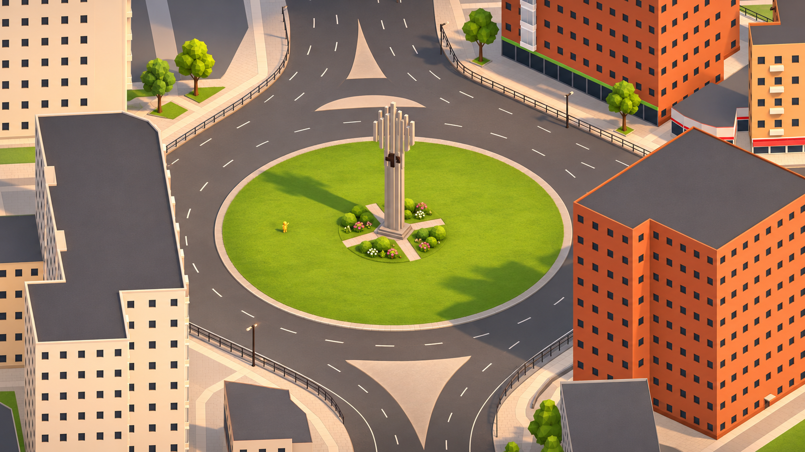

# Визуальный стиль Syktyvkar Underground

**Рабочее название направления: «Солнечный изометрический город».**

Дата фиксации: **12 ноября 2026 года**. Пользователь выбрал приведённый ниже кадр как ориентир для переработки игровых ассетов. Гайд описывает перенос его художественных качеств в существующие 3D-модели и работающую игровую сцену.

Целевой образ — **узнаваемый Сыктывкар в виде аккуратной, солнечной, объёмной игровой миниатюры**. Простая архитектурная геометрия, тёплые кремовые и терракотовые фасады, спокойные тёмные крыши, свежая зелень, гранёные кроны и мягкие направленные тени образуют один согласованный мир. Предметы достаточно просты для браузерной игры и достаточно завершены, чтобы город хотелось рассматривать.

## 1. Главный референс



| Файл | Назначение |
| --- | --- |
| [syktyvkar-style-reference.png](art/references/syktyvkar-style-reference.png) | Главный художественный эталон. Исходный PNG **1672 × 941**, сохранён без изменения пикселей и повторного сжатия. |
| [syktyvkar-original-frame.png](art/references/syktyvkar-original-frame.png) | Исходный игровой кадр **1920 × 1080**. Показывает, из какого состояния получен референс. |
| [syktyvkar-style-reference.prompt.txt](art/references/syktyvkar-style-reference.prompt.txt) | Точный исходный запрос к встроенному `image_gen.imagegen`. История получения изображения. |
| [reference-manifest.json](art/references/reference-manifest.json) | Происхождение, размеры и SHA-256 сохранённых файлов. |

Материалы находятся в постоянной папке документации, за пределами игнорируемого `output/`. Главный PNG не заменять новой генерацией, апскейлом, изображением с титрами или кадром из MP4. Эксперименты сохранять отдельными файлами.

### Как разрешать различия между референсом и существующим объектом

1. **Художественное исполнение** определяют главный PNG и этот гайд: свет, цвет, материалы, степень условности, качество силуэта и деталей.
2. **Идентичность, размеры, размещение, этажность, проходы и физику** определяют текущие исходники и документация конкретного объекта.
3. AI-изображение не является новым обмером города. Небольшие перестановки окон, изменения пластин памятника и другие локальные интерпретации не переносить буквально, если они противоречат устройству объекта.
4. Для категорий, не показанных подробно, ниже даны **правила расширения стиля**. По крошечной фигурке на изображении нельзя восстановить подробный дизайн персонажа или его анимацию.

Числа для roughness, фасок, детализации и света ниже — **стартовые ориентиры реализации**, а не параметры, извлечённые из генератора. Итог проверяется в игре при одинаковых условиях просмотра.

## 2. Художественная идея

Город ощущается живым, ухоженным и доброжелательным. Узнаваемые дома, дороги и памятники остаются основой; привлекательность возникает из ясной формы, хорошего света, согласованной палитры и небольшого количества выразительных деталей.

У объектов есть масса и опора. Здание стоит на земле, бордюр отделяет газон от дороги, куст отбрасывает небольшую тень, у памятника читается постамент. Особенно важны места соприкосновения: без них даже красивый цвет превращает сцену в набор разрозненных примитивов.

Степень условности соответствует качественной игровой диораме. Ствол можно показать несколькими гранями, окно — тёмным прямоугольником, крону — группой многогранных объёмов. При этом вертикали домов остаются ровными, дорожные кривые — аккуратными, повторяющиеся элементы — согласованными.

### Опорные признаки

| Признак | Проявление |
| --- | --- |
| Солнечность | Тёплые освещённые поверхности, читаемые тени, светлые тротуары, ясная зелень. |
| Объём | Направленный свет, контактные тени, небольшая толщина бордюров, цоколей и кромок. |
| Архитектурная аккуратность | Чёткие плоскости, ритм окон, чистые стыки, минимум случайной мелкой геометрии. |
| Умеренная миниатюрность | Небольшой собранный мир при сохранении реальных игровых размеров и пропорций. |
| Избирательная гранёность | Видимые грани прежде всего на кронах, кустах и небольших органических формах. |
| Контролируемая насыщенность | Выразительная зелень и терракота; дороги, крыши, ограды и тени поддерживают их спокойными тонами. |
| Чистота | Крупные ухоженные поверхности, сдержанная фактура, отсутствие повсеместной грязи и сколов. |
| Узнаваемость места | Сохранение характерных корпусов, вывесок, памятников, цветов и планировки. |

## 3. Разбор изображения

Светлый угловой дом слева и терракотовый дом справа имеют крупные спокойные фасады с регулярными тёмными окнами. Тёмные крыши образуют цельные плоскости с тонкой светлой или цветной кромкой. На них нет случайного нагромождения оборудования и контрастной фактуры.

Центральный зелёный остров отделён от серо-коричневого асфальта светлым бордюром. Памятник занимает центр композиции. Вокруг основания расположены компактные кусты, светлые дорожки и небольшие белые и розовые акценты. Большая часть газона свободна.

Кроны состоят из округлых многогранных масс. Разница между светлыми и тёмными гранями даёт объём, не дробя дерево на пёстрые треугольники. Стволы простые, тёплые коричневые. Каждое дерево имеет ясное место на тротуаре или в посадочной зоне.

Свет тёплый и направленный. В этом ракурсе длинные тени уходят преимущественно влево; освещённые и теневые стороны различаются тоном и температурой. Это характеристика кадра, а не требование поворачивать солнце вслед за камерой.

### Иерархия чтения

1. Улицы, крупные корпуса и центральный зелёный остров.
2. Памятник, кроны деревьев, входы и особенности фасадов.
3. Окна, бордюры, ограды, цветники и небольшие предметы.
4. В игре персонаж и доступные взаимодействия должны читаться поверх этой структуры.

Деталь, привлекающая больше внимания, чем сам объект, требует упрощения или снижения контраста. На общем плане важнее светлые и тёмные массы, чем число мелких элементов.

## 4. Язык формы и геометрии

### 4.1. Три уровня формы

**Основная форма** определяет узнаваемость: контур здания, высота корпуса, профиль крыши, силуэт памятника, масса кроны. Закончить её до работы над мелочами.

**Вторичная форма** объясняет устройство: цоколь, парапет, оконные группы, крыльцо, козырёк, основные ветви, несколько объёмов куста. Она читается с обычной игровой камеры.

**Мелкая форма** добавляет завершённость: фаски, бортики клумб, редкие цветы, простая плиточная сетка. Если она видна только в крупном увеличении, её стоимость должна быть минимальной.

### 4.2. Правила моделирования

- Стены и крыши строить из чистых плоскостей. Случайное смещение вершин и намеренно кривые вертикали этому стилю не соответствуют.
- Архитектурные углы оставлять собранными. Небольшая фаска может ловить свет; большое скругление не должно превращать дом в мягкую игрушку.
- Грани органических объектов делать достаточно крупными, чтобы они читались как форма. Мелкая триангуляция без изменения силуэта создаёт шум.
- Flat shading применять избирательно. На кроне он полезен; на ровной стене или асфальте диагональ триангуляции не должна быть видна.
- Число граней круглых объектов выбирать по размеру на экране. Небольшому столбу обычно достаточно 8–12 сторон; крупный круглый газон должен восприниматься окружностью.
- Повторяющиеся окна, секции оград и бордюры строить в общем ритме. Варианты допустимы там, где объект действительно неоднороден.
- Небольшое декоративное преувеличение допустимо для читаемости деталей. Масштаб здания, ширина прохода и физический размер предмета таким способом не меняются.
- Формы должны работать с нескольких направлений. Вид фасада не может зависеть от единственного удачного ракурса.

### 4.3. Толщина и контакт с землёй

Кромки крыш, цоколи, постаменты и бордюры дают тонкую светотеневую границу. Для небольших архитектурных фасок начальный ориентир — несколько сантиметров в реальных единицах, если это заметно на целевой камере. Размер подбирается по объекту.

Исключать щели, наложенные плоскости и зависание над землёй. Ствол входит в грунт или посадочное основание, ножка скамейки касается покрытия, постамент опирается на площадку. Декоративная тень не должна маскировать неверную геометрию.

## 5. Палитра

### 5.1. Цветовые роли

Основа — тёплые светлые фасады, терракота, нейтральные тёмные крыши и асфальт. Зелень даёт главную живую насыщенность. Небольшие розовые, белые и жёлтые акценты появляются там, где они объяснимы предметом или посадкой.

Соседние материалы различаются ролью и светлотой: тротуар светлее дороги, окно темнее стены, крона имеет освещённые верхние и более глубокие внутренние объёмы.

### 5.2. Приближённые экранные ориентиры

Таблица описывает **sRGB-палитру изображения**. Часть ориентиров взята с освещённых или затенённых участков референса. Это не готовые `baseColorFactor`: в значениях уже присутствует свет. Для материала подбирать более нейтральную основу и оценивать её под общим освещением.

| Роль | Ориентир | Применение |
| --- | --- | --- |
| Кремовый фасад на солнце | `#F8CEA7` | Светлая штукатурка и освещённый камень. |
| Нейтральный светлый фасад | `#E8DFCF` | Отправная точка для менее тёплых белых корпусов. |
| Терракотовый фасад | `#E4763C` | Основная тёплая архитектурная масса. |
| Терракота в тени | `#B34D2C` | Ориентир тонального диапазона; не обязательная отдельная краска на теневой стороне. |
| Графитовая крыша | `#5F575A` | Большая спокойная матовая плоскость. |
| Тёмное окно | `#242A2F` | Почти чёрное с холодным оттенком. |
| Асфальт в тёплом свете | `#75655E` | Нейтральный серо-коричневый фон. |
| Светлое мощение | `#E7D2B7` | Тротуары, дорожки, светлые края покрытий. |
| Дорожная разметка | `#F3E8D1` | Читаемые тёплые светлые линии. |
| Газон на солнце | `#A0B122` | Свежая желтоватая зелень без кислотного свечения. |
| Светлая грань кроны | `#A6B62D` | Верхние освещённые объёмы. |
| Средний тон листвы | `#6E8319` | Основная масса кроны и кустарника. |
| Глубина листвы | `#465F23` | Внутренние объёмы и затенённые участки. |
| Древесина | `#8B5B35` | Стволы, деревянные части предметов. |
| Светлый камень памятника | `#D8C6A6` | Тёплый светлый камень под сценовым освещением. |
| Тёмная скульптурная деталь | `#493A31` | Небольшой контрастный акцент. |
| Цветочный розовый | `#DD7FA0` | Небольшие локальные группы. |
| Цветочный белый | `#F6EDD9` | Редкие светлые акценты среди зелени. |

### 5.3. Правила сочетания

- Обычному объекту достаточно основной массы, поддерживающего тона и небольшого акцента. Реальные особенности объекта могут требовать больше цветов.
- Вариативность соседних деревьев и домов задавать узким диапазоном оттенков, а не полностью случайной палитрой.
- Существующие узнаваемые признаки сохранять: красную вывеску, синий киоск, розовый корпус нельзя автоматически перекрасить в кремовый.
- В светлых участках остаются детали стены и окна; в тёмных — форма ствола, крыши и предмета.
- Общая желтизна экрана не заменяет тёплый свет. Серые поверхности продолжают восприниматься серыми, зелёные — зелёными.
- Цвет игрока и сигналы взаимодействия остаются различимыми на фоне этой палитры.

## 6. Материалы и фактуры

### 6.1. Общий принцип

Материалы преимущественно матовые или сдержанно полуматовые. Они различаются цветом, формой, характером блика и небольшой фактурой. Блестящий пластик на всём городе разрушает характер референса.

| Материал | Внешний вид | Стартовая roughness для PBR |
| --- | --- | --- |
| Штукатурка, светлый бетон | Ровная матовая поверхность, мягкий рассеянный свет | 0,8–1,0 |
| Терракотовая облицовка | Однородная тёплая масса, без повсеместной мелкой кирпичной сетки | 0,75–0,95 |
| Крыша | Тёмная плоскость с очень слабой неоднородностью | 0,8–1,0 |
| Асфальт и мощение | Спокойная поверхность без искрящихся микробликов | 0,85–1,0 |
| Древесина | Тёплая; структура досок читается крупными формами | 0,7–0,95 |
| Листва | Матовая, с ясными светлыми и тёмными гранями | 0,8–1,0 |
| Окрашенный металл | Тёмный тонкий силуэт, небольшой широкий блик | 0,55–0,85 |
| Игровые предметы | Характер зависит от предмета; допустим более заметный широкий блик | 0,45–0,85 |

Для большинства поверхностей использовать `metallic = 0`. Ограда покрыта краской и не требует металлического отражения всей поверхности. Непокрытый металл или бронза допустимы у конкретных небольших деталей.

Диапазоны относятся к PBR-материалам. Не добавлять `roughness` в тип материала или рецепт, который не поддерживает это поле. Сначала проверить маршрут рендера.

### 6.2. Окна и стекло

Окно жилого дома читается как тёмное углубление или плоскость. Важны прямоугольный силуэт, повторяемый размер и аккуратная посадка. Допустим небольшой откос или сдержанное различие оттенков. Окна зданий по контуру по умолчанию утоплены на 0,2 м: откосы затенены заранее, переплёт добавляется только там, где он виден на фото.

Обычным окнам не нужны прозрачные интерьеры и случайные яркие отражения. Витрины и архитектурное остекление сохраняют свою функцию: их можно сделать немного более холодными и светлыми, оставляя регулярные стойки и рамки.

### 6.3. Фактуры

В референсе видны мягкая неоднородность травы, спокойная поверхность асфальта и намёк на плитку. Эти эффекты находятся ниже уровня основных форм.

- Сначала добиться результата цветом, геометрией и светом. Текстура решает конкретную видимую проблему.
- Слабая низкочастотная вариация предпочтительнее высококонтрастного шума.
- Избегать фотографий кирпича, травы и камня с детализацией, резко отличающейся от остального мира.
- Швы плитки тонкие и спокойные. На среднем плане покрытие объединяется в цельную площадь.
- Не запекать длинные направленные солнечные тени в цвет: они конфликтуют с реальным освещением.
- Локальное затемнение стыков допустимо, если не создаёт двойную тень и чёрную обводку.
- Материал стен (кирпич, доска, сайдинг, панели, плитка, профлист, блоки, штукатурка) рисуется процедурно в шейдере, без файлов текстур: швы тонкие, вблизи читается материал, на среднем плане рисунок переходит в средний цвет. В режиме economy рисунок выключен.
- Использовать общий атлас или переиспользуемую фактуру, где это разумно. 512–1024 px — возможная стартовая оценка небольшого общего атласа, не обязательный размер каждой модели.

### 6.4. Цветовое пространство

В текущем сборщике цвета рецептов — sRGB `#RRGGBB`; glTF `baseColorFactor` и запекаемые vertex colors переводятся в линейное пространство. Перевод уже есть в [glb.ts](../tools/world-build/src/glb.ts) и [merge.ts](../tools/world-build/src/merge.ts).

Не делать повторную гамма-коррекцию и не переносить экранный цвет напрямую в линейный `baseColorFactor`. Сравнивать процедурные модели, импортированные GLB, динамические предметы и аватары в одной контрольной сцене: у них различаются пути создания материалов.

## 7. Свет, тени и камера

### 7.1. Сценовое освещение

Нужен один понятный солнечный свет и мягкое заполняющее освещение неба. Освещённые стороны тёплые, теневые немного нейтральнее или прохладнее. Внутри тени остаётся достаточно света, чтобы читать окна, стволы и форму предмета.

Солнце выявляет толщину бордюров, грани крон и вертикальный ритм памятника. Для первого подбора можно исследовать высоту примерно 35–50° над горизонтом, выбирая её по кадру и читаемости.

Тени выразительные, с умеренно мягким краем. Контакт у основания предмета плотнее, чем дальний край длинной тени. Исключить как чёрные вырезанные пятна, так и чрезмерное размытие, лишающее объект опоры.

Направление света сохраняется в мировом пространстве при повороте камеры. Перемещение области shadow map за игроком допустимо; вращение солнца ради одинаковой тени на экране — нет.

### 7.2. Существующий рендер

В [world-view.ts](../apps/client/src/rendering/world-view.ts) используются ортографическая камера, `HemisphericLight` и `DirectionalLight`. На момент подготовки гайда:

- основной свет: направление `(-0.6, -1, -0.35)`, цвет `#fff2da`, intensity `1.25`;
- заполняющий свет: `#c7e0e9`, intensity `0.86`;
- карта теней: 1024, `useBlurExponentialShadowMap`, `blurKernel = 16`;
- `economy` отключает тени и снижает внутреннее разрешение через [render-quality.ts](../apps/client/src/rendering/render-quality.ts).

Это существующие значения, а не готовый пресет нового стиля. Сначала разделить вклад модели, материала, контактных деталей и света. Не компенсировать все различия чрезмерным exposure или насыщенностью. Перед реализацией сверить настройки с актуальным кодом.

### 7.3. Камера и оценка

Референс имеет изометрическое ощущение: параллельные вертикали и слабое перспективное сокращение. Сохранять существующую ортографическую проекцию игры. Текущая `beta = π/3.15` измеряется от вертикальной оси и соответствует примерно 33° над землёй.

Проверять обычный игровой масштаб, крупный план и вид издалека, как минимум четыре основных направления и непрерывный поворот. Изменение управления камерой не является необходимым условием смены стиля моделей.

### 7.4. Постобработка

Допустимы аккуратное сглаживание, мягкая тональная коррекция и умеренное затемнение контактов, если их цена измерена. Глубина резкости, сильная виньетка, размытие движения, хроматические аберрации, агрессивный bloom и толстая контурная обводка не относятся к направлению.

Нужный вид должен воспроизводиться в игровой сцене. Цветокоррекция готового ролика и AI-дорисовка скриншота не доказывают обновление игровых моделей.

## 8. Архитектура

### 8.1. Фасады

- Сохранить контур, высоту, этажность, характерные секции, входы и особенности здания.
- Основной фасад дать спокойной цветовой массой. Ритм формируют упорядоченные тёмные окна.
- Углы, простенки и оконные ряды должны быть чистыми: без наложенных поверхностей, случайной глубины и z-fighting.
- Цоколь, основную стену и завершение разделять там, где это поддерживает объект. Не добавлять одинаковый пояс каждому зданию.
- Откосы, козырьки и небольшие выступы помогают свету и узнаваемости.
- Кирпичный или панельный характер можно выразить оттенком, крупными швами и членением. Сетка каждого кирпича не обязательна.
- Сохранять балконы и лоджии, если они определяют текущий объект. Упрощение не должно стирать отличия между домами.

### 8.2. Крыши

Большая тёмная графитовая масса с широкими спокойными плоскостями. Светлая кромка, невысокий парапет или карниз отделяют её от стены. Существующие скаты, формы и перепады высоты сохраняются.

Слуховые окна, выходы и оборудование добавлять или сохранять по исходному объекту. Произвольные трубы ради детализации не нужны. Крыша не должна давать белые зеркальные блики.

### 8.3. Входы, витрины и вывески

Вход читается компактной группой: дверь, крыльцо, козырёк, при необходимости вывеска. Сохраняются проходы и входные зоны.

Тексты и логотипы брать из исходников и документации здания. Ошибочные буквы AI-изображений не использовать. Отсутствие надписей на референсе означает очищенный демонстрационный кадр, а не решение убрать вывески или игровой интерфейс.

Театр, школа, университет, магазины и исторические корпуса сохраняют собственные признаки. Единство достигается качеством форм, материалами и светом.

## 9. Дороги, земля и покрытия

**Асфальт:** спокойный серый с тёплым оттенком, крупная гладкая масса со слабой фактурой. Сохраняются полосы, перекрёстки, направления и контуры кольца.

**Разметка:** светлая, ровная, согласованной ширины. Она не светится и не меняет организацию дороги.

**Тротуары:** светлые песочно-кремовые поверхности. Плитка различима вблизи; издалека покрытие объединяется в чистые полосы.

**Бордюры:** ясная сдержанная граница. Толщина полезна там, где видима; моделирование каждого камня не обязательно.

**Газоны:** связные зелёные массы с читаемыми тенями. Не заполнять все поверхности индивидуальными травинками. Слабая вариация цвета привязана к поверхности и стабильна при движении.

Контуры, проходимость, высоты и принадлежность ячейкам сохраняются. Высоты декоративных слоёв согласовать с [правилами моделей](building-assets.md), чтобы исключить мерцание.

## 10. Деревья, кусты и цветники

### 10.1. Деревья

Главный признак — **компактная округлая крона из нескольких гранёных масс**. В ней есть небольшая асимметрия и иерархия объёмов, а силуэт остаётся собранным.

Стартовый способ: один основной объём и 2–5 перекрывающихся дополнительных. Подойдут низкодетализированные выпуклые многогранники или icosphere малой плотности. Это описание формы, а не требование объявить неподдерживаемый примитив в JSON.

- Размер и положение объёмов варьировать умеренно. Крона не должна выглядеть идеальным шаром или россыпью несвязанных камней.
- Использовать несколько согласованных зелёных тонов. Свет работает через нормали; случайная окраска каждой грани недопустима.
- Ствол тёплый коричневый, простой, с небольшим сужением. Под кроной видно основание.
- Породные различия сохраняются. Ель не превращать в лиственное дерево: перенести на неё принципы цельного силуэта, ограниченной палитры и аккуратных граней.
- Масштаб и место посадки сохраняются. Пышная крона не должна неожиданно перекрывать проход или постоянно закрывать игрока.
- Процедурные варианты детерминированы. Форма не меняется при пересборке или повторной загрузке ячейки.

Текущие деревья используют instancing: округлый профиль `broadleaf` с запечённым AO либо хвойный профиль `spruce`. Две записи конусов в исходном рецепте задают габариты; отдельный GLB дерева не выпускается. Профиль листвы общий для шаблона отрисовки, генерации эталона и проверки пересечений.

### 10.2. Кусты

Низкие плотные группы округлых гранёных масс. Верх светлее, между объёмами есть глубина. Основание соприкасается с землёй; куст не стоит на невидимой ножке.

В группе сочетать 2–3 размера и близкие оттенки. Для свободной посадки не размножать один конус по идеально одинаковой сетке.

### 10.3. Цветники

Цветы — небольшие белые и розовые акценты среди зелени, сосредоточенные у памятника. Большая часть газона свободна.

На обычной камере достаточно нескольких простых цветовых групп. Лепестки и тонкие стебли оправданы только видимым размером. Не создавать отдельные mesh и материал для каждого цветка.

Посадки располагать в существующих декоративных зонах, сохраняя пандусы, проходы и обзор. Озеленение AI-референса — художественный ориентир, а не новая утверждённая схема благоустройства всей карты.

## 11. Памятники и заметные городские объекты

«Трудовая слава» — контрольный объект: светлые вертикальные элементы, разные высоты пластин, тёмный центральный акцент, основание и озеленение читаются отдельно и в общем силуэте.

Сохранить устройство из [описания участка](ring-block.md): холм, пандусы, постамент, пилоны, медальон и ориентацию пластин. Не заменять реальную композицию случайной вариацией сгенерированного изображения.

Скульптуры передавать крупными узнаваемыми массами, опорой и контрастом материалов. Мелкая анатомия и каменная фактура вторичны; поза, направление и характерный атрибут остаются различимыми.

Киоски, фонтаны и павильоны получают ту же аккуратность, что и дома, сохраняя собственные цвета и устройство. Вода, если присутствует, — спокойная читаемая поверхность с умеренным бликом. Сложные отражения и эффекты не обязательны для соответствия стилю.

## 12. Небольшие городские объекты

Ниже — расширение направления на категории, не показанные подробно в эталоне.

| Категория | Правило |
| --- | --- |
| Ограды и перила | Тёмный спокойный материал, ритм стоек, читаемая толщина. Сохранить ворота; исключить частую мерцающую сетку. |
| Фонари | Простая стойка и выраженный светильник. Небольшая светлая головка; днём не требуется заметное свечение. Уникальные многорожковые формы сохраняются. |
| Светофоры | Тёмный корпус, правильная ориентация, отдельные различимые сигналы. |
| Скамейки | Несколько крупных досок, простые опоры, тёплая древесина, сдержанный металл. |
| Урны и ёмкости | Ясный силуэт и отверстие или крышка; минимум вторичной геометрии. |
| Остановки | Ровные стойки, крыша с толщиной, ограниченное остекление и сохранённая доступность пространства. |
| Знаки | Читаемый цветовой блок и правильная форма. Мелкий текст не заменяется случайными символами. |

Издалека элементы образуют порядок. Если тонкие линии сливаются в мерцающее пятно, упростить форму или отображение на расстоянии.

## 13. Игровые предметы, персонажи и интерфейс

### 13.1. Предметы

Сохранять отличимость и игровой смысл. Окружение спокойнее; предмет может иметь немного более выразительный цвет и силуэт.

| Текущий тип | Направление переработки | Инвариант |
| --- | --- | --- |
| `wooden-crate` | Тёплая древесина, крупное деление на доски или ремни, небольшие фаски | Размер, опора, физические параметры |
| `confidence-monument` | Тёмная цельная скульптурная масса, читаемые грани, сдержанный блик | Характерный силуэт, тёмный цветовой смысл, высота 4 м |
| `giant-soap` | Чистая розовая форма, мягкие края, широкий аккуратный блик | Габариты и низкое трение |
| `giant-domino` | Тёплая светлая кость, крупные тёмные точки, ясная центральная линия | Размер и форма для цепных падений |
| `watermelon-ball` | Зелёная округлая масса, небольшое число читаемых тёмных полос | Радиус, упругость, узнаваемый рисунок |

Предпросмотр размещения и сам предмет используют согласованную модель. Не менять массу, трение, упругость и правила размещения ради внешнего вида.

### 13.2. Персонажи

Референс подтверждает уместность маленькой игрушечной фигуры, но не задаёт её подробный дизайн. Переносить чистоту силуэта, свет и материалы, сохраняя идентичность скинов.

- Сохранить `minifigure`, `standard`, общий каркас и пользовательский цвет одежды.
- Голова, руки и ноги различимы на обычном масштабе. Крупные цветовые зоны важнее мелкого орнамента.
- Допустимо более мягкое сглаживание, чем у листвы, если оно поддерживает форму.
- Белые блики не скрывают выбранный цвет персонажа.
- Сохранить суставы, опору, фазу анимации, физическую капсулу и действия.
- Проверить поворот, ходьбу, бег, доступные жесты и движение у стен. Статичной позы недостаточно.

### 13.3. Иконки и интерфейс

Референс задаёт прежде всего 3D-мир. Он не утверждает новую типографику, логотип или полный редизайн интерфейса. Изображения предметов могут использовать новые модели и общий свет. Чат, реакции, управление и индикаторы сохраняют читаемость. Удаление UI из рекламного кадра не переносится в игру.

## 14. Устойчивость изображения в движении

Стиль должен сохраняться при повороте камеры и смене масштаба. Проверять непрерывное движение внутри игры.

- Исключить z-fighting разметки, декалей, окон и бордюров.
- Исправить нормали, если на плоском фасаде видна диагональ или свет скачет при повороте.
- Проверить ограды, оконные сетки и грани листвы на мерцание; снижать избыточную частоту и контраст.
- Не использовать прозрачные плоскости для каждой веточки или окна без необходимости: они осложняют сортировку, тени и исчезновение заслоняющих объектов.
- Сохранить механизм видимости игрока за домом. Детали следуют своей группе прозрачности.
- Не запекать размытие или интерполированные видеокадры в ассет.
- Цвет, форма и процедурная фактура стабильны во времени.
- Если вводится LOD, сохранять силуэт и проверять переключения. Наличие такой системы сейчас не предполагается автоматически.

## 15. Детализация и производительность

Рост числа треугольников сам по себе не улучшает стиль. Сначала работать с силуэтом, палитрой, нормалями, контактами и светом.

Для первых прототипов возможен ориентир: десятки граней на один объём кроны и несколько сотен треугольников на обычное дерево. Это стартовая оценка, не общий лимит. Размер города, число экземпляров и измерения важнее произвольного бюджета одной модели.

- Переиспользовать геометрию и материалы, сохраняя идентичность, тени, прозрачность и выгрузку объектов.
- Не создавать материал на каждую грань, окно или цветок. Использовать общий материал, vertex colors и поддерживаемое объединение частей.
- Художественно целый объект сохраняет собственный ID и жизненный цикл. Весь квартал не объединяется в новую неделимую модель ради draw calls.
- Учитывать размер GLB, сборку, загрузку, подготовку ячеек, видеопамять, материалы, draw calls и видимые треугольники.
- Сравнивать frame time при одинаковых renderer, viewport, масштабе, числе игроков, качестве и прогреве. Одного среднего FPS недостаточно.
- В `economy` цвет и силуэт остаются читаемыми без теней. Главные особенности не должны существовать только в постобработке.
- Проверять поведение на поддерживаемых размерах экрана; мелкие декоративные детали не должны ухудшать читаемость на мобильном устройстве.

В проекте есть [сравнительный профиль рендера](../tests/browser-render-profile.ts), команда `pnpm test:render:browser`. Он оценивает стационарную сцену с одним клиентом и не заменяет проверку полного города, движения и мобильного оборудования.

## 16. Где применять стиль в проекте

Перед реализацией сверить маршруты с актуальной рабочей копией. Здесь перечислены проверенные источники, а не новые предполагаемые подсистемы.

| Область | Маршрут |
| --- | --- |
| Здания и каталог | `content/buildings/ring-block/`, `content/buildings/ring-block/catalog.json` |
| Самостоятельные статические объекты | `content/buildings/ring-block/objects/<assetId>/` |
| Ручные памятники и штучные объекты | `content/buildings/ring-block/manual/` |
| «Трудовая слава» | `content/buildings/ring-block/manual/trudovaya-slava/` |
| Основание и слои покрытия | `content/buildings/ring-block/ring-block-ground/source.json` |
| Определение мира и первоначальный seed | `content/worlds/ring-block/` |
| Городские формы | `tools/world-build/src/city.ts` |
| Деревья | `tools/world-build/src/tree-instances.ts`, `apps/client/src/rendering/tree-geometry.ts` |
| Детали фасадов | `tools/world-build/src/facade.ts` |
| Конструктор объектов | `tools/world-build/src/kit.ts` |
| GLB и объединение частей | `tools/world-build/src/glb.ts`, `tools/world-build/src/merge.ts` |
| Свет и тени | `apps/client/src/rendering/world-view.ts` |
| Качество | `apps/client/src/rendering/render-quality.ts` |
| Здания и прозрачность | `apps/client/src/rendering/buildings.ts`, `apps/client/src/rendering/occlusion.ts` |
| Предметы | `apps/client/src/rendering/items.ts`, `content/items/catalog.json` |
| Физические формы предметов | `packages/contracts/src/item-shapes.ts` — сохранить поведение |
| Персонажи | `apps/client/src/rendering/avatars/`, включая `skins/` |

Работать с собственными исходниками. Сгенерированные GLB, результаты `world:build` и `apps/client/public/generated/` не редактировать вручную вместо источника. Автоматический импорт из OSM удалён; для смены стиля он не нужен.

**Размещение уже существующего мира хранится в PostgreSQL.** JSON-ячеек достаточно для первоначального seed, но их изменение не переставляет объекты действующей игры. Художественная работа должна сохранять текущее размещение; любые необходимые изменения проходят штатный маршрут из [operations.md](operations.md).

### Ограничения маршрута

Процедурный экспорт сейчас задаёт `metallicFactor = 0`, `roughnessFactor = 0.9`. Для другого материала сначала проверить возможности существующего пути. Расширение рецепта должно быть явным и совместимым; произвольное новое поле само ничего не меняет.

Поддерживаемый `kit` имеет ограниченный набор фигур. Новый примитив для гранёной кроны требует реализации в сборщике; альтернативой является авторский GLB.

Правила импорта, semantic parts, коллайдеров, единиц и сборки — в [building-assets.md](building-assets.md). Статический GLB-профиль имеет ограничения по структуре и возможностям; не считать, что он автоматически поддерживает skeleton, анимацию или любые extensions. Маршрут персонажа описан отдельно в [avatar-skins.md](avatar-skins.md).

## 17. Инварианты переработки

Визуальное исполнение меняется с сохранением идентичности игрового мира.

- Сохранить `assetId`, `entityId`, ID типов предметов и скинов.
- Сохранить размещение, ориентацию, основные контуры, размеры, этажность и проходы, если отдельное поручение не требует другого.
- При чисто визуальной работе сохранить коллайдеры и параметры симуляции. Физически значимые изменения явно отделять и проводить штатным способом.
- Обновлённые визуальные `bounds` включают всю геометрию. Старый коллайдер не оправдывает неверные границы или обрезанные детали на краях ячеек.
- Сохранить метры, Y вверх, локальные координаты и pivot. Не исправлять масштаб скрытым runtime `scale`, которого нет в контракте размещения.
- Сохранить semantic tags, роли `wall` / `roof` / `detail` и группы прозрачности. Козырёк не остаётся непрозрачным отдельно от исчезнувшей стены.
- Сохранить самостоятельность объектов, потоковую загрузку, выгрузку ресурсов и переиспользование моделей.
- Не менять сохранённые вещи, инвентари, аккаунты, сетевой протокол и БД без необходимости отдельной задачи.

Визуально свободный проход остаётся проходимым, опора соответствует модели, арка не получает сплошной коллайдер вокруг всего объёма.

## 18. Порядок работы Codex

### 18.1. Исходное состояние

Прочитать гайд, открыть PNG, определить реальные источники выбранных ассетов. Сохранить одинаковые игровые виды до изменений, ID, границы и сведения о физике. Записать условия и исходные показатели производительности.

### 18.2. Контрольный набор

Сначала отработать стиль на связанной группе:

1. Светлый многоэтажный дом.
2. Терракотовый дом с тёмной крышей.
3. Лиственное дерево и кусты.
4. Участок дороги, тротуара и газона.
5. Памятник с основанием и посадочными зонами.
6. Один предмет и один персонаж для сопоставления масштаба и материалов.

Это проверка качества перед массовым переносом, а не обязательный дополнительный этап согласования. Убедиться, что объекты образуют одну сцену, затем переносить решения на остальные категории в пределах поручения.

### 18.3. Общие правила

Определить переиспользуемые цвета, материалы, параметры форм, способы создания фасок и озеленения. Не дублировать десятки почти одинаковых значений и не сводить уникальные здания к одному шаблону.

Настроить общий свет на контрольном наборе. Объект не должен требовать собственного особого освещения, чтобы выглядеть согласованно.

### 18.4. Массовая переработка

Идти от крупных масс к деталям: покрытия и корпуса → крыши и фасады → деревья и кусты → памятники и штучные объекты → уличные детали → предметы и персонажи.

Для каждого ассета сначала проверить силуэт, затем материалы, затем мелочи. Не выполнять механическую перекраску всего каталога одной палитрой.

### 18.5. Проверка в игре

`pnpm world:build` проверяет сборку контента; `pnpm check` — типы и границы кода. Для затронутой геометрии и загрузки выполнить относящиеся проверки ассетов и зданий; для персонажей — аватаров и анимаций. Подбирать проверки по изменению, не повторять полный набор без новой причины. Актуальные команды — в `package.json` и [testing.md](testing.md).

Визуально проверить четыре ракурса, несколько масштабов, непрерывное движение, прозрачность заслоняющих объектов и `standard` / `economy`. Сравнить с исходным состоянием и референсом.

### 18.6. Представление результата

Приложить список изменённых ассетов и генераторов, изображения до/после, условия просмотра, сборку и проверки, сравнение производительности и известные отличия. Отдельно перечислить изменения геометрии, границ или физики.

AI-картинка, текстура готового скриншота и отретушированный ролик не являются результатом обновления работающих 3D-моделей.

## 19. Критерии приёмки

### Художественная проверка

| Критерий | Признак готовности |
| --- | --- |
| Характер | Солнечный, аккуратный, объёмный и узнаваемый город. |
| Палитра | Кремовые и терракотовые массы, тёмные крыши и зелень согласованы; уникальные цвета сохранены. |
| Форма | Силуэты чистые, архитектура ровная, гранёность поддерживает органические объёмы. |
| Свет | Освещённые и теневые стороны читаются, детали не выгорают и не теряются в черноте. |
| Материалы | Преобладают матовые поверхности; блики и отражения сдержанны. |
| Озеленение | Кроны собранные, кусты имеют опору, цветы локальны. |
| Детализация | Важные признаки видны с обычной камеры; мелочи не создают шум. |
| Узнаваемость | Сохранены особенности конкретных зданий, памятников, вывесок и предметов. |
| Движение | Нет новых мерцаний, скачков формы, дыр и конфликтов прозрачности. |
| Единство | Соседние переработанные объекты выглядят частями одного мира. |

### Техническая проверка

- [ ] Изменены источники, результат воспроизводится штатной сборкой.
- [ ] ID, размещение и защищённая геометрия сохранены либо изменение явно входит в отдельный объём задачи.
- [ ] Коллайдеры, проходы, опоры и параметры предметов не изменены случайно.
- [ ] `bounds`, semantic parts и прозрачность соответствуют итоговой модели.
- [ ] Загрузка, исчезновение за пределами видимости и освобождение ресурсов работают.
- [ ] Предметы и персонажи читаются; их действия и анимации сохранены.
- [ ] Есть одинаковые виды до/после, проверено движение и качество без теней.
- [ ] Измерения соразмерны изменению; необъяснённого роста стоимости нет.
- [ ] Главный референс не перезаписан.

Не оценивать успех только числом полигонов, яркостью или одним крупным скриншотом.

## 20. Типичные ошибки

| Ошибка | Следствие | Исправление |
| --- | --- | --- |
| Только повысить saturation | Прежняя геометрия с более резкими цветами | Работать с силуэтом, материалами, опорой и светом |
| Сделать всё гранёным | Мозаика на стенах и дорогах | Разделить архитектурные плоскости и органические формы |
| Сильно округлить всё | Потеря характера архитектуры | Оставить строгие объёмы и целевые небольшие фаски |
| Слить окна, крыши и тени в чёрное | Потеря объёма | Развести светлоту и оттенки, настроить заполнение |
| Оставить крону из двух конусов | Силуэт референса не появился | Собрать округлые гранёные массы для лиственных деревьев |
| Раскрасить каждый треугольник | Пёстрая крона | Сократить палитру, дать свету работать через нормали |
| Заполнить всё цветами | Потеря спокойной композиции | Сосредоточить акценты в небольших группах |
| Добавить глянец всему | Одинаковый пластиковый материал | Ослабить блик, подобрать поддерживаемые параметры материала |
| Наложить жёлтый фильтр | Белое и серое становятся оранжевыми | Настроить баланс света и базовые цвета |
| Допустить дрожание деталей | Стиль работает лишь на стоп-кадре | Упростить частоту, исправить слои, нормали и сглаживание |
| Перестроить памятник по AI | Потеря идентичности места | Вернуть структуру источника, перенести художественное исполнение |
| Получить красоту только ретушью | Игрок не видит новый стиль | Довести модели и игровой рендер |

## 21. Карточка задачи для ассета

Использовать в рабочем отчёте. Это шаблон описания, не новый формат игрового JSON.

```text
Ассет / ID:
Текущий исходник:
Категория:
Узнаваемые особенности:
Геометрические и физические инварианты:

Изменения основной формы:
Изменения вторичных деталей:
Цветовые роли и материалы:
Связь с главным референсом:
Изменения общих генераторов, если нужны:

Проверка обычного масштаба, крупного плана и четырёх ракурсов:
Проверка движения, теней и прозрачности:
Изменение треугольников / материалов / размера ресурса:
Сборка и релевантные проверки:
Изображения до/после:
Известные ограничения:
```

## 22. Готовое задание Codex

Приложить к поручению, указав конкретную группу ассетов или весь каталог:

```text
Переработай визуальное исполнение выбранных ассетов Syktyvkar Underground
по docs/art-style-guide.md.

Сначала прочитай гайд и открой
docs/art/references/syktyvkar-style-reference.png.
Это главный художественный ориентир. Не регенерируй и не перезаписывай его.
Для сравнения есть docs/art/references/syktyvkar-original-frame.png.

Нужен солнечный аккуратный изометрический 3D-город: тёплые кремовые и
терракотовые фасады, тёмные матовые крыши, спокойные дороги, живая зелень,
округлые гранёные кроны, небольшие цветочные акценты, читаемый объём и
мягкие направленные тени. Работай в моделях, материалах и игровом рендерере.

Сохрани характер объектов, assetId/entityId, размещение, основные размеры,
проходы, коллайдеры, физические параметры, semantic parts, прозрачность и
потоковую загрузку. Не переносить геометрические неточности AI-референса
в реальные памятники и здания. Не изменять механику игры и данные игроков.

Сначала отработай общий набор: светлый и терракотовый дома, дерево,
кусты, покрытия, памятник, предмет и персонаж. Проверь их вместе,
затем распространяй решения на остальные ассеты в пределах поручения.
Используй собственные источники; не возобновляй импорт из OSM.
Размещение действующего мира хранится в БД, JSON служит начальным seed.

Не ограничивайся перекраской. Работай с силуэтом, вторичными формами,
нормалями, материалами, опорой и светом. Избегай случайной мелкой геометрии,
фототекстур, сплошного глянца и толстой контурной обводки.

Проверяй результат в самой игре на разных расстояниях и направлениях,
в движении, в standard и economy. Учитывай производительность и контракты.
Выполни сборку и релевантные существующие проверки.

Представь изменённые источники, перечень ассетов, одинаковые виды до/после,
проверки, измерения и оставшиеся ограничения. Отдельно укажи физически
значимые изменения, если они необходимы и входят в поручение.
AI-иллюстрацию не выдавай за обновлённый игровой рендер.
```
