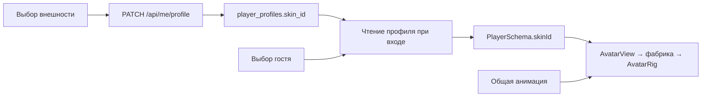

# Общий каркас и библиотека внешности

Библиотека внешности текущей production-версии. Общий расчёт позы описан в [архитектуре персонажей](character-animation.md).

## Разделение ответственности

Персонаж сохраняет одну физическую капсулу и один расчёт походки.
`AvatarRig` задаёт общий каркас `humanoid-v1`: туловище, голову, плечи
и бёдра. Каркас владеет узлами, материалом, цветом одежды, тенями
и освобождением ресурсов. Фабрика скина размещает суставы в спокойной
позе и создаёт геометрию, используя существующие `height` и `radius`.

`CharacterAnimator` рассчитывает общую позу, `AvatarRig.applyPose`
применяет её к суставам. `AvatarView` соединяет каркас, фабрику и аниматор.
Внешность не меняет скорость, коллизии, предсказание или правила мира.
При пересоздании внешнего вида сохраняются корень сущности, кольцо
своего игрока и фаза анимации.

## Каталог

| ID           | Название    | Внешний вид                                                     |
| ------------ | ----------- | --------------------------------------------------------------- |
| `minifigure` | Минифигурка | Жёлтая голова с улыбкой, кисти-захваты и короткие ноги          |
| `standard`   | Стандартный | Прежний человечек с мягкими формами, визором и стройными ногами |

Минифигурка остаётся вариантом по умолчанию для гостей и аккаунтов,
включая существующие профили после миграции. Цвет одежды выбирается
отдельно и работает с обоими скинами.

Общий каталог — [contracts/avatars.ts](../packages/contracts/src/avatars.ts).
Он содержит устойчивые ID, названия, описания и ID совместимого каркаса.
Сервер не загружает геометрию. Клиентские фабрики зарегистрированы в
[skins/index.ts](../apps/client/src/rendering/avatars/skins/index.ts);
тип `Record<AvatarSkinId, ...>` требует фабрику для каждого ID каталога.

Пользователь выбирает подготовленный модуль приложения. Загрузка
произвольных моделей не входит в этот этап. Неизвестный ID при сохранении
или гостевом входе отклоняется. При чтении устаревшего ID из профиля
или отображаемого состояния используется внешний вид по умолчанию.

## Настройка и вход

Перед входом доступны карточки внешности с обычными радиокнопками.
Выбор гостя хранится в `sessionStorage` вкладки и передаётся серверу
при новом входе. Карточки доступны и в режиме без аккаунтов.

У аккаунта скин сохраняется вместе с именем и цветом. Можно нажать
«Сохранить профиль» или сразу «Войти»: перед входом клиент сохраняет
изменённый профиль. Ошибка или конфликт версий останавливает вход
и показывает сообщение. Сервер читает скин аккаунта из БД; клиентский
параметр гостевого входа не переопределяет сохранённый профиль.

Скин виден клиентам, получающим персонажа в своей области интереса. Поле относится к отображению и не
включается в физический снимок. Возврат на старт и переподключение
сохраняют внешний вид текущей игровой сессии. Изменение профиля
в другой вкладке применяется при следующем новом входе в мир.

## Данные и совместимость

В `PlayerProfile` и `ProfileUpdate` добавлено `skinId`. Существующая версия
профиля защищает атомарное изменение имени, цвета и скина от перезаписи.

Добавочная миграция общей схемы БД **v3** создаёт поле
`player_profiles.skin_id text NOT NULL DEFAULT 'minifigure'`.
Имена, цвета, версии профилей и авторизации сохраняются. Ограничение БД
проверяет формат ID, приложение — принадлежность каталогу. Добавление
нового вида не требует изменения SQL-перечня допустимых значений.

Для существующей настроенной БД перед запуском новой версии выполните
`pnpm db:migrate` (или `pnpm db:migrate:built` для собранного сервера).
При старте приложения миграции скрыто не выполняются.

Единый реестр — `apps/server/src/migrations.ts`: v1 создаёт аккаунты,
v2 — предметы и инвентарь, v3 — скины. В раннем варианте ветки
скинов тоже использовался номер 2. Если такая БД уже существует,
команда миграции добавляет недостающие таблицы предметов в той же
транзакции и сохраняет выбранные скины, профили и авторизации.
Номера применённых миграций вручную удалять не требуется.

Сетевой протокол **v11** передаёт `PlayerSchema.skinId`, чат, личные ответы на команды, состояние выбираемых анимаций, подготовку области и игровые часы комнаты. Клиент и сервер выпускаются вместе; проверка совместимости отклоняет старый протокол. Формат мира — v4, ячейки — v2; скины не меняют физическую конфигурацию персонажа.

## Видимость и подготовка области

Подготовка появления и переподключения повторно проверяет аккаунт; скин аккаунта берётся из сохранённого профиля. Статический просмотр не создаёт аватар. Выход персонажа из AOI освобождает его локальный вид, подпись и тени, сохраняя профиль на сервере. При повторном входе в область используется актуальный `skinId` и серверная фаза анимации. Скины не изменяют физический хеш и не требуют новой миграции схемы БД.

## Как добавить следующий скин

1. Добавить устойчивый ID, название и описание в `AVATAR_SKINS`.
2. Создать фабрику в `apps/client/src/rendering/avatars/skins/`, которая
   размещает суставы общего каркаса и создаёт геометрию.
3. Зарегистрировать её в `SKIN_BUILDERS` и добавить иллюстрацию
   `apps/client/public/avatars/<id>.svg`. Карточка появится из каталога.
   При изменении набора поддерживаемых ID повысить `PROTOCOL_VERSION`,
   чтобы уже открытые старые клиенты запросили обновление приложения.
4. Проверить высоту, опору, цвет, тени, прозрачность, очистку ресурсов,
   ходьбу и бег в своём и удалённом клиенте.

Существующие ID не переиспользуются для другой внешности. Скелетные
модели потребуют адаптера к общим суставам. Различающиеся игровые
размеры или способности требуют отдельного решения в симуляции.

Жесты и танец описывают движения общего каркаса и смешиваются с походкой
в `CharacterAnimator` по [архитектуре анимаций](character-animation.md).
Отдельный поток сетевых углов для каждого скина не требуется.

Проверки — в [отчёте о скинах](../reports/avatar-skins.md).
