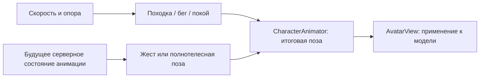

# Персонажи: походка и общая архитектура анимаций

11 ноября 2026 года. Согласованная постановка расширения MVP.
Первый этап реализован: модель с руками и ногами, процедурная походка,
бег, остановка и поза падения. Выбираемые игроком анимации остаются
будущим этапом. Проверки и ограничения — в [отчёте](../reports/characters.md).

Первый этап — сделать персонажей выразительнее с помощью простой модели
и процедурной походки. Возможность выбирать кастомные анимации, видимые
другим игрокам, учитываем в архитектуре сразу, а реализуем отдельным этапом.
Это расширение не меняет исторический состав [v0.1](mvp-network-playground.md).
Общие границы компонентов описаны в [архитектуре](architecture.md).
Внешний вид выбирается из [библиотеки скинов](avatar-skins.md): минифигурка
и стандартный человечек используют общий каркас `humanoid-v1`.

## Реализованная основа

- [WorldView](../apps/client/src/rendering/world-view.ts) размещает виды
  сущностей и подписи. [AvatarView](../apps/client/src/rendering/avatars/avatar-view.ts)
  владеет моделью персонажа, а [CharacterAnimator](../apps/client/src/rendering/avatars/character-animator.ts)
  рассчитывает её позу.
- [PhysicsWorld](../packages/simulation/src/physics-world.ts) управляет
  физической капсулой. Состояние содержит положение, ориентацию, скорость,
  признак опоры `grounded` и `revision` для сбросов положения.
- [GameSession](../apps/client/src/network/session.ts) использует предсказание
  для своего игрока, включая скорость и `grounded`, и интерполяцию для
  остальных. Удалённая походка следует за интерполированной позицией.
- [Клиентские типы отображения](../apps/client/src/presentation/display-state.ts)
  разделяют игрока и предметы и не зависят от рендерера. Локальные
  `motionRevision` и `motionEnabled` позволяют сбросить измерение движения
  и остановить анимацию во время восстановления связи или управления.
- [Реакции](../packages/contracts/src/reactions.ts) уже имеют каталог,
  серверное подтверждение, номер показа и срок окончания. В
  [WorldRoom](../apps/server/src/world-room.ts) дискретные действия используют
  общий `requestId`, проверку `worldEpoch` и кеш результатов повторных запросов.

Движение, отображение и дискретные действия уже разделены. Развиваем эти
границы без нового фреймворка или переноса визуальной анимации в физику.

## Первый этап: модель и процедурное движение

Вариант минифигурки вдохновлён LEGO-человечками: жёлтая цилиндрическая голова
с выступом сверху и простым улыбающимся лицом, трапециевидное туловище,
пояс, слегка согнутые руки с кистями-захватами и короткие цельные ноги
на шарнирах. Цвет одежды определяется профилем игрока; жёлтые детали
и лицо сохраняют свои цвета при перекраске.

Модель собирается из простых объёмов Babylon.js с точками вращения
в плечах и бёдрах. Общую высоту сохраняем относительно физической
капсулы. Ступни в спокойной позе находятся около её нижней границы,
а не ниже неё. Руки и ноги не получают собственных физических тел.

Ноги сохраняют оттенок одежды, компактные прямоугольные ступни немного
темнее. Жёсткие детали при движении вращаются вокруг шарниров, сохраняя
характер игрушечной минифигурки. Визор прежней модели заменён лицом.

| Состояние                  | Визуальное поведение                                                                                  |
| -------------------------- | ----------------------------------------------------------------------------------------------------- |
| Покой                      | Спокойная поза; сохраняется последнее направление взгляда                                             |
| Обычное движение           | Ноги движутся в противофазе; левая рука движется вместе с правой ногой; умеренное покачивание корпуса |
| Бег                        | Увеличиваются размах, наклон вперёд и частота шагов                                                   |
| Остановка или упор в стену | Амплитуда плавно затухает, конечности возвращаются в спокойную позу                                   |
| Нет опоры                  | Цикл шагов затухает, включается простая поза падения                                                  |

Походка зависит от фактической горизонтальной скорости, а не от удержания
клавиш. Малый порог скорости и плавные переходы подавляют дрожание около
остановки. Удержание движения у непроходимой стены не вызывает шаги на месте.

В текущих мирах обычная скорость равна 4 м/с, скорость бега — 14 м/с.
Частота шагов должна иметь верхний предел: ускорение цикла в 3,5 раза
вызывает мельтешение. Максимальная скорость оформляется как подчёркнуто
мультяшный бег; точная фиксация стоп на поверхности в первый этап не входит.
Конкретные амплитуды, длительности переходов и пропорции уточняются
визуальной проверкой в обычном ракурсе и при приближении камеры.

## Расчёт позы и применение к модели

Все движения модели проходят через один `CharacterAnimator`:



`locomotion.ts` рассчитывает базовую позу и не изменяет узлы сцены.
`CharacterAnimator` управляет переходами и смешиванием. `AvatarView`
применяет только итоговую позу: отдельные системы не записывают независимо
повороты одной и той же руки или ноги.

Стабильный корень сущности хранит отображаемую мировую позу. Дочерние узлы
отвечают за сглаженный визуальный разворот, наклон и покачивание корпуса,
плечи и бёдра. Если поворот уже задан корню, визуальная поправка считается
относительно него, чтобы не применять мировой поворот дважды.
Камера, подпись, стикер реакции и кольцо своего игрока привязаны к стабильному
корню и не подпрыгивают вместе с туловищем.

Для частей модели закрепляем устойчивые семантические имена: туловище,
голова, левое и правое плечо, левое и правое бедро. Будущий скелетный
ресурс потребует явного сопоставления с его суставами. Совместимость
произвольных моделей и автоматическое переназначение анимаций не обещаются.

Модули первого этапа и их границы:

| Модуль                                                    | Ответственность                                                                                      |
| --------------------------------------------------------- | ---------------------------------------------------------------------------------------------------- |
| `apps/client/src/presentation/display-state.ts`           | Клиентские типы отображения; явное разделение игрока и ящика; независимость от Babylon.js и Colyseus |
| `apps/client/src/network/session.ts`                      | Подготовка согласованных данных движения и будущего воспроизведения                                  |
| `apps/client/src/rendering/avatars/locomotion.ts`         | Базовая поза, фаза шага и параметры походки                                                          |
| `apps/client/src/rendering/avatars/character-animator.ts` | Переходы и итоговая поза; на первом этапе работает только базовый слой                               |
| `apps/client/src/rendering/avatars/avatar-view.ts`        | Модель, применение позы, материалы, тени и освобождение ресурсов                                     |
| `apps/client/src/rendering/world-view.ts`                 | Жизненный цикл видов сущностей, мировые позиции, камера и подписи                                    |

На первом этапе `contracts`, `protocol` и серверная симуляция не требуют
новых полей ради походки. Нужные значения уже существуют.

## Источники движения и время

Для своего игрока скорость и `grounded` берём из локальной предсказанной
симуляции. Позиция при этом сохраняет существующее визуальное сглаживание.
Серверные коррекции положения не считаются пройденным расстоянием.

Для удалённых игроков темп походки получаем из изменения интерполированной
позиции: конечности должны соответствовать видимому перемещению. Признак
опоры передаётся явно в клиентском состоянии отображения; для будущих
выбираемых анимаций его временная привязка согласуется с интерполяцией.

Аниматор обновляется один раз на отображаемый кадр с прошедшим временем.
Повторные физические шаги при согласовании с сервером не продвигают
визуальную фазу повторно. При смене `revision`, восстановлении соединения,
большом скачке позиции или возвращении из скрытой вкладки пересоздаём
точку отсчёта движения, чтобы не получить лишние шаги. Сброс измерения
движения сам по себе не перезапускает будущую серверную анимацию.

При `prefers-reduced-motion` уменьшаем вторичное покачивание и наклоны,
сохраняя различимость движения и остановки.

## Будущий этап: выбираемые кастомные анимации

Игрок сможет выбрать подготовленную анимацию из каталога и показать её
остальным, как сейчас выбирает стикер реакции. Под кастомными здесь
понимаются наши подготовленные ресурсы. Загрузка файлов самими игроками
и процесс их подготовки остаются отдельной задачей.

Предусматриваем два режима смешивания:

| Режим       | Пример         | Правило                                                                                   |
| ----------- | -------------- | ----------------------------------------------------------------------------------------- |
| `upperBody` | Помахать рукой | Анимация заменяет позу выбранных суставов верхней части тела; ноги продолжают походку     |
| `fullBody`  | Танец, поклон  | Запускается только при наличии опоры и в покое; движение или потеря опоры прерывает показ |

Для `fullBody` началом движения считается принятая сервером ненулевая
команда: попытка уйти отменяет танец даже у стены. Физическое управление
не блокируется. Переход в выбранную позу и обратно выполняется плавно;
базовый слой продолжает рассчитываться под ней.

Одновременно у персонажа активна одна выбираемая анимация. Новый запрос
во время показа отклоняется с оставшимся временем ожидания. Возрождение
или отключение исполнителя прекращает показ. Отключение наблюдателя
не останавливает анимации остальных игроков: после восстановления он
получает их актуальное состояние.

Стикер реакции и телесная анимация — независимые каналы. Можно одновременно
показать реакцию и помахать рукой. Общий механизм дискретных запросов
переиспользуется, но поля и каталоги двух возможностей остаются отдельными.

### Запуск и сетевое состояние

1. Клиент выбирает `animationId` и отправляет `requestAnimation` с общими
   `requestId` и `worldEpoch`.
2. Сервер определяет исполнителя по сессии, проверяет каталог, готовность
   персонажа и условия запуска. Длительность берётся из каталога.
3. Сервер подтверждает запрос через существующий `actionResult` и обновляет
   состояние воспроизведения у игрока.
4. Каждый клиент получает состояние и рассчитывает текущую фазу анимации.
   Первое включение ожидает серверного состояния; отдельное предсказание
   жестов на первом этапе этой возможности не требуется.

Целевая семантика состояния, ещё не добавленная в протокол:

```ts
type AnimationPlayback = {
  sequence: number;
  animationId: string | null;
  startedAtTick: number;
  endsAtTick: number;
};
```

`sequence` увеличивается при новом запуске и досрочной остановке и
сохраняется при очистке активного ID. Повтор снимка не запускает показ
заново. `animationId: null` означает отсутствие активного показа.
Идентичность состояния учитывает `worldEpoch`, `entityId` и `revision`:
состояние из прошлого мира или до возрождения не возобновляет анимацию.
Повтор запроса с тем же `requestId` возвращает прежний результат без
нового запуска.

`startedAtTick` задаёт фазу, `endsAtTick` — конечный срок показа. Даже
зацикленный клип имеет ограниченное сервером время воспроизведения.
Поздно вошедший наблюдатель начинает с актуальной фазы. Если срок истёк,
клиент завершает показ, не ожидая следующего сетевого обновления.

Серверное время переводится в шкалу отображения. Для удалённого игрока
учитывается задержка интерполяции; переходы запуска и остановки удерживаются
в клиентском буфере до соответствующего отображаемого момента. Получение
нового снимка само по себе не означает немедленный переход в его позу.
После восстановления вкладки или соединения фаза вычисляется заново по
времени, а пропущенные циклы не проигрываются ускоренно.

В текущем MVP состояние доступно всем участникам единственной комнаты.
Фильтрация «игроки вокруг» появится вместе с общей сетевой видимостью.
При возвращении персонажа в видимость наблюдатель получает активное
состояние с актуальной фазой, без истории завершённых показов.

### Владение и ресурсы

| Компонент              | Будущая ответственность                                                                       |
| ---------------------- | --------------------------------------------------------------------------------------------- |
| `contracts`            | ID, метаданные каталога и обычные типы запросов и воспроизведения; без зависимостей от движка |
| `protocol`             | Схема запроса и реплицируемые поля игрока                                                     |
| Сервер                 | Проверка запуска, номер показа, время, ограничения и прерывание                               |
| Клиентское отображение | Привязка к времени интерполяции и данным движения                                             |
| `CharacterAnimator`    | Фаза клипа, маска суставов, смешивание и переходы                                             |
| `AvatarView`           | Применение к конкретной модели и владение графическими ресурсами                              |
| `simulation`           | Физическое движение и столкновения                                                            |

Каталог определяет длительность, режим смешивания, правила прерывания
и совместимый тип модели. Клиентские данные связывают ID с ресурсом
и маской суставов. Серверу не требуется загружать графические клипы.

Процедурные позы первого этапа и будущие скелетные клипы используют одну
внешнюю границу аниматора; конкретное сопоставление суставов принадлежит
модели. Чужой клип не считается совместимым только потому, что он в GLB.
Метаданные и визуальные ресурсы должны выпускаться согласованно.
При отсутствии или несовместимости клипа клиент сохраняет базовую позу;
после запоздалой загрузки ресурс можно включить только с актуальной фазы
ещё активного показа.

Выбираемые анимации остаются косметическими: корневое перемещение из клипа
не двигает физическую капсулу, не наносит урон и не меняет взаимодействия.
Атаки, захваты, посадка в транспорт и действия, блокирующие управление,
потребуют отдельных игровых контрактов и правил симуляции.

## Этапы реализации и проверка

### 1. Модель и походка — реализовано

Выделены клиентские типы отображения и согласованы источники движения.
Созданы `AvatarView`, расчёт базовой позы и `CharacterAnimator`, работающий
только с базовым слоем. Реализованы руки, ноги, покой, движение, бег,
остановка и поза падения. Каталог жестов, сетевые поля воспроизведения,
меню выбора и проигрыватель клипов относятся ко второму этапу.

Условия приёмки:

- В двух браузерах видны движения конечностей своего и чужого персонажа;
  старт, остановка, смена направления, обычное движение и бег различимы.
- У стены цикл затухает; при падении персонаж перестаёт шагать по воздуху.
- При 30/60/120 FPS сохраняется темп анимации за одинаковое прошедшее время;
  физическое время и скорости остаются прежними.
- Коррекции, возврат на старт, переподключение и возвращение во вкладку
  не вызывают ускоренных шагов, скачков конечностей и смещения модели от капсулы.
- Поворот и масштаб камеры, подписи, реакции, кольцо своего игрока,
  прозрачность отключённого персонажа и тени работают со всей моделью.
- Удаление персонажа освобождает его узлы, материалы и записи теней;
  общие ресурсы других персонажей сохраняются.
- Выполнены проверка типов и границ пакетов и затронутые проверки движения.
  Визуальный результат подтверждён в настоящем браузере.
- Для восьми видимых движущихся персонажей сравнены время кадра, p95,
  draw calls и число ресурсов до и после изменения в обоих режимах графики.
  Текущий [профиль рендера](../tests/browser-render-profile.ts) с одним
  неподвижным игроком сам по себе эту нагрузку не проверяет.

### 2. Выбираемые анимации — отдельная будущая задача

После первого этапа добавить каталог, серверный жизненный цикл,
реплицируемое состояние, воспроизведение и меню выбора. Изменение схемы
выпускается с новой версией протокола через существующую проверку
совместимости. Текущие реакции продолжают работать независимо.

Проверить показ двум наблюдателям, актуальную фазу при позднем входе,
восстановлении и загрузке ресурса, окончание без нового снимка,
повторные запросы и снимки, неизвестный ID, старую эпоху мира,
несовместимый ресурс, запрет второго показа, прерывание полнотелесной
анимации движением и падением, отмену при возрождении и отключении,
совместное отображение стикера и жеста. Перед включением этой возможности
уточнить допустимую погрешность синхронизации и численные параметры
переходов по результатам браузерной проверки.

### Следующие возможности

Скелетные модели, точная постановка стоп на поверхность, сложные жесты,
редактор и загрузка пользовательских ресурсов рассматриваются после
подтверждения ценности базовой модели и появления конкретного контента.
Отдельная система костей, физические конечности и универсальный граф
анимаций не являются условием первого этапа.
