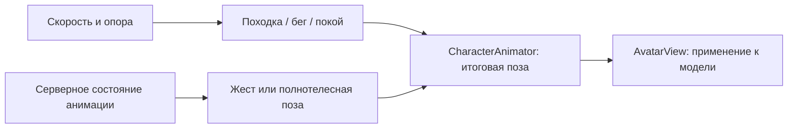

# Персонажи: походка и общая архитектура анимаций

11 ноября 2026 года. Согласованная постановка расширения MVP.
Первый этап реализован: модель с руками и ногами, процедурная походка,
бег, остановка и поза падения. Второй этап также реализован: выбираемые
жесты и танец описаны в [отдельной спецификации](player-animations.md),
проверки — в [отчёте второго этапа](../reports/player-animations.md).
Проверки и ограничения — в [отчёте](../reports/characters.md).

Первый этап — сделать персонажей выразительнее с помощью простой модели
и процедурной походки. Второй этап добавляет выбор подготовленных анимаций,
видимых другим игрокам, на той же границе расчёта позы.
Это расширение не меняет исторический состав [v0.1](mvp-network-playground.md).
Общие границы компонентов описаны в [архитектуре](architecture.md).
Внешний вид выбирается из [библиотеки скинов](avatar-skins.md): минифигурка
и стандартный человечек используют общий каркас `humanoid-v1`.

## Реализованная основа

- [WorldView](../apps/client/src/rendering/world-view.ts) размещает виды
  сущностей и подписи. [AvatarView](../apps/client/src/rendering/avatars/avatar-view.ts)
  владеет моделью персонажа, а [CharacterAnimator](../apps/client/src/rendering/avatars/character-animator.ts)
  рассчитывает её позу.
- [PhysicsWorld](../packages/simulation/src/physics-world.ts) управляет
  физической капсулой. Состояние содержит положение, ориентацию, скорость,
  признак опоры `grounded` и `revision` для сбросов положения.
- [GameSession](../apps/client/src/network/session.ts) использует предсказание
  для своего игрока, включая скорость и `grounded`, и интерполяцию для
  остальных. Удалённая походка следует за интерполированной позицией.
- [Клиентские типы отображения](../apps/client/src/presentation/display-state.ts)
  разделяют игрока и предметы и не зависят от рендерера. Локальные
  `motionRevision` и `motionEnabled` позволяют сбросить измерение движения
  и остановить анимацию во время восстановления связи или управления.
- [Реакции](../packages/contracts/src/reactions.ts) уже имеют каталог,
  серверное подтверждение, номер показа и срок окончания. В
  [WorldRoom](../apps/server/src/world-room.ts) дискретные действия используют
  общий `requestId`, проверку `worldEpoch` и кеш результатов повторных запросов.

Движение, отображение и дискретные действия уже разделены. Развиваем эти
границы без нового фреймворка или переноса визуальной анимации в физику.

## Первый этап: модель и процедурное движение

Вариант минифигурки вдохновлён LEGO-человечками: жёлтая цилиндрическая голова
с выступом сверху и простым улыбающимся лицом, трапециевидное туловище,
пояс, слегка согнутые руки с кистями-захватами и короткие цельные ноги
на шарнирах. Цвет одежды определяется профилем игрока; жёлтые детали
и лицо сохраняют свои цвета при перекраске.

Модель собирается из простых объёмов Babylon.js с точками вращения
в плечах и бёдрах. Общую высоту сохраняем относительно физической
капсулы. Ступни в спокойной позе находятся около её нижней границы,
а не ниже неё. Руки и ноги не получают собственных физических тел.

Ноги сохраняют оттенок одежды, компактные прямоугольные ступни немного
темнее. Жёсткие детали при движении вращаются вокруг шарниров, сохраняя
характер игрушечной минифигурки. Визор прежней модели заменён лицом.

| Состояние                  | Визуальное поведение                                                                                  |
| -------------------------- | ----------------------------------------------------------------------------------------------------- |
| Покой                      | Спокойная поза; сохраняется последнее направление взгляда                                             |
| Обычное движение           | Ноги движутся в противофазе; левая рука движется вместе с правой ногой; умеренное покачивание корпуса |
| Бег                        | Увеличиваются размах, наклон вперёд и частота шагов                                                   |
| Остановка или упор в стену | Амплитуда плавно затухает, конечности возвращаются в спокойную позу                                   |
| Нет опоры                  | Цикл шагов затухает, включается простая поза падения                                                  |

Походка зависит от фактической горизонтальной скорости, а не от удержания
клавиш. Малый порог скорости и плавные переходы подавляют дрожание около
остановки. Удержание движения у непроходимой стены не вызывает шаги на месте.

В текущих мирах обычная скорость равна 4 м/с, скорость бега — 14 м/с.
Частота шагов должна иметь верхний предел: ускорение цикла в 3,5 раза
вызывает мельтешение. Максимальная скорость оформляется как подчёркнуто
мультяшный бег; точная фиксация стоп на поверхности в первый этап не входит.
Конкретные амплитуды, длительности переходов и пропорции уточняются
визуальной проверкой в обычном ракурсе и при приближении камеры.

## Расчёт позы и применение к модели

Все движения модели проходят через один `CharacterAnimator`:

`locomotion.ts` рассчитывает базовую позу и не изменяет узлы сцены.
`CharacterAnimator` управляет переходами и смешиванием. `AvatarView`
применяет только итоговую позу: отдельные системы не записывают независимо
повороты одной и той же руки или ноги.

Стабильный корень сущности хранит отображаемую мировую позу. Дочерние узлы
отвечают за сглаженный визуальный разворот, наклон и покачивание корпуса,
плечи и бёдра. Если поворот уже задан корню, визуальная поправка считается
относительно него, чтобы не применять мировой поворот дважды.
Камера, подпись, стикер реакции и кольцо своего игрока привязаны к стабильному
корню и не подпрыгивают вместе с туловищем.

Для частей модели закрепляем устойчивые семантические имена: туловище,
голова, левое и правое плечо, левое и правое бедро. Будущий скелетный
ресурс потребует явного сопоставления с его суставами. Совместимость
произвольных моделей и автоматическое переназначение анимаций не обещаются.

Модули первого этапа и их границы:

| Модуль                                                    | Ответственность                                                                                      |
| --------------------------------------------------------- | ---------------------------------------------------------------------------------------------------- |
| `apps/client/src/presentation/display-state.ts`           | Клиентские типы отображения; явное разделение игрока и предмета; независимость от Babylon.js и Colyseus |
| `apps/client/src/network/session.ts`                      | Подготовка согласованных данных движения и выбранного воспроизведения                                  |
| `apps/client/src/rendering/avatars/locomotion.ts`         | Базовая поза, фаза шага и параметры походки                                                          |
| `apps/client/src/rendering/avatars/character-animator.ts` | Базовый слой, выбранный клип, маски и переходы итоговой позы                               |
| `apps/client/src/rendering/avatars/avatar-view.ts`        | Модель, применение позы, материалы, тени и освобождение ресурсов                                     |
| `apps/client/src/rendering/world-view.ts`                 | Жизненный цикл видов сущностей, мировые позиции, камера и подписи                                    |

На первом этапе `contracts`, `protocol` и серверная симуляция не требуют
новых полей ради походки. Нужные значения уже существуют.

## Источники движения и время

Для своего игрока скорость и `grounded` берём из локальной предсказанной
симуляции. Позиция при этом сохраняет существующее визуальное сглаживание.
Серверные коррекции положения не считаются пройденным расстоянием.

Для удалённых игроков темп походки получаем из изменения интерполированной
позиции: конечности должны соответствовать видимому перемещению. Признак
опоры и переходы выбранного показа берутся из ограниченного буфера на ту же
шкалу времени, что использует интерполяция позиции: задержка 100 мс и половина
сглаженного RTT в установленном Colyseus SDK. Тики привязываются к времени
снимков через публичные часы SDK, учитывая остановку тика при паузах.

Аниматор обновляется один раз на отображаемый кадр с прошедшим временем.
Повторные физические шаги при согласовании с сервером не продвигают
визуальную фазу повторно. При смене `revision`, восстановлении соединения,
большом скачке позиции или возвращении из скрытой вкладки пересоздаём
точку отсчёта движения, чтобы не получить лишние шаги. Сброс измерения
движения сам по себе не перезапускает выбранную серверную анимацию.

При `prefers-reduced-motion` уменьшаем вторичное покачивание и наклоны,
сохраняя различимость движения и остановки.

## Выбираемые подготовленные анимации

Актуальные требования вынесены в [каталог анимаций персонажа](player-animations.md).
Там зафиксированы первый набор `wave`, `clap`, `dance`, режимы `upperBody`
и `fullBody`, правила запуска и отмены, сетевое состояние, согласование
с интерполяцией, интерфейс, этапы реализации и критерии A01–A16.

Этот документ сохраняет описание реализованной основы: базовой модели,
походки и единой границы расчёта позы. Подготовленные жесты используют
ту же границу и общий каркас обоих скинов. Общий механизм дискретных
запросов переиспользуется; каталоги и состояния реакций и анимаций
остаются отдельными.

## Этапы реализации и проверка

### 1. Модель и походка — реализовано

Выделены клиентские типы отображения и согласованы источники движения.
Созданы `AvatarView`, расчёт базовой позы и `CharacterAnimator`, работающий
только с базовым слоем. Реализованы руки, ноги, покой, движение, бег,
остановка и поза падения. Каталог жестов, сетевые поля воспроизведения,
меню выбора и проигрыватель клипов относятся ко второму этапу.

Условия приёмки:

- В двух браузерах видны движения конечностей своего и чужого персонажа;
  старт, остановка, смена направления, обычное движение и бег различимы.
- У стены цикл затухает; при падении персонаж перестаёт шагать по воздуху.
- При 30/60/120 FPS сохраняется темп анимации за одинаковое прошедшее время;
  физическое время и скорости остаются прежними.
- Коррекции, возврат на старт, переподключение и возвращение во вкладку
  не вызывают ускоренных шагов, скачков конечностей и смещения модели от капсулы.
- Поворот и масштаб камеры, подписи, реакции, кольцо своего игрока,
  прозрачность отключённого персонажа и тени работают со всей моделью.
- Удаление персонажа освобождает его узлы, материалы и записи теней;
  общие ресурсы других персонажей сохраняются.
- Выполнены проверка типов и границ пакетов и затронутые проверки движения.
  Визуальный результат подтверждён в настоящем браузере.
- Для восьми видимых движущихся персонажей сравнены время кадра, p95,
  draw calls и число ресурсов до и после изменения в обоих режимах графики.
  Текущий [профиль рендера](../tests/browser-render-profile.ts) с одним
  неподвижным игроком сам по себе эту нагрузку не проверяет.

### 2. Выбираемые анимации — реализовано

Каталог, серверный жизненный цикл, реплицируемое состояние, воспроизведение
и меню выбора реализованы по [отдельной спецификации](player-animations.md).
Каталог содержит `wave`, `clap`, `dance`; клипы используют независимые оси
плеч и общий каркас обоих скинов. Сервер контролирует начало, срок и отмену;
клиент смешивает позы с входом и выходом 150 мс. После объединения с чатом
и командами предметов используется протокол 9 после интеграции сегментированной загрузки.
Реакции сохраняют независимое состояние и прежнее поведение.
Проверки и ограничения записаны в [отчёте](../reports/player-animations.md).

### Следующие возможности

Скелетные модели, точная постановка стоп на поверхность, сложные жесты,
редактор и загрузка пользовательских ресурсов рассматриваются после
подтверждения ценности базовой модели и появления конкретного контента.
Отдельная система костей, физические конечности и универсальный граф
анимаций не являются условием первого этапа.

## Жизненный цикл при сегментированной загрузке

Обычный переход между ячейками сохраняет локальный контроллер, каркас и аниматор. При отсутствии критических коллайдеров движение и повтор ввода приостанавливаются; дальняя фоновая графика их не блокирует. Выход удалённого персонажа из AOI удаляет локальный вид и буферы, а возвращение использует текущую скорость, опору и фазу сервера. Реакция, жест, танец и реплика сохраняют независимые сроки; дальность и дымка не продлевают показ.
