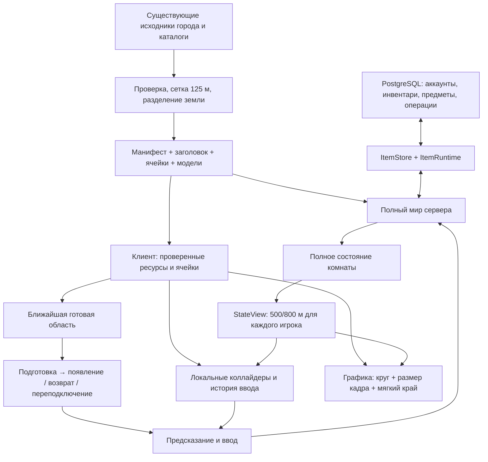

# Внедрение динамической загрузки карты в основную версию

Дата: 12 ноября 2026 года. Версия документа: 1.0.

Статус: полный скоуп и техническая концепция по результатам обсуждения и проверки исходников; реализация и итоговая приёмка ещё не выполнены. Документ предназначен для разработки, проверки и выпуска интеграции PR #10 в актуальный `main`.

## 1. Результат и приоритет требований

Внедрить сегментированную загрузку карты из [PR #10](https://github.com/ftagn-superior/syktyvkar-underground/pull/10) в основную игру, сохранив городской контент, управление, аккаунты, внешность, реакции, анимации, чат, предметы, инвентарь, постоянный мир и выполненные миграции.

Основой поведения служит актуальный `main`. Из PR переносятся и адаптируются сетка мира, загрузчик, управление временем жизни ресурсов, подготовка области, локальная физика, фильтрация сетевого состояния и инструменты проверки.

Этот документ определяет целевую интеграцию. При расхождении с [ранней спецификацией большой карты](large-map-streaming.md) и [планом L0–L6](large-map-delivery-plan.md) приоритет имеет настоящий скоуп. Правила «один ящик», «только гости», «сброс мира при перезапуске», 80/100 м и обязательная полная готовность фонового окружения относятся к прежнему полигону. Они не переносятся в основную игру.

Исторические отчёты, включая [L0–L5](../reports/large-map.md), сохраняются как свидетельства прежней реализации, а не доказательство готовности новой комбинации функций.

### Согласованные продуктовые решения

| Область            | Решение                                                                                                                                       |
| ------------------ | --------------------------------------------------------------------------------------------------------------------------------------------- |
| Общий мир          | Один Node.js-процесс, одна Colyseus-комната, одна авторитетная симуляция; до 8 участников с учётом подготовки и переподключения               |
| Карты              | Городской `ring-block` остаётся миром по умолчанию; `physics-lab` сохраняется для регрессий, `streaming-lab` 2 × 2 км — для проверки масштаба |
| Базовая дальность  | Новое окружение и динамические сущности включаются на 500 м; уже включённые удерживаются до порога 800 м                                      |
| Форма области      | Примерно круговая вокруг персонажа в плоскости X/Z; квадратные ячейки являются способом хранения                                              |
| Камера             | Сохраняются колесо мыши, диапазон 0,6–30×, четыре ракурса и плавный поворот; графическая область расширяется по фактическому кадру            |
| Переходы           | Предварительная загрузка, мягкая круговая граница, плавное появление после готовности; сетка не должна проявляться квадратами                 |
| Быстрый вход       | Появление и ввод зависят от ближайшей безопасной области; готовность всех 500 м не является условием входа                                    |
| Физика сервера     | Сервер продолжает рассчитывать весь мир и сохранять все предметы, независимо от клиентских областей                                           |
| Движок             | Babylon.js 9.35.0 и Havok; штатные загрузка моделей, геометрия, отсечение за кадром и физика; небольшие расширения через официальный API      |
| Сохранённые данные | Совместимая миграция с проверкой состояния; без очистки БД, повторной выдачи стартовых предметов и сброса профилей                            |

Уменьшение количества загруженных объектов не является самоцелью. При дальнем обзоре или на небольшой карте допустима загрузка всей карты. Наблюдение пользователя, что нынешний полный район нормально работает в современных браузерах, принимается как основание для увеличения дальности; точные бюджеты новой версии проверяются отдельно.

### Границы поставки

В скоуп входят адаптация кода и контента, визуальный переход, согласование протокола, сохранность данных, диагностика, регрессии, нагрузочные проверки и инструкция выпуска.

В скоуп не входят увеличение онлайна сверх 8, серверное шардирование, выгрузка серверной физики пустых районов, расширение географии или обновление снимка OSM, новые игровые механики, новый набор моделей/скинов/анимаций, смена движка, новый хостинг и CI/CD. Уже существующие возможности этих подсистем сохраняются.

## 2. Проверенная исходная точка

Ревизии сверены с GitHub перед составлением документа:

| Источник                          | Ревизия                                                                                                            | Значение                                                                |
| --------------------------------- | ------------------------------------------------------------------------------------------------------------------ | ----------------------------------------------------------------------- |
| `main`                            | [`edbce4f`](https://github.com/ftagn-superior/syktyvkar-underground/tree/edbce4f4733a3efffd99becca9fb5ad593cd309a) | Город, PostgreSQL, аккаунты, предметы, скины, чат и выбираемые анимации |
| `feat/large-map-support` / PR #10 | [`175e0dd`](https://github.com/ftagn-superior/syktyvkar-underground/tree/175e0dda8c7f8a1afde0a08a9845648b3c9b5612) | Реализация L0–L5 с прежней моделью одиночного ящика                     |
| Общая основа                      | `9ae935c`                                                                                                          | Первоначальный сетевой физический полигон                               |

PR изменяет 106 файлов; `main` после общей основы — 703 файла. Общих изменённых файлов 34, конфликтующих — 25, конфликтных блоков — 80. GitHub сообщает `CONFLICTING`. Основные пересечения — `session.ts`, `world-room.ts`, `world-view.ts`, `physics-world.ts`, контракты и сборщик. Автоматическое слияние остальных файлов не доказывает смысловую совместимость.

В предварительном аудите отдельно прошли 105 тестов PR, 99 модульных тестов `main` и TypeScript обеих веток. Эти результаты не закрывают интеграцию; полный набор с PostgreSQL и браузерная приёмка основной игры ими не заменяются.

### Что обязательно сохранить из main

| Подсистема             | Поведение и данные, которые входят в регрессионный контракт                                                                                                                              |
| ---------------------- | ---------------------------------------------------------------------------------------------------------------------------------------------------------------------------------------- |
| Город                  | География, устойчивые ID и `sourceRef`, подробные здания, арки и проходы, покрытия, разметка, переходы, светофоры, ограды, деревья, малые формы, подписи ориентиров                      |
| Управление             | Ходьба 4 м/с, спринт 14 м/с, нормализация диагонали, экранные оси при повороте, безопасный возврат, коллизии и восстановление потерянных предметов                                       |
| Камера и графика       | 0,6–30×, Q/E, прозрачность закрывающих персонажа стен/крыш, тени, обычное/экономное качество, обработка потери WebGL-контекста                                                           |
| Аккаунты               | Telegram-вход и гостевой режим, имя/цвет/скин, версии профиля, проверка авторизации при переподключении, отзыв/истечение сессии, защита одного аккаунта от одновременного входа          |
| Персонажи              | Существующие скины и каркасы, походка по фактической скорости, поза без опоры, единый `CharacterAnimator`, сброс движения после разрывов                                                 |
| Реакции, анимации, чат | Каталоги, независимость реакции и жеста, режимы `upperBody/fullBody`, отмена танца вводом даже у стены, серверные сроки, временные реплики, приватность slash-команд                     |
| Предметы и инвентарь   | Все существующие типы и составные формы, подбор/размещение в пределах 3 м, опора и достижимость, предпросмотр, стопки, move/split/merge, `placementVersion`, `safePose`, журнал операций |
| Выдача предметов       | Приватная `/giveme <type-id>`, `SU_ITEM_CREATION_ENABLED`, права аккаунта, существующий период ожидания, отсутствие текста команды в общей реплике                                       |
| Постоянный мир         | Один упорядоченный writer, обработка неопределённого COMMIT, пауза при резервировании/ошибке хранилища, периодические и финальные сохранения, блокировка владения миром                  |
| Запуск и миграции      | PostgreSQL обязателен для постоянного мира; схема v3; сохранение исторического ремонта ранней ветки скинов; source/built-команды; порядок `make run`                                     |

Источники для сверки: [контракты main](https://github.com/ftagn-superior/syktyvkar-underground/blob/edbce4f4733a3efffd99becca9fb5ad593cd309a/packages/contracts/src/index.ts), [комната](https://github.com/ftagn-superior/syktyvkar-underground/blob/edbce4f4733a3efffd99becca9fb5ad593cd309a/apps/server/src/world-room.ts), [миграции БД](https://github.com/ftagn-superior/syktyvkar-underground/blob/edbce4f4733a3efffd99becca9fb5ad593cd309a/apps/server/src/migrations.ts), [постоянные предметы](https://github.com/ftagn-superior/syktyvkar-underground/blob/edbce4f4733a3efffd99becca9fb5ad593cd309a/apps/server/src/items/store.ts), [городской импорт](https://github.com/ftagn-superior/syktyvkar-underground/blob/edbce4f4733a3efffd99becca9fb5ad593cd309a/tools/world-build/src/import-district.ts).

Также сохраняется существующий просмотр статического города до входа и после выхода: сейчас `main.ts` готовит `WorldView` независимо от присоединения к комнате. Пустой фон до нажатия «Войти» вместо работающей карты был бы регрессией.

## 3. Целевой поток и ответственность

Порядок обычного входа:

1. Проверить конфигурацию, схему БД и сохранённую геометрию. Поднять одну полную симуляцию и восстановить предметы через существующий `ItemRuntime`.
2. Клиент получает `WorldInfo`, проверяет версии и манифест, загружает небольшой заголовок и локальный Havok WASM.
3. Сервер проверяет гостевой/аккаунтный вход, профиль и занятость, резервирует место и присылает план ближайшей области.
4. Клиент готовит графику и коллайдеры критических ячеек, отвечает `areaReady`. Сервер повторно проверяет план и условия появления, отвечает `areaResult`.
5. После подтверждения и получения собственного персонажа разрешаются ввод и локальное предсказание. Дальнее окружение догружается независимо.
6. При движении клиент обновляет круги ресурсов; сервер на публикации состояния обновляет область интереса по авторитетным позициям.
7. Выход из клиентской области освобождает только локальные представления и ресурсы. Сохранённые предметы, чужие персонажи и серверная физика продолжают существовать.

Фоновая загрузка одного браузера не приостанавливает общий мир. Пауза `ItemRuntime` остаётся отдельным серверным состоянием с прежними правилами.

До входа и после выхода графический загрузчик работает в режиме просмотра без собственного персонажа, сетевой подписки на динамику и занятого места. Центром служит нынешняя стартовая цель обзора — начало координат, если оно внутри мира, иначе первая точка появления. Колесо мыши, поворот и качество продолжают работать. При входе центр переводится на персонажа, подходящие ресурсы той же версии используются повторно; при выходе удаляется игровая динамика и возвращается статический просмотр.

Проверки DM-09, DM-11 и DM-20 охватывают этот переход: масштаб/поворот до входа, вход без двойных моделей, выход без старых аватаров и сохранение свободных мест при статическом просмотре.

## 4. Области загрузки, видимости и удержания

### 4.1. Центры и круговая выборка

Расстояния считаются в мировых метрах в X/Z. Для сети используется авторитетная позиция своего персонажа и позиция динамической сущности. Собственный персонаж всегда присутствует в его сетевом состоянии после появления.

Для клиентской физики учитываются авторитетная и прогнозируемая позиции, для графики — отображаемая позиция и действующий кадр камеры. Нужные наборы объединяются; небольшой разрыв предсказания не должен выгружать необходимый участок.

Статическая ячейка включается при пересечении её X/Z-прямоугольника с кругом: минимальное расстояние от центра круга до прямоугольника не больше радиуса. Проверка только центра ячейки или здания неприемлема. Крайние ячейки обрезаются границами мира, отрицательные координаты обрабатываются той же сеткой.

Объект записывается во все пересекаемые ячейки и существует один раз по `entityId`. Границы с учётом полного поворота определяют принадлежность; счётчик ссылок не позволяет соседней ячейке удалить ещё нужное здание.

### 4.2. Независимые области

| Область                       | Подключение                                                                                                         | Удержание / освобождение                                                                             |
| ----------------------------- | ------------------------------------------------------------------------------------------------------------------- | ---------------------------------------------------------------------------------------------------- |
| Критическая область           | Текущая ячейка и соседнее кольцо 3 × 3, обрезанные миром; дополнительно весь путь предстоящего шага и повтора ввода | До окончания зависимых шагов, планов и истории; это барьер безопасности, а не дальность обзора       |
| Клиентская статика для физики | Круг 500 м от авторитетной и прогнозируемой позиций; подключение в фоне после критической области                   | Удаление после выхода за 800 м от обоих центров, если отсутствуют критические/исторические удержания |
| Сетевая динамика              | Добавление при расстоянии ≤500 м от своего авторитетного персонажа                                                  | Удаление при расстоянии >800 м; собственный персонаж не фильтруется                                  |
| Статическая графика           | Базовый круг обзора 500 м, расширяемый для камеры; дополнительная предварительная загрузка                          | Внешний круг удержания не меньше 800 м и всегда больше текущей нужной графической области            |
| Физические прокси динамики    | Актуальные реплицированные игроки и предметы                                                                        | Прокси удаляются при уходе из сетевого набора; это не удаление серверного предмета                   |

Радиусы 500/800 задают гистерезис: приближение загружает новое, удаление сохраняет уже известное. Это не требование немедленно загрузить все 800 м при входе.

Готовность разделяется на `criticalReady` и покрытие фоновых областей. Старое единое `streamer.ready` для всего набора нельзя использовать как условие любого движения: иначе большой радиус превратится в долгую блокировку ввода.

При отсутствии критических коллайдеров ввод становится нейтральным, локальный повтор приостанавливается и выполняется штатное согласование. Смена обычной ячейки при готовом окружении сохраняет контроллер и соединение.

### 4.3. Камера 30× и круг графики

Базовые 800 м не являются жёстким пределом графики. При нынешней камере 30× и 16:9 ширина кадра соответствует 1600 м, а углы его проекции на землю до обрезки миром находятся примерно в 1152 м от центра. Ультраширокое окно может требовать большего.

`R_frame` определяется из фактических матриц Babylon.js и пересечения объёма кадра со слоем геометрии мира; учитываются высота домов, положение сглаженной цели камеры и границы карты. Консервативная проверка ячеек через штатные `Frustum/BoundingInfo` допустима. Формулу одного фиксированного ракурса нельзя выдавать за универсальную область.

Начальные технические параметры, уточняемые визуальной проверкой и измерениями:

| Параметр                                          | Правило                                                                             |
| ------------------------------------------------- | ----------------------------------------------------------------------------------- |
| Целевой внешний радиус видимости статики `R_draw` | `max(500 м, R_frame + 125 м)`                                                       |
| Предварительная загрузка графики                  | До `R_draw + 125 м`                                                                 |
| Удержание графики                                 | До `max(800 м, R_draw + 300 м)`, с защитой видимых и подготавливаемых объектов      |
| Мягкий край                                       | Последние 75 м перед внешним визуальным радиусом                                    |
| Появление новой готовой геометрии                 | Около 300 мс; при сниженной анимации допускается более короткий переход             |
| Отложенное освобождение                           | Начальная настройка 5 с после утраты всех удержаний; не заменяет проверку видимости |

Набор графических ячеек остаётся круговым и при увеличении масштаба обзора. Не используется прямоугольный выступ к базовому кругу. Приоритет запросов может учитывать кадр, но не изменяет форму мягкой границы.

Целевой радиус и фактически показанный радиус различаются во время подготовки. Визуальная граница раскрывается только в подготовленную область; при задержке загрузки допустимы дымка и сообщение о дальней загрузке, а не пустые квадраты. Уменьшение радиуса сначала скрывает ненужную геометрию и лишь затем освобождает её.

Для этого определяется `R_ready` — гарантированно подготовленный графический круг: он ограничен минимальным расстоянием до любой ещё не готовой графической ячейки внутри запрошенной области мира. Фактический внешний радиус не превышает `min(R_draw, R_ready)`; рост сглаживается. Участки вне границ мира не считаются ошибкой загрузки. Проверка относится к графической готовности, а не к наличию дальней физики: иначе разделение удержаний не даст эффекта.

Камера реагирует на колесо мыши сразу. Полное покрытие кадра требуется после подготовки данных; ожидание дальней графики не останавливает готовое движение возле персонажа и не уменьшает доступный масштаб.

Камера расширяет статическую графику. Сетевая динамика сохраняет согласованный профиль 500/800: далёкие игроки и предметы не становятся глобально видимыми из-за отдаления. Их визуальная граница затухает к 500 м; удержание до 800 м предотвращает скачки при повторном приближении. Подписи динамики используют эту же границу, ориентиры города — границу статики.

### 4.4. Плавная граница и представление

Край формируется по расстоянию каждой отображаемой точки до персонажа в X/Z. Это позволяет одной большой модели или слитому блоку деталей пересекать границу без исчезновения целиком и без квадратного контура ячейки.

Окружение растворяется в согласованный с фоном цвет лёгкой дымки. Базовый переход статики сохраняет непрозрачный режим материала; массовое включение alpha blending для всех зданий не используется как основной способ скрыть край. Плавность готовности новой геометрии реализуется в том же эффекте с отдельным коэффициентом появления.

Существующее просветление закрывающих персонажа стен/крыш остаётся независимым. Оно совместно применяется с дальностью, не перезаписывает её и сохраняет коллизии. Нельзя вводить второй независимый обработчик, который каждый кадр возвращает `material.alpha` в 1.

Тени освобождённых или полностью скрытых объектов не остаются в сцене. Дальность и качество теней имеют собственный бюджет: обзор 800 м не требует одинаково подробных динамических теней на всей площади.

Названия мест, имена, реакции и реплики чата учитывают готовность объекта, дальность и мягкую границу. DOM-элементы не остаются висеть над туманом или после удаления представления. Переход не продлевает серверный срок реакции/чата/анимации.

## 5. Использование Babylon.js и Havok

Проверка выполнена по установленным исходникам `@babylonjs/core@9.35.0` и официальной документации. Это проверка применимости API; визуальная корректность будущего эффекта ещё требует браузерной приёмки.

| Задача                   | Решение и граница своего кода                                                                                                                                            |
| ------------------------ | ------------------------------------------------------------------------------------------------------------------------------------------------------------------------ |
| Отсечение невидимого     | Штатный frustum culling Babylon.js. Для планирования покрытия — его матрицы, `Frustum` и `BoundingInfo`; отдельный рендерер/отсекатель не создаётся                      |
| GLB и общая геометрия    | `LoadAssetContainerAsync`, `AssetContainer.instantiateModelsToScene` и штатное освобождение; геометрия моделей повторно используется                                     |
| Дальность и мягкий край  | Маленький `MaterialPluginBase` для Standard/PBR с мировыми координатами; движение центра меняет uniforms, а не перекомпилирует шейдер                                    |
| Упрощение моделей        | Если измерения требуют LOD, использовать штатный LOD по экранному размеру. Обычный distance LOD не задаёт круг вокруг персонажа и имеет отдельную семантику у ортокамеры |
| Физика                   | Штатные Havok body/shape, compound/mesh-формы и запросы; наш код управляет составом локальной сцены и связью с предсказанием                                             |
| Пространственные индексы | Сетка ячеек и серверный AOI относятся к игровым данным. Клиентский индекс кандидатов для просветления не должен дублировать штатный рендерный culling                    |
| Владение ресурсами       | Наш слой нужен для хешей манифеста, ограниченной очереди, отмены, версии сессии и ссылок от нескольких ячеек                                                             |

Стандартный scene fog использует расстояние от камеры, поэтому при отдалении ортокамеры он не даёт стабильную круговую границу вокруг игрока. Небольшое расширение материалов решает именно это различие, сохраняя штатные материалы и освещение.

Расширение должно работать и на загруженных, и на клонированных материалах. Переход одного экземпляра не меняет соседний экземпляр общей модели. Общие вычисления сетки/кругов в `contracts` остаются обычным TypeScript; зависимость от графических классов Babylon.js не переносится в сетевые контракты и серверный AOI.

`SmartAssets` также проверен: это реестр загружаемых ресурсов сцены; он не заменяет наши проверки хешей, критическую готовность и удержания нескольких ячеек. Замена работающего `AssetContainer`-слоя на него не является обязательной частью переноса.

Не требуется заранее внедрять октодерево, общий пул всех игровых объектов, новую систему материалов или создавать упрощённые версии каждого здания. Такие изменения добавляются только при измеренном препятствии для согласованных бюджетов.

Официальные источники: [отсечение и оптимизация сцены](https://doc.babylonjs.com/features/featuresDeepDive/scene/optimize_your_scene/), [контейнеры моделей](https://doc.babylonjs.com/features/featuresDeepDive/importers/assetContainers/), [плагины материалов](https://doc.babylonjs.com/features/featuresDeepDive/materials/using/materialPlugins/), [LOD](https://doc.babylonjs.com/features/featuresDeepDive/mesh/LOD/), [SmartAssets](https://doc.babylonjs.com/features/featuresDeepDive/importers/smartAssets/).

## 6. Контракты мира и протокола

### Версии

| Контракт         | main |                          PR #10 |                                                Цель интеграции |
| ---------------- | ---: | ------------------------------: | -------------------------------------------------------------: |
| Сетевой протокол |    8 |                               3 |                                                              9 |
| Формат мира      |    3 |           3 с другой структурой |                                                              4 |
| Формат ячейки    |    1 |                               2 |                                                              2 |
| Схема PostgreSQL |    3 | Постоянное хранение отсутствует | 3; новая добавочная версия только при доказанной необходимости |

Если к началу реализации номера 9/4 заняты новыми изменениями `main`, выбрать следующие свободные номера и обновить документ/проверки. Повторно использовать номер для несовместимых структур нельзя.

Клиент и сервер выпускаются вместе, как в `main`. Старая вкладка получает понятное требование перезагрузки через действующую проверку версий. Параллельная поддержка двух сетевых схем и двойная запись состояния в этот этап не входят.

### Содержимое

- `WorldManifest`: сетка, границы, описатели ячеек с зависимостями, каталог моделей, хеши всех файлов, идентичность карты и физической конфигурации.
- `WorldHeader`: параметры мира и персонажа, включая `sprintSpeed`, точки появления, полный каталог типов предметов, стартовые seed-описания и метаданные ориентиров/маршрутов. Всей статики и всех зданий в заголовке нет.
- `WorldCell` v2: `cellId`, статические примитивы и размещения зданий. Определение на стыке дублируется с тем же ID и объединяется по ссылкам.
- `WorldDefinition`: полная проверенная сборка для сервера, содержащая текущую модель `itemCatalog/initialItems` из `main`. Понятие обязательного отдельного `crate` удаляется из переносимой реализации; ящик остаётся обычным предметом типа `wooden-crate`.
- Источник мира хранит ссылки на каталоги; сборщик разрешает их в проверенные определения. Наличие seed-данных в заголовке не разрешает клиенту создавать экземпляры предметов: их создаёт только штатная серверная инициализация постоянного мира.

Серверное полное состояние и локальный снимок имеют `players` и `items`, но различимые типы: `scope: 'authoritative'` и `scope: 'local'` в доменных снимках/фабриках. Один только разный псевдоним одинаковой структуры TypeScript не защищает от ошибочной передачи частичного состояния writer-у.

Полный снимок используется сохранением и серверными проверками. Локальный допускает пустые `items` и неполный набор `players`; собственный персонаж появляется после подтверждения области.

В `WorldState` сохраняются поля профиля, `skinId`, реакции, анимации, чата, `paused/pauseReason` и занятости. Коллекции `players` и `items` становятся фильтруемыми через `StateView`. Инвентарь и приватные ответы передаются только владельцу и не зависят от его круговой области.

`mapVersion` описывает пакет ресурсов; `simulationConfigHash` включает все влияющие на физику параметры и определения. `compatibility_hash` сохранённого мира остаётся отдельной проверкой хранилища. Скин, подписи, дымка, качество и только визуальная детализация не должны случайно менять физический хеш.

## 7. Городской контент и сборка

Сохранить генераторы `house/footprint/ground/tree/kit`, ручные уточнения фасадов, арки, кольцо, покрытия и разметку. Перенос не меняет координаты района, состав OSM-снимка, физические размеры и свойства предметов.

Нынешний `ring-block` имеет размер 600 × 876 м, 289 размещений и 277 уникальных моделей. Сетка 125 м даёт 40 ячеек. Предварительный расчёт прежней области 3 × 3 у входа давал 51 модель и около 6,2 МиБ GLB против 15,2 МиБ всей карты. Эти числа объясняют устройство контента; они не предсказывают выигрыш при новых радиусах.

Обязательные изменения:

1. Перевести исходники/сборщик на согласованные заголовок и ячейки; перенести корневые статические примитивы в пространственный пакет. Проверять полную карту перед публикацией манифеста.
2. Разделить нынешнюю общую модель земли на участки ячеек. Сохранить полигоны, отверстия, высоты слоёв, цвета, разметку и непрерывность поверхности. Не оставлять одну модель всех покрытий обязательной зависимостью каждой ячейки.
3. Проверить стыки плиток физикой: ходьба, спринт, скольжение, толкание и размещение составных предметов на стороне и углу. Не создавать внутренних стен на границах ячеек.
4. Сохранить существующее объединение мешей внутри группы прозрачности и блоков деталей. Разбивать только то, что мешает независимой загрузке; не превращать каждый элемент разметки в отдельный draw call.
5. Сохранить ID существующих зданий, предметов, seed-описаний и ссылок OSM. Новые ID плиток земли выводить детерминированно из мира и ячейки; миграция сохранённой геометрии учитывает замену общей плиты.
6. На пересечениях хранить одинаковые определения, проверять конфликтующие ID, полноту зависимостей и отсутствие двойных коллайдеров/экземпляров.
7. Сохранить воспроизводимую офлайн-сборку из закоммиченных исходников; публикация манифеста остаётся последней операцией после подготовки всех файлов.

По умолчанию собирается/запускается `ring-block`. `SU_WORLD` остаётся единым выбором мира для сервера и `world:migrate`. Параметры выбора источника/каталога из PR согласуются с этим правилом и не должны незаметно вернуть `physics-lab` в качестве игрового мира.

## 8. Загрузчик, локальная физика и пределы ресурсов

Разделить владение физикой и графикой. Одна запись ячейки может иметь проверенные данные, физическое удержание и независимое графическое удержание. После увеличения камеры графика имеет право жить дальше локальной статики, а история ввода — удерживать физику после скрытия картинки.

Начальный порядок приоритетов:

1. Критические ячейки плана появления/возврата/переподключения.
2. Коллайдеры текущего шага, коррекции и повтора неподтверждённого ввода.
3. Подготовка попадающей в кадр графики и ближайшего окружения.
4. Остальные ячейки круга 500 м и запас предварительной загрузки.
5. Освобождение по утраченным удержаниям, с приоритетом при приближении к бюджету памяти.

Общие ресурсы одной версии скачиваются и разбираются один раз на время использования. Последний потребитель отменяет ненужный запрос; устаревший ответ не активирует ресурс после смены плана, версии мира, выхода или освобождения сцены.

Режим статического просмотра имеет собственное действующее графическое удержание. Оно не продлевает сетевую сессию. Ответ завершённого игрового плана не может самовольно восстановить его состояние; новый просмотр может использовать общий проверенный ресурс только через свою актуальную подписку.

Сохранить проверку SHA-256, повтор повреждённого файла без старого кэша и явную ошибку при повторном несовпадении. Хеши проверяются также для коллизий и метаданных, не только для GLB.

Стартовые настройки PR — 4 HTTP-запроса одновременно, кэш проверенных байтов 64 МиБ и планируемая работа подключения до 2 мс за кадр — сохраняются как исходная точка измерений. Бюджет планировщика не гарантирует, что один разбор большого GLB уложится в 2 мс; такие операции и long tasks измеряются отдельно.

Лимит 64 необходимых ячеек пересматривается: при 500 м возможны примерно 60–69 пересечений, при 800 м — около 150–156, а камера может потребовать весь мир. Поддерживаемый эталон 2 × 2 км при 125 м должен допускать все 256 ячеек; нынешний город — все 40. Удержания разных центров объединяются в пределах объявленных ячеек, не суммируются как независимые копии.

Проверить достаточность лимита 2048 уникальных статических сущностей на полном эталоне и городе после разделения земли. Защитные пределы остаются явными и связаны с проверенным пакетом; радиус не уменьшается скрыто при их достижении.

При больших наборах нужна ограниченная подача работ: нельзя запускать `Promise.all` всех моделей и получать `Resource queue budget exceeded` для допустимой карты. Критические работы должны проходить вперёд фоновых, отмена — снимать ожидание, очередь и кэш — оставаться ограниченными.

Обычное подключение статики выполняется между фиксированными шагами без пересоздания персонажа. При повторе ввода удерживаются ячейки всего пройденного капсулой пути, включая сторону/угол и историю до действующего `MAX_PREDICTION_MS`. Телепортации сбрасывают старый повтор и готовят целевую область.

Динамические прокси используют формы из каталога предметов `main`, включая составные. Передача `crate`-специального поведения в новый клиент исключается. Локальные `surfaceRay/checkPlacement` сохраняются; сервер повторно проверяет размещение по полной физике.

Дальность обзора не увеличивает дальность взаимодействия 3 м. Видимое вдалеке здание не становится доступной опорой для размещения: предпросмотр учитывает наличие нужных локальных коллайдеров, а сервер — прежнюю достижимость и полную геометрию.

## 9. Сессии, сеть и существующие игровые функции

### Подготовка и авторизация

Сохранить `prepareArea → areaReady → areaResult` из PR, адаптировав его к авторизации и постоянному миру. План содержит уникальный `prepareId`, эпоху, версию карты, назначение, точку, критические ячейки и срок. Радиусы фона не должны превращать список обязательных ячеек плана в весь круг 500 м.

Вход проверяет авторизацию до резервирования игрового состояния. Завершение подготовки повторно проверяет подключение, актуальность авторизации/плана, доступность хранилища и безопасность точки. Подготовка не обходит `ACCOUNT_IN_USE`, отзыв сессии или проверку профиля. Скин аккаунта берётся из профиля, гостевой параметр его не переопределяет.

Сохраняются исходные 30 с резервирования при разрыве, 15 с ожидания критической подготовки и 3 с между успешными возвратами. Отказ или таймаут возврата оставляет старую позицию; период ожидания начинается после успешного переноса. Возврат меняет revision один раз, очищает старый ввод и завершает нужные анимации по правилам `main`.

После критической готовности сохраняется ограниченный поиск свободной точки появления до 5 с, как в `main`. Точки повторно проверяются по полной физике: два одновременно готовых клиента не занимают одно место. Если новая безопасная точка требует других критических ячеек, план обновляется без бесконечного продления подготовки.

Переподключение сначала повторно проверяет аккаунт, затем готовит область актуальной позиции. Устаревшая точка/версия заменяет план с явным результатом; повтор `areaReady` не создаёт второго персонажа и не телепортирует повторно.

Длительный фон не продлевает место бесконечно. Отмена/выход освобождает его по действующим правилам, прерывает ненужные запросы и делает поздние ответы недействительными.

### Полное состояние и область интереса

`DynamicInterest` индексирует игроков и все находящиеся в мире предметы. Создание, движение, подбор, размещение, восстановление после ошибки хранения и удаление синхронно обновляют индекс до публикации состояния.

Полные коллекции комнаты остаются серверными; фильтруется сериализация для наблюдателя. Схема сущности имеет стабильную ссылку во время её жизни. При действительном удалении ссылка снимается из индекса и всех представлений до освобождения.

Отсутствие предмета в клиентском `items` означает отсутствие локального представления. Оно не запускает `ItemStore`, не переносит предмет в инвентарь и не очищает запись БД. Получение полной информации для сохранения не зависит от количества наблюдателей.

Общая занятость отражает все активные/подготавливаемые/зарезервированные сессии. Число видимых игроков не используется как число занятых мест. Пустой локальный набор предметов допустим и не останавливает движение, ACK и переподключение.

### Действия и паузы

Сохранить общий порядок `requestId` и кэш результатов для возврата, реакции, анимации, чата и выдачи. Длительный возврат регистрируется как ожидающее действие; повтор возвращает текущий план либо окончательный результат. Эти правила объединяются с существующими `pendingActions`, а не заводят независимую последовательность.

`operationId` предметов и постоянный журнал `item_operations` остаются отдельным механизмом. Повтор после разрыва/неопределённого COMMIT не создаёт дубликат предмета или переноса. Поздний результат отправляется только соответствующей актуальной сессии аккаунта.

Во время критической подготовки новые пространственные действия недоступны. Инвентарь остаётся доступным для чтения; уже начатые операции получают корректное завершение или сохранённый отказ. После ожидания пользователь может выполнить обычные действия снова.

План не завершает перенос во время серверной паузы хранения. Writer не ждёт `areaReady` внутри транзакции: он завершает операцию либо отклоняет её по повторной проверке готовности/авторизации. Это исключает взаимное ожидание миграции позиции и предметной операции.

Клиентское ожидание коллайдеров, недоступность графики и глобальная пауза `ItemRuntime` различаются в состоянии и UI. Прежние правила отключения ввода при потере фокуса/контекста, очистки устаревшей очереди и resync сохраняются.

### Персонажи, анимации, реакции и чат

Сохранить `presentation/display-state`, `AnimationBuffer`, `AnimationRequestState`, `AvatarView` и `CharacterAnimator` из `main`; не возвращать упрощённый персонаж/тип отображения из PR.

Уход наблюдателя из AOI удаляет его локальные буферы и представления, но не отменяет серверное действие исполнителя. При возвращении используется текущая фаза активной анимации и оставшееся время реакции/чата; завершившиеся события не запускаются заново. Сам исполнитель сохраняет прежние правила отмены при движении, потере опоры, отключении, успешном возврате и серверной паузе.

Серверный simulation tick отражает реально выполненные шаги физики. При паузе хранилища не происходит скачка длительностей из-за безусловного присваивания `ctx.tick`. Сетевой ACK/тактовый счётчик Colyseus и время отображения согласуются с этой шкалой, но не подменяют её. Декоративные переходы могут использовать время отображения без продления серверных событий.

Фильтрация наблюдателей — намеренное изменение дальности показа по сравнению с прежним «всем клиентам комнаты». Каталоги, управление и смысл самих функций сохраняются. `/giveme` и любой другой slash-ввод остаются приватными; ответы не исчезают из-за ухода чужого игрока из AOI.

## 10. Совместимость данных и выполненные миграции

### 10.1. Режим перехода

Для хранимых данных применяется **совместимая миграция**. Существующие экземпляры, владение, профили и история операций продолжают использоваться. Для сети сохраняется действующая модель совместного выпуска клиента/сервера с проверкой версии; постоянное сосуществование двух протоколов не вводится.

### 10.2. Схема PostgreSQL

Обязательный источник — `apps/server/src/migrations.ts` из `main`:

- v1: аккаунты, идентичности, профили и сессии;
- v2: постоянные миры, типы и экземпляры предметов, слоты, операции и ограничения стопок;
- v3: `player_profiles.skin_id`.

Сохранить транзакционный ремонт ранней БД ветки скинов, где номер 2 уже применялся к скинам без таблиц предметов. Нельзя удалять эту ветку проверки как «устаревшую», перенумеровывать применённые миграции, менять назначение старого номера или просить вручную очистить `su_schema_migrations`.

Предварительно новая SQL-структура для стриминга не требуется. Если реализация обнаружит такую необходимость, добавить следующую миграцию с отдельным тестом обновления; не менять исторический SQL задним числом.

Прямой `start` проверяет схему и совместимость, но скрыто не мигрирует их. Сохраняются явные команды `db:migrate`, `world:migrate` и их `:built`-варианты. `make run` по-прежнему выполняет build → db:migrate:built → world:migrate:built → start.

### 10.3. Геометрия и хеши

В текущем `main` `worldCompatibility` зависит от порядка массивов физических определений. Предварительная проверка показала изменение хеша после одной лишь сортировки, без изменения геометрии. Сортировка при объединении ячеек и разделение общей плиты поэтому могут потребовать `world:migrate`.

Обязательный путь:

1. Явно определить детерминированную полную физическую проекцию. Сохранить `sprintSpeed`, физику всех типов предметов и существующие правила отделения визуальных полей.
2. Не обходить несовпадение хеша на запуске. Использовать и при необходимости расширить штатный `ItemStore.migrateGeometry`.
3. При остановленном writer-е проверить использованные типы и каждый полный сохранённый физический снимок предмета на новом мире: границы, пересечения и корректность данных `safePose`. Разделить проверку текущего динамического состояния и правила нового пользовательского размещения.
4. Если проверка успешна, атомарно обновить совместимость мира; идентичность предметов, позы, слоты, владельцы и журнал операций при этой миграции не переписываются.
5. Если тип/поза несовместимы, откатить всю транзакцию и выдать причину. Автоматическое перемещение предметов, удаление «неудобных» экземпляров или повторный seed не допускаются.
6. Повтор команды после успеха ничего не меняет. Свежая БД не заселяется командой миграции; первичное заполнение остаётся в штатной инициализации.

Изменение `mapVersion` из-за визуальной дымки или материалов не является основанием сбрасывать совместимость постоянного мира. Стартовые seed-описания не выдаются заново при перезапуске или загрузке очередной ячейки.

Дополнительный случай, выявленный при проверке концепции: нынешний `migrateGeometry` вызывает `checkPlacement` для текущей позы, а тот требует опору непосредственно под предметом. Штатно сохранённый движущийся предмет может находиться в воздухе. Для такого состояния необходимо адресно расширить миграционную проверку: отсутствие текущей опоры само по себе не означает несовместимость, если снимок допустим для динамики, а `safePose` содержит корректные данные. Проверки физических типов, границ и недопустимого пересечения остаются обязательными. `checkPlacement` для новых игровых размещений сохраняет прежнее требование опоры.

Это различие воспроизведено на исходниках `main` в изолированном сценарии без БД: полная симуляция принимает предмет в позиции `(0; 2,52; 6)` со скоростью `(0,2; 1; 0)` и сохранённой `safePose` на полу, а проверка нового размещения того же предмета возвращает `NO_SUPPORT`. Сценарий подтверждает необходимость разграничения проверок; приёмку миграции PostgreSQL он не заменяет.

`safePose` остаётся сохранённым ориентиром восстановления, а не обещанием, что эта точка сейчас свободна: её мог занять другой динамический предмет. Сохраняется существующий поиск безопасного возврата. Нельзя добавлять миграционный отказ только из-за такой временной занятости.

Миграция не обнуляет скорости и не подменяет текущую позу на `safePose` ради прохождения проверки. Отдельный регрессионный случай должен подтвердить перенос такого снимка без изменения его данных; необъяснённый отказ блокирует переход, а не разрешает очистку мира.

### 10.4. Проверяемые инварианты

На изолированной копии состояния/эквивалентной фикстуре сравнить до и сразу после миграции:

| Данные                  | Что должно сохраниться                                                                                                                 |
| ----------------------- | -------------------------------------------------------------------------------------------------------------------------------------- |
| Аккаунты и идентичности | UUID, привязки провайдера, отсутствие новых дублей                                                                                     |
| Профили и авторизация   | Имя, цвет, `skin_id`, версия профиля, действующие/отозванные сессии                                                                    |
| Предметы                | `itemId/typeId`, свойства, `placement_version`, позы, линейные/угловые скорости и `safePose`, принадлежность миру либо слоту           |
| Инвентари               | ID слотов, позиции, порядок, состав и совместимость стопок; в том числе владельцы вне игры                                             |
| Журнал операций         | `operationId`, запросы и результаты; повтор ранее подтверждённого действия не меняет состояние                                         |
| Seed                    | Связки `seed_world_id/seed_id` и отсутствие повторного заселения                                                                       |
| Схема                   | Все применённые версии; повторный `db:migrate` идемпотентен                                                                            |
| Мир                     | В геометрической миграции меняется только ожидаемый `compatibility_hash`; новая runtime-эпоха создаётся штатно при последующем запуске |

Отдельно проверить свежую БД, текущую v3 и раннюю БД скинов с историческим номером 2. Для отказа геометрической миграции снимки таблиц до и после должны совпадать.

## 11. Изменения по компонентам

Пути ниже относятся к итоговому дереву; часть сейчас существует только в `main`.

| Компонент                            | Полный объём адаптации                                                                                                                                                                                                |
| ------------------------------------ | --------------------------------------------------------------------------------------------------------------------------------------------------------------------------------------------------------------------- |
| `packages/contracts`                 | Мир/заголовок/ячейки, круговая выборка, различимые полные/локальные снимки, новые версии; сохранить предметы, аккаунты, скины, чат, реакции и анимации                                                                |
| `packages/protocol`                  | `sprint` во вводе, полные поля `PlayerSchema`, фильтруемые `players/items`, `paused/pauseReason`; преобразование частичного состояния без одиночного `crate`                                                          |
| `packages/simulation`                | Статика по ссылкам, полная серверная и локальная клиентская конфигурации, составные предметы, surfaceRay/placement, корректная очистка прокси и история повторов                                                      |
| `tools/world-build` и `content`      | Сохранить городские генераторы и writer GLB с цветами вершин; разделить землю; обновить импортёр и три мира; детерминированный пакет                                                                                  |
| `apps/server/src/world-room.ts`      | Авторизация, планы, общий порядок действий, `ItemRuntime`, AOI предметов/игроков, simulation tick, метрики, остановка и финальное сохранение                                                                          |
| `apps/server/src/index.ts/main.ts`   | Сохранить аккаунтные маршруты, проверку origin, readiness хранилища, конфигурацию, выбор мира и корректное закрытие PostgreSQL                                                                                        |
| `apps/client/src/network/session.ts` | Проверка заголовка, раздельная готовность/фон, circle/камера, локальная физика, все действия и обратная связь `main`, восстановление и отмена                                                                         |
| `apps/client/src/rendering`          | Ссылки на модели/статику, круговой эффект, полный `DisplayEntity`, существующие аватары/предметы, просветление, подписи, тени и камера                                                                                |
| `apps/client/src/presentation/ui`    | Сохранить профили, каталог внешности, инвентарь, реакции, анимации и чат; согласовать доступность действий, сообщения загрузки и DOM-видимость                                                                        |
| Сборка и запуск                      | Объединить скрипты и зависимости обеих веток; сохранить все три серверные точки main/migrate/migrate-world, WASM и `Makefile`; lockfile пересоздать штатным менеджером                                                |
| Проверки и документация              | Адаптировать тестовые аккаунты/БД, SDK-генераторы и фикстуры; убрать ожидание обязательного ящика и фиксированного runtime-ID `crate-01`; сохранить галерею анимаций; обновить действующие документы после реализации |

Конфликтующие файлы разбираются по ответственности, с проверкой вызывающих модулей. Пакетный выбор одной стороны `ours/theirs` для сетевой сессии, физики или контрактов не является способом интеграции. Перенос выполняется в отдельной интеграционной ветке от актуального `main`; рабочая основная версия остаётся проверяемой точкой сравнения.

## 12. Этапы поставки

Этапы завершаются последовательно в одной интеграционной работе. Публикация промежуточной версии с потерянными функциями не предусмотрена.

| Этап                    | Работа                                                                                                            | Условие завершения                                                                                         |
| ----------------------- | ----------------------------------------------------------------------------------------------------------------- | ---------------------------------------------------------------------------------------------------------- |
| M0 — основание          | Сверить актуальный main/PR, зафиксировать функции и версии, подготовить старую БД/город и сценарии сравнения      | Есть воспроизводимая исходная сборка, фикстуры истории миграций и карта регрессий                          |
| M1 — данные             | Согласовать форматы/хеши, перенести каталоги, разделить землю, обновить импорт и все три мира                     | Пакет собирается повторяемо, полная симуляция проходит старые физические и миграционные проверки           |
| M2 — загрузчик          | Разделить физические/графические удержания и критическую готовность, ввести круги и ограниченную подачу запросов  | Нет ошибок старого лимита 64; полное покрытие эталона допустимо; обычная граница не пересоздаёт контроллер |
| M3 — сервер и сессия    | Встроить подготовку в авторизацию/постоянный мир, перенести AOI на предметы и игроков, сохранить операции и паузы | Сетевые, аккаунтные и предметные регрессии проходят с новой схемой                                         |
| M4 — представление      | Подключить камеру, круговой эффект, готовность появления, DOM и тени через возможности движка                     | В браузере нет квадратных краёв, пустых областей после подготовки и конфликтов с просветлением             |
| M5 — игровая регрессия  | Проверить все интерфейсы, скины, походку, жесты, реакции, чат, инвентарь, управление и восстановление             | Матрица существующих функций закрыта на новой реализации, отсутствующие тесты добавлены                    |
| M6 — репетиция перехода | Пройти миграции/старт/рестарт на копии старого состояния, проверить идемпотентность и сценарий отказа/возврата    | Все инварианты таблиц подтверждены; инструкция выпуска исполнима                                           |
| M7 — приёмка            | Нагрузка, аппаратные измерения, очистка ресурсов, итоговые документы и визуальная приёмка                         | Выполнены критерии ниже; результаты относятся к финальной ревизии и согласованным радиусам                 |

Непосредственно перед итоговым PR повторно сравнить его с текущим `main`. Новые изменения основной ветки включаются в инвентарь функций и регрессии; исходный снимок `edbce4f` не ограничивает обязательство сохранить более поздние принятые функции.

## 13. Проверки и критерии приёмки

Ни один пункт таблицы пока не объявляется пройденным новой реализацией.

| ID    | Проверяемый результат                                                                                                                                                           |
| ----- | ------------------------------------------------------------------------------------------------------------------------------------------------------------------------------- |
| DM-01 | Город, физический полигон и 2 × 2 км собираются повторяемо; ресурсы, сетка, ID, стыки и зависимости проверены                                                                   |
| DM-02 | Свежая, текущая и ранняя БД скинов проходят правильную цепочку миграций; повтор не меняет данные                                                                                |
| DM-03 | Геометрическая миграция сохраняет все инварианты раздела 10, включая допустимый движущийся снимок без текущей опоры; несовместимая поза/тип дают полный откат                   |
| DM-04 | Гость и Telegram-аккаунт входят, сохраняют имя/цвет/скин, корректно получают конфликт профиля, повторного входа и отзыв сессии                                                  |
| DM-05 | Ходьба, спринт, диагональ, четыре ракурса, арки, препятствия и составные предметы работают до/после перехода через сторону и угол ячеек                                         |
| DM-06 | Выборка круговая, учитывает AABB и полные объекты; повторное посещение границ не создаёт дублей и не удаляет общую геометрию раньше времени                                     |
| DM-07 | AOI добавляет при ≤500 м, удерживает при 500–800 м и удаляет при >800 м; свой игрок/занятость/личный инвентарь доступны по своим правилам                                       |
| DM-08 | Удаление сущности из клиентского AOI не меняет полный серверный снимок, владение, записи БД и сохранение движения удалённого предмета                                           |
| DM-09 | Камера 0,6–30×, все повороты, 1920×1080, 360×800 и 3840×720 покрываются подготовленной графикой; масштаб не ограничен сетевым радиусом                                          |
| DM-10 | На движении/повороте/смене масштаба нет квадратных проявлений, резких пропаданий, висящих подписей и конфликтов прозрачности; материалы обеих используемых систем поддержаны    |
| DM-11 | Вход ждёт критическую область; задержка дальней модели не блокирует готовое управление; при отсутствии критического пола предсказание безопасно останавливается                 |
| DM-12 | Возврат/переподключение/выход, таймаут и устаревший план не дублируют персонажа/перенос; сохраняются авторизация, скин и правильный период ожидания                             |
| DM-13 | Подбор, размещение с опорой/достижимостью, предпросмотр, move/split/merge и повторы после неопределённого COMMIT не теряют и не дублируют предметы                              |
| DM-14 | Походка, реакция, жест, танец и реплика сохраняют правила main; вход наблюдателя в AOI показывает только актуальную фазу/оставшееся время                                       |
| DM-15 | `/giveme`, её ошибки и ответы приватны; флаг отключения, авторизация и период ожидания работают; выдача не зависит от чужого AOI                                                |
| DM-16 | При потере БД сохраняются очередь и пауза; после восстановления корректны предметы, tick, resync и отмена анимаций; ожидания areaReady и writer не образуют взаимную блокировку |
| DM-17 | HTTP 503, повреждённый кэш, потеря сети/контекста, выход во время GLB и смена эпохи не активируют устаревшие ресурсы и не возвращают старое управление                          |
| DM-18 | После повторных маршрутов и изменений масштаба счётчики ресурсов возвращаются к расчётному набору; общие ресурсы освобождаются после последнего удержания                       |
| DM-19 | Spread/crowd по 30 минут после прогрева с 6 SDK + 2 браузерами завершены на финальной версии; сохранены профиль контента, оборудование, трафик, кадры, коррекции и память       |
| DM-20 | После штатной остановки и перезапуска сохраняются предметы/инвентари/профили; seed не повторяется; source/built-миграции, make run и отказ старой вкладке работают              |

### Наборы проверок

1. **Статика и сборка:** TypeScript, границы пакетов, сборка всех миров и повторная идентичность артефактов.
2. **Доменные и сетевые тесты:** существующие тесты `main` и PR после адаптации, новые случаи частичного снимка, кругов, фоновой готовности и очередей.
3. **PostgreSQL:** явно включённые тесты accounts/items/items-network/giveme/animations/server/world-migration. Зелёный `pnpm test` с `skipIf(!SU_TEST_DATABASE_URL)` не означает проверку сохранности данных.
4. **Браузер:** существующие smoke/physics/buildings/assets/network/polish/accounts/avatars/avatar-profile/reactions/animations/chat/items/giveme/restart; добавить новую комбинированную матрицу streaming.
5. **Изменение состояния:** миграционные фикстуры содержат поднятые и выставленные предметы, допустимый движущийся снимок в воздухе, составные формы, несколько стопок, офлайн-владельца, сохранённую операцию и выбранные скины.
6. **Масштаб и отказы:** городской контент и синтетический мир; движение/спринт, zoom 1×/30×, четыре ракурса, spread/crowd, RTT 100 мс с jitter ±20 мс, HTTP-задержки и реальные сетевые разрывы.

Тесты используют отдельную тестовую БД/схемы через существующие фикстуры, без изменения рабочих данных. Число и набор размещённых предметов фиксируются в каждом нагрузочном профиле; к простому эталону добавляется сценарий со всеми текущими типами и несколькими одновременно движущимися предметами.

### Производительность и измерения

Сохранить исходные бюджеты большой карты как цели новой поставки:

| Метрика                                       | Критерий                                                                                                                   |
| --------------------------------------------- | -------------------------------------------------------------------------------------------------------------------------- |
| Полный серверный цикл с AOI/кодированием      | p95 ≤8 мс, p99 <16,7 мс; отдельный профиль сервера 2 vCPU / 4 ГБ                                                           |
| Видимый кадр с подключением ячеек             | p95 ≤20 мс на целевом GPU, 1920×1080, обычное качество, после 60 с прогрева                                                |
| Коррекции до сглаживания                      | p95 ≤0,2 м у статики и ≤0,5 м при контакте с физическим предметом на сопоставимом профиле; телепортации считаются отдельно |
| Сходимость остановленного контрольного ящика  | До 0,1 м за 500 мс после свежего состояния                                                                                 |
| WebSocket-состояние                           | Среднее ≤30 КиБ/с на клиента за устойчивые 60 с при 8 активных участниках; HTTP отдельно                                   |
| Обязательная холодная загрузка до первой игры | ≤8 МиБ сжатых ресурсов в зафиксированном профиле; дальний фон и полное раскрытие камеры измеряются отдельно                |
| Стабильность                                  | Оба 30-минутных профиля, ограниченные очереди/кэши и отсутствие накопления ресурсов после повторных маршрутов              |

Профиль 30× также измеряется отдельно и не скрывается в среднем обычной игры. Необоснованное ухудшение относительно полной карты `main` требует расследования. Синтетический мир не заменяет измерение подробного города; восемь простых SDK-клиентов не заменяют два реальных рендерящих браузера.

Для аппаратного серверного замера генераторы нагрузки и браузеры работают вне измеряемых 2 vCPU / 4 ГБ. Общий программный стенд допустим для функциональных прогонов, но его CPU-результаты не выдаются за этот аппаратный профиль.

В отчёте фиксируются число ячеек, уникальных объектов и коллайдеров, треугольники, материалы, draw calls, тени, CPU физики/AOI/публикации, event loop, загрузочные пики, HTTP/WS, коррекции, JS heap, RSS и доступные графические показатели. Отсутствующий отдельный счётчик памяти Havok/GPU не подменяется другим показателем.

SwiftShader закрывает функциональные проверки, но не аппаратный бюджет. Предыдущие L0–L5 и незакрытый L6 не объявляются аппаратной приёмкой интеграции. Если цель не достигается, сначала устраняется измеренная причина; изменение радиусов, масштаба, онлайна или бюджетов не выполняется скрыто.

## 14. Подготовка выпуска и возврат

Это требования к будущему выпуску, а не разрешение выполнять сейчас команды на рабочем сервере.

1. Подготовить проверенные артефакты клиента, сервера и миграций; повторить переход на изолированной БД; сохранить результаты DM-01–DM-20 и ревизию.
2. Перед изменением рабочей геометрии остановить приём новых действий и штатно закрыть мир, дождавшись финального сохранения и освобождения writer-а.
3. Сохранить согласованный снимок БД, прежние артефакты и конфигурацию выбранного мира. Не смешивать backup до остановки с физическим снимком после новых операций.
4. Выполнить явные команды миграции схемы и геометрии из новой сборки для того же `SU_WORLD`. При отказе не запускать приложение с обходом проверки.
5. Запустить новую версию, проверить readiness, профиль, предмет в мире, инвентарь и миграционные инварианты. Затем открывать доступ игрокам.
6. Старые вкладки получают требование обновления; HTTP-пакет и WebSocket относятся к одной совместимой версии.

До допуска новых записей можно вернуться к согласованной предыдущей БД и артефактам. После новых игровых операций простое восстановление старого backup потеряет новые действия и не является автоматическим откатом. Такой возврат требует отдельной проверки обратной совместимости геометрии/данных и сохранения новых операций; до решения безопаснее остановить доступ и сохранить актуальное состояние.

Изменение только кода на старый может не пройти `compatibility_hash` после миграции. Инструкция возврата не должна обещать, что одного переключения Git-ветки достаточно.

## 15. Дополнительная проверка согласованности концепции

После составления полного скоупа выполнен отдельный проход по связям требований, данным и сценариям. Это проверка проекта решения; критерии исполнения из раздела 13 остаются открытыми.

| Проверяемое сочетание                        | Результат проверки и устранённое противоречие                                                                                         |
| -------------------------------------------- | ------------------------------------------------------------------------------------------------------------------------------------- |
| Круг 500/800 и камера 30×                    | Разделены сеть/физика и графика; графический круг расширяется, а базовые 800 м не обрезают подготовленный кадр                        |
| Круг и квадратные ячейки                     | Ячейки выбираются пересечением с кругом, пиксельная граница формируется отдельно; большие объекты удерживаются по ссылкам             |
| Большой радиус и быстрый вход                | Критический набор отделён от фона; дальняя модель не блокирует появление и движение                                                   |
| Камера и локальная физика                    | Независимые удержания позволяют видеть дальний город без обязательной полной загрузки его коллизий до первой игры                     |
| Мягкий край и задержанный HTTP               | Целевой радиус отделён от фактически подготовленного; граница не раскрывает отсутствующие квадраты                                    |
| Частичный снимок и сохранения                | Различимые типы и полный серверный writer; отсутствие в AOI не меняет БД                                                              |
| Сортировка/плитки и существующий мир         | Изменение хеша обрабатывается явной атомарной геометрической миграцией, без повторного seed                                           |
| Движущийся предмет и геометрическая миграция | Проверка динамического снимка отделяется от нового размещения с обязательной опорой; поза, скорости и safePose сохраняются            |
| Старые миграции и скины                      | Сохранён ремонт исторического номера 2; новый сетевой/мировой формат не требует сброса схемы v3                                       |
| Планы, авторизация и операции                | Повторные проверки, единый requestId и отдельный operationId; writer не ждёт готовность клиента внутри транзакции                     |
| Серверная пауза и анимации                   | Simulation tick не подменяется безусловным сетевым tick; правила отмены и истечения сохраняются                                       |
| Выход/вход в AOI и косметика                 | Возвращается актуальная фаза, а не повтор старого события; DOM и буферы живут по тем же правилам представления                        |
| Новая дальность и старые лимиты              | Убрана зависимость от 64 ячеек; предусмотрены весь эталон, независимые удержания и ограниченная подача запросов                       |
| Возможности движка и свой код                | Рендер, GLB, формы и culling остаются штатными; своё расширение ограничено правилами мира и радиальным эффектом                       |
| «Зелёные тесты» и миграции                   | Отдельно обязательны PostgreSQL и комбинированные браузерные сценарии; пропуски и старые прогоны не считаются доказательством         |
| Новая версия и возврат                       | Разделены совместимость хранимых данных и совместный выпуск сетевой схемы; учтён риск потери новых операций при восстановлении backup |

На уровне описанной концепции не осталось противоречий, требующих заново проектировать механизм загрузки. До реализации остаются измеряемые технические уточнения: окончательные бюджеты памяти/очередей, вид и ширина дымки, коэффициенты появления, дальность теней и необходимость LOD. Они не разрешают удалять функции или ослаблять инварианты данных.

Дополнительно сверено сочетание статического просмотра и игровой сессии: графика до входа и после выхода имеет отдельное удержание, не создаёт персонажа и не занимает место; завершённый сетевой план не восстанавливается поздним ответом.

Работа считается завершённой после реализации всех этапов, подтверждения регрессий и миграций, измерений на целевом профиле и визуальной приёмки. При реализации обновляются README, `PROJECT_CONTEXT.md`, архитектура, инструкции городского импорта/предметов/аватаров/анимаций и новые отчёты: документирование старого «одиночного ящика» не должно снова стать актуальным описанием основной игры.
