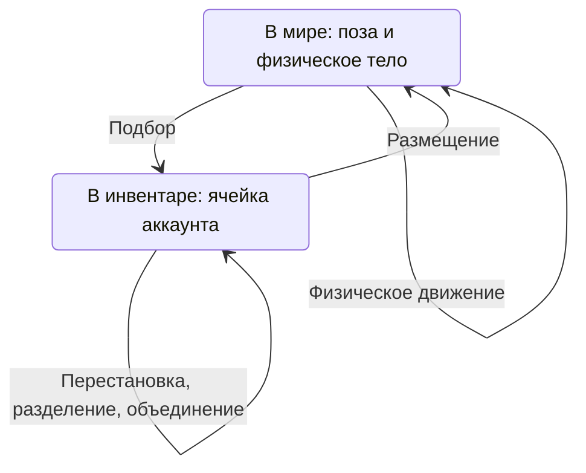

# Предметы, личный инвентарь и постоянный мир

11 ноября 2026 года. Согласованная спецификация и реализованный этап MVP.

Документ описывает поведение предметов, инвентаря и сохранения мира. Базовая реализация этого этапа добавлена; принятые технические решения приведены в разделе 14, команды запуска и миграций — в [README](../README.md). Он развивает [архитектуру проекта](architecture.md) и [базовую спецификацию сетевого полигона](mvp-network-playground.md). Для этого этапа прежние ограничения «один обязательный ящик» и «сброс мира при перезапуске» заменяются коллекцией постоянных предметов и восстановлением сохранённого мира.

## 1. Цель и границы этапа

Игрок после входа через Telegram получает личный инвентарь, содержимое которого сохраняется в PostgreSQL и доступно при следующих входах. Игрок может подбирать физические предметы из общего мира, складывать их в ячейки, выбирать позицию и поворот для размещения. Размещённые предметы и их физическое состояние сохраняются между перезапусками сервера.

Для MVP сохраняется существующая основа: Babylon.js, Havok, Colyseus, TypeScript, один серверный процесс, одна комната общего мира и до восьми игроков. Сервер рассчитывает полную карту; клиент загружает локальную статику сегментами и получает только динамику своего AOI. Одним постоянным миром одновременно владеет один серверный процесс.

Сохраняются предметы и инвентари. Сохранение позиции персонажа между запусками в этот этап не входит: постоянный аккаунт, игровая сессия и сущность персонажа сохраняют разные назначения.

## 2. Основные понятия

| Понятие | Смысл |
|---|---|
| Тип предмета | Описание в общем каталоге: название, отображение, физические параметры и правила складывания |
| Экземпляр предмета | Конкретная вещь с постоянным уникальным ID, типом, индивидуальным состоянием и местонахождением |
| Инвентарь | Личное хранилище постоянного аккаунта с расположением ячеек |
| Ячейка со стопкой | Группа из 1…N совместимых экземпляров предмета |
| Постоянный мир | Сохраняемое игровое пространство с устойчивым ID |
| Запуск мира | Работа серверной симуляции с отдельным `worldEpoch` и счётчиком шагов |
| Версия карты | Выпущенная версия геометрии и подготовленных данных, которую согласуют клиент и сервер |

### Каталог предметов

Все переносимые предметы описываются в общем каталоге. Для типа определены:

- устойчивый идентификатор;
- название, иконка и визуальная модель;
- физическая форма, размеры, масса, трение и упругость;
- максимальное число экземпляров в одной стопке `N`, где `N` — целое число не меньше единицы.

Каталог определяет свойства типа. Индивидуальное изменяемое состояние принадлежит экземпляру. В первом объёме оно может отсутствовать; будущие повреждения, подписи или иные свойства не требуют изменения принципа идентичности предметов.

Каталог предметов и каталог статических зданий имеют разные предметные правила. Они могут использовать общие средства подготовки моделей и физических форм. Здания, геометрия карты и персонажи не становятся содержимым инвентаря.

Каталог выпускается вместе со сборкой и имеет согласованную версию на клиенте и сервере. Для небольшого MVP в сборку включаются описания и ресурсы всех поддерживаемых типов предметов, в том числе находящихся только в инвентарях.

Тип нельзя бесследно удалять, пока на него ссылаются существующие экземпляры. Прекращение создания новых предметов такого типа не удаляет уже созданные вещи. Если при обновлении уменьшается `N`, прежние стопки разделяются с сохранением всех экземпляров.

### Экземпляр и физическое тело

ID экземпляра сохраняется при подборе, размещении, разделении стопок и перестановке ячеек. Индекс ячейки, сетевой `sessionId` и `worldEpoch` не определяют идентичность предмета.

Каждый экземпляр может существовать как физический объект мира. Физическое тело создаётся при размещении и удаляется при подборе. В инвентаре предмет не участвует в физической симуляции. Создание тела не создаёт новый экземпляр предмета.

Для размещённого предмета сохраняются постоянный ID, тип, индивидуальное состояние, ID мира, позиция, ориентация, линейная и угловая скорости, а также данные безопасного положения для восстановления. Ориентация хранится в принятом в проекте формате кватерниона. Применяются общие единицы и оси: метры, секунды, радианы, вертикаль `Y`.

## 3. Инварианты и владение данными

Для каждого существующего экземпляра выполняются следующие правила:

1. Он находится ровно в одном месте: в конкретном мире либо в конкретной ячейке инвентаря одного аккаунта.
2. Одновременное нахождение в мире и инвентаре, в двух инвентарях или в двух ячейках недопустимо.
3. У размещённого предмета определены мир и физическая поза. У предмета в инвентаре определена ячейка, через которую устанавливается принадлежность аккаунту.
4. Подбор, размещение, разделение и объединение стопок сохраняют число и ID экземпляров.
5. В ячейке находятся от 1 до `N` совместимых предметов. Размер стопки определяется её содержимым.
6. Подтверждённое изменение сохраняется независимо от подключения игрока и времени жизни серверного процесса.
7. Повтор одной операции не выполняет перенос повторно и не создаёт дополнительное физическое тело.

Эти ограничения обеспечиваются серверной логикой и ограничениями хранения. Интерфейс отображает результат и не является единственным средством проверки.

| Факт | Источник и владелец |
|---|---|
| Свойства типа | Согласованная версия каталога |
| Идентичность, индивидуальное состояние и местонахождение экземпляра | Постоянные данные в PostgreSQL, изменяемые серверными операциями |
| Текущее физическое движение | Авторитетная серверная симуляция |
| Состояние для восстановления после остановки | Последний успешно записанный физический снимок в PostgreSQL |
| Принадлежность и раскладка инвентаря | Постоянные данные аккаунта и его ячеек |
| Количество в стопке | Состав экземпляров в ячейке; число в интерфейсе является проекцией |
| Сетевое и визуальное представление | Проекции подтверждённого состояния |

Связь предмета с аккаунтом определяется его нахождением в личном инвентаре. После размещения предмет доступен любому вошедшему игроку. Сведения о том, кто ранее поставил вещь, не предоставляют исключительных прав на подбор.

Во всех переходах сохраняется ID экземпляра. Временное резервирование при обработке команды не вводит третьего постоянного местонахождения.

## 4. Инвентарь, ячейки и стопки

Инвентарь привязан к постоянному `accountId`. Переподключение, смена браузера и появление новой сущности персонажа не меняют его содержимого.

Число ячеек и общее количество предметов в инвентаре не ограничиваются игровым правилом. Новые ячейки появляются по необходимости. Бесконечное пустое пространство интерфейса не требует заранее создавать записи в БД.

Стопка состоит из отдельных экземпляров. Десять ящиков в ячейке — это десять вещей с собственными ID; интерфейс показывает одну иконку и число 10.

Для объединения необходимы одинаковый тип и совместимое индивидуальное состояние. Пока индивидуальных свойств нет, достаточно совпадения типа. Идентификаторы и прежние позиции в мире не влияют на совместимость.

Правила работы:

- При подборе предмет дополняет подходящую неполную стопку. Если такой стопки нет, создаётся новая ячейка со стопкой.
- При наличии нескольких подходящих ячеек сервер использует определённый порядок выбора.
- Игрок может переставлять ячейки, разделять стопки и объединять совместимые стопки в пределах `N`.
- Ячейки имеют устойчивую идентичность, а их порядок сохраняется. Подбор не переставляет остальные ячейки произвольно.
- Размещение переносит один конкретный экземпляр из выбранной стопки. Остальные предметы остаются в ячейке.
- Пустая ячейка не считается стопкой с нулевым количеством предметов. Отображение свободных мест относится к раскладке интерфейса.

Пример при `N = 10`: подбор 23 одинаковых предметов даёт стопки **10 / 10 / 3**. Размещение одного экземпляра из первой ячейки оставляет **9 / 10 / 3** и один физический предмет в мире. Общее число экземпляров остаётся равным 23.

Инвентарь и изменения его содержимого передаются только владельцу. Общая сетевая проекция мира не содержит личные инвентари остальных игроков.

## 5. Доступ игроков

| Участник | Доступные действия |
|---|---|
| Гость | Вход в мир, движение, столкновения и толкание предметов |
| Игрок после входа через Telegram | Действия гостя, личный постоянный инвентарь, подбор, перестановка стопок и размещение |

Изменения мира от толчков гостя также сохраняются. Для этого не требуется личный инвентарь или постоянный анонимный аккаунт гостя.

Сервер определяет аккаунт и персонажа по проверенной авторизации и игровой сессии. Переданный клиентом ID чужого аккаунта не предоставляет доступ к его инвентарю.

При выходе игрока содержимое его инвентаря сохраняется. Поставленные им вещи остаются в общем мире. Начатый перенос связан с аккаунтом и ID операции; закрытие соединения не должно оставлять предмет без местонахождения.

## 6. Подбор предмета

Клиент отправляет намерение подобрать конкретный экземпляр. Сервер проверяет:

- действующую авторизацию и готовность персонажа к действиям;
- наличие предмета в этом мире;
- досягаемость предмета и доступность взаимодействия без подбора сквозь препятствие;
- отсутствие другой операции, зарезервировавшей предмет;
- подходящую ячейку либо возможность создать новую.

После успешного сохранения переноса сервер удаляет физическое тело и обновляет личный инвентарь. Другие клиенты получают исчезновение предмета из мира.

Если два игрока одновременно подбирают один экземпляр, успешно завершается только одна операция. Второй игрок получает отказ и актуальное состояние. Отсутствие свободных ячеек не является причиной отказа: их число не ограничено.

В реализации дальность подбора также составляет 3 метра. Для обоих действий расстояние измеряется от центра физической формы персонажа до центра формы предмета.

## 7. Размещение предмета

### Выбор позиции

1. Игрок выбирает предмет в ячейке своего инвентаря.
2. Клиент показывает полупрозрачное предварительное изображение одного экземпляра.
3. Игрок выбирает позицию на поверхности и поворот. Допустимость позиции отражается в предварительном изображении.
4. При подтверждении клиент отправляет желаемую позу и ссылку на содержимое инвентаря.
5. Сервер проверяет актуальное состояние и проводит перенос. При успехе предмет появляется в общем мире и подчиняется физике.

Предварительное изображение видно размещающему игроку, не имеет физического тела и не является новым экземпляром предмета. До подтверждения вещь остаётся в инвентаре. Отмена предварительного выбора не меняет постоянные данные.

### Правила допустимости

Начальная максимальная дальность размещения — **3 метра**, настраиваемое серверное правило. Расстояние измеряется в трёх измерениях от согласованной опорной точки персонажа до центра физической формы предмета. Произвольная точка привязки визуальной модели не влияет на дальность.

Сервер проверяет, что:

- игрок вправе распоряжаться выбранным экземпляром;
- координаты и поворот корректны;
- дальность не превышена по актуальному положению персонажа;
- физическая форма целиком находится в допустимой области мира;
- предмет имеет опору на поверхность, включая поверхность другого предмета;
- отсутствуют недопустимые пересечения с геометрией, персонажами и другими предметами; допустимый контакт с опорой не считается пересечением;
- место доступно со стороны персонажа и не выбрано сквозь стену;
- выбранное место и предмет доступны для завершения операции.

Предварительная проверка клиента помогает выбрать позицию. Окончательное решение принимает сервер: за время выбора опора могла сдвинуться, а выбранное место — оказаться занято.

Во время записи сервер удерживает место допустимым с помощью резервирования, учитываемого симуляцией и другими действиями. Если условия нельзя обеспечить до фиксации переноса, действие отклоняется и предмет остаётся в инвентаре. В базовой реализации резервирование обеспечивается краткой приостановкой общей физики до фиксации транзакции и применения результата. При медленной БД эта пауза может быть заметна игрокам.

### Поведение после размещения

Выбранная поза становится начальным состоянием физического тела. Предмет может падать, скользить, вращаться, сталкиваться и быть подобран другим вошедшим игроком. Он не закрепляется автоматически на поверхности или на предмете-опоре.

Проверка опоры не гарантирует устойчивость: поставленный на край ящик может перевернуться. Кнопки X / Y / Z меняют поворот с шагом 15°; хранимая ориентация поддерживает полную пространственную позу.

## 8. Согласование БД и симуляции

Физика рассчитывается в памяти сервера. Запросы к БД выполняются вне фиксированного физического шага. Серверный модуль предметов согласует постоянные данные, резервирование, изменения физических тел и сетевую проекцию.

Обычный перенос проходит следующие стадии:

1. Проверка команды, аккаунта, текущего местонахождения и условий действия.
2. Резервирование предмета и необходимых ресурсов: ячейки, места размещения или опоры.
3. Запись переноса и результата операции одной транзакцией PostgreSQL.
4. Применение подтверждённого изменения к физическому миру между шагами симуляции.
5. Обновление сетевых проекций и подтверждение клиенту.

У операции есть устойчивый идентификатор, связанный с аккаунтом. Повтор того же запроса возвращает известный результат; повторное использование идентификатора для другого действия не допускается. Сведения, необходимые для защиты от повторного переноса после переподключения и перезапуска, сохраняются в БД.

Если БД отклонила транзакцию, постоянное местонахождение не меняется и резервирование освобождается. При неопределённом результате записи сервер сначала устанавливает, была ли операция зафиксирована. Он не подтверждает успех или окончательный отказ на основании одного сетевого тайм-аута.

Если процесс завершился после фиксации в БД, но до изменения физического тела или отправки ответа, следующий запуск восстанавливает предмет по сохранённому местонахождению. При невозможности применить уже зафиксированный перенос работа мира приостанавливается до согласования состояния; дополнительные команды не должны усугублять расхождение.

Для MVP используется одна упорядоченная очередь записей мира: переносы и физические снимки проходят согласованный порядок. Фиксированный обработчик не ожидает SQL-запросов. Во время фонового сохранения движение продолжается; во время переноса физика приостановлена для сохранения допустимости резервирования.

## 9. Сохранение физического движения

| Изменение | Момент сохранения |
|---|---|
| Подбор, размещение и изменение содержимого ячеек | До подтверждения успешной операции |
| Движение предметов | Периодически, ориентировочно раз в секунду, для изменившихся предметов |
| Остановка предмета | Сохранение окончательного физического состояния |
| Штатное завершение сервера | Запись оставшихся изменений до освобождения симуляции |

Позиция, ориентация и скорости предмета записываются совместно. Изменившиеся предметы одного физического снимка собираются на одном шаге и сохраняются согласованным пакетом. Для неподвижных предметов не требуется повторять одинаковые записи на каждом шаге.

Снимок содержит версию размещения экземпляра и порядок физического состояния в рамках запуска. Фоновая запись применяется только к тому же размещению в мире и не может перезаписать более новое состояние.

Пример защищаемого сценария:

1. Подготовлен снимок предмета в мире.
2. Предмет подобран и, возможно, снова размещён в другой точке.
3. Завершается запоздалая запись старого снимка.
4. Проверка версии исключает возврат предмета в мир из инвентаря и перезапись новой позы старой.

Очистка признака изменившегося предмета также учитывает, какое состояние действительно сохранено: движение, произошедшее во время записи, остаётся ожидающим сохранения.

### Гарантии восстановления

Подтверждённые переносы сохраняются при аварийном завершении. Физическое движение восстанавливается до последнего успешно записанного состояния. Интервал около секунды является настройкой частоты записи, а не безусловной гарантией максимального отката при задержках или ошибках БД.

При штатном завершении сервер прекращает новые действия, завершает начатые переносы, останавливает изменение физического состояния, сохраняет оставшиеся изменения и только затем освобождает симуляцию и подключение к БД. При невозможности завершить запись остановка не считается полностью сохранённой.

Сохраняемых поз и скоростей достаточно для продолжения обычной физики. Внутренние контакты решателя Havok не сохраняются, поэтому после запуска возможна небольшая стабилизация соприкасающихся предметов. Побитово одинаковое продолжение траектории не является требованием MVP.

## 10. Инициализация и восстановление мира

Постоянный мир имеет устойчивый ID. Новые `worldEpoch`, ID комнаты и счётчик шагов обозначают очередной запуск и не создают новый постоянный мир. Текущие координаты предметов не входят в идентичность сборки карты и не меняют `mapVersion`.

### Первое создание

Описание карты задаёт первоначальное наполнение. Экземпляры создаются однократно, с устойчивой связью между записью начального наполнения и созданным предметом. Инициализация отмечается в постоянных данных и безопасна при повторном запуске.

Отсутствие предметов в мире не означает, что он не инициализирован. Все вещи могли оказаться в инвентарях. Добавление или изменение начального наполнения в последующей сборке требует явного решения о применении к существующему миру.

### Последующие запуски

Сервер:

1. Проверяет доступность PostgreSQL, схему хранения и право единолично обслуживать этот постоянный мир.
2. Загружает совместимую геометрию и каталог предметов.
3. Выполняет первоначальную инициализацию только для ещё не созданного мира.
4. Восстанавливает размещённые экземпляры, их позы, скорости и индивидуальное состояние.
5. Создаёт физические тела только для экземпляров, находящихся в мире.
6. Назначает новый `worldEpoch` и объявляет мир готовым к входу игроков.

Личные инвентари загружаются для владельцев после авторизации. Предметы из них не получают физических тел при старте мира.

Время выключенного сервера считается паузой. Продолжительный простой не запускает ускоренный расчёт прошедшего времени. Мир с нулём размещённых предметов является корректным и доступным для игры состоянием.

При недоступности БД или невозможности восстановить данные сервер не подменяет существующий мир свежим начальным наполнением.

## 11. Недоступность БД, обновления и потерянные предметы

### Ошибки сохранения

PostgreSQL становится обязательной зависимостью постоянного мира. Его конфигурация отделяется от параметров Telegram: мир сохраняется и при игре одних гостей.

При обнаруженной невозможности сохранять изменения сервер приостанавливает симуляцию и новые переносы, сообщает о недоступности сохранения и не объявляет мир готовым. После восстановления связи он устанавливает результаты незавершённых записей, согласует состояние, сохраняет ожидающие изменения и затем возобновляет игру. Клиенты должны согласовать предсказание с состоянием возобновлённой симуляции.

### Совместимость карты и каталога

Перезапуск и пересборка карты сами по себе не сбрасывают предметы. Изменение геометрии, физических форм или других значимых параметров требует проверки совместимости с сохранённым состоянием.

Для MVP несовместимое обновление применяется отдельным явным шагом. Автоматическое исправление любых последствий изменения карты не требуется. Неизвестный тип или неразрешимая несовместимость не приводят к молчаливому удалению экземпляров и созданию нового мира.

### Возврат потерянного предмета

Прежнее правило возврата единственного ящика на старт заменяется восстановлением того же экземпляра в безопасном положении. Успешное размещение обновляет сохраняемую точку его восстановления; дальнейшие безопасные положения могут уточнять её. Запись этой точки учитывает версию размещения, как и запись текущей позы.

Перед возвратом сервер заново проверяет границы, опору и отсутствие пересечений. Ранее безопасное место могло оказаться занято. Если оно недоступно, требуется допустимое место поблизости либо предусмотренная безопасная область мира. Отсутствие подходящего места не разрешает удалять экземпляр, создавать его копию или переносить его в произвольный инвентарь.

Реализация проверяет сохранённую безопасную позу, соседние позиции и позиции у точек появления персонажей. Если допустимого места пока нет, тело временно останавливается вне игровой области и поиск повторяется. Идентичность экземпляра и его принадлежность миру сохраняются; каждый кандидат проверяется по текущей геометрии.

## 12. Встраивание в архитектуру

| Компонент | Ответственность на новом этапе |
|---|---|
| `@su/contracts` | Определения типов и экземпляров, местонахождений, команд, результатов и проверяемых данных |
| `@su/simulation` | Физика предметов, запросы опоры и пересечений, создание, удаление и восстановление тел |
| `@su/protocol` | Общая коллекция размещённых предметов и форматы личной синхронизации инвентаря |
| `apps/server` | Авторизация действий, операции над предметами, SQL, очередь записи, резервирование, восстановление и согласование с физикой |
| `apps/client` | Инвентарь, предварительное размещение, управление поворотом, отображение подтверждений и согласование предсказания |
| Сборщик мира | Выпуск согласованного каталога, визуальных и физических ресурсов, геометрии и первоначального наполнения |

Правила зависимостей сохраняются: `contracts` не зависит от движка и транспорта; `simulation` не обращается к PostgreSQL и не зависит от Colyseus; `protocol` не импортирует серверную симуляцию. Приложение сервера соединяет эти части.

Достаточно модуля предметов внутри серверного приложения, существующего PostgreSQL, общего пула подключения и общего механизма миграций. Предметная логика не должна целиком накапливаться в `WorldRoom`: комната обслуживает подключения, передаёт действия, запускает шаг и публикует проекции.

### Необходимые изменения существующих предположений

- [Контракты и валидация мира](../packages/contracts/src/world.ts) перестают требовать ровно один `crate-01`.
- [Серверная физика](../packages/simulation/src/physics-world.ts) поддерживает коллекцию предметов и изменение состава тел после запуска.
- [Сетевая схема](../packages/protocol/src/index.ts) передаёт коллекцию размещённых предметов вместо единственного обязательного ящика.
- [Клиентская сессия](../apps/client/src/network/session.ts), предсказание и отображение поддерживают ноль, один и несколько предметов, их появление и исчезновение.
- [Отображение предметов](../apps/client/src/rendering/world-view.ts) получает параметры по типу из каталога; экземпляр не обязан присутствовать в первоначальном списке сущностей карты.
- [Обработка действий](../apps/server/src/world-room.ts) дополняется постоянной защитой переносов от повторного выполнения.
- [Конфигурация сервера](../apps/server/src/config.ts), готовность и завершение работы учитывают обязательное хранение мира независимо от входа через Telegram.
- Клиент и сервер выпускаются согласованно; при изменении форматов обновляется версия соответствующего контракта и протокола.

Клиентское предсказание получает актуальные формы размещённых предметов и удаляет их при подборе. Сервер остаётся владельцем результата общей физики. Появление предмета в сцене, его физической проекции и сетевом состоянии согласуется по ID экземпляра.

## 13. Критерии проверки реализации

Таблица задаёт критерии приёмки. Добавлены [проверки хранения и очереди записи](../tests/integration/items.test.ts), [сетевых операций и приватности](../tests/integration/items-network.test.ts), [физики размещения](../packages/simulation/src/items.test.ts) и [браузерного пути](../tests/browser-items.ts). Полный набор из 118 тестов прошёл с настоящим PostgreSQL в изолированных схемах. Отдельно проверены Chromium, узкий экран и собранный сервер с восемью клиентами и одним размещённым телом. Окно после фиксации переноса до изменения физики проверяется восстановлением хранилища без применения переноса к телам; отдельный процесс в этой проверке принудительно не завершается.

| ID | Сценарий | Ожидаемый результат |
|---|---|---|
| I01 | Подобрать 23 одинаковых предмета при `N = 10` | Стопки 10 / 10 / 3, сохранены все 23 ID |
| I02 | Разделить, объединить и переставить стопки, затем войти снова | Состав, ограничения `N` и раскладка сохраняются |
| I03 | Подобрать последний предмет мира | Мир, движение и клиентское предсказание продолжают работать |
| I04 | Перезапустить мир, все предметы которого находятся в инвентарях | Восстанавливается пустой мир; начальное наполнение не создаётся повторно |
| I05 | Двум игрокам одновременно подобрать один экземпляр | Один успешный перенос, один владелец, одно сохранённое местонахождение |
| I06 | Повторить команду после потери ответа, переподключения и перезапуска | Нет повторного переноса или дополнительного тела; результат установлен по ID операции |
| I07 | Завершить процесс после фиксации переноса в БД, до изменения физики или ответа | После запуска экземпляр находится в сохранённом месте и существует в одном количестве |
| I08 | Закрыть соединение во время переноса | Операция получает определённый итог, предмет не теряется, результат связан с правильным аккаунтом |
| I09 | Завершить старую запись координат после подбора и нового размещения | Она не меняет местонахождение и не перезаписывает новую позу |
| I10 | Разместить предмет вне дальности, сквозь стену, без опоры или с пересечением | Отказ; экземпляр остаётся в инвентаре |
| I11 | Сдвинуть опору или занять место во время подтверждения | Сервер сохраняет допустимость до фиксации либо отказывает до переноса |
| I12 | Разместить один предмет из стопки и подобрать его другим игроком | Переносится один прежний экземпляр; остальные остаются в исходной стопке |
| I13 | Перезапустить сервер с несколькими соприкасающимися и движущимися предметами | Состав, позы и скорости восстанавливаются из согласованных данных, допускается физическая стабилизация |
| I14 | Штатно остановить сервер после движения предметов | Оставшиеся изменения записаны до освобождения симуляции |
| I15 | Прервать работу аварийно | Подтверждённые переносы сохранены; движение восстановлено до последнего успешного снимка |
| I16 | Отключить БД во время игры и затем восстановить связь | Мир приостановлен, неподтверждённые результаты установлены, перед продолжением состояние согласовано |
| I17 | Зайти гостем и попытаться изменить инвентарь | Доступны движение и толкание; подбор и размещение требуют авторизации |
| I18 | Подключиться другим аккаунтом и наблюдать общую сетевую схему | Чужое содержимое инвентаря не передаётся |
| I19 | Запустить уже созданный мир после изменения начального наполнения | Существующие экземпляры не сбрасываются и не дублируются |
| I20 | Восстановить потерянный предмет, прежняя безопасная точка которого занята | Нет пересечения, удаления или копии; сохраняется ID экземпляра |
| I21 | Обновить каталог с уменьшением `N` | Стопки приведены к новому пределу без потери экземпляров |

Для нагрузки сохраняется текущая цель до восьми игроков. Проверяется, что фоновое сохранение не блокирует физический шаг. Число размещённых тел для измерений фиксируется отдельно; неограниченный личный инвентарь не является обещанием неограниченной одновременно активной физической сцены.

## 14. Принятые решения реализации

| Деталь | Решение |
|---|---|
| Дальность и опорная точка | Подбор и размещение — до 3 метров между центрами физических форм персонажа и предмета |
| Управление | I — инвентарь, F — подбор ближайшего предмета, кнопки X / Y / Z ±15° — поворот, Esc — отмена размещения |
| Ячейки | Новые ячейки создаются по необходимости; доступны обмен местами, разделение пополам и объединение совместимых стопок |
| Резервирование | На время переноса общая физика приостановлена; фоновая запись движения выполняется без такой паузы |
| Потерянный предмет | Проверка безопасной позы, соседних мест и точек появления; при отсутствии места тело ждёт восстановления без удаления или смены владельца |
| Хранение | Общая миграция схемы версии 1 → 2, таблицы мира, типов, экземпляров, ячеек и результатов операций; SQL-ограничения местонахождения и стопок |
| Повторы и снимки | Постоянный ID операции, версия размещения, эпоха и монотонный порядок снимков; результаты операций автоматически не удаляются |
| Владение миром | Выделенное соединение общего пула удерживает PostgreSQL advisory lock; штатное завершение ждёт подтверждения освобождения блокировки |
| Совместимость | Формат мира v4, ячейки v2 и протокол v9; несовместимая геометрия или физика существующего типа требуют явной миграции |
| Каталог | Все текущие типы из `content/items/catalog.json`, включая составные формы; предел стопки задаёт тип, полный каталог включён в сборку независимо от первоначального наполнения |

## 15. Ручная выдача через чат

Первый объём ограничен постоянными предметами, личными ячейками, подбором, размещением, обычной физикой и восстановлением. Источник первоначальных экземпляров — наполнение мира; подбор и размещение не производят новые вещи. Расширение от 12 ноября 2026 года добавляет ручное создание экземпляров через чат.

Команда `/giveme <type-id>` выдаёт ровно один предмет существующего типа в инвентарь отправителя. Она доступна каждому вошедшему через Telegram игроку без административной роли. Команды, включая неизвестные и ошибочные, не появляются над персонажем; подтверждение или ошибка отправляются только автору запроса. После размещения созданная вещь подчиняется обычным правилам общего мира.

Создание использует очередь записи предметов и транзакционный журнал `item_operations`: экземпляр и успешный результат сохраняются вместе. Журнал содержит аккаунт, время, тип и ID созданной вещи. Повтор запроса, в том числе после неопределённого результата COMMIT, возвращает прежний результат. Создание в инвентаре не требует резервирования физического тела. Существующие правила дополнения стопок применяются и к выдаче. Между успешными выдачами одному аккаунту выдерживаются две секунды по сохранённым операциям, независимо от игровой сессии и перезапуска сервера.

`SU_ITEM_CREATION_ENABLED=false` отключает новые выдачи после перезапуска сервера. По умолчанию выдача включена. Переключатель не затрагивает уже созданные вещи, их подбор и размещение. Схема БД остаётся v3; личное текстовое сообщение в ответ на действие добавлено в протоколе v7 и сохранено в общей версии v9 с анимациями и сегментированной загрузкой.

## 16. Последующие расширения

Крафт, расходование и уничтожение предметов, торговля, вложенные контейнеры, экипировка, ограничения по весу и персональные права на размещённые вещи не входят в этот этап. Для их добавления потребуется отдельно определить жизненный цикл и новые допустимые местонахождения.

Распределённая симуляция, расчёт времени простоя, полное воспроизведение физики по журналу и автоматическая миграция произвольных изменений карты также остаются последующими задачами.

## Сохранения при сегментированной загрузке

`WorldHeader` содержит каталог и стартовые описания предметов, но клиент не создаёт seed-экземпляры. Единственный источник — инициализация постоянного мира. Серверный снимок имеет `scope: 'authoritative'`; частичный клиентский — `scope: 'local'`. Writer получает полный серверный мир. Уход предмета из AOI 500/800 м освобождает прокси и отображение, сохраняя ID, владение, движение и запись БД. Личный инвентарь и приватные ответы не фильтруются по расстоянию.

Разбиение земли и новая сортировка статики меняют совместимость геометрии. `world:migrate` после остановки проверяет текущую позу, `safePose`, типы и границы в одной транзакции. Допустимый движущийся снимок может находиться в воздухе: проверка сохранённой геометрии не подменяется новым размещением с обязательной опорой. Несовместимые данные вызывают полный откат. Миграция сохраняет предметы, скорости, версии размещения, инвентари, операции и профили, не повторяет seed и не сбрасывает схему v3.

Ожидание `areaReady` не удерживает writer или транзакцию. При паузе хранилища сохраняются прежние правила tick, resync и отмены анимаций. Восстановление старой БД после новых игровых операций может потерять эти операции; возврат требует согласованной версии артефактов и сохранённых данных.
