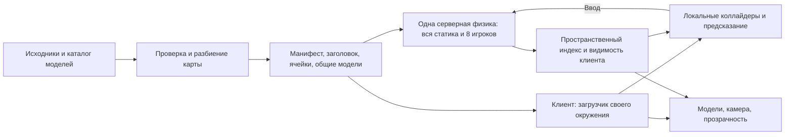

# Следующий этап: большая карта и локальное окружение

> Исторический документ полигона L0–L6. Текущая интеграция с городом и постоянными предметами описана в [README](../README.md#сегментированная-карта) и [отчёте интеграции](../reports/dynamic-map-integration.md). Правила одного ящика, 80/100 м и сброса мира не относятся к основной игре.

Версия документа 1.0, 11 ноября 2026 года. Статус: объём согласован пользователем, выполнены [L0–L5](../reports/large-map.md): локальная загрузка, жизненный цикл сессии, сетевая видимость и автоматическая приёмочная матрица, включая два 30-минутных программных прогона. L6 остаётся открытым для целевого GPU, сервера 2 vCPU / 4 ГБ и пользовательской приёмки. Обозначение этапа — **v0.2**; контракты в коде повышены до формата мира 3 и протокола 3; версия приложения пока 0.1.0. Документ предназначен для разработчиков клиента, симуляции, сети и инструментов проверки. Декомпозиция работ — в [плане реализации](large-map-delivery-plan.md).

## Цель и границы

Поддержать карту **2 × 2 км при лимите 8 игроков**: каждый браузер загружает окружение своего персонажа, получает ближайшие динамические сущности и освобождает удалённые ресурсы. Игроки существуют в одном авторитетном мире, встречаются и взаимодействуют с одним общим ящиком.

| Решение                                                               | Статус для v0.2                                 |
| --------------------------------------------------------------------- | ----------------------------------------------- |
| Карта 2 × 2 км, максимум 8 мест с учётом подготовки и переподключения | Продуктовое решение пользователя                |
| Загрузка ячеек на клиенте и сетевая область интереса                  | Обязательная поставка                           |
| Один Node.js-процесс, одна Colyseus-комната, одна серверная симуляция | Принятая архитектура этапа                      |
| Вся упрощённая статическая геометрия в серверной физике               | Первый вариант, подлежащий нагрузочной проверке |
| Выгрузка серверных коллайдеров пустых участков                        | Отдельное продолжение по результатам измерений  |
| Гостевые сессии, один ящик, сброс состояния при перезапуске           | Сохраняем правила текущего полигона             |

В поставку входят синтетическая карта для приёмки, изменения контрактов и сборки, клиентская загрузка, согласование с предсказанием, фильтрация сети, диагностика и проверки. Реальный импорт Сыктывкара, художественное наполнение, прыжки, транспорт, интерьеры, новые режимы, аккаунты, сохранения, мобильный клиент, увеличение онлайна, распределение мира между процессами, CI и изменение размещения относятся к дальнейшим работам. Цель 50 игроков остаётся долгосрочной и не является критерием этого этапа.

## Текущая основа и необходимые изменения

| Основание v0.1                                                     | Изменение v0.2                                                                                   |
| ------------------------------------------------------------------ | ------------------------------------------------------------------------------------------------ |
| `tools/world-build/src/index.ts` задаёт ячейкам границы всего мира | Настоящая сетка и пространственное распределение всей статики                                    |
| `loadWorldBundle` читает все ячейки и все физические ресурсы       | Отдельная загрузка заголовка, выбранной ячейки и её зависимостей                                 |
| `WorldBase.entities` содержит пол и препятствия всей сцены         | Статические объекты переходят в ячейки; общие параметры и определение ящика остаются в заголовке |
| `PhysicsWorld` создаёт всю статику в конструкторе                  | Клиентская физика добавляет и удаляет статические наборы без пересоздания мира и персонажа       |
| Рендерер создаёт все дома, прозрачность обходит общий список       | Добавление/удаление экземпляров и выбор локальных кандидатов                                     |
| Все клиенты получают `players` и обязательный `crate`              | Фильтруемые персонажи и ящик, который может отсутствовать на клиенте                             |
| Клиент пересчитывает `simulationConfigHash` по целому миру         | Проверка серверной версии, корня манифеста и хешей загружаемых файлов                            |
| Серверные маршруты и инструменты привязаны к `physics-lab`         | Выбор одного активного мира через конфигурацию и `manifestUrl`                                   |

Текущие [архитектура](architecture.md), [формат моделей v2](building-assets.md) и [отчёты](../reports/acceptance.md) описывают реализованный полигон. Наличие этого плана не означает готовности потоковой загрузки или выполнения аппаратных бюджетов.

## Целевой поток

Клиент узнаёт активную версию, загружает заголовок и локальный WASM, присоединяется к единственной комнате и получает серверный план появления. После подготовки нужных ячеек сообщает готовность. Сервер повторно проверяет точку, размещает персонажа и разрешает ввод. Далее клиент заранее готовит соседние участки, а сервер обновляет сетевую область интереса по авторитетной позиции.

## Пространственные данные и версии

Начальная сетка — **125 × 125 м**, 16 × 16 ячеек для карты 2000 × 2000 м. Координаты остаются мировыми, в метрах, с Y вверх. Начало сетки — минимальные X/Z границы мира; индексы вычисляются через `floor((coordinate - origin) / cellSize)`. Ячейки полуоткрытые по X/Z; внешняя граница обрабатывается явно. На малом `physics-lab` крайняя ячейка обрезается границами мира.

Здание или препятствие включается во все ячейки, пересекаемые его мировой ограничивающей областью с учётом поворота. В каждой такой ячейке хранится одинаковое определение с тем же `entityId`. Клиент и сервер объединяют определения по ID; различающиеся определения одного ID отклоняются сборкой. Это исключает необходимость загружать соседний файл только ради поиска владельца здания. Полное попадание здания проверяется по границам мира; принадлежность ячейке проверяется пересечением.

Земля разбивается на согласованные плитки. Между плитками проверяются стыки коллизий и отсутствие щелей; один пол размером 2000 м не добавляется поверх существующего ограничения размера примитивов. Размещение в ячейках не создаёт новых физических стен внутри карты.

| Контракт поставки       | Семантика                                                                                                             |
| ----------------------- | --------------------------------------------------------------------------------------------------------------------- |
| `WorldManifest`         | Формат v3, сетка, границы, версии, список ячеек, каталог моделей и SHA-256 файлов                                     |
| `WorldHeader`           | ID/границы мира, параметры симуляции, точки появления, определение единственного ящика; без массива всей статики      |
| `WorldCell`             | Формат v2, ID, статические примитивы и размещения зданий; точные границы и зависимости на модели — в записи манифеста |
| `WorldDefinition`       | Полная проверенная сборка для сервера; повторные определения на стыках уже объединены                                 |
| Локальный набор статики | Только подготовленные ячейки и используемые ресурсы; не выдаётся за полную `WorldDefinition`                          |
| Авторитетный снимок     | Содержит всех серверных игроков и обязательный ящик                                                                   |
| Локальный снимок        | Содержит своего игрока и видимые сущности; ящик необязателен                                                          |

Сборщик и сервер продолжают проверять полную карту и вычислять `simulationConfigHash` по всем физическим данным. Клиент сверяет версии с `/api/world` и состоянием комнаты, проверяет `mapVersion` по идентичности манифеста и SHA-256 каждого полученного файла. Полное скачивание ради повторного вычисления физического хеша на клиенте исключается. Все загрузки одной сессии относятся к одной неизменяемой версии мира.

Во время реализации повышаются `WORLD_FORMAT_VERSION` с 2 до 3 и `PROTOCOL_VERSION` с 1 до 3: L1–L3 использовали протокол 2, L4 заменил обязательное поле ящика фильтруемой коллекцией и поднял версию ещё раз для явного отказа старой вкладке; мигрируются исходники `physics-lab` и проверки. Форматы каталога моделей и GLB сохраняются, если их семантика не меняется. Ни один числовой лимит валидатора не снимается без замены явным пределом и проверкой нового профиля.

## Загрузка и освобождение клиентских ресурсов

Базовое окружение — текущая ячейка и восемь соседних, с обрезанием по краю карты. Область определяется по серверной и прогнозируемой позиции, дополнительно удерживаются участки истории неподтверждённого ввода. При смене текущей ячейки следующий ряд загружается заранее. Поворот и изменение окна не должны выводить видимую область камеры за подготовленное окружение.

Жизненный цикл ячейки: отсутствует → загружается → проверена → подготовлена → активна → освобождена. Повторные запросы объединяются. Результат устаревшего запроса может остаться в ограниченном кэше байтов, но не активирует ячейку после смены цели или завершения сессии. Ошибка загрузки допускает явный повтор; повреждённый файл повторно читается без старого кэша, после повторного несовпадения показывается ошибка версии/ресурса.

Стартовые инженерные настройки: до 4 одновременных HTTP-загрузок, до 2 мс планируемой работы по подключению ресурсов за кадр, задержка освобождения удалённой ячейки 5 секунд, LRU-кэш проверенных байтов 64 МиБ. Одна операция движка может превысить бюджет кадра: её стоимость измеряется отдельно, слишком тяжёлый ресурс упрощается или дробится при подготовке. Бюджет кэша байтов не считается бюджетом памяти GPU, Havok или разобранной сцены.

У экземпляров и моделей есть счётчики использования. Повторная загрузка ячейки не дублирует объект, а освобождение одной ячейки не удаляет объект, ещё нужный другой. Модель разделяет геометрию между экземплярами; изменяемые материалы прозрачности остаются индивидуальными. Освобождение экземпляра удаляет его из теней, прозрачности, пространственного индекса и физики. Общие материалы, текстуры и формы освобождаются после последнего использования.

При нехватке бюджета приоритет имеют текущее окружение и история предсказания; спекулятивная подгрузка прекращается, вытесняются необязательные данные. Обязательные коллайдеры ради соблюдения кэша не удаляются. Если обязательный набор сам превышает проверенный профиль, это ошибка бюджета содержимого: показывается понятное состояние, причина и измерения попадают в отчёт.

## Согласование с предсказанием и жизненным циклом игрока

Клиент подключает проверенную статику на границе локального физического шага. Мир и собственный контроллер при обычном переходе не пересоздаются. Выгрузка запрещена, пока ячейка нужна текущему положению, предсказываемой траектории или повтору неподтверждённого ввода. Длина удерживаемой истории остаётся ограниченной существующим пределом 500 мс.

Когда безопасного подготовленного окружения не хватает, клиент прекращает свободный прогноз и отправляет нейтральный ввод. Сервер продолжает авторитетную физику. Клиент подгружает область свежего серверного положения, сбрасывает устаревшую историю и возобновляет прогноз после восстановления; камера и интерфейс явно показывают ожидание. Такое ожидание одного клиента не останавливает комнату и не создаёт отсутствующих коллайдеров на сервере.

Для появления, возврата и восстановления соединения вводятся серверный план подготовки и подтверждение клиента. Рабочие названия сообщений — контракты приложения, а не готовые методы библиотек:

| Сообщение     | Поля и назначение                                                                                                        |
| ------------- | ------------------------------------------------------------------------------------------------------------------------ |
| `prepareArea` | `prepareId`, `worldEpoch`, `mapVersion`, причина, целевая позиция, ID нужных ячеек и срок действия; цель выбирает сервер |
| `areaReady`   | `prepareId`, эпоха и версия; подтверждение подготовки ресурсов текущего плана                                            |
| `areaResult`  | ID плана, итог и причина отказа; окончательное положение приходит авторитетным состоянием                                |

До первичного появления персонажа нет в физике. При возврате существующий персонаж остаётся в старой области с нейтральным вводом, пока новая не подготовлена. На завершении сервер повторно проверяет безопасную точку: при занятости выбирает другую внутри готовой области, иначе обновляет план в пределах исходного срока либо возвращает отказ. Успешный возврат увеличивает `revision`, сбрасывает очередь ввода и запускает существующий cooldown; повтор запроса действия возвращает тот же итог.

Просроченное или повторное подтверждение не создаёт второго персонажа и не выполняет второй перенос. Смена плана, выход или новая эпоха отменяют старую подготовку; смена плана не продлевает общий срок. Первичная подготовка ограничена существующими 15 секундами после входа; ожидание безопасной точки после готовности — существующими 5 секундами. Возврат ограничен 15 секундами подготовки, при отказе сохраняет старого персонажа. При переподключении восстанавливается тот же `entityId` в существующем 30-секундном окне, затем готовится окружение фактической позиции с ограниченным сроком 15 секунд. Клиентский список ячеек не даёт права выбирать серверную позицию или отключать столкновения.

## Сетевая область интереса

Сервер обновляет пространственный индекс динамических сущностей после физического шага. Наборы видимости обновляются с частотой отправки состояния 20 Гц; физика и ввод остаются 60 Гц. Первый снимок уже фильтруется. После появления собственный персонаж доступен независимо от расстояния; подтверждения ввода, tick, эпоха, версии и общая занятость комнаты также не зависят от области интереса.

Стартовые расстояния в плоскости X/Z: добавить сущность при ≤ 80 м, убрать при > 100 м. Пороги учитывают радиусы взаимодействий и проверяются для видимой области текущей камеры, поворота и изменения окна; при необходимости увеличиваются до нагрузки. Используем существующую сетку для отбора кандидатов, затем точную проверку расстояния. Граница ячейки сама по себе не меняет видимость. Статические дома не включаются в сетевые снимки.

Фильтрация реализуется через `StateView` и фильтруемые поля коллекции игроков/ящика; совместимость точной установленной версии проверяется в L0. Свой игрок включается в представление до первого снимка с его появлением; до завершения первичной подготовки его нет в физике и коллекции игроков. Уход из области интереса удаляет локальную модель, физический прокси и историю сглаживания. Повторное появление начинает историю с полного свежего состояния. Серверное уничтожение удаляет объект также из индекса и всех представлений. Переподключение восстанавливает видимость заново.

Отсутствие ящика не останавливает ввод и предсказание. Клиент удаляет его старый прокси; при появлении создаёт его по определению заголовка и актуальному состоянию. Авторитетная симуляция продолжает рассчитывать ящик постоянно. Новые типы предметов и универсальная коллекция произвольной динамики в этот этап не добавляются.

У `StateView` есть цена сериализации для каждого представления; экономия трафика измеряется вместе с CPU. Официальные источники: [видимость состояния](https://docs.colyseus.io/state/view), [оптимизация состояния](https://docs.colyseus.io/state/optimization). Документация предупреждает об ограничениях на больших наборах; масштаб нашей поставки — восемь игроков и один ящик.

## Ответственность компонентов

| Компонент                  | Ответственность и направление зависимостей                                                                                           |
| -------------------------- | ------------------------------------------------------------------------------------------------------------------------------------ |
| `packages/contracts`       | Типы заголовка/ячейки/снимков, сетка, валидаторы и чистые пространственные вычисления; без DOM, Babylon, Colyseus и I/O              |
| `tools/world-build`        | Разбиение, согласование ID на стыках, зависимости, бюджеты содержимого, детерминированные артефакты; зависит от contracts            |
| `packages/simulation`      | Добавление/удаление статики и прокси, физический шаг, восстановление персонажа; без HTTP и выбора ячеек для загрузки                 |
| `packages/protocol`        | Схемы и сообщения подготовки, локальный сетевой снимок; зависит от contracts                                                         |
| `apps/client`              | Планирование/отмена загрузок, кэши и счётчики использования, удержание истории, сцена и состояния интерфейса                         |
| `apps/server`              | Полная загрузка одного выбранного мира, планы появления, индекс и сетевые представления; физическое состояние принадлежит simulation |
| `tools/load-test`, `tests` | Движение по большой карте, проверка видимости по позиции и подготовка по тому же протоколу                                           |

Новые отдельные сервисы и инфраструктура не вводятся. Названия конкретных классов выбирает реализация в указанных границах.

## Переход и отложенная оптимизация сервера

Режим миграции — согласованная замена сборки клиента, сервера и мира с повышением версий. Существующая политика разрешает завершение сессий и сброс состояния при перезапуске; постоянных данных для переноса нет. Одновременная поддержка двух протоколов и горячая смена коллайдеров не вводятся. Старый клиент получает несовместимость и действие перезагрузки. Перед заменой сохраняется предыдущий согласованный артефакт для отката; сам выпуск на внешний сервер выполняется отдельной задачей.

Сначала сервер держит всю статику, всех игроков и один ящик. Если на зафиксированном профиле сервер выходит за бюджеты и профиль CPU/памяти связывает это со статикой, в отчёте формируется отдельная задача активации участков. Неудачная приёмка при этом остаётся открытой до исправления и повторного измерения.

Будущий менеджер участков должен удерживать объединение областей игроков, отключившихся персонажей, подготавливаемых переносов и динамических тел с запасом по траектории. Общие коллайдеры учитываются один раз. Участки с ящиком закреплены до отдельного решения о сохранении/замораживании тел. Обязательные коллайдеры должны быть готовы перед взаимодействием; это отдельная проверка корректности, а не простое удаление удалённых домов. Worker-процессы и передача владения между серверами здесь не проектируются.

## Приёмочный профиль и бюджеты

Синтетическая сцена `streaming-lab`: границы X/Z от −1000 до 1000 м, сетка 125 м, **1600 размещений** существующих простых домов, 256 плиток земли, один ящик, минимум восемь безопасных точек появления. Одна ячейка содержит 64 дома; остальные размещения распределены повторяемо. В удалённых ячейках есть минимум два дополнительных ID моделей, чтобы проверить отсутствие преждевременных загрузок. В сцене заданы дом поперёк границы, стык четырёх ячеек и маршруты через них. Генератор, seed, число коллайдеров, треугольников, материалов и байтов сохраняются в отчёте. Это проверенный профиль содержимого, а не обещание производительности любой городской геометрии.

Для сравнения до начала работ сохраняется замер исходного полигона. Итоговые бюджеты наследуют [метрики v0.1](mvp-network-playground.md#условия-измерений):

| Метрика                                                              | Критерий v0.2                                                                                                                                 |
| -------------------------------------------------------------------- | --------------------------------------------------------------------------------------------------------------------------------------------- |
| Сервер: весь цикл, включая стоимость сетевой фильтрации/сериализации | p95 ≤ 8 мс, p99 < 16,7 мс; отдельно физика, репликация и задержка event loop                                                                  |
| Видимый клиентский кадр, включая подключение ячеек                   | p95 ≤ 20 мс на целевом GPU, 1920 × 1080, после 60 секунд прогрева; пики и long tasks сохраняются                                              |
| Коррекции до сглаживания                                             | p95 ≤ 0,2 м у статики и ≤ 0,5 м при контакте с ящиком, RTT 100 мс и jitter ±20 мс; телепортации отдельно                                      |
| Сходимость остановленного ящика                                      | До 0,1 м за 500 мс после свежего состояния                                                                                                    |
| WebSocket-состояние                                                  | Среднее ≤ 30 КиБ/с на клиента за устойчивые 60 секунд при восьми активных участниках; HTTP ячеек измеряется отдельно                          |
| Загрузка до первой игры                                              | ≤ 8 МиБ сжатых обязательных ресурсов на профиле; запрашиваются только начальные ячейки и их зависимости                                       |
| Длительный прогон                                                    | По 30 минут распределённого движения и скопления; без падений и роста ограниченных очередей                                                   |
| Ресурсы при повторном маршруте                                       | После прогрева счётчики активных объектов возвращаются к расчётному набору, необязательные кэши ограничены; нет накопления экземпляров/прокси |

Начальный серверный профиль — Linux, 2 vCPU / 4 ГБ; модели CPU/GPU, браузер и условия замеров фиксируются. Генераторы нагрузки по возможности работают отдельно. RSS, heap, память Havok/WASM, число моделей/материалов/тел и объём кэша записываются отдельно; колебание RSS из-за аллокатора само по себе не доказывает утечку или её отсутствие. По трём повторениям одного маршрута проверяется отсутствие роста числа удержанных объектов; в длительном прогоне сравниваются поздние пятиминутные окна памяти.

Программный рендерер подтверждает поведение и очистку ресурсов; аппаратный бюджет закрывается только на целевом GPU. Существующая незавершённая аппаратная проверка v0.1 не объявляется пройденной этим планом. Инженерные настройки разрешено менять с записью причины и повтором затронутых проверок; изменение числа игроков, механик или бюджета приёмки требует отдельного продуктового решения.

| ID      | Проверяемый результат                                                                                                                     |
| ------- | ----------------------------------------------------------------------------------------------------------------------------------------- |
| LM-AC01 | Карта 2000 × 2000 м собирается повторяемо; ячейки имеют реальные границы, конфликтующие ID и ресурсы отклоняются                          |
| LM-AC02 | На холодном входе скачивается только начальное окружение и зависимости; удалённые уникальные модели не запрашиваются                      |
| LM-AC03 | Переход через сторону и угол ячеек сохраняет сущность, движение и столкновения; дом на стыке создаётся один раз                           |
| LM-AC04 | Два игрока встречаются с разных участков и толкают один ящик через границу с согласованным результатом                                    |
| LM-AC05 | Выход/возврат в сетевую видимость очищает и заново создаёт локальные представления; отсутствие ящика допускает обычную игру               |
| LM-AC06 | Медленные/ошибочные загрузки и устаревшие ответы не включают неверную ячейку; ожидание клиента не останавливает остальных                 |
| LM-AC07 | Появление, возврат, истечение плана, повтор подтверждения, переподключение в удалённом районе и новая эпоха обрабатываются однократно     |
| LM-AC08 | Повторный маршрут освобождает экземпляры, тени, материалы, прокси и ссылки; лимиты кэша и очередей соблюдаются                            |
| LM-AC09 | Восемь активных клиентов проходят оба длительных сценария в бюджетах; девятый получает отказ без новой комнаты                            |
| LM-AC10 | Малый `physics-lab` сохраняет прежние механики на новых контрактах; сборка/запуск обоих миров и несовместимость старого клиента проверены |

Открытых продуктовых вопросов для начала реализации нет. Параметры производительности уточняются техническими проверками L0; художественная карта и дальнейшая оптимизация сервера остаются отдельными решениями после измерений.
