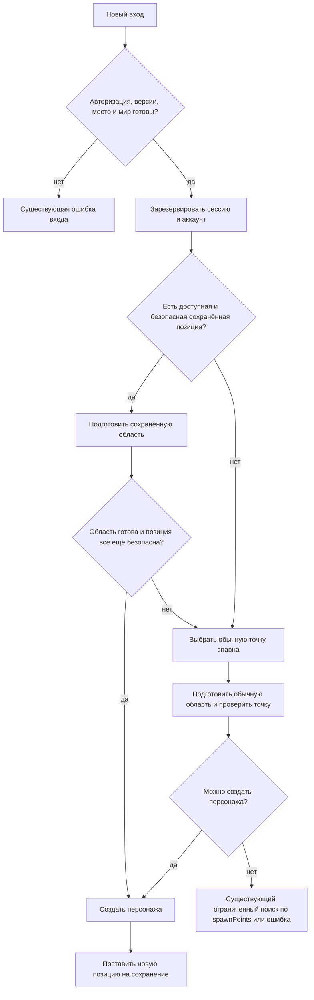

# Возвращение авторизованного игрока в сохранённую позицию: первая версия

Дата: 13 ноября 2026 года. Основание: исследование кода `548a02f` и выбранный владельцем вариант «сохранённая точка → обычный спавн».

**Статус: реализация в рабочей ветке; автоматические результаты и открытая ручная приёмка — в [отчёте](../../reports/player-position-persistence-mvp.md).** Документ сохраняет требования поставки для проверки в настоящей игровой сессии. Поиск соседней точки и возврат в последнюю безопасную позицию в неё не входят.

## 1. Цель и результат поставки

Авторизованный игрок уходит со стартовой площадки, выходит из игры и при следующем входе появляется на том же месте, если оно пригодно для появления персонажа. Сохранение принадлежит аккаунту и миру, работает из другого браузера и переживает перезапуск сервера.

Если сохранение отсутствует, не читается или сохранённая точка недоступна, сервер использует обычный алгоритм спавна. Обычный спавн означает первую подходящую точку из актуального массива `spawnPoints`, с проверкой занятости; это не одна жёстко заданная координата.

Правило владельца «по любой причине» распространяется на невозможность использовать сохранение: неверные данные, небезопасную геометрию, отсутствие опоры, занятость и невозможность подготовить область. Оно не отменяет авторизацию, лимит игроков, проверку версий и общую готовность мира. При глобальной недоступности игры вход может завершиться существующей ошибкой. Если обычный спавн тоже недоступен, нельзя принудительно создавать персонажа в непроверенном месте.

### Входит в поставку

- Одна запись позиции на пару `(accountId, worldId)` в PostgreSQL.
- Сохранение при явном выходе, потере связи, выходе из аккаунта и истечении авторизации.
- Периодические контрольные записи и финальное сохранение при штатной остановке.
- Восстановление точной позиции тела и проверка безопасности на сервере.
- Одна попытка использовать сохранённую точку и автоматический переход к обычному спавну.
- Подготовка удалённой области до появления, включая переход на старт при локальном сбое её загрузки.
- Совместимость с существующими переподключением, «На старт», сменой раскладки, инвентарём и двумя режимами камеры.
- Автоматические проверки с настоящими PostgreSQL, WebSocket и браузером, затем ручная приёмка в городе.

### За пределами поставки

- Поиск рядом, navmesh, перемещение на другой этаж и выбор ближайшей поверхности.
- История безопасных мест, несколько персонажей и выбор сохранения пользователем.
- Сохранение скорости, анимации, реакции, чата, поворота персонажа и состояния камеры. В v1 сохраняются только `x/y/z`; остальные параметры следуют обычному новому входу, скорость и ввод обнуляются.
- Постоянно присутствующее в мире тело отключившегося игрока после окна переподключения.
- Новый экран выбора точки, переключатель функции, административная панель и общий рефакторинг хранения предметов.
- Автоматическое развёртывание в production в рамках реализации этого плана.

## 2. Подтверждённая основа

| Источник                                                                                                          | Текущее поведение                                                                                  | Следствие                                                                                |
| ----------------------------------------------------------------------------------------------------------------- | -------------------------------------------------------------------------------------------------- | ---------------------------------------------------------------------------------------- |
| [WorldRoom: вход и подготовка](../../apps/server/src/world-room.ts)                                               | `onJoin` синхронно резервирует аккаунт, затем создаёт план; `areaReady` предшествует созданию тела | Резервировать аккаунт до асинхронного чтения позиции; сохранить барьер подготовки        |
| [Сессия комнаты](../../apps/server/src/room/session.ts)                                                           | Состояние переживает транспортное переподключение, но не полноценный новый вход                    | Хранить в сессии выбор источника спавна и снимок отключения, в БД — долгоживущую позицию |
| [AuthoritativeWorld](../../packages/simulation/src/authoritative-world.ts)                                        | Сервер владеет состоянием тела; `addPlayer` принимает опорную точку спавна                         | Сохранять серверную позицию; добавить явный API создания по центру тела                  |
| [PhysicsWorld](../../packages/simulation/src/physics-world.ts)                                                    | `findSpawn` проверяет пересечения, но сам не проверяет опору и границы                             | Нужна отдельная проверка пригодности позиции персонажа                                   |
| [Контракт сессии](../../packages/contracts/src/session.ts)                                                        | `PrepareArea` несёт координаты и ячейки; сейчас нет сообщения об отказе подготовки области         | Переиспользовать подготовку, добавить узкий ответ `areaFailed`                           |
| [GameSession](../../apps/client/src/network/session.ts), [CellStreamer](../../apps/client/src/streaming/cells.ts) | Клиент сообщает готовность критической области; ошибки её загрузки остаются в загрузчике           | Сообщать серверу окончательный локальный отказ активного плана                           |
| [Схема БД](../../apps/server/src/migrations.ts)                                                                   | Схема 6, таблицы позиции игрока нет                                                                | Добавить миграцию, без заполнения выдуманными координатами                               |
| [WorldOwnership](../../apps/server/src/world-ownership.ts), [ItemRuntime](../../apps/server/src/items/runtime.ts) | Один владелец мира; очередь предметов при сбое может приостанавливать игру и повторять операцию    | Позициям нужен ограниченный по времени путь, не задерживающий очередь предметов          |
| [Остановка сервера](../../apps/server/src/index.ts)                                                               | `shutdownWorld` вызывается до отключения клиентов; закрытие предметов освобождает владение         | Финальные позиции должны попасть в сохранение до освобождения владельца                  |

Срез версий: протокол **16**, БД **6**, формат мира **5**. Для реализации ниже требуются следующая версия протокола и следующая версия БД; на данном срезе это **17** и **7**. При параллельных изменениях выбрать следующие свободные номера, не перезаписывать чужие миграции.

Подтверждённая особенность координат: позиция контроллера — центр тела, а исходная точка спавна — опорная точка. `spawnPosition` добавляет `height / 2 + 0.02`; сейчас это 0,92 м. Передача сохранённого центра в старый `addPlayer` повторно добавляет эту высоту.

## 3. Целевой сценарий целиком



1. `onAuth` сохраняет существующую проверку аккаунта. Координаты клиента не принимаются ни при входе, ни при выходе.
2. `onJoin` без `await` проверяет и занимает `accountPlayers`, создаёт `PlayerSession` и увеличивает occupancy. Затем начинает чтение сохранения для авторизованного игрока. Гость сразу переходит к обычному спавну.
3. На чтение, включая ожидание очереди, отводится 1000 мс. Последний ещё не записанный серверный снимок того же аккаунта в памяти имеет приоритет перед более старой строкой БД. Это обеспечивает немедленный выход и повторный вход.
4. Непригодная запись или ошибка чтения приводят к обычному спавну. Поздний результат чтения уже не меняет принятое решение.
5. Для сохранённой позиции выполняется серверная проверка безопасности, затем обычный `prepareArea` с `reason: 'spawn'`. Персонажа до `areaReady` нет.
6. После готовности клиента сервер повторяет проверку по текущей физике и раскладке. Проверка и создание тела выполняются синхронно между физическими шагами, без SQL и `await` между ними.
7. Любой локальный отказ сохранённой попытки переводит вход в обычный спавн. В рамках этого входа сохранённая позиция больше не рассматривается.
8. Успешное создание публикуется существующим способом через `PlayerSchema`, AOI и `areaResult`. Фактический центр нового тела сразу становится новым снимком для записи — в том числе после запасного спавна.

Долговечность позиции не задерживает появление: сохранение новой позиции выполняется фоново. Успешный `areaResult` подтверждает появление, а не завершение SQL-записи.

## 4. Однозначные правила жизненного цикла

| Событие                                           | Что сохранять / восстанавливать                                                                                                                                            |
| ------------------------------------------------- | -------------------------------------------------------------------------------------------------------------------------------------------------------------------------- |
| Успешный новый вход                               | Сразу захватить фактический центр созданного тела                                                                                                                          |
| Игрок онлайн                                      | Раз в 5 секунд захватывать изменившуюся позицию после серверного физического шага                                                                                          |
| Явный выход                                       | Захватить позицию до удаления тела, передать снимок сохраняющему модулю, освободить персонажа и аккаунт без ожидания БД                                                    |
| Потеря связи                                      | В `onDrop` один раз захватить позицию на момент обнаружения отключения и поставить её на запись; сохранить снимок в сессии                                                 |
| Успешное переподключение в существующие 30 секунд | Восстановить существующего персонажа существующим путём; не применять к нему позицию из БД. После успешной подготовки убрать снимок отключения и захватить текущую позицию |
| Истечение окна переподключения                    | Использовать уже захваченный снимок отключения; не заменять его более поздней позицией продолжающего симулироваться тела                                                   |
| Выход из аккаунта / истечение авторизации         | Захватить позицию до перевода сессии в отключённую и удаления тела; при последующих callback не захватывать её второй раз                                                  |
| Успешное «На старт»                               | Выбирать только обычный спавн и сразу сохранять фактическое новое положение                                                                                                |
| Неудачное «На старт»                              | Существующее тело остаётся источником позиции; не сохранять координаты неисполненного плана                                                                                |
| Выход до первого появления                        | Не создавать и не перезаписывать сохранение                                                                                                                                |
| Штатная остановка                                 | Для онлайн-игроков захватить текущее положение; для отключённых с зарезервированным местом — снимок отключения; дождаться записи в общем процессе остановки                |
| Аварийное завершение                              | Следующий запуск использует последнюю подтверждённую запись БД                                                                                                             |

Для сохранения выхода используется `accountId` ранее допущенной сервером сессии. Проверка `auth.expiresAt > now` в момент записи не нужна: при logout и истечении срока она как раз помешала бы сохранить позицию. Это внутренний снимок ранее авторизованного персонажа, а не новое клиентское полномочие.

Отключённые персонажи не участвуют в периодическом захвате. При каждом новом успешном переподключении начинается новый период связи; следующее отключение создаёт новый снимок. Идентификатор периода связи нужен для защиты от запоздалых callback прежнего транспорта.

Позиция в воздухе или в небезопасном состоянии сохраняется как фактическая позиция, без подмены последним безопасным местом. Если при следующем входе она непригодна, выбирается обычный спавн. Само наличие `grounded` в старом снимке не является доказательством безопасности при новом входе.

## 5. Данные и источник истины

### Запись PostgreSQL

Новая таблица `player_positions`:

| Поле             | Тип / ограничение                                     | Назначение                                          |
| ---------------- | ----------------------------------------------------- | --------------------------------------------------- |
| `account_id`     | `uuid`, FK `accounts(id) ON DELETE CASCADE`           | Владелец позиции                                    |
| `world_id`       | `text`, FK `persistent_worlds(id) ON DELETE CASCADE`  | Мир с неизменной системой координат                 |
| `x`, `y`, `z`    | `double precision NOT NULL`, только конечные значения | Центр физической капсулы, метры, мировые координаты |
| `write_epoch`    | `uuid NOT NULL`                                       | Запуск сервера, создавший запись                    |
| `write_sequence` | `bigint NOT NULL CHECK (write_sequence >= 0)`         | Порядок захвата снимка внутри запуска               |
| `updated_at`     | `timestamptz NOT NULL`                                | Время успешной записи для диагностики               |

Первичный ключ — `(account_id, world_id)`. Позиция не относится к `player_profiles`: у профиля собственная версия редактирования, а координаты меняются независимо и принадлежат конкретному миру.

Проверка конечности должна исключать также PostgreSQL `NaN` и обе бесконечности, например через строгие сравнения с `'-Infinity'::double precision` и `'Infinity'::double precision` для каждой координаты. Границы актуального мира проверяются приложением при использовании записи.

`write_epoch` защищает запись, но **не ограничивает чтение**: позиции прежней эпохи обязательно доступны после перезапуска. `updated_at` не определяет порядок записей. Последовательность присваивается при захвате снимка, а не при начале или завершении SQL.

`mapVersion`, ревизия раскладки и полный хеш геометрии не входят в ключ и не запрещают восстановление при изменении карты. Безопасность проверяется заново. Изменение начала координат или смысла координат существующего `worldId` требует отдельного явного сброса/переноса этих записей; такой перенос в MVP не реализуется.

Сохранённые позиции не должны блокировать миграцию геометрии или строительство на месте отсутствующего игрока: они являются кандидатами для будущего входа, а не постоянной резервацией пространства. Не добавлять их в проверки блокировки размещений и офлайн-миграции предметов.

### Серверные контракты

Имена ниже — целевые, их можно уточнить при реализации без изменения семантики:

```ts
interface PlayerPositionSnapshot {
  accountId: string;
  worldId: string;
  position: Vec3; // центр тела; копия значений, без ссылки на живой объект
  writeEpoch: string;
  writeSequence: number; // безопасное целое JS, преобразуется в bigint БД
}

type PositionLoadResult =
  | { status: 'found'; snapshot: PlayerPositionSnapshot }
  | { status: 'missing' }
  | { status: 'unavailable'; reason: 'timeout' | 'storage' | 'invalid' };
```

Долговременный источник истины — PostgreSQL. Внутри работающего сервера более новый захваченный, но ещё не записанный снимок имеет приоритет. После подтверждения записи неактивному аккаунту такой кеш больше не требуется. Клиент не получает таблицу позиций других игроков и не может записывать координаты через HTTP или сетевое сообщение.

## 6. Границы компонентов и сохранение

Добавить узкий модуль `apps/server/src/players/`:

| Компонент                             | Ответственность                                                                                                                            |
| ------------------------------------- | ------------------------------------------------------------------------------------------------------------------------------------------ |
| `position-store.ts`                   | Чтение и условный upsert; транзакционная защита от старой эпохи; перевод строк БД в проверенные данные                                     |
| `position-runtime.ts`                 | Нумерация снимков, последние незаписанные позиции, объединение повторных записей, ограниченные попытки БД, повторы, закрытие и диагностика |
| `WorldRoom`                           | Только захват позиции в нужные события, жизненный цикл сессии, выбор источника спавна и подготовка области                                 |
| `AuthoritativeWorld` / `PhysicsWorld` | Проверка позиции и создание/перемещение тела; никаких импортов PostgreSQL и серверного runtime                                             |

Направление зависимостей: комната использует runtime и симуляцию; runtime использует store; store использует пул PostgreSQL. Общие сетевые DTO живут в `packages/contracts`, сериализация состояния — в `packages/protocol`.

В `onCreate` запускать runtime позиций после успешного `items.initialize`: к этому моменту строка `persistent_worlds` существует, а текущая эпоха установлена. Runtime получает мир, эпоху и функцию проверки активности аккаунта из комнаты, без зависимости от её конкретного класса. При ошибке запуска и при закрытии все созданные таймеры и соединения должны освобождаться.

### Почему отдельный путь записи

Позиция — восстанавливаемый снимок, а не подтверждённая операция переноса вещи. Сбой её сохранения не должен ставить неисполнимое задание в голову очереди предметов и останавливать всех игроков.

`PlayerPositionStore` использует отдельное кратковременное соединение **из существующего пула**, а не `WorldOwnership.db`. Не создаются новый пул, второй advisory-владелец мира и параллельные транзакции на сессии владельца предметов. Runtime допускает не более одной своей операции БД одновременно. Это сохраняет остальные соединения для действующих подсистем.

### Защита записи от старого сервера

Одной проверки эпохи обычным `SELECT` недостаточно: старый процесс может проверить её до смены владельца и завершить запись позже. Для каждой записи:

1. Начать короткую транзакцию на соединении пула, установить локальные тайм-ауты.
2. Прочитать строку своего `persistent_worlds` с блокировкой `FOR SHARE` и проверить её `epoch` на равенство текущему `writeEpoch`.
3. При несовпадении прекратить запись; runtime прекращает повторы этой эпохи и сообщает комнате об утрате права записи. Комната снимает readiness и завершает работу с существующим механизмом остановки; продолжать владеть старым миром нельзя.
4. Выполнить upsert, разрешающий обновление, только если эпоха строки отличается либо её `write_sequence` меньше нового.
5. Завершить транзакцию и освободить соединение.

При любом SQL-исключении выполнить ROLLBACK до возврата соединения в пул. Если состояние соединения не удаётся восстановить, уничтожить его. Локальные SQL-тайм-ауты не должны оставаться настройками для следующего потребителя пула.

Блокировка строки удерживается до COMMIT и конфликтует с обновлением эпохи новым владельцем. Поэтому запись старой эпохи либо завершается до перехода, либо отклоняется после него. Чтение позиции при входе не захватывает эту блокировку и не сравнивает эпоху сохранённого снимка с новой.

Повтор одного снимка идемпотентен. Нулевое число обновлённых строк при уже сохранённой такой же или большей последовательности считается обработанным результатом, а не поводом повторять старую запись.

### Очередь, ошибки и быстрый повторный вход

- `capture` синхронно копирует позицию, присваивает последовательность и заменяет последний снимок аккаунта в памяти. SQL не выполняется в физическом шаге.
- Повторные фоновые записи одного аккаунта объединяются: хранятся выполняемая запись и самый новый ожидающий снимок, без очереди всех промежуточных положений.
- Подтверждение более старой выполняемой записи не удаляет более новый ожидающий снимок.
- `loadForJoin` сначала проверяет последний снимок в памяти. Поэтому новый вход видит позицию только что завершённой сессии даже до её COMMIT. Это также исключает необходимость удерживать старый `ACCOUNT_IN_USE` до записи.
- Если снимка в памяти нет, выполняется чтение БД. Ожидание ограничено 1000 мс; просроченное задание до запуска пропускается, поздний результат не применяется к сессии.
- SQL-чтение ограничено `statement_timeout` 1000 мс, запись — 2000 мс, ожидание блокировки записи — 500 мс. Ожидание соединения ограничено существующим тайм-аутом пула. Внешний лимит входа не ждёт завершения позднего задания, но runtime удерживает свой единственный рабочий слот до его реального завершения и освобождения соединения.
- После неудачной записи сохраняется последний снимок; следующая попытка допускается через 1 секунду, без горячего цикла. Новое положение заменяет устаревшее ожидающее.
- В памяти допускается до 64 аккаунтов с ожидающей записью, включая активных игроков. При переполнении удаляется самый старый ожидающий снимок неактивного аккаунта с отдельным счётчиком потери; активные аккаунты защищены. Подтверждённая строка БД при этом не удаляется. Это ограничение относится к длительному сбою хранения и частой смене игроков, а не к штатной работе восьми участников.
- Ошибка чтения ведёт к обычному спавну; ошибка фоновой записи отражается в диагностике и не закрывает игровое соединение. Утрата владения миром и существующая глобальная неисправность БД обрабатываются отдельно, как описано выше.

При здоровом хранилище авария откатывает позицию примерно до последнего контрольного снимка: 5 секунд плюс время очереди и записи. Это не строгая гарантия «не более 5 секунд». При недоступной БД или переполнении очереди может остаться более старая подтверждённая позиция; после потери процесса незаписанные координаты восстановить невозможно.

## 7. Проверка безопасности и создание тела

### Единый смысл координат

Во всех новых API восстановления и во всех `PrepareArea.position` использовать **центр тела**. Авторские `WorldDefinition.spawnPoints` сохраняют существующий смысл опорных точек.

Преобразование опорной точки в центр выполняется ровно один раз внутри адаптера симуляции. Комната не повторяет формулу высоты и не передаёт центр в старый `findSpawn` / `addPlayer` как опорную точку.

Добавить явные операции симуляции:

- `checkPlayerSpawnPosition(center, excludeId?)` — проверка без изменения мира с результатом `ok` либо конкретной причиной отказа.
- `findDefaultPlayerSpawn(excludeId?)` — перебор авторских точек по порядку, преобразование в центр, применение новой проверки; возвращает центр.
- `addPlayerAtPosition(entityId, center)` — повторная проверка и создание тела по центру, с нулевой скоростью и нейтральным вводом.
- `respawnPlayerAtPosition(entityId, center)` — такой же контракт для «На старт», с существующим увеличением revision и очисткой ввода.

Существующий `findSpawn` используется также геометрическими probe-мирами без пола. Не заменять его повсеместно новым требованием опоры: переключить именно игровые пути комнаты, сохранив существующие контракты офлайн-проверок и других вызывающих мест. Общие внутренние части проверки коллизий следует переиспользовать.

### Условия пригодности

1. Все координаты конечны. Полная капсула с актуальными высотой и радиусом находится в границах мира: по X/Z учитывается радиус, по Y — половина высоты.
2. Физическая капсула не пересекает статику, предметы и других персонажей. Проверяется настоящая форма, включая объём здания, а не только точка центра или графический bounds. Допустимый численный порог проникновения — не более 5 мм.
3. Под капсулой есть опора в пределах 6 см. Проверять коротким shape cast капсулы: начало на 2 см выше центра, конец на 6 см ниже. Это допуск контакта, а не перенос на найденную поверхность: возвращаемые X/Y/Z остаются сохранёнными.
4. Нормаль опоры имеет Y не меньше 0,5, что соответствует текущему `maxSlopeCosine` контроллера. Вынести это значение в одну внутреннюю константу для контроллера и проверки, чтобы они не расходились.
5. В v1 опорой служит только неподвижная геометрия мира: исходная статика и статические размещения. Вещь, даже временно остановившаяся, и другой персонаж не считаются устойчивой опорой.
6. Проверка не создаёт временного персонажа, не двигает тела, не продвигает симуляцию и не оставляет физические ресурсы. Исключение собственного тела применяется только к существующему персонажу при «На старт».

Причины отказа для серверной диагностики: `INVALID_POSITION`, `OUT_OF_BOUNDS`, `BLOCKED`, `NO_SUPPORT`, `UNSTABLE_SUPPORT`, `STEEP_SUPPORT`. Данные причины не становятся пользовательскими разрешениями или новым API перемещения.

Небольшое естественное оседание тела в пределах контактного допуска после создания допустимо. Нельзя исправлять X/Z, искать другой Y, переносить на крышу или подбирать последнюю безопасную точку.

Обычные точки спавна в игровых путях проходят ту же проверку пригодности. При отсутствии подходящей точки действуют существующие ограниченное ожидание освобождения, подготовка другой обычной области и `SPAWN_UNAVAILABLE`; небезопасное создание запрещено.

## 8. Подготовка области и автоматический переход на старт

### Состояние сервера

В `PlayerSession` хранить состояние начального входа отдельно от конкретного сетевого плана:

- Стадию `loading-position | saved | default | spawned`.
- Выбранный центр; сохранённый кандидат доступен только в стадии `saved`.
- Монотонные дедлайны текущей стадии и флаг завершения чтения позиции.
- Номер периода связи и, при наличии тела, захваченный снимок отключения.

В `PreparationPlan` держать конкретный `prepareId` и выбранную цель. Дублировать координаты в нескольких изменяемых источниках нельзя: сетевое сообщение — копия выбранной серверной цели.

Переход `saved → default` выполняется один раз. Смена плана, приход запоздалого чтения, повтор сообщения и смена раскладки не переводят `default` обратно в `saved`.

Одна сохранённая попытка означает одну стадию с общим сроком: существующие сетевые повторы загрузчика и перевыпуск плана новой ревизии внутри неё допустимы. Начинать сохранённую стадию заново после окончательного отказа нельзя.

### Сетевые изменения

В `PrepareArea` добавить `spawnSource: 'saved' | 'default'` для `reason: 'spawn'`. Для остальных причин поле не используется. `position` во всех причинах обозначает центр тела. Новое сообщение клиента:

```ts
interface AreaFailed extends AreaReady {
  code: 'RESOURCE_UNAVAILABLE';
}
```

`AreaFailed` содержит только существующую идентичность плана (`prepareId`, `layoutRevision`, `worldEpoch`, `mapVersion`) и код. Клиент не передаёт новую точку и не выбирает тип опоры.

Сервер принимает отказ только от владельца текущей сессии и для текущего плана с совпадающими версиями. Повторный или старый отказ ничего не меняет. Поздний `areaReady` заменённого плана не создаёт персонажа; работают существующие запоминание результатов и `PLAN_REPLACED`.

### Причины перехода с сохранённой точки

- Начальная или повторная физическая проверка отклонила позицию.
- Актуальная публикация не позволяет подготовить её область.
- Получен допустимый `areaFailed` после окончательной ошибки критических ресурсов.
- Истёк срок готовности сохранённой области либо срок её исполнения.

При переходе завершить старый план как заменённый, выбрать обычную точку, вычислить её ячейки и выдать новый `prepareId`. Это переход внутри того же входа: аккаунт и место остаются занятыми, новая игровая сессия не создаётся.

### Сроки

На каждой из стадий `saved` и `default`:

- До `areaReady` — существующие 15 секунд от начала стадии.
- После своевременного `areaReady` — до 5 секунд на исполнение, с абсолютным пределом 20 секунд от начала стадии.
- Перевыпуск плана из-за занятости обычной точки или смены раскладки не начинает срок стадии заново.

При единственном переходе `saved → default` обычная стадия получает собственный бюджет. Максимальное время решения начального входа — примерно 41 секунда: до 1 секунды чтения и до двух стадий по 20 секунд. Оно может быть меньше при раннем отказе. Бесконечные перевыпуски плана и продление сроков при повторных сообщениях запрещены.

Глобальная остановка/непригодность мира не продлевает этот вход бесконечно. Существующий отказ входа допустим; автоматическое лечение глобальной неисправности не входит в функцию позиции.

### Поведение клиента

Клиент отправляет `areaFailed` не более одного раза на активный план при окончательной ошибке **критической** графики или физики. Используются существующие попытки загрузчика ресурсов. Ошибка дальнего фона не отменяет готовую безопасную область; `AbortError` от замены плана не считается отказом.

При новом плане приостановить предсказание, заменить критическую область, отменить ненужных потребителей старых ресурсов и освободить их по существующим правилам streaming. Общие проверенные ресурсы можно переиспользовать. Ошибка ячейки старого плана не должна блокировать новый план, если ячейка больше не критическая.

Текущее присваивание `reloadRequired` по тексту ошибки `SHA-256|version` требует доработки: окончательный сбой отдельного файла сохранённой области должен допускать переход на старт, сохраняя проверку целостности каждого загружаемого ресурса. Разделить локальный отказ ресурса и глобальное несовпадение протокола/manifest; глобальная несовместимость по-прежнему требует обновления клиента. Не принимать непроверенные байты ради успешного спавна.

При переходе с `spawnSource: 'saved'` на `default` показать приватное неблокирующее сообщение: «Не удалось вернуться на прежнее место. Появляемся на старте». Для первоначально отсутствующего сохранения сообщение не требуется. Во время смены области используется существующее состояние подготовки, без дополнительного подтверждения.

Для обычного спавна, «На старт» и переподключения сообщение `areaFailed` само по себе не добавляет новый запасной источник позиции: сохраняются существующие повтор загрузки и ограниченный срок. Проблема обычной области завершается обычной ошибкой, если она не устранена.

Изменение смысла координат и новые сообщения требуют согласованного обновления клиента и сервера с повышением `PROTOCOL_VERSION`.

## 9. Гонки и смена раскладки

| Ситуация                                                           | Требуемое поведение                                                                                                                   |
| ------------------------------------------------------------------ | ------------------------------------------------------------------------------------------------------------------------------------- |
| Два входа одного аккаунта во время чтения позиции                  | Только первый резервирует `accountPlayers`; второй получает существующий `ACCOUNT_IN_USE`                                             |
| Выход, пока читается позиция                                       | Освободить сессию; результат чтения не создаёт план или тело и не перезаписывает прежнюю позицию                                      |
| Logout во время чтения / подготовки                                | Существующая ревокация побеждает; перед созданием тела повторно проверить авторизацию                                                 |
| Немедленный повторный вход после выхода                            | Прочитать последний захваченный снимок памяти, а не ждать старую SQL-запись и не использовать более старую строку                     |
| Позднее завершение SQL-записи старой позиции                       | Условие epoch/sequence не даёт затереть более новое положение                                                                         |
| Другой игрок или предмет занял сохранённое место во время загрузки | Финальная проверка переводит вход на обычный спавн                                                                                    |
| Два разных аккаунта имеют одинаковые сохранённые координаты        | Синхронный commit тела позволяет появиться там одному; второй выбирает обычный спавн                                                  |
| Поменялась раскладка до появления                                  | Сохранить стадию и её дедлайны, перепроверить цель на новой геометрии и перевыпустить план новой ревизии; при отказе перейти на старт |
| Смена раскладки после перехода на старт                            | Переподготовить обычный спавн; не перечитывать сохранённую точку                                                                      |
| Переподключение уже существующего тела                             | Использовать существующий `reconnect` и его реальную текущую позицию; не создавать второе тело                                        |
| Callback старого отключения пришёл после переподключения           | По идентичности сессии/периода связи не захватывать и не удалять новое состояние                                                      |

Особенно важно изменить `layoutChanged`: сейчас он заново создаёт `spawn` для ещё не появившейся сессии и тем самым потеряет выбранную сохранённую цель, если хранить её только в старом `PreparationPlan`.

## 10. Штатная остановка

Сохранение нельзя добавлять только в `onLeave`: при остановке оно вызывается слишком поздно относительно существующего закрытия хранилища предметов.

Порядок в `shutdownWorld`:

1. Единожды установить состояние остановки, снять readiness и запретить новые входы, планы, движения и изменения мира. Повторные вызовы используют тот же Promise.
2. Перевести `ItemRuntime` в состояние `closing` без немедленного освобождения владельца; для этого добавить узкий `beginClose`, который также используется его существующим `close`.
3. Нейтрализовать ввод и прекратить физические шаги. Захватить финальные позиции по правилам раздела 4; остановить периодический захват.
4. Вызвать `PlayerPositionRuntime.close`: запретить новые задания, обработать последние снимки, дождаться результата в пределах 10 секунд, завершить/очистить таймеры и контролируемо освободить свои соединения. При превышении срока вернуть ошибку незавершённого сохранения.
5. Независимо от результата шага 4 выполнить существующий финальный `ItemRuntime.close`. Его сохранение предметов и освобождение владельца обязательны даже при ошибке позиций.
6. Только затем продолжить существующее отключение клиентов и освобождение симуляции/пула. Вернуть вызывающему коду ошибку любого незавершённого финального сохранения.

Поздние `onDrop`/`onLeave` после начала остановки только освобождают сессии: уже захваченный финальный снимок повторно не заменяется. Worker позиций после возврата из `close` не должен продолжать писать или удерживать соединение; при остановке незавершённое соединение нужно завершить штатным способом драйвера либо уничтожить, не возвращая в пул с открытой транзакцией.

Поскольку для позиций и предметов используются отдельные транзакции, общий атомарный снимок всего мира не обещается. При входе поза игрока проверяется против фактически восстановленных предметов и статики, что закрывает этот разрыв.

## 11. Минимальная диагностика

Дополнить существующие серверные diagnostics агрегатами, без нового сервиса мониторинга:

- Число успешных восстановлений и обычных входов; число переходов на старт по ограниченному перечню причин.
- Время чтения позиции, количество тайм-аутов и ошибок чтения/записи.
- Количество ожидающих аккаунтов, возраст старейшего незаписанного снимка, число повторов и потерь при лимите очереди.
- Последняя ошибка финального сохранения и факт прекращения записи из-за чужой эпохи.

Причины перехода: `missing`, `read_timeout`, `read_error`, `invalid_record`, причины физической проверки, `area_unavailable`, `prepare_timeout`. Использовать конечные наборы значений, без `accountId`, координат или путей файлов как меток счётчика.

Для воспроизводимых тестов допустимы подробности текущего плана в существующей тестовой диагностике: источник, центр, prepareId и результат. Не публиковать все сохранённые координаты аккаунтов в общем `/api/diagnostics`. Токены авторизации в журнал не попадают.

## 12. Миграция и выпуск

Выбран режим **аддитивной миграции данных с согласованным выпуском клиента и сервера**. Существующие аккаунты, предметы и раскладка сохраняются. Сосуществование двух версий сетевого протокола и двойная запись в старое хранилище не нужны: старого хранилища позиции нет, а проект уже проверяет точное совпадение протокола.

1. Добавить очередную SQL-миграцию `player_positions` и обновить версию схемы. Новая таблица изначально пуста. Первый вход существующего аккаунта происходит обычным способом.
2. Обновить контракт и версию протокола вместе в клиенте и сервере. Формат мира, ячеек и ресурсов карты не меняется из-за этой механики.
3. Проверить upgrade тестовой БД со схемы 6 и отсутствие изменений аккаунтов, профилей, инвентарей и размещений. Обычный запуск по-прежнему не мигрирует БД молча.
4. На тестовом экземпляре выполнить обычную сборку и миграции проекта, затем приёмку по разделам 14–15. Для окончательного выпуска остановить прежний сервер, дождаться сохранений, сделать обычную резервную копию и обновить комплект приложения. Старые вкладки должны обновиться.
5. Обновить рабочие документы только вместе с фактической реализацией, отделив результаты проверок от планируемого поведения.

Откат не должен удалять таблицу позиций или менять историю миграций вручную. Неизменённый старый бинарник со схемой 6 не запустится поверх схемы 7 из-за существующей строгой проверки. Если потребуется возврат к прежнему игровому поведению, собрать комплект с прежней логикой входа и поддержкой новой аддитивной схемы, сохранив таблицу и её строки. Это временный rollback-выпуск, а не второй постоянный путь в целевой архитектуре.

## 13. Порядок доработок и завершённость этапов

| Этап                         | Изменения                                                                                                                       | Что подтверждает завершение                                                                                      | Зависимости                                                            |
| ---------------------------- | ------------------------------------------------------------------------------------------------------------------------------- | ---------------------------------------------------------------------------------------------------------------- | ---------------------------------------------------------------------- |
| 1. Контракты и координаты    | Тип `AreaFailed`, источник `spawn`, центр в `PrepareArea`, версии; целевые типы снимка и результата чтения                      | Контрактные проверки, обновлённые фикстуры, отсутствует неоднозначная двойная прибавка высоты                    | Основа для следующих этапов                                            |
| 2. Физическая пригодность    | Новые операции проверки, выбора обычного спавна и создания по центру; общий предел уклона                                       | Физические тесты раздела 14, без регрессии старых probe-проверок                                                 | Этап 1                                                                 |
| 3. Хранилище позиций         | SQL-миграция, store, runtime, последовательности, ограничения, повторы и fencing                                                | Настоящая БД: upgrade, изоляция аккаунта/мира, устаревшие снимки и эпохи, ограниченная очередь                   | Этап 1; можно независимо от этапа 2                                    |
| 4. Жизненный цикл комнаты    | Асинхронное чтение после резервации, захват событий, saved/default, финальная проверка, смена раскладки, «На старт» и reconnect | SDK-сценарии с настоящим WebSocket; ни одного второго персонажа и зависшего аккаунта                             | Этапы 2–3                                                              |
| 5. Загрузка и запасной спавн | `areaFailed`, ошибка только активной критической области, замена плана, сообщение игроку, пределы сроков                        | Выборочный отказ ресурсов удалённой области приводит к готовой стартовой сессии                                  | Этапы 1 и 4; подготовку клиентской обработки можно вести после этапа 1 |
| 6. Остановка и эксплуатация  | `beginClose`, финальные снимки до освобождения владельца, diagnostics, обновление документации                                  | Перезапуск с той же БД сохраняет место; ошибка финального сохранения видна; нет оставшихся соединений и таймеров | Этапы 3–5                                                              |
| 7. Игровая приёмка           | Браузерный сценарий и ручной проход в `ring-block`, отчёт о проверках                                                           | Все обязательные сценарии ниже пройдены, ограничения записаны                                                    | Этапы 4–6                                                              |

Не поставлять отдельно «таблица есть, но читается только в одной ветке входа» или «возврат работает только пока сервер не перезапущен». Рабочий объём первой версии включает все семь этапов. Независимость этапов означает возможность раздельной реализации, а не требование использовать нескольких агентов.

### Карта файлов

| Файлы                                                                                                               | Ожидаемая доработка                                                                       |
| ------------------------------------------------------------------------------------------------------------------- | ----------------------------------------------------------------------------------------- |
| `packages/contracts/src/session.ts`, экспорты                                                                       | Сетевой контракт, версия, документированный смысл координат                               |
| `packages/simulation/src/physics-world.ts`, `authoritative-world.ts`                                                | Проверка опоры/границ, выбор обычной точки, создание и возврат по центру                  |
| `apps/server/src/players/position-store.ts`, `position-runtime.ts`                                                  | Новое узкое хранение позиций                                                              |
| `apps/server/src/migrations.ts`                                                                                     | Аддитивная схема                                                                          |
| `apps/server/src/room/session.ts`, `world-room.ts`                                                                  | Стадии, снимки отключения, защита поздних callback, сохранение и выбор точки              |
| `apps/server/src/items/runtime.ts`, при необходимости `index.ts`                                                    | Раннее объявление остановки и порядок финального сохранения                               |
| `apps/client/src/network/session.ts`, при необходимости `streaming/cells.ts`, `resources.ts`                        | Отказ активной области, отмена старой подготовки, классификация ошибок и сообщение игроку |
| `tests/integration/player-positions.test.ts`, модульные тесты новых компонентов                                     | Постоянство, жизненный цикл, гонки и ошибки                                               |
| `tests/browser-player-positions.ts`, `package.json`                                                                 | Самостоятельный запускаемый игровой сценарий                                              |
| `docs/architecture.md`, `items-inventory-and-world-persistence.md`, `testing.md`, `operations.md`, `docs/README.md` | Фактическое поведение, запуск проверок, выпуск и ограничения                              |
| `reports/player-position-persistence-mvp.md`                                                                        | Результаты реализации, окружение, свидетельства и ручная приёмка                          |

## 14. Автоматическая проверка

### Физика

- Точное восстановление центра: нет дополнительного подъёма на 0,92 м; X/Z не меняются, установившийся Y отличается не более чем на 5 см контактного допуска.
- Стена, полностью замкнутый объём здания, низкий потолок, предмет и другой персонаж отклоняют появление.
- Выход полной капсулы за любую границу, нечисловые значения, воздух и отсутствие пола отклоняются.
- Неподвижная поверхность подходит; предмет и персонаж как опора не подходят; чрезмерный уклон отклоняется.
- Проверка не создаёт тел и не изменяет состояние симуляции.
- Обычные точки выбираются по прежнему порядку; занятые пропускаются; отсутствие пригодных точек приводит к ограниченному ожиданию/ошибке.

### PostgreSQL и runtime

- Upgrade 6 → следующая схема сохраняет существующие данные; новая таблица пуста.
- Одна строка на аккаунт и мир; другой аккаунт и другой мир не получают чужую позицию.
- Более старый и повторный снимки не меняют новое положение; завершение старого задания не очищает новое ожидающее.
- Запись прежней эпохи отклоняется; тест с перекрывающимися транзакциями доказывает порядок относительно смены эпохи, а не только последовательные вызовы.
- Новая эпоха читает старую подтверждённую позицию.
- Повтор после неопределённого результата COMMIT идемпотентен.
- Задержки чтения/записи, занятый пул, повторы и лимит очереди не создают неограниченных заданий и утечек соединений.
- Немедленный повторный вход использует последний снимок памяти; поздний read после тайм-аута не меняет выбранный спавн.
- Ошибка позиции не блокирует успешные операции предметов при доступном основном владельце.

### Настоящие WebSocket

- Авторизованный игрок проходит обычный вход, перемещается, выходит и получает ту же позицию с новой сущностью при следующем входе.
- Незавершённый вход не перезаписывает сохранение; два параллельных входа не создают двух персонажей.
- Явный выход, logout, истечение авторизации и истечение reconnect сохраняют предусмотренный снимок.
- Короткий reconnect сохраняет прежнюю сущность и использует текущее тело, а не сохранённую строку.
- Точка занята после выдачи плана: старый `areaReady` не создаёт тело, новый план ведёт на обычный спавн.
- Изменение раскладки во время подготовки сохраняет выбранную стадию и срок; небезопасная цель переводит на старт.
- `areaFailed` с чужими/старыми идентификаторами, дубли и поздняя готовность не меняют завершённую сессию.
- Отказ сохранённой подготовки по тайм-ауту даёт один обычный этап; повторные сообщения не продлевают 41-секундный предел начального входа.
- «На старт» выбирает обычную точку; успешный возврат сразу меняет снимок.
- При штатном рестарте те же аккаунт и мир восстанавливают позицию с новой эпохой; при аварии используется последняя подтверждённая контрольная запись.
- Гость не создаёт строки и всегда использует обычный вход.

### Браузер

Новый `tests/browser-player-positions.ts` поднимает изолированные тестовые БД и мир с локальным OIDC по образцу существующих account fixtures. Выполнять реальный вход, движение через игровой ввод и выход кнопкой интерфейса. Нельзя подтверждать основной сценарий прямой записью координат в БД или вызовом будущего внутреннего `capture`.

Проверить другой браузерный контекст того же аккаунта, выход/вход, перезапуск, обе камеры, управление и чат после появления. Для отказа ресурсов выбрать сохранённую область, не пересекающуюся с критической стартовой областью, и блокировать только её необходимые запросы; подтвердить, что старт загружается, а целостность ресурсов проверяется. Дополнительно проверить общий отказ ресурсов: он заканчивается существующей ошибкой, а не бесконечным переходом.

Готовность сценария — сервер и клиент сообщают `playing`, виден ровно один собственный персонаж, движение и взаимодействие работают после восстановления. Одного совпадения строки БД недостаточно.

Запланированные команды поставки:

```sh
pnpm check
pnpm exec vitest run packages/simulation/src/player-spawn.test.ts apps/server/src/players/position-runtime.test.ts tests/integration/player-positions.test.ts apps/client/src/network/session.test.ts
pnpm build
pnpm test:player-positions:browser
```

Новый browser script добавить в `package.json`. Имена новых тестовых файлов в команде создать вместе с реализацией. Интеграционным и браузерным сценариям обязателен **тестовый** `SU_TEST_DATABASE_URL`; существующие helpers создают временную схему и удаляют её после выполнения. Производственный `DATABASE_URL` для этих проверок не использовать.

Регрессии должны покрыть существующие аккаунты, предметы, серверный lifecycle, подготовку области, размещение/удаление статики и рестарт. Запустить полный обычный набор Vitest после сборки; браузерные регрессии выбрать по затронутым путям: аккаунты, предметы, рестарт, динамическая карта, первое лицо и смена раскладки. Нагрузочный soak не является обязательным для этого изменения, если функциональные проверки не обнаружили роста ресурсов.

## 15. Ручная игровая приёмка и критерий готовности

Приёмка выполняется на тестовом `ring-block` с постоянной БД и настоящим игровым клиентом. Второй участник или второй аккаунт нужен для проверки занятости и изменения мира.

1. Войти авторизованным игроком, уйти в узнаваемое место за пределами стартового окружения, остановиться, выйти кнопкой и немедленно войти. Проверить точное место, отсутствие заметного подъёма, движение, столкновения и чат.
2. Выйти и войти тем же аккаунтом в другом браузерном контексте. Место должно определяться аккаунтом, а не `sessionStorage`.
3. Проверить краткий обрыв: тот же персонаж восстанавливается существующим reconnect. Затем закрыть вкладку, дождаться более 30 секунд и войти снова: создаётся новый персонаж в сохранённой позиции отключения.
4. Выйти из аккаунта и авторизоваться снова; повторить со штатной остановкой и запуском сервера на той же БД.
5. После выхода первого игрока вторым игроком занять его место либо поставить препятствие. Первый должен появиться на обычном спавне, без поиска рядом. Отдельно занять место, пока первый клиент ещё готовит сохранённую область.
6. На тестовом стенде отказать только ресурсам сохранённой области. Проверить автоматическое сообщение, подготовку старта и полноценное управление после появления.
7. Нажать «На старт», выйти и войти снова. Новое сохранение соответствует стартовому месту, прежняя удалённая позиция не возвращается.
8. Выполнить несколько циклов в обзоре и от первого лица. Проверить отсутствие лишних персонажей, зависших мест, старых ошибок загрузки и растущего числа тел/ожидающих задач.

В `reports/player-position-persistence-mvp.md` записать ревизию кода, версии протокола/БД, мир, браузер, результаты автоматических и ручных сценариев. JSON, снимки и при необходимости видео хранить в `output/playwright/player-positions/`. До ручного прохода не объявлять его выполненным.

**Поставка готова к игровому испытанию**, когда реализованы сохранение и оба пути появления, ограничены ожидания, пройдены проверки с настоящей БД/WebSocket/браузером и есть воспроизводимый запуск стенда. **Механика принята**, когда дополнительно пройдены ручные шаги выше и зафиксирован результат.

Продуктовых вопросов, блокирующих реализацию выбранного варианта, нет. Численные допуски физики и тайм-ауты этого документа — технические значения первой версии; их изменение по результатам измерений должно сопровождаться обновлением тестов и плана. Поиск рядом и последняя безопасная позиция остаются отдельными будущими решениями.
