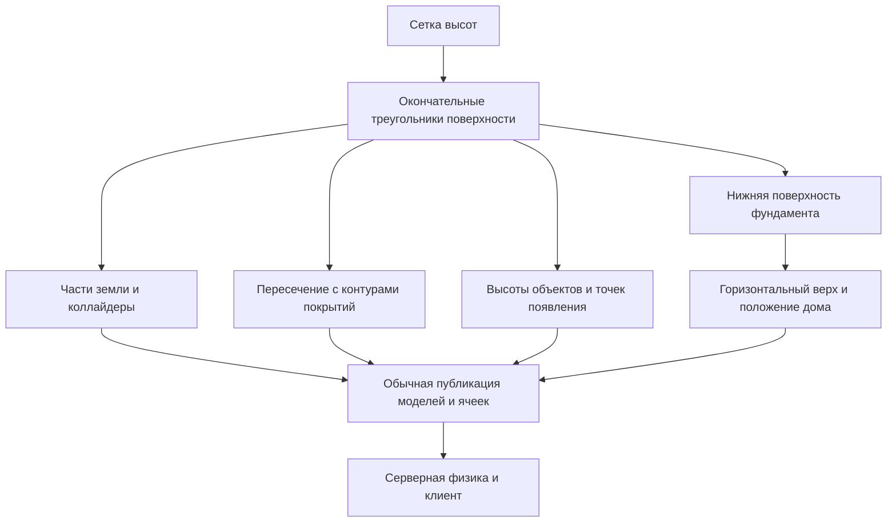

# Эксперимент с рельефом на малом полигоне

Статус: проект эксперимента. Дата: 12 ноября 2026 года.

Цель — проверить на небольшом игровом участке единую систему рельефа: землю с изменяющейся высотой, повторяющие её покрытия, размещение объектов и горизонтальный дом с фундаментом, нижняя поверхность которого следует склону. Результат должен помочь принять решение о развитии системы для городской карты.

Эксперимент проводится в отдельном мире `terrain-lab`, используя существующие сборку ресурсов, серверную физику, клиентское предсказание и потоковую загрузку. В этой задаче готовится план; реализация полигона и результаты проверок относятся к следующему этапу.

## Обязательные условия

Следующие условия определены владельцем проекта и задают смысл эксперимента:

1. Возвышение является изгибом поверхности карты. Дороги, дорожки, газоны и разметка повторяют этот изгиб; на разных высотах располагаются дома и объекты.
2. Пригорок с домом расположен в одном углу карты. Остальные три угла находятся на одной общей отметке ниже пригорка.
3. Горизонтали, то есть линии одинаковой высоты, изгибаются. Рельеф нельзя заменить наклоном всей карты, прямым пандусом или набором параллельных полос.
4. Отдельно проверяется дом непосредственно на склоне. Пол, перекрытия и верх фундамента остаются горизонтальными, стены — вертикальными. Нижняя поверхность фундамента повторяет рельеф под зданием.

Выбор северо-восточного угла, размеры участка и численные параметры ниже — рабочая конструкция полигона. Их можно уточнить до реализации, сохраняя эти четыре условия.

## Что требуется выяснить

Главная гипотеза: существующая трёхмерная физика и публикация статичных моделей позволяют добавить рельеф на этапе сборки мира, сохранив общий источник геометрии для графики, столкновений, покрытий и размещения.

| Вопрос                                            | Что должно подтвердить гипотезу                                                                                           |
| ------------------------------------------------- | ------------------------------------------------------------------------------------------------------------------------- |
| Получается ли настоящий пространственный пригорок | Три нижних угла имеют одну высоту, четвёртый выше; вид сверху и численные проверки подтверждают кривизну горизонталей     |
| Согласуются ли покрытия с землёй                  | Дорога, дорожка, газон и разметка проходят по склонам и стыкам ячеек без зависания и пересечения поверхности              |
| Можно ли ставить дом на неровное основание        | Дом горизонтален; высота поверхности под ним существенно меняется; фундамент заполняет промежуток и повторяет землю снизу |
| Совпадают ли графика и физика                     | Персонажи и предметы опираются на ту же поверхность, которую видит игрок                                                  |
| Сохраняется ли сетевое движение                   | Два клиента согласованно наблюдают подъём, спуск, столкновения и движение предметов                                       |
| Совместимо ли решение с ячейками                  | На стыках нет щелей и физических зацепов, ресурсы корректно подключаются и освобождаются                                  |
| Достаточна ли простая модель высот                | Для заданной сцены не нужны отдельный физический движок, новая модель сетевых координат или изменение схемы БД            |

Отрицательный результат допустим: эксперимент должен установить конкретное ограничение и цену следующего шага. Красивый кадр при несогласованных столкновениях не подтверждает гипотезу.

## Текущая основа

Высота в игре задаётся координатой Y, карта лежит в плоскости XZ, единицы — метры. Север соответствует −Z. Позиции и скорости персонажей и предметов уже трёхмерные.

Существующий `physics-lab` занимает 40 × 40 м, содержит плоское основание, здания, препятствия и физический ящик. Он подходит как основа запуска и проверки взаимодействий, но его текущую геометрию следует сохранить для регрессий.

Генератор `ground` создаёт плоскую плиту и плоские визуальные покрытия. У слоя одна постоянная высота, а столкновение обеспечивает плита. Размещение статичных объектов хранит абсолютные позиции; автоматической привязки к рельефу нет. Камера следует за игроком по XZ с целевой высотой Y=0.

Статичные коллайдеры уже поддерживают треугольные меши. Валидатор требует замкнутые объёмы с наружной ориентацией граней. Земля, фундамент и их публикация должны соблюдать этот контракт.

Источники текущих ограничений:

- [Исходный физический полигон](../../content/worlds/physics-lab/world.json).
- [Плоская земля и покрытия](../../tools/world-build/src/city.ts).
- [Сборка миров и разбиение основания](../../tools/world-build/src/index.ts).
- [Контракты мира и размещения](../../packages/contracts/src/index.ts).
- [Валидация коллайдеров](../../packages/contracts/src/world-bundle.ts).
- [Контроллер и физика](../../packages/simulation/src/physics-world.ts).
- [Следование камеры](../../apps/client/src/rendering/world-view.ts).
- [Модель карты и сохранённое размещение](../map-model-guide.md).

## Размеры и форма полигона

### Общие параметры

| Параметр                    | Значение для первого эксперимента                         |
| --------------------------- | --------------------------------------------------------- |
| Мир                         | `terrain-lab`, отдельный от `physics-lab` и `ring-block`  |
| Границы по X и Z            | От −20 до +20 м, участок 40 × 40 м                        |
| Границы мира по Y           | От −10 до +20 м, включая толщину земли, здания и предметы |
| Высоты основной поверхности | От 0 до 6 м                                               |
| Нижний уровень              | 0 м в северо-западном, юго-западном и юго-восточном углах |
| Верхний угол                | Северо-восточный, X=20 и Z=−20, высота 6 м                |
| Шаг сетки высот             | 1 м, 41 × 41 узел                                         |
| Ячейки публикации           | Четыре ячейки 20 × 20 м со стыками X=0 и Z=0              |
| Основной игровой режим      | Настольный клиент, ходьба 4 м/с и бег 14 м/с              |
| Сквозная сетевая проверка   | Два браузерных клиента, существующая серверная модель     |

Высоты углов проверяются также на примыкающих к ним квадратах 4 × 4 м. Это исключает форму, в которой совпадают только четыре отдельные точки.

### Пригорок с дугообразными горизонталями

Исходную форму предлагается воспроизводимо получить вокруг точки C=(16, −16) в северо-восточной части карты:

```text
r = sqrt((x - 16)^2 + (z + 16)^2)
t = clamp((r - 9) / 22, 0, 1)
h(x, z) = 6 * (1 - (3*t^2 - 2*t^3))
```

До радиуса 9 м располагается горизонтальная вершина высотой 6 м. Между радиусами 9 и 31 м поверхность плавно опускается к нулю. За радиусом 31 м сохраняется нижний уровень. Все три нижние угловые площадки лежат за этим радиусом, верхняя угловая площадка — внутри вершины.

Горизонтали такой формы — дуги окружностей, обрезанные границами участка. На сетке они приближённо представлены ломаными. Основной склон имеет максимальный уклон около 22°, подходящий для проверки обычного перемещения. Форма меняется и по X, и по Z; направление склона зависит от положения на пригорке.

Формула служит генератором исходных отметок для тестового набора. После выборки на сетке окончательную поверхность задаёт триангулированная сетка; физика и размещение не вычисляют формулу независимо во время игры.

Отдельные короткие численные наборы с отрицательными высотами проверяют пригодность контракта для углублений. Второй игровой мир с впадиной в этот этап не входит.

### Состав сцены

| Элемент                | Расположение и назначение                                                                                 |
| ---------------------- | --------------------------------------------------------------------------------------------------------- |
| Нижний контрольный дом | Центр примерно (−12, 12), простая модель 6 × 4 м на нижней равнине                                        |
| Дом в верхнем углу     | Центр примерно (13, −13), такая же модель на горизонтальной вершине пригорка                              |
| Дом на склоне          | Центр примерно (1, −7), пятно 6 × 4 м пересекает X=0; земля под пятном остаётся наклонной и криволинейной |
| Дорога                 | Из нижней части участка к верхнему дому, ширина 4 м; маршрут пересекает обе внутренние границы ячеек      |
| Дорожка                | Ответвление шириной около 1,5 м к дому на склоне, с непрерывным подходом к входу                          |
| Газоны                 | Как минимум один на нижнем уровне и один на криволинейном склоне, граничащий с дорожкой                   |
| Разметка               | Сплошной край дороги, прерывистая линия и короткий переход на наклонном участке                           |
| Статичные объекты      | Четыре дерева, два фонаря и одна скамейка на разных высотах; опоры остаются вертикальными                 |
| Динамические предметы  | Ящик, мяч-арбуз и гигантское мыло из существующего каталога                                               |
| Точки появления        | Восемь свободных точек, включая нижний и верхний уровни, с учётом размеров капсулы                        |

Дорога изгибается в плане и поднимается по пригорку. Её точный контур подбирается так, чтобы оставить свободными пятна домов и проходы. В первых двух домах внутренняя планировка не требуется.

Подход к входу дома на склоне согласуется с уровнем пола: короткая наклонная дорожка или пандус обеспечивает проход без прыжка через цоколь. Его верх и коллайдер совпадают. Автоматическое проектирование таких подходов не требуется; в полигоне достаточно одного явно заданного решения.

## Дом на склоне и фундамент

Этот сценарий обязателен отдельно от дома на горизонтальной вершине. Рельеф внутри пятна здания сохраняет форму общего пригорка. Перепад высот под пятном должен составлять не менее 1 м, чтобы ошибку нельзя было скрыть почти плоским основанием.

### Положение дома

Дом представляет собой жёсткую модель: пол и перекрытия горизонтальны, стены вертикальны. Поворот возможен только вокруг оси Y. Геометрия дома не изгибается по поверхности и не наклоняется по её нормали.

У дома с центром (1, −7) и пятном 6 × 4 м поверхность в предложенной сетке меняется примерно от 2,55 до 5,24 м. Это даёт перепад около 2,69 м под одним зданием и делает изменение высоты фундамента хорошо различимым.

Для прямоугольного пятна дома определяется максимальная отметка окончательного рельефа. Отметка верха фундамента и основания модели дома задаётся так:

```text
floorY = maxTerrainHeightInsideFootprint + 0.30 м
```

Максимум ищется по всей площади пятна: по вершинам и пересечениям треугольников поверхности с контуром здания. Проверки только центра или четырёх углов недостаточно. Выбранные 30 см задают минимальную высоту цоколя над землёй с высокой стороны.

### Геометрия фундамента

Фундамент — замкнутый объём с плоским горизонтальным верхом на отметке `floorY`. Его нижняя поверхность повторяет участок того же рельефа под всем пятном здания. Для устранения щелей допускается заглубление нижней поверхности на 2 см. По периметру верх соединяется с нижним контуром вертикальными стенками.

На высокой стороне видимый цоколь получается ниже, на низкой — выше. Его нижняя линия повторяет поверхность, включая промежуточные узлы и пересечения с треугольниками. Прямой нижний срез или четыре независимо подобранные угловые опоры не удовлетворяют этому сценарию.

Графика и коллайдер строятся из одной геометрии фундамента. Между домом и фундаментом нет промежутка; под фундаментом нет доступной пустоты, в которую может провалиться предмет. Земля под домом остаётся частью общего рельефа, а небольшое заглубление фундамента обеспечивает соприкосновение объёмов.

Фундамент получает устойчивые идентификаторы, производные от ID дома. На этапе сборки дом, фундамент и подход ко входу образуют согласованный набор. Для полигона эти производные размещения фиксируются как часть геометрии выпуска, чтобы ручное перемещение только одной части через БД не разрушало проверяемую конструкцию. Разработка редактирования такого набора в существующем городе отложена.

### Что проверяется у фундамента

- Дом сохраняет горизонтальность независимо от перепада поверхности под ним.
- Верх фундамента — одна горизонтальная плоскость; низ следует рельефу по всей площади.
- Изменение высоты или формы склона с последующей сборкой пересчитывает основание и положение дома.
- По периметру нет видимых зазоров, а у верхней стороны земля не проходит сквозь пол.
- Серверные и клиентские столкновения совпадают с видимым цоколем и подходом ко входу.

Расчёт несущей способности, промерзания, сваи, подвалы и конструктивные нормативы не входят в эксперимент. Фундамент проверяется как игровая геометрия и опора здания.

## Границы первого этапа

### Входит в эксперимент

- Один статический пригорок заданной формы, три нижних угла и верхняя угловая площадка.
- Единая сетка высот и согласованная триангуляция для земли, покрытий и запросов размещения.
- Четыре части земли с физическими коллайдерами и корректными стыками.
- Дорога, дорожка, газоны и разметка, повторяющие поверхность.
- Три дома, включая обязательный дом с фундаментом на неизменённом склоне.
- Привязка выбранных статичных объектов, точек появления и начальных предметов к высоте поверхности.
- Следование камеры за высотой игрока и необходимые исправления движения на контрольном маршруте.
- Размещение предмета на верхней площадке и на наклонной поверхности через существующий механизм.
- Два сетевых клиента, сохранение предметов и повторный запуск того же выпуска полигона.
- Контроль сборки, физики, браузерного вида и ресурсов на стыках ячеек.

### Отложено

| Работа                                                 | Условие для следующего этапа                                               |
| ------------------------------------------------------ | -------------------------------------------------------------------------- |
| Перенос рельефа в `ring-block`                         | Полигон подтвердил геометрию, фундамент, движение и публикацию             |
| Миграция городских домов и сохранённых предметов       | Определены правила изменения высоты уже населённого мира                   |
| Автоматическое выравнивание площадок и земляные работы | Возникла задача массового размещения домов на реальном рельефе             |
| Сложные контуры фундаментов и составные здания         | Прямоугольный дом подтвердил подход, появились конкретные городские модели |
| Редактор рельефа и привязок                            | Выбран рабочий формат и понятен процесс авторского наполнения              |
| Геоданные и реальные отметки Сыктывкара                | Принято решение о городском участке и источнике высот                      |
| Большая карта, LOD и плотная сетка                     | Замеры выявили необходимость или началось масштабирование                  |
| Полная мобильная приёмка                               | Завершён настольный эксперимент, согласован мобильный объём                |

### Не входит в этот эксперимент

Пещеры и нависающие участки поверхности, воксели, деформация земли во время игры, копание, вода и гидрология, эрозия, транспорт, прыжки и альпинизм. Не требуется делать полноценные интерьеры домов или универсальный строительный редактор. Поверхность имеет одну высоту Y для каждой точки XZ; отдельные здания и пандусы могут находиться над ней.

## Источник поверхности и сборка

### Данные и семантика

Рабочая модель — регулярная сетка высот. Для полигона фиксируются начало сетки (−20, −20), шаг 1 м, 41 столбец и 41 строка. Высоты абсолютные, в метрах. Порядок хранения — строки с возрастающим Z, внутри строки возрастающий X.

Каждый квадрат делится на два треугольника по одной фиксированной диагонали. Высота между узлами определяется линейной интерполяцией внутри соответствующего треугольника. Билинейная интерполяция не используется для привязок: она может описывать поверхность, отличающуюся от физических треугольников.

Общий запрос поверхности возвращает высоту и нормаль выбранного треугольника. Вне границ он возвращает отсутствие поверхности; автоматического продолжения или прижатия к краю нет. Поведение на диагоналях и границах ячеек задаётся однозначно и проверяется тестами.

Для контрольного варианта `flat` используется та же сетка с нулевыми отметками, те же покрытия, дома и правила размещения. Он нужен для сравнения поведения и стоимости рельефа; это вариант одного эксперимента, а не новый игровой режим.

### Предлагаемые авторские файлы

| Файл                                       | Ответственность                                                         |
| ------------------------------------------ | ----------------------------------------------------------------------- |
| `content/worlds/terrain-lab/world.json`    | Мир, сетка публикации, параметры симуляции и ссылки на исходники        |
| `content/worlds/terrain-lab/terrain.json`  | Геометрия сетки и итоговые отметки высот                                |
| `content/worlds/terrain-lab/surfaces.json` | Контуры покрытий в XZ и их порядок                                      |
| `content/worlds/terrain-lab/anchors.json`  | Привязки объектов, пятно дома на склоне, параметры фундамента и подхода |

Ссылка на эти данные добавляется как необязательное поле авторского `WorldSource`. Поля валидируются при сборке и не передаются как новая система координат в сетевых состояниях. Окончательные имена полей фиксируются при реализации в типах и валидаторе; семантика определяется этим планом.

Данные не должны одновременно задавать конкурирующие абсолютную высоту объекта и привязку к рельефу. Для объекта выбирается один способ: явная абсолютная поза либо авторская привязка с вычисляемой высотой. На выходе сборки остаётся одна абсолютная поза.

### Последовательность обработки



Верхняя поверхность земли содержит 3200 треугольников до добавления боковых граней и дна. Части земли имеют замкнутые коллайдеры; их дно располагается ниже минимальной высоты поверхности. Генератор обеспечивает замкнутость, включая промежуточные вершины по краям.

Плоскую физическую плиту исходного `physics-lab` в новом мире нужно удалить. Скрытая плита не должна подменять контакт с землёй или перекрывать будущие углубления.

Куски поверхности и связанные с домом производные размещения относятся к фиксированной геометрии выпуска. Для их публикации используется существующий подход к фиксированным плиткам земли. Новую сущность PostgreSQL для каждой вершины создавать не требуется.

## Покрытия и размещение

### Дороги и разметка

Контуры покрытий остаются двумерными авторскими данными. Сборщик пересекает их с окончательными треугольниками рельефа и строит соответствующие участки. Каждая полученная часть лежит над тем треугольником, который задаёт землю в этой точке. Проверка включает внутреннюю площадь покрытия, а не только его исходные вершины.

Сохраняются цветные материалы или цвета вершин существующего стиля. Вводить новую систему текстур или декалей для эксперимента не требуется.

Покрытия остаются визуальными: физическую опору обеспечивает земля. Их вертикальные смещения малы, упорядочены и составляют суммарно не более 4 см. Разметка наследует высоту дороги и получает дополнительное смещение. Толщина асфальта, отдельные бордюры и физические ступеньки между покрытиями отложены.

При пересечении контуров действует явный порядок слоёв. На границах газона и дороги, внутри отверстий и на стыках ячеек не возникает лишних треугольников, просветов или мерцания.

### Статичные и динамические объекты

Деревья и фонари получают высоту опорной точки из поверхности и сохраняют вертикальную ось. Скамейка размещается на заранее выбранной достаточно ровной точке; автоматическое устройство площадки под любую мебель не требуется.

Точки появления задают высоту опоры ног, а существующий механизм добавляет половину высоты капсулы и зазор. Сборка и запуск проверяют свободный объём персонажа и наличие опоры. Формального отсутствия пересечения без поверхности под ногами недостаточно.

Начальные предметы получают позы с учётом размеров и опорного расстояния их формы. После старта их высоту и вращение определяет физика. Предпросмотр и размещение используют существующие запросы к коллайдерам; для проверки склона достаточно сферического предмета, а ящик размещается также на горизонтальной вершине.

Автоматическое наклонение любого предмета по нормали, новые способы управления инвентарём и расширение сенсорного режима в этот этап не входят.

## Ячейки и поведение во время игры

Все четыре части земли строятся из общих глобальных узлов. На общей границе совпадают высоты и координаты вершин. Нормали для графики учитывают соседнюю часть, чтобы на гладком склоне не появлялась искусственная световая полоса.

Нельзя добавлять верхние заглушки или внутренние выступы, через которые капсула будет переступать на границе. Замыкающие боковые грани коллайдеров располагаются ниже общей верхней кромки. Безопасность такого стыка проверяется реальным проходом и движением предмета.

Сервер использует полный мир, клиент — существующее подключение статичной физики и графики. Ссылки из текущей области и истории предсказания удерживают нужные коллайдеры до завершения использования.

Участок 40 × 40 м меньше обычной области загрузки, поэтому прогулка по нему сама по себе не доказывает выгрузку ячеек. Подключение, освобождение и повторное подключение дополнительно проверяются управляемым тестом существующих механизмов. Коллайдер под игроком не выгружается ради демонстрации этого теста.

Камера следует за высотой ног персонажа с существующим сглаживанием. Поворот и масштаб сохраняют прежнюю семантику. На вершине, склоне и после возврата на старт игрок остаётся в кадре; свет и тени следуют за обновлённой целью.

На рабочих склонах проверяются подъём, спуск, поперечное движение и остановка. Отдельный малый физический набор с уклоном более 70° проверяет, что контроллер не получает возможность ходить по почти вертикальной стене; в основную форму пригорка такой участок добавлять не требуется.

## Совместимость и сохранения

Эксперимент добавляется отдельным миром и не меняет выбор `ring-block` по умолчанию. Миры без нового авторского описания рельефа продолжают собираться по прежним правилам. Для экспериментального пути используются существующие выходные контракты моделей, ячеек и трёхмерных состояний; повышение сетевой версии и изменение схемы БД не планируются.

Эта совместимость нужна на всё время эксперимента, поскольку существующий город и регрессионные полигоны продолжают использоваться. После эксперимента решение о замене старого генератора принимается отдельно; второй постоянный способ описывать один и тот же участок не вводится.

Сборка разрешает авторские привязки в абсолютные позы. Уже инициализированное размещение в БД не пересчитывается автоматически при каждом входе. Варианты `flat`, `hill` и проверки изменения исходных высот запускаются в отдельных временных тестовых схемах БД с новым seed. Изменение геометрии существующего сохранённого мира не входит в эксперимент.

Сохранение и восстановление предметов проверяются при неизменном выпуске `terrain-lab`: остановка, запуск, прежние ID и позы в пределах физической погрешности. Для этого используются существующие тестовые helpers и `SU_TEST_DATABASE_URL`. Отдельный world ID не заменяет изоляцию тестовой БД.

## Сценарий прогулки

1. Войти на нижнюю площадку, увидеть нижний дом и пригорок в верхнем углу карты.
2. Пройти по дороге вверх, пересечь стыки X=0 и Z=0, повернуть камеру в несколько сторон.
3. Сойти на газон, пройти поперёк склона и вернуться на дорожку. Покрытия остаются связаны с поверхностью.
4. Обойти дом на склоне, сравнить высокий и низкий края фундамента, пройти по подходу к входу.
5. Дойти до верхнего дома, поставить предмет на площадке и вернуться вниз бегом.
6. Толкнуть мяч по выбранному склону и проверить его движение через стык ячеек.
7. Повторить часть маршрута вдвоём: видеть одинаковую высоту игроков, столкновения и положение предметов.
8. Вернуться на старт с верхнего уровня и со склона; затем проверить восстановление предметов после перезапуска того же выпуска.

Для визуального свидетельства нужны общий ракурс, вид сверху с горизонталями, вид сбоку, крупный план двух сторон фундамента и вид стыка покрытия на склоне. Горизонтали и диагностическая сетка — инструменты проверки, их не требуется добавлять в пользовательское меню.

## Критерии приёмки

Численные допуски ниже — цели эксперимента. Их фиксируют до измерений; изменение допуска в ходе реализации сопровождается объяснением в итоговом отчёте.

| Область                      | Проверяемое условие                                                                                                                                                                                           |
| ---------------------------- | ------------------------------------------------------------------------------------------------------------------------------------------------------------------------------------------------------------- |
| Углы карты                   | Три нижние угловые площадки имеют Y=0, верхняя — Y=6 м, погрешность не более 1 мм                                                                                                                             |
| Изгиб горизонталей           | Контуры 1,5, 3 и 4,5 м извлекаются из окончательных треугольников и имеют форму дуг. Для контура 3 м участок между точками около (−4, −16) и (16, 4) отклоняется от соединяющей их прямой не менее чем на 4 м |
| Изменение направления склона | В окрестностях этих двух точек горизонтальные направления нормалей отличаются не менее чем на 60°; плоскость и прямые параллельные полосы не проходят проверку                                                |
| Совпадение поверхности       | Высота по запросу к сетке и вертикальному физическому лучу отличается не более чем на 1 см в открытых контрольных точках, включая внутренности треугольников и стыки                                          |
| Покрытия                     | После вычитания объявленного смещения ошибка высоты покрытия относительно земли не более 1 мм; нет видимых пересечений, просветов и мерцания в контрольных ракурсах                                           |
| Дом на склоне                | Перепад земли внутри пятна не менее 1 м; пол и верх фундамента горизонтальны с погрешностью 1 мм по высоте; ось дома вертикальна                                                                              |
| Низ фундамента               | Вершины и внутренние контрольные точки повторяют землю с заданным заглублением 2 см и погрешностью 1 мм; под полом нет выступающей земли, по периметру нет открытых зазоров                                   |
| Проход к дому                | К входу можно дойти без прыжка; верх подхода достигает уровня пола без непроходимой ступеньки                                                                                                                 |
| Стыки ячеек                  | Общие узлы совпадают с погрешностью не более 1 мм; проход пешком и бегом в обе стороны не вызывает провала, застревания или отдельного подброса на шве                                                        |
| Движение                     | Полный маршрут выполняется без застреваний, накопительного сползания при остановке на рабочих склонах и повторяющихся срывов контакта, мешающих управлению                                                    |
| Сеть                         | На маршруте без контакта с динамическими телами p95 коррекции до сглаживания не более 0,2 м при RTT 100 мс и jitter ±20 мс; телепортации учитываются отдельно, максимумы также публикуются                    |
| Предметы                     | Нет провалов в землю и фундамент; мяч пересекает стык, предмет ставится на вершине и допустимом склоне; после перезапуска того же выпуска ID сохраняются                                                      |
| Ресурсы                      | После 20 управляемых циклов подключения и освобождения нет накопления тел, мешей и ссылок; повторный вход восстанавливает корректную сцену                                                                    |
| Регрессии                    | Прежние физический полигон и город собираются; их вход, движение, размещение и камера проходят выбранные существующие регрессии                                                                               |

Численное совпадение нижней поверхности фундамента проверяется по сохранённой геометрии и точкам поверхности; луч из воздуха может сначала встретить дом и не подходит для этой проверки. Контрольные физические лучи для земли выбираются вне покрывающих её объектов.

Для замеров производительности сравниваются `flat` и `hill` при одинаковых моделях, сетке, маршруте, качестве, окне и окружении. Записываются число треугольников земли и покрытий, размеры ресурсов, тела, draw calls, время физического шага и кадра. Допустимая цель для p95 кадра и физического шага: не более `max(1,2 × baseline, baseline + 1 мс)`. Прогрев — 60 секунд, измерение — не менее 60 секунд. Это сравнение внутри полигона, оно не подтверждает производительность всего города или мобильных устройств.

## Этапы реализации и проверки

### Геометрия и контракты

Создать отдельный исходник полигона, описание сетки и авторские привязки. Реализовать единый выбор треугольника и запрос поверхности, валидацию и детерминированную сборку. Повторная сборка одинаковых данных должна давать одинаковые версии ресурсов.

Проверки охватывают форму пригорка, угловые площадки, кривизну горизонталей, отрицательные отметки, диагонали сетки, выход за границы, некорректные размеры, нечисловые высоты и одинаковые стыки. До этого этапа не требуется дорабатывать художественный вид.

### Покрытия и фундамент

Добавить пересечение контуров с поверхностью, слои разметки и публикацию четырёх частей земли. Затем построить фундамент по пятну дома и согласовать с ним положение здания и вход.

Обязательные геометрические случаи: склон в двух направлениях, треугольник сетки, проходящий через пятно здания, промежуточная высокая точка внутри пятна, отверстие в покрытии и пересечение покрытия со стыком ячеек. Проверить замкнутость и ориентацию всех физических мешей.

### Физика и клиент

Подключить полигон через существующую публикацию, исправить следование камеры по высоте и проверить движение, предметы и контакт с фундаментом. Сравнить предсказание с сервером на подъёме, вершине, спуске и переходах между ними.

Поведение на склонах оценивается по измерениям и записи движения. Значение `grounded` в одном кадре само по себе не определяет качество; важны устойчивый контакт, отсутствие заметных скачков и управляемость на всём маршруте.

### Сквозная приёмка

Добавить воспроизводимый сценарий для `terrain-lab` в принятом формате браузерных проверок. Использовать два клиента и временную тестовую схему БД. Проверить повторный запуск того же выпуска, подключения ресурсов и контрольные ракурсы; выполнить сравнение `flat` и `hill`.

Для реализации выполнить `pnpm check`, `pnpm test`, `pnpm build` и отдельную проверку рельефа. Из существующих браузерных сценариев выбрать проверки физики, зданий и камеры, предметов и запуска города согласно [testing.md](../testing.md). Точные команды нового сценария добавляются вместе с ним; этот план не объявляет их уже существующими.

Полный эксперимент не считается пройденным, если отсутствуют браузерные или сетевые свидетельства, даже когда геометрические тесты проходят. Полученные частичные результаты сохраняются с указанием оставшегося вопроса.

## Результат и решение после эксперимента

Ожидаемые артефакты следующего этапа:

- Воспроизводимо собираемый и запускаемый `terrain-lab` с исходниками и контрольным вариантом `flat`.
- Общий код поверхности, покрытий, привязок и фундамента, используемый графикой и физикой без отдельных несовместимых расчётов.
- Автоматические проверки существенных контрактов и сквозной браузерный сценарий.
- Краткий отчёт `reports/terrain-lab-experiment.md` с версиями, окружением, измерениями и выводами; тяжёлые журналы и изображения — в игнорируемом `output/`.
- Обновлённые инструкции запуска полигона и ссылки в документации.

Дальнейшее решение принимается по всей цепочке: форма поверхности, покрытия, фундамент, движение, сеть и стоимость сборки. Если она работает, следующий шаг — ограниченный городской участок и отдельный план переноса сохранённого размещения. Если конкретная часть не проходит проверку, отчёт должен назвать причину, локальное исправление либо необходимую смену подхода. Успех малого полигона не означает готовности автоматически изменить высоты всего существующего города.
