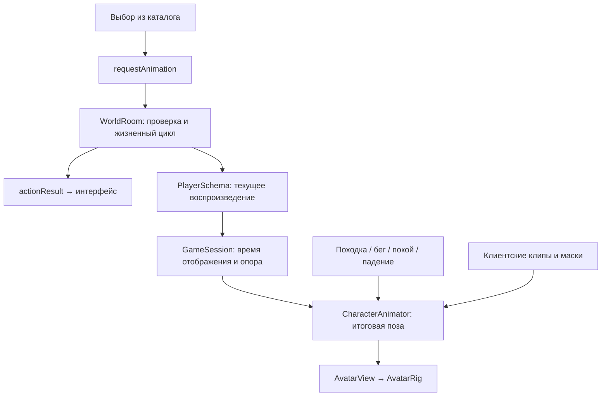

# Каталог анимаций персонажа

12 ноября 2026 года. Согласованная спецификация следующего этапа MVP;
функциональность реализована; результаты и ограничения —
в [отчёте](../reports/player-animations.md). Основа проверена на `5f81b51`
в ветке `personals`, обновлённой из `feat/school-ring-district`.

Документ определяет выбираемые игроком жесты и танец. Он развивает
[общую архитектуру анимаций](character-animation.md) и использует
[библиотеку внешности](avatar-skins.md). Для этого этапа настоящий документ
является источником требований к каталогу, воспроизведению и сетевому контракту.

## 1. Цель и объём MVP

Игрок выбирает подготовленную анимацию, которая повторяется на его модели
до первого движения, затем ещё 5 секунд. Показ виден всем участникам текущей комнаты, включая гостей.
Анимация косметическая: она не перемещает физическую капсулу, не создаёт
контактов конечностями и не меняет предметы, взаимодействия или состояние
других игроков. Управление персонажем остаётся доступным.

Используется существующий стек Babylon.js, Havok, Colyseus и TypeScript:
один серверный процесс, одна комната и до восьми игроков. Первый выпуск
содержит три процедурных клипа на общем каркасе `humanoid-v1`.

| ID      | Название       | Пауза перед сменой | Режим и маска                   | Совместимость с движением                                             |
| ------- | -------------- | ------------------ | ------------------------------- | --------------------------------------------------------------------- |
| `wave`  | Помахать рукой | 3000 мс            | `upperBody`, правая рука        | Ходьба и бег разрешены; остальные суставы продолжают базовое движение |
| `clap`  | Хлопать        | 3000 мс            | `upperBody`, обе руки           | Ходьба и бег разрешены; ноги продолжают базовое движение              |
| `dance` | Танцевать      | 5000 мс            | `fullBody`, корпус, руки и ноги | Запуск в покое; движение запускает таймер завершения на 5 секунд      |

Категории первого набора: «Общение» для `wave` и `clap`, «Развлечения»
для `dance`. Категория относится к метаданным и не меняет правила исполнения.

Загрузка файлов игроками, редактор, произвольные скелеты, автоматическое
переназначение суставов, универсальный граф анимаций, покупки и сохранение
коллекции в профиле находятся за пределами этого этапа. Каталог поставляется
с приложением; текущий показ хранится только в памяти комнаты.

## 2. Правила показа

- Для запуска любого клипа нужны подключённый и готовый персонаж,
  доступный мир и наличие опоры.
- Для `fullBody` дополнительно нужны отсутствие принятого ввода движения
  и горизонтальная скорость не выше 0,08 м/с. Это порог покоя,
  согласованный с существующей походкой.
- Одновременно активна одна выбираемая анимация. В покое она повторяется
  бессрочно; после паузы из каталога можно заменить её другой.
  Первое фактическое горизонтальное движение быстрее 0,08 м/с запускает
  таймер на 5 секунд. До его завершения замена недоступна.
- Стикер реакции и анимация — независимые каналы. Их можно показывать
  одновременно; занятость одного канала не ограничивает другой.
- Любая выбранная анимация завершается при потере опоры, успешном
  возрождении, отключении исполнителя или переходе мира в паузу.
- Движение продолжает все клипы до истечения таймера, включая `fullBody`.
  Остановка и повторный шаг не меняют его срок. Ввод при упоре в стену
  и один `sprint` при нулевых осях не запускают таймер.
- После окончания или отмены отдельного периода ожидания нет. Следующий
  показ доступен, когда снова выполнены условия запуска.

Возрождение, которое сервер отклонил, не прекращает показ. Отключение
наблюдателя не отменяет анимации остальных: после восстановления он получает
их актуальное состояние. Возвращение исполнителя после обрыва связи
не возобновляет отменённый жест.

Правило отмены относится к любой серверной паузе. Сейчас
[ItemRuntime](../apps/server/src/items/runtime.ts) приостанавливает мир
также на время резервирования при операциях с предметами. Такие короткие
паузы тоже завершают активные показы; после возобновления старые клипы
не продолжаются. Для MVP используется одна политика без отдельного
сохранения и восстановления фазы на паузах.

## 3. Каталог и расширение

Планируемый `packages/contracts/src/animations.ts` содержит каталог `ANIMATIONS`,
поиск `findAnimation`, тип `AnimationId`, запрос и обычные типы воспроизведения.
Каталог аналогичен [REACTIONS](../packages/contracts/src/reactions.ts).

```ts
type AnimationDefinition = {
  id: string;
  label: string;
  category: string;
  cooldownMs: number;
  mode: 'upperBody' | 'fullBody';
  rig: 'humanoid-v1';
};
```

ID устойчив и не зависит от названия, порядка карточек или имени функции.
`AnimationId` выводится из записей каталога. `cooldownMs` задаёт минимальную
паузу перед сменой клипа в покое. Срок показа после движения един для чата,
реакций и анимаций: `WORLD_ACTIVITY_MOVE_DURATION_MS` (5000 мс).
Процедурные клипы продолжают периодические движения по абсолютной фазе,
без перезапуска на каждом снимке или при начале таймера.

Режим определяет серверные условия запуска и маску суставов. Отдельного набора
произвольных флагов поведения в MVP нет. Клиентский реестр
`Record<AnimationId, AnimationClip>` связывает ID с функцией расчёта позы
и маской суставов. Он не является частью общего сетевого пакета.

Добавление клипа существующего режима требует записи в каталоге, реализации
позы и регистрации в клиентском реестре. Меню строится автоматически;
сервер использует существующие правила режима. Обе стороны пересобираются
и выпускаются согласованно. Для нового набора суставов или новых игровых
правил требуется отдельное проектирование совместимости.

## 4. Компоненты и направление зависимостей

| Компонент                                                                                                                          | Ответственность                                                             |
| ---------------------------------------------------------------------------------------------------------------------------------- | --------------------------------------------------------------------------- |
| `packages/contracts/src/animations.ts` — новый                                                                                     | Каталог и независимые от движка типы; без Babylon.js, Colyseus и DOM        |
| [protocol/PlayerSchema](../packages/protocol/src/index.ts)                                                                         | Реплицируемые поля текущего показа                                          |
| [WorldRoom](../apps/server/src/world-room.ts)                                                                                      | Проверка запросов, последовательность, сроки, окончание и отмена            |
| [GameSession](../apps/client/src/network/session.ts)                                                                               | Отправка запросов, ответы и подготовка согласованного состояния отображения |
| [presentation](../apps/client/src/presentation/display-state.ts)                                                                   | Клиентские типы и небольшой буфер переходов показа и опоры                  |
| Клиентский реестр клипов — новый                                                                                                   | Чистый расчёт позы по времени и маски суставов                              |
| [CharacterAnimator](../apps/client/src/rendering/avatars/character-animator.ts)                                                    | Базовая поза, выбранный клип, приоритеты и смешивание                       |
| [AvatarView](../apps/client/src/rendering/avatars/avatar-view.ts), [AvatarRig](../apps/client/src/rendering/avatars/avatar-rig.ts) | Соединение с моделью, применение позы и владение графическими ресурсами     |
| Меню «Анимации» — новое                                                                                                            | Выбор, ожидание ответа, занятость и сообщения об отказе                     |
| `packages/simulation`                                                                                                              | Существующее физическое движение и столкновения                             |

Косметические поля не добавляются в физический `PlayerState` и снимки
предсказания. `DisplayPlayer` получает отдельные данные текущего показа.
Серверу не нужны геометрия, графические ресурсы или расчёт суставов.
`WorldView` сохраняет ответственность за мировую позу, камеру и подписи.



## 5. Запрос, проверка и ответ

```ts
type AnimationRequest = {
  requestId: number;
  worldEpoch: string;
  animationId: AnimationId;
};
```

Клиент отправляет `requestAnimation`. Сервер определяет исполнителя
по сессии; клиент не выбирает чужую сущность, длительность или момент начала.
Входное сообщение остаётся `unknown` до проверки: TypeScript-тип не заменяет
проверку данных из сети.

Переиспользуются `beginAction` и `finishAction`, общая последовательность
`requestId` для дискретных действий и ограниченный кеш результатов.
Дубль запроса возвращает сохранённый результат без запуска; старый запрос,
уже вышедший из кеша, получает существующий `ALREADY_PROCESSED`.
Дубли после окончания показа также не воспроизводят его заново.

| Условие отказа                                              | Ответ                                                              |
| ----------------------------------------------------------- | ------------------------------------------------------------------ |
| Некорректные данные или неизвестный ID                      | Существующий `INVALID_INPUT`                                       |
| Другая эпоха мира                                           | Существующий `STALE_WORLD`                                         |
| Персонаж не готов, отключён или мир приостановлен           | Существующий `WORLD_NOT_READY`                                     |
| Не закончилась пауза перед сменой или таймер после движения | Существующий `RATE_LIMITED` и `retryAfterMs` до доступности выбора |
| Нет опоры, танец запрошен в движении или каркас несовместим | Новый `ANIMATION_NOT_ALLOWED`                                      |

Используется существующий `ActionResult`. Новый код добавляется в общий
`ErrorCode` при реализации. Успешный ответ означает принятие запроса,
но сам показ начинается только из реплицируемого состояния. `retryAfterMs`
не создаёт самостоятельную блокировку после отмены: определяющим остаётся
актуальное состояние игрока.

При запуске танца сервер проверяет актуальное физическое состояние
и последнюю использованную команду. После запуска первое фактическое
движение задаёт срок завершения через 5 секунд. Отдельная очередь
анимационных запросов или блокировка физического ввода не вводится.

## 6. Реплицируемое состояние и жизненный цикл

```ts
type AnimationPlayback = {
  animationId: AnimationId | null;
  sequence: number;
  startedAtTick: number;
  endsAtTick: number;
  changedAtTick: number;
};
```

В `PlayerSchema` это плоские поля `animationId`, `animationSequence`,
`animationStartedAtTick`, `animationEndsAtTick`, `animationChangedAtTick`.
Строка по умолчанию — `''`, числовые поля — `uint32` со значением `0`.
На границе клиентского отображения пустой ID преобразуется в отсутствие
активного показа; семантический тип использует `null`.

| Переход                | Изменение состояния                                                                                                     |
| ---------------------- | ----------------------------------------------------------------------------------------------------------------------- |
| Запуск                 | Увеличить `sequence`; установить ID, начало и `changedAtTick` в текущий тик; конец — `0` для бессрочного цикла          |
| Первое движение        | Установить конец через 300 тиков; `changedAtTick` — тик начала движения; сохранить `sequence` и начало клипа            |
| Естественное окончание | Очистить ID; сохранить `sequence`, начало и конец; `changedAtTick` равен сроку окончания                                |
| Досрочная отмена       | Очистить ID; увеличить `sequence`; записать фактический тик отмены в `changedAtTick`; сохранить начало и исходный конец |

Таймер переводится как `ceil(WORLD_ACTIVITY_MOVE_DURATION_MS * TICK_RATE / 1000)`.
При текущих 60 Гц это 300 тиков после первого движения для всех клипов.
Занятость выбора определяется паузой перед сменой и запущенным таймером;
бессрочный показ после паузы не блокирует новый выбор.

Идентичность показа учитывает `worldEpoch`, `entityId`, `revision`
и `sequence`. Повторный снимок не перезапускает клип. После очистки ID
сохранённые сроки сами по себе не означают активность.

В обычном серверном шаге после физики проверяются опора,
изменение `revision`, фактическая скорость и срок окончания. Тики переходов соответствуют
состоянию, которое реплицируется этим обновлением.

Успешное возрождение и отключение имеют явные точки отмены. Переход мира
в паузу отменяет показы в обработчике изменения статуса сохранения:
обычный `step` во время паузы возвращается раньше обновлений.
Повторная отмена уже неактивного показа не меняет последовательность.

## 7. Время и согласованное отображение

Клиент вычисляет фазу из разницы отображаемого тика и `startedAtTick`.
Ненулевой `endsAtTick` ограничивает срок; нулевой означает бессрочный цикл.
Скорость воспроизведения не зависит
от FPS, количества полученных пакетов и повторных физических шагов
при согласовании с сервером.

Для своего игрока используются предсказанные движение и опора,
а запуск клипа ждёт серверного состояния. При движении клип продолжает
играть до серверного срока окончания; полнотелесная поза танца сохраняется.
Потеря опоры по-прежнему отдаёт приоритет падению.

Для остальных персонажей переходы показа и `grounded` выбираются
на тот же момент, что и интерполированная позиция. Сейчас задержка
интерполяции равна 100 мс; её значение должно быть общим для подготовки
позиции и этих данных. Нельзя совмещать интерполированную позицию
с опорой или отменой из последнего, более нового снимка.

Небольшой ограниченный буфер хранит снимки опоры и переходы показа
с их серверным временем. Он сохраняет предыдущее состояние до момента
перехода, поддерживает несколько полученных переходов внутри окна интерполяции
и удаляет данные ушедших сущностей. При смене эпохи или `revision`
старый буфер отбрасывается; для новой сущности используется текущий снимок.
Клип, который успел начаться и завершиться между сетевыми обновлениями,
не восстанавливается по истории: сервер передаёт текущее состояние показа.

Связь серверного тика со временем отображения строится по снимкам
и публичным часам установленного Colyseus SDK, с той же временной
привязкой, что использует интерполяция. Произведение `serverTick * (1000 / TICK_RATE)`
нельзя безусловно приравнять к часам комнаты: во время пауз тик не растёт.
При восстановлении связи или вкладки точка отсчёта обновляется.

Поздний наблюдатель начинает с актуальной фазы активного клипа.
Завершённые показы не восстанавливаются. Клиент завершает клип по сроку
на своей шкале отображения, не ожидая пакета с очищенным ID. После возврата
во вкладку пропущенные циклы не проигрываются ускоренно. Сброс измерения
походки через `motionRevision` сам по себе не запускает клип заново.

Начальный допуск ошибки фазы относительно выбранного отображаемого
времени — 100 мс в стабильной локальной сети. Сравнение двух клиентов
учитывает задержку отображения: одинаковая поза в один физический момент
на двух экранах не является критерием синхронизации.

## 8. Поза, смешивание и ресурсы

Клип — чистая функция расчёта позы по прошедшему времени. Он не меняет
узлы сцены, физические тела, таймеры игры или состояние других сущностей.
Маска задаёт суставы, на которые действует выбранный режим.

В каждом отображаемом кадре `CharacterAnimator` рассчитывает базовое
движение, позу клипа и их смешивание. Базовый слой продолжает работать
под клипом. Поза падения имеет приоритет над выбранным показом.
Только итоговая поза передаётся в `AvatarRig.applyPose` через `AvatarView`.

Формат `AvatarPose` расширяется независимыми поворотами плеч по нужным
осям. Общего `armSpread` недостаточно для взмаха одной рукой и хлопков.
Отдельные локти, пальцы и физические конечности не требуются.
Оба существующих скина используют одну реализацию каждого клипа.

Начальное время входа и выхода — 150 мс. Естественный выход укладывается
в последние 150 мс таймера после движения; досрочная отмена плавно возвращает модель
к актуальной базовой позе. Новый разрешённый показ смешивается с текущей
визуальной позой, не ожидая завершения декоративного перехода.

Смещения корпуса остаются относительно устойчивого корня сущности.
Камера, подпись, кольцо игрока и стикер реакции не подпрыгивают вместе
с телом. При пересоздании скина с тем же каркасом сохраняется фаза показа.
Изменения суставов не добавляют физические формы.

При `prefers-reduced-motion` уменьшаются наклоны, подъём и покачивания
корпуса; жесты остаются различимыми, длительность и серверные правила
не меняются. При отсутствии или несовместимости клипа отображается
базовая поза и доступна диагностика причины. Если клиентский ресурс
становится доступен позднее, включается только актуальная фаза ещё
активного показа. Загрузчик внешних клипов в этот этап не входит.

## 9. Интерфейс и восстановление после ошибок

Рядом с реакциями появляется кнопка «Анимации». Меню строит три текстовые
карточки из каталога, показывает название и правило «до движения + 5 с». Поиск,
пагинация и отдельная навигация по категориям для трёх вариантов не нужны.
Одновременно открыта одна игровая панель; открытое меню не отключает движение.

Выбор доступен с клавиатуры и указателя. Есть видимый фокус, закрытие
по Escape и кнопке, возврат фокуса в игру после закрытия. Статус ожидания
и причина недоступности доступны как текст, включая «Остановитесь,
чтобы танцевать» и «Дождитесь опоры».

Во время запроса повторная отправка блокируется. Успешный `actionResult`
закрывает меню, отказ оставляет его открытым с объяснением. Промежуток
между успешным ответом и соответствующим снимком не должен разрешать
повторную отправку: сохраняется ограниченное ожидание репликации.
Последующая занятость определяется состоянием показа, а не локальным
таймером полной длительности.

За 5 секунд без ответа или подтверждающего состояния ожидание завершается
с сообщением о связи. Запрос не переотправляется автоматически с новым ID.
Актуальное состояние по-прежнему может подтвердить уже начавшийся показ.
Потеря связи закрывает меню и очищает локальное ожидание; восстановление
принимает текущий снимок без повтора завершённых анимаций.

## 10. Этапы реализации и выпуск

1. Добавить метаданные и клиентский реестр, расширить позу плеч, сделать
   три процедурных клипа. Визуально проверить оба скина; сначала убедиться,
   что хлопки читаются на нынешних жёстких руках.
2. Добавить реплицируемые поля, обработчик запроса, правила запуска
   и все точки отмены. Использовать существующий механизм дискретных действий.
3. Подключить буфер отображения, согласованную опору, фазу и смешивание;
   добавить меню и обработку ответов без самостоятельного периода ожидания.
4. Выполнить проверки ниже и обновить документацию реализации и отчёт
   фактическими результатами. Проверить общие правила показа чата, реакций и анимаций.

Изменение сетевой схемы выпускается согласованным обновлением клиента
и сервера с повышением `PROTOCOL_VERSION` (на момент постановки — `5`).
Несовместимый клиент получает существующий `VERSION_MISMATCH` и обновляет
страницу. Параллельные старые форматы и адаптеры этого этапа не требуются.

Косметические данные не меняют физическую совместимость сохранённого мира,
формат карты или хеш симуляции. Миграции PostgreSQL для анимаций нет;
сами показы не восстанавливаются после перезапуска сервера.

## 11. Приёмка и стратегия проверки

| Критерий                                                 | Проверка                                                                                                                               |
| -------------------------------------------------------- | -------------------------------------------------------------------------------------------------------------------------------------- |
| A01. Все три клипа работают на `minifigure` и `standard` | Визуальная проверка крупно и в игровом ракурсе; в двух клиентах различимы жесты и танец                                                |
| A02. Маски сохраняют походку                             | При `wave` свободная рука и ноги продолжают движение; при `clap` продолжают двигаться ноги                                             |
| A03. Танец совместим с управлением                       | Нельзя запустить при принятом вводе; фактическое движение после запуска завершает его через 5 секунд; упор в стену не запускает таймер |
| A04. Корректен жизненный цикл                            | Потеря опоры, успешное возрождение, отключение и любая пауза завершают показ; отказ возрождения не отменяет его                        |
| A05. Одновременно активен один клип                      | До окончания паузы или запущенного таймера запрос отклоняется; в покое после паузы разрешена замена; отмена сразу освобождает выбор    |
| A06. Запросы обрабатываются однократно                   | Дубли до и после окончания не запускают показ повторно; старые запросы вне кеша не исполняются                                         |
| A07. Сервер контролирует запрос                          | Проверены некорректные данные, неизвестный ID, старая эпоха, отсутствие готовности и попытки задать чужую сущность или длительность    |
| A08. Фаза определяется временем                          | Поздний вход и восстановление наблюдателя показывают актуальную фазу; ошибка укладывается в начальный допуск                           |
| A09. Снимки не перезапускают клип                        | Повтор снимка, `motionRevision` и возврат во вкладку не воспроизводят пропущенные циклы; истечение срока работает без нового пакета    |
| A10. Удалённые переходы согласованы                      | На старте, остановке и сходе с края позиция, опора и выбранная поза соответствуют одной шкале отображения                              |
| A11. Сбросы не восстанавливают старый показ              | Смена эпохи, `revision`, сущности и переподключение исполнителя не возвращают завершённую анимацию                                     |
| A12. Косметика независима от мира и реакций              | Стикер и жест видны одновременно; анимация не двигает капсулу и предметы, не меняет физические параметры                               |
| A13. Интерфейс восстанавливается                         | Проверены успех, отказ, таймаут, порядок прихода ответа и снимка, потеря связи, клавиатура и возврат фокуса                            |
| A14. Нет зависимости от FPS                              | При 30/60/120 FPS за одинаковое время совпадает фаза; переходы плавные, повтор физического шага не продвигает клип                     |
| A15. Корректны ограничения отображения                   | Проверены уменьшенное движение, отсутствующий клип, смена совместимого скина и сохранение базовой позы при ошибке                      |
| A16. Нет регрессии ресурсов                              | Буферы очищаются; удаление и пересоздание модели освобождают её ресурсы; клипы сами не добавляют меши, материалы или draw calls        |

Чистые расчёты фаз, масок, переходов и буфера проверяются модульно.
Серверные запросы, сроки и отмены — интеграционными тестами с существующим
изолированным PostgreSQL. Пользовательские сценарии — в настоящем браузере
с независимыми клиентами, включая задержку сети и оба скина.

Обязательны проверка типов, границ пакетов, сборка, затронутые тесты
и регрессия реакций. Для восьми одновременно анимируемых моделей
сравниваются время кадра, p95 и счётчики ресурсов с базовой походкой.
Результат программного рендерера фиксируется с ограничениями и не считается
подтверждением производительности на целевом GPU или на 50 игроках.

## 12. Границы дальнейшего расширения

Будущий подготовленный скелетный клип может использовать те же ID,
серверные сроки и внешнюю границу аниматора. Его совместимость с каркасом,
сопоставление суставов и загрузка ресурсов проектируются при появлении
такого контента. Наличие файла GLB само по себе не означает совместимость.

Атаки, захваты, посадка в транспорт и действия, блокирующие управление,
потребуют отдельных игровых контрактов и правил симуляции. Каталог этого
этапа остаётся каталогом косметических показов.
