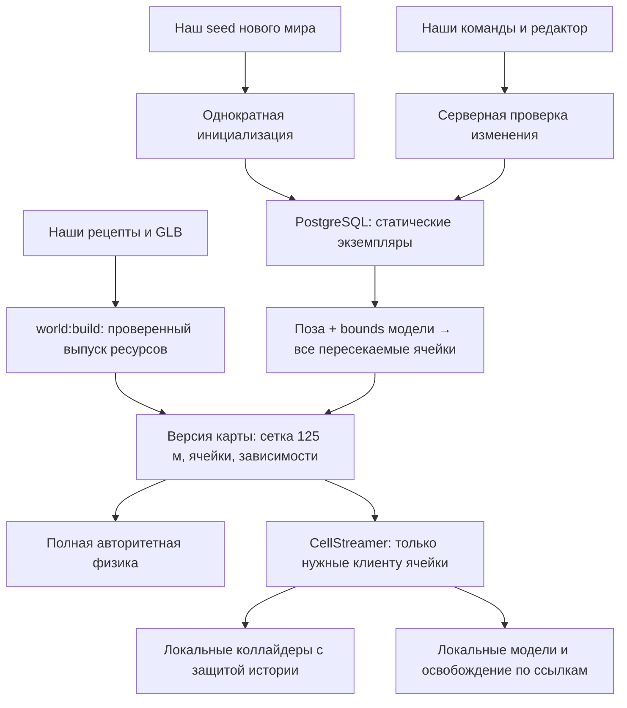

# Статические объекты: целевая концепция и план миграции

Дата: 12 ноября 2026 года. Обновлено после получения `main` до `6d535fa` в ветку `map`. Получены потоковая загрузка и последующее обновление геометрии кольца PR #12. Статус: план миграции статических объектов; потоковая загрузка мира уже реализована, новые таблицы размещения и административные операции ещё не реализованы.

Документ фиксирует согласованное направление развития карты и технический порядок перехода. Первую задачу реализации описывает [инструкция агенту по выделению объектов](static-object-extraction-agent.md). При расхождении с прежними предложениями о дальнейшем импорте OSM направление этой миграции определяется настоящим документом. Остальные игровые механики продолжают определяться действующими контрактами проекта.

Основа потоковой загрузки — текущие [контракты интеграции](dynamic-map-integration-scope.md), [описание моделей и сегментов](building-assets.md) и [отчёт интеграции](../reports/dynamic-map-integration.md). Исторические радиусы 80/100 м и схема одного ящика из раннего полигона не относятся к текущей игре. Этот план сохраняет принятую загрузку окружения и подключает размещение из БД к тому же пути.

## 1. Цель и принятые решения

Карта должна состоять из самостоятельных статических объектов: целых домов, светофоров, фонарей, остановок, памятников, деревьев и участков ограды. Каждый экземпляр имеет постоянную идентичность, модель из нашего каталога и редактируемую позу. Размещение хранится в PostgreSQL. В дальнейшем администратор меняет его собственными инструментами, включая инструмент внутри игры.

Пользователем приняты следующие решения:

- Сохранить текущую основу Babylon.js, Havok, Colyseus и TypeScript.
- Сохранить статический характер этих объектов в физической симуляции.
- Разделить определение модели и её экземпляры на карте.
- Перейти к собственному наполнению и редактированию мира.
- Отказаться от дальнейшего автоматического импорта OSM и удалить его инструменты после извлечения нужного контента.
- Использовать уже подготовленную карту как исходное наполнение собственного мира.
- Сохранить потоковую загрузку и выгрузку клиентского окружения: экземпляры из БД попадают в существующие пространственные ячейки по фактическим габаритам и освобождаются по тем же правилам владения ресурсами.

Технические решения ниже конкретизируют этот объём. Первое применение размещения из БД выполняется при остановленном мире. Горячее применение и игровой редактор поставляются отдельными этапами. Для первого редактора достаточно добавления, перемещения, поворота, отключения и восстановления экземпляра.

Режим миграции — последовательное переключение с сохранением данных. После конвертации остаётся один поддерживаемый процесс наполнения; обратная совместимость с OSM-командами и постоянная двойная запись не требуются. Между этапами сохраняется запускаемый собственный контент, а откат выполняется согласованным выпуском и состоянием. Старые клиенты при несовместимой смене формата должны обновиться до входа в мир.

В этот план не входят редактирование вершин модели внутри игры, изменение масштаба экземпляра, поведение транспорта и светофорных фаз, изменение физических свойств переносимых предметов, распределённая симуляция или обязательное внедрение PostGIS. Существующая система динамических предметов и инвентарей сохраняет собственные сущности и правила.

## 2. Проверенное исходное состояние

Проверенная основа после обновления: формат мира v4, ячейка v2, протокол v9, схема БД v3. Зафиксированы Babylon.js 9.35.0 и Havok 1.3.14. При начале реализации агент повторно проверяет эти значения в своей ветке; обновление плана не является основанием понижать версии.

| Авторский контент `ring-block` до сегментации | Экземпляры | Состояние                                             |
| --------------------------------------------- | ---------: | ----------------------------------------------------- |
| Здания из OSM                                 |        136 | Уже самостоятельные экземпляры                        |
| Ручные объекты                                |         18 | Памятники, фонтаны, фонари и киоск; есть общие модели |
| Участки мелких объектов                       |        134 | Квадраты 64 × 64 м объединены в модели `details-*`    |
| Исходный рецепт земли                         |          1 | При сборке превращается в отдельные плитки            |
| Всего в исходном `buildings`                  |        289 | 277 уникальных исходных моделей                       |

Файл `content/worlds/ring-block/cells/0_0.json` — исходный список размещения, а не единственный сетевой сегмент. Ещё четыре граничные стены из исходного `world.entities` при сборке также распределяются по ячейкам. Участок занимает X от −269 до 331 м и Z от −745 до 131 м.

Собранный `ring-block` имеет сетку **125 м**, origin `(−269, −745)`, 5 × 8 = **40 ячеек**, **332 уникальные статические сущности**, **316 моделей** и **1892 коллайдера**. В эти числа входят 40 моделей земли. `streaming-lab` имеет 256 ячеек и сохраняется как собственный полигон загрузчика. Повторные записи объекта на стыках не являются новыми сущностями. Числа выпуска сверяются со сборкой своей ревизии; исходные и выпускные показатели нельзя смешивать.

Контрольная сборка `ring-block` на `6d535fa` дала `mapVersion` `1b2cc39851df9e35c4e2d124a0c9bbbe8a911fa64feabac630e48f498aa16ebb`. В baseline новой конвертации входит последняя геометрия кольца по ручным спутниковым трассам, а не прежние контуры. После изменения контента агент вычисляет собственный baseline заново.

Сервер загружает полную проверенную статику. Клиент получает заголовок и manifest, а модели и коллайдеры подгружает для требуемых ячеек. Старые квадраты деталей 64 м отличаются от сетки доставки 125 м и подлежат разбору на самостоятельные объекты.

| Источник                                                                                                                 | Подтверждённое поведение                                                                                                                            |
| ------------------------------------------------------------------------------------------------------------------------ | --------------------------------------------------------------------------------------------------------------------------------------------------- |
| [Контракты](../packages/contracts/src/index.ts)                                                                          | `BuildingInstance` содержит ID, модель и позу; `WorldCell` v2 содержит `statics` и `buildings`; manifest содержит сетку, bounds и зависимости ячеек |
| [Сборщик](../tools/world-build/src/index.ts)                                                                             | Разбивает землю, распределяет статику по всем пересекаемым ячейкам и вычисляет `assetIds` и хеши                                                    |
| [Общая сетка](../packages/contracts/src/world-grid.ts)                                                                   | Задаёт origin, считает AABB с полным поворотом, пересечения и объединение одинаковых записей по ID                                                  |
| [Детали OSM](../tools/world-build/src/osm-details.ts), [слияние](../tools/world-build/src/merge.ts)                      | Семантические предметы пока теряются при объединении примитивов в старые участки                                                                    |
| [Физические формы](../packages/simulation/src/building-colliders.ts), [мир](../packages/simulation/src/physics-world.ts) | Уже удерживают/освобождают экземпляры по ID; общая форма освобождается после последнего тела                                                        |
| [Клиентские модели](../apps/client/src/rendering/buildings.ts)                                                           | Удерживают модели по версии и экземпляры по ID; удаляют графику, тени и запись пространственного индекса после последней ссылки                     |
| [Загрузка bundle](../packages/contracts/src/world-bundle.ts)                                                             | Разделяет заголовок, одну ячейку, её физику и полный серверный мир; проверяет покрытие стыков                                                       |
| [CellStreamer](../apps/client/src/streaming/cells.ts)                                                                    | Разделяет критическую область, графику, физику, историю ввода и отложенное освобождение                                                             |
| [VerifiedResources](../apps/client/src/streaming/resources.ts)                                                           | Проверяет SHA-256, объединяет запросы, поддерживает отмену и ограниченный LRU байтов                                                                |
| [Сессия](../apps/client/src/network/session.ts), [история](../apps/client/src/streaming/prediction-area.ts)              | Согласуют `prepareArea`/`areaReady`/`areaResult` и защищают ячейки повтора ввода                                                                    |
| [Постоянный мир](../apps/server/src/items/store.ts)                                                                      | Проверяет актуальную позу и `safePose` относительно новой статики; допускает движущиеся и находящиеся в воздухе снимки                              |
| [SQL-миграции](../apps/server/src/migrations.ts)                                                                         | Таблиц статических экземпляров пока нет                                                                                                             |

[DynamicInterest](../apps/server/src/interest.ts) фильтрует игроков и переносимые предметы. Статические объекты доставляются файлами ячеек; новая БД не превращает их в ещё одну коллекцию динамической репликации. Реализация и машинные контракты имеют приоритет над историческими разделами документации.

## 3. Доменная модель

### 3.1. Модель из каталога

`StaticAsset` — переиспользуемое определение объекта в локальных координатах. Оно включает:

- `assetId` — устойчивое имя модели;
- `version` — хеш согласованного пакета графики, коллайдеров и частей;
- `category` — назначение для собственного каталога: здание, ограда, светофор, фонарь, остановка, дерево и т. п.;
- модель GLB либо поддерживаемый исходный рецепт;
- список локальных коллайдеров, их материалы и общие габариты;
- семантические части и группы прозрачности.

Категория не определяет физику по имени. Физика берётся из явных коллайдеров. В полном целевом формате допустима модель с пустым списком коллайдеров: она остаётся видимым редактируемым объектом без физического тела. Пустой список нельзя подменять скрытым препятствием ради прохождения старого валидатора.

Размеры запекаются в модель и её физические формы. Единой схемой можно описывать как типовой светофор, так и уникальный дом по сложному контуру. Унификация не требует превращать все здания в одинаковые шаблоны.

### 3.2. Экземпляр

Целевой контракт экземпляра:

```ts
interface StaticObjectInstance {
  entityId: string;
  assetId: string;
  position: { x: number; y: number; z: number };
  rotation: { x: number; y: number; z: number; w: number };
  instanceRevision: number;
  enabled: boolean;
  sourceRef?: { provider: string; type: string; id: string };
}
```

`worldId` задаёт контекст хранения и снимка. Постоянный ключ — `(worldId, entityId)`. Существующие ID домов и ручных объектов сохраняются. Новые ID выдаются при создании и переживают перемещение, поворот, смену цвета или версии модели. Индекс массива, ID физического тела и текущие координаты не являются идентичностью.

Экземпляры с одним `assetId` используют одно определение модели, но имеют независимые позы. Составной дом получает один корень трансформации для корпусов, крыши, вывесок и коллайдеров. Прозрачность отдельных частей продолжает работать через метаданные модели.

Система координат остаётся прежней: метры, правая система, Y вверх, восток +X, север −Z. Поворот хранится нормализованным кватернионом. В административном интерфейсе первый удобный режим — перенос и поворот вокруг Y; формат способен сохранить полную ориентацию. Для новых моделей опорная точка располагается у основания. Уже готовые модели можно оставить с прежним корректным pivot, явно описав его.

### 3.3. Границы целого объекта

| Вид                                 | Единица редактирования                                                                                                      |
| ----------------------------------- | --------------------------------------------------------------------------------------------------------------------------- |
| Дом, включая сложный многокорпусный | Один существующий экземпляр со всеми его частями                                                                            |
| Светофор                            | Стойка, корпус и сигналы вместе; отдельные направления подъезда — отдельные экземпляры                                      |
| Фонарь, скамейка, столбик           | Цельный предмет                                                                                                             |
| Остановка                           | Павильон и относящийся к нему знак; остановка без павильона также самостоятельна                                            |
| Дерево, куст                        | Одно дерево со всей кроной либо один куст; роща не становится одним редактируемым объектом                                  |
| Детский комплекс                    | Один цельный комплекс                                                                                                       |
| Ограда, стена, живая изгородь       | Непрерывный прямой участок после существующего обрезания у ворот; отдельные пролёты можно группировать инструментом позднее |
| Памятник, фонтан, киоск             | Существующий цельный экземпляр                                                                                              |

Проход у ворот остаётся свободным. Назначение общего ID объекту не означает создание сплошного коллайдера по его bounding box.

### 3.4. Основание карты и связанные данные

Земля, асфальт, тротуары, парковки, разметка и островки остаются слоем основания. Начальная миграция сохраняет его геометрию и существующее разделение на 40 плиток. Граничные стены и точки появления также остаются частью определения мира. Для них не требуется тот же пользовательский инструмент, что для светофоров.

При переносе в БД фиксированные экземпляры основания остаются частью выпуска ресурсов и в seed редактируемого размещения повторно не включаются. Эффективная карта объединяет основание и активные экземпляры БД с общей проверкой уникальности ID. Затем **оба** слоя распределяются по ячейкам и проходят один клиентский жизненный цикл. Неизменяемое основание не означает постоянно загруженную на клиенте землю всего мира. `WorldHeader` остаётся небольшим и не получает глобального массива основания. Административная операция размещения не может изменить фиксированный слой через подстановку его ID.

Собственная [трассировка кольца](../content/worlds/ring-block/ring-trace.json) и [предпросмотр](../tools/world-build/src/preview-ring.ts) относятся к ручным инструментам создания основания. Их данные и полезное поведение сохраняются. Сейчас preview по умолчанию запускает `importDistrict`, даже режим без импорта читает `import.json`: перед удалением OSM эти зависимости нужно разорвать.

Существующие мировые подписи ориентиров при первой конвертации остаются на месте. Перед включением перемещения зданий подпись, относящаяся к объекту, получает `entityId` и локальное смещение. Подпись площади или района сохраняет явную мировую точку. Перемещение дома не меняет автоматически покрытие двора или дороги: это отдельные редактируемые данные.

## 4. Источники истины и архитектура

| Факт                                                               | Источник истины                        | Производные представления                  |
| ------------------------------------------------------------------ | -------------------------------------- | ------------------------------------------ |
| Геометрия и физическая форма модели                                | Наш версионируемый каталог ресурсов    | GLB, формы Havok, кеш графики              |
| Положение, ориентация и доступность экземпляра после инициализации | PostgreSQL                             | Проверенный снимок размещения, тела и меши |
| Начальное наполнение нового мира                                   | Собственный seed в репозитории         | Однократное наполнение БД                  |
| Границы, основание, параметры симуляции и стартовые точки          | Выпуск определения мира                | Серверная и клиентская конфигурация        |
| Состояние переносимых предметов                                    | Действующая система предметов          | Физические тела и сетевые снимки           |
| Разбиение для отрисовки и пространственного поиска                 | Вычисляется из экземпляров и габаритов | Пакеты отрисовки, индексы, кеши            |

Seed больше не является вторым источником текущего размещения. Обновление приложения не перезаписывает таблицу экземпляров. Если администратор отключил все объекты, пустой мир остаётся пустым после перезапуска.



Границы пакетов сохраняются: `contracts` описывает данные и чистые проверки; `simulation` строит физические представления; сервер владеет БД, полномочиями и публикацией; клиент владеет отображением и предпросмотром; сборщик готовит наши ресурсы. Симуляция не выполняет SQL-запросы внутри физического шага.

Названия `BuildingInstance`, `BuildingPhysicsAsset`, `buildings` и `BuildingViews` обобщляются отдельным согласованным изменением. Для первой конвертации существующие имена допустимы. Переименование сериализованных полей требует обновления версии формата, загрузчиков и тестов; постоянные старые и новые пути чтения не поддерживаются.

Сейчас сборщик выпускает только модели, на которые уже ссылаются экземпляры. Для собственного каталога этапа БД он должен уметь включать явно выбранные доступные модели, даже если ни одного экземпляра ещё нет. Тогда администратор сможет разместить первый экземпляр опубликованного prefab. Добавление новой геометрии в каталог требует публикации выпуска ресурсов; размещение уже опубликованной модели выполняется без её пересборки.

## 5. Хранение и жизненный цикл

### 5.1. Таблицы

| Таблица                   | Основные поля и ограничения                                                                                                                                                      |
| ------------------------- | -------------------------------------------------------------------------------------------------------------------------------------------------------------------------------- |
| `world_layouts`           | `world_id` с FK на `persistent_worlds`, `asset_release_version`, `seed_version`, монотонная `revision`, `validated_revision`, `validated_hash`, время первоначального наполнения |
| `world_static_instances`  | PK `(world_id, entity_id)`, `asset_id`, числовые `position_x/y/z`, `rotation_x/y/z/w`, `instance_revision`, `enabled`, необязательное происхождение, `updated_at`                |
| `world_static_operations` | Мир, уникальный ID операции, источник изменения, административный аккаунт при наличии, до/после, затронутые ID, итоговая версия размещения, время                                |

Положение и кватернион — отдельные типизированные столбцы, удобные для SQL. Геометрия не копируется в каждую строку. Выпуск `asset_release_version` фиксирует точные версии всех доступных моделей. `asset_id` проверяется по этому выпуску; создание экземпляра неизвестной модели отклоняется. Переключение выпуска выполняется явной миграцией с проверкой всех используемых ссылок.

Числовые значения должны быть конечными; кватернион ненулевой и нормализованный; ревизии положительные и представимые без потери точности в выбранном сетевом типе. Начальная реализация может использовать ограниченный SQL `integer` и JS `number` для ревизий. При переходе к `bigint` потребуется единый явный способ сериализации.

Для `enabled=false` физические тела и меши не создаются. Строка сохраняется как явное административное решение. История операций служит для проверки и отката; она не является альтернативным механизмом восстановления всего мира через проигрывание событий. Первоначально автоматическое удаление истории не вводится.

### 5.2. Первоначальное наполнение

Инициализация выполняется один раз в транзакции под существующей блокировкой владельца мира. Отдельный признак наполнения различает новый мир, миграцию существующего мира без статической таблицы и уже инициализированный пустой мир.

Для существующего `persistent_worlds` добавляется только статическое размещение. Идентичность предметов, инвентари, операции и правила первоначальной выдачи не пересоздаются. Повторный запуск с тем же seed ничего не добавляет и не меняет. Позднейшее расширение карты выполняется отдельной нашей операцией, а не повторным импортом seed.

### 5.3. Редактирование SQL

Прямые SQL-правки поддерживаются при остановленном игровом мире. Триггеры или эквивалентный обязательный механизм БД увеличивают ревизии изменённых экземпляров и размещения, обновляют время и инвалидируют результат проверки. Для прямого SQL источник операции отмечается как `sql`; административный аккаунт может быть неизвестен. Он не подменяется вымышленным пользователем.

Сервисные операции и триггеры используют единый контекст журналирования, чтобы не записывать одно изменение дважды. Монотонная ревизия размещения может увеличиться несколько раз за пакетную SQL-правку; её точное приращение не является публичным контрактом.

Перед запуском команда применения проверяет полный набор строк и публикует его хеш. Изменение строк само по себе не означает, что работающая игра уже применила новую геометрию. Прямой SQL в обход работающего владельца мира не поддерживается как горячий способ редактирования.

### 5.4. Владение и конкурентные записи

Сейчас соединением с блокировкой мира владеет `ItemStore`. При добавлении размещения нужно выделить общий жизненный цикл владения, чтобы хранилища предметов и статических объектов использовали одного владельца и согласованный порядок изменений. Два независимых соединения не должны конкурировать за одну advisory-блокировку.

Горячая операция проверяет `worldEpoch`, текущую версию размещения и `instanceRevision`. Конфликт возвращает актуальное состояние и требует повторного действия. Повтор одного `operationId` возвращает сохранённый результат и не перемещает объект повторно. Во время проверки и фиксации геометрии изменения физических предметов сериализуются с ней; состояние для проверки не должно устареть между чтением и применением.

## 6. Версии, загрузка и публикация

### 6.1. Значение версий

- `assetReleaseVersion` идентифицирует неизменяемый выпуск каталога и основания карты. Административное перемещение не пересобирает модели.
- `layoutRevision` увеличивается при изменении размещения. Она отражает порядок изменений, а не состав геометрии.
- `layoutHash` вычисляется по канонически упорядоченному активному размещению и ссылке на выпуск ресурсов.
- `mapVersion` в первом этапе загрузки идентифицирует полный эффективный пакет карты, включая фактическое размещение.
- `simulationConfigHash` и проверка совместимости сохранённого мира учитывают фактически применённые коллайдеры, трансформации и параметры симуляции.
- `worldEpoch` продолжает обозначать запуск владельца мира и защищает от команд предыдущего запуска.

Модели и экземпляры сортируются по устойчивым ключам до вычисления хешей. Порядок строк SQL не должен менять версию карты. Публичный снимок не содержит журнал действий, идентичность администратора или служебные данные БД.

### 6.2. Первый работающий вариант: БД → сегментированный bundle

Первый вариант формирует при запуске проверенный эффективный bundle из выпуска ресурсов и размещения БД. Он сохраняет нынешний путь загрузки: заголовок без всей статики, manifest с сеткой и индексом ячеек, отдельные файлы ячеек и общие модели. Набор координат из БД не отправляется клиенту одним глобальным массивом объектов.

Публикацию и разбиение нужно выделить из `buildWorld` в общий чистый этап: подготовленные определения + проверенный каталог → распределение по сетке → файлы ячеек и manifest. Этим этапом пользуются и сборка собственного контента, и публикация размещения БД. Повторно реализовывать расчёт ячеек в серверном SQL-коде нельзя. Конкретный алгоритм и инварианты описаны в разделе 8.

Порядок подготовки: получить владение миром → прочитать/инициализировать размещение и сохранённые предметы → совместить его с плитками основания → сформировать все ячейки и их зависимости → проверить полную геометрию и совместимость → опубликовать единый неизменяемый снимок и создать серверную симуляцию → открыть readiness. На ошибке мир не объявляется готовым.

Сервер, `/api/world`, HTTP-раздача, планы подготовки и состояние комнаты используют одну опубликованную версию. Недостаточно заменить `definition.buildings` после проверки старого manifest. Произвольные файловые пути из БД не принимаются; ссылки разрешаются через проверенный каталог. Ресурсы предыдущего выпуска не перезаписываются по прежнему хешированному URL. Метаданные новой версии публикуются после готовности её зависимостей; раздача не должна случайно использовать файлы новой версии со старым списком разрешённых ресурсов.

Клиент по-прежнему использует `loadWorldHeader`, `CellStreamer`, `loadWorldCell`/`loadCellPhysics` и `createLocalPredictionWorld`. Полный `loadWorldBundle` и пересчёт хеша всей физики остаются серверными операциями. Заголовок, корень manifest и полученные байты проверяются штатно; ради верификации клиент не скачивает удалённые коллайдеры.

Перед горячим применением к метаданным публикации добавляются `assetReleaseVersion`, `layoutRevision` и `layoutHash`. Публичный снимок размещения — manifest и адресуемые ячейки одной версии, а не обязательный плоский список всех экземпляров. Полный экспорт остаётся административной операцией. Протокол и формат повышаются согласованно только при реальном изменении контракта.

### 6.3. Сохранённые предметы и обновление геометрии

Даже геометрически эквивалентное разделение участков меняет ID и физический хеш. Это ожидаемая миграция, а не основание отключать проверку совместимости.

Офлайн-применение использует нынешний `world:migrate` и `checkSavedItem`: проверяет актуальную позу и `safePose` относительно новой статики, границы и внутренние объёмы solid mesh. Движущийся предмет может находиться в воздухе; отсутствие опоры у сохранённого снимка само по себе не делает миграцию невалидной. Занятость исторической `safePose` другим динамическим предметом также не является изменением геометрии карты. Не заменять эту проверку старым вызовом размещения, требующим опоры. Настоящий конфликт с новой статикой отклоняет применение без автоматического переноса вещей и без изменения `compatibility_hash` и их сохранённых состояний. Для горячего удаления занятой опоры остаётся отдельная проверка безопасности операции.

## 7. Горячее применение и собственный инструмент

Предпросмотр двигает только локальную копию. До подтверждения действующий объект остаётся на месте. Подтверждение отправляет серверу `operationId`, `worldEpoch`, ожидаемые ревизии, ID экземпляра и новую позу. Добавление также указывает модель из опубликованного каталога. Отключение и восстановление используют тот же порядок проверок.

Сервер выполняет:

1. Проверку административного права; обычного входа через Telegram недостаточно.
2. Проверку типов, конечности координат, кватерниона, границ и принадлежности модели выпуску.
3. Проверку фактических форм, свободных стартовых точек, пересечений с игроками, другими объектами и предметами. Для перемещения собственное старое тело исключается. Контакт с основанием допустим; общее правило «никаких контактов» здесь непригодно.
4. Проверку удаления опоры: предмет на крыше или игрок на объекте также может сделать изменение недопустимым. Начальное правило — отклонить конфликт и объяснить причину.
5. Фиксацию размещения, ревизий и операции в одной SQL-транзакции.
6. Применение на границе физического шага и публикацию подтверждённой версии.

Для первого инструмента право редактирования задаётся серверным списком внутренних `accountId` в конфигурации. Пустой список запрещает изменения всем; гость не получает это право. Общая система ролей и управление правами внутри игры не нужны для первого результата. Проверка выполняется для каждой операции. Административное размещение имеет собственный контракт: оно не создаёт переносимый предмет, не использует инвентарь и не наследует ограничение предметов в 3 м.

Транзакция PostgreSQL не является транзакцией Havok. Если после подтверждённого commit применить сцену не удалось, комната приостанавливается и восстанавливается из подтверждённого состояния либо перезапускается. Продолжать игру со старой геометрией нельзя. Неопределённый результат commit разрешается через журнал `operationId`.

Первое горячее применение использует контролируемую смену поколения загрузки: комната приостанавливается, клиенты получают новый manifest, освобождают старые удержания и историю предсказания, готовят **только свою критическую область** по существующему протоколу подготовки и получают свежее авторитетное состояние. Подготовка всего мира или всего графического круга не является условием возобновления. Клиент, не подготовивший версию за ограниченное время, переподключается. Обычная ходьба между ячейками сохраняет контроллер и соединение; смена версии геометрии — отдельное событие. Уточнения по ревизиям и поздним ответам приведены в разделе 8.4.

Адресуемые `retainStatic`/`releaseStatic`, удаление тел и моделей уже реализованы. Их следует расширить согласованной заменой версии, а не создавать второй реестр экземпляров. Нынешние адаптеры отклоняют новую позу того же ID, пока удерживается старое определение: простой повторный `add` не является перемещением. При замене нужны актуальные обратные матрицы, замороженные матрицы мешей, bounds и пространственный индекс, прозрачность, тени и связанные подписи. Сопоставление выбора на экране с `entityId` обязательно.

## 8. Загрузка объектов из БД и освобождение клиентской памяти

### 8.1. Сохраняем существующую политику областей

| Подсистема                   | Действующее правило, которое сохраняем                                                                                                   |
| ---------------------------- | ---------------------------------------------------------------------------------------------------------------------------------------- |
| Сетка доставки               | 125 м, origin из `manifest.grid`; ключ `floor((coordinate - origin) / cellSize)`                                                         |
| Критическая физика и графика | Окрестности 3 × 3 вокруг авторитетной и предсказанной позиции плюс ячейки истории неподтверждённого ввода                                |
| Фоновая физика               | Пересечение ячеек с кругами 500 м вокруг обеих позиций; ранее удержанные ячейки сохраняются до 800 м                                     |
| Графика                      | `R_draw = max(500, R_frame + 125)` по фактическим матрицам камеры; предварительная загрузка до `R_draw + 125`                            |
| Удержание графики            | `max(800, R_draw + 300)`; это независимый от физики круг                                                                                 |
| Освобождение                 | После ухода из соответствующего wanted-набора и отложенного срока, сейчас 5 с; история и другие потребители продолжают удерживать ресурс |
| Подготовка                   | До 4 параллельных подготовок и HTTP-запросов; `pump` меняет сцены между шагами с целевым бюджетом 2 мс                                   |
| Байты                        | Проверенный LRU до 64 МиБ; единичный ресурс и файлы ячеек имеют отдельные ограничения                                                    |
| Просмотр без входа           | Загружается графика без игрока, места в комнате и физических тел; после выхода просмотр восстанавливается                                |

Вход/возврат/переподключение сохраняют `prepareArea` → `areaReady` → `areaResult` и проверку эпохи/версии. `criticalReady` разрешает ввод; `backgroundReady` служит отдельным показателем. Радиусы выбирают пересечение **AABB ячейки** с кругом, а не расстояние до центра. Круг графики может показывать дальнюю статику, но не расширяет сетевой AOI динамики 500/800 м. Туман и мягкая граница учитывают реально подготовленный радиус.

Серверная статика и предметы продолжают существовать, когда клиент удалил их представления. Состояние `enabled=false` в БД — административное отключение; выгрузка из клиентской памяти не меняет эту строку.

### 8.2. Координаты БД определяют полное покрытие ячеек

Одна строка экземпляра в БД порождает одно смысловое определение. Его доставка вычисляется существующими чистыми функциями:

```ts
const aabb = buildingBounds(instance, asset.bounds);
const memberships = cellsIntersectingBounds(worldBounds, grid, aabb);
```

`buildingBounds` преобразует все восемь углов локальных bounds полной ориентацией. Поэтому дом с pivot в одной ячейке, но крышей или корпусом в соседней, попадёт в обе. Размер сетки, начало мира и отрицательные координаты учитываются через общий `world-grid`; отдельное `floor(x / 64)` или хранение только «домашней» ячейки объекта непригодно.

В каждую пересекаемую ячейку записывается одинаковое определение с тем же `entityId`, `instanceRevision` и позой. Внутри одной ячейки дублей нет. Полное вмещение проверяется по bounds **мира**; для ячейки требуется положительное X/Z-пересечение по действующему контракту. Простое касание плиток не порождает копии в соседней ячейке. Круговая выборка ячеек отдельно сохраняет граничный контакт. Вычисления не подменяются SQL-округлением координаты центра.

Для каждой ячейки из актуального содержимого пересчитываются отсортированные `assetIds`, байты, SHA-256 и ссылка manifest. Сборщик и полная серверная загрузка проверяют, что покрытие каждого объекта точно равно ожидаемому набору ячеек; неполное или противоречивое покрытие отклоняется. Клиент объединяет одинаковые записи в один root и одно тело с несколькими удержаниями.

При создании, перемещении, повороте, смене модели или отключении вычисляется объединение **старых и новых** memberships. Обновляются также ячейки, оставшиеся в пересечении: поза объекта в них могла измениться. Старые записи и неиспользуемые зависимости удаляются, новые добавляются, пустые ячейки остаются валидными. Изменение bounds модели в новом выпуске также требует пересчёта покрытия. Индекс ячеек — производные данные; перенос объекта не меняет его ID.

В первом варианте владелец мира читает строки БД при подготовке/редактировании и публикует снимок. При ходьбе клиента выполняются запросы неизменяемых файлов нужных ячеек. Второй независимый канал «объекты рядом из БД», обходящий `CellStreamer`, не вводится. При росте объёма допустим восстановимый индекс memberships на сервере; он не становится источником позы. Бизнес-поля `cell_id` в строке недостаточно для больших объектов.

### 8.3. Что именно освобождается

Нужны отдельные удержания **экземпляров** и **моделей**, независимо для физики и графики:

1. Подключение нескольких ячеек одного объекта добавляет ссылки, сохраняя одну графическую и одну физическую инстанцию.
2. Уход из графической области после гистерезиса/задержки удаляет меши экземпляра, его материалы прозрачности, тени, привязанные DOM-элементы и запись в `SpatialIndex`, когда нет других графических удержаний.
3. Уход из физической области удаляет тело только после последнего физического удержания, включая историю предсказания. Отдаление камеры не создаёт удалённые тела ради графики; приближение камеры не снимает нужную физику.
4. Общая модель GLB, материалы/текстуры контейнера и форма Havok освобождаются только после последних своих пользователей. Отмена одной загрузки не отменяет запрос, ещё нужный соседней ячейке.
5. После освобождения ячейки удаляются её разобранные данные, временные результаты подготовки и замыкания. Внешний глобальный массив всех экземпляров не должен удерживать бывшие меши или коллайдеры.
6. Проверенные сырые байты могут остаться в ограниченном LRU для возврата. Поэтому уход от объекта не означает немедленно нулевую всю память: активные сцены, разобранные данные, незавершённые запросы и LRU измеряются раздельно. Безразмерный кеш уже разобранной физики не допускается.

Пустые ячейки и visual-only модели должны достигать готовности, даже когда не создали native body. Нельзя реализовать visual-only простым пропуском, после которого `physicsReady` бесконечно ждёт несовпадающее число удержаний.

Проверка освобождения выполняется после ухода за **все** соответствующие круги и 5-секундной задержки с очищенной историей, либо после `dispose`. Обычный выход из игры возвращает графический просмотр стартовой области и потому не требует нулевых мешей. После нескольких одинаковых маршрутов и циклов камеры резидентный набор возвращается к вычисленному набору; рост памяти не маскируется увеличением лимита кеша.

### 8.4. Изменение размещения и загрузка старой ревизии

Первая поставка БД меняет размещение офлайн и публикует новую неизменяемую версию карты. Движущийся клиент в рамках одной сессии читает только выбранную версию. SQL-правка без публикации не меняет ответы файлов под прежним хешем.

Для горячего применения поколение загрузки однозначно связывается с `worldEpoch`, `mapVersion`, `layoutRevision` и `prepareId`. После смены поколения отменяются старые запросы и продолжения `prepare`, генераторы подключения/освобождения и планы подготовки. Обработчик результата проверяет, что всё ещё относится к текущему поколению. Поздний GLB/коллайдер не может заново создать удалённый объект, восстановить старую позу или уменьшить счётчик нового экземпляра.

Простой начальный путь — сброс старого stream-контекста и локальная подготовка нового manifest через существующий барьер. Перед новым удержанием одного ID его старые графические/физические ссылки полностью снимаются; новая сигнатура не смешивается со старой. Повтор ввода через старую геометрию прекращается, затем начинается с нового авторитетного состояния. Клиент, отставший по ревизии, получает новый индекс и только нужные ему ячейки. Бесшовные диффы по затронутым ячейкам — последующая оптимизация.

Создание/перенос издалека в загруженную область включает объект при подготовке новой версии; перенос наружу удаляет прежнюю копию. Изменение целиком вне области клиента не создаёт у него меш или тело: новая запись обнаружится при будущем запросе соответствующей ячейки. При двух удалённых игроках каждый поддерживает собственный набор, а сервер — один общий мир.

Одинаковое содержимое незатронутых ячеек должно сохранять хеш: глобальную `layoutRevision` не следует вписывать в байты каждой ячейки без необходимости. На первом пути допустима повторная локальная подготовка. Повторное использование проверенных неизменённых ресурсов между поколениями подключается с явным ключом хеша/версии; менять `manifest` у действующего `VerifiedResources` или `CellStreamer` на месте нельзя.

Для статического просмотра без входа предусмотреть проверку нового `/api/world` перед входом, при возвращении фокуса и редким неблокирующим опросом (начальный интервал 15 с, остановка в скрытой вкладке). После смены версии просмотр меняет поколение и заново готовит свою область без резервирования места. Игровые клиенты получают уведомление через текущую комнату. Старый просмотр не становится новой игровой сессией со старой картой.

### 8.5. Улучшения существующего загрузчика

Это предложения на основе кода `6d535fa`, а не уже внесённые оптимизации. Радиусы, максимальный масштаб камеры и целостность проверок сохраняются. Перед реализацией фиксируется исходный профиль; после — функциональное равенство и сопоставимый замер.

| Приоритет и место                              | Наблюдение                                                                                                                         | Изменение и проверка                                                                                                                                                                                                                                                                |
| ---------------------------------------------- | ---------------------------------------------------------------------------------------------------------------------------------- | ----------------------------------------------------------------------------------------------------------------------------------------------------------------------------------------------------------------------------------------------------------------------------------- |
| P1: `CellStreamer.prepare` / `loadCellPhysics` | Даже графическая область и preview сейчас получают `LocalStaticSet` с разобранными коллайдерами                                    | Разделить чтение `WorldCell` и физические зависимости: GLB и bounds готовить для графики, коллайдеры — по физическим удержаниям; освобождать физические JSON, пока дальняя графика остаётся. Проверить preview/30×, нулевые дальние тела и снижение разобранных collision bytes     |
| P1: `loadCellPhysics` / `VerifiedResources`    | Зависимости физики запускаются через `Promise.all`, очередь имеет предел 512; после выделения число моделей в ячейке может вырасти | Дать производителю ограниченную подачу зависимостей/backpressure с приоритетом критической области. Не повышать лимит ради всплеска. Проверить плотную ячейку, HTTP ≤4, отмену и прогресс критической подготовки                                                                    |
| P1: бюджеты нового контента                    | В `STREAMING_LIMITS` сейчас 2048 уникальных активных статических ID; есть 512 КиБ на файл ячейки и отдельные лимиты ресурсов       | Проверить худшие наборы графики/физики, швы, 30× и повторные модели после выделения. Обоснованно согласовать ёмкость и затраты памяти; число ссылок с нескольких ячеек не выдавать за число уникальных объектов                                                                     |
| P2: `cellsIntersectingCircle` / `setArea`      | Круговая выборка обходит всю сетку и вызывается при планировании каждого кадра                                                     | Сначала ограничить строки/колонки AABB окружности, затем применять ту же точную проверку расстояния; учитывать касание на границе и radius=0. Сравнить со старым полным перебором на отрицательном origin, краях, диагоналях и разных радиусах                                      |
| P2: manifest и кадр камеры                     | `find`/`some` повторяются по списку ячеек; `graphicalArea` обходит сетку и создаёт `BoundingInfo` при расчёте области              | Построить неизменяемый индекс `cellId → descriptor` и геометрию bounds один раз на версию; кешировать расчёт камеры с полной инвалидизацией по матрицам, сглаженному положению, viewport, zoom, высотам и версии. Не считать смену только текущей ячейки достаточной инвалидизацией |
| P2: общие коллайдеры                           | Одна модель может повторно разбираться в разных `LocalStaticSet`; при сравнении используются канонические JSON                     | Измерить выигрыш от общего проверенного parsed-ресурса по версии, с refcount и ограниченным временем жизни. Переиспользовать проверенную сигнатуру вместо сериализации больших массивов на каждом удержании                                                                         |
| P2: приоритет I/O                              | Приоритет очереди не гарантирует свободный HTTP-слот, если все текущие запросы уже заняты долгим фоном                             | Испытать несколько одновременно задержанных фоновых ответов; при подтверждённой блокировке предусмотреть резерв критического I/O или отмену лишнего фона с сохранением общих потребителей                                                                                           |

Сначала исправляется измеренный узкий участок или необходимая для корректности граница. P2 не является условием первого этапа выделения объектов. Instancing, объединение внутри prefab и производные пространственные пакеты подключаются по измерениям с сохранением самостоятельных ID; возвращать несвязанные предметы в неадресуемые `details-*` нельзя.

Диагностика дополняется версией размещения, числом уникальных экземпляров и удержаний, графическими/физическими ячейками, pin истории, разобранными collision bytes, кешем байтов, моделями/GPU-ресурсами, отменёнными старыми результатами и временем critical preparation. Замер включает переходы ячеек и поворот/масштаб камеры, а не только неподвижный кадр. Целевые аппаратные и длительные проверки остаются отдельной приёмкой; SwiftShader подтверждает функциональность.

## 9. Этапы поставки

### Этап 0. Зафиксировать исходное состояние

Сохранить ревизию Git после интеграции `6d535fa`, хеши исходных файлов и собрать сегментированный baseline `ring-block` во временной папке. Зафиксировать grid, 40 выпускных ячеек, memberships и плитки земли, отдельно от авторского файла `0_0`. Не использовать старый baseline до появления streaming как эталон текущей версии. Отдельно зафиксировать землю, границы, стартовые точки, динамические seeds, существующие ID, геометрию и физические формы в мировых координатах. До работы с постоянным миром подготовить согласованную резервную копию PostgreSQL и соответствующий выпуск карты.

Выход: воспроизводимый исходный набор для проверки сохранности. Резервирование и откат не требуют сброса предметов или инвентарей.

### Этап 1. Выделить самостоятельные объекты

Выполняется по [отдельному заданию](static-object-extraction-agent.md). Разовая локальная конвертация использует зафиксированные источники до потери семантических границ при объединении. Результат — собственные рецепты/модели и размещение без участков `details-*`, содержащих несвязанные предметы. Геометрия, материалы, коллайдеры и проходы сохраняются.

ID домов и ручных объектов сохраняются; повторяющиеся новые объекты получают общие модели, где это не меняет геометрию. Формат размещения на этом этапе может оставаться прежним. Новая БД, обобщение всех имён и редактор в задачу выделения не входят.

Выход: проверенный контент, таблица соответствий и отчёт о сохранности геометрии **и клиентского жизненного цикла**. Обычный сборщик повторно распределяет новые экземпляры по текущей сетке 125 м; тестируются швы, независимые удержания, история и возврат памяти после маршрута. Старые команды импорта выводятся из поддерживаемого рабочего процесса, чтобы не перезаписать результат. Это относится и к неявному импорту внутри `world:preview-ring`: безопасный собственный просмотр не должен перезаписывать выделенные объекты. Исходный код импортёра остаётся только до следующего этапа очистки.

### Этап 2. Удалить OSM-конвейер

После принятия этапа 1 удалить:

- команды `world:fetch-osm` и `world:import`, если они ещё не удалены;
- `fetch-osm.ts`, `import-district.ts`, `osm-details.ts`, `road-markings.ts` и специализированный код без оставшихся потребителей;
- `content/worlds/ring-block/import.json` и снимок `content/sources/ring-block/osm.json` после переноса нужного происхождения;
- специализированные тесты импортёра, заменив полезные проверки геометрии и игры проверками собственных ресурсов;
- устаревшие правила `.prettierignore` и инструкции, объявляющие собственный контент автоматически генерируемым.

Сохранить `ring-trace.json` и собственный `world:preview-ring`. Отвязать preview от вызова `importDistrict`, режима автоматического импорта и чтения `import.json`; ID мира и ссылки ресурсов читать из собственного определения мира/каталога. Параметры авторской трассировки и нужное применение к слоям основания вынести в собственный рецепт/генератор, без географического импорта. У `roundabout.ts` отделить чистую работу с нашими контурами от коррекции старого импортного результата; сохранить только код, нужный этому инструменту и его предметным проверкам. Удаление импортёра не должно ломать просмотр, экспорт трасс или последнюю геометрию кольца. `triangulate.ts`, `city.ts`, `facade.ts`, `house.ts`, `kit.ts`, `glb.ts`, `merge.ts`, `streaming-lab.ts`, `world:build` и собственные инструменты приёмки streaming сохраняются по фактическим зависимостям. Удаление OSM не удаляет разбиение земли, общую сетку или полигон загрузчика.

Исторический `data/syktyvkar-offline.html` не должен участвовать в сборке или заполнении игры. Удаление самостоятельного исторического прототипа не является обязательной частью удаления импортёра. Происхождение и существующие сведения об источниках сохраняются как метаданные, без работающей интеграции с OSM.

Выход: обычная сборка, запуск и тесты используют только собственный контент; исполняемых путей OSM-импорта и чтения его конфигурации нет. Разовый конвертер не становится новой поддерживаемой утилитой.

### Этап 3. Обобщить контракты и перенести размещение в БД

В одном согласованном изменении обобщить нужные контракты, сохранив базу мира v4 / ячеек v2 / протокола v9 либо повысив версии при несовместимом изменении. Добавить таблицы, однократную инициализацию и общий порядок владения миром. Выделить общий publisher сегментов из существующего сборщика и публиковать эффективный bundle из БД с полным покрытием и зависимостями всех ячеек. Проверить P1-границы загрузчика на новом числе объектов и реализовать необходимые изменения ограниченной подачи/владения ресурсами по результатам профиля. Сделать экспорт текущего размещения в собственный формат и проверку кандидата без применения. `physics-lab` также должен иметь однозначный путь загрузки и изолированное наполнение тестовых миров.

Предлагаемые новые команды: `world:layout:validate` для проверки, `world:layout:export` для экспорта. Их названия — часть будущей реализации, а не команды, уже доступные в репозитории. Применение геометрии согласовать с существующим `world:migrate`, без двух независимых обновлений compatibility hash.

Приёмка: SQL-изменение координат при остановленном сервере после проверки и запуска одинаково видно серверу и клиенту. При подходе объект загружается по новым координатам, при удалении освобождается после положенных удержаний, в прежних ячейках не остаётся копии. Большой повёрнутый объект доступен из всех пересекаемых ячеек и создаётся один раз. Повторный запуск не меняет размещение и предметы. Ошибочная поза останавливает применение до readiness. Клиент не загружает весь мир ради новой БД; билды не зависят от удалённых OSM-файлов.

### Этап 4. Добавить административные команды и горячее применение

Добавить явные права редактирования мира, операции создания/перемещения/поворота/отключения/восстановления, проверку ожидаемых ревизий, идемпотентность, историю и применение обратной операции. Откат создаёт новую ревизию и проходит текущую проверку, поскольку прежнее место могло стать занятым.

Добавить согласование размещения в сетевой протокол, восстановление версии и локальных ячеек после reconnect и клиентский барьер подготовки с защитой поколения. Проверить старые/новые memberships и зависимости при переносе, удалении и смене bounds; переключение с поздними запросами и старой историей; просмотр без входа. Приёмка проводится как минимум с двумя браузерами и с предметом либо игроком в конфликтующем месте.

### Этап 5. Добавить игровой инструмент

Каталог → выбор модели/экземпляра → предпросмотр и управление позой → подтверждение → серверный результат. Отмена не меняет исходный объект. Действие с устаревшей ревизией объясняет конфликт. Клавиатурное управление редактором не должно одновременно двигать персонажа или камеру. Публикация состояния выполняется после проверки прав на сервере.

Для связанных ориентиров перейти к локальным якорям до включения перемещения соответствующих объектов. Проверить выбор составных и повторяющихся моделей, работу прозрачности и мягкого края, смену качества, 30×/разные viewport, восстановление графического контекста и освобождение предпросмотра при отмене. Сам редактор удерживает свои ресурсы явно и освобождает их, не оставляя невидимых постоянных объектов.

Этапы 1 и 2 предшествуют переносу размещения в БД. Этапы 4 и 5 зависят от единого снимка и ревизий этапа 3. Параллельные изменения одних и тех же контрактов и каталогов согласуются через владельца этапа; этот план сам по себе не требует запуска дополнительных агентов.

## 10. Проверка, применение и откат

| Проверка                | Критерий                                                                                                                         |
| ----------------------- | -------------------------------------------------------------------------------------------------------------------------------- |
| Сохранность конвертации | Совпадают мировые визуальные примитивы/треугольники с цветами и мировые коллайдеры; различия ID, порядка и границ mesh допустимы |
| Самостоятельность       | Перемещение тестового светофора или ограды меняет только его графику и физику; второй экземпляр модели остаётся на месте         |
| Собственная сборка      | Детерминированный выпуск без сетевого доступа, импортёра и его исходников                                                        |
| Seed                    | Повторная инициализация не создаёт копии, не возвращает отключённые объекты и не заселяет намеренно пустой мир                   |
| Постоянный мир          | Сохраняются ID и состояние предметов, инвентари и история; конфликт геометрии отклоняется атомарно                               |
| Протокол                | Сервер, графика и предсказание используют одну версию размещения; несовместимый клиент не начинает игру                          |
| Сбой записи/применения  | Повтор операции безопасен; ошибка после commit не оставляет работающую комнату со старой сценой                                  |
| Конкуренция             | Из двух правок одной ревизии применяется только допустимая; вторая получает конфликт                                             |
| Полномочия              | Гость и обычный аккаунт не могут применить изменение через прямое сообщение или HTTP                                             |
| Производительность      | Есть сопоставимые замеры до/после и объяснение выявленных регрессий                                                              |

Первое применение к постоянному миру выполняется при остановленном владельце: резервная копия → сборка → SQL-миграции → проверка/миграция фактической геометрии → запуск → проверка readiness, входа и предметов. Существующие команды `make run` и `world:migrate` обновляются с учётом нового порядка и проверяются вместе с ним.

До запуска новой версии откат возвращает согласованные код, ресурсы и резервную копию состояния. После новых игровых записей старая копия БД не накатывается автоматически: это потеряет последующие действия игроков. Используется проверенная обратная операция либо исправление вперёд. Результат конвертации также можно вернуть коммитом до начала эксплуатации новой версии.

Для разработки выполняются `pnpm check`, подходящие unit/integration-тесты и `pnpm build`. Проверки с PostgreSQL используют существующий механизм уникальных временных схем. Браузерные сценарии запускаются на явно выбранном тестовом сервере. Отсутствие БД или графического окружения указывается как непроверенная область, а не как успешный результат.

При актуализации на `6d535fa` прошли проверка типов и границ пакетов, 25 проверок сетки/bundle/streamer/ресурсов/истории/локальной физики/стыков земли и 36 проверок геометрии `ring-block`. Контрольная сборка и полная проверка городского release подтвердили приведённые числа и хеш. Это проверки текущей основы: они не подтверждают будущую БД размещения, горячие изменения или предложенные оптимизации. PostgreSQL-, браузерная и длительная аппаратная приёмка в этой актуализации не выполнялись.

### Обязательная матрица размещения и streaming

- Строка БД по одну сторону границы сетки, отрицательный origin, точные внешние края; совпадение server/client membership.
- Большой и повёрнутый объект на стороне/углу 2–4 ячеек: одно тело и один root, удаление одной ячейки сохраняет остальные удержания, последнее освобождение удаляет объект.
- Ходьба и спринт через сторону/диагональ, неподтверждённая история ввода, задержка/ошибка/повтор I/O: коллайдеры не исчезают до безопасного момента, дальний фон не блокирует готовую критическую область.
- Два экземпляра одной модели: уход от одного не освобождает модель второго; после ухода от обоих native shapes и контейнер освобождаются, байты остаются только в рамках LRU.
- 30×, четыре ракурса и разные окна: удалённая графика не расширяет физику/сетевой AOI, приближение камеры освобождает лишнюю графику после задержки, отсутствующее содержимое не раскрывается сквозь край.
- Preview → вход → выход → preview, respawn и reconnect; одинаковые повторные маршруты не накапливают модели, parsed-коллайдеры, тени и ссылки. Исчезновение с клиента не меняет строки БД и серверные предметы.
- Перенос/поворот через границу: старые, новые и общие ячейки имеют актуальные определения и `assetIds`; удаление последнего экземпляра убирает зависимость, отключённый объект не возвращается после перезапуска.
- Редактирование при двух удалённых игроках и вне всех текущих областей: новый объект появляется при подходе, без глобального массива клиентских экземпляров; поздняя загрузка старой версии не возрождает его старую позу.
- Плотное собственное наполнение: ограничения 2048 активных ID, 512 КиБ на ячейку, 512 запросов очереди, HTTP/prepare ≤4, бюджет pump и объём кеша проверены, а не подняты без измерений.

Минимальная функциональная основа: `world-grid`, `world-bundle`, `streaming/cells`, `streaming/resources`, `streaming/prediction-area`, `simulation/streaming`, `rendering/buildings`, `ground-tiles`, `world-build`, `world-serving`, `world-migration` и существующие приёмочные сценарии streaming. Дополнить их реальным источником размещения из БД. Браузерные проверки `ring-block` и `streaming-lab` не заменяют друг друга.

## 11. Завершение миграции

Миграция завершена, когда собственные ресурсы собираются без OSM-конвейера, размещение существующего мира живёт в БД и переживает обновления, экземпляры по их актуальным координатам корректно включаются в ячейки, загружаются и освобождаются на каждом клиенте, а административные операции согласованно меняют графику и статическую физику. В истории остаётся происхождение старого контента, но дальнейшее развитие карты не требует исходных геоданных.

Первый законченный промежуточный результат — этап 3: самостоятельные объекты, собственный каталог и проверенное размещение из БД при запуске. Он полезен до появления игрового редактора и имеет собственную проверяемую приёмку.
