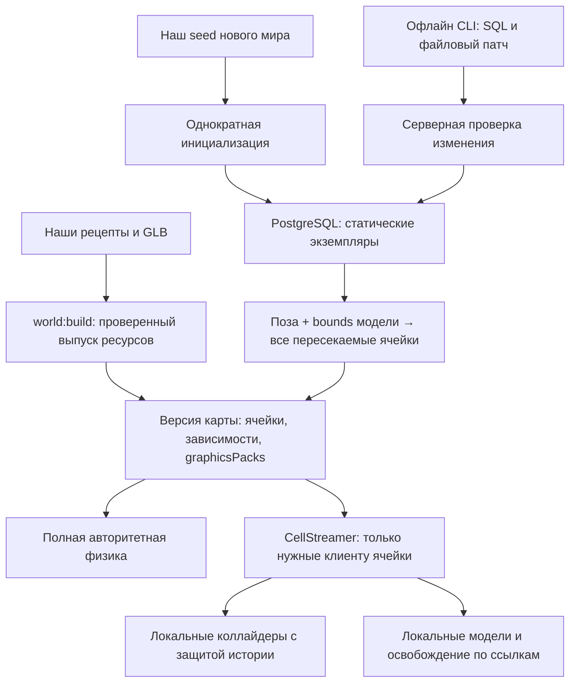

# Статические объекты: целевая концепция и план миграции

Дата актуализации: 12 ноября 2026 года. Срез реализации — `206a84d`: формат мира v4, ячейки v2, протокол v10, схема PostgreSQL v4. Документ описывает выполненную миграцию и оставшиеся этапы; текущие команды редактирования приведены в [памятке разработчика](map-model-guide.md) и [эксплуатации](operations.md).

| Часть плана                                       | Статус                                                      |
| ------------------------------------------------- | ----------------------------------------------------------- |
| Этап 0: исходный baseline                         | Зафиксирован; независимые эталоны сохранены                 |
| Этап 1: самостоятельные объекты                   | Выполнен и принят, `81c4ae6`                                |
| Этап 2: удаление OSM-конвейера                    | Выполнен, включён в `376112b`                               |
| Этап 3: размещение из БД и общий издатель         | Выполнен; схема v4 применена при миграции 12 ноября         |
| Дополнение 3а: файловые патчи и Makefile          | Выполнено, `1b7b507`; работает офлайн на остановленном мире |
| Дополнение 3б: оптимизация загрузки ресурсов      | Выполнено, `aabadc8`; объединено с патчами в `206a84d`      |
| Этап 4: административное API и горячее применение | Не реализован, оставлен на следующую итерацию               |
| Этап 5: игровой редактор                          | Не реализован, оставлен на следующую итерацию               |

Самостоятельные статичные объекты уже хранят размещение в БД и загружаются клиентом через пространственные ячейки. Разработчик без доступа к БД может получить экспорт, изменить копию и создать файловый патч; оператор проверяет и применяет его через Makefile. Это не включает горячее переключение работающей комнаты или игровой инструмент.

[Инструкция агенту по выделению объектов](static-object-extraction-agent.md) сохранена как историческое задание завершённого этапа. Исходные цифры и старые версии ниже помечены как baseline. Рабочее описание загрузки — [потоковая карта](large-map-streaming.md), форматы моделей — [модели и сборка](building-assets.md). Код и машинные контракты имеют приоритет над историческими отчётами.

## 1. Цель и принятые решения

Карта должна состоять из самостоятельных статических объектов: целых домов, светофоров, фонарей, остановок, памятников, деревьев и участков ограды. Каждый экземпляр имеет постоянную идентичность, модель из нашего каталога и редактируемую позу. Размещение хранится в PostgreSQL. В дальнейшем администратор меняет его собственными инструментами, включая инструмент внутри игры.

Пользователем приняты следующие решения:

- Сохранить текущую основу Babylon.js, Havok, Colyseus и TypeScript.
- Сохранить статический характер этих объектов в физической симуляции.
- Разделить определение модели и её экземпляры на карте.
- Перейти к собственному наполнению и редактированию мира.
- Отказаться от дальнейшего автоматического импорта OSM и удалить его инструменты после извлечения нужного контента.
- Использовать уже подготовленную карту как исходное наполнение собственного мира.
- Сохранить потоковую загрузку и выгрузку клиентского окружения: экземпляры из БД попадают в существующие пространственные ячейки по фактическим габаритам и освобождаются по тем же правилам владения ресурсами.

Технические решения ниже конкретизируют этот объём. Текущее применение размещения из БД и файловых патчей выполняется при остановленном мире. Горячее применение и игровой редактор поставляются отдельными этапами. Для первого редактора достаточно добавления, перемещения, поворота, отключения и восстановления экземпляра.

Режим миграции — последовательное переключение с сохранением данных. После конвертации остаётся один поддерживаемый процесс наполнения; обратная совместимость с OSM-командами и постоянная двойная запись не требуются. Между этапами сохраняется запускаемый собственный контент, а откат выполняется согласованным выпуском и состоянием. Старые клиенты при несовместимой смене формата должны обновиться до входа в мир.

В этот план не входят редактирование вершин модели внутри игры, изменение масштаба экземпляра, поведение транспорта и светофорных фаз, изменение физических свойств переносимых предметов, распределённая симуляция или обязательное внедрение PostGIS. Существующая система динамических предметов и инвентарей сохраняет собственные сущности и правила.

## 2. Текущее состояние и исторический baseline

### 2.1. Реализованные контракты

В [контрактах](../packages/contracts/src/index.ts) зафиксированы мир v4, ячейки v2 и протокол v10; в [миграциях](../apps/server/src/migrations.ts) — схема PostgreSQL v4. Babylon.js — 9.35.0, Havok — 1.3.14. Переход к файловым патчам и транспортным графическим пакетам не потребовал новой версии схемы БД.

| Источник                                                                                                              | Реализованное поведение                                                                         |
| --------------------------------------------------------------------------------------------------------------------- | ----------------------------------------------------------------------------------------------- |
| [Каталог города](../content/buildings/ring-block/catalog.json) и [сборщик](../tools/world-build/src/index.ts)         | Собственные рецепты/GLB; выпускаются все доступные модели каталога, в том числе без экземпляров |
| [Схема размещений](../apps/server/src/layout/schema.ts), [хранилище](../apps/server/src/layout/store.ts)              | Размещения, ревизии, отключение, история и блокировка конкурентных записей                      |
| [Общий издатель](../packages/world-release/src/index.ts)                                                              | Разбиение основания, полные AABB-memberships, зависимости ячеек и графические пакеты            |
| [Подготовка мира](../apps/server/src/layout/prepare.ts)                                                               | Объединение фиксированного слоя и БД, проверка геометрии и сохранений                           |
| [Формат патча](../packages/contracts/src/world-layout-patch.ts), [применение](../apps/server/src/layout/patch.ts)     | Офлайн diff, конфликты версий, предварительная проверка и атомарное применение                  |
| [CellStreamer](../apps/client/src/streaming/cells.ts), [VerifiedResources](../apps/client/src/streaming/resources.ts) | Независимые удержания графики/физики, отмена, SHA-256 и ограниченный кеш                        |
| [DynamicInterest](../apps/server/src/interest.ts)                                                                     | AOI игроков и динамических предметов; размещения статики доставляются через файлы ячеек         |

### 2.2. Текущий собственный контент

В исходной расстановке `ring-block` — **1744 редактируемых экземпляра и один исходный экземпляр основания**. Каталог содержит **1675 моделей объектов и один рецепт основания**. При сборке основание превращается в 40 плиток; вместе с четырьмя фиксированными границами выпуск содержит **1788 уникальных статичных экземпляров и 1715 моделей**. Это числа исходного наполнения; реальные включённые строки конкретной БД могут отличаться после правок оператора.

Сетка доставки — **125 м**, origin `(−269, −745)`, 5 × 8 = **40 ячеек**. Границы X от −269 до 331 м, Z от −745 до 131 м. `streaming-lab` сохраняет 256 ячеек как полигон загрузчика. Повторные определения на стыках не увеличивают число уникальных объектов.

`content/worlds/ring-block/cells/0_0.json` теперь задаёт seed, а не текущее размещение существующей установки. Сборка не возвращает удалённые или отключённые записи БД. Сервер загружает полную проверенную статику; клиент — только требуемые ячейки, графику и коллайдеры. Графические пакеты меняют доставку байтов, сохраняя самостоятельность объектов и отдельную загрузку физики.

### 2.3. История исходного состояния

До этапа 1 авторское наполнение содержало 136 домов, 18 ручных объектов, 134 сборных участка `details-*` и один рецепт земли: 289 экземпляров и 277 исходных моделей. Выпуск имел 332 уникальные статические сущности, 316 моделей, 40 плиток основания и 1892 коллайдера. Тогда использовались протокол v9 и схема БД v3; эти значения не являются текущими версиями.

Первоначальный план опирался на `main` `6d535fa`; независимый baseline фактического выделения сохранён с ревизии `2ea824dfe3bd7e4b398c514f7f82e29f08a35fbb`. Источники доказательства — [реестр](../content/worlds/ring-block/extraction.json), [эталоны](../tests/fixtures/static-extraction/README.md) и [отчёт этапа 1](../reports/static-object-extraction.md). Эталоны не пересоздаются из нового контента ради прохождения теста. Удалённые OSM-файлы доступны только через историю Git и не участвуют в текущей сборке.

## 3. Доменная модель

### 3.1. Модель из каталога

`StaticAsset` — доменное название переиспользуемой модели в локальных координатах. В текущем коде её описывают дескриптор `asset.json`, `BuildingPhysicsAsset`, `BuildingParts` и запись `manifest.assets`, а не единый сериализованный тип с таким именем. Модель включает:

- `assetId` — устойчивое имя модели;
- `version` — хеш согласованного пакета графики, коллайдеров и частей;
- модель GLB либо поддерживаемый исходный рецепт;
- список локальных коллайдеров, их материалы и общие габариты;
- семантические части и группы прозрачности.

Категории здание/ограда/светофор и т. п. пока записаны в историческом реестре выделения; пользовательская классификация каталога относится к будущему редактору. Категория или имя не определяют физику: она берётся из явных коллайдеров. Контракты допускают модель с пустым списком коллайдеров — видимый объект без физического тела; отдельный генератор рецепта может иметь более строгие требования. Пустой список не подменяется скрытым препятствием.

Размеры запекаются в модель и её физические формы. Единой схемой можно описывать как типовой светофор, так и уникальный дом по сложному контуру. Унификация не требует превращать все здания в одинаковые шаблоны.

### 3.2. Экземпляр

Реализованный контракт хранилища и административного экспорта:

```ts
interface StaticObjectInstance {
  entityId: string;
  assetId: string;
  position: { x: number; y: number; z: number };
  rotation: { x: number; y: number; z: number; w: number };
  instanceRevision: number;
  enabled: boolean;
  sourceRef?: { provider: string; type: string; id: string };
}
```

`worldId` задаёт контекст хранения и снимка. Постоянный ключ — `(worldId, entityId)`. Существующие ID домов и ручных объектов сохраняются. Новые ID выдаются при создании и переживают перемещение, поворот, смену цвета или версии модели. Индекс массива, ID физического тела и текущие координаты не являются идентичностью.

Экземпляры с одним `assetId` используют одно определение модели, но имеют независимые позы. Составной дом получает один корень трансформации для корпусов, крыши, вывесок и коллайдеров. Прозрачность отдельных частей продолжает работать через метаданные модели.

Система координат остаётся прежней: метры, правая система, Y вверх, восток +X, север −Z. Поворот хранится нормализованным кватернионом. В административном интерфейсе первый удобный режим — перенос и поворот вокруг Y; формат способен сохранить полную ориентацию. Для новых моделей опорная точка располагается у основания. Уже готовые модели можно оставить с прежним корректным pivot, явно описав его.

### 3.3. Границы целого объекта

| Вид                                 | Единица редактирования                                                                                                      |
| ----------------------------------- | --------------------------------------------------------------------------------------------------------------------------- |
| Дом, включая сложный многокорпусный | Один существующий экземпляр со всеми его частями                                                                            |
| Светофор                            | Стойка, корпус и сигналы вместе; отдельные направления подъезда — отдельные экземпляры                                      |
| Фонарь, скамейка, столбик           | Цельный предмет                                                                                                             |
| Остановка                           | Павильон и относящийся к нему знак; остановка без павильона также самостоятельна                                            |
| Дерево, куст                        | Одно дерево со всей кроной либо один куст; роща не становится одним редактируемым объектом                                  |
| Детский комплекс                    | Один цельный комплекс                                                                                                       |
| Ограда, стена, живая изгородь       | Непрерывный прямой участок после существующего обрезания у ворот; отдельные пролёты можно группировать инструментом позднее |
| Памятник, фонтан, киоск             | Существующий цельный экземпляр                                                                                              |

Проход у ворот остаётся свободным. Назначение общего ID объекту не означает создание сплошного коллайдера по его bounding box.

### 3.4. Основание карты и связанные данные

Земля, асфальт, тротуары, парковки, разметка и островки остаются слоем основания. Начальная миграция сохраняет его геометрию и существующее разделение на 40 плиток. Граничные стены и точки появления также остаются частью определения мира. Для них не требуется тот же пользовательский инструмент, что для светофоров.

При переносе в БД фиксированные экземпляры основания остаются частью выпуска ресурсов и в seed редактируемого размещения повторно не включаются. Эффективная карта объединяет основание и активные экземпляры БД с общей проверкой уникальности ID. Затем **оба** слоя распределяются по ячейкам и проходят один клиентский жизненный цикл. Неизменяемое основание не означает постоянно загруженную на клиенте землю всего мира. `WorldHeader` остаётся небольшим и не получает глобального массива основания. Административная операция размещения не может изменить фиксированный слой через подстановку его ID.

Собственная [трассировка кольца](../content/worlds/ring-block/ring-trace.json) и [предпросмотр](../tools/world-build/src/preview-ring.ts) относятся к ручным инструментам создания основания. Их данные и полезное поведение сохраняются. Зависимость preview от импортёра и его конфигурации устранена на этапе 1. На этапе 2 удалён старый конвейер; рецепт параметров и генерация слоёв из трасс теперь самостоятельны.

Подписи ориентиров пока сохраняют отдельные мировые координаты в `world.json.landmarks`; перемещение здания через БД или патч не переносит подпись автоматически. Локальные якоря через `entityId` и смещение относятся к этапу редактора. Подпись площади или района сохраняет мировую точку. Перемещение дома также не меняет автоматически покрытие двора или дороги: это отдельные данные основания.

## 4. Источники истины и архитектура

| Факт                                                               | Источник истины                        | Производные представления                  |
| ------------------------------------------------------------------ | -------------------------------------- | ------------------------------------------ |
| Геометрия и физическая форма модели                                | Наш версионируемый каталог ресурсов    | GLB, формы Havok, кеш графики              |
| Положение, ориентация и доступность экземпляра после инициализации | PostgreSQL                             | Проверенный снимок размещения, тела и меши |
| Начальное наполнение нового мира                                   | Собственный seed в репозитории         | Однократное наполнение БД                  |
| Границы, основание, параметры симуляции и стартовые точки          | Выпуск определения мира                | Серверная и клиентская конфигурация        |
| Состояние переносимых предметов                                    | Действующая система предметов          | Физические тела и сетевые снимки           |
| Разбиение для отрисовки и пространственного поиска                 | Вычисляется из экземпляров и габаритов | Пакеты отрисовки, индексы, кеши            |

Seed больше не является вторым источником текущего размещения. Обновление приложения не перезаписывает таблицу экземпляров. Если администратор отключил все объекты, пустой мир остаётся пустым после перезапуска.



Границы пакетов сохраняются: `contracts` описывает данные и чистые проверки; `simulation` строит физические представления; сервер владеет БД, полномочиями и публикацией; клиент владеет отображением и предпросмотром; сборщик готовит наши ресурсы. Симуляция не выполняет SQL-запросы внутри физического шага.

Исторические имена `BuildingInstance`, `BuildingPhysicsAsset`, `buildings` и `BuildingViews` сохранены и обслуживают разные статичные объекты. `StaticObjectInstance` расширяет экземпляр для хранилища и экспорта; это не переименование полей сетевых ячеек. Возможная смена сериализованных имён требует отдельного согласованного изменения формата, загрузчиков и тестов.

Сборщик выпускает все модели выбранного каталога, даже когда у них ещё нет экземпляров. Добавление геометрии требует сборки и принятия нового выпуска через `world:migrate`; затем делается свежий экспорт и размещается первый экземпляр. Перемещение или добавление экземпляра уже принятой модели не пересобирает её геометрию. Процедура удаления модели учитывает также отключённые строки и seed: [памятка](map-model-guide.md#10-удаление-модели-из-каталога).

## 5. Хранение и жизненный цикл

### 5.1. Таблицы

| Таблица                   | Основные поля и ограничения                                                                                                                                                                                                            |
| ------------------------- | -------------------------------------------------------------------------------------------------------------------------------------------------------------------------------------------------------------------------------------- |
| `world_layouts`           | `world_id` с FK на `persistent_worlds`, `asset_release_version`, `seed_version`, допустимые `asset_ids`, резервные `fixed_entity_ids`, монотонная `revision`, `validated_revision`, `validated_hash`, время первоначального наполнения |
| `world_static_instances`  | PK `(world_id, entity_id)`, `asset_id`, числовые `position_x/y/z`, `rotation_x/y/z/w`, `instance_revision`, `enabled`, необязательное происхождение, `updated_at`                                                                      |
| `world_static_operations` | PK `(world_id, operation_id, entity_id)`, источник `sql`/`seed`/`migration`, необязательный аккаунт, до/после, ревизия размещения и время                                                                                              |

Положение и кватернион — отдельные типизированные столбцы, удобные для SQL. Геометрия не копируется в каждую строку. Выпуск `asset_release_version` фиксирует точные версии всех доступных моделей. `asset_id` проверяется по этому выпуску; создание экземпляра неизвестной модели отклоняется. Переключение выпуска выполняется явной миграцией с проверкой всех используемых ссылок.

Числовые значения должны быть конечными; кватернион ненулевой и нормализованный; ревизии положительные и представимые без потери точности в выбранном сетевом типе. Начальная реализация может использовать ограниченный SQL `integer` и JS `number` для ревизий. При переходе к `bigint` потребуется единый явный способ сериализации.

Для `enabled=false` физические тела и меши не создаются. Строка сохраняется как явное административное решение. История операций служит для проверки и отката; она не является альтернативным механизмом восстановления всего мира через проигрывание событий. Первоначально автоматическое удаление истории не вводится.

### 5.2. Первоначальное наполнение

Инициализация выполняется один раз в транзакции под существующей блокировкой владельца мира. Отдельный признак наполнения различает новый мир, миграцию существующего мира без статической таблицы и уже инициализированный пустой мир.

Для существующего `persistent_worlds` добавляется только статическое размещение. Идентичность предметов, инвентари, операции и правила первоначальной выдачи не пересоздаются. Повторный запуск с тем же seed ничего не добавляет и не меняет. Позднейшее расширение карты выполняется отдельной нашей операцией, а не повторным импортом seed.

### 5.3. Редактирование SQL

Прямые SQL-правки поддерживаются при остановленном игровом мире. Триггеры БД увеличивают ревизии изменённых экземпляров и размещения, обновляют время и инвалидируют результат проверки. Для прямого SQL источник операции отмечается как `sql`; административный аккаунт может быть неизвестен. Он не подменяется вымышленным пользователем.

Сервисные операции и триггеры используют единый контекст журналирования, чтобы не записывать одно изменение дважды. Монотонная ревизия размещения может увеличиться несколько раз за пакетную SQL-правку; её точное приращение не является публичным контрактом.

Перед запуском команда применения проверяет полный набор строк и публикует его хеш. Изменение строк само по себе не означает, что работающая игра уже применила новую геометрию. Прямой SQL в обход работающего владельца мира не поддерживается как горячий способ редактирования.

### 5.4. Владение и конкурентные записи

`WorldOwnership` уже предоставляет общую сессию с advisory-блокировкой для `ItemStore`, `StaticLayoutStore`, запуска мира и офлайн-команд. Работающий владелец блокирует вторую команду/сервер и SQL-правки размещений. Геометрия, размещения и сохранённые предметы проверяются на этой же сессии; два независимых владельца не конкурируют за одну блокировку.

Будущая горячая операция должна проверять `worldEpoch`, текущую версию размещения и `instanceRevision`. Конфликт возвращает актуальное состояние и требует повторного действия. Повтор одного `operationId` возвращает сохранённый результат и не перемещает объект повторно. Во время проверки и фиксации геометрии изменения физических предметов сериализуются с ней; состояние для проверки не должно устареть между чтением и применением.

### 5.5. Файловые патчи без доступа разработчика к БД

Оператор после `make build` экспортирует размещения остановленного мира. Разработчик меняет копию и создаёт патч без `.env` и БД. Оператор проверяет и применяет его на остановленном мире:

```sh
make map-export FILE=output/base.json
cp output/base.json output/edited.json
# Разработчик редактирует output/edited.json.
make map-patch BASE=output/base.json EDITED=output/edited.json PATCH=output/change.json
make map-check PATCH=output/change.json
make map-apply PATCH=output/change.json
make start
```

Патч v1 содержит мир, выпуск каталога, seed, исходную общую ревизию и явные `add`/`update`/`delete`. Обновление передаёт полную запись и ожидаемую ревизию экземпляра; отсутствие `sourceRef` очищает его. Одна операция на ID, добавление требует нового ID. Пропущенные в патче экземпляры сохраняются. Копия экспорта сохраняет служебные версии и ревизии; у нового экземпляра `instanceRevision: 1`.

Любое несовпадение исходной ревизии размещения, ревизии объекта или выпуска отклоняет применение. Для повторной правки нужен свежий экспорт; непустой патч не применяется второй раз. Это обнаружение конфликтов, а не будущая идемпотентность API с сохранённым ответом.

`map-check` не меняет БД. `map-apply` проверяет геометрию/точки появления и сохранённые предметы, затем фиксирует размещения, ревизии, аудит и совместимость одной транзакцией. Ошибка откатывает все эти изменения. История использует существующий `source: sql`; UUID `operation_id` объединяет строки применения. После успеха дополнительная `world:migrate` для этого патча не нужна. Команды сами не останавливают и не запускают сервер; экспорт не заменяет резервную копию БД.

Точные форматы, варианты CLI из исходников и работа с новым каталогом описаны в [памятке](map-model-guide.md#51-основной-сценарий-разработчик-без-доступа-к-бд). Полный JSON в `world:layout:validate --file ...` по-прежнему только проверяется; применять нужно патч или прямые SQL-правки.

## 6. Версии, загрузка и публикация

### 6.1. Значение версий

- `assetReleaseVersion` идентифицирует неизменяемый выпуск каталога и основания карты. Административное перемещение не пересобирает модели.
- `layoutRevision` — логическое название общей ревизии размещения: сейчас это `revision` в снимке/БД и `baseRevision` в патче. Она отражает порядок изменений, а не состав геометрии; отдельного публичного поля `layoutRevision` пока нет.
- `layoutHash` вычисляется по канонически упорядоченному активному размещению и ссылке на выпуск ресурсов.
- `mapVersion` в первом этапе загрузки идентифицирует полный эффективный пакет карты, включая фактическое размещение.
- `simulationConfigHash` и проверка совместимости сохранённого мира учитывают фактически применённые коллайдеры, трансформации и параметры симуляции.
- `worldEpoch` продолжает обозначать запуск владельца мира и защищает от команд предыдущего запуска.

Модели и экземпляры сортируются по устойчивым ключам до вычисления хешей. Порядок строк SQL не должен менять версию карты. Публичный снимок не содержит журнал действий, идентичность администратора или служебные данные БД.

### 6.2. Реализованный путь: БД → сегментированный bundle

Сервер формирует при запуске проверенный эффективный bundle из выпуска ресурсов и размещения БД. Он сохраняет нынешний путь загрузки: заголовок без всей статики, manifest с сеткой и индексом ячеек, отдельные файлы ячеек и общие модели. Набор координат из БД не отправляется клиенту одним глобальным массивом объектов.

Публикация и разбиение уже выделены в `@su/world-release`: подготовленные определения + проверенный каталог → распределение по сетке → файлы ячеек, графические пакеты и manifest. Общим издателем пользуются сборщик, сервер и применение файлового патча. GLB и parts доставляются через `graphicsPacks` с SHA-256; индивидуальные URL сохранены, коллайдеры в пакеты не входят. Повторно реализовывать расчёт ячеек в SQL-коде нельзя. Алгоритм и инварианты описаны в разделе 8.

Порядок подготовки: получить владение миром → прочитать/инициализировать размещение и сохранённые предметы → совместить его с плитками основания → сформировать все ячейки и их зависимости → проверить полную геометрию и совместимость → опубликовать единый неизменяемый снимок и создать серверную симуляцию → открыть readiness. На ошибке мир не объявляется готовым.

Сервер, `/api/world`, HTTP-раздача, планы подготовки и состояние комнаты используют одну опубликованную версию. Недостаточно заменить `definition.buildings` после проверки старого manifest. Произвольные файловые пути из БД не принимаются; ссылки разрешаются через проверенный каталог. Ресурсы предыдущего выпуска не перезаписываются по прежнему хешированному URL. Метаданные новой версии публикуются после готовности её зависимостей; раздача не должна случайно использовать файлы новой версии со старым списком разрешённых ресурсов.

Клиент по-прежнему использует `loadWorldHeader`, `CellStreamer`, `loadWorldCell`/`loadCellPhysics` и `createLocalPredictionWorld`. Полный `loadWorldBundle` и пересчёт хеша всей физики остаются серверными операциями. Заголовок, корень manifest и полученные байты проверяются штатно; ради верификации клиент не скачивает удалённые коллайдеры.

Перед горячим применением к метаданным публикации добавляются `assetReleaseVersion`, `layoutRevision` и `layoutHash`. Публичный снимок размещения — manifest и адресуемые ячейки одной версии, а не обязательный плоский список всех экземпляров. Полный экспорт остаётся административной операцией. Протокол и формат повышаются согласованно только при реальном изменении контракта.

### 6.3. Сохранённые предметы и обновление геометрии

Даже геометрически эквивалентное разделение участков меняет ID и физический хеш. Это ожидаемая миграция, а не основание отключать проверку совместимости.

Офлайн-применение через `world:migrate` или `map-apply` использует `ItemStore.migrateGeometry` и `checkSavedItem`: проверяет актуальную позу и `safePose` относительно новой статики, границы и внутренние объёмы solid mesh. Движущийся предмет может находиться в воздухе; отсутствие опоры у сохранённого снимка само по себе не делает миграцию невалидной. Занятость исторической `safePose` другим динамическим предметом также не является изменением геометрии карты. Не заменять эту проверку старым вызовом размещения, требующим опоры. Настоящий конфликт с новой статикой отклоняет применение без автоматического переноса вещей и без изменения `compatibility_hash` и их сохранённых состояний. Для горячего удаления занятой опоры остаётся отдельная проверка безопасности операции.

## 7. Горячее применение и собственный инструмент

**Обновление 13 ноября 2026:** в рабочей ветке реализованы каталог `/motherlode` и `/vilievna`: любой авторизованный игрок может удалить целиком самостоятельный статичный экземпляр, включая исходные здания. Права автора и список редакторов не используются. Удаление сохраняет `enabled=false` и проходит существующий общий барьер; восстановление и перемещение отложены. Ниже сохранена исходная последовательность общего редактора; актуальное поведение описано в [памятке](map-model-guide.md).

В рабочей ветке реализован узкий путь создания одной скамейки по [плану ядра MVP](plans/static-placement-core-mvp.md): любой действующий Telegram-аккаунт, `/motherlode`, транзакционный аудит и горячее переключение с общей паузой. Общего API перемещения и восстановления ещё нет. Требование списка редакторов ниже заменено правилом доступа из MVP только для этого создания; остальные будущие операции не реализованы.

Предпросмотр двигает только локальную копию. До подтверждения действующий объект остаётся на месте. Подтверждение отправляет серверу `operationId`, `worldEpoch`, ожидаемые ревизии, ID экземпляра и новую позу. Добавление также указывает модель из опубликованного каталога. Отключение и восстановление используют тот же порядок проверок.

Сервер выполняет:

1. Проверку административного права; обычного входа через Telegram недостаточно.
2. Проверку типов, конечности координат, кватерниона, границ и принадлежности модели выпуску.
3. Проверку фактических форм, свободных стартовых точек, пересечений с игроками, другими объектами и предметами. Для перемещения собственное старое тело исключается. Контакт с основанием допустим; общее правило «никаких контактов» здесь непригодно.
4. Проверку удаления опоры: предмет на крыше или игрок на объекте также может сделать изменение недопустимым. Начальное правило — отклонить конфликт и объяснить причину.
5. Фиксацию размещения, ревизий и операции в одной SQL-транзакции.
6. Применение на границе физического шага и публикацию подтверждённой версии.

Для первого инструмента право редактирования задаётся серверным списком внутренних `accountId` в конфигурации. Пустой список запрещает изменения всем; гость не получает это право. Общая система ролей и управление правами внутри игры не нужны для первого результата. Проверка выполняется для каждой операции. Административное размещение имеет собственный контракт: оно не создаёт переносимый предмет, не использует инвентарь и не наследует ограничение предметов в 3 м.

Транзакция PostgreSQL не является транзакцией Havok. Если после подтверждённого commit применить сцену не удалось, комната приостанавливается и восстанавливается из подтверждённого состояния либо перезапускается. Продолжать игру со старой геометрией нельзя. Неопределённый результат commit разрешается через журнал `operationId`.

Первое горячее применение использует контролируемую смену поколения загрузки: комната приостанавливается, клиенты получают новый manifest, освобождают старые удержания и историю предсказания, готовят **только свою критическую область** по существующему протоколу подготовки и получают свежее авторитетное состояние. Подготовка всего мира или всего графического круга не является условием возобновления. Клиент, не подготовивший версию за ограниченное время, переподключается. Обычная ходьба между ячейками сохраняет контроллер и соединение; смена версии геометрии — отдельное событие. Уточнения по ревизиям и поздним ответам приведены в разделе 8.4.

Адресуемые `retainStatic`/`releaseStatic`, удаление тел и моделей уже реализованы. Их следует расширить согласованной заменой версии, а не создавать второй реестр экземпляров. Нынешние адаптеры отклоняют новую позу того же ID, пока удерживается старое определение: простой повторный `add` не является перемещением. При замене нужны актуальные обратные матрицы, замороженные матрицы мешей, bounds и пространственный индекс, прозрачность, тени и связанные подписи. Сопоставление выбора на экране с `entityId` обязательно.

## 8. Загрузка объектов из БД и освобождение клиентской памяти

### 8.1. Сохраняем существующую политику областей

| Подсистема                   | Действующее правило, которое сохраняем                                                                                                   |
| ---------------------------- | ---------------------------------------------------------------------------------------------------------------------------------------- |
| Сетка доставки               | 125 м, origin из `manifest.grid`; ключ `floor((coordinate - origin) / cellSize)`                                                         |
| Критическая физика и графика | Окрестности 3 × 3 вокруг авторитетной и предсказанной позиции плюс ячейки истории неподтверждённого ввода                                |
| Фоновая физика               | Пересечение ячеек с кругами 500 м вокруг обеих позиций; ранее удержанные ячейки сохраняются до 800 м                                     |
| Графика                      | `R_frame` — максимальное расстояние до XZ-углов видимых камерой ячеек; `R_draw = max(125, R_frame + 75)`, предзагрузка до `R_draw + 125` |
| Удержание графики            | `R_draw + 300`; это независимый от физики круг, без прежнего минимума 800 м                                                              |
| Освобождение                 | После ухода из соответствующего wanted-набора и отложенного срока, сейчас 5 с; история и другие потребители продолжают удерживать ресурс |
| Подготовка                   | До 4 параллельных подготовок и HTTP-запросов; обычный `pump` — 2 мс, в preview/критической подготовке — адаптивно до 6 мс                |
| Байты                        | Проверенный LRU до 64 МиБ; единичный ресурс и файлы ячеек имеют отдельные ограничения                                                    |
| Просмотр без входа           | Загружается графика без игрока, места в комнате и физических тел; после выхода просмотр восстанавливается                                |

Вход/возврат/переподключение сохраняют `prepareArea` → `areaReady` → `areaResult` и проверку эпохи/версии. `criticalReady` разрешает ввод; `backgroundReady` служит отдельным показателем. Радиусы выбирают пересечение **AABB ячейки** с кругом, а не расстояние до центра. Круг графики может показывать дальнюю статику, но не расширяет сетевой AOI динамики 500/800 м. Туман и мягкая граница учитывают реально подготовленный радиус.

Серверная статика и предметы продолжают существовать, когда клиент удалил их представления. Состояние `enabled=false` в БД — административное отключение; выгрузка из клиентской памяти не меняет эту строку.

### 8.2. Координаты БД определяют полное покрытие ячеек

Одна строка экземпляра в БД порождает одно смысловое определение. Его доставка вычисляется существующими чистыми функциями:

```ts
const aabb = buildingBounds(instance, asset.bounds);
const memberships = cellsIntersectingBounds(worldBounds, grid, aabb);
```

`buildingBounds` преобразует все восемь углов локальных bounds полной ориентацией. Поэтому дом с pivot в одной ячейке, но крышей или корпусом в соседней, попадёт в обе. Размер сетки, начало мира и отрицательные координаты учитываются через общий `world-grid`; отдельное `floor(x / 64)` или хранение только «домашней» ячейки объекта непригодно.

В каждую пересекаемую ячейку записывается одинаковое активное определение с тем же `entityId`, `assetId` и позой. Поля `instanceRevision` и `enabled` остаются в БД/экспорте и не добавляются в текущий транспорт ячеек v2. Внутри одной ячейки дублей нет. Полное вмещение проверяется по bounds **мира**; для ячейки требуется положительное X/Z-пересечение по действующему контракту. Простое касание плиток не порождает копии в соседней ячейке. Круговая выборка ячеек отдельно сохраняет граничный контакт. Вычисления не подменяются SQL-округлением координаты центра.

Для каждой ячейки из актуального содержимого пересчитываются отсортированные `assetIds`, байты, SHA-256 и ссылка manifest. Сборщик и полная серверная загрузка проверяют, что покрытие каждого объекта точно равно ожидаемому набору ячеек; неполное или противоречивое покрытие отклоняется. Клиент объединяет одинаковые записи в один root и одно тело с несколькими удержаниями.

При создании, перемещении, повороте, смене модели или отключении вычисляется объединение **старых и новых** memberships. Обновляются также ячейки, оставшиеся в пересечении: поза объекта в них могла измениться. Старые записи и неиспользуемые зависимости удаляются, новые добавляются, пустые ячейки остаются валидными. Изменение bounds модели в новом выпуске также требует пересчёта покрытия. Индекс ячеек — производные данные; перенос объекта не меняет его ID.

В первом варианте владелец мира читает строки БД при подготовке/редактировании и публикует снимок. При ходьбе клиента выполняются запросы неизменяемых файлов нужных ячеек. Второй независимый канал «объекты рядом из БД», обходящий `CellStreamer`, не вводится. При росте объёма допустим восстановимый индекс memberships на сервере; он не становится источником позы. Бизнес-поля `cell_id` в строке недостаточно для больших объектов.

### 8.3. Что именно освобождается

Нужны отдельные удержания **экземпляров** и **моделей**, независимо для физики и графики:

1. Подключение нескольких ячеек одного объекта добавляет ссылки, сохраняя одну графическую и одну физическую инстанцию.
2. Уход из графической области после гистерезиса/задержки удаляет меши экземпляра, его материалы прозрачности, тени, привязанные DOM-элементы и запись в `SpatialIndex`, когда нет других графических удержаний.
3. Уход из физической области удаляет тело только после последнего физического удержания, включая историю предсказания. Отдаление камеры не создаёт удалённые тела ради графики; приближение камеры не снимает нужную физику.
4. Общая модель GLB, материалы/текстуры контейнера и форма Havok освобождаются только после последних своих пользователей. Отмена одной загрузки не отменяет запрос, ещё нужный соседней ячейке.
5. После освобождения ячейки удаляются её разобранные данные, временные результаты подготовки и замыкания. Внешний глобальный массив всех экземпляров не должен удерживать бывшие меши или коллайдеры.
6. Проверенные сырые байты могут остаться в ограниченном LRU для возврата. Поэтому уход от объекта не означает немедленно нулевую всю память: активные сцены, разобранные данные, незавершённые запросы и LRU измеряются раздельно. Безразмерный кеш уже разобранной физики не допускается.

Пустые ячейки и visual-only модели должны достигать готовности, даже когда не создали native body. Нельзя реализовать visual-only простым пропуском, после которого `physicsReady` бесконечно ждёт несовпадающее число удержаний.

Проверка освобождения выполняется после ухода за **все** соответствующие круги и 5-секундной задержки с очищенной историей, либо после `dispose`. Обычный выход из игры возвращает графический просмотр стартовой области и потому не требует нулевых мешей. После нескольких одинаковых маршрутов и циклов камеры резидентный набор возвращается к вычисленному набору; рост памяти не маскируется увеличением лимита кеша.

### 8.4. Изменение размещения и загрузка старой ревизии

Офлайн-применение по-прежнему завершается перезапуском сервера. Для игрового создания одной скамейки в рабочей ветке добавлены смена поколения и барьер `layout`; защита отмены и устаревших результатов распространяется на замену локального контекста. Остальные типы редактирования этим не реализованы.

Первая поставка БД меняет размещение офлайн и публикует новую неизменяемую версию карты. Движущийся клиент в рамках одной сессии читает только выбранную версию. SQL-правка без публикации не меняет ответы файлов под прежним хешем.

Для горячего применения поколение загрузки однозначно связывается с `worldEpoch`, `mapVersion`, `layoutRevision` и `prepareId`. После смены поколения отменяются старые запросы и продолжения `prepare`, генераторы подключения/освобождения и планы подготовки. Обработчик результата проверяет, что всё ещё относится к текущему поколению. Поздний GLB/коллайдер не может заново создать удалённый объект, восстановить старую позу или уменьшить счётчик нового экземпляра.

Простой начальный путь — сброс старого stream-контекста и локальная подготовка нового manifest через существующий барьер. Перед новым удержанием одного ID его старые графические/физические ссылки полностью снимаются; новая сигнатура не смешивается со старой. Повтор ввода через старую геометрию прекращается, затем начинается с нового авторитетного состояния. Клиент, отставший по ревизии, получает новый индекс и только нужные ему ячейки. Бесшовные диффы по затронутым ячейкам — последующая оптимизация.

Создание/перенос издалека в загруженную область включает объект при подготовке новой версии; перенос наружу удаляет прежнюю копию. Изменение целиком вне области клиента не создаёт у него меш или тело: новая запись обнаружится при будущем запросе соответствующей ячейки. При двух удалённых игроках каждый поддерживает собственный набор, а сервер — один общий мир.

Одинаковое содержимое незатронутых ячеек должно сохранять хеш: глобальную `layoutRevision` не следует вписывать в байты каждой ячейки без необходимости. На первом пути допустима повторная локальная подготовка. Повторное использование проверенных неизменённых ресурсов между поколениями подключается с явным ключом хеша/версии; менять `manifest` у действующего `VerifiedResources` или `CellStreamer` на месте нельзя.

Для статического просмотра без входа предусмотреть проверку нового `/api/world` перед входом, при возвращении фокуса и редким неблокирующим опросом (начальный интервал 15 с, остановка в скрытой вкладке). После смены версии просмотр меняет поколение и заново готовит свою область без резервирования места. Игровые клиенты получают уведомление через текущую комнату. Старый просмотр не становится новой игровой сессией со старой картой.

### 8.5. Реализованные оптимизации и оставшиеся предложения

Первоначальные P1/P2 были сформулированы по коду до миграции. Часть уже выполнена на этапе 3 и в обновлении `aabadc8`; повторно планировать её как отсутствующую не нужно. Физические радиусы и сетевой AOI 500/800 м, максимальный масштаб камеры и проверки целостности сохранены; область графики теперь определяется фактическим кадром по правилу раздела 8.1.

| Область                        | Текущее состояние                                                                                                                    |
| ------------------------------ | ------------------------------------------------------------------------------------------------------------------------------------ |
| Независимая графика и физика   | Preview не загружает коллайдеры; parsed-физика освобождается отдельно от дальней графики                                             |
| Подача физических зависимостей | `loadCellPhysics` использует ограниченное число производителей, сохраняя предел HTTP и приоритет критической подготовки              |
| Доставка GLB и parts           | Общие `graphicsPacks`, SHA-256 пакета и вложенных ресурсов, индивидуальные URL как fallback; в LRU остаются извлечённые файлы        |
| Подготовка сцены               | Ограниченная параллельность импорта, адаптивная подготовка, Havok подключается при входе в игру                                      |
| Камера и отрисовка             | Графическая область учитывает вид камеры; сокращены повторные обходы сцены и вычисления статических трансформаций                    |
| Бюджеты                        | Сохранены 2048 активных статичных ID, 512 КиБ на ячейку, очередь 512, до 4 HTTP/prepare и LRU 64 МиБ; пакеты имеют отдельные пределы |

Остаются предложения для отдельного измеренного улучшения: ограничить перебор сетки AABB окружности, расширить неизменяемые индексы и кеширование камеры с полной инвалидизацией, исследовать общий кеш разобранных физических ресурсов и дополнительные гарантии критического I/O. Перед реализацией нужно подтвердить конкретный узкий участок: это не обязательные остатки этапа выделения объектов и не основание ослаблять проверки или уменьшать радиусы.

Instancing и дальнейшее объединение моделей допускаются только с сохранением самостоятельных ID, точного покрытия ячеек и освобождения ресурсов по ссылкам. Транспортные пакеты не возвращают несвязанные предметы в неадресуемые `details-*`.

Измерения разделяют активные экземпляры, удержания ячеек, модели/GPU-ресурсы, parsed collision bytes, LRU, очереди, отменённые результаты и время critical preparation. Нужны маршруты, повороты/масштаб камеры, возврат и `dispose`, а не только неподвижный кадр. Аппаратная и длительная приёмка остаётся отдельной проверкой; результаты SwiftShader не являются обещанием производительности Safari/телефона.

## 9. Этапы поставки

### Этап 0. Исходный baseline — выполнен

Сохранены исходная ревизия, независимые геометрические/физические эталоны и контрольные области загрузки. Реестр — `content/worlds/ring-block/extraction.json`, эталоны — `tests/fixtures/static-extraction/`. Исторические числа не подменяются результатом новой сборки.

### Этап 1. Самостоятельные объекты — выполнен

Принят `81c4ae6`: 1590 предметов выделены из 134 `details-*`, существующие дома/ручные модели и геометрия сохранены. После сборки — 1788 уникальных статичных экземпляров и 1715 моделей. Сохранены ID, локальные трансформации, проходы, коллайдеры, покрытие ячеек и независимая проверка треугольников/цветов. [Отчёт](../reports/static-object-extraction.md), [историческое задание](static-object-extraction-agent.md).

### Этап 2. Удаление OSM-конвейера — выполнен

Удалены загрузчик геоданных, импорт района, генерация деталей/разметки из тегов, конфигурация и снимок OSM, команды импорта и их специализированные тесты. Собственные рецепты и три мира собираются без них. `ring-layout.json` и `ring-trace.json` используются отдельным генератором `world:ring:layers`, который предлагает слои, но не переписывает основание сам. Предпросмотр читает собственные исходники.

На момент удаления 5186 файлов выпуска побайтово совпали с контрольной сборкой этапа 1; это историческое доказательство очистки, а не текущий размер выпуска с графическими пакетами. Исторический HTML, происхождение и независимые эталоны сохранены отдельно. Реализация этапов 2–3 включена в `376112b`.

### Этап 3. Размещение из PostgreSQL — выполнен

Добавлены схема v4, однократный seed, общий `WorldOwnership`, ревизии/история и `@su/world-release`. Сервер объединяет фиксированное основание с активными строками БД и публикует один проверенный bundle. Непустой и намеренно пустой миры сохраняются без повторного наполнения. Команды `world:layout:export`, `world:layout:validate` и `world:migrate` реализованы; проверка кандидата не является импортом.

Приёмка охватывает полные повороты и все пересекаемые ячейки, зависимости, перезапуск, блокировку второго владельца, несовместимые сохранения и сохранность предметов/инвентарей. Графика/физика удерживаются независимо, физические зависимости подаются с ограниченной параллельностью. Сетевые экземпляры остаются в формате ячеек v2 без служебных ревизий БД.

### Дополнение 3а. Файловые патчи и Makefile — выполнено

`1b7b507` добавил офлайн diff двух экспортов, явные операции, защиту версий/ревизий и атомарное применение с историей. Доступны `make map-export`, `make map-patch`, `make map-check`, `make map-apply`; подробный порядок — в разделе 5.5 и памятке. Разработчику не нужны реквизиты БД. Проверены ошибки геометрии, устаревшие патчи, полный откат частичного SQL-сбоя, неизменность предметов и правки только метаданных без изменения физического хеша.

### Дополнение 3б. Оптимизация загрузки — выполнено

`aabadc8` добавил графические пакеты, ограниченную/адаптивную подготовку, отложенную загрузку Havok и оптимизации выбора графики/обходов сцены. Общий издатель сохраняет индивидуальные ресурсы, ID и физику. Объединение с файловыми патчами — `206a84d`; операторский сценарий проверен с ячейками, содержащими `graphicsPacks`.

### Этап 4. Административное API и горячее применение — частично реализовано

Для создания одной скамейки по [плану ядра](plans/static-placement-core-mvp.md) реализованы Telegram-доступ, ожидаемая ревизия, постоянная идентичность операции, игровой аудит, транзакционная запись, добавление тела Havok и смена публикации. Барьер `layout` готовит критические области двух клиентов под общей паузой; старое поколение не активируется. Pending-запрос сохраняется при переподготовке/reconnect. Просмотр проверяет текущую публикацию перед входом, при фокусе и раз в 15 секунд.

Общие операции перемещения, поворота существующего экземпляра, отключения/восстановления и undo остаются следующим объёмом. Для них нужны проверки старых/новых memberships, опор, перемещения bounds и обратной операции на текущем мире. Создание одной модели не подтверждает эту матрицу.

### Этап 5. Игровой инструмент — частично реализовано

Настольная `/motherlode` открывает отдельный ghost фиксированной модели. Луч указателя пересекает плоскость Y=0; A/D поворачивают модель на 15°, подтверждение отправляет один запрос, Esc отменяет неотправленный предпросмотр. Движение и поворот камеры отключены, колесо доступно. Место проверяет сервер, включая удалённые коллизии. Открытие панели, touch и потеря графики освобождают ghost; подтверждённый запрос сохраняет свою идентичность.

Каталог выбора модели и `/vilievna` с выбором и удалением существующего экземпляра реализованы. Перемещение и восстановление не реализованы. Для перемещения связанных ориентиров понадобятся локальные якоря. Эти будущие функции требуют отдельных проверок составных и повторяющихся моделей, прозрачности, мягкого края, качества и разных viewport.

Этапы 1–3 и дополнения завершены. Для этапов 4–5 в рабочей ветке добавлено ядро создания одной модели; общий редактор и бесшовные диффы остаются следующими отдельными итерациями. Проверки и ограничения записаны в [отчёте](../reports/static-placement-core-mvp.md). План не требует запуска дополнительных агентов.

### Историческая запись о применении к production

12 ноября 2026 года в 13:31–13:33 UTC после остановки сервера пользователем схема была обновлена v3 → v4; созданы 1744 редактируемых экземпляра и 1744 записи seed, общая ревизия стала 1745. Фиксированные плитки и границы не вошли в редактируемый seed. Проверки сохранности аккаунтов, предметов и инвентарей выполнялись отдельно от наполнения статикой.

Это запись о завершённой миграции, а не описание текущего процесса production. Временная сборка этапа 3 и локальные файлы `output/` не являются актуальными инструкциями запуска или источником состояния. Код затем объединён с `main` при разрешении PR #16 (`6f47eb7`); дальнейший порядок сборки/запуска определяет [эксплуатация](operations.md). Новые файловые инструменты проверены на отдельной тестовой БД; их реализация сама по себе не означает применения нового патча в production.

## 10. Проверка, применение и откат

### Реализованная офлайн-приёмка

| Проверка                | Критерий                                                                                                  |
| ----------------------- | --------------------------------------------------------------------------------------------------------- |
| Сохранность конвертации | Независимые треугольники/цвета и коллайдеры; прежние дома, ручные модели и основание сохранены            |
| Самостоятельность       | Перемещение одного экземпляра не меняет второй экземпляр общей модели                                     |
| Собственная сборка      | Выпуск воспроизводится без OSM-конвейера и сетевой загрузки геоданных                                     |
| Seed                    | Повторный запуск не создаёт копии и не заселяет намеренно пустой мир                                      |
| Хранение и владение     | Типы/ревизии/история проверяются; работающий мир блокирует офлайн-правки                                  |
| Файловый патч           | Офлайн diff, явные удаления, несовпадающие версии/ревизии отклоняются, dry-run не меняет БД               |
| Атомарность             | Ошибка откатывает размещения, ревизии, историю и compatibility hash; предметы/инвентари сохранены         |
| Публикация              | Координаты БД попадают во все нужные ячейки и их графические пакеты; HTTP и сервер используют один выпуск |
| Streaming               | Отдельные удержания графики/физики, история, общие модели, отмена и освобождение после маршрута           |

На объединённой реализации `206a84d` прошли сборка, проверка типов/границ пакетов и **367 тестов в 55 файлах** с отдельной тестовой БД. Дополнительно выполнен реальный сценарий всех четырёх Makefile-команд: экспорт, создание патча без БД, проверка без записи, применение, отклонение повтора и HTTP-ячейки после запуска с графическими пакетами. Это результаты реализации до актуализации этих Markdown-файлов, а не новый production-прогон.

При изменении кода выполняются `pnpm check`, подходящие тесты и `pnpm build`. PostgreSQL-тесты требуют явной `SU_TEST_DATABASE_URL` и работают в уникальных временных схемах; без неё часть тестов пропускается. Браузерные проверки запускают на выбранном тестовом сервере. Изменение только документации проверяют по ссылкам, командам и фактическим контрактам.

### Применение и откат

Текущий порядок: штатная остановка → согласованная резервная копия БД и ресурсов → сборка → миграции схемы при необходимости → проверка/применение фактической геометрии → запуск → readiness и проверка изменённого места. Для файлового патча это `map-check` → `map-apply` → `make start`; после прямого SQL нужна `world:migrate`. Экспорт размещений не заменяет резервную копию БД.

До запуска новой версии откат возвращает согласованные код, ресурсы и состояние. После новых игровых записей старая копия БД не накатывается автоматически: она потеряет последующие действия игроков. Обратная правка размещений формируется по свежему экспорту и проходит ту же проверку; автоматической команды undo сейчас нет. Прямой SQL и последующая миграция — отдельные транзакции, файловый патч применяется целиком.

### Матрица streaming и будущего горячего применения

- Границы сетки, отрицательный origin, внешние края и угол 2–4 ячеек: полное покрытие, один экземпляр, несколько удержаний.
- Ходьба/спринт через сторону и диагональ, неподтверждённая история, ошибки/задержки I/O: коллайдеры и критическая подготовка сохраняются.
- Два экземпляра общей модели, уход и возврат: native shapes/контейнер освобождаются после последнего владельца, байты остаются только в ограниченном LRU.
- Камера 30×, ракурсы и viewport: дальняя графика не расширяет физику и сетевой AOI; зависимости и выгрузка соответствуют камере.
- Preview → вход → выход → preview, reconnect/respawn и `dispose`: не накапливаются модели, parsed-физика, тени и ссылки.
- Перенос/поворот/отключение патчем: после перезапуска старые, новые и общие ячейки имеют актуальные определения и зависимости; seed не возвращает удалённое.
- Для этапа 4 дополнительно нужны два игровых клиента, изменение вне всех областей, конфликт с игроком/предметом/опорой, поздняя загрузка прежней версии, повтор команды и сбой между commit и живым переключением. Эти проверки не выдаются за уже реализованную возможность.

Минимальная основа — `world-grid`, `world-bundle`, `graphics-pack`, `streaming/cells`, `streaming/resources`, `streaming/prediction-area`, `simulation/streaming`, `rendering/buildings`, `ground-tiles`, `world-build`, `world-serving`, `world-migration`, `static-layout` и `world-layout-patch`. Проверки `ring-block` и `streaming-lab` дополняют друг друга.

## 11. Завершение миграции

Базовый переход завершён: собственный контент собирается без OSM, текущее размещение живёт в БД, объекты по своим координатам попадают в ячейки и корректно загружаются/освобождаются. Офлайн-редактирование дополнено переносимым файловым патчем и операторскими командами Makefile.

Полный пользовательский замысел включает ещё этапы 4–5: серверные права и административное API, согласованное горячее применение и игровой инструмент с предпросмотром. Они не считаются готовыми из-за наличия офлайн-команд. История происхождения остаётся в Git/метаданных; дальнейшее наполнение не требует исходных геоданных.
